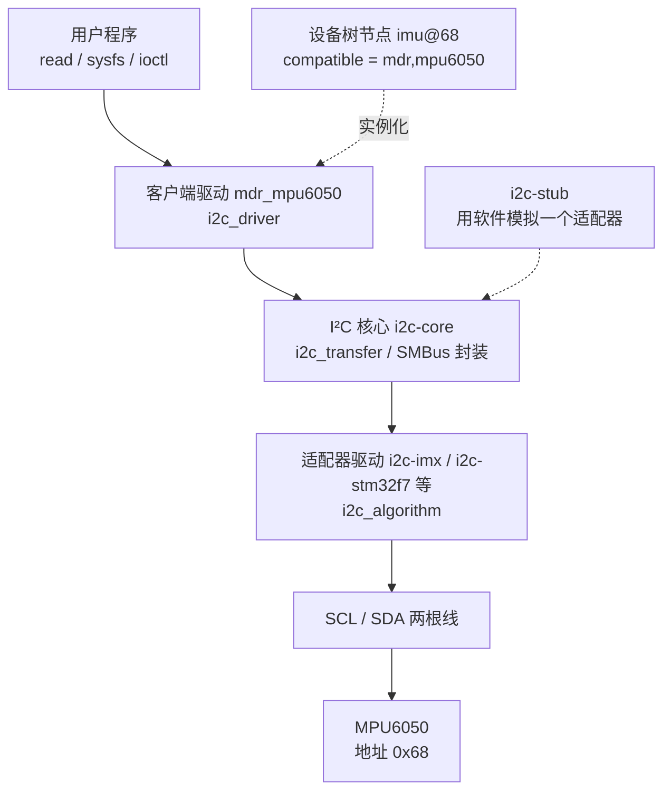

# 5.8 platform、I²C 与 SPI 驱动

在嵌入式系统的演进过程中，外设驱动的设计思想经历了一场深刻的分层变革。若回顾裸机外设编程，驱动一颗传感器往往需要开发者亲自操作 GPIO 引脚电平，逐位模拟通信时序，手动发出地址字节、判断应答位并翻转时钟。而在引入嵌入式 Linux 系统后，硬件控制被清晰地划分为了总线适配层与外设协议层：底层的物理控制器（如 SoC 内置的 I²C 或 SPI 控制器）由芯片原厂提供的成熟控制器驱动管理，严格负责总线时钟生成、时序发生、仲裁机制以及底层 DMA 搬运；上层的设备驱动开发者则能将精力完全收敛至“总线上挂载了何种具体外设、其内部寄存器如何读写配置”的协议逻辑上。对于直接映射于片上物理地址空间的外设，其基地址如何划分、中断线路如何分配，统一由设备树在引导阶段移交内核，驱动程序仅需按标准框架索取对应资源。

本篇将沿着由底向上的演进路径展开三项核心驱动实践：首先编写 platform 驱动接管虚拟平台上的第二个物理串口，建立对内存映射 I/O（MMIO）外设的完整驱动认知；接着构建标准 I²C 客户端驱动，实现六轴传感器 MPU6050 加速度数据的采集并借助 sysfs 子系统向用户空间暴露统一读数；随后实现最小 SPI 驱动以读取 SPI NOR Flash 的 JEDEC 硬件识别码。在缺少实体板卡的场景下，还将剖析如何借助虚拟适配器模块 i2c-stub 以及用户态字符节点进行全链路数值仿真与功能调试，并在末尾梳理当驱动 `probe` 探测函数未能按预期被内核回调触发时的体系化定位流程。有关设备树的基础描述语法参见 [5.5 设备树](/教程/正文/嵌入式/5_嵌入式Linux/5_5_设备树)，字符设备与 sysfs 属性节点的底层交互参见 [5.7 字符设备与用户空间接口](/教程/正文/嵌入式/5_嵌入式Linux/5_7_字符设备与用户空间接口)。

## 1. platform 总线与资源

在 Linux 设备模型的设计哲学中，总线 (Bus) 不仅是物理线缆的象征，更是驱动与设备之间进行匹配、绑定和资源传递的核心桥梁。然而，SoC 内部存在大量直接通过芯片高速内部交叉总线（如 AXI、AHB、APB）寻址的外设——例如片载 UART、定时器、看门狗以及各色总线控制器。这类外设在物理电气上并没有独立的配置空间或硬件枚举协议（无法像 PCI 总线那样通过读取 Vendor ID/Device ID 获知自身身份，也无法像 USB 那样执行枚举描述符的交互），其物理基地址与中断线由硅片物理布线直接焊死。为了将这些无法自枚举的片上设备统一收纳进 Linux 统一的驱动模型（Driver Model）体系，内核抽象出了一条特殊的虚拟总线——platform 总线（平台总线）。

在支持扁平设备树（FDT）的现代 Linux 内核启动流程中，解析器会递归遍历设备树的根节点。凡是挂载在内部总线节点下且带有 `status = "okay"` 属性的设备节点，内核在完成拓扑解析后都会自动将其封装实例化为一个 `struct platform_device` 对象。节点中的 `reg` 属性会被内核解析为一组物理内存映射资源（`IORESOURCE_MEM`），`interrupts` 属性则被解析并转译为一条独立的中断号资源（`IORESOURCE_IRQ`），其余私有属性则作为设备属性节点保留在设备树树结构中，静候对应驱动按需提取。在驱动端，编写者需要定义一个匹配的 `platform_driver` 结构体：

```c
static int mdr_demo_probe(struct platform_device *pdev);
static void mdr_demo_remove(struct platform_device *pdev);

static const struct of_device_id mdr_demo_of_match[] = {
	{ .compatible = "mdr,demo" },
	{ }
};
MODULE_DEVICE_TABLE(of, mdr_demo_of_match);

static struct platform_driver mdr_demo_driver = {
	.probe = mdr_demo_probe,
	.remove = mdr_demo_remove,
	.driver = {
		.name = "mdr_demo",
		.of_match_table = mdr_demo_of_match,
	},
};
module_platform_driver(mdr_demo_driver);
```

代码中的 `module_platform_driver` 是一个高度封装的辅助宏，它在预处理阶段直接展开生成模块装载入口函数 `module_init` 与注销出口函数 `module_exit`，其执行实质便是在模块加载时向平台总线注册 `platform_driver`，在模块卸载时将其反注册。在平台总线模型中，驱动与设备的绑定机制优先依赖 `of_match_table` 中列出的 `compatible`（兼容性字符串）与设备树节点中的属性逐字比对；而结构体中的 `.driver.name` 字段主要用于在 sysfs 文件树（如 `/sys/bus/platform/drivers/`）中生成驱动目录项，在基于设备树的现代嵌入式平台上并不作为主匹配键。

当匹配成功后，内核总线驱动模型便会调度执行驱动的 `probe` 回调函数，并将该设备的封装对象 `struct platform_device *pdev` 作为入参传入。此时，驱动获取硬件物理资源与配置信息依靠一组标准的内核接口：

| 要取的东西 | 接口 | 说明 |
| --- | --- | --- |
| 内存映射寄存器 | `devm_platform_ioremap_resource(pdev, 0)` | 取第 0 段 `reg` 资源并调用 `ioremap` 映射至内核虚拟空间，返回 `void __iomem *` |
| 中断号 | `platform_get_irq(pdev, 0)` | 取第 0 条中断配置，经中断控制器映射后返回对应的 Linux 虚拟中断号 |
| 设备树属性 | `device_property_read_u32(&pdev->dev, "mdr,size", &v)` | 统一设备属性接口，读取设备树中一个 32 位整型数值 |
| 设备树属性（字符串） | `device_property_read_string(&pdev->dev, "label", &s)` | 读取设备树节点中定义的描述性字符串 |
| 任意通用资源 | `platform_get_resource(pdev, IORESOURCE_MEM, 0)` | 拿到未映射的 `struct resource` 原生对象，由开发者手动管理生命周期与映射 |

其中 `devm_platform_ioremap_resource` 属于设备资源管理机制（Devres，即 `devm_*` 系列）提供的组合包装函数。它在单一调用中自动完成了两项工作：先从 `pdev` 中检索指定索引的内存资源，校验其范围合法性并申请资源占用；随后直接在内核虚拟内存空间建立页表映射（`ioremap`），并注册自动析构回调。如果在早期工程或较老版本的第三方驱动中阅读源码，常会见到拆分为 `platform_get_resource`、`devm_request_mem_region` 和 `devm_ioremap_resource` 多步执行的写法，其在资源锁定与页表映射效果上是等价的。

必须格外强调的是，映射所返回的指针属于带有 `__iomem` 属性修饰的内核虚拟地址，在 C 语言层面决不能当作普通内存指针直接解引用读取，也不能直接传入 `memcpy` 进行数据搬运。这背后的根本原因根植于现代处理器与编译器的执行假定：在开启 MMU 的复杂系统架构下，外设寄存器地址映射的物理区域属于 Device Memory，读写寄存器往往伴随着状态清除、FIFO 推进、握手触发等严重的硬件副作用，且寄存器数值会因物理信号变化而在后台自行跳变。编译器若将其视为普通内存指针，可能会施加激进的公共子表达式消除、死代码消除或重复读合并优化；而标准函数 `readl` 与 `writel` 则在汇编底层包含了编译器重排屏障、CPU 内存屏障（如 ARM 架构上的 `dsb` / `dmb` 指令）并妥善处理了体系结构间的大小端字节序转换，以此保障寄存器访问的时序一致性与确定性。

::: concept emb-plat-ioremap-rule title="MMIO 指针只能经 readl/writel 访问"

`devm_platform_ioremap_resource` 返回的 `void __iomem *` 指针不能直接解引用，也不能传给 `memcpy` 等通用内存复制函数。对该区域的寄存器操作一律必须通过 `readl`、`writel`、`readb`、`writeb` 等专用内核宏或内联函数进行，位运算逻辑在读入 CPU 通用寄存器后进行处理。这个限制受内核静态检查工具的严密监督：`__iomem` 属性修饰能让稀疏检查工具 (Sparse) 在编译前分析代码并精准定位非法直接解引用隐患；若普通编译未开启 `__CHECKER__` 检查，非法解引用虽然可能侥幸通过编译，但极易在具备强乱序执行与预测执行特性的现代内核中引发不可预期的总线硬件异常或数据锁死。

:::

## 2. 从零驱动第二个 PL011

以 QEMU 模拟的 ARM Versatile Express (vexpress-a9) 开发平台为例，SoC 内部集成了四组符合 ARM PrimeCell 规范的 PL011 UART 物理控制器。在标准系统镜像启动时，第一组串口（物理基地址通常位于 `0x10009000`）被内核内建终端机制捕获并初始化为系统主控制台（Console），用于输出启动日志 `dmesg` 与交互登录终端；其余三组平时由内核成熟的 AMBA 驱动 `amba-pl011` 统一纳管，分别向用户空间注册为 `/dev/ttyAMA1` 至 `/dev/ttyAMA3` 设备节点。为了从零贯通 platform 驱动对 MMIO 外设的操控流程，我们可以通过设备树重写第二组串口节点的匹配规则，将其从默认驱动的管辖权中剥离出来，编写一个轻量级的专有字符设备驱动接管该外设，实现向 `/dev/mdr_serial` 写入文本流即可直达该物理串口发送管道的效果。

PL011 控制器的硬件规范由 ARM 官方技术参考手册 DDI0183 规定。在只考虑发送通路的核心场景下，驱动仅需围绕两组核心寄存器展开交互：

| 偏移 | 名称 | 作用 |
| --- | --- | --- |
| 0x00 | UARTDR | 数据寄存器（Data Register），向其写入字节即触发硬件 FIFO 入队与串行移位发送，读取则取出接收数据 |
| 0x18 | UARTFR | 标志寄存器（Flag Register），只读状态位集合，反映发送与接收 FIFO 深度、线路空闲与调制解调器握手状态 |

深入分析标志寄存器 UARTFR 的位分配布局：

| 位 | 名称 | 含义 |
| --- | --- | --- |
| 31～9 | 保留 | 硬件固定返回 0，驱动不得向其依赖特定逻辑 |
| 8 | RI | 振铃指示状态位（Ring Indicator），用于硬件 Modem 握手检测 |
| 7 | TXFE | 发送 FIFO 完全为空（Transmit FIFO Empty） |
| 6 | RXFF | 接收 FIFO 已达容量上限（Receive FIFO Full） |
| 5 | TXFF | 发送 FIFO 已满（Transmit FIFO Full），当该位为 1 时严禁向 UARTDR 注入新数据 |
| 4 | RXFE | 接收 FIFO 为空（Receive FIFO Empty） |
| 3 | BUSY | 控制器当前正忙于移位发送字节数据，未完全进入总线空闲态 |
| 2 | DCD | 数据载波检测信号（Data Carrier Detect） |
| 1 | DSR | 数据装置就绪信号（Data Set Ready） |
| 0 | CTS | 清除发送许可信号（Clear To Send），硬件流控握手电平 |

基于上述硬件状态，向 UART 发送一个字节的基本操作路径为：轮询读取 UARTFR 寄存器的值；若 `TXFF` 标志位为 1，表明内部发送 FIFO 缓冲区已满，必须挂起等待；一旦检测到 `TXFF` 降为 0，便可安全地将数据字节写入 UARTDR。

在内核完成设备拓扑构建前，我们需要在设备树层面将第二块串口从通用驱动的绑定列表中解绑。在 vexpress 架构的公共板级描述文件 `vexpress-v2m.dtsi` 中，四块串口分别以 `serial@9000`、`serial@a000`、`serial@b000`、`serial@c000` 声明，节点标签对应为 `v2m_serial0` 至 `v2m_serial3`。我们在板级覆盖文件中修改第二个节点：

```text
&v2m_serial1 {
	compatible = "mdr,serial";
	status = "okay";
};
```

此时无需重复编写底层的 `reg` 基地址与 `interrupts` 属性，节点覆盖机制会自动继承父模板中的硬件资源定义，仅替换兼容性标识。重新编译生成 DTB 并引导系统后，内核在解析到该节点时将因缺少能够匹配 `"mdr,serial"` 的内建驱动而使其处于闲置状态，在 `/sys/bus/platform/devices/` 目录下会出现对应的 `a000.serial` 设备对象，但该目录下的 `driver` 符号链接尚未建立。

接管并驱动该串口的完整驱动模块实现如下。它通过混杂设备（miscdevice）子系统向 `/dev` 注册统一入口，并在 `.write` 方法中将用户空间传递进来的缓冲区逐字节注入 UARTDR：

```c
#include <linux/bits.h>
#include <linux/fs.h>
#include <linux/io.h>
#include <linux/iopoll.h>
#include <linux/miscdevice.h>
#include <linux/mod_devicetable.h>
#include <linux/module.h>
#include <linux/platform_device.h>
#include <linux/string.h>
#include <linux/uaccess.h>

#define MDR_UART_DR 0x00
#define MDR_UART_FR 0x18

#define MDR_UART_FR_TXFF BIT(5)

struct mdr_serial {
	void __iomem *base;
	struct miscdevice misc;
};

static ssize_t mdr_serial_write(struct file *file, const char __user *ubuf,
				size_t count, loff_t *ppos)
{
	struct mdr_serial *s = container_of(file->private_data,
					    struct mdr_serial, misc);
	u8 *buf;
	size_t i;
	int ret = 0;

	if (count == 0)
		return 0;
	buf = memdup_user(ubuf, count);
	if (IS_ERR(buf))
		return PTR_ERR(buf);

	for (i = 0; i < count; i++) {
		u32 fr;

		if (readl_poll_timeout(s->base + MDR_UART_FR, fr,
				       !(fr & MDR_UART_FR_TXFF), 10, 10000)) {
			ret = -ETIMEDOUT;
			break;
		}
		writel(buf[i], s->base + MDR_UART_DR);
	}
	kfree(buf);
	return ret ? ret : (ssize_t)count;
}

static const struct file_operations mdr_serial_fops = {
	.owner = THIS_MODULE,
	.write = mdr_serial_write,
};

static int mdr_serial_probe(struct platform_device *pdev)
{
	struct mdr_serial *s;
	int ret;

	s = devm_kzalloc(&pdev->dev, sizeof(*s), GFP_KERNEL);
	if (!s)
		return -ENOMEM;

	s->base = devm_platform_ioremap_resource(pdev, 0);
	if (IS_ERR(s->base))
		return PTR_ERR(s->base);

	s->misc.minor = MISC_DYNAMIC_MINOR;
	s->misc.name = "mdr_serial";
	s->misc.fops = &mdr_serial_fops;
	s->misc.mode = 0666;
	s->misc.parent = &pdev->dev;
	ret = misc_register(&s->misc);
	if (ret)
		return ret;

	platform_set_drvdata(pdev, s);
	dev_info(&pdev->dev, "映射到 %pR\n", &pdev->resource[0]);
	return 0;
}

static void mdr_serial_remove(struct platform_device *pdev)
{
	struct mdr_serial *s = platform_get_drvdata(pdev);

	misc_deregister(&s->misc);
}

static const struct of_device_id mdr_serial_of_match[] = {
	{ .compatible = "mdr,serial" },
	{ }
};
MODULE_DEVICE_TABLE(of, mdr_serial_of_match);

static struct platform_driver mdr_serial_driver = {
	.probe = mdr_serial_probe,
	.remove = mdr_serial_remove,
	.driver = {
		.name = "mdr_serial",
		.of_match_table = mdr_serial_of_match,
	},
};
module_platform_driver(mdr_serial_driver);

MODULE_LICENSE("GPL");
MODULE_DESCRIPTION("QEMU vexpress 第二块 PL011 的写驱动");
```

在这份驱动实现中，若干架构设计细节值得细细推敲：

首先，`container_of` 宏的运用展现了内核面向对象多态封装的经典模式。当用户程序调用 `open` 系统调用打开 `/dev/mdr_serial` 时，misc 核心框架会自动将自身的 `struct miscdevice` 实例指针存入文件描述符对象的 `file->private_data` 字段中。由于我们将 `misc` 作为内嵌成员置于驱动私有上下文 `struct mdr_serial` 之中，通过 `container_of` 即可基于结构体成员指针及结构体内偏移量，准确反算出外层宿主结构体的起始地址。这种无须依赖全局单例指针的设计，使得驱动在理论上能够天然支持同一驱动代码同时挂接、并发管理多个独立的物理串口设备实例。

其次是等待 FIFO 的调度友好性。`readl_poll_timeout` 是内核提供的受限轮询等待宏，它在指定的总体超时上限（此处为 10000 微秒）内持续通过 `readl` 采样目标寄存器并计算判定条件；每轮采样之间，宏内部会调用 `usleep_range` 让出当前 CPU 核的执行权并休眠指定微秒数（此处为 10 微秒）。由于字符设备驱动的 `write` 操作运行在发起系统调用的用户进程上下文中（Process Context），进程休眠不会破坏内核原子上下文的约束，既保证了外设在物理发送高负荷时的响应时效，又避免了死循环忙等（Spin-wait）对系统 CPU 算力的严重浪费。

再次，关注 `remove` 函数签名的现代规范。在早期的 Linux 内核中，`platform_driver` 的 `remove` 回调返回 `int` 类型，这常常让初学者误以为驱动可以在析构阶段返回诸如 `-EBUSY` 的错误码以阻止硬件卸载。然而在现代设备热插拔与动态管理模型中，总线核心在卸载驱动或拔除设备时具备绝对仲裁权，驱动的反初始化流程必须无条件彻底执行完毕；因此自 Linux 6.11 起，内核彻底将该接口修正为返回 `void`。此外，虽然 `s` 对象的内存与 `s->base` 映射均通过 `devm_*` 托管并在驱动解绑后自动回收，但 `misc_deregister` 并不属于 devm 托管范围，必须在 `remove` 回调中手动执行注销以注销字符设备节点。

模块经交叉编译并加载入内核后，向设备节点发送的数据将直接旁路系统终端体系，由 QEMU 的第二路串口模拟器接收并输出：

::: terminal title="bash - mdr_serial（输出类似）"

```text
$ sudo insmod mdr_serial.ko
$ dmesg | tail -2
[   38.771402] mdr_serial a000.serial: 映射到 [mem 0x1000a000-0x1000afff]
$ ls -l /dev/mdr_serial
crw-rw-rw- 1 root root 10, 123 Sep 12 11:02 /dev/mdr_serial
$ echo "hello from mdr_serial" > /dev/mdr_serial
$ cat /sys/bus/platform/devices/a000.serial/driver/uevent
DRIVER=mdr_serial
MODALIAS=of:NserialT(null)Cmdr,serial
```

:::

屏幕上终端不会回显这行字符，因为数据已被重定向输送到了 QEMU 第二串口的物理抽象后端。

::: tip 真实硬件上还要配置波特率

上述演示之所以能在 QEMU 仿真环境下直接出字，是因为虚拟外设模型简化了物理波形产生逻辑，只要检测到写入 UARTDR 即直接转发字符流。但在真实的物理 SoC 上，`probe` 阶段还必须严谨计算并配置分频与线路控制寄存器：涵盖整数波特率除数寄存器 UARTIBRD、小数除数寄存器 UARTFBRD、线路控制寄存器 UARTLCR_H（配置数据位长度、奇偶校验与 FIFO 深度开启）以及控制寄存器 UARTCR。以 24 MHz 物理参考输入时钟与 115200 目标波特率为例，分频比算式要求求出整数除数与 64 倍的小数除数，随后明确使能发送使能位 TXE 与串口总使能 UARTE。若在实体硬件上漏掉了时钟与分频初始化，即使寄存器写入成功，引脚物理电平也不会产生任何跳变。

:::

对照裸机开发实践，二者在控制硬件的电平语义上是一致的——核心逻辑始终是对标志位的轮询判断与数据寄存器的写入。但平台驱动架构带来了深刻的环境提升：物理基地址在开启分页与虚拟内存后不再可直达，必须经由 MMU 页表重映射为受保护的内核虚拟内存指针；寄存器操作严格受控于 `readl` 与 `writel` 的内存屏障与体系结构大小端保障；硬件的配置边界、物理分布与中断路由全量交由设备树描述，驱动实现由此彻底摆脱了硬编码常数的桎梏，获得了跨板级移植与复用的通用能力。

<Quiz
  type="multi"
  :options="[
    { label: '映射得到的 void __iomem 指针可以直接解引用读寄存器', value: 'A' },
    { label: 'devm_platform_ioremap_resource 取第 0 段 reg 并完成映射', value: 'B' },
    { label: '寄存器访问用 readl、writel，能保证不被编译器优化掉', value: 'C' },
    { label: '设备树的 reg 与 interrupts 由驱动自己解析后再映射', value: 'D' }
  ]"
  :answer="['B', 'C']"
>

<template #question>

关于 platform 驱动取资源与访问寄存器，下列说法正确的是哪些？

</template>

正确答案是 **B、C**。A 错在 `__iomem` 指针不能解引用，要经 `readl`、`writel`；D 错在 `reg` 与 `interrupts` 已经由内核转成资源，驱动用 `devm_platform_ioremap_resource` 与 `platform_get_irq` 取即可，不需要自己解析设备树。

</Quiz>

## 3. I²C 子系统

与内存映射外设不同，串行总线上的设备无法直接通过 CPU 内存总线寻址，而是需要依赖特定的总线协议控制器进行数据转接。在 Linux 内核中，I²C 子系统被精妙地解耦为两层架构：负责管理 SoC 片上物理 I²C 控制器的底层驱动被称为适配器驱动 (Adapter Driver)，通常由芯片原厂（如 NXP、ST 等）基于硬件规范编写，专职负责驱动物理引脚生成起始位、停止位、发送从机地址字节、处理时钟拉伸（Clock Stretching）以及总线仲裁等严苛的物理时序；而在总线上挂接的各色外围芯片（如温湿度计、惯性测量单元、EEPROM）对应的驱动则被称为客户端驱动 (Client Driver)，这正是传感器与外围模块开发者需要编写的核心逻辑。两层之间由内核的 I²C 核心层 (i2c-core) 充当统一调度枢纽。



在分层架构下，客户端驱动只需面向 I²C 核心层暴露的标准数据传输接口编程，而无需关心底层适配器究竟是真实的物理硬件控制器，还是用于单元仿真的软件虚拟适配器（如 i2c-stub）。这种高度的解耦使得驱动代码具备极佳的可移植性与无硬件调试能力。

一个标准的 I²C 客户端驱动通过 `struct i2c_driver` 结构体进行描述：

```c
static const struct of_device_id mdr_mpu6050_of_match[] = {
	{ .compatible = "mdr,mpu6050" },
	{ }
};
MODULE_DEVICE_TABLE(of, mdr_mpu6050_of_match);

static const struct i2c_device_id mdr_mpu6050_id[] = {
	{ "mdr_mpu6050", 0 },
	{ }
};
MODULE_DEVICE_TABLE(i2c, mdr_mpu6050_id);

static struct i2c_driver mdr_mpu6050_driver = {
	.probe = mdr_mpu6050_probe,
	.remove = mdr_mpu6050_remove,
	.id_table = mdr_mpu6050_id,
	.driver = {
		.name = "mdr_mpu6050",
		.of_match_table = mdr_mpu6050_of_match,
	},
};
module_i2c_driver(mdr_mpu6050_driver);
```

与前述 platform 驱动相比，`i2c_driver` 中通常会显式注册一张传统总线设备匹配表 `id_table`。在设备树主导的现代嵌入式 Linux 系统中，固化在设备树中的硬件节点优先经由 `of_match_table` 的 `compatible` 属性进行精确比对与实例化；然而在硬件热插拔、动态扩容或纯用户空间排查阶段，运维人员可能会借助 sysfs 的 `new_device` 接口手动创建设备对象。此时由于没有关联的设备树节点，内核便会降级退回到 `id_table` 中按设备名字字符串完成二次匹配。将两张匹配表同时补全，能赋予驱动最大的灵活性与调试适应面。

在 Linux 6.3 之后的现代内核标准中，`probe` 探测函数的入参已被精简为单一的 `struct i2c_client *client` 指针对象。在这个结构体中，`client->addr` 记录了当前受控设备的 7 位总线物理地址。

在寄存器读写交互层面，内核针对 I²C 提供了两套不同抽象层次的通信接口。对于符合 SMBus（系统管理总线）标准的简单寄存器读写，内核封装了简明的一体化函数簇：

| 函数 | 作用 | 返回 |
| --- | --- | --- |
| `i2c_smbus_read_byte_data(client, reg)` | 读取指定 8 位寄存器中的单字节数据 | 0～255 的数据，或负值的标准内核错误码 |
| `i2c_smbus_write_byte_data(client, reg, val)` | 向指定 8 位寄存器写入单字节数据 | 成功返回 0，或负值的标准内核错误码 |
| `i2c_smbus_read_word_data(client, reg)` | 读取指定寄存器起始的 16 位数值（默认按小端解析） | 0～65535 的数据，或负值的标准内核错误码 |
| `i2c_smbus_read_i2c_block_data(client, reg, len, buf)` | 自 reg 偏移起连续块读取 len 字节序列至指定缓冲区 | 实际读取到的字节数，或负值的标准内核错误码 |

由于 I²C 属于共享总线且物理传输可能遭遇从机无应答（NACK）、时钟超时或仲裁丢失等物理故障，调用这类函数后必须无条件对返回值进行严格的判负错误校验。

若外设在通信协议上具有特殊要求——例如必须将“写入目标寄存器地址”与“随后的读取数据”无缝衔接，并在两者之间发送重复起始位（Repeated Start）而严禁释放总线产生停止位（避免总线控制权在多主环境中被抢占），此时开发者可以通过 `i2c_transfer` 底层接口手动组装由多个 `struct i2c_msg` 构成的复合事务序列：

```c
static int mdr_read_regs(struct i2c_client *client, u8 reg, u8 *buf, int len)
{
	struct i2c_msg msgs[2] = {
		{ .addr = client->addr, .flags = 0, .len = 1, .buf = &reg },
		{ .addr = client->addr, .flags = I2C_M_RD, .len = len, .buf = buf },
	};
	int ret = i2c_transfer(client->adapter, msgs, 2);

	return ret == 2 ? 0 : (ret < 0 ? ret : -EIO);
}
```

`i2c_transfer` 的成功返回值等于顺利完成的总线消息段数。在上述示例中，仅当两段消息全部成功收发时，该函数才会返回 2；两段消息之间的重复起始信号由底层硬件适配器自动激发，完全杜绝了总线空闲期间被其他并发总线事务切入破坏的风险。

在更复杂的大型芯片驱动开发中，内核还提供了再往上一层的寄存器映射抽象框架 `regmap`。它将各种物理总线（I²C、SPI、SPMI 等）的底层收发进一步抹平，在驱动层提供统一的寄存器读写、读写掩码位域更新、寄存器缓存以及 debugfs 诊断接口。对于寄存器数量庞大、需要频繁执行位翻转的复杂电源管理芯片（PMIC）或音频编解码芯片，采用 regmap 能够大幅消减样板代码；而对于本节实现的基础传感器驱动，直接调用简洁直观的 SMBus 函数族能够让通信机理呈现得更为纯粹。

## 4. MPU6050 客户端驱动

MPU6050 是一颗广泛应用的六轴微机电系统（MEMS）运动跟踪传感器，其内部集成了一组三轴加速度计、一组三轴陀螺仪以及片上温度测量传感器。该器件在硬件上采用标准 7 位 I²C 设备地址，其基准地址固定为 `0x68`（当芯片外部引脚 AD0 接入高电平逻辑时，该地址自动跳变为 `0x69`），片上所有控制与状态寄存器均采用 8 位寻址。驱动核心交互涉及的关键寄存器布局如下：

| 地址 | 名称 | 说明 |
| --- | --- | --- |
| 0x19 | SMPLRT_DIV | 采样率分频寄存器，出厂复位值为 0x07 |
| 0x1A | CONFIG | 数字低通滤波器（DLPF）与外部同步信号配置 |
| 0x1B | GYRO_CONFIG | 陀螺仪量程配置，位 4:3 决定满量程动态范围（±250～±2000 °/s） |
| 0x1C | ACCEL_CONFIG | 加速度计量程配置，位 4:3 决定满量程范围（±2/±4/±8/±16 g） |
| 0x3B～0x40 | ACCEL_XOUT_H … ACCEL_ZOUT_L | 三轴加速度数据输出寄存器，每轴占 2 字节，以大端高字节在前的格式存放 |
| 0x41～0x42 | TEMP_OUT_H、TEMP_OUT_L | 片内温度原始数据，灵敏度为每摄氏度 340 LSB，存在固定补偿常数 |
| 0x43～0x48 | GYRO_XOUT_H … GYRO_ZOUT_L | 三轴角速度数据输出寄存器，每轴占 2 字节 |
| 0x6B | PWR_MGMT_1 | 电源管理寄存器 1，位 6 为休眠使能控制位 SLEEP，位 2:0 选取芯片基准时钟源 |
| 0x6C | PWR_MGMT_2 | 电源管理寄存器 2，各轴独立待机使能控制 |
| 0x75 | WHO_AM_I | 芯片器件身份标识寄存器，出厂固定返回 0x68，专用于探测硬件连通性与芯片正品校验 |

::: concept emb-i2c-address-7bit title="I²C 地址是 7 位的"

在整个 Linux I²C 驱动框架与设备树标准中，所谓“设备从机地址”在语义上永远专指规范规定的 7 位有效地址。以 MPU6050 为例，其地址即为数值 `0x68`。在物理信号线进行串行移位传输时，总线上实际发出的第一个字节是 8 位复合帧：高 7 位承载这 7 位地址，最低的第 0 位则作为数据传输流向位（R/W 位，写为 0，读为 1）。因此在总线逻辑分析仪上，写操作发出的首字节显示为 `0xD0`，读操作显示为 `0xD1`。芯片数据手册的引脚描述、系统诊断工具 `i2cdetect`、驱动结构体成员 `client->addr` 以及设备树节点中的 `reg` 属性，全量严格采用标准的 7 位地址数值；若错误地将经过左移计算的 8 位总线字节 `0xD0` 填入设备树的 `reg` 属性中，内核总线驱动模型将无法匹配上对应的设备对象，直接导致 `probe` 回调彻底失效。

:::

在掌握外设寄存器时序后，我们编写针对 MPU6050 的客户端驱动。驱动负责完成设备上电复位初始配置、三轴加速度数据的突发连读、物理工程单位换算，并通过标准的 sysfs 属性文件接口将测量数值向用户空间呈现：

```c
#include <linux/delay.h>
#include <linux/i2c.h>
#include <linux/mod_devicetable.h>
#include <linux/module.h>
#include <linux/mutex.h>
#include <linux/sysfs.h>

#define MDR_MPU6050_REG_ACCEL_CONFIG 0x1C
#define MDR_MPU6050_REG_ACCEL_XOUT_H 0x3B
#define MDR_MPU6050_REG_PWR_MGMT_1   0x6B
#define MDR_MPU6050_REG_WHO_AM_I     0x75
#define MDR_MPU6050_WHO_AM_I_VAL     0x68

/* ±2 g 量程下的灵敏度，16384 LSB/g */
#define MDR_MPU6050_LSB_PER_G 16384

struct mdr_mpu6050 {
	struct i2c_client *client;
	struct mutex lock;
};

static int mdr_mpu6050_read_accel(struct mdr_mpu6050 *priv, s16 xyz[3])
{
	u8 raw[6];
	int i, ret;

	ret = i2c_smbus_read_i2c_block_data(priv->client,
					    MDR_MPU6050_REG_ACCEL_XOUT_H,
					    sizeof raw, raw);
	if (ret < 0)
		return ret;
	if (ret != (int)sizeof raw)
		return -EIO;

	for (i = 0; i < 3; i++)
		xyz[i] = (s16)((raw[2 * i] << 8) | raw[2 * i + 1]);
	return 0;
}

static int mdr_mpu6050_axis_mg(struct mdr_mpu6050 *priv, int axis, int *mg)
{
	s16 xyz[3];
	int ret;

	mutex_lock(&priv->lock);
	ret = mdr_mpu6050_read_accel(priv, xyz);
	mutex_unlock(&priv->lock);
	if (ret)
		return ret;

	*mg = (int)xyz[axis] * 1000 / MDR_MPU6050_LSB_PER_G;
	return 0;
}

static ssize_t accel_show(struct device *dev, int axis, char *buf)
{
	struct mdr_mpu6050 *priv = dev_get_drvdata(dev);
	int mg, ret;

	ret = mdr_mpu6050_axis_mg(priv, axis, &mg);
	if (ret)
		return ret;
	return sysfs_emit(buf, "%d\n", mg);
}

static ssize_t accel_x_show(struct device *dev,
			    struct device_attribute *attr, char *buf)
{
	return accel_show(dev, 0, buf);
}
static DEVICE_ATTR_RO(accel_x);

static ssize_t accel_y_show(struct device *dev,
			    struct device_attribute *attr, char *buf)
{
	return accel_show(dev, 1, buf);
}
static DEVICE_ATTR_RO(accel_y);

static ssize_t accel_z_show(struct device *dev,
			    struct device_attribute *attr, char *buf)
{
	return accel_show(dev, 2, buf);
}
static DEVICE_ATTR_RO(accel_z);

static struct attribute *mdr_mpu6050_attrs[] = {
	&dev_attr_accel_x.attr,
	&dev_attr_accel_y.attr,
	&dev_attr_accel_z.attr,
	NULL,
};
ATTRIBUTE_GROUPS(mdr_mpu6050);

static int mdr_mpu6050_probe(struct i2c_client *client)
{
	struct mdr_mpu6050 *priv;
	int ret;

	priv = devm_kzalloc(&client->dev, sizeof(*priv), GFP_KERNEL);
	if (!priv)
		return -ENOMEM;
	priv->client = client;
	mutex_init(&priv->lock);
	i2c_set_clientdata(client, priv);

	ret = i2c_smbus_read_byte_data(client, MDR_MPU6050_REG_WHO_AM_I);
	if (ret < 0)
		return ret;
	if (ret != MDR_MPU6050_WHO_AM_I_VAL) {
		dev_err(&client->dev, "WHO_AM_I = 0x%02x，不是 MPU6050\n", ret);
		return -ENODEV;
	}

	/* 清 SLEEP 位唤醒，时钟源选内部 8 MHz 振荡器 */
	ret = i2c_smbus_write_byte_data(client, MDR_MPU6050_REG_PWR_MGMT_1, 0x00);
	if (ret < 0)
		return ret;
	msleep(100);

	/* ACCEL_CONFIG 位 4:3 = 00，对应 ±2 g 量程 */
	ret = i2c_smbus_write_byte_data(client, MDR_MPU6050_REG_ACCEL_CONFIG, 0x00);
	if (ret < 0)
		return ret;

	dev_info(&client->dev, "MPU6050 就绪，地址 0x%02x\n", client->addr);
	return 0;
}

static void mdr_mpu6050_remove(struct i2c_client *client)
{
	/* 让芯片回到休眠 */
	i2c_smbus_write_byte_data(client, MDR_MPU6050_REG_PWR_MGMT_1, 0x40);
}
```

深入剖析这份驱动代码中的关键实现细节：

在数据解包逻辑 `mdr_mpu6050_read_accel` 中，驱动调用 `i2c_smbus_read_i2c_block_data` 一次性将三轴加速度对应的连续 6 字节数据拉回内部缓冲区。由于传感器硬件规范将加速度高字节放在低物理地址处（即大端序存贮），而 ARM 架构在通用 Linux 运行环境中工作在小端序模式下，直接使用内存拷贝到 `s16` 数组会导致高低字节颠倒混乱，必须通过显式的位移拼接操作 `(s16)((raw[2 * i] << 8) | raw[2 * i + 1])` 确保数据按照芯片定义的符号位扩展正确还原为有符号定点数。

在物理量换算函数 `mdr_mpu6050_axis_mg` 中，驱动利用定点整数运算将传感器的原生 LSB 计数值转化为物理世界的毫重力加速度（mg）。在 ±2 g 动态量程下，标称灵敏度为 16384 LSB/g，即每 1 mg 对应约 16.384 个 LSB 刻度。通过整型除法直接折算会截断末位小数，产生微弱的定点截断误差，但在姿态倾角判定或振动阈值报警等工控常规场景下已完全具备实用精度；若用户空间应用对超低噪声滤波有严苛要求，也可以选择将原始 LSB 读数直接通过 sysfs 节点透传给上层，由应用程序的数学库利用浮点或卡尔曼滤波算法展开更高阶的处理。

关注驱动内部设置的互斥锁 `priv->lock` 的防护边界。调用 SMBus 接口的底层通信涉及复杂的硬件等待状态并可能伴随进程休眠调度，因而不能使用自旋锁，而必须依托互斥锁（Mutex）进行同步。尽管 I²C 适配器驱动自身能够确保“单次数据包收发”不会在总线电平层面产生交织破坏，但在操作系统层面上，当多个用户态进程或多线程并发 `cat` 读取 `accel_x`、`accel_y` 和 `accel_z` 属性文件时，若缺乏驱动层面的互斥保护，针对底层传感器寄存器的多次重叠访问就会互相干扰状态。通过为私有数据结构挂接这把互斥锁，驱动将“连续连读并更新三轴数值”的完整语义保护为确定性的临界区。

针对 sysfs 属性文件的生命周期治理，代码使用了现代内核标准的 `ATTRIBUTE_GROUPS(mdr_mpu6050)` 宏定义。它在编译期生成一个统一的属性组结构体，在初始化 `i2c_driver` 结构体时将其挂接到驱动模型的通用属性表下：

```c
static struct i2c_driver mdr_mpu6050_driver = {
	/* probe、remove、id_table 同上 */
	.driver = {
		.name = "mdr_mpu6050",
		.of_match_table = mdr_mpu6050_of_match,
		.dev_groups = mdr_mpu6050_groups,
	},
};
```

借助设备驱动核心模型的 `dev_groups` 挂载点，内核在每次设备匹配探测成功后，会自动在 sysfs 树的对应设备目录下批量创建 `accel_x`、`accel_y`、`accel_z` 等属性文件；在设备移除或驱动卸载时，驱动核心又会自动无遗漏地完成这些文件的注销与引用清理。这种设计相比于过去在 `probe` 中逐个手动调用 `device_create_file` 并在出错路径和 `remove` 中逆向逐个删除的做法，彻底根除了由于错误处理分支遗漏而导致的文件悬空或内存泄漏隐患。

在设备树中，此传感器节点的拓扑从属于实际所挂载的 I²C 控制器节点之下：

```text
&i2c5 {
	status = "okay";

	imu@68 {
		compatible = "mdr,mpu6050";
		reg = <0x68>;
	};
};
```

节点名称的单元地址 `@68` 必须与内部定义的 `reg = <0x68>` 保持数值一致，且属性 `compatible` 必须与驱动模块 `of_match_table` 中列出的兼容字符串完全相符。值得一提的是，标准 Linux 内核源码树内建有一套完善的工业级惯性传感器驱动（`inv_mpu6050`，基于 IIO 工业 I/O 子系统构建），其匹配的官方兼容性字符串为 `"invensense,mpu6050"`。若在实验设备树中直接使用官方厂商前缀，内核内建驱动将与我们手写的驱动产生设备抢占竞争；由于内建驱动或先加载的模块优先享有认领权，后者的 `probe` 将完全丧失执行机会。因此，在开发与测试自研驱动时，更换专属的厂商前缀（如 `"mdr,mpu6050"`）是行之有效的工程隔离准则。

将驱动模块交叉编译并顺利插入运行后，在设备树 alias 映射指定的 I²C 节点路径下即可直接查验由属性系统导出的实时物理读数：

::: terminal title="bash - 读取加速度（输出类似）"

```text
$ sudo insmod mdr_mpu6050.ko
$ dmesg | tail -1
[  102.418077] mdr_mpu6050 5-0068: MPU6050 就绪，地址 0x68
$ cat /sys/bus/i2c/devices/5-0068/accel_x
12
$ cat /sys/bus/i2c/devices/5-0068/accel_y
-3
$ cat /sys/bus/i2c/devices/5-0068/accel_z
1004
```

:::

输出的数值单位为毫重力加速度（mg）：当传感器平稳静置于水平桌面上时，Z 轴测得约为 1004 mg 的读数，极其贴近物理世界标准地球重力加速度（1 g ≈ 1000 mg）；X 与 Y 轴的读数则在 0 mg 附近由于芯片自身零偏与 PCB 安装微弱倾角而呈现轻微抖动。

::: compare left-title="7.1 的寄存器级读法" right-title="Linux 客户端驱动"

```c
/* 自己产生起始位、地址字节、寄存器地址，再逐位收 6 字节 */
i2c_start();
i2c_write_byte(MPU6050_ADDR << 1);
i2c_write_byte(0x3B);
i2c_start();
i2c_write_byte((MPU6050_ADDR << 1) | 1);
for (int i = 0; i < 6; i++)
    raw[i] = i2c_read_byte(i == 5);
i2c_stop();
```

---

```c
/* 时序、重复起始、应答全由适配器驱动处理 */
u8 raw[6];

ret = i2c_smbus_read_i2c_block_data(client, 0x3B, 6, raw);
if (ret < 0)
    return ret;
```

:::

对比左栏裸机裸奔操作与右栏标准 Linux 客户端驱动可以清晰领略系统级抽象的力量：在单片机裸机开发中，开发者必须操心每一根信号线的电平翻转、微妙的时序延时、起始与重复起始判定以及 ACK 应答采样，出现通信失败往往需要动用示波器或逻辑分析仪逐个边沿追踪排查；而在 Linux 设备驱动模型下，繁复的底层物理电气操作被彻底下沉至经过数万款商用设备验证的原厂适配器驱动之中，驱动开发者只需调用语义高度凝练的读写函数。虽然这种分层机制剥离了开发者直接操控底层引脚波形的权力（时序速率的微调转而通过修改设备树中的时钟频率属性完成），但它彻底终结了外设驱动为不同主控芯片重复造轮子的低效历史。

<Quiz
  type="single"
  :options="[
    { label: 'client->addr 是 0xD0，reg 也写 0xD0', value: 'A' },
    { label: 'client->addr 是 0x68，reg 写 0x68', value: 'B' },
    { label: 'client->addr 是 0x68，reg 写 0xD0', value: 'C' },
    { label: 'client->addr 是 0xD1，reg 写 0x68', value: 'D' }
  ]"
  answer="B"
>

<template #question>

MPU6050 的 7 位地址是 0x68，设备树节点与 `client->addr` 应该怎么写？

</template>

正确答案是 **B**。设备树 `reg` 与 `client->addr` 都用 7 位地址；0xD0 是左移一位后加上写方向位的总线地址字节，填进 `reg` 会导致设备匹配不上。

</Quiz>

## 5. 没有硬件时怎么调

在实际工程研发流程中，固件与驱动的编写常常与硬件 PCB 投产并行展开。面对“驱动代码已经完成，但实体板卡仍在贴片”或者“手边缺乏特定传感器模块”的现实状况，Linux 强大的分层测试设施提供了由近及远、逐级解耦的调试手段。从实体硬件到纯软件仿真，通常存在三级经典的验证路径：

第一级基于实体开发板，借助通用工具集 `i2c-tools` 在进入驱动编写前率先打通物理接线与电气通路。`i2cdetect` 能够遍历扫描目标总线上的有效地址，`i2cget` 与 `i2cset` 则提供了直接读写任意从机寄存器的快速交互能力：

::: terminal title="bash - 开发板上用 i2c-tools（输出类似）"

```text
$ sudo i2cdetect -y 5
     0  1  2  3  4  5  6  7  8  9  a  b  c  d  e  f
00:                         -- -- -- -- -- -- -- --
10: -- -- -- -- -- -- -- -- -- -- -- -- -- -- -- --
20: -- -- -- -- -- -- -- -- -- -- -- -- -- -- -- --
30: -- -- -- -- -- -- -- -- -- -- -- -- -- -- -- --
40: -- -- -- -- -- -- -- -- -- -- -- -- -- -- -- --
50: 50 -- -- -- -- -- -- -- -- -- -- -- -- -- -- --
60: -- -- -- -- -- -- -- -- -- -- -- -- -- -- -- 68
70: -- -- -- -- -- -- -- --
$ sudo i2cget -y 5 0x68 0x75
0x68
$ sudo i2cget -y 5 0x68 0x3b w
0x00f8
```

:::

在 `i2cdetect` 的扫描结果矩阵中，凡是得到物理从机应答（ACK）的地址均会显示出两位十六进制编号，`--` 则代表该地址发出寻址帧后超时未见响应。在上图中，`0x68` 处清晰显现，读取该地址的 `0x75` 寄存器返回 `0x68`，确凿证明从机芯片已上电并且通信通路正常。使用 `i2cget ... 0x3b w` 读取 16 位字数据，返回十六进制原始读数 `0x00f8`，折算为加速度约为 15 mg。若矩阵中某处呈现出字符标志 `UU`，则意味着该总线地址当前已被内核中某一活跃的驱动模块独占认领，系统为了防止用户态探测时序与内核正常业务通信产生破坏性竞争，会自动屏蔽对该地址的主动握手探测。

第二级脱离所有实体外设，在纯虚拟环境（如 QEMU 或本地开发机内核）下借助虚拟测试模块 `i2c-stub` 模拟外围芯片。`i2c-stub` 向系统注册一个纯软件模拟的虚拟 I²C 适配器，其底层并不驱动任何物理引脚，而是在内核内存中开辟了一段 256 字节的模拟寄存器阵列。这恰好为驱动的功能仿真提供了极佳的受控测试平台，开发者能够人为向该阵列注入任意测试数据，用于验证驱动的数据解析、大端重组与单位折算逻辑：

::: terminal title="bash - i2c-stub 预置寄存器（输出类似）"

```text
$ sudo modprobe i2c-stub chip_addr=0x68
$ sudo i2cset -y 0 0x68 0x75 0x68
$ sudo i2cset -y 0 0x68 0x3b 0x01 0x90 0xff 0xae 0x40 0x00 i
$ sudo i2cset -y 0 0x68 0x6b 0x00
```

:::

参数 `chip_addr=0x68` 指示 stub 虚拟适配器在地址 `0x68` 处对外响应，其余地址均模拟为总线空载态。上述三条 `i2cset` 命令依次预置了 WHO_AM_I 校验值、三轴加速度的 6 个连续测试字节，并将电源管理寄存器置为工作态（末尾带有 `i` 标识代表采用 SMBus 连续块写入格式）。

在无须改动任何设备树源文件的前提下，我们可以借助 I²C 核心的动态扩展能力，直接通过 sysfs 接口在运行中动态创建设备实例并绑定驱动：

::: terminal title="bash - i2c-stub 上测试 mdr_mpu6050（输出类似）"

```text
$ echo mdr_mpu6050 0x68 > /sys/bus/i2c/devices/i2c-0/new_device
$ dmesg | tail -2
[  201.553301] i2c i2c-0: new_device: Instantiated device mdr_mpu6050 at 0x68
[  201.554120] mdr_mpu6050 0-0068: MPU6050 就绪，地址 0x68
$ cat /sys/bus/i2c/devices/0-0068/accel_x
24
$ cat /sys/bus/i2c/devices/0-0068/accel_y
-5
$ cat /sys/bus/i2c/devices/0-0068/accel_z
-1000
```

:::

终端中输出的测试读数完全印证了预置数据的数学变换：X 轴原始字节 `0x0190`（即十进制 400）经灵敏度系数折算精确得到 24 mg；Y 轴原始字节 `0xFFAE` 经大端合并与补码符号扩展转换为负数值 −82，折算后输出 −5 mg；Z 轴原始字节 `0x4000`（16384）则准确折算为 1000 mg（对应标准的 1 g）。只要这组读数完全匹配数学推导，便足以证实驱动内部的 SMBus 块读取、大端序拼接、正负符号扩展与 sysfs 文件生成全链路完全正确，其健壮性验证不再受限于物理芯片的有无。测试完毕后，只需向同级目录下的 `delete_device` 节点写入对应地址即可触发驱动析构与设备解绑。

第三级是完全绕过内核驱动编写的用户态直接交互路径：利用 Linux 字符设备框架提供的 `/dev/i2c-N` 接口，在用户空间程序中直接发起 ioctl 控制调用，指定从机地址并组装传输帧。这条路径非常适合在硬件出厂测试治具中编写产测诊断小程序，或者在移植新型复杂传感器前快速抓取寄存器状态：

```c
#define _POSIX_C_SOURCE 200809L

#include <errno.h>
#include <fcntl.h>
#include <stdio.h>
#include <stdlib.h>
#include <sys/ioctl.h>
#include <unistd.h>

#include <linux/i2c-dev.h>
#include <linux/i2c.h>

#define MPU6050_ADDR 0x68
#define MPU6050_WHO_AM_I 0x75

int main(int argc, char *argv[]) {
    if (argc != 2) {
        fprintf(stderr, "用法: %s /dev/i2c-N\n", argv[0]);
        return EXIT_FAILURE;
    }
    int fd = open(argv[1], O_RDWR);
    if (fd == -1) {
        perror("open");
        return EXIT_FAILURE;
    }
    if (ioctl(fd, I2C_SLAVE, MPU6050_ADDR) == -1) {
        perror("ioctl I2C_SLAVE");
        close(fd);
        return EXIT_FAILURE;
    }

    struct i2c_smbus_ioctl_data args = {
        .read_write = I2C_SMBUS_READ,
        .command = MPU6050_WHO_AM_I,
        .size = I2C_SMBUS_BYTE_DATA,
        .data = &(union i2c_smbus_data){.byte = 0},
    };
    if (ioctl(fd, I2C_SMBUS, &args) == -1) {
        perror("ioctl I2C_SMBUS");
        close(fd);
        return EXIT_FAILURE;
    }
    printf("WHO_AM_I = 0x%02x\n", args.data->byte);
    close(fd);
    return EXIT_SUCCESS;
}
```

程序首先通过 `I2C_SLAVE` 命令为后续文件流设定默认的从机设备寻址目标，随后利用 `I2C_SMBUS` 核心命令通知内核发起一次符合 SMBus 规范的物理读事务。在没有总线节点的通用开发机上，可以对其执行严密的编译器检查：

::: terminal title="bash - 编译用户态程序"

```text
$ gcc -std=c17 -Wall -Wextra -O2 -c i2c_read_whoami.c -o i2c_read_whoami.o
$ gcc -std=c17 -Wall -Wextra -O2 i2c_read_whoami.c -o i2c_read_whoami
```

:::

编译过程纯净无警告，表明数据结构与内核标准头文件完全兼容。将二进制程序部署至具备实体总线的嵌入式板卡并执行 `./i2c_read_whoami /dev/i2c-5`，即可稳定读回 `WHO_AM_I = 0x68`。实际上，系统标准命令 `i2cdetect` 与 `i2cget` 的内部正是依托这套完全相同的系统调用体系构筑而成。

## 6. SPI 驱动

相较于基于双线开漏与应答仲裁的 I²C 架构，串行外设接口（SPI）采用了全双工同步四线制拓扑（主出从入 MOSI、主入从出 MISO、串行时钟 SCLK 与片选使能 CS），具备更高的时钟吞吐能力。Linux 针对 SPI 总线建立了与 I²C 严格平行的设备模型体系：负责驱动物理控制器引脚产生移位脉冲的模块被称为控制器驱动（SPI Controller Driver，早期版本中常称作 SPI Master），而挂载在控制器各片选线路上的外设驱动则依托 `struct spi_driver` 进行规范定义。在设备树树状层级中，SPI 从设备被直接描述为 SPI 控制器节点的子节点，并通过 `reg` 属性指示所连接的物理片选线索引（Chip Select）：

```text
&spi1 {
	status = "okay";

	flash@0 {
		compatible = "mdr,w25q64";
		reg = <0>;
		spi-max-frequency = <10000000>;
		spi-cpol;
		spi-cpha;
	};
};
```

SPI 协议自身不具备类似 I²C 那样的设备地址寻址与时钟拉伸协商规范，因此物理通信参数必须在设备树中显式严格静态配置。其中属性 `spi-cpol` 规定了时钟空闲时的基准电平为高（Clock Polarity），属性 `spi-cpha` 规定了数据采样发生在时钟脉冲的第二个边沿（Clock Phase），两者结合即构成了工业界广泛采用的 SPI 模式 3（Mode 3）。属性 `spi-max-frequency` 标识了该外设能够耐受的最高时钟速率，控制器驱动在实际执行总线通信时会自动协商并截取硬件上限与外设需求两者间的较小值。片选引脚由控制器硬件或 GPIO 统一管理，控制器驱动会负责在每次数据事务开始前主动拉低片选电平并在会话结束后将其复位释放。

在 Linux SPI 子系统的抽象语义中，数据交互的最小原子作业被称为一段传输（`struct spi_transfer`），而由一个或多个连续传输段组成的完整会话任务则被称为一条消息（`struct spi_message`）。在同一条消息的整个交付生命周期中，片选信号线将严格维持在拉低选通状态而不被释放，从而保证长指令或复合读写序列的会话完整性。内核为最基础的“写指令-读应答”时序提供了高度优化的标准封装 `spi_write_then_read`：

| 函数 | 用途 |
| --- | --- |
| `spi_write_then_read(spi, tx, tx_len, rx, rx_len)` | 将发送缓冲区与接收缓冲区串联进同一条消息，自动维持片选连续拉低 |
| `spi_write(spi, buf, len)` | 执行纯发送事务 |
| `spi_read(spi, buf, len)` | 执行纯读取事务 |
| `spi_sync(spi, msg)` | 同步阻塞式提交一条包含自定义传输段序列的复杂 SPI 消息 |

以工业界极其普及的 SPI NOR 闪存芯片 Winbond W25Q64（容量 8 MiB）为例，其读取硬件身份识别码的 JEDEC 命令字固定为 `0x9F`。主控首先向总线发出该单字节命令，随后在片选不释放的前提下连续发出时钟脉冲并回读 3 字节硬件数据（分别代表 Winbond 厂商编号、存储器类型以及器件容量等级），标准芯片通常稳定读回序列 `EF 40 17`。实现这一探测操作的最小 SPI 驱动框架如下：

```c
#include <linux/mod_devicetable.h>
#include <linux/module.h>
#include <linux/spi/spi.h>

#define MDR_W25Q_JEDEC_ID 0x9F

static int mdr_w25q_probe(struct spi_device *spi)
{
	u8 cmd = MDR_W25Q_JEDEC_ID;
	u8 id[3];
	int ret;

	ret = spi_write_then_read(spi, &cmd, 1, id, sizeof id);
	if (ret)
		return ret;

	dev_info(&spi->dev, "JEDEC ID: %02x %02x %02x\n", id[0], id[1], id[2]);
	if (id[0] != 0xef)
		dev_warn(&spi->dev, "厂商号不是 Winbond\n");
	return 0;
}

static const struct of_device_id mdr_w25q_of_match[] = {
	{ .compatible = "mdr,w25q64" },
	{ }
};
MODULE_DEVICE_TABLE(of, mdr_w25q_of_match);

static struct spi_driver mdr_w25q_driver = {
	.probe = mdr_w25q_probe,
	.driver = {
		.name = "mdr_w25q",
		.of_match_table = mdr_w25q_of_match,
	},
};
module_spi_driver(mdr_w25q_driver);

MODULE_LICENSE("GPL");
MODULE_DESCRIPTION("读 W25Q64 的 JEDEC ID");
```

在传入 `probe` 的 `struct spi_device` 对象中，时钟工作极性、相位模式、峰值频率以及对应片选线路配置早已由控制器驱动依据设备树完成了深度初始化，驱动开发者无须再像单片机裸机开发那样手动配置定时器预分频器或手动翻转 CS 相关的 GPIO。

::: tip 真实产品中对 SPI NOR 的规范处理

在量产工程中，对于作为存储介质的 SPI NOR 闪存器件，决不应像上文那样编写专有的裸字符设备驱动。Linux 内核内部维护着成熟庞大的 `spi-nor` 驱动框架与 MTD（内存技术设备）子系统。该子系统为标准 SPI NOR 提供了完备的块擦除、按页编程、硬件写保护、状态轮询以及支持更高吞吐率的 Dual-SPI 与 Quad-SPI（四线快速模式）驱动，并能将物理闪存无缝映射为内核 MTD 分区，直接承载 JFFS2、UBIFS 等专用日志型文件系统或作为 SquashFS 根分区的存储载体。开发者只需在设备树节点中填入通用兼容性属性 `compatible = "jedec,spi-nor"`，内核内建驱动便会自动完成对上千款主流闪存芯片的自适应枚举。上述轻量驱动示例的核心价值，在于硬件初次调测阶段快速验证时钟引脚、片选线路与基础电气时序是否通畅。

若在前期原型打样验证中需要快速调试未知 SPI 芯片，还可以直接使用内核提供的 `spidev` 用户态驱动：在设备树中声明匹配属性后，内核会在 `/dev` 下生成诸如 `/dev/spidev0.0` 的节点，借助用户空间工具 `spidev_test` 便可自由收发十六进制字节流，在不编写一行内核驱动代码的前提下完成原型验证。

:::

## 7. probe 不被调用时的排查

在嵌入式 Linux 设备驱动开发过程中，驱动模块明明已经通过 `insmod` 顺利加载，`lsmod` 列表中也确认可见，但终端却既没有打印预期的 `probe` 初始化日志，`/sys/bus/.../drivers/...` 目录下也看不到与目标硬件绑定的任何痕迹。这种“探测静默失败”是外设驱动开发中最普遍的疑难杂症。依照设备模型的运转机理，按照以下由浅入深的三步法则能够迅速锁死绝大部分问题根源：

第一步，严密复核设备树节点的 `compatible` 属性与驱动模块内部 `of_match_table` 的声明是否绝对一字不差。Linux 内核的设备匹配引擎执行的是严格的二进制字符精确比对，包括大小写字母、标点逗号以及连字符符号都必须逐字节吻合。在系统运行时，可以直接读取 proc 伪文件系统确认目标设备节点当前由内核解析出来的实际字符串：

::: terminal title="bash - 读实际生效的 compatible（输出类似）"

```text
$ cat /proc/device-tree/soc/serial@a000/compatible
mdr,serial
```

:::

需要特别留神的是，设备树二进制文件（DTB）中的字符串以空字符（`\0`）结尾，某些命令行工具在输出时可能在末尾呈现微小的排版空白。此外，设备树源码宏展开失误或包含头文件版本脱节引起的拼写错漏，也是触发匹配失败的高发诱因。

第二步，确认目标外设节点的 `status` 状态是否处于激活态。在设备树语法中，如果省略 `status` 属性，内核默认将其视同为 `"okay"`；但若在父模板、包含文件（dtsi）或板级追加节点中被显式配置成了 `"disabled"`，或者由于开发者手误拼写成了非标准的 `"ok"`，内核总线解析器在初始化阶段就会直接跳过该节点，根本不会在 `/sys/bus/platform/devices/` 或 `/sys/bus/i2c/devices/` 目录下为该硬件实例化设备对象。若在对应的总线设备目录中根本找不到该硬件目录项，说明问题完全出在设备树拓扑的生成阶段，与后续加载的驱动程序代码毫无关联。

第三步，排查驱动模块的注册有效性以及是否存在“同类竞争抢先绑定”。首先通过 `lsmod` 与 `/sys/bus/<总线>/drivers/<驱动名>/` 目录验证驱动结构体本身是否已在内核总线模型中完成登记注册。若总线设备与驱动均在系统中存在，则需高度怀疑该硬件设备是否早已被内核内建驱动（如官方集成驱动）抢先认领。Linux 驱动模型遵循先到先得的单重绑定规则：一旦一个设备对象成功与某一驱动完成绑定，后续任何后加载的模块即便拥有完全相同的兼容匹配项，其 `probe` 函数也决不会被二次回调。排查此类冲突的直接手段是在调试阶段为自研驱动自定义独有的厂商前缀，从而在根本上绕开系统现有驱动的匹配树。

::: tip 另外两个常见错误

在 I²C 领域，最容易导致 `probe` 无法被触发的高频低级错误，是误将移位加读写位后的 8 位总线传输字节（如 `0xD0`）填入设备树的 `reg` 属性中，而内核标准要求必须严格填写 7 位地址（如 `0x68`）。另一个隐蔽且严重的系统级隐患，是在中断顶半部（ISR）或持有自旋锁的原子上下文（Atomic Context）中误调用了 `i2c_smbus_*` 这类会触发休眠的通信函数——由于底层总线传输涉及进程挂起等待，这会在内核日志中引发严重的“scheduling while atomic”致命警告并造成系统卡顿，下一篇 [5.9 中断、DMA 与并发](/教程/正文/嵌入式/5_嵌入式Linux/5_9_中断_DMA与并发) 将详细阐释如何将此类需要休眠的工作优雅卸载到底半部工作队列中去。

:::

<Quiz
  type="multi"
  :options="[
    { label: '/proc/device-tree 中节点的 compatible 与驱动 of_match_table 逐字比对', value: 'A' },
    { label: '确认节点的 status 是 okay，且设备出现在 /sys/bus/<总线>/devices/ 下', value: 'B' },
    { label: '确认驱动模块已加载，且设备没有被别的驱动抢先匹配', value: 'C' },
    { label: '把驱动的 probe 函数改成 __init 就能强制它被调用', value: 'D' }
  ]"
  :answer="['A', 'B', 'C']"
>

<template #question>

驱动装上了但 `probe` 没有被调用，应该按什么顺序排查？

</template>

正确答案是 **A、B、C**。这三步依次排除“名字不对”“设备没实例化”“驱动没加载或被抢先”三类原因。D 没有依据，`__init` 只影响内存回收，不会改变匹配结果。

</Quiz>

## 8. 习题

### 8.1 巩固

<Exercise id="60572" :d="1" :w="2">

第 2 节的发送循环用 UARTFR 的 TXFF 位决定能不能写 UARTDR。

(1) 写出 `MDR_UART_FR_TXFF` 的值，并判断下面四个 FR 读数分别对应哪种情况：`0x00000090`、`0x000000A0`、`0x00000010`、`0x00000020`。哪些可以直接写 UARTDR，哪些必须等？

(2) `readl_poll_timeout(..., 10, 10000)` 的两个时间参数各是什么单位？最坏情况下一个字节要等多久？把这个上限乘以 256 字节，说明为什么 `write` 的耗时需要一个上界。

(3) 条件写成 `!(fr & MDR_UART_FR_TXFF)` 而不是 `fr & MDR_UART_FR_TXFF`，宏的语义有什么不同？

(4) 把 `writel(buf[i], ...)` 改成 `writeb(buf[i], ...)`，在 ARM 上会发生什么？UARTDR 在 PL011 里是几个字节宽的寄存器？

(5) 如果发送 FIFO 一直不空（比如没接线的板子上流控引脚被拉低），`write` 返回什么？用返回值的用户程序该怎么处理？

</Exercise>

<Exercise id="60573" :d="2" :w="2">

下面五段代码各自有一处与第 1 节的表格或 concept 块对不上。

```c
/* A */
s->base = devm_platform_ioremap_resource(pdev, 0);
if (!s->base)
	return -ENOMEM;
s->base[0] = 1;

/* B */
irq = platform_get_irq(pdev, 0);
if (irq == 0)
	return -ENXIO;

/* C */
ret = device_property_read_u32(&pdev->dev, "size", &v);

/* D */
res = platform_get_resource(pdev, IORESOURCE_MEM, 0);
s->base = ioremap(res->start, resource_size(res));

/* E */
u32 v;
readl(s->base + 0x10);
```

(1) 逐段指出错误，并给出改法。

(2) C 段里设备树属性实际叫 `mdr,size`，把查询名写成 `size` 会返回什么？设备树属性的名字为什么要带厂商前缀？

(3) D 段与 `devm_platform_ioremap_resource` 相比少了哪一层管理？驱动卸载后这段映射会怎样？

(4) E 段的返回值被丢弃。什么情况下读寄存器必须保留返回值？`readl` 本身解决了哪两个问题？

(5) 把五段合成一个能通过编译的 `probe` 骨架，只保留取资源与映射两步，错误路径用 devm 的写法。

</Exercise>

<Exercise id="60574" :d="2" :w="2">

第 4 节的驱动把 6 个字节拼成三个 16 位数，再换算成 mg。用下面这组字节手算一遍：

```text
0x3B: 01 90  ff AE  40 00
```

(1) 按 `(s16)((raw[2 * i] << 8) | raw[2 * i + 1])` 算出三个原始值，再按 16384 LSB/g 与整数除法算出 mg，写出完整过程。

(2) 去掉 `(s16)` 强制转换，y 轴的结果是多少？用户 `cat` 到的数字会怎么变，为什么这种错误在 x 轴为正、z 轴为正时看不出来？

(3) `i2c_smbus_read_i2c_block_data` 的返回值该用什么类型接？判断写成 `if (ret < 0)` 与 `if (ret != 6)` 各排除了哪一种情况？

(4) 把量程换成 ±8 g 后，同一个原始值 `0x0190` 对应多少 mg？驱动里除了常数，还有哪一处要跟着改？

(5) 设备树里 `reg` 写 `0x68`，而某个同学写成了 `0xD0`。分别说明这两件事会怎样表现：设备能不能创建、`probe` 会不会被调用。

</Exercise>

<Exercise id="60575" :d="3" :w="3">

第 7 节给出三步排查。下面四份配置各不相同，驱动都是本页的 `mdr_mpu6050`。

```text
/* 甲 */
imu@68 { compatible = "mdr,mpu6050x"; reg = <0x68>; };

/* 乙 */
imu@68 { compatible = "mdr,mpu6050"; reg = <0xD0>; };

/* 丙 */
imu@68 { compatible = "mdr,mpu6050"; reg = <0x68>; status = "ok"; };

/* 丁 */
imu@68 { compatible = "mdr,mpu6050"; reg = <0x68>; };
/* 驱动里漏了 MODULE_DEVICE_TABLE(i2c, mdr_mpu6050_id);
   也漏了 MODULE_DEVICE_TABLE(of, mdr_mpu6050_of_match); */
```

(1) 为每一份写出你会执行的检查命令与看到的现象，指出它对应三步里的哪一步。

(2) 甲与丙的症状都是「设备不存在」，用 `/proc/device-tree` 与 `/sys/bus/i2c/devices/` 里的输出区分它们。

(3) 丁的驱动手工 `insmod` 之后 `probe` 会执行吗？把 `echo mdr_mpu6050 0x68 > /sys/bus/i2c/devices/i2c-0/new_device` 之后呢？分别说明。

(4) 甲、乙、丙三份改对之后，还有一处会让 `probe` 执行但返回 `-ENODEV`。指出是哪一处，并给出一条能从 `dmesg` 看出原因的检查。

(5) 给这四份配置各写一句一句话结论，格式为「问题在设备树 / 在驱动 / 在匹配表」。

</Exercise>

### 8.2 编程

<Exercise id="60576" :d="3" :w="3">

给第 2 节的 `mdr_serial` 补上接收方向，只用轮询，不用中断（中断在 [5.9](/教程/正文/嵌入式/5_嵌入式Linux/5_9_中断_DMA与并发)）。

要求：

1. 加 `.read`：用 `readl_poll_timeout` 等 UARTFR 的 RXFE 位清零，读到字节后写进内核缓冲区，全部取完后 `copy_to_user`，返回实际字节数。
2. 阻塞模式下，最多等 100 ms 就返回已经收到的字节数；一个字节都没等到时返回 `-ETIMEDOUT`。
3. `O_NONBLOCK` 时不等，FIFO 里没有数据就直接返回 `-EAGAIN`。
4. 一次最多读 `count` 字节，`count` 为 0 时返回 0。
5. 写完后回答：这个实现为什么在 `count` 很大时会变慢，中断为什么能解决它。只写结论。

验收（QEMU，第二块串口接一个可以输入的字符后端）：

- 往 `/dev/mdr_serial` 写 `abc`，第二块串口窗口出现 `abc`。
- 在第二块串口窗口里敲 `xyz`，`cat /dev/mdr_serial` 打印 `xyz`。
- 不改任何代码，把 `read` 的等待时间从 100 ms 改成 1000 ms，`cat` 在无输入时由 0.1 秒返回变成 1 秒返回，用 `time` 确认。

</Exercise>

<Exercise id="60577" :d="3" :w="3">

用户态也能直接操作 I²C 总线。写一个工具 `i2c_tool`。

要求：命令行 `i2c_tool /dev/i2c-N scan`、`i2c_tool /dev/i2c-N whoami [地址]`、`i2c_tool /dev/i2c-N accel [地址]`。

1. `scan`：对 0x08～0x77 逐个 `ioctl(fd, I2C_SLAVE, addr)` 加一次 `I2C_SMBUS` 读，有应答的地址按 `i2cdetect` 的格式打印成一行。
2. `whoami`：读地址 0x75，打印 `WHO_AM_I = 0x68` 或读到的其他值。
3. `accel`：从 0x3B 起块读 6 字节，按本页的规则换算成三个 mg 值打印。
4. 所有 `ioctl` 都要检查返回值。地址上没有芯片时，`I2C_SLAVE` 与 `I2C_SMBUS` 哪一个先失败？记录 `errno` 并打印 `strerror`。

验收：

- 在 SignalX 上只做编译检查：`gcc -std=c17 -Wall -Wextra -O2 i2c_tool.c -o i2c_tool`，无警告。
- 在接有 MPU6050 的板子上：`scan` 报出 `68`（若引脚接高则是 `69`），`whoami` 与 `accel` 的数字与 5.7 的驱动读到的同量级。

(5) 与 `i2cdetect`、`i2cget` 的行为对照：为什么 `scan` 遇到被内核驱动占用的地址会得到 `EBUSY` 而不是正常应答？

</Exercise>

<Exercise id="60578" :d="4" :w="3">

用 i2c-stub 给 `mdr_mpu6050` 做一次数值链路的验证，并补上调试用的 sysfs 属性。

(1) 按第 5 节预置寄存器：`WHO_AM_I = 0x68`，加速度 `01 90 FF AE 40 00`，`PWR_MGMT_1 = 0x00`。实例化设备后，先写下三个属性应该输出的值，再实际 `cat` 对照。

(2) 把预置的 `WHO_AM_I` 改成 `0x70`，重新实例化，记录 `probe` 的失败信息与 `dmesg`。`i2cset` 写 `0x75` 之前为什么要先 `delete_device`？

(3) 给驱动加两个只读属性：`accel_raw` 输出三个空格分隔的十进制原始值，`who_am_i` 输出十六进制。写进同一个 `ATTRIBUTE_GROUPS`，用 `cat` 验证与 (1) 的字节一致。

(4) 说明 `sysfs_emit(buf, "%d %d %d\n", ...)` 为什么符合「一个文件一个值」的要求，而输出三行带说明文字就不符合。

(5) 删除设备：写 `0x68` 到 `delete_device`，确认 `/sys/bus/i2c/devices/0-0068/` 消失、驱动的 `remove` 执行（让 `remove` 打印一行）。

</Exercise>

<Exercise id="60579" :d="4" :w="4">

第 6 节的 `mdr_w25q` 只用 `spi_write_then_read` 读了 JEDEC ID。扩成能读状态寄存器，并改用消息级接口。

W25Q64 的两条命令：`0x9F` 读 JEDEC ID（3 字节），`0x05` 读状态寄存器 1（1 字节）。

(1) 用 `spi_write_then_read` 加一个属性 `status`，`cat` 它输出状态寄存器 1 的值。装载后与数据手册的复位值对照。

(2) 改用 `spi_sync` 加 `struct spi_message`、`struct spi_transfer` 手写同一次读 ID：一段发命令，一段收 3 字节。写完后说明两段为什么必须在同一条消息里，分成两次 `spi_sync` 会怎样。

(3) 读出三段 `spi_transfer` 的写法：命令段、空段、数据段。若把接收段的 `rx_buf` 改成 `tx_buf`，会得到什么？

(4) 设备树里把 `spi-cpol` 与 `spi-cpha` 删掉，重新编译 DTB 启动，再读一次 ID，记录结果并解释原因。

(5) 设计对比：把这颗 Flash 注册成 `jedec,spi-nor` 的 MTD 设备，`cat /proc/mtd` 与 `mtdinfo` 的输出会是什么形状？说明为什么产品里不再需要 (1) 到 (4) 的自写代码，而自写驱动仍适合验证片选与接线。

验收：在没有硬件时只要求编译通过（对着目标内核树 `make M=$PWD modules`），有 W25Q64 的板子上 ID 读回 `EF 40 17`。

</Exercise>

### 8.3 综合与挑战

<Exercise id="60580" :d="6" :w="5" scope="*">

给 `mdr_mpu6050` 建一套能在没有硬件的机器上自动跑的回归测试，并让它在出错时指出是哪一层坏了。

要求：

1. 准备脚本 `run-tests.sh`：加载 `i2c-stub chip_addr=0x68`，按测试用例预置寄存器，实例化设备，读 sysfs，比对期望值，最后清理。每条用例打印 `PASS`、`FAIL` 与实测值，退出码等于失败条数。
2. 用例至少覆盖五类：
   - 正常值：`01 90 FF AE 40 00` 对应 `24 -5 1000`；
   - 全负值：三个轴都是负数，验证符号扩展；
   - 满量程：`0x7FFF` 与 `0x8000` 两个边界值，验证换算不溢出；
   - `WHO_AM_I` 不符：`probe` 必须失败，设备目录下没有属性；
   - 写 `accel_x` 属性：必须失败，`errno` 是 `EACCES`。
3. 再加一组「量程切换」用例：要求驱动支持可写的 `accel_range` 属性（0～3 对应 ±2/±4/±8/±16 g），切换后同一个原始值的 mg 读数按比例变化。用 `0x0190` 在四档下各验证一次，写出四个期望值。
4. 一条用例验证「驱动被抢先匹配」：先 `modprobe inv_mpu6050`，再实例化设备，确认本驱动的 `probe` 不执行、`/sys/bus/i2c/devices/0-0068/driver` 指向另一个驱动。说明这和 `compatible` 写错有什么区别，脚本怎样区分这两种失败。
5. 最后写一段说明：哪些行为 i2c-stub 测不了，必须上硬件；这些项与 [5.9](/教程/正文/嵌入式/5_嵌入式Linux/5_9_中断_DMA与并发) 的哪些内容对应。

提示：i2c-stub 的寄存器数组只有 256 字节，`0x75` 与 `0x3B` 都在范围内；块写用 `i2cset ... i`；读 sysfs 前确认设备已经实例化，必要时轮询目录是否存在。

</Exercise>

## 9. 参考资料

- Bootlin, Linux kernel and driver development 培训幻灯片（platform drivers、I2C API、I/O memory）：https://bootlin.com/doc/training/linux-kernel/linux-kernel-slides.pdf
- Implementing I2C device drivers：https://docs.kernel.org/i2c/writing-clients.html
- How to instantiate I2C devices：https://docs.kernel.org/i2c/instantiating-devices.html
- i2c-stub：https://docs.kernel.org/i2c/i2c-stub.html
- Implementing I2C device drivers in userspace：https://docs.kernel.org/i2c/dev-interface.html
- Overview of Linux kernel SPI support：https://docs.kernel.org/spi/spi-summary.html
- SPI userspace API（spidev）：https://docs.kernel.org/spi/spidev.html
- Driver Model：https://docs.kernel.org/driver-api/driver-model/index.html
- Arm PrimeCell UART (PL011) Technical Reference Manual（DDI0183）：https://developer.arm.com/documentation/ddi0183/latest/
- InvenSense MPU-6000/MPU-6050 Register Map and Descriptions（RM-MPU-6000A）：https://invensense.tdk.com/products/motion-tracking/6-axis/mpu-6050/
- Winbond W25Q64JV 数据手册：https://www.winbond.com/
- Elixir Cross Referencer, Linux v6.18（include/linux/platform_device.h、include/linux/i2c.h、include/linux/spi/spi.h、include/linux/iopoll.h）：https://elixir.bootlin.com/linux/v6.18/source
