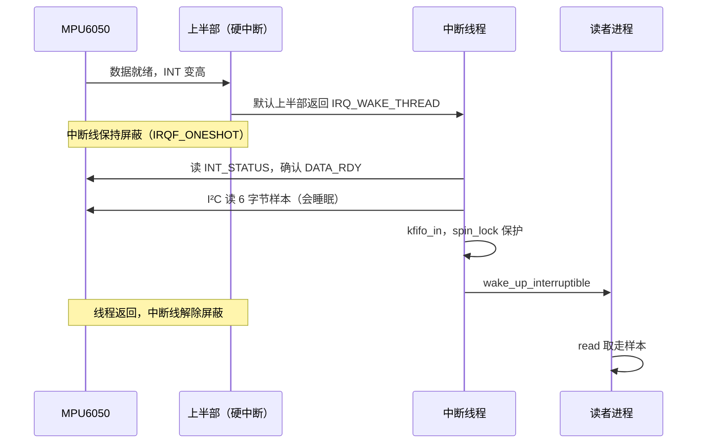
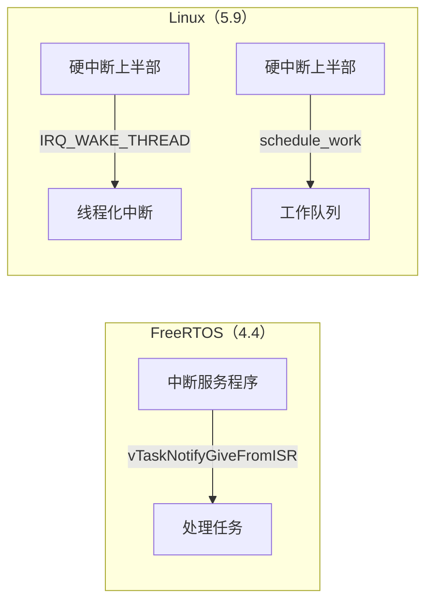

# 5.9 中断、DMA 与并发

[4.4 中断与任务协作](/教程/正文/嵌入式/4_RTOS与固件架构/4_4_中断与任务协作) 在 FreeRTOS 里处理过同一个问题：中断服务程序只把数据接住，解析、计算、打印交给任务，两者之间用带 FromISR 后缀的 API 交接。Linux 内核面对的是同一组限制：中断里不能睡眠、不能等锁、不能直接把数据交给用户，换掉的只是推迟的办法，改用线程化中断和工作队列。

这一页接着 [5.8](/教程/正文/嵌入式/5_嵌入式Linux/5_8_platform_I2C与SPI驱动) 的两个驱动往下走。先给 QEMU 上的 `mdr_serial` 加上接收中断，把读到的字节放进 `kfifo`、由中断唤醒读者；再给 `mdr_mpu6050` 加上数据就绪中断，在线程化中断里经 I²C 取样本。然后摊开内核的同步原语，说明每种执行上下文能用哪一种；再讲 DMA 映射为什么存在、一致性映射与流式映射怎么选，以及 dmaengine 的调用顺序；最后看两条把上下文用错时会打出的内核警告。

## 1. 注册中断

驱动要处理中断，先得拿到中断号。platform 设备的号来自设备树的 `interrupts` 属性，用 `platform_get_irq(pdev, 0)` 取；I²C 客户端的号在 `client->irq` 里，同样由设备树填好。两者都不需要驱动自己解析设备树。

拿到号之后注册处理函数：

```c
static irqreturn_t mdr_demo_irq(int irq, void *dev_id)
{
	struct mdr_demo *d = dev_id;

	if (!mdr_demo_pending(d))
		return IRQ_NONE;

	mdr_demo_ack(d);
	return IRQ_HANDLED;
}

static int mdr_demo_probe(struct platform_device *pdev)
{
	struct mdr_demo *d;
	int irq, ret;

	d = devm_kzalloc(&pdev->dev, sizeof(*d), GFP_KERNEL);
	if (!d)
		return -ENOMEM;

	irq = platform_get_irq(pdev, 0);
	if (irq < 0)
		return irq;

	ret = devm_request_irq(&pdev->dev, irq, mdr_demo_irq, 0,
			       dev_name(&pdev->dev), d);
	if (ret)
		return ret;
	return 0;
}
```

`devm_request_irq` 的参数依次是设备、中断号、处理函数、标志、在 `/proc/interrupts` 里显示的名字，以及原样传回给处理函数的 `dev_id`。用 `devm_` 版本注册的中断在设备卸载时自动释放，驱动不必在 `remove` 里 `free_irq`。devm 资源的释放顺序与申请顺序相反，所以只要中断是最后申请的，它就会最先被释放，不会出现“驱动数据已经释放、中断还在进来”的窗口。

处理函数的返回值只有两种含义：

- `IRQ_HANDLED`：这个中断是我们的，已经处理。
- `IRQ_NONE`：不是我们的。共享中断线上每个处理函数都会被调用，谁都认领不了时返回它，内核把这个计数记作 spurious（虚假中断）。

一条中断线可以被多个设备共用，注册时加 `IRQF_SHARED`。共享有一个硬性要求：线上的每个处理函数都必须加这个标志，否则注册被拒绝；`dev_id` 必须唯一且不能为 `NULL`，因为内核靠它区分是谁注册的。只有一个设备独占这条线时不需要这个标志，`0` 就够了。

触发方式（上升沿、下降沿、高电平、低电平）不写在驱动里。设备树的中断描述里已经带了类型，中断控制器按它配置硬件；驱动再传 `IRQF_TRIGGER_*` 反而会与设备树冲突。

::: concept emb-irqcontext-no-sleep title="中断上下文不能睡眠"

硬中断处理函数运行在中断上下文里，调度器此时不能切换。任何可能睡眠的操作都不能调用：`mutex_lock`、`i2c_smbus_*` 等 I²C 传输、`kmalloc(GFP_KERNEL)`、`copy_to_user`、`msleep`、`wait_event_*`。需要睡眠的工作要么放进线程化中断，要么交给工作队列。违反这一条不会编译报错，运行时报 “BUG: sleeping function called from invalid context”。

:::

判断一个中断有没有在工作，先看 `/proc/interrupts`：

::: terminal title="bash - /proc/interrupts（输出类似，编号与列数随机器不同）"

```text
$ grep a000 /proc/interrupts
 38:          0       SIC   6 Level     a000.serial
```

:::

计数按 CPU 各占一列，示例里的系统只有一列，多核机器上会有几列。第一列是 Linux 内部的中断号，与硬件中断号不必相同；后面依次是中断控制器、控制器内部的硬件中断号、触发类型与注册名。vexpress 的几块 PL011 挂在次级中断控制器 (SIC) 上，SIC 再级联到 GIC，所以控制器一栏显示 `SIC`，硬件号 6 是设备树里写的那个数。中断号、控制器名称与 CPU 列数都随机器和内核配置变化，这里只关心计数：驱动装载前是 0，有数据进来后增长；一直不增长说明中断根本没有到达，或者被别的驱动认领了（共享中断时可能被别人的处理函数当成自己的）。

<Quiz
  type="multi"
  :options="[
    { label: '在硬中断处理函数里调用 mutex_lock，只要很快释放就没问题', value: 'A' },
    { label: '在硬中断处理函数里用 spin_lock 保护与 read 回调共享的数据', value: 'B' },
    { label: '在硬中断处理函数里用 copy_to_user 把数据交给用户程序', value: 'C' },
    { label: '在硬中断处理函数里调用 i2c_smbus_read_byte_data 读取传感器寄存器', value: 'D' }
  ]"
  :answer="['B']"
>

<template #question>

下列哪些操作可以在硬中断处理函数里执行？

</template>

正确答案是 **B**。A 错在 `mutex_lock` 会睡眠；C 错在 `copy_to_user` 可能触发缺页而睡眠；D 错在 I²C 传输要等硬件完成，同样会睡眠。硬中断里只能用不睡眠的锁，也就是第 5 节讲的 `spin_lock`。

</Quiz>

## 2. 给 mdr_serial 加上接收中断

5.8 的 `mdr_serial` 只会发送，往 `/dev/mdr_serial` 写什么，QEMU 的第二块串口就出现什么。现在把反方向补上：从第二个串口窗口敲进去的字符，由接收中断收下来，用户程序从 `/dev/mdr_serial` 读走。

PL011 的接收路径要用到四个寄存器：

| 偏移 | 名称 | 作用 |
| --- | --- | --- |
| 0x00 | UARTDR | 读一次取走接收 FIFO 里的一个字节 |
| 0x18 | UARTFR | 位 4 RXFE 表示接收 FIFO 空，位 6 RXFF 表示已满 |
| 0x38 | UARTIMSC | 中断屏蔽寄存器，位 4 RXIM 打开接收中断 |
| 0x44 | UARTICR | 写 1 清除对应的中断状态 |

打开接收中断就是往 UARTIMSC 的 RXIM 位写 1，关闭则写 0。处理函数里循环读 UARTDR，直到 UARTFR 的 RXFE 置位，再把数据塞进缓冲区、清中断、唤醒读者：

```c
#define MDR_UART_DR       0x00
#define MDR_UART_FR       0x18
#define MDR_UART_IMSC     0x38
#define MDR_UART_ICR      0x44
#define MDR_UART_FR_RXFE  BIT(4)
#define MDR_UART_INT_RX   BIT(4)

struct mdr_serial {
	void __iomem *base;
	struct miscdevice misc;
	struct kfifo fifo;
	spinlock_t lock;
	wait_queue_head_t readq;
};

static irqreturn_t mdr_serial_irq(int irq, void *dev_id)
{
	struct mdr_serial *s = dev_id;

	spin_lock(&s->lock);
	while (!(readl(s->base + MDR_UART_FR) & MDR_UART_FR_RXFE)) {
		u8 ch = readl(s->base + MDR_UART_DR);

		kfifo_in(&s->fifo, &ch, 1);
	}
	spin_unlock(&s->lock);

	writel(MDR_UART_INT_RX, s->base + MDR_UART_ICR);
	wake_up_interruptible(&s->readq);
	return IRQ_HANDLED;
}
```

处理函数里没有 `printk`，没有 `copy_to_user`，也没有任何等待，只有读寄存器、写缓冲区、清中断和一次唤醒。这就是中断该做的事。数据本身留在 `kfifo` 里，等某个进程来取。

`kfifo` 已经被 5.7 用在 `mdr_fifo` 上，这里换了个用途：它成了中断与进程之间的交接点。缓冲区满时 `kfifo_in` 只写进去一部分、剩下的丢弃，串口这种不在乎丢几个字节的场合可以接受。

`read` 回调与中断共享这个 `kfifo`，所以两边都要加锁。中断侧用 `spin_lock` 就够了，因为进入硬中断时本 CPU 的中断已经是关闭的；进程侧必须用 `spin_lock_irqsave`：

::: compare left-title="read 回调里用 spin_lock" right-title="read 回调里用 spin_lock_irqsave"

```c
	/* read 回调里取数据的那一段 */
	spin_lock(&s->lock);
	n = kfifo_out(&s->fifo, tmp, count);
	spin_unlock(&s->lock);
```

---

```c
	/* read 回调里取数据的那一段 */
	spin_lock_irqsave(&s->lock, flags);
	n = kfifo_out(&s->fifo, tmp, count);
	spin_unlock_irqrestore(&s->lock, flags);
```

:::

左栏会死锁：进程拿着锁的时候来了串口中断，而且中断就落在同一颗 CPU 上，处理函数也要这把锁，于是在原地打转，持锁的进程永远回不来。单核机器上这一撞是必然的；多核上看中断落到哪颗 CPU，落到别处时只是让中断多等一会儿，落到持锁的那颗就是死锁。右栏在持锁期间关掉了本 CPU 的中断，中断要么在拿锁之前发生，要么等锁放掉之后再进，两种机器上都安全。

`read` 的完整实现里还有一个细节：`kfifo_out` 取出来的数据放在内核的临时缓冲区里，出了锁区再 `copy_to_user`。不能在锁区里调用 `copy_to_user`，因为它可能缺页睡眠，而持有自旋锁时不能睡眠：

```c
#define MDR_SERIAL_FIFO_SIZE 256

static ssize_t mdr_serial_read(struct file *file, char __user *ubuf,
			       size_t count, loff_t *ppos)
{
	struct mdr_serial *s = container_of(file->private_data,
					    struct mdr_serial, misc);
	unsigned char tmp[64];
	unsigned long flags;
	unsigned int n;
	int ret;

	if (count == 0)
		return 0;
	if (count > sizeof tmp)
		count = sizeof tmp;

	for (;;) {
		spin_lock_irqsave(&s->lock, flags);
		n = kfifo_out(&s->fifo, tmp, count);
		spin_unlock_irqrestore(&s->lock, flags);
		if (n > 0)
			break;
		if (file->f_flags & O_NONBLOCK)
			return -EAGAIN;
		ret = wait_event_interruptible(s->readq,
					       !kfifo_is_empty(&s->fifo));
		if (ret)
			return ret;
	}

	if (copy_to_user(ubuf, tmp, n))
		return -EFAULT;
	return n;
}
```

循环的形状与 5.7 的 `mdr_fifo_read` 一样：取数据，取不到就看是不是非阻塞，是就返回 `-EAGAIN`，不是就在等待队列上睡。唤醒它的是中断处理函数里的 `wake_up_interruptible`，而等待队列头在 `probe` 里初始化。`poll` 也照 5.7 的样子写，队列上非空就报 `EPOLLIN`。

中断的开关在 `probe` 里成对出现，顺序不能颠倒。5.8 的 `probe` 在映射寄存器之后补上这几步：

```c
	ret = kfifo_alloc(&s->fifo, MDR_SERIAL_FIFO_SIZE, GFP_KERNEL);
	if (ret)
		return ret;
	spin_lock_init(&s->lock);
	init_waitqueue_head(&s->readq);

	/* 先申请中断，再打开源头；反过来中断可能在处理函数就位前到达 */
	ret = devm_request_irq(&pdev->dev, irq, mdr_serial_irq, 0,
			       "mdr_serial", s);
	if (ret)
		return ret;
	writel(MDR_UART_INT_RX, s->base + MDR_UART_IMSC);
```

卸下模块时，`remove` 先 `writel(0, s->base + MDR_UART_IMSC)` 把中断屏蔽寄存器清零，PL011 不会再拉起中断线，然后再注销 misc，最后交给 devm 释放中断、映射和内存。顺序反过来，就会出现中断已经释放、硬件还在触发的情况。

::: terminal title="bash - 接收中断工作起来（输出类似，编号与列数随机器不同）"

```text
$ sudo insmod mdr_serial.ko
$ cat /dev/mdr_serial
（在第二个串口窗口里输入 hello 并回车）
hello
^C
$ grep a000 /proc/interrupts
 38:         11       SIC   6 Level     a000.serial
```

:::

`cat` 停在 `read` 里，说明等待队列把人挂住了；在另一个窗口敲字，中断把字节放进 `kfifo` 并唤醒它，`cat` 把这一行打出来。中断计数随输入增长，一次处理函数可以取走好几个字节，所以计数与字节数不必相等，只要它不是 0 就一直增长，就说明这条路径在工作。

::: tip QEMU 的 PL011 模型不检查接收使能位

真实芯片上还要求 UARTCR 的 RXE（位 9）与 UARTE（位 0）置位，否则数据到了引脚也进不了 FIFO，中断更不会产生。QEMU 的模型不做这项检查，所以示例能直接跑。换到开发板上，在 `probe` 里补上 `UARTCR` 的配置，与 5.8 那条关于波特率的提示一并处理。

:::

## 3. 下半部

中断处理函数里能做的事太少，多出来的活要放到限制更少的地方执行。内核把这种“推迟执行”统称下半部 (bottom half)，与它相对的、中断发生时立刻执行的那部分叫上半部 (top half)。可用的机制有三种，区别在于运行上下文和能不能睡眠。

**线程化中断**（threaded IRQ）把处理函数拆成两半：上半部只判断中断是不是自己的，是就让内核唤醒一个专门的内核线程，剩下的工作在线程里做。注册用 `request_threaded_irq`：

```c
ret = devm_request_threaded_irq(&client->dev, client->irq,
				NULL, mdr_mpu6050_irq,
				IRQF_ONESHOT, "mdr_mpu6050", priv);
```

第二个参数是中断号，第三个参数是上半部，传 `NULL` 表示用内核的默认上半部，它只返回 `IRQ_WAKE_THREAD`，把活全交给第四个参数给的线程函数。这时第五个参数（标志）必须带 `IRQF_ONESHOT`，否则注册函数直接返回 `-EINVAL`，dmesg 里留下 “Threaded irq requested with handler=NULL and !ONESHOT”。

`IRQF_ONESHOT` 的作用是在线程执行期间一直屏蔽这条中断线，直到线程返回才解除。电平触发的中断特别需要它：外设的中断线还拉着，如果不屏蔽，线程还没读完状态寄存器，中断又来了。代价是这段时间里这条线上的中断收不到，所以线程里不能久留。

**工作队列**（workqueue）把函数排进一个内核线程池，由工作线程在进程上下文里执行，能睡眠、能拿互斥量、能做 I²C 传输：

```c
struct mdr_dev {
	struct work_struct rx_work;
	struct kfifo fifo;
};

static void mdr_rx_work(struct work_struct *work)
{
	struct mdr_dev *d = container_of(work, struct mdr_dev, rx_work);
	struct mdr_frame frame;
	unsigned int n;

	while ((n = kfifo_out(&d->fifo, &frame, sizeof frame)) == sizeof frame) {
		mdr_handle_frame(d, &frame);   /* 可以睡眠：这里是进程上下文 */
	}
}

/* probe 里初始化一次 */
INIT_WORK(&d->rx_work, mdr_rx_work);

/* 中断里 */
schedule_work(&d->rx_work);
```

`schedule_work` 不睡眠，可以在中断里调用。同一个 `work_struct` 在被执行之前重复排队只会合并成一次，这正好符合“有新数据要处理”的语义。需要延迟一段时间再执行时用 `schedule_delayed_work`。

**tasklet** 曾经是中断上下文里推迟工作的主力，它运行在软中断上下文，不能睡眠。新代码已经不再推荐它，内核文档建议改用 BH 工作队列。读老驱动时会遇到 `tasklet_schedule`，知道它跑在软中断里、不能睡眠就够了。

一次带线程化中断的数据传递，时间线上分成三段：上半部只做最短的判断，线程里做会等的活，读者最后被唤醒：



上半部是内核默认的那一个，连状态寄存器都不读；确认设备、取样本、放进 `kfifo` 全在线程里做。读者进程被唤醒后从 `kfifo` 取数据，与线程之间只共享那一段短暂的加锁窗口。

| 上下文 | 能否睡眠 | 怎么进入 | 可用的同步原语 |
| --- | --- | --- | --- |
| 进程上下文 | 能 | 系统调用回调、`probe`、工作队列、线程化中断 | mutex、completion、自旋锁 |
| 硬中断（上半部） | 不能 | `request_irq` 的处理函数 | 自旋锁 |
| 线程化中断 | 能 | `request_threaded_irq` 的线程部分 | mutex、completion、自旋锁 |
| 软中断、tasklet | 不能 | 网络收包、dmaengine 完成回调 | 自旋锁（`spin_lock_bh`） |

与 4.4 对照，两边的分工完全一样，只是换了一套名字：



FreeRTOS 里被唤醒的是开发者自己创建的任务；Linux 里线程化中断的线程由内核代管，名字是 `irq/中断号-注册名`，在 `ps` 里看得见。选哪一种看活的性质：处理要跟中断一一对应、延迟尽量小，用线程化中断；处理可以攒一攒批量做、或者要在几个中断之间排队，用工作队列。

<Quiz
  type="single"
  :options="[
    { label: '编译报错，NULL 不能作为处理函数', value: 'A' },
    { label: '注册失败，因为上半部为 NULL 时必须带 IRQF_ONESHOT', value: 'B' },
    { label: '注册成功，但线程部分永远不会被执行', value: 'C' },
    { label: '注册成功，只是中断会一直重复触发', value: 'D' }
  ]"
  answer="B"
>

<template #question>

调用 `request_threaded_irq` 时上半部传 `NULL`，标志里又没有 `IRQF_ONESHOT`，会发生什么？

</template>

正确答案是 **B**。内核明确拒绝这种组合，因为它无法保证线程执行期间中断线被屏蔽。`IRQF_ONESHOT` 让中断线保持屏蔽直到线程返回，是 NULL 上半部能成立的前提。

</Quiz>

## 4. MPU6050 的数据就绪中断

5.8 的 `mdr_mpu6050` 靠用户进程 `cat` 一次 sysfs 属性、读一次寄存器，采样率取决于用户多久读一次。要让采样跟着芯片走，用 MPU6050 的 INT 引脚：数据准备好时芯片拉高这根线，驱动收到中断，在线程里经 I²C 读出六个字节。

设备树节点在 5.8 的基础上加一条中断描述：用 `interrupts-extended` 把芯片的 INT 引脚接到开发板上的一个 GPIO，并给出边沿类型。节点的写法、中断控制器的标签和单元格数由 SoC 的绑定决定，[5.5 设备树](/教程/正文/嵌入式/5_嵌入式Linux/5_5_设备树) 里有完整例子。驱动不关心这些细节，只要 `client->irq` 里有号。

INT 引脚默认按脉冲方式工作，每次数据就绪只给出一个约 50 微秒的高脉冲，边沿可能被错过。`probe` 里把 INT_CFG（0x37）的 LATCH_INT_EN（位 5）置 1，引脚就改成锁存方式：数据就绪后保持高电平，直到读走 INT_STATUS 才回到低电平。锁存之后用边沿触发，每次事件只有一个上升沿，处理函数不会被同一次事件重复叫醒。

驱动这边在 5.8 的结构上追加 `kfifo`、自旋锁、等待队列和一个 misc 设备。中断必须线程化，因为读样本要走 I²C，而 I²C 传输会睡眠，这正是 5.8 结尾提到的那个坑：

```c
#define MDR_MPU6050_REG_INT_ENABLE   0x38
#define MDR_MPU6050_REG_INT_STATUS   0x3A
#define MDR_MPU6050_INT_DATA_RDY     BIT(0)

#define MDR_SAMPLE_SIZE  6
#define MDR_FIFO_SAMPLES 64

struct mdr_mpu6050 {
	struct i2c_client *client;
	struct miscdevice misc;
	struct mutex i2c_lock;	/* 5.8 里的 lock，这里改名以免与下面的自旋锁混淆 */
	struct kfifo fifo;
	spinlock_t lock;	/* 保护 kfifo */
	wait_queue_head_t readq;
};

static irqreturn_t mdr_mpu6050_irq(int irq, void *dev_id)
{
	struct mdr_mpu6050 *priv = dev_id;
	u8 raw[MDR_SAMPLE_SIZE];
	int status, ret;

	mutex_lock(&priv->i2c_lock);
	status = i2c_smbus_read_byte_data(priv->client,
					  MDR_MPU6050_REG_INT_STATUS);
	if (status < 0 || !(status & MDR_MPU6050_INT_DATA_RDY)) {
		mutex_unlock(&priv->i2c_lock);
		return IRQ_HANDLED;
	}

	ret = i2c_smbus_read_i2c_block_data(priv->client,
					    MDR_MPU6050_REG_ACCEL_XOUT_H,
					    sizeof raw, raw);
	mutex_unlock(&priv->i2c_lock);
	if (ret != sizeof raw)
		return IRQ_HANDLED;

	spin_lock(&priv->lock);
	if (kfifo_avail(&priv->fifo) >= sizeof raw)
		kfifo_in(&priv->fifo, raw, sizeof raw);
	spin_unlock(&priv->lock);

	wake_up_interruptible(&priv->readq);
	return IRQ_HANDLED;
}
```

这个函数看起来与 5.8 里“中断里不能做的事”正面冲突，关键在它注册的位置：`devm_request_threaded_irq` 把它作为线程函数登记，让它运行在内核线程里，线程属于进程上下文，`i2c_smbus_*` 在这里是合法的。上半部由内核默认实现代劳，只负责唤醒线程。线程函数的返回值只影响统计，不再用来判断中断归属；示例里读到什么状态都返回 `IRQ_HANDLED`，因为这条中断已经由我们认领。

5.8 里保护 I²C 读数的那把 mutex 仍然留着，线程函数读寄存器时也要拿它，免得与 sysfs 的读交错。两种锁各管一段：mutex 圈住会睡眠的 I²C 传输，自旋锁圈住只碰内存的 `kfifo` 操作，两者不嵌套在对方的临界区里，就不会引出新的加锁顺序问题。这里的 `kfifo` 只有线程函数和 `read` 回调会碰，两者都在进程上下文，两侧都用 `spin_lock` 就够，不必像第 2 节那样关中断。`probe` 里除了 `kfifo_alloc(&priv->fifo, MDR_FIFO_SAMPLES * MDR_SAMPLE_SIZE, GFP_KERNEL)`、初始化自旋锁和等待队列，还要把 INT_CFG 的 LATCH_INT_EN 与 INT_ENABLE 的 DATA_RDY 依次写好，最后申请中断、注册 misc 设备。`remove` 的顺序反过来：先把 INT_ENABLE 清零，再注销 misc，免得卸载途中还有中断进来往已经释放的缓冲区写数据。

`kfifo` 里存的是原样的 6 个字节，不是换算后的毫克值。写入前用 `kfifo_avail` 确认放得下完整的一个样本，避免缓冲区将满时只写进半个样本、让后面读出的每个样本都错位。读出时同样凑满 6 字节才取。

用户态拿到的就是一串 6 字节样本，换算留给用户程序：

```c
#define _POSIX_C_SOURCE 200809L

#include <errno.h>
#include <fcntl.h>
#include <poll.h>
#include <stdint.h>
#include <stdio.h>
#include <stdlib.h>
#include <unistd.h>

#define SAMPLE_SIZE 6
#define LSB_PER_G 16384
#define POLL_TIMEOUT_MS 1000

static int16_t be16(const unsigned char *p) {
    return (int16_t)((p[0] << 8) | p[1]);
}

/* 一次 read 可能只拿到半个样本，凑齐 6 字节再返回 */
static int read_sample(int fd, unsigned char *buf) {
    size_t got = 0;

    while (got < SAMPLE_SIZE) {
        ssize_t n = read(fd, buf + got, SAMPLE_SIZE - got);
        if (n == 0) {
            return 0;
        }
        if (n == -1) {
            if (errno == EINTR) {
                continue;
            }
            return -1;
        }
        got += (size_t)n;
    }
    return 1;
}

int main(int argc, char *argv[]) {
    const char *path = argc > 1 ? argv[1] : "/dev/mdr_mpu6050";
    int fd = open(path, O_RDONLY);
    if (fd == -1) {
        perror("open");
        return EXIT_FAILURE;
    }

    for (int i = 0; i < 5; i++) {
        struct pollfd pfd = {.fd = fd, .events = POLLIN};
        int ready = poll(&pfd, 1, POLL_TIMEOUT_MS);
        if (ready == -1) {
            perror("poll");
            break;
        }
        if (ready == 0) {
            printf("poll: %d 毫秒内没有样本\n", POLL_TIMEOUT_MS);
            continue;
        }

        unsigned char buf[SAMPLE_SIZE];
        int st = read_sample(fd, buf);
        if (st < 0) {
            perror("read");
            break;
        }
        if (st == 0) {
            printf("read: 设备已关闭\n");
            break;
        }

        int ax = be16(buf) * 1000 / LSB_PER_G;
        int ay = be16(buf + 2) * 1000 / LSB_PER_G;
        int az = be16(buf + 4) * 1000 / LSB_PER_G;
        printf("ax=%4d mg  ay=%4d mg  az=%4d mg\n", ax, ay, az);
    }

    close(fd);
    return EXIT_SUCCESS;
}
```

程序里 `read_sample` 那个循环不能省。驱动一次 `read` 返回一个完整样本，可管道的语义没变：用户态的 `read` 在数据还没到齐时可能只拿到前半段。对设备节点通常一次就给全，对命名管道则经常是半截，把这层处理写进程序，两种场合都能用。

在 SignalX 上用命名管道一次性喂进五组字节，其中最后一组被拆成两次写入，输出如下：

::: terminal title="bash - imu_read 对命名管道运行（SignalX 实际输出）"

```text
$ gcc -std=c17 -Wall -Wextra -O2 imu_read.c -o imu_read
$ mkfifo demo.fifo
$ ./imu_read demo.fifo
ax=  24 mg  ay=  -5 mg  az=1000 mg
ax=  73 mg  ay= -36 mg  az= 994 mg
ax= -24 mg  ay=   5 mg  az= 994 mg
ax= 183 mg  ay= -61 mg  az= 984 mg
ax=   0 mg  ay=   0 mg  az=1000 mg
```

:::

样本 `01 90 FF AE 40 00` 是 x=400、y=−82、z=16384，换算成 24 mg、−5 mg、1000 mg。最后一组故意拆成两次写入，程序凑齐六个字节后照常输出，说明拼包的逻辑正确。

换到有传感器的开发板上，把路径换成 `/dev/mdr_mpu6050`，在 QEMU 里则没有中断可用，i2c-stub 只模拟寄存器，不会拉 INT 线，所以中断路径只能在真实硬件上验证：

::: terminal title="bash - 开发板上读样本（输出类似）"

```text
$ sudo insmod mdr_mpu6050.ko
$ dmesg | tail -1
[  184.207551] mdr_mpu6050 5-0068: MPU6050 就绪，地址 0x68
$ ./imu_read
ax=  12 mg  ay=  -3 mg  az=1004 mg
ax=  14 mg  ay=  -2 mg  az=1001 mg
ax=  11 mg  ay=  -4 mg  az=1006 mg
```

:::

每次中断产生一个样本，`poll` 返回后可读；采样率由芯片的 SMPLRT_DIV 决定，不再受用户进程读取速度影响。缓冲区满时新样本被丢弃，读者慢一点也不会把驱动拖住。

## 5. 并发与锁

内核代码的并发来源比用户态多。一个 `read` 回调可能同时在几个 CPU 上执行，可能在执行途中被中断打断，也可能因为内核抢占被换下 CPU。驱动里共享的对象（`kfifo`、设备状态、寄存器镜像）都要考虑这几种情况。

按“要不要睡眠”分成两类原语，这与 [4.1 临界区与 RTOS 边界](/教程/正文/嵌入式/4_RTOS与固件架构/4_1_临界区与RTOS边界) 里按“谁会被谁打断”选手段是同一个思路。

**原子操作**用于单个整数的读-改-写。`atomic_t` 保证递增、递减、比较并交换在多核上不可分割：

```c
static atomic_t mdr_irq_count = ATOMIC_INIT(0);

/* 中断里 */
atomic_inc(&mdr_irq_count);

/* 进程上下文 */
int n = atomic_read(&mdr_irq_count);
```

单独一个 32 位对象的置位、清位用 `set_bit`、`clear_bit`、`test_and_set_bit`，同样不可分割。超过一个对象的组合（比如同时更新长度和下标）原子操作就无能为力，得用锁。

**自旋锁**（spinlock）在拿不到锁时原地循环等待，不睡眠，因此硬中断里也能用，第 2 节的接收中断用它保护 `kfifo`。常用的三种加锁方式，区别只在于关不关中断：

| 写法 | 关中断 | 用在哪 |
| --- | --- | --- |
| `spin_lock` / `spin_unlock` | 不关 | 硬中断处理函数内部 |
| `spin_lock_irqsave` / `spin_unlock_irqrestore` | 关本 CPU 中断，保存原状态 | 进程上下文，锁会被中断处理函数拿 |
| `spin_lock_bh` / `spin_unlock_bh` | 关软中断 | 进程上下文，锁会被软中断或 tasklet 拿 |

**互斥量**（mutex）拿不到锁时让出 CPU 睡眠，只能用在能睡眠的上下文，换来的好处是不浪费 CPU，并且支持优先级继承。5.8 的 MPU6050 驱动用它保护整段 I²C 读数，就是因为那一段会睡眠。

**完成量**（completion）用来等一件事发生，典型场合是 DMA 传输完成：

```c
/* struct completion tx_done; 放在设备结构里，probe 中 init_completion() */

reinit_completion(&d->tx_done);
mdr_start_dma(d, buf, len);
ret = wait_for_completion_interruptible_timeout(&d->tx_done,
						msecs_to_jiffies(100));

/* DMA 完成回调里，软中断上下文 */
complete(&d->tx_done);
```

完成量的语义是“一次事件唤醒一个等待者”，可以重复使用，每次等待前用 `reinit_completion` 清零。它比信号量轻，因为它只表达“完成了”，不表达“现在轮到你”。

选哪一把，先看有几个执行上下文参与：

| 参与方 | 选什么 |
| --- | --- |
| 只有进程上下文（read、write、ioctl） | mutex |
| 进程上下文与硬中断共享 | 自旋锁，进程侧用 `spin_lock_irqsave` |
| 进程上下文与软中断、tasklet 共享 | 自旋锁，进程侧用 `spin_lock_bh` |
| 只有一个计数或标志 | `atomic_t` 或位操作 |
| 等一次完成事件 | completion |

拿不准时先看参与方一列有没有中断或软中断：没有就用互斥量，有才升级到自旋锁。反过来先上自旋锁，往往会在临界区里顺手调用一个会睡眠的函数，然后收到第 7 节那条警告。

锁本身管不了加锁顺序。两个函数各自持有两把锁、顺序相反，两个 CPU 上同时执行就会互相等，谁也放不掉，这就是死锁。写驱动时把全局的加锁顺序定下来，所有路径都照同一个顺序拿；已经写好的驱动靠下一节的 lockdep 检查。

### 5.1 用 lockdep 找锁的问题

内核有一个运行时的锁检查器 lockdep，打开 `CONFIG_PROVE_LOCKING` 后，它记录每次加锁的上下文与嵌套关系，发现可能的循环等待就在 dmesg 里报警：

::: terminal title="bash - lockdep 报告（输出类似，节选自内核文档，地址与栈内容随架构和运行情况不同）"

```text
======================================================
WARNING: possible circular locking dependency detected
6.18.0 #1 Not tainted
------------------------------------------------------
cat/312 is trying to acquire lock:
ffff8880072a1a18 (&d->lock){+.+.}-{3:3}, at: mdr_read+0x4c/0x90

but task is already holding lock:
ffff8880072a1a70 (&d->reg_lock){+.+.}-{3:3}, at: mdr_ioctl+0x38/0x80

 Possible unsafe locking scenario:

       CPU0
       ----
  lock(&d->reg_lock);
  lock(&d->lock);

 *** DEADLOCK ***
```

:::

报告的读法：`cat/312 is trying to acquire lock` 说明当前这次调用要拿 `lock`，`but task is already holding lock` 说明它手上已经有 `reg_lock`；`Possible unsafe locking scenario` 一节再列出另一条路径按相反顺序拿这两把锁。两者同时存在，只要两个 CPU 各走一条，就会互相等下去。lockdep 只在“可能出现”时报警，不等真的发生，给出的调用栈直接指向两处加锁点。打开它会让内核变慢、内存占用变多，开发阶段打开、产品关闭。

RCU 是另一种同步机制，读侧几乎不加锁，用在读多写少的数据结构上。它涉及的东西超出本页范围，知道内核里有这个名字就够了。

<Quiz
  type="single"
  :options="[
    { label: 'mutex_lock，因为它支持优先级继承', value: 'A' },
    { label: 'spin_lock，因为中断里不能用带中断状态的版本', value: 'B' },
    { label: 'spin_lock_irqsave，因为进程上下文持锁时可能被同一中断打断', value: 'C' },
    { label: '什么都不用，kfifo 自己就是并发安全的', value: 'D' }
  ]"
  answer="C"
>

<template #question>

`read` 回调（进程上下文）与硬中断处理函数共享一个 `kfifo`，进程侧应该用哪一把锁？

</template>

正确答案是 **C**。互斥量会睡眠，不能与中断共享；硬中断里用 `spin_lock` 是因为中断已经关闭，进程侧没有这个前提，必须用 `spin_lock_irqsave` 关掉本 CPU 的中断；`kfifo` 只保证单生产者单消费者，这里的中断就是第二个生产者。

</Quiz>

## 6. DMA

[2.9 ADC、DAC 与 DMA](/教程/正文/嵌入式/2_MCU裸机开发/2_9_ADC_DAC与DMA) 在 STM32F103 上配置过 DMA 通道：往 `CPAR` 写外设地址、往 `CMAR` 写内存地址、往 `CNDTR` 写长度、开 `CCR` 的使能位。地址都是芯片上的物理地址，驱动程序直接写进去就行。到了 Linux，同一件事多出一层：CPU 用的是虚拟地址，DMA 控制器用的是总线地址，两者之间隔着 MMU；CPU 还可能有一份数据在自己的缓存里，设备却只看内存。

把 `kmalloc` 返回的指针直接交给 DMA 控制器，错在两层。地址层面，虚拟地址对设备没有意义，设备发出的是总线地址；缓存层面，CPU 刚写进缓存的数据还没落到内存，设备读到的会是旧值，反过来设备写进内存的数据也可能被 CPU 缓存里的旧副本盖住。DMA 映射 API 就是用来同时解决这两件事的。

::: concept emb-dma-map-ownership title="映射期间缓冲区属于设备"

调用 `dma_map_single` 之后、`dma_unmap_single` 之前，缓冲区归设备所有，CPU 不能读写它。设备写完、CPU 要读之前，必须先 `dma_unmap_single`（或 `dma_sync_single_for_cpu`）把缓存处理干净；CPU 写完、设备要读之前，同样要先映射或同步。在这段窗口里读写缓冲区，读到什么由缓存状态决定，与设备有没有写完无关。

:::

映射分两种，按生命期选。

**一致性映射**（coherent mapping）在映射期间保证 CPU 与设备看到的内容一致，返回两个地址：CPU 用的虚拟地址和设备用的 DMA 地址。它适合长期共享的缓冲区，比如网卡的收发描述符环：

```c
struct mdr_ring {
	void *desc;           /* CPU 视角的虚拟地址 */
	dma_addr_t desc_dma;  /* 设备视角的总线地址 */
	size_t size;
};

static int mdr_ring_alloc(struct mdr_dev *d, size_t size)
{
	d->ring.desc = dma_alloc_coherent(d->dev, size, &d->ring.desc_dma,
					  GFP_KERNEL);
	if (!d->ring.desc)
		return -ENOMEM;
	d->ring.size = size;

	/* 描述符里的“下一个”字段填 d->ring.desc_dma，CPU 读写 d->ring.desc */
	mdr_ring_init(d, size);
	return 0;
}

static void mdr_ring_free(struct mdr_dev *d)
{
	dma_free_coherent(d->dev, d->ring.size, d->ring.desc,
			  d->ring.desc_dma);
}
```

`dma_alloc_coherent` 返回的虚拟地址与总线地址是一对，写进描述符的链表指针必须用总线地址，否则设备按虚拟地址去找内存，哪里也找不到。

**流式映射**（streaming mapping）针对单次传输，把一块已经存在的缓冲区临时交给设备，用完就解除：

```c
static int mdr_read_block(struct mdr_dev *d, void *buf, size_t len)
{
	dma_addr_t addr;

	addr = dma_map_single(d->dev, buf, len, DMA_FROM_DEVICE);
	if (dma_mapping_error(d->dev, addr))
		return -ENOMEM;

	mdr_start_rx(d, addr, len);
	wait_for_completion(&d->rx_done);

	dma_unmap_single(d->dev, addr, len, DMA_FROM_DEVICE);
	return 0;
}
```

方向参数决定映射时对缓存做什么：

| 方向 | 数据流向 | 映射与解除时做什么 |
| --- | --- | --- |
| `DMA_TO_DEVICE` | 内存 → 设备 | 映射时把缓存刷到内存 |
| `DMA_FROM_DEVICE` | 设备 → 内存 | 解除时让 CPU 的缓存失效 |
| `DMA_BIDIRECTIONAL` | 双向 | 两边都做，开销最大 |

方向写反了不会报错，只会读到旧数据或者让设备读到旧数据，这类问题在小数据量、缓存恰好被换出的情况下还看不出来。传输进行到一半、CPU 又想碰缓冲区时，用 `dma_sync_single_for_cpu` 与 `dma_sync_single_for_device` 在两边切换所有权，不必解除整个映射。

缓冲区本身也有要求：物理连续，并且落在设备能访问的地址范围内。`kmalloc` 与页分配器满足物理连续；`vmalloc` 得到的内存只在虚拟地址上连续，不能直接映射。栈上的数组同样不行，它的位置和生命期都不由驱动掌握，函数一返回就可能被别的代码复用。设备只能寻址 32 位地址时，`probe` 里用 `dma_set_mask_and_coherent(&pdev->dev, DMA_BIT_MASK(32))` 告诉内核，映射时才会把缓冲区分配在合适的范围内。

::: generate emb-dma-cache-analogy kind=explanation concepts=emb-dma-map-ownership

面向第一次接触 DMA 映射的读者，用“外设是只看仓库的搬运工、CPU 习惯把资料先抄在自己的桌面（缓存）上”做类比，说明为什么 CPU 写过的数据要先刷到仓库、搬运工送来的数据要让 CPU 把桌面上的旧副本作废，再把这个类比对应回 dma_map_single、dma_unmap_single 的方向参数，以及 dma_alloc_coherent 为什么不需要这层同步。

:::

### 6.1 用 dmaengine 发起一次传输

SoC 的 DMA 控制器在 Linux 里由 dmaengine 框架统一管理。驱动不直接写控制器寄存器，而是按名字向框架申请一个通道，配置传输参数，提交描述符，最后启动：

```c
struct mdr_uart {
	struct device *dev;
	void __iomem *base;       /* 串口寄存器，probe 里映射 */
	phys_addr_t base_phys;    /* 同一段寄存器的物理地址 */
	struct dma_chan *tx_chan;
	struct completion tx_done;
	dma_addr_t tx_dma;
	size_t tx_len;
};

/* 传输完成回调，运行在软中断上下文 */
static void mdr_tx_done(void *param)
{
	struct mdr_uart *u = param;

	dma_unmap_single(u->dev, u->tx_dma, u->tx_len, DMA_TO_DEVICE);
	complete(&u->tx_done);
}

static int mdr_uart_start_tx(struct mdr_uart *u, const void *buf, size_t len)
{
	struct dma_slave_config cfg = {
		.dst_addr = u->base_phys + MDR_UART_DR,
		.dst_addr_width = DMA_SLAVE_BUSWIDTH_1_BYTE,
		.dst_maxburst = 1,
		.direction = DMA_MEM_TO_DEV,
	};
	struct dma_async_tx_descriptor *tx;
	int ret;

	u->tx_chan = dma_request_chan(u->dev, "tx");
	if (IS_ERR(u->tx_chan))
		return PTR_ERR(u->tx_chan);

	ret = dmaengine_slave_config(u->tx_chan, &cfg);
	if (ret)
		return ret;

	u->tx_dma = dma_map_single(u->dev, (void *)buf, len, DMA_TO_DEVICE);
	if (dma_mapping_error(u->dev, u->tx_dma))
		return -ENOMEM;
	u->tx_len = len;

	tx = dmaengine_prep_slave_single(u->tx_chan, u->tx_dma, len,
					 DMA_MEM_TO_DEV, DMA_PREP_INTERRUPT);
	if (!tx) {
		dma_unmap_single(u->dev, u->tx_dma, len, DMA_TO_DEVICE);
		return -ENOMEM;
	}

	tx->callback = mdr_tx_done;
	tx->callback_param = u;
	reinit_completion(&u->tx_done);
	if (dma_submit_error(dmaengine_submit(tx))) {
		dma_unmap_single(u->dev, u->tx_dma, len, DMA_TO_DEVICE);
		return -EIO;
	}

	dma_async_issue_pending(u->tx_chan);
	return wait_for_completion_interruptible(&u->tx_done);
}
```

顺序固定为六步：申请通道、配置、映射缓冲区、准备描述符、提交、启动。`dma_slave_config` 的 `dst_addr` 要写外设寄存器的物理地址，不能写 `ioremap` 得到的虚拟地址，与缓冲区收尾时的 `dma_unmap_single` 是同一条规则。实际驱动里通道在 `probe` 里申请一次、`remove` 里 `dma_release_channel` 释放，这里为了把六步放在一处才写进同一个函数。`dma_request_chan` 的第二个参数是通道名，设备树里用 `dma-names` 声明过，比如 `dma-names = "tx", "rx";`。`dmaengine_prep_slave_single` 返回的描述符可以设置完成回调，回调运行在软中断里，只能调用 `complete()`、`atomic_inc()` 这类不会睡眠的函数，`mdr_tx_done` 里就只做 `dma_unmap_single` 和 `complete`。把 `wait_for_completion` 放进回调会立刻触发第 7 节的警告；它属于调用者，放在 `mdr_uart_start_tx` 的最后一行正合适。

驱动作者多数时候碰不到这一整套调用。串口、SPI、I²C 的核心层已经替驱动管好了 DMA：设备树里给节点写 `dmas` 与 `dma-names`，核心层在传输大块数据时自动启用，驱动只管收发。自己调用 dmaengine 的场合通常是视频采集、音频这类数据量大、对时延敏感，又不在现成子系统覆盖范围内的设备。

与 2.9 对照，两边的分工变了：裸机上驱动自己算通道、自己填寄存器，中断里清标志、重装计数；Linux 上通道由框架分配、寄存器由控制器驱动写，驱动只描述“从哪到哪、多长、什么方向”，完成时收到一次回调。代价是多了一层间接，好处是同一份驱动能跑在 DMA 控制器完全不同的 SoC 上。

<Quiz
  type="single"
  :options="[
    { label: 'DMA_TO_DEVICE', value: 'A' },
    { label: 'DMA_FROM_DEVICE', value: 'B' },
    { label: 'DMA_BIDIRECTIONAL', value: 'C' },
    { label: '方向不影响结果，可以随便填', value: 'D' }
  ]"
  answer="B"
>

<template #question>

设备把采集到的数据写进内存，随后 CPU 要读这块缓冲区，流式映射应该用哪个方向？

</template>

正确答案是 **B**。数据从设备流向内存，解除映射时内核才会让 CPU 的缓存失效，CPU 读到的才是设备写进去的新数据。填 A 会让 CPU 继续读缓存里的旧副本。

</Quiz>

## 7. 常见的内核警告

上下文用错时，内核不会崩溃，而是打一条警告然后继续跑，这才是它危险的地方：数据可能已经错了，只是还没表现出来。两条最常见的警告都指向“在不该睡眠的地方睡了”。

第一条是 `BUG: sleeping function called from invalid context`，由 `might_sleep()` 一类的检查在 `mutex_lock`、`kmalloc(GFP_KERNEL)`、`copy_to_user` 被调用的那一刻打出。第二条是 `BUG: scheduling while atomic`，发生在真正触发调度的时候，比如在上面这些函数里等锁等不下去。两条的成因相同，区别只是发现得早或晚。

把 5.8 的 MPU6050 读取直接搬进硬中断，就会得到第一条：

::: compare left-title="硬中断里发起 I²C 传输" right-title="线程化中断里发起 I²C 传输"

```c
static irqreturn_t bad_irq(int irq, void *dev_id)
{
	struct mdr_mpu6050 *priv = dev_id;
	u8 raw[6];

	/* i2c_smbus_* 会等硬件，进入睡眠 */
	i2c_smbus_read_i2c_block_data(priv->client,
				      MDR_MPU6050_REG_ACCEL_XOUT_H,
				      sizeof raw, raw);
	return IRQ_HANDLED;
}

ret = devm_request_irq(&client->dev, client->irq, bad_irq, 0,
		       "mdr_mpu6050", priv);
```

---

```c
static irqreturn_t good_irq(int irq, void *dev_id)
{
	struct mdr_mpu6050 *priv = dev_id;
	u8 raw[6];

	/* 线程化中断在进程上下文，可以睡眠 */
	i2c_smbus_read_i2c_block_data(priv->client,
				      MDR_MPU6050_REG_ACCEL_XOUT_H,
				      sizeof raw, raw);
	return IRQ_HANDLED;
}

ret = devm_request_threaded_irq(&client->dev, client->irq,
				NULL, good_irq, IRQF_ONESHOT,
				"mdr_mpu6050", priv);
```

:::

左栏运行后 dmesg 里出现：

::: terminal title="bash - 硬中断里睡眠的警告（输出类似，节选自内核文档）"

```text
BUG: sleeping function called from invalid context at kernel/locking/mutex.c:283
in_atomic(): 1, irqs_disabled(): 0, non_block: 0, pid: 312, name: cat
preempt_count: 1, expected: 0
CPU: 0 PID: 312 Comm: cat Not tainted 6.18.0 #1
Hardware name: ARM-Versatile Express
Call trace:
 mutex_lock+0x...
 i2c_smbus_xfer+0x...
 i2c_smbus_read_i2c_block_data+0x...
 bad_irq+0x...
```

:::

调用栈最后一行直接指向出错的处理函数，倒数几行说明睡眠发生在 I²C 核心的互斥量上。看到这个栈，改法只有一种：把这段活挪到能睡眠的上下文。线程化中断、工作队列都可以，选哪个取决于是否需要与中断一一对应。

同一个坑还有几个变体：在硬中断里调用 `copy_to_user`、在持有自旋锁的回调里调用 `kmalloc(GFP_KERNEL)`、在软中断里 `mutex_lock`。判断标准始终是同一条：这段代码的调用者能不能睡眠。拿不准时，在自己的辅助函数开头写一句 `might_sleep()`：它被从原子上下文调用时，调试内核会当场报出来，比等到函数内部真正触发睡眠、栈已经绕了几层时再报好查得多。

## 8. 习题

### 8.1 巩固

<Exercise id="65581" :d="2" :w="3">

写一个 `irqmon.sh`，监视一条中断的到达情况：

```text
用法：./irqmon.sh <注册名> [秒数]
```

每 200 毫秒读一次 `/proc/interrupts`，找到注册名为指定值的行，打印

```text
名字  total=总数  delta=[cpu0增量 cpu1增量 ...]
```

秒数默认 5。要求：

- CPU 列数不固定，从 `/proc/interrupts` 第一行的表头或用 `nproc` 取得，不能写死一列。
- 同一注册名可能出现在多行（每个中断号一行），计数要全部累加。
- 结束时打印一次最终总数。

验收：加载本页的 `mdr_serial`，运行 `./irqmon.sh a000.serial 10`，在第二个串口窗口连续输入字符，脚本应出现 `delta` 非零的行；停止输入后 `total` 不再变化。手边还有持续产生中断的设备（网卡、USB）时，对它的中断再跑一次，确认各列增量之和等于总数增量。

另答一问：正文示例行里的 `38` 与 `6` 分别是哪一级的编号，为什么两者不相等？

</Exercise>

<Exercise id="65582" :d="3" :w="3">

下面是从 5.8 的 `mdr_serial` 改出来的接收中断版本。结构体里写的是 `struct mutex lock;`，`read` 回调也用它保护 `kfifo`。代码能编译，装进内核后才暴露问题。

```c
static irqreturn_t mdr_serial_irq(int irq, void *dev_id)
{
	struct mdr_serial *s = dev_id;
	u8 ch;

	mutex_lock(&s->lock);
	while (!(readl(s->base + MDR_UART_FR) & MDR_UART_FR_RXFE)) {
		kfifo_in(&s->fifo, &ch, 1);
	}
	mutex_unlock(&s->lock);

	wake_up_interruptible(&s->readq);
	return IRQ_HANDLED;
}
```

```c
	/* probe 里映射完寄存器之后 */
	writel(MDR_UART_INT_RX, s->base + MDR_UART_IMSC);

	ret = devm_request_irq(&pdev->dev, irq, mdr_serial_irq,
			       IRQF_SHARED, "mdr_serial", NULL);
	if (ret)
		return ret;
```

(1) 找出全部错误，逐条写出后果。其中一处让 `probe` 直接失败、设备绑不上驱动；另有一处只要收到一个字符，处理函数就再也返回不了（假设前一处已经修好）。

(2) 写出改正后的处理函数与 `probe` 片段。

(3) 改正后 `read` 回调里该用 `spin_lock` 还是 `spin_lock_irqsave`？分别说明单核与多核上会发生什么。

(4) 改正后还要调整 `probe` 与 `remove` 的步骤顺序。说明为什么必须先 `devm_request_irq` 再写 `UARTIMSC`，`remove` 里又为什么先清零 `UARTIMSC`、再注销 misc、最后让 devm 释放中断。把顺序颠倒各会出现什么现象？

</Exercise>

<Exercise id="65583" :d="3" :w="3">

一个逐字节接收的设备用工作队列处理数据，`mdr_handle_frame()` 里要调用会睡眠的 `i2c_smbus_read_byte_data()`。

```c
struct mdr_dev {
	struct device *dev;
	struct i2c_client *client;
	void __iomem *base;
	struct work_struct rx_work;
	struct kfifo fifo;
	spinlock_t lock;
};

static irqreturn_t mdr_irq(int irq, void *dev_id)
{
	struct mdr_dev *d = dev_id;
	u8 ch = readb(d->base + MDR_REG_DATA);

	spin_lock(&d->lock);
	kfifo_in(&d->fifo, &ch, 1);
	spin_unlock(&d->lock);

	schedule_work(&d->rx_work);
	return IRQ_HANDLED;
}
```

(1) 写出 `mdr_rx_work()`，从 `kfifo` 里按整帧取出数据并调用 `mdr_handle_frame()`。

(2) 写出 `probe` 里与工作队列有关的一行初始化，以及 `remove` 的收尾顺序：屏蔽设备中断、取消工作、注销 misc。说明 `cancel_work_sync()` 与 `flush_work()` 的区别，这里为什么用前者。

(3) 同一个 `work_struct` 在执行前被 `schedule_work()` 排了 20 次，实际执行几次？这个语义对「有新数据要处理」为什么合适？如果要求每个字节都被单独处理一次，该换成什么机制？

(4) 读老驱动时遇到 `tasklet_schedule()`：它运行在什么上下文，能用哪种锁？把它改成 BH 工作队列需要改动哪几处？

</Exercise>

### 8.2 编程

<Exercise id="65584" :d="3" :w="3">

为第 2 节的 `mdr_serial` 写用户态测试程序 `irqtest.c`，验证 `read` 路径的三种行为：

```text
用法：./irqtest /dev/mdr_serial
```

(1) 以 `O_NONBLOCK` 打开、缓冲区为空时，`read` 返回 -1 且 `errno == EAGAIN`，打印 `nonblock: EAGAIN`。

(2) 改为阻塞打开，测试者在第二个串口窗口输入 `hello`，`read` 应在 2 秒内返回 5 字节，打印 `blocking: 5 bytes`。

(3) 阻塞 `read` 期间用 `alarm(1)` 触发 `SIGALRM`，`read` 返回 -1 且 `errno == EINTR`，打印 `interrupt: EINTR`，随后仍能继续调用 `read`。

要求：信号处理函数只设置一个 `volatile sig_atomic_t` 标志；用 `sigaction` 注册且不带 `SA_RESTART`；三次测试各自重新 `open`，并把上一次残留的字节读空。

验收：在 QEMU 里运行，三条输出依次出现。把驱动的 `wait_event_interruptible` 临时换成 `wait_event`，第三项应当卡住不返回，说明原因后再换回来。

</Exercise>

<Exercise id="65585" :d="3" :w="3">

把正文的 `imu_read` 扩成采样日志工具 `imu_log.c`：

```text
用法：./imu_log [-n N] [-o out.csv] <设备或管道路径>
```

- 默认 `N = 10`，输出到 stdout。
- 每个样本输出一行 CSV：`序号,单调时钟毫秒,ax_mg,ay_mg,az_mg`，时间用 `clock_gettime(CLOCK_MONOTONIC)` 取。
- 用 `poll` 等数据，超时则往 stderr 记一行并继续；结束时打印 `samples=N timeouts=M`。
- 保留正文 `read_sample` 凑满 6 字节的逻辑。

测试数据自己造：`mkfifo demo.fifo`，再写一个小程序或脚本，每 100 毫秒向管道写入一组 6 字节样本，共 10 组，其中最后一组拆成两次 `write`。第一组用 `01 90 FF AE 40 00`。

验收：`./imu_log -n 10 demo.fifo` 输出 10 行，序号从 1 连续到 10，时间列递增且相邻间隔约 100 毫秒；第一行的三个加速度列为 `24,-5,1000`（换算与正文一样用整数除法截断）；拆成两次写入的样本没有错位。把 `read_sample` 换成一次 `read(fd, buf, 6)` 后重复实验，指出出现了什么错误。

</Exercise>

<Exercise id="65586" :d="4" :w="3">

一个内存映射的采集外设用三个寄存器：`STATUS`（偏移 0x00，位 0 DATA_RDY）、`DATA`（0x04）、`IRQ_EN`（0x08）。数据准备好时它拉起中断线，直到 `DATA` 被读走才放开。

(1) 用 `devm_request_threaded_irq` 写注册代码，上半部 `mdr_cap_irq()` 读 `STATUS`：DATA_RDY 未置位返回 `IRQ_NONE`，置位返回 `IRQ_WAKE_THREAD`。线程函数读 `DATA`、写入 `kfifo`、调用 `wake_up_interruptible()`。

(2) 注册标志写 `IRQF_ONESHOT`。说明这里的 `IRQF_ONESHOT` 为什么不能省；它与第 1 节的 `request_irq` 加电平触发相比，线程执行期间这条线的行为有什么不同，代价是什么。

(3) 有人把上半部的返回值一律改成 `IRQ_HANDLED`。程序能编译、能装载，但一个样本也收不到，之后的采样全部停住。解释原因。

(4) 把这段上半部照搬去读 MPU6050 的 `INT_STATUS`（在 I²C 寄存器后面）会怎样？为什么正文的 MPU6050 驱动只能用 `NULL` 上半部？

</Exercise>

<Exercise id="65587" :d="4" :w="4">

下面这段 DMA 接收至少有三处错误，设备负责把采集数据写进内存。

```c
static int mdr_capture(struct mdr_dev *d, size_t len)
{
	char *buf = kmalloc(len, GFP_KERNEL);
	dma_addr_t addr;

	if (!buf)
		return -ENOMEM;

	addr = dma_map_single(d->dev, buf, len, DMA_TO_DEVICE);
	mdr_start_rx(d, addr, len);
	wait_for_completion(&d->rx_done);
	process(buf, len);
	dma_unmap_single(d->dev, addr, len, DMA_TO_DEVICE);
	kfree(buf);
	return 0;
}
```

(1) 指出全部错误，逐条说明后果。方向参数与 `process()` 的位置各算一处；映射失败的处理也算一处。

(2) 写出改正后的函数，说明 `process()` 为什么必须放在 `dma_unmap_single()` 之后；每次发起新传输前还漏了什么动作？

(3) 如果这个缓冲区要长期复用、每 1 毫秒采一次，该换成哪种映射？用 `dma_alloc_coherent()` 写出初始化与释放。

(4) 把 (2) 的传输改用 dmaengine 完成，按六步写出调用顺序与每步的参数来源；完成回调运行在什么上下文，里面允许做什么？

</Exercise>

### 8.3 综合与挑战

<Exercise id="65588" :d="5" :w="4">

一个驱动同时用 `d->reg_lock`（互斥量）与 `d->lock`（自旋锁），lockdep 报出：

```text
WARNING: possible circular locking dependency detected
------------------------------------------------------
cat/312 is trying to acquire lock:
ffff8880072a1a18 (&d->lock){+.+.}-{3:3}, at: mdr_read+0x4c/0x90

but task is already holding lock:
ffff8880072a1a70 (&d->reg_lock){+.+.}-{3:3}, at: mdr_read+0x2c/0x90

 Possible unsafe locking scenario:

       CPU0
       ----
  lock(&d->reg_lock);
  lock(&d->lock);

 *** DEADLOCK ***
```

对应的代码：

```c
static ssize_t mdr_read(struct file *file, char __user *ubuf,
			size_t count, loff_t *ppos)
{
	struct mdr_dev *d = file->private_data;
	unsigned long flags;

	mutex_lock(&d->reg_lock);
	spin_lock_irqsave(&d->lock, flags);
	/* 取数据 */
	spin_unlock_irqrestore(&d->lock, flags);
	mutex_unlock(&d->reg_lock);
	return count;
}

static long mdr_ioctl(struct file *file, unsigned int cmd, unsigned long arg)
{
	struct mdr_dev *d = file->private_data;
	unsigned long flags;

	spin_lock_irqsave(&d->lock, flags);
	mutex_lock(&d->reg_lock);
	/* 改硬件寄存器 */
	mutex_unlock(&d->reg_lock);
	spin_unlock_irqrestore(&d->lock, flags);
	return 0;
}

static irqreturn_t mdr_irq(int irq, void *dev_id)
{
	struct mdr_dev *d = dev_id;

	spin_lock(&d->lock);
	/* 处理中断状态 */
	spin_unlock(&d->lock);
	return IRQ_HANDLED;
}
```

(1) 逐行说明报告里三段的含义，指出哪两处代码构成循环等待。

(2) 这段代码除了加锁顺序，还有一个更早会触发的错误：`mdr_ioctl()` 在自旋锁里拿了互斥量。它会打出第 7 节的哪条警告？为什么单靠统一加锁顺序修不好它？

(3) 改写两个函数：统一加锁顺序，把可能睡眠的 `reg_lock` 移到自旋锁外面。说明关中断的范围应当覆盖到哪一段。

(4) 这段代码在单核机器上也能死锁，给出一种具体的执行顺序（哪个上下文、在哪一行被打断）。

(5) lockdep 只在「可能出现」循环等待时报警，不等真的发生。这样设计的好处是什么？为什么发布内核把 `CONFIG_PROVE_LOCKING` 关掉？

</Exercise>

<Exercise id="65589" :d="6" :w="5" scope="*">

把第 2 节的 `mdr_serial` 扩成一个完整的接收驱动。

1. 中断上半部只做四件事：循环读 `UARTDR` 放进 `kfifo`、`kfifo` 满时丢弃新字节并累加 `dropped`、清接收中断、唤醒读者。`kfifo` 与计数用自旋锁保护。
2. `read` 同时支持阻塞与 `O_NONBLOCK`；`poll` 报告 `EPOLLIN`；`ioctl` 增加 `MDR_SERIAL_IOC_GET_STATS`，返回 `received`、`dropped`、`irq_count` 三个计数，命令号用 `_IOR` 生成。
3. `remove` 的收尾顺序：屏蔽 `UARTIMSC`、注销 misc、释放 `kfifo`。逐条说明每一步防的是什么。
4. 三个计数里哪些适合用 `atomic_t`，哪些必须在锁里更新？说明理由。
5. 写用户态程序 `rxstress.c`：从 `/dev/mdr_serial` 连续读取，按收到的字节总数与 `ioctl` 的统计打印一行 `read=N received=R dropped=D irq=I`。

验收：模块用 `make W=1` 编译无警告；`insmod` 后在第二个串口窗口粘贴一段 1000 字节的递增字符序列，用户态读到的内容与源文本逐字节一致，且 `read + dropped == received`；把 `kfifo` 改小到 16 字节再重复，丢弃计数应当增大，读到的内容仍然有序。

</Exercise>

## 9. 参考资料

- Bootlin, Linux kernel and driver development 培训幻灯片（Processes, scheduling, sleeping and interrupts；Locking；DMA）：https://bootlin.com/doc/training/linux-kernel/linux-kernel-slides.pdf
- Linux generic IRQ handling：https://docs.kernel.org/core-api/genericirq.html
- Workqueue：https://docs.kernel.org/core-api/workqueue.html
- Unreliable Guide To Locking：https://docs.kernel.org/kernel-hacking/locking.html
- Lock types and their rules：https://docs.kernel.org/locking/locktypes.html
- Runtime locking correctness validator（lockdep）：https://docs.kernel.org/locking/lockdep-design.html
- Dynamic DMA mapping Guide：https://docs.kernel.org/core-api/dma-api-howto.html
- DMA Engine API Guide（client）：https://docs.kernel.org/driver-api/dmaengine/client.html
- Arm PrimeCell UART (PL011) Technical Reference Manual（DDI0183）：https://developer.arm.com/documentation/ddi0183/latest/
- Linux Device Drivers, 3rd ed., ch9 Communicating with Hardware、ch15 Memory Mapping and DMA（接口已有变化，只作概念参考）：https://lwn.net/Kernel/LDD3/
- Elixir Cross Referencer, Linux v6.18（include/linux/interrupt.h、include/linux/spinlock.h、include/linux/dma-mapping.h、include/linux/dmaengine.h、include/linux/completion.h）：https://elixir.bootlin.com/linux/v6.18/source
