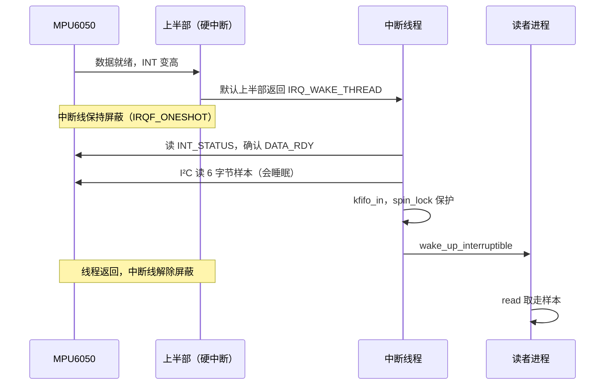
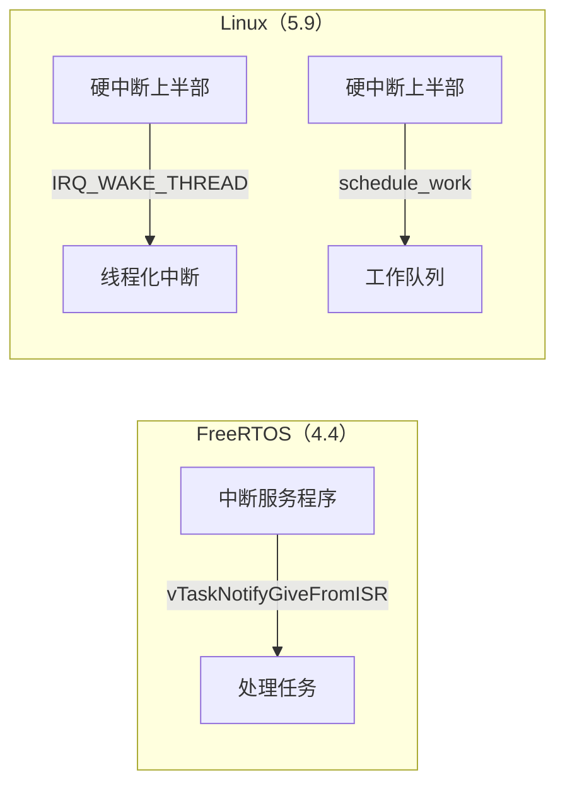

# 5.9 中断、DMA 与并发

在操作系统内核与硬件外设的协同体系中，异步事件的高效处理构成了系统吞吐量与实时响应能力的基石。若回顾 [4.4 中断与任务协作](/教程/正文/嵌入式/4_RTOS与固件架构/4_4_中断与任务协作) 在小型实时操作系统（如 FreeRTOS）中的设计模式，中断服务例程（ISR）的黄金法则是以极简的时序仅将数据捕获并暂存，随后通过专用的内核通知或队列机制将繁重复杂的解析、浮点解算与通信分发交由常驻任务在自由上下文中逐步消化。进入宏内核架构的 Linux 之后，由于引入了复杂的抢占式多任务调度器、多核心（SMP）对称处理、内存管理单元（MMU）以及非确定性的总线通信周期，这一软硬件协作原则面临着更为严苛的执行边界：硬中断上下文严禁陷入睡眠、严禁持有可能让渡执行权的锁原语、亦绝对无法直接向用户空间虚拟内存搬运数据。为了化解硬件突发速率与高层协议处理周期的深刻矛盾，Linux 演进出了一套涵盖线程化中断、工作队列、分级自旋锁保护以及总线级 DMA 映射的高性能并发治理体系。

本篇在 [5.8 platform、I²C 与 SPI 驱动](/教程/正文/嵌入式/5_嵌入式Linux/5_8_platform_I2C与SPI驱动) 建立的外设访问模型基础上展开深入演进。首先为前述虚拟串口驱动补全完整的硬件接收中断通路，剖析内核环形无锁缓冲区 `kfifo` 如何充当中断上半部与用户读取进程间的安全数据蓄水池，并配合等待队列实现精密的休眠唤醒协同；随后为惯性测量单元 MPU6050 引入硬件数据就绪（Data Ready）外部中断，利用线程化中断在进程上下文中优雅完成耗时较长的 I²C 复合读取事务；在此基础上，系统梳理 Linux 内核在多核抢占架构下的全套同步原语（原子操作、自旋锁、互斥锁与完成量），明确各执行上下文的锁选型铁律；接着穿透 MMU 与多级 Cache 的硬件屏障，解析一致性 DMA 映射与流式 DMA 映射的物理成因，并给出异步 DMA 引擎（dmaengine）的标准编排步骤；最后深入剖析破坏上下文规则时内核抛出的致命告警堆栈，建立从根源预防死锁与非法调度的工程防线。

## 1. 注册中断

当硬件外设产生物理电平跳变并向中断控制器（如 ARM 架构上的 GIC 或其级联控制器）发送信号后，驱动程序若想捕获并处理该事件，首先必须在内核中申请并绑定对应的 Linux 虚拟中断号。在现代基于设备树的驱动架构中，中断资源的编号解析完全由总线核心托管：挂载在平台总线上的 platform 设备，其绑定的中断号由内核解析设备树节点的 `interrupts` 属性后自动填充，驱动只需调用 `platform_get_irq(pdev, 0)` 即可获取系统层级的虚拟中断号；挂载在 I²C 总线上的从设备，其对应的中断号在从设备对象实例化时已被填入 `client->irq` 之中。驱动程序无须自行遍历或解析底层的设备树节点属性。

在获取有效的中断号之后，驱动在探测初始化（`probe`）阶段通过标准接口将中断处理例程挂载进系统的中断调度表中：

```c
static irqreturn_t mdr_demo_irq(int irq, void *dev_id)
{
	struct mdr_demo *d = dev_id;

	if (!mdr_demo_pending(d))
		return IRQ_NONE;

	mdr_demo_ack(d);
	return IRQ_HANDLED;
}

static int mdr_demo_probe(struct platform_device *pdev)
{
	struct mdr_demo *d;
	int irq, ret;

	d = devm_kzalloc(&pdev->dev, sizeof(*d), GFP_KERNEL);
	if (!d)
		return -ENOMEM;

	irq = platform_get_irq(pdev, 0);
	if (irq < 0)
		return irq;

	ret = devm_request_irq(&pdev->dev, irq, mdr_demo_irq, 0,
			       dev_name(&pdev->dev), d);
	if (ret)
		return ret;
	return 0;
}
```

函数 `devm_request_irq` 属于设备资源自动管理家族的一员。其参数依次指定受控的设备句柄、分配到的虚拟中断号、中断顶半部回调函数、注册控制标志（如共享中断标记）、在 `/proc/interrupts` 中对外展示的设备标识串，以及一个原样透传回处理例程的私有数据对象指针 `dev_id`。采用 devm 机制申请的中断能够获得自动化的生命周期管理：当设备被解绑或模块卸载时，内核框架会自动代为调用 `free_irq` 释放该中断资源。根据 devm 资源“后申请者先释放”的栈式析构原则，只要中断申请放置在私有内存分配与硬件映射之后，卸载时中断线就会优先于内存被注销切断，从而在根本上规避了“驱动上下文已被释放、但残留物理中断仍在触发引发野指针访问”的严峻竞态漏洞。

中断顶半部处理例程的返回值具有极为明确的协议约束：

- `IRQ_HANDLED`：确认当前中断事件确由本设备引发，且对应的顶半部应答与关键现场处理已经顺利执行完毕。
- `IRQ_NONE`：检测设备状态寄存器后确认当前中断并非由本设备发起。在多外设共享同一根物理中断线的拓扑中，内核中断核心会依次遍历调用挂载在该中断线上的所有驱动例程；若所有例程均返回 `IRQ_NONE`，内核便判定该中断事件无人认领，并在系统中断计数中记录为一次虚假中断（Spurious Interrupt）。

当物理线路上挂载了多个独立的设备时，注册中断必须显式传入标志 `IRQF_SHARED`。系统对此施加了严格的一致性检查：同一中断线上的所有驱动在注册时均必须声明该标志，否则后续注册者将被内核直接拒绝；同时，入参 `dev_id` 必须传入全局唯一的非空指针对象，因为内核中断子系统正是依托该指针的内存地址，在注销时从共享中断链表中精准剔除目标驱动的回调。如果硬件上为独占中断线，则直接传入 `0` 作为默认标志即可。

值得深入注意的是，诸如高电平、低电平、上升沿或下降沿等电气触发方式（Trigger Type），在现代驱动设计中一律严禁在驱动代码内部通过 `IRQF_TRIGGER_*` 进行硬编码。物理触发特性本质上是由电路 PCB 设计及外设电气规格决定的板级属性，早已在设备树的中断单元格（Interrupt Specifier）中做出了明确定义，中断控制器在解析设备树时会自动下发硬件寄存器配置；驱动若在代码中额外强行传入触发标志，极易与设备树描述产生冲突并导致注册失败。

::: concept emb-irqcontext-no-sleep title="中断上下文不能睡眠"

硬中断处理例程直接运行在高度敏感的中断上下文（Interrupt Context）中。在此期间，CPU 的硬件中断屏蔽位可能被置位，当前核心的进程调度器上下文切换机制处于完全冻结状态。在中断上下文内，严禁调用任何可能引发当前任务休眠或让渡 CPU 执行权的函数：这包括获取互斥锁 `mutex_lock`、调用可能涉及长时等待的 I²C/SPI 传输函数、使用带有可睡眠标记的动态内存分配 `kmalloc(GFP_KERNEL)`、涉及用户空间虚拟内存页搬运的 `copy_to_user`、显式延时 `msleep` 以及条件等待队列 `wait_event_*`。任何可能耗时较长或存在睡眠隐患的操作，都必须解耦移交至线程化中断或工作队列中执行。若违反此项铁律，内核在编译期无法给出告警，而在系统运行时则会当场抛出 “BUG: sleeping function called from invalid context” 的致命内核故障回溯。

:::

在系统运行时，排查中断线是否已挂接并处于正常工作状态的直观窗口是读取 proc 伪文件系统中的状态快照：

::: terminal title="bash - /proc/interrupts（输出类似，编号与列数随机器不同）"

```text
$ grep a000 /proc/interrupts
 38:          0       SIC   6 Level     a000.serial
```

:::

在输出信息中，数值列代表各个 CPU 核心上累计捕获到的该中断触发总次数（多核系统会对应呈现多列）；首列的 `38` 代表内核统一分配的 Linux 虚拟中断号，它与硬件手册上的原始物理中断号之间由中断域（irq_domain）机制维护映射，二者无需一一对应；后续列项则依次反映中断控制器类型、控制器局部的硬件引脚编号（硬件号 6 正好对应设备树中定义的条目）、电气触发属性（如 Level 电平触发）以及驱动注册时传入的设备描述名称。在此输出中，开发者应密切关注计数列的动态变化：驱动模块加载后基准计数应为 0，当产生外部物理输入时计数应呈阶梯式稳步攀升；若计数始终归零纹丝不动，则说明中断信号在硬件电平、GPIO 多路复用配置或中断屏蔽寄存器层面被阻断，或者在共享中断链条中被其他优先级更高的驱动先行拦截认领。

<Quiz
  type="multi"
  :options="[
    { label: '在硬中断处理函数里调用 mutex_lock，只要很快释放就没问题', value: 'A' },
    { label: '在硬中断处理函数里用 spin_lock 保护与 read 回调共享的数据', value: 'B' },
    { label: '在硬中断处理函数里用 copy_to_user 把数据交给用户程序', value: 'C' },
    { label: '在硬中断处理函数里调用 i2c_smbus_read_byte_data 读取传感器寄存器', value: 'D' }
  ]"
  :answer="['B']"
>

<template #question>

下列哪些操作可以在硬中断处理函数里执行？

</template>

正确答案是 **B**。A 错在 `mutex_lock` 会睡眠；C 错在 `copy_to_user` 可能触发缺页而睡眠；D 错在 I²C 传输要等硬件完成，同样会睡眠。硬中断里只能用不睡眠的锁，也就是第 5 节讲的 `spin_lock`。

</Quiz>

## 2. 给 mdr_serial 加上接收中断

在前一篇 [5.8](/教程/正文/嵌入式/5_嵌入式Linux/5_8_platform_I2C与SPI驱动) 的实践中，`mdr_serial` 驱动仅实现了发送通路，向 `/dev/mdr_serial` 写入的字节能够由底层 FIFO 顺利转发至 QEMU 的物理抽象终端。现在我们沿着反向接收数据流构建完整的双向通信能力：外部设备通过串口线输入的字符首先触发硬件控制器的接收 FIFO，由此引发 CPU 外部中断，由内核中断服务例程将其批量拉取并暂存至环形队列，等待处于阻塞或轮询状态的用户进程将其读取消费。

在 ARM PrimeCell PL011 架构规范中，接收通路围绕四组核心寄存器运转：

| 偏移 | 名称 | 作用 |
| --- | --- | --- |
| 0x00 | UARTDR | 数据寄存器，执行读操作即可从内部 16 字节深度的硬件接收 FIFO 中弹出并取走一个字节 |
| 0x18 | UARTFR | 标志寄存器，位 4 `RXFE` 指示接收 FIFO 当前完全为空，位 6 `RXFF` 指示接收 FIFO 已经填满 |
| 0x38 | UARTIMSC | 中断屏蔽配置寄存器，位 4 `RXIM` 控制是否使能接收 FIFO 触发的物理中断生成 |
| 0x44 | UARTICR | 中断清除寄存器，向对应状态位写入 1 即可向硬件确认并清除挂起的中断信号 |

使能硬件接收中断的底层动作即向 UARTIMSC 的 `RXIM` 位写入 1，关闭则清零。在硬中断处理函数中，驱动需要循环读取 UARTDR 寄存器，直至 UARTFR 的 `RXFE`（接收 FIFO 空）标志位置位，随后将取出的数据批量推入内核无锁环形队列 `kfifo`，最后向 UARTICR 发送确认脉冲并唤醒在等待队列上休眠的读取进程：

```c
#define MDR_UART_DR       0x00
#define MDR_UART_FR       0x18
#define MDR_UART_IMSC     0x38
#define MDR_UART_ICR      0x44
#define MDR_UART_FR_RXFE  BIT(4)
#define MDR_UART_INT_RX   BIT(4)

struct mdr_serial {
	void __iomem *base;
	struct miscdevice misc;
	struct kfifo fifo;
	spinlock_t lock;
	wait_queue_head_t readq;
};

static irqreturn_t mdr_serial_irq(int irq, void *dev_id)
{
	struct mdr_serial *s = dev_id;

	spin_lock(&s->lock);
	while (!(readl(s->base + MDR_UART_FR) & MDR_UART_FR_RXFE)) {
		u8 ch = readl(s->base + MDR_UART_DR);

		kfifo_in(&s->fifo, &ch, 1);
	}
	spin_unlock(&s->lock);

	writel(MDR_UART_INT_RX, s->base + MDR_UART_ICR);
	wake_up_interruptible(&s->readq);
	return IRQ_HANDLED;
}
```

审视这份中断处理例程的代码结构：其中没有冗长的格式化日志打印 `printk`，没有任何可能陷入缺页异常的内存复制 `copy_to_user`，更没有任何可能导致阻塞等待的低速外设轮询。它所执行的仅是极短的寄存器排空、内存数组推送、硬件中断状态确认以及一次对等待队列头的条件唤醒通知。这正是顶半部“争分夺秒，即刻归还 CPU 运行权”的最佳实践典范。

在此处，内核标准结构 `kfifo` 充当了硬件中断上半部与用户态读取线程之间的高效解耦缓冲区。当外部突发数据洪峰涌入而用户程序消费不及时导致环形队列饱和时，`kfifo_in` 会自动按其实际空闲容量尽力写入、将超出部分安全截断丢弃，这在常规串行流控允许丢弃超限字符的场景下展现出了良好的防御性。

由于文件读取回调 `read` 与中断处理函数 `mdr_serial_irq` 共享同一个 `kfifo` 实体，对该缓冲区的写入与读出操作必须施加严格的并发锁保护。在硬中断处理函数一侧，由于执行流已经处于 CPU 硬件中断屏蔽的环境中，直接使用普通的 `spin_lock` 即可；而在运行于进程上下文的 `read` 回调一侧，则必须使用带有中断保护语义的 `spin_lock_irqsave`：

::: compare left-title="read 回调里用 spin_lock" right-title="read 回调里用 spin_lock_irqsave"

```c
	/* read 回调里取数据的那一段 */
	spin_lock(&s->lock);
	n = kfifo_out(&s->fifo, tmp, count);
	spin_unlock(&s->lock);
```

---

```c
	/* read 回调里取数据的那一段 */
	spin_lock_irqsave(&s->lock, flags);
	n = kfifo_out(&s->fifo, tmp, count);
	spin_unlock_irqrestore(&s->lock, flags);
```

:::

左栏的写法隐藏着致命的内核死锁漏洞：设想用户进程进入 `read` 函数并成功获取了 `s->lock` 自旋锁；恰在此微秒区间内，外部串口硬件向当前 CPU 核心投递了一条接收中断请求。由于当前 CPU 未关闭本地中断，硬件中断强制抢占了当前进程并打断其执行，直接跳转进入中断服务例程 `mdr_serial_irq`。在该例程内部，代码同样调用 `spin_lock` 试图获取同一把 `s->lock`。然而，持有该锁的用户进程已被中断上下文挂起压在调用栈底，只要中断处理例程不退出，该进程就永远无法获得 CPU 时间片去执行 `spin_unlock`；而中断处理例程又在原地不断自旋循环等待锁被释放，二者形成了无法打破的死锁死结。在单核处理器上，这种死锁是必然触发的灾难；在多核 SMP 架构下，一旦中断调度亲和性使该中断恰好路由到持有锁的核心上，同样会当场锁死该 CPU 核心。右栏的 `spin_lock_irqsave` 在尝试获取锁之前，率先通过 CPU 指令（如 ARM 的 CPSID i）保存当前中断标志并强行关闭当前核心的本地中断，彻底杜绝了持锁期间被同核中断插队的可能，从而在多核与单核环境下均能构筑起绝对坚固的临界区防线。

在 `read` 方法的完整实现中，还有一个关于内核安全规范的经典考量：通过 `kfifo_out` 弹出的数据必须先暂存至内核栈空间的临时缓冲区数组中，在完全脱离自旋锁临界区之后，再通过 `copy_to_user` 交付给用户态指针。这是因为用户空间传入的虚拟内存指针可能处于尚未映射真实物理页框的冷状态，向其写入极易触发 CPU 缺页异常（Page Fault）；而处理缺页异常需要操作系统从文件系统或交换分区调入数据页，属于必须在进程上下文中执行的可休眠长耗时操作。如果在持有自旋锁期间触发缺页休眠，将直接破坏自旋锁的不可抢占假定并导致系统崩溃：

```c
#define MDR_SERIAL_FIFO_SIZE 256

static ssize_t mdr_serial_read(struct file *file, char __user *ubuf,
			       size_t count, loff_t *ppos)
{
	struct mdr_serial *s = container_of(file->private_data,
					    struct mdr_serial, misc);
	unsigned char tmp[64];
	unsigned long flags;
	unsigned int n;
	int ret;

	if (count == 0)
		return 0;
	if (count > sizeof tmp)
		count = sizeof tmp;

	for (;;) {
		spin_lock_irqsave(&s->lock, flags);
		n = kfifo_out(&s->fifo, tmp, count);
		spin_unlock_irqrestore(&s->lock, flags);
		if (n > 0)
			break;
		if (file->f_flags & O_NONBLOCK)
			return -EAGAIN;
		ret = wait_event_interruptible(s->readq,
					       !kfifo_is_empty(&s->fifo));
		if (ret)
			return ret;
	}

	if (copy_to_user(ubuf, tmp, n))
		return -EFAULT;
	return n;
}
```

驱动读操作的逻辑拓扑与 [5.7 字符设备与用户空间接口](/教程/正文/嵌入式/5_嵌入式Linux/5_7_字符设备与用户空间接口) 中的 FIFO 设备保持高度一致：首先尝试弹取数据；若队列为空且文件被标记为非阻塞（`O_NONBLOCK`），则立即以 `-EAGAIN` 退出返回；若为阻塞模式，则将当前任务挂载在等待队列 `s->readq` 上让出 CPU 陷入深度睡眠，直到硬中断回调中的 `wake_up_interruptible` 将其重新唤醒。

关注驱动探测（`probe`）与卸载（`remove`）流程中中断开关的时序严密性。在 `probe` 中，寄存器映射完成后必须按严格步骤逐步就绪：

```c
	ret = kfifo_alloc(&s->fifo, MDR_SERIAL_FIFO_SIZE, GFP_KERNEL);
	if (ret)
		return ret;
	spin_lock_init(&s->lock);
	init_waitqueue_head(&s->readq);

	/* 必须先注册中断处理例程，最后开启外设物理中断使能；反之会导致中断在驱动未就绪时提前到来 */
	ret = devm_request_irq(&pdev->dev, irq, mdr_serial_irq, 0,
			       "mdr_serial", s);
	if (ret)
		return ret;
	writel(MDR_UART_INT_RX, s->base + MDR_UART_IMSC);
```

在模块卸载时，`remove` 回调必须首先向硬件写入 `writel(0, s->base + MDR_UART_IMSC)` 彻底掐灭芯片向总线发出中断信号的能力，随后注销字符设备节点，最后由 devm 框架安全解除中断映射并回收内存。若时序颠倒，硬件中断便极有可能在中断例程注销的临界窗口内持续向内核灌入电平信号，引发空指针解引用或总线挂死。

模块重新加载并投入运行后，用户态进程即能以标准阻塞管道的形式接收到来自底层串口中断采集的字符流：

::: terminal title="bash - 接收中断工作起来（输出类似，编号与列数随机器不同）"

```text
$ sudo insmod mdr_serial.ko
$ cat /dev/mdr_serial
（在第二个串口窗口里输入 hello 并回车）
hello
^C
$ grep a000 /proc/interrupts
 38:         11       SIC   6 Level     a000.serial
```

:::

命令 `cat` 在无输入时被静默挂起在等待队列中；当终端有按键按下时，物理中断迅速填充 `kfifo` 并触发唤醒，字符随即在屏幕显现。由于一个中断例程周期内可以通过循环一次性读空多个字节，因此 `/proc/interrupts` 中的中断累加计数并不会严格等于总接收字节数，但其持续攀升明确印证了中断链路的健康流转。

::: tip QEMU 的 PL011 模型不检查接收使能位

在真实的物理芯片上，除了使能中断屏蔽寄存器 UARTIMSC 之外，还必须向控制寄存器 UARTCR 的位 9（`RXE`，接收逻辑总使能）与位 0（`UARTE`，芯片全功能使能）写入 1，否则引脚上的物理信号根本无法被芯片采入硬件 FIFO，中断信号自然无从产生。由于 QEMU 的虚拟外设模型简化了模拟逻辑未校验 RXE 标志，上述代码能够在模拟器中顺利运行；但在实体电路板上落地时，必须在 `probe` 中补全控制寄存器 UARTCR 的完整线路使能。

:::

## 3. 下半部

由于硬中断上半部运行在严禁休眠、关闭本地中断的严苛受限环境中，若在其中堆积过多复杂任务（如大型协议报文解析、长距离总线通信或复杂的内存结构维护），将导致当前 CPU 核心长期无法响应其他硬件紧急事件，严重拉低系统的吞吐能力并推高系统抖动。为了化解这一结构性矛盾，操作系统内核将异步事件的处理解耦为两段式机制：中断发生时必须以最高优先级就地执行的最简操作被称为上半部（Top Half，硬中断）；而那些被延后推迟、能够在更为宽松的环境中逐步完成的繁重计算与总线交互，则被统称为下半部（Bottom Half）。现代 Linux 内核提供了三种主流的延迟处理机制：

**线程化中断**（Threaded IRQ）是现代内核处理复杂外设事件的首选标准机制。它将传统的中断处理流程优雅地切分为两部分：注册时保留一个轻量级的硬中断上半部，仅用于读取状态寄存器并判断该事件是否属于自身，确认后立即向调度器返回 `IRQ_WAKE_THREAD` 信号；内核中断核心随即唤醒一个由系统专门派生并绑定的内核处理线程，让驱动开发者在标准的进程上下文中完成后续所有繁重的数据读取与状态重置：

```c
ret = devm_request_threaded_irq(&client->dev, client->irq,
				NULL, mdr_mpu6050_irq,
				IRQF_ONESHOT, "mdr_mpu6050", priv);
```

在这项声明中，第三个入参代表硬中断上半部，传入 `NULL` 代表委托内核使用系统内建的默认上半部。该默认上半部不执行任何硬件寄存器交互，仅无条件返回 `IRQ_WAKE_THREAD` 并唤醒第四个参数传入的内核线程函数。当上半部设置为 `NULL` 时，第五个标志参数中必须强制携带 `IRQF_ONESHOT`，否则注册接口将直接以 `-EINVAL` 报错拦截，并在内核日志留下 “Threaded irq requested with handler=NULL and !ONESHOT” 的诊断信息。

标志 `IRQF_ONESHOT` 的核心物理职责是在中断线程实际运行期间，通知中断控制器持续维持当前物理中断线的硬件屏蔽状态，直到线程函数执行完毕并返回后才重新解除屏蔽。这对于电平触发（Level Triggered）型外设尤为生死攸关：由于外设在未被驱动读走数据前其物理 INT 引脚将持续拉高，若不施加单次单发屏蔽，一旦默认上半部返回，物理电平仍将持续处于激活态，内核在线程尚未被调度运行前就会陷入被同一硬件电平无限次重复触发的死循环“中断风暴”中。

**工作队列**（Workqueue）则是一种将任务函数打包提交至内核全局或自定义工作线程池（kworker）中异步调度的通用机制。工作函数运行在完全标准的内核进程上下文中，天然支持任意程度的休眠等待、支持获取复杂的互斥锁、亦能从容发起高时延的 I²C 或 SPI 复合总线事务：

```c
struct mdr_dev {
	struct work_struct rx_work;
	struct kfifo fifo;
};

static void mdr_rx_work(struct work_struct *work)
{
	struct mdr_dev *d = container_of(work, struct mdr_dev, rx_work);
	struct mdr_frame frame;
	unsigned int n;

	while ((n = kfifo_out(&d->fifo, &frame, sizeof frame)) == sizeof frame) {
		mdr_handle_frame(d, &frame);   /* 可以从容睡眠：此处属于进程上下文 */
	}
}

/* probe 探测函数中执行静态或动态初始化 */
INIT_WORK(&d->rx_work, mdr_rx_work);

/* 硬中断上半部中快速触发调度排队 */
schedule_work(&d->rx_work);
```

由于 `schedule_work` 仅仅是将一个链表节点塞入内核工作队列调度链并标记挂起，它本身绝不触发休眠，因而可以在最严苛的硬中断顶半部中安全调用。值得注意的是，内核工作队列具备天然的排重合并特性：同一个 `work_struct` 对象如果在被后台工作线程实际取出执行前被多次重复调用 `schedule_work`，后续的提交将自动被合并为单一事件，这恰好完美拟合了外设“有批次数据需要尽快排空”的事件语义。

至于 **tasklet**，它曾长期作为软中断（Softirq）机制的轻量级驱动接口广泛应用于网络卡与块设备驱动中。然而由于 tasklet 运行在软中断上下文之中，其内部依然受限于“不可休眠”的铁律，加之其在多核并发调度语义上的历史技术包袱，在现代内核演进中已被官方明确列为废弃机制，新代码一律强烈推荐采用 BH 工作队列（Bottom Half Workqueue）作为替代方案。

依托线程化中断构建的数据流在时钟线上呈现出清晰的三级解耦节奏：



在此流程中，硬中断仅耗费数个指令周期即完成任务委托并退出；耗时数毫秒的 I²C 硬件总线寻址与多字节移位完全交由内核线程在后台从容消化；最终处于休眠等待状态的用户态读者进程被唤醒，经由受自旋锁保护的微小窗口从 `kfifo` 中安全拉取解析好的数据。

全面梳理各级执行上下文的运转特性与可用的锁同步机制：

| 上下文 | 能否睡眠 | 怎么进入 | 可用的同步原语 |
| --- | --- | --- | --- |
| 进程上下文 | 能 | 文件系统系统调用、`probe` 回调、工作队列任务、线程化中断工作体 | 互斥量（mutex）、完成量（completion）、自旋锁（spinlock） |
| 硬中断（上半部） | 严禁 | 物理中断引脚触发、由 `request_irq` 注册的处理例程 | 自旋锁（普通 spin_lock） |
| 线程化中断 | 能 | 由 `request_threaded_irq` 注册派生的专用内核线程 | 互斥量、完成量、自旋锁 |
| 软中断、tasklet | 严禁 | 网络协议栈收发包调度、dmaengine 异步传输完成回调 | 自旋锁（底半部保护版 `spin_lock_bh`） |

对照实时操作系统架构，Linux 与 FreeRTOS 在处理机制上的映射脉络高度互通：



在 FreeRTOS 中，通知投递的目标通常是固件开发者预先静态创建的任务；而在 Linux 中，线程化中断的内核线程（形如 `irq/中断号-注册名`）由系统总线核心全自动按需派生与销毁，在系统命令 `ps -ef` 中清晰可辨。在工程选型上：若外设事件要求与中断具备高度精准的一对一响应时效且涉及长耗时总线通信，线程化中断是毋庸置疑的最优解；若数据到达后允许被动聚合批处理，或者处理流程需要在多个异构事件源之间进行工作编排，则采用工作队列更为契合架构弹性的需要。

<Quiz
  type="single"
  :options="[
    { label: '编译报错，NULL 不能作为处理函数', value: 'A' },
    { label: '注册失败，因为上半部为 NULL 时必须带 IRQF_ONESHOT', value: 'B' },
    { label: '注册成功，但线程部分永远不会被执行', value: 'C' },
    { label: '注册成功，只是中断会一直重复触发', value: 'D' }
  ]"
  answer="B"
>

<template #question>

调用 `request_threaded_irq` 时上半部传 `NULL`，标志里又没有 `IRQF_ONESHOT`，会发生什么？

</template>

正确答案是 **B**。内核明确拒绝这种组合，因为它无法保证线程执行期间中断线被屏蔽。`IRQF_ONESHOT` 让中断线保持屏蔽直到线程返回，是 NULL 上半部能成立的前提。

</Quiz>

## 4. MPU6050 的数据就绪中断

在 [5.8](/教程/正文/嵌入式/5_嵌入式Linux/5_8_platform_I2C与SPI驱动) 实现的基础驱动中，传感器数据的采集完全依赖用户空间进程发起 `cat` 读取 sysfs 属性文件——这种主动轮询（Polling）机制的采样速率完全受制于用户程序的调用频度，不仅无法严格对齐传感器的内部真实物理采样周期，还极易在频繁的无意义查询中白白空耗 I²C 总线带宽。若想让数据流严格契合芯片的硬件节拍，必须依托 MPU6050 提供的外部物理中断引脚（INT）：当芯片内部硬件低通滤波与模数转换（ADC）完成、新一组三轴测量数据写入数据寄存器时，芯片主动拉高 INT 引脚通知主控；驱动捕获该中断信号后，在专门的线程化中断中通过 I²C 总线将这 6 字节数据拉回并送入队列。

在硬件描述层面，设备树节点需要在 5.8 的基础上追加中断属性定义：通常利用 `interrupts-extended` 属性将传感器的物理 INT 引脚与 SoC 对应的某一 GPIO 控制器引脚建立电气映射，并声明其触发电气属性。具体的控制器句柄标签、引脚编号与单元格规则由主控芯片架构决定，详见 [5.5 设备树](/教程/正文/嵌入式/5_嵌入式Linux/5_5_设备树) 的展开分析。驱动程序完全脱离这些板级拓扑细节，只需直接从 `client->irq` 成员中读取内核转译好的虚拟中断号。

在物理电气特性上，MPU6050 的 INT 引脚默认工作在瞬态脉冲模式（Pulse Mode）：每次数据转换完毕仅输出一个宽度约为 50 微秒的高电平窄脉冲。在中断响应延迟较大或线路存在分布电容的场景下，这种极窄的电平边沿极易被中断控制器漏采。因此，驱动在 `probe` 初始化中通过向芯片配置寄存器 INT_CFG（地址 `0x37`）的位 5（`LATCH_INT_EN`）写入 1，将中断引脚强制重构为锁存模式（Latch Mode）：一旦数据就绪，INT 引脚将持续锁定在稳固的高电平状态，直到主控芯片完整读空状态寄存器 INT_STATUS（地址 `0x3A`）后才会自动重置拉低。在锁存模式下配合边沿触发检测，每次数据事件产生且仅产生一次确定的上升沿跃变，杜绝了物理信号毛刺引发的重复虚假触发。

在驱动实现架构中，我们在私有结构体中扩展集成 `kfifo` 环形队列、自旋锁、等待队列头以及用于暴露数据流的 misc 字符设备。值得反复强调的是，此处的接收逻辑必须采用线程化中断（Threaded IRQ），因为读取 6 字节样本必须发起 I²C 总线传输，而底层适配器驱动在等待总线电平切换与仲裁时必然触发进程休眠，这在硬中断顶半部中属于绝对禁区：

```c
#define MDR_MPU6050_REG_INT_ENABLE   0x38
#define MDR_MPU6050_REG_INT_STATUS   0x3A
#define MDR_MPU6050_INT_DATA_RDY     BIT(0)

#define MDR_SAMPLE_SIZE  6
#define MDR_FIFO_SAMPLES 64

struct mdr_mpu6050 {
	struct i2c_client *client;
	struct miscdevice misc;
	struct mutex i2c_lock;	/* 保护 I2C 传输的互斥量，避免与 sysfs 读取并发交错 */
	struct kfifo fifo;
	spinlock_t lock;	/* 保护内存 kfifo 存取的自旋锁 */
	wait_queue_head_t readq;
};

static irqreturn_t mdr_mpu6050_irq(int irq, void *dev_id)
{
	struct mdr_mpu6050 *priv = dev_id;
	u8 raw[MDR_SAMPLE_SIZE];
	int status, ret;

	mutex_lock(&priv->i2c_lock);
	status = i2c_smbus_read_byte_data(priv->client,
					  MDR_MPU6050_REG_INT_STATUS);
	if (status < 0 || !(status & MDR_MPU6050_INT_DATA_RDY)) {
		mutex_unlock(&priv->i2c_lock);
		return IRQ_HANDLED;
	}

	ret = i2c_smbus_read_i2c_block_data(priv->client,
					    MDR_MPU6050_REG_ACCEL_XOUT_H,
					    sizeof raw, raw);
	mutex_unlock(&priv->i2c_lock);
	if (ret != sizeof raw)
		return IRQ_HANDLED;

	spin_lock(&priv->lock);
	if (kfifo_avail(&priv->fifo) >= sizeof raw)
		kfifo_in(&priv->fifo, raw, sizeof raw);
	spin_unlock(&priv->lock);

	wake_up_interruptible(&priv->readq);
	return IRQ_HANDLED;
}
```

深度分析这段代码中的锁分工与并发边界设计：

在 `mdr_mpu6050_irq` 函数内部，互斥锁 `priv->i2c_lock` 与自旋锁 `priv->lock` 呈现出了教科书式的正交分工。前者（Mutex）专门圈定耗时较长、伴随进程休眠让度的 I²C 总线读取操作（读取中断状态及拉取 6 字节原始数据），它的存在彻底杜绝了中断线程与上层用户进程并发 `cat` 访问 sysfs 属性文件时可能造成的总线事务踩踏；后者（Spinlock）则仅在内存层面极小化地圈定对 `kfifo` 环形缓冲区的入队操作，绝不让可能休眠的 I²C 传输渗透入自旋锁临界区。由于两把锁在时序上完全串行解耦、彼此不产生任何反向嵌套，在根本上消除了死锁的拓扑条件。此外，由于该中断函数被注册为内核线程，其自身与字符设备的 `read` 回调均处于进程上下文中，对 `kfifo` 的访问无需像第 2 节那样调用关中断的 `spin_lock_irqsave`，直接使用常规的 `spin_lock` 即可保障多核并发安全。

在环形队列治理上，驱动存储的是未经转化的 6 字节原生高低位字节流，保留了最原始的硬件采样精度。写入前必须通过 `kfifo_avail` 严格校验当前剩余空闲容量是否能够容纳一个完整的样本块（6 字节）；若缓冲区逼近饱和，则果断丢弃整包数据，严禁出现将半包残缺数据残留在队列头部的状况，防止后续读取者遭遇灾难性的数据字节错位。

用户空间通过打开 `/dev/mdr_mpu6050` 设备节点读取实时数据流，其底层读取机制通过 `poll` 实现高效的多路复用监听：

```c
#define _POSIX_C_SOURCE 200809L

#include <errno.h>
#include <fcntl.h>
#include <poll.h>
#include <stdint.h>
#include <stdio.h>
#include <stdlib.h>
#include <unistd.h>

#define SAMPLE_SIZE 6
#define LSB_PER_G 16384
#define POLL_TIMEOUT_MS 1000

static int16_t be16(const unsigned char *p) {
    return (int16_t)((p[0] << 8) | p[1]);
}

/* 一次 read 可能只拿到半个样本，凑齐 6 字节再返回 */
static int read_sample(int fd, unsigned char *buf) {
    size_t got = 0;

    while (got < SAMPLE_SIZE) {
        ssize_t n = read(fd, buf + got, SAMPLE_SIZE - got);
        if (n == 0) {
            return 0;
        }
        if (n == -1) {
            if (errno == EINTR) {
                continue;
            }
            return -1;
        }
        got += (size_t)n;
    }
    return 1;
}

int main(int argc, char *argv[]) {
    const char *path = argc > 1 ? argv[1] : "/dev/mdr_mpu6050";
    int fd = open(path, O_RDONLY);
    if (fd == -1) {
        perror("open");
        return EXIT_FAILURE;
    }

    for (int i = 0; i < 5; i++) {
        struct pollfd pfd = {.fd = fd, .events = POLLIN};
        int ready = poll(&pfd, 1, POLL_TIMEOUT_MS);
        if (ready == -1) {
            perror("poll");
            break;
        }
        if (ready == 0) {
            printf("poll: %d 毫秒内没有样本\n", POLL_TIMEOUT_MS);
            continue;
        }

        unsigned char buf[SAMPLE_SIZE];
        int st = read_sample(fd, buf);
        if (st < 0) {
            perror("read");
            break;
        }
        if (st == 0) {
            printf("read: 设备已关闭\n");
            break;
        }

        int ax = be16(buf) * 1000 / LSB_PER_G;
        int ay = be16(buf + 2) * 1000 / LSB_PER_G;
        int az = be16(buf + 4) * 1000 / LSB_PER_G;
        printf("ax=%4d mg  ay=%4d mg  az=%4d mg\n", ax, ay, az);
    }

    close(fd);
    return EXIT_SUCCESS;
}
```

在应用程序中，封装函数 `read_sample` 的循环累加机制展现了严密的系统编程思维：尽管底层字符驱动在常规单次系统调用中通常会交付完整的 6 字节帧，但在标准的 POSIX 字节流抽象语义下，当文件描述符承接的是管道、套接字或遭遇系统信号强行打断（`EINTR`）时，单次读取可能仅返回部分字节。通过显式的累加循环确保凑满 6 字节再行解析，使得该测试程序在面对复杂流式后端时具备了极佳的健壮性。

在通用宿主机（如 SignalX）上借助 Linux 命名管道（FIFO）可以便捷地开展纯软件层面的数据封包与数学解析校验：

::: terminal title="bash - imu_read 对命名管道运行（SignalX 实际输出）"

```text
$ gcc -std=c17 -Wall -Wextra -O2 imu_read.c -o imu_read
$ mkfifo demo.fifo
$ ./imu_read demo.fifo
ax=  24 mg  ay=  -5 mg  az=1000 mg
ax=  73 mg  ay= -36 mg  az= 994 mg
ax= -24 mg  ay=   5 mg  az= 994 mg
ax= 183 mg  ay= -61 mg  az= 984 mg
ax=   0 mg  ay=   0 mg  az=1000 mg
```

:::

测试序列中故意将最后一组字节拆分成两次写入操作，程序平稳将其拼接复原并准确输出重力加速度换算值，证明用户态解包逻辑完全符合预期。

将编译生成的驱动模块部署至具备实体物理连线的嵌入式板卡并加载后，中断驱动的数据通路随即全面贯通：

::: terminal title="bash - 开发板上读样本（输出类似）"

```text
$ sudo insmod mdr_mpu6050.ko
$ dmesg | tail -1
[  184.207551] mdr_mpu6050 5-0068: MPU6050 就绪，地址 0x68
$ ./imu_read
ax=  12 mg  ay=  -3 mg  az=1004 mg
ax=  14 mg  ay=  -2 mg  az=1001 mg
ax=  11 mg  ay=  -4 mg  az=1006 mg
```

:::

此时，系统采样的步频严格锁定在传感器内部时钟分频寄存器 SMPLRT_DIV 规定的节奏上，上层应用程序的读取快慢不再扰动硬件采样的时钟确定性。

## 5. 并发与锁

在 Linux 内核开发环境中，代码所面临的并发竞争源远比普通用户态应用复杂得多。在对称多处理（SMP）架构下，同一个驱动的 `read` 或 `ioctl` 回调可能在多个 CPU 核心上被不同的用户线程并发调用；在单核心内部，当前正在执行的代码可能随时被硬件外部中断强行打断；在开启内核抢占（`CONFIG_PREEMPT`）的系统中，更高优先级的任务随时可能将处于进程上下文的内核代码剥夺 CPU 调度下线。驱动内部共享的任何数据对象——包括环形队列指针、设备状态机镜像、统计计数与硬件寄存器状态缓存——都必须接受严密的并发保护。

在内核设计哲学中，同步原语的选型首要依据“临界区内是否允许发生休眠”划分为两大阵营，这与裸机或 RTOS 开发中依据打断层级选配临界区的思维高度一致。

**原子操作**（Atomic Operations）专用于单个整型数值的免锁并发读-改-写。内核提供的 `atomic_t` 类型依托处理器硬件底层的独占访问指令对（如 ARM 架构上的 `LDREX`/`STREX` 或 x86 上的 `LOCK` 前缀总线锁），保证递增、递减、读取及条件交换在多核全局拓扑中具备不可分割的原子语义：

```c
static atomic_t mdr_irq_count = ATOMIC_INIT(0);

/* 硬中断上下文中安全递增 */
atomic_inc(&mdr_irq_count);

/* 进程上下文中原子读取 */
int n = atomic_read(&mdr_irq_count);
```

针对单个 32 位或 64 位无符号字对象的单比特位翻转，内核提供了高效的位操作原语（如 `set_bit`、`clear_bit`、`test_and_set_bit`），同样具备跨核心硬件原子性。然而，一旦临界区涉及两个或以上关联对象的协同变更（例如在更新缓冲区指针的同时更新有效长度计数），原子操作便无法维系整体的一致性，此时必须升级为锁机制。

**自旋锁**（Spinlock）是中断与原子上下文并发治理的核心利器。当一个 CPU 核心试图获取已被占用的自旋锁时，它不会引发任务休眠让出 CPU，而是在底层汇编中执行高速的紧凑循环（忙等自旋），直到锁持有者将其释放。由于不涉及进程调度切换，自旋锁能够在硬中断上半部中安全使用。依据执行上下文的中断保护范围，内核提供了三套标准变体：

| 写法 | 中断控制语义 | 典型应用场景 |
| --- | --- | --- |
| `spin_lock` / `spin_unlock` | 不改动本地中断屏蔽状态 | 仅在硬中断顶半部函数内部使用（进入硬中断时 CPU 本地中断已由硬件关闭） |
| `spin_lock_irqsave` / `spin_unlock_irqrestore` | 保存当前 CPU 状态标志并关闭本地中断 | 进程上下文与硬中断上半部共享数据时的唯一安全选择 |
| `spin_lock_bh` / `spin_unlock_bh` | 仅关闭当前 CPU 的底半部（软中断与 tasklet） | 进程上下文与软中断（如网络收发、dmaengine 完成回调）共享数据 |

**互斥量**（Mutex）则是典型的睡眠锁。当任务未能成功获取互斥锁时，内核调度器会将当前进程的状态变更为不可运行态，移入该锁的等待链表中，并主动让出 CPU 切换执行其他就绪任务。互斥量具备极佳的 CPU 资源利用率，并在现代内核中全面支持优先级继承（Priority Inheritance）机制以防止高优先级任务被低优先级任务阻塞引发系统级优先级翻转；但其核心代价在于获取与释放必须严格限定在允许休眠的进程上下文中。

**完成量**（Completion）则专为“一个任务发起异步作业、随后挂起等待异步事件敲门通知”的单次同步场景而生，最典型的应用即为 DMA 传输的完成等待：

```c
/* struct completion tx_done; 嵌入在设备私有结构体中，在 probe 阶段完成 init_completion() */

reinit_completion(&d->tx_done);
mdr_start_dma(d, buf, len);
ret = wait_for_completion_interruptible_timeout(&d->tx_done,
						msecs_to_jiffies(100));

/* DMA 异步传输结束，在底层软中断回调中执行唤醒通知 */
complete(&d->tx_done);
```

完成量在语义上聚焦于“事件已成功就绪”这一纯粹状态通知，每次等待前通过 `reinit_completion` 重置内部计数器，比传统信号量更为轻量高效。

面对复杂的并发场景，锁的选型遵循极其清晰的决策拓扑：

| 临界区并发参与方 | 推荐同步原语 | 关键防护细节 |
| --- | --- | --- |
| 仅限进程上下文并发（read、write、ioctl、工作队列） | 互斥量（mutex） | 允许临界区内发生休眠、内存分配与长延时总线访问 |
| 进程上下文与硬中断上半部共享 | 自旋锁（spinlock） | 进程侧必须严格采用 `spin_lock_irqsave` 实施中断隔离 |
| 进程上下文与软中断、dmaengine 回调共享 | 自旋锁 | 进程侧必须采用 `spin_lock_bh` 屏蔽下半部抢占 |
| 仅涉及单一独立整数的计数或状态标志 | `atomic_t` 或位操作 | 免除加锁开销，硬件级原子保障 |
| 阻塞等待特定异步硬件事件发生 | 完成量（completion） | 支持带超时的中断友好型等待 |

在工程实践中，当对临界区的属性拿捏不准时，应优先审视是否存在硬中断或软中断参与：若无中断干扰，首选互斥量；若有中断介入，则升级为自旋锁体系。切忌盲目滥用自旋锁，否则极易在无意识中于自旋锁临界区内调用了带休眠性质的系统函数，从而触发严重的内核异常。

此外，任何锁机制都无法自动避免由加锁顺序不一致引发的死锁。若两条不同的代码执行路径以相反的顺序分别尝试获取同一对锁（例如路径 A 先拿锁 1 再拿锁 2，路径 B 先拿锁 2 再拿锁 1），在双核 SMP 系统上并发执行时将不可避免地导致死锁。因此，驱动架构设计必须在全局层面立下严苛的“锁获取次序（Lock Ordering）”铁律。

### 5.1 用 lockdep 找锁的问题

为了在开发阶段彻底扫除隐蔽的死锁陷阱，Linux 内核内建了功能强大的运行时锁依赖静态与动态验证器 lockdep。在内核配置中启用 `CONFIG_PROVE_LOCKING` 后，lockdep 会实时追踪系统中每一次锁分配的上下文、构建全系统的锁获取有向图（Lock Dependency Graph）。一旦其算法在拓扑图中推导出发散或潜在的闭环死锁路径，即便该死锁在实测中尚未真正发生，内核也会立即在 `dmesg` 中以红色高优先级输出详尽的诊断警告：

::: terminal title="bash - lockdep 报告（输出类似，节选自内核文档，地址与栈内容随架构和运行情况不同）"

```text
======================================================
WARNING: possible circular locking dependency detected
6.18.0 #1 Not tainted
------------------------------------------------------
cat/312 is trying to acquire lock:
ffff8880072a1a18 (&d->lock){+.+.}-{3:3}, at: mdr_read+0x4c/0x90

but task is already holding lock:
ffff8880072a1a70 (&d->reg_lock){+.+.}-{3:3}, at: mdr_ioctl+0x38/0x80

 Possible unsafe locking scenario:

       CPU0
       ----
  lock(&d->reg_lock);
  lock(&d->lock);

 *** DEADLOCK ***
```

:::

解读 lockdep 报告的脉络非常明确：第一段 `trying to acquire lock` 标明当前调用试图获取的锁对象与其代码行号；第二段 `already holding lock` 指明当前任务上下文此前已占有的锁对象；随后的 `Possible unsafe locking scenario` 则以形式化推演列出与之冲突的反向持锁链条，直截了当地点出两处加锁点构成的死锁环。lockdep 的巨大价值在于其防患于未然的预测性；由于其运转伴随着显著的内存开销与执行延迟，该功能通常只在实验室研发调测固件中开启，在商用量产构建中则应将其关闭。

在内核极高性能数据路径中，还存在读写极度不对称的 RCU（Read-Copy-Update）免锁读取机制，读者无需持有任何传统锁即可实现高并发无等待访问，写者则通过延后宽限期执行安全回收。读者在后续接触网络路由表或虚拟文件系统核心时会频繁遇到这一机制。

<Quiz
  type="single"
  :options="[
    { label: 'mutex_lock，因为它支持优先级继承', value: 'A' },
    { label: 'spin_lock，因为中断里不能用带中断状态的版本', value: 'B' },
    { label: 'spin_lock_irqsave，因为进程上下文持锁时可能被同一中断打断', value: 'C' },
    { label: '什么都不用，kfifo 自己就是并发安全的', value: 'D' }
  ]"
  answer="C"
>

<template #question>

`read` 回调（进程上下文）与硬中断处理函数共享一个 `kfifo`，进程侧应该用哪一把锁？

</template>

正确答案是 **C**。互斥量会睡眠，不能与中断共享；硬中断里用 `spin_lock` 是因为中断已经关闭，进程侧没有这个前提，必须用 `spin_lock_irqsave` 关掉本 CPU 的中断；`kfifo` 只保证单生产者单消费者，这里的中断就是第二个生产者。

</Quiz>

## 6. DMA

在单片机裸机开发阶段（如 [2.9 ADC、DAC 与 DMA](/教程/正文/嵌入式/2_MCU裸机开发/2_9_ADC_DAC与DMA) 中针对 STM32F103 的配置），配置直接内存访问（DMA）通道的过程直白而裸露：开发者向外设地址寄存器 `CPAR` 写入片上外设的固定物理地址，向内存地址寄存器 `CMAR` 写入 RAM 缓冲区的物理地址，设定长度计数 `CNDTR` 并开启控制寄存器 `CCR`。由于裸机系统既无 MMU 内存分页抽象，硬件通常亦无多级 Cache 缓存架构，CPU 与 DMA 控制器共享完全相同的物理扁平地址空间，驱动只需直接填入物理数值即可展开数据搬移。

然而进入运行着 Linux 的高性能嵌入式 SoC（如搭载 Cortex-A 核心的处理器）后，同一项 DMA 操作面临着双重严峻的体系结构鸿沟：其一是**地址空间割裂**——在开启 MMU 分页机制后，CPU 视野中由 `kmalloc` 导出的全部是指向内核虚拟地址空间的指针，而挂载在系统总线上的 DMA 控制器不经过 CPU 内部的核心 MMU，它所能感知的必须是物理内存总线地址（Bus/Physical Address）；其二是**高速缓存一致性危机**——现代高性能应用处理器标配了多级 L1/L2 Cache 并采用回写（Write-Back）策略。当 CPU 写入缓冲区时，更新的数据往往驻留在 CPU 内部的高速缓存脏行（Dirty Line）中，尚未同步回写至物理 DDR 颗粒；此时若放任外设 DMA 搬运工直接从 DDR 抽取数据，发送出去的将是残缺的陈旧数据。反之，当外设 DMA 将采集到的新数据强行注入 DDR 之后，若 CPU 随后读取该区域时命中了本地 Cache 里的陈旧副本，CPU 将完全无视 DDR 中的新数据，甚至未来 Cache 换出时还可能将旧数据写回 DDR，从而将外设刚搬进来的有效数据彻底冲毁。Linux 提供的通用 DMA 映射 API（DMA Mapping API）正是为了同时抚平总线地址转译与 Cache 内存同步这两大物理落差。

::: concept emb-dma-map-ownership title="映射期间缓冲区属于设备"

当驱动调用 `dma_map_single` 发起流式映射之后、在调用 `dma_unmap_single` 解除映射之前，该段物理内存区域的逻辑所有权被严格移交给外设硬件所有，CPU 在此期间严禁对其进行任何形式的读写操作。当外设完成写入传输、CPU 准备读取有效数据之前，必须先通过 `dma_unmap_single`（或显式调用 `dma_sync_single_for_cpu`）将该区域对应的 CPU Cache 标记为失效（Invalidate）；反之，当 CPU 组装完待发送数据、外设准备发起 DMA 发送之前，也必须通过映射或同步操作将 Cache 脏行强制刷盘写回物理内存（Flush/Clean）。在所有权未明确归还的窗口期内强行读写缓冲区，读到的数据状态完全取决于 Cache 命中概率，极易引发随机不可复现的数据损坏。

:::

依据应用场景与缓冲区的生命周期模式，DMA 映射被清晰地划分为两类策略：

**一致性映射**（Coherent Mapping，亦称同步映射）保证在整个分配生命周期内，CPU 核心与外设硬件看到的物理内存视图绝对实时一致。内核在为一致性缓冲区分配物理内存时，会自动通过修改内核页表属性，将其配置为“禁止高速缓存（Uncached / Non-cacheable）”或通过专用硬件一致性互连总线（如支持硬件 Snooping 的 CCI/CCN 互连模块）维系同步。该接口一次性返回两个成对的寻址句柄：一个供 CPU 正常读写的内核虚拟地址指针，以及一个交由 DMA 控制器寻址的总线物理地址 `dma_addr_t`。这种模式极适合生命周期长期稳定、CPU 与硬件频繁握手交互的控制结构，例如高速以太网卡与 PCIe 设备的收发描述符环形队列（Ring Buffer）：

```c
struct mdr_ring {
	void *desc;           /* CPU 视角的虚拟地址，用于填充和校验描述符 */
	dma_addr_t desc_dma;  /* 设备视角的总线物理地址，用于写入硬件寄存器 */
	size_t size;
};

static int mdr_ring_alloc(struct mdr_dev *d, size_t size)
{
	d->ring.desc = dma_alloc_coherent(d->dev, size, &d->ring.desc_dma,
					  GFP_KERNEL);
	if (!d->ring.desc)
		return -ENOMEM;
	d->ring.size = size;

	/* 描述符中的链表“下一个指针”必须填写设备总线地址 d->ring.desc_dma，CPU 则直接操作虚拟指针 d->ring.desc */
	mdr_ring_init(d, size);
	return 0;
}

static void mdr_ring_free(struct mdr_dev *d)
{
	dma_free_coherent(d->dev, d->ring.size, d->ring.desc,
			  d->ring.desc_dma);
}
```

一致性映射免去了驱动在每次传输前后手动执行 Cache 刷盘与失效的沉重负担，但由于完全旁路或弱化了 Cache 的突发吞吐能力，对于体积庞大的高带宽数据载荷，长期采用一致性内存会降低总线吞吐效率。

**流式映射**（Streaming Mapping）则专为单次突发数据传输而生。它将一块由通用内存分配器（如 `kmalloc`、`kzalloc` 或页面分配器）预先申请的带有 Cache 特性的普通缓冲区，在即将发起传输的瞬间临时映射给外设，传输完毕后立即解除映射并归还控制权：

```c
static int mdr_read_block(struct mdr_dev *d, void *buf, size_t len)
{
	dma_addr_t addr;

	addr = dma_map_single(d->dev, buf, len, DMA_FROM_DEVICE);
	if (dma_mapping_error(d->dev, addr))
		return -ENOMEM;

	mdr_start_rx(d, addr, len);
	wait_for_completion(&d->rx_done);

	dma_unmap_single(d->dev, addr, len, DMA_FROM_DEVICE);
	return 0;
}
```

流式映射的核心参数之一是数据流向标志，它直接决定了内核对 CPU Cache 执行的底层总线屏障指令类型：

| 映射方向 | 物理数据流向 | 内核执行的 Cache 同步动作 |
| --- | --- | --- |
| `DMA_TO_DEVICE` | 内存（RAM） → 外设 | 映射时执行 Cache Clean：将 CPU 本地 Cache 的脏行强行刷回物理 RAM，确保外设读到最新数据 |
| `DMA_FROM_DEVICE` | 外设 → 内存（RAM） | 解除映射时执行 Cache Invalidate：将当前区域对应的 CPU Cache 行直接标记作废，强迫 CPU 下次访问时从 RAM 重载外设写入的新值 |
| `DMA_BIDIRECTIONAL` | 双向传输 | 映射与解除时均执行全量清理与作废，系统总线开销最大 |

方向参数若在编写时写反，内核通常不会抛出显式编译或运行报错，但会导致数据读取陷入诡异的陈旧数据偶发混乱。若传输尚未彻底结束、但 CPU 临时需要透视缓冲区内容，可通过 `dma_sync_single_for_cpu` 与 `dma_sync_single_for_device` 在不停用整个映射的前提下临时倒换访问权。

用于流式 DMA 的内存缓冲区还需满足物理内存连续性约束。由 `kmalloc` 及低层伙伴系统分配的页面能够保证物理地址的绝对连续；而通过 `vmalloc` 分配的内存仅在虚拟空间连续、底层物理页框在 DDR 中散落各处，不能直接传入 `dma_map_single`（若需支持离散物理页的 DMA，必须改用散列表映射接口 `dma_map_sg`）。此外，驱动栈空间的局部数组绝对禁止用于 DMA 映射，栈内存生命周期短暂且在多核心调用栈切换中地址极易被污染。若外设的物理寻址位宽受限（如仅支持 32 位寻址的遗留控制器挂载在 64 位宽 SoC 上），驱动必须在 `probe` 中通过 `dma_set_mask_and_coherent(&pdev->dev, DMA_BIT_MASK(32))` 向内核明确声明，内核随后便会自动借助保底弹跳缓冲区（Bounce Buffer / SWIOTLB）完成物理地址重定向。

::: generate emb-dma-cache-analogy kind=explanation concepts=emb-dma-map-ownership

面向第一次接触 DMA 映射的读者，用“外设是只看仓库的搬运工、CPU 习惯把资料先抄在自己的桌面（缓存）上”做类比，说明为什么 CPU 写过的数据要先刷到仓库、搬运工送来的数据要让 CPU 把桌面上的旧副本作废，再把这个类比对应回 dma_map_single、dma_unmap_single 的方向参数，以及 dma_alloc_coherent 为什么不需要这层同步。

:::

### 6.1 用 dmaengine 发起一次传输

在现代 Linux SoC 体系中，片载的通用 DMA 控制器由内核统一的 DMA 引擎框架（dmaengine）集中治理。驱动程序无须像裸机那样直接向 DMA 控制器的基地址寄存器写入配置，而是向框架按逻辑通道名动态申请通道，装配传输从设备配置，装配并提交异步描述符，最终触发排队：

```c
struct mdr_uart {
	struct device *dev;
	void __iomem *base;       /* 串口寄存器虚拟指针，在 probe 中经 ioremap 建立 */
	phys_addr_t base_phys;    /* 同一段外设寄存器的物理基地址 */
	struct dma_chan *tx_chan;
	struct completion tx_done;
	dma_addr_t tx_dma;
	size_t tx_len;
};

/* 传输完成回调例程，直接运行在系统的软中断（Softirq）上下文之中 */
static void mdr_tx_done(void *param)
{
	struct mdr_uart *u = param;

	dma_unmap_single(u->dev, u->tx_dma, u->tx_len, DMA_TO_DEVICE);
	complete(&u->tx_done);
}

static int mdr_uart_start_tx(struct mdr_uart *u, const void *buf, size_t len)
{
	struct dma_slave_config cfg = {
		.dst_addr = u->base_phys + MDR_UART_DR,
		.dst_addr_width = DMA_SLAVE_BUSWIDTH_1_BYTE,
		.dst_maxburst = 1,
		.direction = DMA_MEM_TO_DEV,
	};
	struct dma_async_tx_descriptor *tx;
	int ret;

	u->tx_chan = dma_request_chan(u->dev, "tx");
	if (IS_ERR(u->tx_chan))
		return PTR_ERR(u->tx_chan);

	ret = dmaengine_slave_config(u->tx_chan, &cfg);
	if (ret)
		return ret;

	u->tx_dma = dma_map_single(u->dev, (void *)buf, len, DMA_TO_DEVICE);
	if (dma_mapping_error(u->dev, u->tx_dma))
		return -ENOMEM;
	u->tx_len = len;

	tx = dmaengine_prep_slave_single(u->tx_chan, u->tx_dma, len,
					 DMA_MEM_TO_DEV, DMA_PREP_INTERRUPT);
	if (!tx) {
		dma_unmap_single(u->dev, u->tx_dma, len, DMA_TO_DEVICE);
		return -ENOMEM;
	}

	tx->callback = mdr_tx_done;
	tx->callback_param = u;
	reinit_completion(&u->tx_done);
	if (dma_submit_error(dmaengine_submit(tx))) {
		dma_unmap_single(u->dev, u->tx_dma, len, DMA_TO_DEVICE);
		return -EIO;
	}

	dma_async_issue_pending(u->tx_chan);
	return wait_for_completion_interruptible(&u->tx_done);
}
```

调用 dmaengine 完成一次异步传输严格遵循六步标准流水线：**请求逻辑通道**、**配置从机参数**、**流式映射缓冲区**、**准备异步描述符**、**提交就绪描述符**与**触发激活执行**。在 `dma_slave_config` 配置中，目标硬件寄存器地址 `.dst_addr` 必须填写芯片手册规定的物理总线地址（即 `u->base_phys + MDR_UART_DR`），切不可填写内核虚拟地址 `base`，因为 DMA 控制器寻址外设同样依赖芯片内部的物理交叉总线。异步完成回调 `mdr_tx_done` 运行在内核软中断上下文中，其内部只能执行解除流式映射 `dma_unmap_single` 以及触发完成量唤醒 `complete(&u->tx_done)` 这类非休眠动作。发起者通过 `wait_for_completion_interruptible` 挂起自身，在进程上下文中等待传输落下帷幕。

在多数通用外设（如 UART、SPI、I²C）的量产驱动开发中，上层子系统核心框架已经为开发者深度封装了 dmaengine 的调度细节：只要设备树节点正确声明了 `dmas` 与 `dma-names` 属性，内核便会在数据长度达到阈值时自动切入 DMA 通道，驱动只需聚焦协议本身。驱动作者亲自操刀 dmaengine 的典型场景，主要集中于高帧率摄像头视频采集（V4L2）、多通道音频 IIS 传输（ALSA）等吞吐极大、时延极度苛刻的高性能专用硬件中。

<Quiz
  type="single"
  :options="[
    { label: 'DMA_TO_DEVICE', value: 'A' },
    { label: 'DMA_FROM_DEVICE', value: 'B' },
    { label: 'DMA_BIDIRECTIONAL', value: 'C' },
    { label: '方向不影响结果，可以随便填', value: 'D' }
  ]"
  answer="B"
>

<template #question>

设备把采集到的数据写进内存，随后 CPU 要读这块缓冲区，流式映射应该用哪个方向？

</template>

正确答案是 **B**。数据从设备流向内存，解除映射时内核才会让 CPU 的缓存失效，CPU 读到的才是设备写进去的新数据。填 A 会让 CPU 继续读缓存里的旧副本。

</Quiz>

## 7. 常见的内核警告

在内核驱动开发中，最危险的缺陷往往不是会导致系统当场死机的空指针崩塌，而是执行上下文违规调用所触发的“静默警告”。在此类场景下，内核代码虽然打印了报错但仍然挣扎着继续推进，而底层的数据一致性与时钟状态机可能早已遭受不可逆的破坏。在各类并发缺陷中，最为高频的两条警告均直接指向在不可休眠的原子上下文内触发了调度睡眠：

第一条是 `BUG: sleeping function called from invalid context`。在开发调试阶段，内核在许多核心睡眠函数（如 `mutex_lock`、`msleep`、`kmalloc(GFP_KERNEL)`、`copy_to_user` 等）的入口处普遍埋设了 `might_sleep()` 校验宏。一旦系统检测到当前处于硬件中断上半部、软中断中或当前 CPU 核心的抢占计数器 `preempt_count` 处于自旋锁锁定的非零态，就会当场触发该告警。第二条则是 `BUG: scheduling while atomic`，它发生在代码真正跨过门槛、触发调度器 `schedule()` 企图完成上下文切换的瞬间。二者的病灶完全相同，只是被防线捕获的时机稍有早晚。

若将 5.8 中本应在进程中执行的 I²C 寄存器读取逻辑粗暴地搬入硬中断顶半部，系统便会精准触发第一类告警：

::: compare left-title="硬中断里发起 I²C 传输" right-title="线程化中断里发起 I²C 传输"

```c
static irqreturn_t bad_irq(int irq, void *dev_id)
{
	struct mdr_mpu6050 *priv = dev_id;
	u8 raw[6];

	/* i2c_smbus_* 会等硬件，进入睡眠 */
	i2c_smbus_read_i2c_block_data(priv->client,
				      MDR_MPU6050_REG_ACCEL_XOUT_H,
				      sizeof raw, raw);
	return IRQ_HANDLED;
}

ret = devm_request_irq(&client->dev, client->irq, bad_irq, 0,
		       "mdr_mpu6050", priv);
```

---

```c
static irqreturn_t good_irq(int irq, void *dev_id)
{
	struct mdr_mpu6050 *priv = dev_id;
	u8 raw[6];

	/* 线程化中断在进程上下文，可以睡眠 */
	i2c_smbus_read_i2c_block_data(priv->client,
				      MDR_MPU6050_REG_ACCEL_XOUT_H,
				      sizeof raw, raw);
	return IRQ_HANDLED;
}

ret = devm_request_threaded_irq(&client->dev, client->irq,
				NULL, good_irq, IRQF_ONESHOT,
				"mdr_mpu6050", priv);
```

:::

运行左栏代码后，系统日志 `dmesg` 中将当即抛出刺眼的崩溃回溯栈：

::: terminal title="bash - 硬中断里睡眠的警告（输出类似，节选自内核文档）"

```text
BUG: sleeping function called from invalid context at kernel/locking/mutex.c:283
in_atomic(): 1, irqs_disabled(): 0, non_block: 0, pid: 312, name: cat
preempt_count: 1, expected: 0
CPU: 0 PID: 312 Comm: cat Not tainted 6.18.0 #1
Hardware name: ARM-Versatile Express
Call trace:
 mutex_lock+0x...
 i2c_smbus_xfer+0x...
 i2c_smbus_read_i2c_block_data+0x...
 bad_irq+0x...
```

:::

细致分析该回溯栈：调用链最底层的 `bad_irq` 引发了链式调用，逐级向下穿透到 I²C 传输核心函数 `i2c_smbus_xfer`；由于该函数内部尝试获取适配器互斥锁 `mutex_lock`，触发了 `might_sleep()` 的严正告警。面对这种诊断报告，唯一的修复准则便是重构架构层次：借助线程化中断或工作队列，将伴随休眠等待的总线交互彻底抽离至进程上下文中执行。

在日常编码中，类似的上下文误用陷阱还包括：在硬中断例程中试图通过 `copy_to_user` 直接交付采集数据、在持有自旋锁的临界区内调用带有 `GFP_KERNEL` 标志的动态内存分配、以及在软中断回调中调用 `mutex_lock`。在编写自定义的复杂公共辅助函数时，若该函数内部设计为可休眠操作，推荐在其函数体入口处显式添加一行宏调用 `might_sleep()`：这样一旦其他协作者在原子上下文或中断中误用了该函数，调试内核会在调用发生的第一时间当场报警，远比深陷数层复杂调用栈后排查诡异的死锁或崩溃要清晰迅速得多。

## 8. 习题

### 8.1 巩固

<Exercise id="65581" :d="2" :w="3">

写一个 `irqmon.sh`，监视一条中断的到达情况：

```text
用法：./irqmon.sh <注册名> [秒数]
```

每 200 毫秒读一次 `/proc/interrupts`，找到注册名为指定值的行，打印

```text
名字  total=总数  delta=[cpu0增量 cpu1增量 ...]
```

秒数默认 5。要求：

- CPU 列数不固定，从 `/proc/interrupts` 第一行的表头或用 `nproc` 取得，不能写死一列。
- 同一注册名可能出现在多行（每个中断号一行），计数要全部累加。
- 结束时打印一次最终总数。

验收：加载本页的 `mdr_serial`，运行 `./irqmon.sh a000.serial 10`，在第二个串口窗口连续输入字符，脚本应出现 `delta` 非零的行；停止输入后 `total` 不再变化。手边还有持续产生中断的设备（网卡、USB）时，对它的中断再跑一次，确认各列增量之和等于总数增量。

另答一问：正文示例行里的 `38` 与 `6` 分别是哪一级的编号，为什么两者不相等？

</Exercise>

<Exercise id="65582" :d="3" :w="3">

下面是从 5.8 的 `mdr_serial` 改出来的接收中断版本。结构体里写的是 `struct mutex lock;`，`read` 回调也用它保护 `kfifo`。代码能编译，装进内核后才暴露问题。

```c
static irqreturn_t mdr_serial_irq(int irq, void *dev_id)
{
	struct mdr_serial *s = dev_id;
	u8 ch;

	mutex_lock(&s->lock);
	while (!(readl(s->base + MDR_UART_FR) & MDR_UART_FR_RXFE)) {
		kfifo_in(&s->fifo, &ch, 1);
	}
	mutex_unlock(&s->lock);

	wake_up_interruptible(&s->readq);
	return IRQ_HANDLED;
}
```

```c
	/* probe 里映射完寄存器之后 */
	writel(MDR_UART_INT_RX, s->base + MDR_UART_IMSC);

	ret = devm_request_irq(&pdev->dev, irq, mdr_serial_irq,
			       IRQF_SHARED, "mdr_serial", NULL);
	if (ret)
		return ret;
```

(1) 找出全部错误，逐条写出后果。其中一处让 `probe` 直接失败、设备绑不上驱动；另有一处只要收到一个字符，处理函数就再也返回不了（假设前一处已经修好）。

(2) 写出改正后的处理函数与 `probe` 片段。

(3) 改正后 `read` 回调里该用 `spin_lock` 还是 `spin_lock_irqsave`？分别说明单核与多核上会发生什么。

(4) 改正后还要调整 `probe` 与 `remove` 的步骤顺序。说明为什么必须先 `devm_request_irq` 再写 `UARTIMSC`，`remove` 里又为什么先清零 `UARTIMSC`、再注销 misc、最后让 devm 释放中断。把顺序颠倒各会出现什么现象？

</Exercise>

<Exercise id="65583" :d="3" :w="3">

一个逐字节接收的设备用工作队列处理数据，`mdr_handle_frame()` 里要调用会睡眠的 `i2c_smbus_read_byte_data()`。

```c
struct mdr_dev {
	struct device *dev;
	struct i2c_client *client;
	void __iomem *base;
	struct work_struct rx_work;
	struct kfifo fifo;
	spinlock_t lock;
};

static irqreturn_t mdr_irq(int irq, void *dev_id)
{
	struct mdr_dev *d = dev_id;
	u8 ch = readb(d->base + MDR_REG_DATA);

	spin_lock(&d->lock);
	kfifo_in(&d->fifo, &ch, 1);
	spin_unlock(&d->lock);

	schedule_work(&d->rx_work);
	return IRQ_HANDLED;
}
```

(1) 写出 `mdr_rx_work()`，从 `kfifo` 里按整帧取出数据并调用 `mdr_handle_frame()`。

(2) 写出 `probe` 里与工作队列有关的一行初始化，以及 `remove` 的收尾顺序：屏蔽设备中断、取消工作、注销 misc。说明 `cancel_work_sync()` 与 `flush_work()` 的区别，这里为什么用前者。

(3) 同一个 `work_struct` 在执行前被 `schedule_work()` 排了 20 次，实际执行几次？这个语义对「有新数据要处理」为什么合适？如果要求每个字节都被单独处理一次，该换成什么机制？

(4) 读老驱动时遇到 `tasklet_schedule()`：它运行在什么上下文，能用哪种锁？把它改成 BH 工作队列需要改动哪几处？

</Exercise>

### 8.2 编程

<Exercise id="65584" :d="3" :w="3">

为第 2 节的 `mdr_serial` 写用户态测试程序 `irqtest.c`，验证 `read` 路径的三种行为：

```text
用法：./irqtest /dev/mdr_serial
```

(1) 以 `O_NONBLOCK` 打开、缓冲区为空时，`read` 返回 -1 且 `errno == EAGAIN`，打印 `nonblock: EAGAIN`。

(2) 改为阻塞打开，测试者在第二个串口窗口输入 `hello`，`read` 应在 2 秒内返回 5 字节，打印 `blocking: 5 bytes`。

(3) 阻塞 `read` 期间用 `alarm(1)` 触发 `SIGALRM`，`read` 返回 -1 且 `errno == EINTR`，打印 `interrupt: EINTR`，随后仍能继续调用 `read`。

要求：信号处理函数只设置一个 `volatile sig_atomic_t` 标志；用 `sigaction` 注册且不带 `SA_RESTART`；三次测试各自重新 `open`，并把上一次残留的字节读空。

验收：在 QEMU 里运行，三条输出依次出现。把驱动的 `wait_event_interruptible` 临时换成 `wait_event`，第三项应当卡住不返回，说明原因后再换回来。

</Exercise>

<Exercise id="65585" :d="3" :w="3">

把正文的 `imu_read` 扩成采样日志工具 `imu_log.c`：

```text
用法：./imu_log [-n N] [-o out.csv] <设备或管道路径>
```

- 默认 `N = 10`，输出到 stdout。
- 每个样本输出一行 CSV：`序号,单调时钟毫秒,ax_mg,ay_mg,az_mg`，时间用 `clock_gettime(CLOCK_MONOTONIC)` 取。
- 用 `poll` 等数据，超时则往 stderr 记一行并继续；结束时打印 `samples=N timeouts=M`。
- 保留正文 `read_sample` 凑满 6 字节的逻辑。

测试数据自己造：`mkfifo demo.fifo`，再写一个小程序或脚本，每 100 毫秒向管道写入一组 6 字节样本，共 10 组，其中最后一组拆成两次 `write`。第一组用 `01 90 FF AE 40 00`。

验收：`./imu_log -n 10 demo.fifo` 输出 10 行，序号从 1 连续到 10，时间列递增且相邻间隔约 100 毫秒；第一行的三个加速度列为 `24,-5,1000`（换算与正文一样用整数除法截断）；拆成两次写入的样本没有错位。把 `read_sample` 换成一次 `read(fd, buf, 6)` 后重复实验，指出出现了什么错误。

</Exercise>

<Exercise id="65586" :d="4" :w="3">

一个内存映射的采集外设用三个寄存器：`STATUS`（偏移 0x00，位 0 DATA_RDY）、`DATA`（0x04）、`IRQ_EN`（0x08）。数据准备好时它拉起中断线，直到 `DATA` 被读走才放开。

(1) 用 `devm_request_threaded_irq` 写注册代码，上半部 `mdr_cap_irq()` 读 `STATUS`：DATA_RDY 未置位返回 `IRQ_NONE`，置位返回 `IRQ_WAKE_THREAD`。线程函数读 `DATA`、写入 `kfifo`、调用 `wake_up_interruptible()`。

(2) 注册标志写 `IRQF_ONESHOT`。说明这里的 `IRQF_ONESHOT` 为什么不能省；它与第 1 节的 `request_irq` 加电平触发相比，线程执行期间这条线的行为有什么不同，代价是什么。

(3) 有人把上半部的返回值一律改成 `IRQ_HANDLED`。程序能编译、能装载，但一个样本也收不到，之后的采样全部停住。解释原因。

(4) 把这段上半部照搬去读 MPU6050 的 `INT_STATUS`（在 I²C 寄存器后面）会怎样？为什么正文的 MPU6050 驱动只能用 `NULL` 上半部？

</Exercise>

<Exercise id="65587" :d="4" :w="4">

下面这段 DMA 接收至少有三处错误，设备负责把采集数据写进内存。

```c
static int mdr_capture(struct mdr_dev *d, size_t len)
{
	char *buf = kmalloc(len, GFP_KERNEL);
	dma_addr_t addr;

	if (!buf)
		return -ENOMEM;

	addr = dma_map_single(d->dev, buf, len, DMA_TO_DEVICE);
	mdr_start_rx(d, addr, len);
	wait_for_completion(&d->rx_done);
	process(buf, len);
	dma_unmap_single(d->dev, addr, len, DMA_TO_DEVICE);
	kfree(buf);
	return 0;
}
```

(1) 指出全部错误，逐条说明后果。方向参数与 `process()` 的位置各算一处；映射失败的处理也算一处。

(2) 写出改正后的函数，说明 `process()` 为什么必须放在 `dma_unmap_single()` 之后；每次发起新传输前还漏了什么动作？

(3) 如果这个缓冲区要长期复用、每 1 毫秒采一次，该换成哪种映射？用 `dma_alloc_coherent()` 写出初始化与释放。

(4) 把 (2) 的传输改用 dmaengine 完成，按六步写出调用顺序与每步的参数来源；完成回调运行在什么上下文，里面允许做什么？

</Exercise>

### 8.3 综合与挑战

<Exercise id="65588" :d="5" :w="4">

一个驱动同时用 `d->reg_lock`（互斥量）与 `d->lock`（自旋锁），lockdep 报出：

```text
WARNING: possible circular locking dependency detected
------------------------------------------------------
cat/312 is trying to acquire lock:
ffff8880072a1a18 (&d->lock){+.+.}-{3:3}, at: mdr_read+0x4c/0x90

but task is already holding lock:
ffff8880072a1a70 (&d->reg_lock){+.+.}-{3:3}, at: mdr_read+0x2c/0x90

 Possible unsafe locking scenario:

       CPU0
       ----
  lock(&d->reg_lock);
  lock(&d->lock);

 *** DEADLOCK ***
```

对应的代码：

```c
static ssize_t mdr_read(struct file *file, char __user *ubuf,
			size_t count, loff_t *ppos)
{
	struct mdr_dev *d = file->private_data;
	unsigned long flags;

	mutex_lock(&d->reg_lock);
	spin_lock_irqsave(&d->lock, flags);
	/* 取数据 */
	spin_unlock_irqrestore(&d->lock, flags);
	mutex_unlock(&d->reg_lock);
	return count;
}

static long mdr_ioctl(struct file *file, unsigned int cmd, unsigned long arg)
{
	struct mdr_dev *d = file->private_data;
	unsigned long flags;

	spin_lock_irqsave(&d->lock, flags);
	mutex_lock(&d->reg_lock);
	/* 改硬件寄存器 */
	mutex_unlock(&d->reg_lock);
	spin_unlock_irqrestore(&d->lock, flags);
	return 0;
}

static irqreturn_t mdr_irq(int irq, void *dev_id)
{
	struct mdr_dev *d = dev_id;

	spin_lock(&d->lock);
	/* 处理中断状态 */
	spin_unlock(&d->lock);
	return IRQ_HANDLED;
}
```

(1) 逐行说明报告里三段的含义，指出哪两处代码构成循环等待。

(2) 这段代码除了加锁顺序，还有一个更早会触发的错误：`mdr_ioctl()` 在自旋锁里拿了互斥量。它会打出第 7 节的哪条警告？为什么单靠统一加锁顺序修不好它？

(3) 改写两个函数：统一加锁顺序，把可能睡眠的 `reg_lock` 移到自旋锁外面。说明关中断的范围应当覆盖到哪一段。

(4) 这段代码在单核机器上也能死锁，给出一种具体的执行顺序（哪个上下文、在哪一行被打断）。

(5) lockdep 只在「可能出现」循环等待时报警，不等真的发生。这样设计的好处是什么？为什么发布内核把 `CONFIG_PROVE_LOCKING` 关掉？

</Exercise>

<Exercise id="65589" :d="6" :w="5" scope="*">

把第 2 节的 `mdr_serial` 扩成一个完整的接收驱动。

1. 中断上半部只做四件事：循环读 `UARTDR` 放进 `kfifo`、`kfifo` 满时丢弃新字节并累加 `dropped`、清接收中断、唤醒读者。`kfifo` 与计数用自旋锁保护。
2. `read` 同时支持阻塞与 `O_NONBLOCK`；`poll` 报告 `EPOLLIN`；`ioctl` 增加 `MDR_SERIAL_IOC_GET_STATS`，返回 `received`、`dropped`、`irq_count` 三个计数，命令号用 `_IOR` 生成。
3. `remove` 的收尾顺序：屏蔽 `UARTIMSC`、注销 misc、释放 `kfifo`。逐条说明每一步防的是什么。
4. 三个计数里哪些适合用 `atomic_t`，哪些必须在锁里更新？说明理由。
5. 写用户态程序 `rxstress.c`：从 `/dev/mdr_serial` 连续读取，按收到的字节总数与 `ioctl` 的统计打印一行 `read=N received=R dropped=D irq=I`。

验收：模块用 `make W=1` 编译无警告；`insmod` 后在第二个串口窗口粘贴一段 1000 字节的递增字符序列，用户态读到的内容与源文本逐字节一致，且 `read + dropped == received`；把 `kfifo` 改小到 16 字节再重复，丢弃计数应当增大，读到的内容仍然有序。

</Exercise>

## 9. 参考资料

- Bootlin, Linux kernel and driver development 培训幻灯片（Processes, scheduling, sleeping and interrupts；Locking；DMA）：https://bootlin.com/doc/training/linux-kernel/linux-kernel-slides.pdf
- Linux generic IRQ handling：https://docs.kernel.org/core-api/genericirq.html
- Workqueue：https://docs.kernel.org/core-api/workqueue.html
- Unreliable Guide To Locking：https://docs.kernel.org/kernel-hacking/locking.html
- Lock types and their rules：https://docs.kernel.org/locking/locktypes.html
- Runtime locking correctness validator（lockdep）：https://docs.kernel.org/locking/lockdep-design.html
- Dynamic DMA mapping Guide：https://docs.kernel.org/core-api/dma-api-howto.html
- DMA Engine API Guide（client）：https://docs.kernel.org/driver-api/dmaengine/client.html
- Arm PrimeCell UART (PL011) Technical Reference Manual（DDI0183）：https://developer.arm.com/documentation/ddi0183/latest/
- Linux Device Drivers, 3rd ed., ch9 Communicating with Hardware、ch15 Memory Mapping and DMA（接口已有变化，只作概念参考）：https://lwn.net/Kernel/LDD3/
- Elixir Cross Referencer, Linux v6.18（include/linux/interrupt.h、include/linux/spinlock.h、include/linux/dma-mapping.h、include/linux/dmaengine.h、include/linux/completion.h）：https://elixir.bootlin.com/linux/v6.18/source
