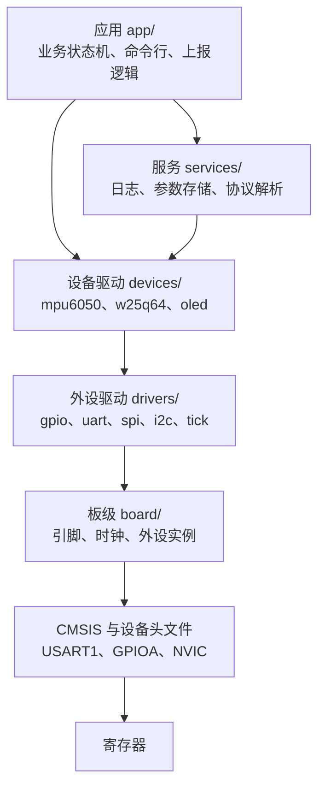

# 6.1 固件架构、配置与资源预算

初始阶段编写的固件可能只有 40 KB，面对 64 KB 的片上 Flash，似乎还有相当宽裕的余量。然而，随着后续引入浮点格式化打印、接入第三方的通信协议栈，链接器突然在某次构建中报出存储空间溢出；与此同时，当硬件版本小幅迭代，LED 指示灯从 PC13 换到 PB12、调试串口从 USART1 挪到 USART2 时，开发者不得不痛苦地在五六个源码文件中搜索被写死的寄存器与引脚号；更隐蔽的麻烦往往出现在系统运行期，随着任务逻辑增多，内存中的栈指针开始相互踩踏，而整个团队甚至理不清那区区 20 KB 的 SRAM 到底被哪些全局对象和动态调用悄悄占满。

这些在嵌入式研发后期频繁出现的泥潭，本质上源于同一组工程短板：架构缺乏清晰的分层，致使物理硬件的细节向应用业务肆意渗透；配置管理散乱，未能在构建前期验证功能组合的合理性；资源缺乏量化预算，直到硬件边界被撞破才仓促修补。

在资源高度受限的单片机环境中，代码质量首先体现在对物理边界的敬畏与控制。本节围绕这一核心展开，建立模块单向依赖的分层规范，将板级引脚与业务开关收拢至严密的配置结构中，并通过 `size`、链接映射（map 文件）、符号表及 `-fstack-usage` 等工具，把 Flash、RAM、栈深与 CPU 负载量化为可追踪的数字，将其作为构建闸门嵌入日常的自动化流程。

## 1. 分层与依赖

先看一个典型的中等规模固件。它的模块分成五层：



在模块依赖的管理上，必须恪守严格的单向拓扑：依赖关系只能自顶向下延伸。顶层的业务应用可以依赖服务层和外设驱动，中间的服务层可以调用底层驱动，但底层的驱动与板级支持包绝对不能知晓上层的具体符号与业务细节。当下层模块确实需要将状态变更向上通报时（例如按键按下或串口数据帧到达），应当通过预先注册的回调函数或抽象事件队列来实现反向投递。板级中断例程只负责触发这个函数指针，至于指针背后是点亮指示灯还是触发一次网络上报，板级代码完全不予关心。

这种单向依赖不仅保护了代码边界，更直接决定了系统的可测性与可移植性。外设驱动仅仅依赖板级头文件提供的抽象端口定义，它无需关心业务层期望以何种波特率通信，也不必理会板载 LED 是高电平还是低电平驱动；设备驱动（如惯性传感器或 SPI Flash 驱动）则仅仅依托通用总线接口进行数据收发，并不绑定特定的芯片引脚；而处于最上层的应用逻辑，甚至完全无需感知底层是一颗 STM32 还是其他架构的 MCU。这种解耦带来的直接收益，是我们在 [6.3 测试、逻辑分析与硬件在环](/教程/正文/嵌入式/6_质量_安全与交付/6_3_测试_逻辑分析与硬件在环) 中可以在主机端（PC）链接一份桩代码构建出的仿真板级文件，无需物理硬件即可将完整的业务状态机驱动起来。

板级信息只出现在 `board/` 目录里，这是分层里最容易被破坏的一条。写错的样子和改对之后差别明显：

::: compare left-title="引脚号散落在各模块" right-title="板级信息集中在 board 模块"

```c
/* led.c */
void led_on(void) {
    GPIOC->BSRR = GPIO_BSRR_BR13;
}

/* key.c */
bool key_pressed(void) {
    return (GPIOA->IDR & (1u << 0)) == 0u;
}

/* uart.c */
void console_init(void) {
    USART1->BRR = 72000000u / 115200u;
}
```

---

```c
/* board/board.h */
void board_led_set(bool on);
bool board_button_pressed(void);
void board_console_init(uint32_t baud);

/* board/board_bluepill.c */
static const struct gpio_pin k_led = {GPIOC, 13u, true};
static const struct gpio_pin k_btn = {GPIOA, 0u, true};

void board_led_set(bool on) {
    gpio_pin_write(&k_led, on);
}

bool board_button_pressed(void) {
    return gpio_pin_read(&k_btn);
}

void board_console_init(uint32_t baud) {
    uart_init(USART1, 72000000u, &(struct uart_config){.baudrate = baud});
}
```

:::

对比两种组织方式可以发现，左侧的代码直接将具体的寄存器操作和特定引脚硬编码在各个功能模块内部。一旦硬件工程师在改版时将 LED 改接到 PB12、将输入按键换至 PB1，开发者必须逐一跨文件排查修改，任何遗漏都不会在编译期得到警告。而右侧的代码将引脚与外设映射统统收拢在板级支持模块中，应用逻辑与底层驱动不再绑定具体的引脚编号。当引入全新的硬件版本时，只需新增对应的 `board_minimal.c` 并初始化相关描述对象，顶层逻辑完全不受波及。这一接口约定在 [3.1 驱动接口、CMSIS 与设备头文件](/教程/正文/嵌入式/3_驱动_通信与中间件/3_1_驱动接口_CMSIS与设备头文件) 中已经建立规范，其在系统架构中的定位十分明确：板级模块是全工程中唯一同时掌握芯片具体型号与板载物理连线的特殊边界层。

目录按层来分，一层一个目录，同一层的模块之间可以互相调用，跨层调用要看得见：

```text:no-line-numbers
firmware/
├── CMakeLists.txt
├── app/
│   ├── app_main.c              # 初始化顺序与主循环
│   └── report.c                # 周期上报
├── services/
│   ├── log.c                   # 分级日志（6.2）
│   └── cmd.c                   # 命令行解析
├── devices/
│   ├── mpu6050.c               # 依赖 i2c_bus 接口，不依赖具体引脚
│   └── w25q64.c                # 依赖 spi_bus 接口
├── drivers/
│   ├── gpio.c
│   ├── uart.c
│   ├── i2c.c
│   └── tick.c
├── board/
│   ├── board.h                 # 应用唯一可见的板级头文件
│   ├── board_bluepill.c
│   └── board_bluepill.h        # 引脚与时钟宏
└── config/
    ├── app_config.h            # 功能开关与缓冲区大小
    └── log_config.h
```

目录的划分方式在 [7 项目目录与模块划分](/教程/正文/开发与工程基础/7_项目目录与模块划分) 里有更一般的讨论；固件这一侧的特殊之处是 `board/`，它同时向上提供接口、向下使用外设实例，是把「芯片」和「产品」隔开的那一层。

::: tip 用一种简单的办法检查依赖方向

在源码里搜索上层目录的头文件名。`grep -rn '#include "app/' drivers/ devices/ services/` 应该一条都搜不到；搜得到就说明有下层模块反向依赖了上层。CMake 里也可以用 `target_link_libraries` 的表达依赖关系，让链接器在符号层面拒绝反向引用。

:::

在工程实践中，往往需要克制过早抽象的冲动。很多项目出于“未来可能更换芯片供应商”的预想，一开始就试图编写极其庞大、甚至兼容所有常见 MCU 的通用硬件抽象层。然而现实是，从 F103 换到同家族的 F407 时，外设寄存器布局大体兼容，差异主要集中在时钟树和少数高速外设的配置；只要通过清晰的板级目录完成隔离，改动量完全在可控范围内。反之，若为了抽象而抽象，不仅会让代码体积与调试成本成倍增长，还会徒增间接调用的性能开销。分层的核心目标在于收敛变更影响的范围，而非追求理论上的绝对泛化。

## 2. 配置

系统配置通常分为两类。板级配置刻画硬件板卡的固有特征，包括具体引脚分配、晶振时钟频率以及挂载的外设清单；功能配置则表达特定产品型号的业务需求，例如是否启用数据记录功能、通信缓冲区尺寸以及系统日志级别。在 C 语言构建体系中，这两类配置通常以头文件宏定义的形式呈现，由构建系统在编译调用时按需引入。

`config/board.h` 是整个硬件配置的唯一入口，它本身不包含具体引脚或特定板卡的任何硬编码，职责是根据构建系统传入的宏分发包含具体的板级定义：

```c
#ifndef BOARD_H
#define BOARD_H

/* 构建系统用 -DBOARD_HEADER='"board_bluepill.h"' 选择板子 */
#ifndef BOARD_HEADER
#error "BOARD_HEADER is not defined: pass -DBOARD_HEADER=\"board_bluepill.h\""
#endif

#include BOARD_HEADER

#endif /* BOARD_H */
```

`board_bluepill.h` 与 `board_minimal.h` 只写宏：

```c
#define BOARD_NAME "bluepill"
#define BOARD_LED_PORT 'C'
#define BOARD_LED_PIN 13u
#define BOARD_LED_ACTIVE_LOW 1
#define BOARD_HAS_W25Q64 1
#define BOARD_SYSCLK_HZ 72000000u
```

功能配置集中在 `config/app_config.h`，每个宏都用 `#ifndef` 给一个默认值，构建系统可以覆盖：

```c
#include "board.h"

#ifndef APP_USE_W25Q64
#define APP_USE_W25Q64 BOARD_HAS_W25Q64
#endif

#ifndef APP_LOG_BUF_SIZE
#define APP_LOG_BUF_SIZE 256u
#endif

#ifndef APP_LINE_MAX
#define APP_LINE_MAX 128u
#endif
```

这种配置层叠设计的巧妙之处在于，默认行为会自然继承硬件特征：`APP_USE_W25Q64` 默认取自当前板级的 `BOARD_HAS_W25Q64`。当目标切换为 Blue Pill 时外部存储功能自动启用，切换至精简板时则自动休眠，开发者在切换编译目标时完全无需在命令行重复传入冗长的参数。

### 2.1 用编译期断言检查组合

嵌入式固件的配置错误如果潜伏到运行期才暴露，排查代价会变得极为高昂。例如试图在一个根本没有焊接外部 Flash 的精简板上调用擦写例程，程序可能在进入死循环超时后才被看门狗复位，而开发者很难迅速定位究竟是硬件虚焊还是配置疏漏。利用预处理与静态断言，可以在编译器生成任何目标机器码之前，就彻底切断这种非法的宏组合。

```c
#if APP_USE_W25Q64 && !BOARD_HAS_W25Q64
#error "APP_USE_W25Q64=1 but this board has no external flash"
#endif

_Static_assert((APP_LOG_BUF_SIZE & (APP_LOG_BUF_SIZE - 1u)) == 0u,
               "APP_LOG_BUF_SIZE must be a power of two");
_Static_assert(APP_LOG_BUF_SIZE >= APP_LINE_MAX,
               "APP_LOG_BUF_SIZE must hold at least one command line");
_Static_assert(BOARD_LED_PIN < 16u, "BOARD_LED_PIN out of range");
```

这里展现了两个互补的编译期防护层：
1. 预处理阶段的 `#error` 指令：用于捕获宏存在性与布尔组合的逻辑冲突。当构建系统强制启用了某个上层功能，而当前板级头文件明确声明缺乏对应外设时，预处理器会立即中断并输出指定的错误文本。
2. C11 标准引入的 `_Static_assert` 关键字：它允许我们对常量表达式进行更为精确的数值约束检查。无论是缓冲区长度必须为 2 的幂次以方便位运算环形队列，还是引脚编号不能超出 GPIO 硬件通道范围，任何违规都会在语义分析阶段直接触发报错。

这两种机制完全不占用任何运行期的 Flash 空间或 CPU 指令周期。将系统参数的合法性校验前置到编译甚至预处理阶段，是保障固件工程严谨性的基本手段。

在精简板上编译它，得到的是这样一串错误：

::: terminal title="PowerShell - 配置组合不成立时的编译错误"

```text
$ arm-none-eabi-gcc -std=c11 -mcpu=cortex-m3 -mthumb -Wall -Wextra -Iconfig ^
    -DBOARD_HEADER='"board_minimal.h"' -DAPP_USE_W25Q64=1 -c config/config_check.c
In file included from config/config_check.c:9:
config/app_config.h:20:2: error: #error "APP_USE_W25Q64=1 but this board has no external flash"
   20 | #error "APP_USE_W25Q64=1 but this board has no external flash"
      |  ^~~~~
```

:::

缓冲区大小写错时出现两条断言错误，每条都指出是哪一个宏违反了什么规则：

::: terminal title="PowerShell - 断言错误"

```text
$ arm-none-eabi-gcc -std=c11 -mcpu=cortex-m3 -mthumb -Wall -Wextra -Iconfig ^
    -DBOARD_HEADER='"board_minimal.h"' -DAPP_LOG_BUF_SIZE=100u -c config/config_check.c
In file included from config/config_check.c:9:
config/app_config.h:23:1: error: static assertion failed: "APP_LOG_BUF_SIZE must be a power of two"
   23 | _Static_assert((APP_LOG_BUF_SIZE & (APP_LOG_BUF_SIZE - 1u)) == 0u,
      | ^~~~~~~~~~~~~~
config/app_config.h:25:1: error: static assertion failed: "APP_LOG_BUF_SIZE must hold at least one command line"
   25 | _Static_assert(APP_LOG_BUF_SIZE >= APP_LINE_MAX,
      | ^~~~~~~~~~~~~~
```

:::

没有传 `BOARD_HEADER` 时，`board.h` 自己的 `#error` 先说话，报错信息里连正确的命令行写法都给了：

::: terminal title="PowerShell - 漏传板级选择"

```text
$ arm-none-eabi-gcc -std=c11 -mcpu=cortex-m3 -mthumb -Wall -Wextra -Iconfig -c config/config_check.c
In file included from app_config.h:4,
                 from config/config_check.c:2:
board.h:6:2: error: #error "BOARD_HEADER is not defined: pass -DBOARD_HEADER=\"board_bluepill.h\""
    6 | #error "BOARD_HEADER is not defined: pass -DBOARD_HEADER=\"board_bluepill.h\""
      |  ^~~~~
board.h:9:10: error: #include expects "FILENAME" or <FILENAME>
    9 | #include BOARD_HEADER
      |          ^~~~~~~~~~~~
```

:::

第二条错误是 `#include BOARD_HEADER` 在宏为空时的后果，可以视作噪音，但第一条已经说清了问题。

::: concept emb61-config-checked-at-build title="配置错误在编译期发现"

板级与功能配置全部由宏表达，构建系统在编译命令行上传入 `-D`。宏之间的约束用 `#if ... #error` 与 `_Static_assert` 检查：前者在预处理阶段，后者在编译阶段，两者都不产生运行时代码。凡是能在编译期确定的组合是否合法，都在编译期检查。

:::

### 2.2 构建系统选择板子

CMake 里用一个缓存项表示板子，再把它翻译成头文件名：

```cmake
set(BOARD "bluepill" CACHE STRING "板级配置：bluepill 或 minimal")
set_property(CACHE BOARD PROPERTY STRINGS bluepill minimal)

if(BOARD STREQUAL "bluepill")
    set(BOARD_HEADER "board_bluepill.h")
elseif(BOARD STREQUAL "minimal")
    set(BOARD_HEADER "board_minimal.h")
else()
    message(FATAL_ERROR "未知的 BOARD=${BOARD}，可选 bluepill 或 minimal")
endif()

add_library(config_check OBJECT config/config_check.c)
target_link_libraries(config_check PRIVATE stm32f103_options)
target_compile_definitions(config_check PRIVATE BOARD_HEADER="${BOARD_HEADER}")
target_include_directories(config_check PRIVATE "${CMAKE_CURRENT_LIST_DIR}/config")
```

`config_check.c` 只做一件事：包含 `app_config.h`，再把几个配置值放进一个全局对象，让编译器真的去看它们。它不参与任何产品固件的链接，单独编译一次就相当于跑了一遍配置检查。构建命令是：

::: terminal title="PowerShell - 换板子构建"

```text
$ cmake -B build_min -G Ninja --toolchain ../../common/arm-none-eabi.cmake ^
    -DCMSIS_DIR=C:/cmsis -DBOARD=minimal
-- Configuring done
-- Generating done
$ cmake --build build_min --target config_check
[1/1] Building C object CMakeFiles/config_check.dir/config/config_check.c.obj
```

:::

完整的工程在 `code/嵌入式/6_质量_安全与交付/6_1_固件架构_配置与资源预算/`，`CMakeLists.txt` 里 `BOARD` 的合法取值写在 `STRINGS` 属性里，这样 `cmake -LA` 和图形界面的缓存编辑器都能列出来。

### 2.3 Kconfig

当配置项超过几十个、而且彼此有依赖时，手写头文件和 `#error` 会变得难以维护。Linux 内核、Zephyr、RT-Thread 用的是另一套办法：Kconfig。每个配置项写在一个 `Kconfig` 文件里，声明类型、默认值、依赖关系和帮助文字：

```text
config LOG_LEVEL
    int "Log level"
    range 0 4
    default 3
    help
      Logging verbosity: 0 none, 1 error, 2 warning, 3 info, 4 debug.

config USE_W25Q64
    bool "Enable external W25Q64 flash"
    depends on BOARD_HAS_SPI
    default y
```

`menuconfig` 或 `guiconfig` 读取这些声明，画出带依赖关系的菜单：`USE_W25Q64` 依赖的条件不成立时，这一项根本不出现。选完之后工具生成一个头文件（Linux 内核里是 `include/generated/autoconf.h`），C 代码包含它就能用 `CONFIG_LOG_LEVEL` 这样的宏。

什么时候该上 Kconfig：当项目衍生出多款差异化产品、涉及几十乃至上百个互相缠绕的宏开关，且由不同小组共同维护时，文本头文件配合 `#error` 的方式容易发生维护疏漏。此时引入 Kconfig 系统，通过图形化配置界面直观呈现依赖树，能极大降低配置冲突的概率；而对于功能单一、硬件衍生版本有限的常规项目，简单的头文件层叠搭配 `_Static_assert` 足够透明直接，无需为之引入一整套额外的外部解释工具链。关于 Kconfig 的语法规范，可参阅 Linux 内核源码树中的相关文档。

### 2.4 运行期配置

引脚接线与晶振主频等参数在出厂打板焊接后便已固化，属于典型的编译期配置；而诸如传感器采样速率、网络上报周期、出厂序列号等可变参数，则属于运行期配置。这些参数通常持久化在 MCU 内部 Flash 的预留扇区或板载外部 EEPROM 中，其擦写机制与版本兼容迁移在 [3.9 Flash、EEPROM、SD 与文件系统](/教程/正文/嵌入式/3_驱动_通信与中间件/3_9_Flash_EEPROM_SD与文件系统) 以及 [6.8 发布、现场升级与维护](/教程/正文/嵌入式/6_质量_安全与交付/6_8_发布_现场升级与维护) 中有深入讨论。

在系统设计中，务必严守两者的界限：编译期配置决定了固件中到底包含哪些二进制指令与常量，而运行期配置仅仅改变现有代码的执行分支与逻辑参数。如果在固件中把“板子是否焊有外部 Flash”做成运行期动态探测的配置项，就意味着固件必须包含两套硬件的处理代码，并在每一次访问时都进行条件分支检查——这种看似灵活的设计不仅徒增运行开销，更会无端膨胀代码体积，是早期固件开发中最容易陷入的过度工程陷阱。

## 3. Flash 与 RAM 预算

先看一个可以反复测量的工程。`code/嵌入式/6_质量_安全与交付/6_1_固件架构_配置与资源预算/size_demo/` 是一份完整的固件：初始化 PC13 的 LED 和 USART1，用 `printf` 打印一个环形平均滤波的结果。这份工程的作用是体积的「标尺」：它包含了一个产品固件最常见的两样东西，GPIO 与带格式化的串口输出。

`arm-none-eabi-size` 给出三个数：

::: terminal title="PowerShell - size 的三列"

```text
$ arm-none-eabi-size build/size_demo.elf
   text    data     bss     dec     hex filename
   4600      92    1900    6592    19c0 build/size_demo.elf
```

:::

三列的含义在 [1.8 复位、启动与链接](/教程/正文/嵌入式/1_平台与工具链/1_8_复位_启动与链接) 里已经讲过，这里只重复与预算有关的结论：

| 列 | 进 Flash | 进 RAM | 内容 |
| --- | --- | --- | --- |
| `text` | 是 | 否 | 代码、向量表、只读常量 |
| `data` | 是 | 是 | 有初值的可写全局对象，初值存在 Flash，运行时复制到 RAM |
| `bss` | 否 | 是 | 零初值的全局对象，启动时清零 |

所以 Flash 占用是 `text + data`，RAM 占用是 `data + bss`。`data` 同时算进两者，是因为它有两份拷贝：Flash 里存初值，RAM 里存运行时的副本。

三个数不能直接当预算用，因为链接脚本还给堆和栈留了空间。`size -A` 把每个输出段列出来：

::: terminal title="PowerShell - size -A 的段明细"

```text
$ arm-none-eabi-size -A build/size_demo.elf
section              size        addr
.isr_vector           236   134217728
.text                4284   134217964
.rodata                80   134222248
.data                  92   536870912
.bss                  360   536871004
.noinit                 0   536871364
._user_heap_stack    1540   536871364
```

:::

`bss` 那一列的 1900 是 360 加 1540：后者是链接脚本按 `_Min_Heap_Size = 0x200` 与 `_Min_Stack_Size = 0x400` 预留的主栈与最小堆。计算 RAM 占用时要把这部分加进去，之后再按第 4 节的方法核对栈够不够。

链接时加 `-Wl,--print-memory-usage`，链接器直接按 `MEMORY` 区域报百分比：

```cmake
target_link_options(size_demo PRIVATE -Wl,--print-memory-usage)
```

::: terminal title="PowerShell - 链接器的内存占用报告"

```text
Memory region         Used Size  Region Size  %age Used
           FLASH:        4692 B        64 KB      7.16%
             RAM:        1992 B        20 KB       9.73%
```

:::

4692 就是 `text + data`，1992 是 `data + bss`；RAM 的 1992 里已经包含 `._user_heap_stack` 的 1540。这个选项应当长期开着，链接器每次都会提醒还剩多少。

### 3.1 从 map 文件里找大户

`size` 只给总数。要知道是谁占的，用链接脚本的 `-Wl,-Map=<文件>` 生成映射文件。`firmware.cmake` 里的 `stm32f103_firmware()` 已经给每个目标生成了 `<目标>.map`。打开它，先看开头一段：

::: terminal title="text - size_demo.map 的库成员列表（节选）"

```text
Archive member included to satisfy reference by file (symbol)

libc_nano.a(libc_a-printf.o)
                              size_demo/main.c.obj (printf)
libc_nano.a(libc_a-puts.o)
                              size_demo/main.c.obj (puts)
libc_nano.a(libc_a-wbuf.o)
                              libc_nano.a(libc_a-puts.o) (__swbuf_r)
libc_nano.a(libc_a-nano-vfprintf.o)
                              libc_nano.a(libc_a-printf.o) (_vfprintf_r)
libc_nano.a(libc_a-nano-vfprintf_i.o)
                              libc_nano.a(libc_a-nano-vfprintf.o) (_printf_i)
libc_nano.a(libc_a-fflush.o)
                              libc_nano.a(libc_a-wbuf.o) (_fflush_r)
```

:::

这一段回答的是「为什么这一大堆库代码被链接进来了」：每一次 `printf` 都会拉进 `printf`、`puts`、缓冲管理、锁、`vfprintf` 和格式化核心，哪怕只打印一个整数。往下翻到 `Linker script and memory map` 段，可以按目标文件查每个段的大小：

::: details size_demo.map 里按目标文件的占用

```text
 .text.startup.main
                0x0800013c       0xe4 CMakeFiles/size_demo.dir/size_demo/main.c.obj
 .text._write   0x08000220       0x2c CMakeFiles/size_demo.dir/size_demo/retarget.c.obj
 .text.printf   0x0800024c       0x24 libc_nano.a(libc_a-printf.o)
                0x080006c4      0x230 libc_nano.a(libc_a-nano-vfprintf.o)
 .text._printf_common
                0x080008f4       0xe4 libc_nano.a(libc_a-nano-vfprintf_i.o)
 .text._printf_i
                0x080009d8      0x23c libc_nano.a(libc_a-nano-vfprintf_i.o)
```

:::

自己写的代码一共 0xe4 + 0x2c = 0x110 字节，而链接进来的库代码（格式化、缓冲、堆管理）加起来约四千字节。这是用了 `printf` 的固定代价，预算时要把它算进去，别等 Flash 满了再去查。

`arm-none-eabi-nm --size-sort -S` 按符号大小排序（加 `-r` 从大到小），适合快速找大户：

::: terminal title="PowerShell - nm 找最大的符号"

```text
$ arm-none-eabi-nm --size-sort -S -r build/size_demo.elf | head -8
080009d8 0000023c T _printf_i
080006c4 00000230 T _vfprintf_r
080006c4 00000230 T _vfiprintf_r
20000080 00000138 B __sf
0800055c 00000100 T _malloc_r
08000c14 00000100 T __sflush_r
08000000 000000ec R g_vector_table
0800013c 000000e4 T main
```

:::

`_vfprintf_r` 与 `_vfiprintf_r` 是同一个地址的两个别名，`__sf` 是 newlib 的 3 个文件流对象，占 0x138 字节 RAM。注意 `main` 只有 0xe4 字节，写代码的人往往高估自己那部分，低估库的部分。

### 3.2 编译选项对体积的影响

同一份 `size_demo`，只改编译选项，`text` 从 4528 变到 29096 字节。下面每一行都是在同一台机器、同一个工具链（Arm GNU Toolchain 13.3）下实际构建得到的，链接脚本与启动文件都相同：

| 构建方式 | text | data | bss | Flash 合计 |
| --- | --- | --- | --- | --- |
| `-O0` | 4748 | 92 | 1900 | 4840 |
| `-Og` | 4584 | 92 | 1900 | 4676 |
| `-Os` | 4528 | 92 | 1900 | 4620 |
| `-O2` | 4600 | 92 | 1900 | 4692 |
| `-O2`，去掉 `--gc-sections` | 6028 | 92 | 1900 | 6120 |
| `-O2`，`-u _printf_float` | 14672 | 456 | 1896 | 15128 |
| `-O2`，不用 `nano.specs`（完整 newlib） | 29096 | 1744 | 1944 | 30840 |

分析上述实测数据，有几个现象往往打破工程师的固有直觉：

首先，编译器优化级别对最终体积的影响，远没有大家想象得那样剧烈。从几乎不作优化的 `-O0` 一路调至追求极简体积的 `-Os`，整个固件的 Flash 占用仅仅缩减了 220 字节；而是否选用裁剪过的精简 C 库（`nano.specs`），体积差异竟高达 25 KB 以上。在资源排查时，盲目将编译选项由 `-O2` 切换为 `-Os` 往往收效甚微，审视链接阶段引入的基础库才是解决空间危机的关键所在。

其次，未开启 `--gc-sections` 会导致固件凭空多出 1.4 KB（实测 1428 字节）的无用负荷。链接器的段回收依赖编译器输出的独立段（即 `-ffunction-sections` 与 `-fdata-sections`）。若没有这两个选项，链接器只能以整个目标文件为单位进行打包，即便整个文件里只有某个极小的辅助函数被调用，其余几十个未被触碰的函数与常量也会被全数打包进 Flash。

最后，开启浮点格式化输出的代价异常沉重。仅仅通过链接参数引入 `-u _printf_float`，固件尺寸便骤增近 10 KB。这是因为底层除了要拉入负责高精度浮点转换的 `_dtoa_r`（0xb7c 字节）等核心算法，还会连带保留 `_printf_float`（0x458 字节）、`_Balloc`、若干 `__aeabi_d*` 软浮点例程，以及 `malloc` 与 `mprec` 一整套。`text` 由 4600 涨到 14672，`bss` 略有减少是因为别的对象被挤掉了。在一颗总容量仅 64 KB 的低成本单片机上，仅仅这一处格式化特性便侵占了六分之一的物理空间。

::: tip 优化固件体积的排查优先级

当固件面临 Flash 溢出告警时，合理的排查顺序应当是：首先核查编译与链接链条中 `--specs=nano.specs` 与 `-Wl,--gc-sections` 是否已被正确激活；其次借助生成的 map 文件与符号排序，定位占用空间最大的库成员；最后再评估是否需要关闭浮点打印、裁剪高耗能协议库，或是将常规优化降至 `-Os`。遵循这样的逻辑，通常能在不损害代码结构与可读性的前提下迅速收回大量存储空间。

:::

在通常的工程开发中，常规应用保持 `-O2` 即可兼顾执行效率与代码尺寸；只有当 Flash 边界极度紧张时，才值得将全局或特定单元切换为 `-Os`。在绝大多数微控制器应用中，执行效率的瓶颈主要由中断响应延迟与算法时间复杂度决定，微调这两档编译器优化所带来的性能波澜微乎其微。

<Quiz
  type="single"
  :options="[
    { label: '4600 字节，因为只有 text 进 Flash', value: 'A' },
    { label: '4692 字节，data 的初值也要占 Flash', value: 'B' },
    { label: '6592 字节，三列之和', value: 'C' },
    { label: '1900 字节，bss 是最大的一列', value: 'D' }
  ]"
  answer="B"
>

<template #question>

`size` 输出为 `text 4600, data 92, bss 1900`。这段固件占多少 Flash？

</template>

正确答案是 **B**。`text` 与 `data` 都进 Flash：`data` 的初值保存在 Flash 里，启动时由启动代码复制到 RAM。`bss` 不占 Flash，启动时清零即可。三列之和 6592 没有物理意义，1900 是 RAM 的一部分。

</Quiz>

<Quiz
  type="single"
  :options="[
    { label: '把 -O2 改成 -Os，能省下大部分空间', value: 'A' },
    { label: '关掉 --gc-sections，让链接器自己判断', value: 'B' },
    { label: '检查 nano.specs 与 gc-sections 是否开启，再查 map 里最大的库成员', value: 'C' },
    { label: '把 printf 改成 puts，问题就解决了', value: 'D' }
  ]"
  answer="C"
>

<template #question>

固件超出 Flash 预算 2 KB，第一步应该做什么？

</template>

正确答案是 **C**。实测里 `-O0` 到 `-Os` 只差两百多字节，而换 C 库能差二十多 KB；map 文件会告诉你哪几个库函数加起来占了两千字节。`puts` 只能替掉一行没有格式化的输出，解决不了根本问题。

</Quiz>

## 4. 栈预算

在没有硬件存储器保护单元（MPU）辅助兜底的微控制器中，栈溢出往往是极为隐蔽而致命的缺陷。一旦调用深度或局部数据突破了预留边界，下溢的栈顶指针就会直接踩踏相邻内存中存放的全局对象或控制块。这种破坏通常不会立即触发硬件中断，而是表现为毫无规律的偶发复位、通信数据异常或业务状态机乱跳。确定栈的大小绝不能凭直觉分配一个看似宽裕的数字，而必须从函数调用树的拓扑结构与每个栈帧的具体尺寸严谨推导。

`-fstack-usage` 让编译器为每个源文件生成一个 `.su` 文件，每个函数一行，格式是「文件:行:列:函数名 字节数 类型」：

```cmake
add_library(stack_demo OBJECT stack/demo.c)
target_compile_options(stack_demo PRIVATE
    -std=c11 -mcpu=cortex-m3 -mthumb -O2 -fstack-usage)
```

`stack/demo.c` 里有四个函数，分别代表四种常见情况：一次小的传感器读取、一次带 `snprintf` 的上报、一个变长数组、一个 512 字节的大缓冲区。编译后得到的 `.su` 文件是：

::: terminal title="text - demo.su"

```text
demo.c:25:6:sensor_task       40      static
demo.c:30:6:report_task       56      static
demo.c:36:6:log_task           8      dynamic
demo.c:42:6:big_buffer_task  520      static
```

:::

第三列的类型要分清：

| 类型 | 含义 | 怎么处理 |
| --- | --- | --- |
| `static` | 栈帧大小在编译期确定 | 直接参与求和 |
| `dynamic` | 用了变长数组或 `alloca`，大小在运行期才知道 | 必须改掉，或者按最大可能的长度估算 |
| `bounded` | 大小有上界但编译器只能给出范围 | 按上界算 |

`log_task` 里有一行 `char buf[len];`，长度来自参数，所以只有 8 字节是固定的，其余无法确定。这种写法在嵌入式固件里应当避免：栈大小是预算的一部分，预算里不能有未知数。

`-Wstack-usage=N` 把超过 N 字节的函数变成警告，把 `dynamic` 变成另一条警告：

::: terminal title="PowerShell - 栈用量警告"

```text
$ arm-none-eabi-gcc -std=c11 -mcpu=cortex-m3 -mthumb -O2 -fstack-usage ^
    -Wstack-usage=128 -c stack/demo.c
demo.c: In function 'log_task':
demo.c:36:6: warning: stack usage might be unbounded [-Wstack-usage=]
   36 | void log_task(unsigned len) {
      |      ^~~~~~~~
demo.c: In function 'big_buffer_task':
demo.c:42:6: warning: stack usage is 520 bytes [-Wstack-usage=]
   42 | void big_buffer_task(void) {
      |      ^~~~~~~~~~
```

:::

警告里的「might be unbounded」说的是实情：编译器确实不知道 `len` 有多大。把上限设在任务栈的四分之一左右比较合适，比如 1 KB 的任务栈用 `-Wstack-usage=256`。

### 4.1 沿调用链求和

单个函数的栈帧不等于最深栈深。`main` 调 `a()`，`a()` 调 `b()`，栈上同时压着三层栈帧，还要加上中断入栈的 8 个字。`-fcallgraph-info=su` 生成一份带栈用量的调用图，格式是 VCG，用文本看：

::: terminal title="text - demo.ci（节选）"

```text
graph: { title: "demo.c"
node: { title: "sensor_task" label: "sensor_task\ndemo.c:25:6\n40 bytes (static)" }
node: { title: "sensor_read_raw" label: "sensor_read_raw\ndemo.c:11:16" shape : ellipse }
edge: { sourcename: "sensor_task" targetname: "sensor_read_raw" label: "demo.c:26:17" }
node: { title: "report_task" label: "report_task\ndemo.c:30:6\n56 bytes (static)" }
edge: { sourcename: "report_task" targetname: "snprintf" label: "demo.c:32:13" }
node: { title: "big_buffer_task" label: "big_buffer_task\ndemo.c:42:6\n520 bytes (static)" }
edge: { sourcename: "big_buffer_task" targetname: "bus_write" label: "demo.c:47:5" }
}
```

:::

图里出现的外部函数（`snprintf`、`bus_write`）只有名字，没有栈用量，因为它们的实现不在当前编译单元。`snprintf` 的栈帧要去 newlib 的源码或者反汇编里看，通常几百字节，这一项在估栈时经常被漏掉。

沿调用链求和时，取「根到叶」路径上栈帧之和的最大值。递归必须单独处理：编译器不会告诉你递归深度，只能人工确认递归不存在，或者证明深度有上限。函数指针调用的目标在编译期不确定，`-fcallgraph-info` 会把它们标成 `shape : ellipse`，调用链在这一处断开，需要人工补上。

### 4.2 主栈与任务栈

主栈（MSP）用在两个地方：调度器启动之前的初始化代码，以及所有中断。它的需求是两者之和：

- 启动阶段最深的调用链：时钟初始化、外设初始化、`main` 里的局部对象；
- 最深的中断嵌套：每个中断处理函数自身的栈帧，乘上允许嵌套的层数，再加硬件入栈的 8 个字（共 32 字节）。

F103 上链接脚本默认给了 1 KB 主栈，够用与否要按上面的方法算。`._user_heap_stack` 里同时包含 `_Min_Heap_Size`，不用 `malloc` 的固件可以把它改小。

RTOS 任务栈是另一笔账：每个任务有独立的栈，大小由创建时的参数决定，栈的测量方法与高水位线在 [4.5 内存与资源管理](/教程/正文/嵌入式/4_RTOS与固件架构/4_5_内存与资源管理) 里讲过。任务栈要按「该任务自己最深的一条调用链」定，不能按 `main` 的栈深照搬。

::: concept emb61-stack-depth title="最坏栈深的算法"

一个执行路径的最坏栈深等于该路径上所有函数栈帧之和的最大值，加上每次中断入栈的 32 字节乘以嵌套层数。`-fstack-usage` 给出每个函数栈帧的大小；递归、函数指针与变长数组会让调用图不完整，必须人工确认。

:::

## 5. CPU 与时间预算

相较于 Flash 与 RAM 这类可以通过静态编译工具精确度量的空间资源，CPU 运算时间属于典型的动态时间维度资源。静态分析工具无法替我们预知所有外部中断的触发频率与偶发事件的并发强度，因而建立时间预算必须从系统运行特性的分析与建模入手。

在实时控制系统中，建立时间预算的基本路径是列出所有前后台任务的周期要求与最坏情况执行时间（WCET）：

| 任务 | 周期 | 最坏执行时间 WCET | 利用率 |
| --- | --- | --- | --- |
| 传感器采样 | 10 ms | 0.8 ms | 8% |
| 控制计算 | 10 ms | 2.5 ms | 25% |
| 通信处理 | 20 ms | 1.2 ms | 6% |
| 日志输出 | 事件触发（最长 50 ms 一次） | 3 ms | 6% |
| 合计 | | | 45% |

周期任务的利用率之和构成了系统稳态 CPU 负载的底线。以表中的参数为例，稳态周期计算占用了 45% 的算力；在此基础上，还必须叠加异步中断服务的开销：例如 USART 在 115200 波特率下全速收发时每秒传输约 11.5 KB 数据，按单字节中断服务耗时 3 μs 估算，持续占满总线时的 CPU 占比不足 4%；再加上系统滴答定时器（SysTick）与常规外设中断，系统的常态总负载大约在 50% 上下。按照实时系统工程准则，单核 MCU 上的稳态周期任务综合利用率建议压制在 60%–70% 之间，预留出的 30% 算力窗口用于消化突发数据洪峰与后续的功能迭代空间。

关于最坏情况执行时间（WCET）的具体实测手段，我们将在 [6.5 实时性、性能与功耗测量](/教程/正文/嵌入式/6_质量_安全与交付/6_5_实时性_性能与功耗测量) 中通过 GPIO 翻转结合逻辑分析仪、Cortex-M 的 DWT 周期计数器以及静态指令分析等工具进行系统化测量。这里的核心原则是：时间预算表中的每一个毫秒数字都必须有可追溯的实验实测数据或数学上界支撑，坚决避免无根据的主观推测。

截止时间与利用率的进一步分析（响应时间、优先级分配）在 [4.6 优先级反转、死锁与实时性](/教程/正文/嵌入式/4_RTOS与固件架构/4_6_优先级反转_死锁与实时性) 里讲过，这里不再重复。

## 6. 把预算放进构建

预算写在文档里没人看，写在构建脚本里才有约束力。一个够用的检查脚本只要几十行：调用 `arm-none-eabi-size` 读 ELF，算出 Flash 与 RAM 占用，和一份 JSON 里的上限比较，超出就以非零状态退出。

`budget/check_budget.py` 就是这样做的：

```python
def run_size(size_tool, elf):
    out = subprocess.run([size_tool, elf], check=True,
                         capture_output=True, text=True).stdout
    lines = [ln for ln in out.splitlines() if ln.strip()]
    for i, ln in enumerate(lines):
        if ln.split()[:3] == ["text", "data", "bss"]:
            row = lines[i + 1].split()
            return int(row[0]), int(row[1]), int(row[2])
    raise ValueError("size 输出里没有 text/data/bss 表头")
```

主函数把 `text + data` 与 `data + bss` 分别和预算比较，逐行打印百分比，最后给出结论：

::: terminal title="PowerShell - 预算内"

```text
$ python budget/check_budget.py build/size_demo.elf --budget budget/budget.json ^
    --size-tool arm-none-eabi-size
Flash    4692 /    8192 B   57.3%  OK
RAM      1992 /    4096 B   48.6%  OK
budget check passed
```

:::

把同一份预算用在打开浮点 `printf` 的构建上，Flash 立刻超限，退出码是 1：

::: terminal title="PowerShell - 超预算"

```text
$ python budget/check_budget.py build/size_demo_float.elf --budget budget/budget.json ^
    --size-tool arm-none-eabi-size
Flash   15128 /    8192 B  184.7%  OVER
RAM      2352 /    4096 B   57.4%  OK
budget exceeded
```

:::

接进 CMake 只要一条 `POST_BUILD` 命令：

```cmake
find_package(Python3 REQUIRED COMPONENTS Interpreter)
add_custom_command(TARGET size_demo POST_BUILD
    COMMAND "${Python3_EXECUTABLE}" "${CMAKE_CURRENT_LIST_DIR}/budget/check_budget.py"
        "$<TARGET_FILE:size_demo>"
        --budget "${CMAKE_CURRENT_LIST_DIR}/budget/budget.json"
        --size-tool "${CMAKE_SIZE}"
    VERBATIM)
```

构建时它紧跟在 `size` 输出之后运行，超限就让整个构建失败：

::: terminal title="PowerShell - 构建时超限"

```text
[8/8] Linking C executable size_demo.elf
   text    data     bss     dec     hex filename
   4600      92    1900    6592    19c0 size_demo.elf
Flash    4692 /    4096 B  114.6%  OVER
RAM      1992 /    4096 B   48.6%  OK
budget exceeded
FAILED: size_demo.elf
ninja: build stopped: subcommand failed.
```

:::

这种自动化闸门的最大价值，在于将潜在的容量风险拦截在工程师的本地开发阶段。无论是某次改动不慎调小了限额，还是不经意间引入了庞大的第三方组件导致 Flash 溢出，构建工具都会在本地编译完成时立刻报错中断，根本无需等到系统联调乃至临近发布时才仓促排查。将预算配置文件纳入版本控制，更使得任何容量限额的调整都必须通过明确的代码评审，成为团队公开讨论的技术决策。

### 6.1 CI 里记录体积变化

本地构建失败能够有效拦截突破绝对上限的“硬违规”，但往往难以防范每次提交悄悄增加几十字节的“代码膨胀”。在持续集成（CI）流水线中，更进一步的做法是将每次构建生成的 ELF 尺寸作为关键指标记录并比对，甚至直接以自动评论的形式反馈在合并请求中：

```
Flash  4692 B  (+36 B, +0.8%)
RAM    1992 B  (+0 B, +0.0%)
```

指标的具体存储与图表渲染方式可以依托团队现有的 CI 平台，其实现哲学与 [18 持续集成](/教程/正文/开发与工程基础/18_持续集成) 中阐述的自动化质量守护完全相通：每次构建执行相同的度量指令，提取产物尺寸并与主干基线做差值分析。当某个提交导致 Flash 意外激增数千字节时，这往往表明该次提交误触了某个未裁剪的重型功能开关，或是无意中引入了复杂的软浮点运算。

::: tip 需求引入前评估物理余量

预算表中的限制阈值应当作为架构设计的常态约束，伴随项目始终。当片上剩余 Flash 空间仅剩 3 KB 时，就不应在系统方案中盲目拍板选用需要 8 KB 代码体积的协议组件，更不必先硬行合并再试图做痛苦的事后裁剪。在方案论证初期就把剩余物理余量作为硬性指标纳入考量，往往能规避后期沉重的重构成本。

:::

## 7. 习题

### 7.1 巩固

<Exercise id="60601" :d="1" :w="1">

某次构建的 `size` 输出与 `size -A` 的节选如下：

```text
   text    data     bss     dec     hex filename
   5124     128    2100    7352    1cb8 size_demo.elf
```

```text
section              size        addr
.bss                  464   536871004
.noinit                96   536871364
._user_heap_stack    1540   536871364
```

(1) 这份固件占多少 Flash、多少 RAM？写出两个算式。
(2) `bss` 列的 2100 由哪几段组成？`.noinit` 为什么也算进 RAM，尽管启动代码不会清零它？
(3) 之后加入三个对象：一个 256 字节的 `const` 查表、一个 64 字节零初值的全局缓冲、一个 32 字节带初值的全局表。`text`、`data`、`bss` 三列各变成多少？Flash 与 RAM 各增加多少字节？三个对象里哪一个同时占两份？
(4) 有人看到 `.bss` 只有 464 字节，就说「RAM 只用了 464」。这样算漏掉了什么？漏掉的部分在什么情况下最先出问题？

</Exercise>

<Exercise id="60602" :d="2" :w="2">

`config/board_minimal.h` 里 `BOARD_HAS_W25Q64` 为 0，`APP_LINE_MAX` 默认为 128。下面的命令不改任何源码：

```text
arm-none-eabi-gcc -std=c11 -mcpu=cortex-m3 -mthumb -Wall -Wextra -Iconfig ^
    -DBOARD_HEADER='"board_minimal.h"' -DAPP_LOG_BUF_SIZE=100u -c config/config_check.c
```

(1) 先不运行，写出这条命令会报几条错误、各是哪一条规则被违反。再实际运行，对照结果。第二条断言为什么也失败？
(2) 只在命令行再加 `-DAPP_LINE_MAX=64u`，错误减少到几条？为什么 `100u` 满足「不小于一行」仍不满足另一条规则？
(3) 把下面六个配置项分成编译期与运行期两类，各写一句理由：LED 引脚、控制台波特率、采样率、上报周期、是否启用 W25Q64、设备编号。其中哪一项如果做成运行期可读，会让每个用到它的函数都多一次判断？
(4) 什么时候该从 `#ifndef` 加 `_Static_assert` 换成 Kconfig？用本页配置项的数量说明现在为什么不必。

</Exercise>

### 7.2 编程

<Exercise id="60603" :d="3" :w="3">

给工程加第三块板 `lab`：LED 接 PA15、低电平点亮、没有外部 Flash、SYSCLK 为 8 MHz。

(1) 写 `config/board_lab.h`，六个宏与另外两块板保持同名、同格式。
(2) 在 `CMakeLists.txt` 的 `BOARD` 分支里加上 `lab`，同时把它写进缓存项的 `STRINGS` 属性。说明 `STRINGS` 除了影响 `cmake -LA` 的输出，还影响什么。
(3) 在 `config/app_config.h` 里补两条 `_Static_assert`：`BOARD_SYSCLK_HZ` 不低于 8 MHz，`BOARD_LED_ACTIVE_LOW` 只能取 0 或 1。后者写成 `(BOARD_LED_ACTIVE_LOW == 0) || (BOARD_LED_ACTIVE_LOW == 1)`，说明为什么不能写成 `BOARD_LED_ACTIVE_LOW == 0 || 1`。
(4) 用 `cmake -B build_lab -DBOARD=lab -LA ...` 确认缓存里列出三个取值，再构建 `config_check` 目标，两者都贴输出。
(5) 把 `board_lab.h` 的 `BOARD_SYSCLK_HZ` 临时改成 `4000000u`，贴出断言错误，再把值改回来。

验收：(1) 到 (4) 全部通过，(5) 的报错里出现你写的提示语。没有 CMSIS 头文件时，(1)(3)(5) 可以只用 `arm-none-eabi-gcc -Iconfig -DBOARD_HEADER='"board_lab.h"' -c config/config_check.c` 验证。

</Exercise>

<Exercise id="60604" :d="3" :w="3">

下面是一个按层分目录的固件，箭头左边的文件包含了右边的头文件：

```text
app/app_main.c          -> services/log.h
services/log.c          -> drivers/uart.h
services/cmd.c          -> app/app_main.h
devices/mpu6050.c       -> services/log.h
drivers/uart.c          -> board/board.h
devices/w25q64.c        -> drivers/spi.h
```

(1) 按本页的五层依赖方向（app → services → devices → drivers → board），指出哪两条违规，各自在换板子或做主机测试时会带来什么麻烦。
(2) 写 `check_layers.py`：读一份 `layers.json`（目录名到层号的映射），扫描给定目录下所有 `.c` 与 `.h` 的 `#include "..."`，把「被包含文件所在层高于包含者」的情况连同文件与行号打印出来；有违规时退出码为 1。
(3) 修掉这两处违规，不改功能：`services/cmd.c` 那一处改成「调用者把结果交回来」，`devices/mpu6050.c` 那一处改成注册回调。给出修改前后的关键代码，并说明为什么回调比在设备里直接调用服务层更容易测。
(4) 本页建议用 `grep -rn '#include "app/' drivers/ devices/ services/` 检查。这条命令只找 `app/`，漏掉哪两类向上包含？用上面列表里的 `devices/mpu6050.c -> services/log.h` 说明第一类，再补一条会被漏掉的相对路径写法。
(5) 把 `layers.json` 里的 `devices` 与 `services` 对调，重新运行脚本，说明为什么脚本能发现这次配置错误，而编译器不能。

验收：修复前脚本打印 2 条并返回 1，修复后打印 0 条并返回 0。

</Exercise>

<Exercise id="60605" :d="3" :w="3">

一个裸机固件的 `-fstack-usage` 结果与调用关系如下，`snprintf` 与 `arm_mat_mult` 的实现都不在本编译单元，后者还只能经函数指针调用：

| 函数 | 栈帧 | 调用 |
| --- | --- | --- |
| `app_main` | 24 | `control_task`、`report_task` |
| `control_task` | 72 | `filter_update` |
| `filter_update` | 96 | `arm_mat_mult`（函数指针） |
| `report_task` | 48 | `snprintf` |
| `snprintf` | 400（查库源码估） | — |
| `isr_tick` | 32 | 中断，允许嵌套 2 层 |

(1) 写出两条根到叶路径的栈深。`arm_mat_mult` 那一层在 `.su` 里查不到，为什么调用图在这一处断开？这个未知量应该怎么处理？
(2) 取可算的那条路径（`report_task → snprintf`）为最坏值，加上中断开销：每层中断的硬件入栈是 8 个字，处理函数自身用 32 字节。两层嵌套共加多少字节？
(3) 主栈默认 1 KB。按上面的数算，余量是多少？如果后来查明 `arm_mat_mult` 实际用 300 字节，结论会变吗？给出两个总需求，并说明为什么 `snprintf` 的 400 字节是最难估的一项。
(4) 如果 `filter_update` 改用变长数组，`.su` 里的类型会变成什么？这对预算评估会造成什么影响，应该怎么改掉？
(5) 把 `isr_tick` 的嵌套层数从 2 改成 3，总需求增加多少？F103 的 NVIC 上这个层数由谁决定？

</Exercise>

<Exercise id="60606" :d="4" :w="4">

写 `stack_report.py`：给定一个目录，读入其中所有 `.su` 与 `.ci`，算出每个根函数的最坏栈深。

`-fcallgraph-info=su` 生成的 `.ci` 是 VCG 文本，节点与边形如：

```text
node: { title: "report_task" label: "report_task\ndemo.c:30:6\n56 bytes (static)" }
edge: { sourcename: "report_task" targetname: "snprintf" label: "demo.c:32:13" }
```

(1) 解析 `.su` 得到「函数名到字节数与类型」的对应关系，解析 `.ci` 得到调用边。以没有入边的节点为根，对每条路径求和。凡路径上出现 `.su` 里没有记录的函数，就在那一处停下并把这条件路径标成 `>= 已算部分`，不要当成 0 字节。
(2) 处理三种特殊情况：调用了没有 `.su` 记录的函数（外部库）、`dynamic` 类型的函数、调用图里出现环。前两种在路径上标注 `unknown`，第三种报告 `cycle: a -> b -> a` 并跳过这条路径，不能死循环。
(3) 在 `code/嵌入式/6_质量_安全与交付/6_1_固件架构_配置与资源预算/stack/` 上生成输入并运行。输出里应能看出：可算的路径中最大的是 `big_buffer_task`（520 字节），而 `report_task` 那条路径因为 `snprintf` 不在 `.su` 里只能给出下界。用这个结果说明为什么第 4.1 节说「函数指针与外部库会让调用图不完整」。
(4) 给 `demo.c` 加一个自递归函数 `int fib(int n)`，用 `-fcallgraph-info=su` 重新生成，确认脚本报出环而不是卡住。

验收：脚本对 (3) 打印 `big_buffer_task` 为最大可算路径、`report_task` 路径上的 `snprintf` 标为 `unknown` 并给出下界；(4) 有 `cycle` 字样且程序正常退出。

</Exercise>

### 7.3 综合与挑战

<Exercise id="60607" :d="4" :w="3">

某产品的任务表如下：

| 任务 | 周期 | WCET |
| --- | --- | --- |
| 采样 | 5 ms | 1.0 ms |
| 控制 | 10 ms | 2.0 ms |
| 通信 | 20 ms | 0.6 ms |
| 日志 | 100 ms（事件触发） | 1.5 ms |

(1) 算出周期任务的利用率之和。表里四个 WCET 哪一个最难确定？给出它的测量方案（引脚、仪器、取平均值还是最大值），与 6.5 节的方法对上即可。
(2) 串口 115200 波特率、每字节中断处理 3 μs，接收端持续满速时占多少 CPU？系统节拍 1 kHz、每次 2 μs，又占多少？
(3) 现在要加一个 3 ms/50 ms 的显示刷新任务。按平均值算，总负载（含 (2) 的中断开销）是多少？按本页 60%–70% 的经验值，离上界还剩多少？
(4) 通信任务偶尔要接收一个 8 KB 的固件包，为此把波特率临时提到 921600，每字节中断开销仍是 3 μs。8N1 每字节 10 位，这个包在线上要传多久？其中 CPU 被占用多少毫秒、占这个传输窗口的百分之几？
(5) 突发期间按 RMS 分配优先级，哪个任务最先被拖期？给出两条让它在突发期间仍能按时执行的设计改动。

</Exercise>

<Exercise id="60608" :d="6" :w="5">

把 `budget/check_budget.py` 扩展成能进 CI 的体积闸门。

(1) 增加 `--baseline <json>`：文件存在时读上次的 Flash 与 RAM，按 `Flash  4692 B  (+36 B, +0.8%)` 的格式打印差值；文件不存在时以当前结果创建它并正常退出。
(2) 增加 `--max-delta-flash <字节>`：增量超过上限时失败，退出码为 1；正好等于上限算通过。
(3) 用一份假的 `size` 工具做测试：写一个只打印固定文本的小脚本，覆盖四种情况——正常、超预算、增量超限、输出里没有表头。给出四种情况的输出与退出码。
(4) 接进 CMake 的 `POST_BUILD`，并说明 baseline 为什么应该作为 CI 缓存或构建产物保存，而不是提交进仓库。
(5) `size` 的三列由段的属性归并，链接脚本新增一个段时口径可能对不上。改用 `size -A` 的输出、按地址落在 Flash 还是 RAM 来求和，写出伪代码，并说明它比三列可靠在哪里、麻烦在哪里。

验收：四种情况的退出码分别为 0、1、1 与非零且带明确错误信息；`cmake --build` 在超限时失败。

</Exercise>

## 8. 参考资料

- Elecia White, *Making Embedded Systems*, 2nd ed., O'Reilly, 2024，第 7 章与第 9 章
- Memfault, *Code Size Optimization: GCC Compiler Flags*：https://interrupt.memfault.com/blog/code-size-optimization-gcc-flags
- Memfault, *The Best and Worst GCC Compiler Flags For Embedded*：https://interrupt.memfault.com/blog/best-and-worst-gcc-clang-compiler-flags
- Memfault, *From Zero to main(): Bootstrapping libc with Newlib*：https://interrupt.memfault.com/blog/bootstrapping-libc-with-newlib
- GCC, Developer Options（`-fstack-usage`、`-fcallgraph-info`）：https://gcc.gnu.org/onlinedocs/gcc/Developer-Options.html
- GNU ld, Command-line Options（`--print-memory-usage`、`-Map`、`--gc-sections`）：https://sourceware.org/binutils/docs/ld/Options.html
- Zephyr, Configuration System (Kconfig)：https://docs.zephyrproject.org/latest/build/kconfig/index.html
- Linux 内核, Kconfig Language：https://docs.kernel.org/kbuild/kconfig-language.html
- ST, RM0008 Rev 21（存储器组织与中断向量表）、DS5319 Rev 20（STM32F103x8/xB 容量）
