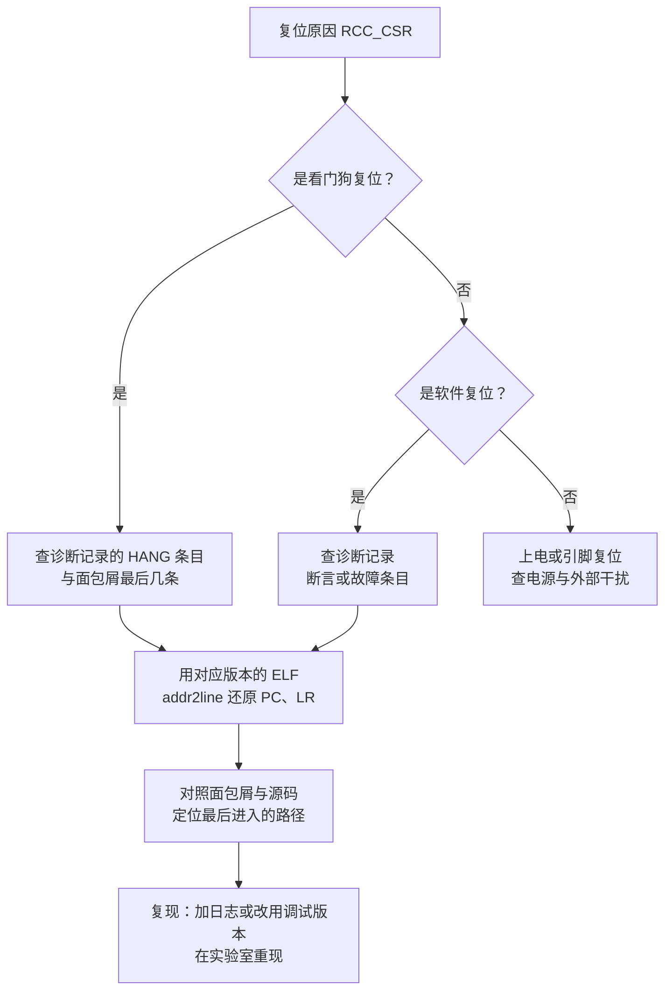

# 6.2 日志、断言与故障诊断

设备在远端部署后发生偶发性复位，往往是嵌入式运维中最棘手的故障。现场技术支持反馈的信息通常只有模糊的“设备又莫名重启了”，而研发人员即便奔赴现场接上串口调试线，很多时候也只能面对一片死寂——为了节约系统开销，生产固件在常规状态下往往关闭了调试输出；即便系统复位标志确认触发了看门狗，崩溃前数秒内的关键上下文也早已随内存断电而荡然无存。

在 [2.10 看门狗、低功耗与故障处理](/教程/正文/嵌入式/2_MCU裸机开发/2_10_看门狗_低功耗与故障处理) 中，我们通过 HardFault 异常机制，初步实现了将程序计数器（PC）、链接寄存器（LR）与故障状态寄存器（CFSR）暂存至保留内存（`.noinit` 段）的自愈雏形。然而在商业级复杂固件中，仅凭这几个静态寄存器很难还原案发现场：RAM 中的数据无法抵御掉电，排查者无法得知异常发生时哪个任务正在执行，更无从获知故障前夕系统经历了何种状态跃迁；而若在异常服务例程中贸然调用阻塞式串口打印，则极易因中断被屏蔽或总线死锁而导致整个芯片彻底挂起。

要让离线设备具备真正的可诊断性，必须在固件架构层面建立多层次的观测与诊断闭环：在正常业务中，通过零运行时开销的编译期分级日志记录运行痕迹；在代码边界处，依托语义清晰的防御性断言遏制缺陷扩散；当严重故障不可避免地爆发时，迅速固化包含寄存器现场、任务状态与历史事件面包屑的诊断包，并将其安全转储至非易失介质。

## 1. 日志

在资源高度受限的嵌入式微控制器中，日志框架的设计必须同时满足两个硬性约束：正常运行时不拖慢关键业务的实时响应速度，关闭之后不额外消耗宝贵的 Flash 存储空间。要达成这两个目标，核心手段是将日志等级的判定彻底前置到预处理阶段，使被过滤的调用在编译期直接被抹去，不生成任何目标机器码。

`log.h` 把每个级别写成一个宏，宏是否展开取决于 `LOG_LEVEL`：

```c
#define LOG_LEVEL_ERR 1
#define LOG_LEVEL_WRN 2
#define LOG_LEVEL_INF 3
#define LOG_LEVEL_DBG 4

#ifndef LOG_LEVEL
#define LOG_LEVEL LOG_LEVEL_INF
#endif

#if LOG_LEVEL >= LOG_LEVEL_ERR
#define LOG_ERR(...) log_emit('E', LOG_MODULE_TAG, __VA_ARGS__)
#else
#define LOG_ERR(...) ((void)0)
#endif
```

当 `LOG_LEVEL` 设定为 0（完全禁用）时，所有日志宏都会被直接展开为 `((void)0)`。这意味着格式化字符串常量、输入参数表达式以及底层的 `snprintf` 符号引用将从编译器视线中彻底消失，链接器自然不会把庞大的格式化解析引擎打包进最终固件。很多初学者习惯在日志函数内部检查全局运行期标志位，但那种做法不仅无法削减 `.rodata` 中的字符串空间，依然会在每次调用处产生传参指令和开销，仅仅免去了向串口写入寄存器的时间。

模块标签用同一套办法：每个源文件在包含 `log.h` 之前定义自己的 `LOG_MODULE_TAG`：

```c
#define LOG_MODULE_TAG "net"
#include "log.h"
```

`log.c` 负责格式化和输出，一行日志形如 `[   251] W app: sensor not responding, retry 1`：

```c
void log_emit(char level_char, const char *tag, const char *fmt, ...) {
    char line[LOG_LINE_MAX];
    va_list args;
    int prefix = snprintf(line, sizeof line, "[%6lu] %c %s: ",
                          (unsigned long)log_tick_ms(), level_char, tag);
    if (prefix < 0 || (size_t)prefix >= sizeof line) {
        return;
    }
    va_start(args, fmt);
    int used = vsnprintf(line + prefix, sizeof line - (size_t)prefix, fmt, args);
    va_end(args);
    /* 追加换行后交给平台输出 */
}
```

缓冲放在栈上，不用 `malloc`。`snprintf` 与 `vsnprintf` 有返回值和截断判断，因为日志太长时截断比溢出好。

两个模块分别用 `app` 与 `net` 标签，在主机上跑出来的结果是：

::: terminal title="PowerShell - LOG_LEVEL=INF（默认）"

```text
$ gcc -std=c17 -Wall -Wextra -I. log.c log_net.c log_demo.c -o log_demo
$ ./log_demo
[    12] I app: boot ok, version 1.4
[   251] W app: sensor not responding, retry 1
[   400] E app: i2c bus error 0x18
[   512] I net: link up, dhcp lease 192.168.1.42
```

:::

`LOG_DBG` 的两行没有出现。把级别调到 `DBG`、`WRN`、`NONE` 各编译一次，输出依次变化：

::: terminal title="PowerShell - 改变编译期级别"

```text
$ gcc -std=c17 -Wall -Wextra -DLOG_LEVEL=4 -I. log.c log_net.c log_demo.c -o log_dbg
$ ./log_dbg
[    12] I app: boot ok, version 1.4
[   130] D app: adc raw = 2048
[   251] W app: sensor not responding, retry 1
[   400] E app: i2c bus error 0x18
[   512] D net: rx ring level 3
[   512] I net: link up, dhcp lease 192.168.1.42

$ gcc -std=c17 -Wall -Wextra -DLOG_LEVEL=1 -I. log.c log_net.c log_demo.c -o log_err
$ ./log_err
[   400] E app: i2c bus error 0x18

$ gcc -std=c17 -Wall -Wextra -DLOG_LEVEL=0 -I. log.c log_net.c log_demo.c -o log_none
$ ./log_none
（运行结束，没有任何输出）
```

:::

级别为 `NONE` 时程序什么都不输出。更有说服力的是固件里的体积对比。把同一批日志放进一个最小固件，只改 `-DLOG_LEVEL`，用 `arm-none-eabi-size` 量出来：

| `LOG_LEVEL` | text | data | bss |
| --- | --- | --- | --- |
| 0（NONE） | 364 | 0 | 1536 |
| 1（ERR） | 3052 | 80 | 1560 |
| 2（WRN） | 3080 | 80 | 1560 |
| 3（INF） | 3124 | 80 | 1560 |
| 4（DBG） | 3160 | 80 | 1560 |

从级别 0（NONE）切换到级别 1（ERR）时，固件体积骤增了 2688 字节。这部分开销几乎全部来自于标准 C 库的格式化支持体系：包括负责数值转换的 `_printf_i`、核心流驱动 `_svfprintf_r`、格式化公共逻辑，以及在 `.data` 中分配的文件流对象。而令人深思的是，从 ERR 进一步放开至 DBG 级别，增加几级日志的开销仅仅多了 108 字节。这清晰地表明，在嵌入式系统中“多保留几条诊断打印”本身的边际代价极低，决定性的成本在于“系统是否决定引入格式化引擎”。

在工业级量产固件中，为日志系统划拨约 3 KB 的基础 Flash 预算通常是一笔极具性价比的工程投资。如果项目硬件选型极度逼仄、连这几千字节都无法抽调，一种经典的替代方案是摒弃标准 C 库，自行编写仅支持 `%d`、`%x`、`%s` 等基本占位符的轻量级格式化函数，其体积可以压制在数百字节以内。但在存储尚有余量的前提下，保留标准的 `vsnprintf` 支持能为复杂的业务调试提供极大的便利，它在现场故障分析中节省的工时成本，远胜过省下区区 3 KB 存储空间的微小收益。

### 1.1 RTOS 下的日志输出

在 RTOS 多任务环境中，如果各个业务任务直接调用 `printf`，通常会遭遇两个致命缺陷：其一是时序阻塞，串口驱动在 115200 波特率下发送数十个字节需要耗费数毫秒，这会导致高优先级的控制任务被无谓拖挂在慢速 I/O 上；其二是资源竞争，当多个并发任务未加保护地向同一个串口寄存器倾泻字符时，打印流会严重相互穿插，导致输出的文本支离破碎。

标准解法是将日志生成与实际的物理传输解耦，采用专用任务统一管理。这正是 [4.3 队列、信号量、互斥量与事件](/教程/正文/嵌入式/4_RTOS与固件架构/4_3_队列_信号量_互斥量与事件) 中阐述的典型守门人模式：

::: compare left-title="在任务里直接打印" right-title="写队列，由日志任务输出"

```c
void sensor_task(void *arg) {
    for (;;) {
        int32_t v = sensor_read();
        /* 串口发送 40 字节约 3.5 ms，任务在这里被拖住 */
        printf("sensor: %ld\n", (long)v);
        vTaskDelay(pdMS_TO_TICKS(10));
    }
}
```

---

```c
static QueueHandle_t g_log_q;

void log_task(void *arg) {
    char line[LOG_LINE_MAX];
    for (;;) {
        if (xQueueReceive(g_log_q, line, portMAX_DELAY) == pdTRUE) {
            log_write(line, strlen(line));
        }
    }
}

void sensor_task(void *arg) {
    for (;;) {
        int32_t v = sensor_read();
        /* 只做一次内存复制，队列满时丢弃这一次日志 */
        log_post("sensor: %ld\n", (long)v);
        vTaskDelay(pdMS_TO_TICKS(10));
    }
}
```

:::

对比两种架构：左侧的业务任务直接在自身上下文中等待慢速外设，日志文本越长，任务被挂起的时间越久，且完全丧失了对时序抖动的控制能力；右侧的业务任务仅在自身上下文中执行轻量的队列写入，耗时通常在微秒级别，随后立即交还 CPU 周期。而真正耗时的物理 I/O 发送，则交由系统最低优先级的日志任务在后台空闲时消化。当突发并发导致队列饱和时，根据系统策略直接丢弃最新或最老日志，坚决不让调试信息的传输阻塞核心业务的推进。队列长度与内存占用的折中考量在 4.3 节有完整论述。

::: tip 日志队列满时丢最老的还是丢最新的

丢最新的实现简单，丢最老的更能保留最近的现场。现场排障关心的是故障前的一小段时间，所以环形覆盖（丢最老）通常更合适。做法是把队列换成一块带读写下标的环形缓冲，日志任务取走时更新下标，生产者在缓冲满时覆盖最老的一条。

:::

### 1.2 二进制日志

串口格式化在每条日志上都要跑一遍 `vsnprintf`，几十微秒到几百微秒不等，对 1 kHz 的控制循环来说不可接受。另一种做法是把日志延迟到主机上格式化：固件只记录「哪条格式串、参数是什么」，原始二进制写进一个环形缓冲，调试器或串口空闲时再传出去，主机端用一个与固件共享的格式串表还原成人能读的文本。

这样每条日志只花几个指令周期，代价是主机上要有一份配套的解析程序，而且格式串表随固件版本变化。SEGGER 的 SystemView、FreeRTOS 的 Trace Recorder 和大多数商业 RTOS 的跟踪工具都采用类似思路。自己实现的最小版本在 [4.9 RTOS 固件架构、跟踪与测试](/教程/正文/嵌入式/4_RTOS与固件架构/4_9_RTOS固件架构_跟踪与测试) 的跟踪实验里有雏形，这里不展开。

## 2. 输出通道

日志写到哪里，决定了它对实时性的影响和调试的便利程度：

| 通道 | 速度 | 占用 | 是否影响目标时序 | 适用 |
| --- | --- | --- | --- | --- |
| 阻塞 UART | 115200 波特率下约 87 μs/字节 | 一个串口 | 是，发送期间 CPU 空等 | 调试期；日志量小的产品 |
| 中断或 DMA 的 UART | CPU 只负责填缓冲 | 一个串口加缓冲 | 很小 | 产品固件的常规选择 |
| SWO/ITM | 与内核时钟同步，几 Mbit/s | 一条调试引脚 | 极小 | 开发阶段，见 [1.7 SWD、JTAG 与片上调试](/教程/正文/嵌入式/1_平台与工具链/1_7_SWD_JTAG与片上调试) |
| 半主机（semihosting） | 由调试器转发 | 无额外引脚 | 调试器断开时停在断点 | 只在开发阶段 |
| SEGGER RTT | 往 RAM 环形缓冲写，调试器轮询读取 | 几 KB RAM | 极小 | 有 J-Link 或支持 RTT 的调试器时 |

半主机这一项要特别小心：它的实现是一条 `BKPT` 指令，由调试器接管后把请求转发到主机。没有接调试器时，`BKPT` 会触发 HardFault（或者在没有使能调试监控时直接锁死）。产品固件里绝不能留半主机调用，链接时也不要用 `--specs=rdimon.specs`。

::: warning 产品固件不要链接 rdimon.specs

`rdimon.specs` 让 `printf` 走半主机。调试器一断开，第一次打印就会触发异常。产品构建用 `--specs=nano.specs --specs=nosys.specs`，`_write` 自己接到串口或 RTT。

:::

RTT 值得单独说一句。它在目标 RAM 里放一个控制块和上行、下行两个环形缓冲，调试器通过后台内存访问轮询读取，不需要目标执行任何 I/O 指令，所以对时序的影响比串口小得多，也不需要额外的引脚。J-Link 自带 RTT Viewer，OpenOCD 也提供了 `rtt` 命令。缺点是需要一个支持它的调试器，且缓冲区大小要在链接时就定好。

## 3. 断言

混淆断言（Assertion）与常规错误处理（Error Handling）的职责边界，是嵌入式固件开发中最具破坏性的习惯之一。

::: concept emb62-assert-vs-error title="断言守护设计契约，错误处理响应运行异常"

断言检查的是系统在设计上“绝对不可能发生”的程序逻辑缺陷：私有函数接收到了违反内部前置契约的非法入参、有限状态机跳入了未经定义的非法状态分支、或是某些关键驱动在未完成初始化之前便被调用。这类缺陷属于代码层面的逻辑错误，继续让程序盲目向下执行会导致不可预测的未定义行为，最正确的反应是立即冻结上下文并留存故障现场。与之相反，错误处理应对的是系统与外部物理环境交互时“在设计预期之内可能失败”的动态事件：例如传感器在通信线受到干扰时偶发超时未应答、网络数据包 CRC 校验失真、或是非易失存储器因块磨损导致写入超时。这类外部偶发异常必须通过显式的函数返回值逐层通报，交由上层调用者决定执行重试、降级运行或是告警上报。

:::

如果将物理传感器的无应答错误包装成断言，设备就会在外部排线哪怕发生一次偶发抖动时瞬间死机复位；反过来，若将核心逻辑中的空指针异常或结构体越界轻描淡写地包装成错误返回值并试图静默吞没，实际上是在掩盖致命的设计缺陷，往往导致后续更深层次的内存踩踏。[语法和标准库 14.1 assert](/教程/正文/语法和标准库/14_文本转换_错误与程序生命周期/14_1_assert) 中介绍了标准 C 语言 `assert` 的语言机制，但在嵌入式体系中，更关键的议题在于：当断言一旦触发，系统应当采取怎样的策略动作。

在传统的桌面软件开发中，生产发布版本通常会定义 `NDEBUG` 宏以将标准 `assert` 彻底消除以榨取极限性能。然而在微控制器领域，最佳实践往往恰恰相反：商业级产品固件更应当保留关键断言。因为一旦断言条件破裂，意味着程序正在未知的内存破坏状态下“带病狂奔”，此时任由执行流乱跳远比受控的主动自毁更危险。通过定制系统断言宏，我们可以在断言触发的第一时间牢牢锁住现场：

```c
#define MDR_ASSERT(cond)                                                     \
    do {                                                                     \
        if (!(cond)) {                                                       \
            diag_assert_failed(__FILE__, __LINE__,                           \
                               (uintptr_t)__builtin_return_address(0));      \
        }                                                                    \
    } while (0)
```

`__FILE__` 与 `__LINE__` 给出断言在源码里的位置，`__builtin_return_address(0)` 给出调用点的返回地址。只看文件行号还不够，同一个断言宏可能被内联到多个调用点，返回地址能告诉你是哪一次调用出的事。

失败处理函数按构建类型分两种：

```c
void diag_assert_failed(const char *file, int line, uintptr_t ret) {
    diag_capture(DIAG_REASON_ASSERT); /* 写诊断记录，见第 4 节 */
    if ((CoreDebug->DHCSR & CoreDebug_DHCSR_C_DEBUGEN_Msk) != 0u) {
        __BKPT(0); /* 调试器连着：停下来看调用栈 */
    }
    NVIC_SystemReset(); /* 产品：记录后复位，让系统恢复工作 */
}
```

调试版本停在断点上，可以直接 `bt` 看调用链；产品版本记录后复位，设备还能继续服务，而现场留在 Flash 里。两种行为共用同一个宏，由 `DHCSR` 的调试使能位自动区分。

主机上跑一个小例子，能看清断言与返回值的分工。`assert/assert_demo.c` 里 `scale_of()` 对一个枚举参数做断言，`read_sensor()` 用返回值报告传感器不应答：

::: terminal title="PowerShell - 断言与错误处理"

```text
$ gcc -std=c17 -Wall -Wextra -I. assert_demo.c -o assert_demo
$ ./assert_demo
scale(accel) = 1
scale(gyro)  = 10
WHO_AM_I = 0x68
read 0x6B failed: sensor did not answer

$ ./assert_demo bad
scale(accel) = 1
scale(gyro)  = 10
WHO_AM_I = 0x68
read 0x6B failed: sensor did not answer
ASSERT FAILED at assert_demo.c:26 (return address 0x752A189A)
```

:::

第二种调用故意传入非法枚举值，断言立即触发（主机上开启了地址随机化，返回地址每次运行不同）。主机实现打印后以非零状态退出，固件实现记录后复位；两者都是「停下」，而不是「继续执行并返回一个奇怪的值」。

编译期检查用 `_Static_assert`，它在 [6.1 固件架构、配置与资源预算](/教程/正文/嵌入式/6_质量_安全与交付/6_1_固件架构_配置与资源预算) 里用于检查配置组合，同一套机制也可以用在协议常量、缓冲区大小这类地方。FreeRTOS 的 `configASSERT` 也接到同一个失败处理函数上：

```c
#define configASSERT(x)                                                      \
    do {                                                                     \
        if (!(x)) {                                                          \
            diag_assert_failed(__FILE__, __LINE__,                           \
                               (uintptr_t)__builtin_return_address(0));      \
        }                                                                    \
    } while (0)
```

这样内核里检查到的错误（队列句柄为空、在中断里调用了非 FromISR 的函数、栈溢出）与应用里的断言走同一条记录路径，诊断包里看到的是同一种格式。

<Quiz
  type="single"
  :options="[
    { label: '把 LOG_LEVEL 设成 0，宏展开为空，连格式串都不进固件', value: 'A' },
    { label: '在 log_emit 开头 if 一下级别，直接 return', value: 'B' },
    { label: '运行时把日志函数的指针换成空函数', value: 'C' },
    { label: '把日志写到外部 Flash，不占内部 Flash', value: 'D' }
  ]"
  answer="A"
>

<template #question>

要在发布版本里彻底去掉全部日志、连格式化代码也不链接进来，该怎么做？

</template>

正确答案是 **A**。级别由预处理判断，`LOG_LEVEL` 为 0 时宏展开成 `((void)0)`，格式串、参数求值与 `vsnprintf` 的引用都不存在，链接器自然也不会拉进格式化库。B 保留全部字符串与参数，只省了串口时间；C 保留了整份代码。

</Quiz>

## 4. 诊断记录

在工业级嵌入式系统中，一份合格的故障快照必须能够独立闭环地重构事故过程。相比于早先仅记录基础寄存器的简易机制，完善的诊断记录结构体旨在清晰回答四个关键维度的疑问：系统到底遭遇了何种故障（异常原因与硬件状态字）、执行流在物理代码段的哪一行折断（程序计数器 PC 与返回地址 LR）、故障发生在哪个独立的执行上下文（RTOS 任务名称或中断向量标识）、以及在崩溃前夕系统经历了哪些关键业务跳转（时间序列事件面包屑）。`diag_record.h` 将这些关键证据组织成紧凑的二进制帧：

```c
struct diag_record {
    uint32_t magic;
    uint16_t version;
    uint16_t reason; /* enum diag_reason */
    uint32_t seq;
    struct diag_frame frame; /* R0-R3、R12、LR、PC、xPSR */
    uint32_t cfsr;
    uint32_t hfsr;
    uint32_t bfar;
    uint32_t mmfar;
    char task[DIAG_TASK_NAME_MAX];
    uint32_t uptime_ms;
    uint8_t crumb_count;
    uint8_t crumb_head;
    uint16_t reserved;
    struct diag_crumb crumbs[DIAG_CRUMB_MAX];
    uint32_t crc32;
};
```

| 字段 | 来源 | 回答的问题 |
| --- | --- | --- |
| `magic`、`version` | 固定值 | 这条记录有效吗、格式是哪一版 |
| `reason` | 故障入口 | 是 HardFault、断言、栈溢出还是看门狗 |
| `seq` | 每次加一 | 上电以来第几次故障 |
| `frame` | 异常入栈区或当前栈 | 出错时的 PC、LR 与通用寄存器 |
| `cfsr`、`hfsr`、`bfar`、`mmfar` | `SCB` | 具体是哪一类总线错误、非法访问的地址 |
| `task` | `pcTaskGetName(NULL)` | 出错时哪个任务在运行 |
| `uptime_ms` | `xTaskGetTickCount()` | 设备已经跑了多久 |
| `crumbs` | 应用埋点 | 故障前最近 16 个事件 |
| `crc32` | 写入时计算 | 记录是否完整 |

`task` 字段取任务名要小心：故障可能发生在中断里，这时 `pcTaskGetName(NULL)` 返回的是被打断的任务，而不是当前真正在跑的上下文。中断里出错时可以改用 `xTaskGetCurrentTaskHandleFromISR` 的等价做法，或者在记录里再加一个 `in_isr` 标志。

### 4.1 面包屑

面包屑（breadcrumb）是故障前的一小段事件日志，环形覆盖，放在 `.noinit` 里，随诊断记录一起保存：

```c
void diag_crumb_push(struct diag_record *rec, uint16_t code, uint16_t arg,
                     uint32_t tick_ms) {
    struct diag_crumb *c = &rec->crumbs[rec->crumb_head];
    c->tick_ms = tick_ms;
    c->code = code;
    c->arg = arg;
    rec->crumb_head = (uint8_t)((rec->crumb_head + 1u) % DIAG_CRUMB_MAX);
    if (rec->crumb_count < DIAG_CRUMB_MAX) {
        rec->crumb_count++;
    }
}
```

16 条面包屑占 16 × 8 = 128 字节，对整个记录贡献不到三分之二。写入只用几条指令，可以放在状态机切换、命令处理、错误返回这些地方。现场出问题后，面包屑往往比 PC 更有用：它说出了故障前设备在做什么。

面包屑的 `code` 用一个枚举统一编号，不要太细，十几二十个就够：

```c
enum crumb_code {
    CRUMB_BOOT = 0x01,
    CRUMB_SENSOR_OK = 0x10,
    CRUMB_SENSOR_TIMEOUT = 0x11,
    CRUMB_NET_CONNECT = 0x20,
    CRUMB_NET_LOST = 0x21,
    CRUMB_CMD_RECEIVED = 0x30,
    CRUMB_FLASH_WRITE = 0x40,
};
```

命名与编号在固件里固定下来，主机上的解析工具就不必跟着改。

<Quiz
  type="single"
  :options="[
    { label: '只看魔数就够了，CRC 是多余的', value: 'A' },
    { label: '记录写到一半断电时，魔数可能已经写进去而其余字段还是旧的，所以要有 CRC', value: 'B' },
    { label: 'CRC 用来加密记录内容', value: 'C' },
    { label: 'CRC 用于压缩记录大小', value: 'D' }
  ]"
  answer="B"
>

<template #question>

诊断记录已经有 4 字节魔数，为什么还要再加一个 CRC-32？

</template>

正确答案是 **B**。魔数只能说明「这个位置曾经被写过」，不能说明整条记录完整；写到一半断电、RAM 被部分破坏都会留下魔数正确而内容错误的记录。CRC 覆盖除自身以外的全部字段，任何一处被改都能发现。

</Quiz>

### 4.2 用 CRC 校验记录

`.noinit` 在第一次上电时是随机内容，软件复位后保留，部分写入还会留下半截记录。只靠魔数不够：随机内容碰巧等于魔数的概率虽低，但不是零；写到一半断电时，魔数可能已经写进去了，后面的字段还是旧的。

`diag_record.h` 用 CRC-32 覆盖除 `crc32` 字段以外的全部内容：

```c
bool diag_record_valid(const struct diag_record *rec) {
    if (rec->magic != DIAG_MAGIC || rec->version != DIAG_VERSION) {
        return false;
    }
    return rec->crc32 == diag_crc32(rec, offsetof(struct diag_record, crc32));
}
```

`offsetof` 给出 `crc32` 在结构体里的偏移，CRC 只算到这里。CRC-32 的计算与 [3.9 Flash、EEPROM、SD 与文件系统](/教程/正文/嵌入式/3_驱动_通信与中间件/3_9_Flash_EEPROM_SD与文件系统) 的配置记录相同，那边还有一份现成的实现。

记录大小会影响存储布局。在主机上量一下：

::: terminal title="PowerShell - 记录的大小"

```text
$ ./test_diag
sizeof(diag_record) = 208
test_crc_known_value: 通过
test_empty_record_invalid: 通过
test_fill_and_valid: 通过
test_corruption_detected: 通过
test_crumbs_wrap: 通过
test_task_name_truncated: 通过
全部测试通过
```

:::

208 字节对一条诊断记录来说完全可接受。测试里有几个刻意的用例：空记录必须无效；改动 `frame.lr` 的一个位必须被 CRC 发现；写满 16 条面包屑后再写时最老的一条被覆盖，头指针回到 1；任务名超长时截断到 7 个字符仍然保持记录有效。

### 4.3 存进外部 Flash

`.noinit` 能扛住软件复位和看门狗复位，扛不住掉电。要留住多条历史记录，得写进外部 Flash。跨页约定里，W25Q64 的 `0x020000`–`0x02FFFF` 是诊断与核心转储区，64 KB 分成 256 个 256 字节的槽，每个槽放一条记录。

`diag_store.c` 的写入顺序很关键：先写记录正文，最后写槽头。槽头里的 CRC 一写成功，这个槽才算有效；写到一半断电，槽头还是 `0xFFFFFFFF`，读取时自然被跳过：

```c
struct diag_slot_header {
    uint32_t magic;
    uint32_t seq;
    uint16_t len;
    uint16_t pad;
    uint32_t crc32;
};

/* 先写记录，再写头；头写完这一槽才算有效 */
if (!st->ops->write(base + (uint32_t)sizeof hdr, rec, sizeof *rec)) {
    return false;
}
if (!st->ops->write(base, &hdr, sizeof hdr)) {
    return false;
}
```

NOR Flash 的物理约束在这里也要照顾：一个扇区（4 KB）只能整扇区擦除，不能单独擦一个字节。16 个槽共用一扇区，进入新扇区时擦一次，之后顺序写入剩下的 15 个槽。

主机测试用一块模拟 Flash 验证这套逻辑，模拟遵守「擦除置 0xFF、写入只能把 1 变 0」的规律，还能在第 N 次写入时断电：

::: terminal title="PowerShell - 诊断存储的测试"

```text
$ gcc -std=c17 -Wall -Wextra -I. diag_record.c diag_store.c test_store.c -o test_store
$ ./test_store
sizeof(diag_record) = 208
test_append_and_read_back: 通过
test_wrap_across_sectors: 通过
test_power_loss_before_header: 通过
test_storage_full_wraps: 通过
全部测试通过
```

:::

第三个用例专门模拟「记录写完了、槽头没写成」：这次追加返回失败，重启后读这一槽得到无效结果；再追加一条时，擦除整个扇区，半截数据被清掉。第四个用例把写指针放在最后一个槽，写完回绕到 0，验证循环存储不会越界。

固件里的接法是用 3.9 的 `w25q.c` 提供 `read`、`erase_sector`、`write` 三个函数，填进 `struct diag_flash_ops`。启动时先扫一遍槽，找出最后一条有效记录的 `seq`，确定下一次写哪个槽：

```c
struct diag_store st;
diag_store_init(&st, &w25q_diag_ops, last_slot + 1u);
```

`last_slot` 可以在启动时扫出来，也可以写进 `.noinit` 省掉每次启动的扫描时间。扫描 256 个槽、每个 256 字节，总共 64 KB 的外部 Flash 读取，按 SPI 4 MHz 需要一百多毫秒，对启动时间敏感的产品值得省掉。

### 4.4 谁写诊断记录

三种来源写同一种记录，格式统一才方便分析：

| 来源 | 触发时机 | `reason` |
| --- | --- | --- |
| HardFault 处理函数 | 已使能的故障异常进入处理函数 | `DIAG_REASON_HARDFAULT` |
| 断言失败处理函数 | `MDR_ASSERT` 条件为假 | `DIAG_REASON_ASSERT` |
| 栈溢出钩子 | FreeRTOS 检测到任务栈越界 | `DIAG_REASON_STACK_OVERFLOW` |
| 监视任务 | 被监视的任务长时间没有喂狗 | `DIAG_REASON_HANG` |
| 看门狗复位后的启动代码 | `RCC_CSR` 的 IWDGRSTF 置位 | `DIAG_REASON_WATCHDOG` |

在异常服务例程中持久化故障数据，最大的技术风险在于“二级故障”。例如当系统因总线硬件故障（BusFault）跌入 HardFault 时，驱动外部 SPI Flash 所需的 SPI 外设或 GPIO 引脚可能正处于不可用状态；若在异常上下文中贸然调用复杂的驱动协议栈，极易再次触发嵌套异常，甚至陷入硬件死锁，导致原本宝贵的现场数据彻底湮灭。

工程上最稳健的防御策略是实施“两段式持久化”：在异常爆发的第一现场，只执行绝对安全的轻量内存写入，将诊断数据暂存在无需外设介入的 `.noinit` 内存段中，随后立即触发系统复位；待 MCU 经过完整硬件复位重新启动、基础外设与时钟树恢复正常就绪后，再由早期的启动代码将 `.noinit` 中的有效记录安全搬运至板载外部 Flash 中持久保存。这种策略将故障现场的执行时间压缩到了微秒级，最大程度保障了记录落盘的成功率。

::: concept emb62-record-layout title="诊断记录的两段式保存"

故障发生时只写 `.noinit` 里的记录，不碰外部 Flash。复位后在启动阶段检查记录有效，把它追加到 W25Q64 的诊断区，再清除 `.noinit`。两段式保存的收益是故障路径最短，代价是掉电时只能靠 `.noinit`，因此电池供电、随时可能掉电的设备要在每次记录后立刻写外部 Flash，不能等复位。

:::

## 5. 核心转储

诊断记录给出了故障发生的直接物理地址与硬件状态字，但在复杂的软件工程中，仅有事故瞬间的单点 PC 往往不足以定位根因。很多时候，诱发异常的代码深藏在某层通用底层函数的深处，我们迫切需要知晓完整的函数调用链条。核心转储（Core Dump）正是为了解决调用上下文复原而设立的机制：它将故障瞬间任务栈区（或整个系统 RAM）的二进制镜像连同当前 CPU 核心寄存器一并冻结保存，以便后续在主机调试环境中精准重建执行堆栈。

故障时能拿到的栈有两部分：异常入栈的 8 个寄存器（32 字节）和栈指针以上、该任务栈范围内的其余内容。前者在 `diag_frame` 里，后者要主动复制。故障处理函数可以这样取：

```c
__attribute__((naked)) void HardFault_Handler(void) {
    __asm volatile(
        "tst lr, #4      \n"
        "ite eq          \n"
        "mrseq r0, msp   \n"
        "mrsne r0, psp   \n"
        "b hardfault_c   \n"
    );
}
```

`hardfault_c()` 拿到栈指针后，从栈顶往下复制一段（比如 1 KB）到 `.noinit` 或直接写外部 Flash 的暂存区。2.10 已经写过这个跳板，这里只是多了「复制栈」这一步。

### 5.1 从栈里找返回地址

栈上混杂着局部对象、保存的寄存器和不用的空间，直接看是二进制。但有一条规律：函数调用时硬件把返回地址压进 LR，被调函数入口把它存到栈上，所以栈里的返回地址都长这样——落在 `.text` 范围内，最低位为 1（Thumb 模式）。

`stackscan.c` 就按这条规律扫：

```c
for (size_t off = 0; off + 4u <= dump_len; off += 4u) {
    uint32_t v = read_u32(dump + off);
    if ((v & 1u) == 0u) {
        continue; /* Thumb 地址最低位为 1 */
    }
    uint32_t a = v & ~1u;
    if (a >= text.addr && a < text.addr + text.size) {
        printf("offset %4lu: 0x%08lX  -> 0x%08lX\n",
               (unsigned long)off, (unsigned long)v, (unsigned long)a);
        found++;
    }
}
```

`.text` 的范围从 ELF 的节头表里读，工具只需要 C 标准库，在主机上编译。

拿一个真实的固件做实验。`crashfw/fw.c` 是一条 `main → app_tick → sensor_poll → protocol_write` 的调用链，每层都带局部对象，用 `-O2` 交叉编译：

::: terminal title="bash - 固件的符号地址"

```text
$ arm-none-eabi-nm -n fw.elf | grep -E " (t|T) "
080000ec T protocol_write
08000134 T sensor_poll
0800014c T app_tick
08000160 T main
08000168 T Default_Handler
0800016c T Reset_Handler
080001b8 T memset
080001c8 T memcpy
080001e4 T _etext
```

:::

栈转储按真实 ELF 里 `bl` 指令之后那条指令的地址构造（这段输入是构造的，工具输出是真实的），运行栈扫描：

::: terminal title="PowerShell - stackscan 的输出"

```text
$ ./stackscan fw.elf stack.bin
.text: 0x080000EC..0x080001E4 (248 bytes)
dump : 64 bytes, 16 words
offset   20: 0x0800013F  -> 0x0800013E
offset   36: 0x08000153  -> 0x08000152
offset   44: 0x08000167  -> 0x08000166
offset   52: 0x080001A3  -> 0x080001A2
offset   60: 0x080000ED  -> 0x080000EC
5 candidate return address(es)
```

:::

四个地址对应真正的调用链，第五个 `0x080000ED` 是人为放进去的干扰项（它就是 `protocol_write` 的入口地址加 1，也是一个合法的 Thumb 地址）。这正是扫描的局限：它只按「落在 `.text` 里且最低位为 1」筛选，不能区分真正的返回地址和碰巧长这样的数据。

把候选地址交给 `addr2line` 得到函数名和行号：

::: terminal title="bash - addr2line 还原调用链"

```text
$ arm-none-eabi-addr2line -e fw.elf -f -a 0x0800013F 0x08000153 0x08000167 0x080001A3
0x0800013f
sensor_poll
./fw.c:37
0x08000153
app_tick
./fw.c:42
0x08000167
main
./fw.c:46
0x080001a3
Reset_Handler
./../../../common/startup_stm32f103.c:181
```

:::

四个地址正好倒着对应 `main` 调用 `app_tick`、`app_tick` 调用 `sensor_poll`、`sensor_poll` 调用 `protocol_write`，最后一个来自启动代码调用 `main`。编译时用 `-ffile-prefix-map` 把绝对路径换成了相对路径，否则调试信息里是整条构建机的路径。`addr2line` 的用法在 2.10 讲过，这里只是批量地用。

比 `addr2line` 更省事的是用 GDB 直接加载转储。`arm-none-eabi-gdb -batch` 可以先把 ELF 载入、设置栈指针和 PC，再 `bt`：

```text
$ arm-none-eabi-gdb -batch fw.elf \
    -ex "set $sp = 0x20000400" \
    -ex "set $pc = 0x08000246" \
    -ex "bt"
```

前提是转储里记下了故障时的 SP 与 PC（`diag_frame` 里有 PC，SP 要从跳板函数里取）。GDB 会把栈当成本地对象和返回地址逐个展开，比手工扫描准确，遇到优化后的代码也能工作——只要调试信息完整。

<Quiz
  type="single"
  :options="[
    { label: '直接按顺序打印栈上的每个字', value: 'A' },
    { label: '筛出落在 .text 范围内、最低位为 1 的值，再交给 addr2line', value: 'B' },
    { label: '把栈里所有值都当作地址，逐个查符号表', value: 'C' },
    { label: '只看异常入栈的 8 个寄存器，不看后面的栈', value: 'D' }
  ]"
  answer="B"
>

<template #question>

拿到一块 1 KB 的栈转储，要找出其中的调用链，第一步做什么？

</template>

正确答案是 **B**。返回地址有两条特征：落在代码段 `.text` 里，且 Thumb 地址最低位为 1。按这两条筛一遍，剩下的候选地址交给 `addr2line` 就能还原函数名与行号。A 只会得到一堆二进制；C 会产生大量误报；D 只看到最内层，还原不出完整调用链。

</Quiz>

开源的 CrashCatcher 与 CrashDebug 把这条路走得更远：CrashCatcher 是运行在目标上的故障处理库，把整个 RAM 与寄存器写进调试器可读的区域；CrashDebug 在主机上接管 GDB，把转储伪装成一个可以 `bt` 的进程。它们的思路与本节一样，只是把细节都封装好了，接入成本比自己写一套低，值得在正式产品里考虑。

### 5.2 转储里该放什么

全 RAM 转储最完整，但 20 KB 写到 SPI Flash 要好几秒，故障处理函数里做不完。实际的做法是只复制当前任务栈的一段（1–2 KB）加上寄存器。要还原完整的调用链，这个量通常够了；需要更多时可以按需扩大。

外部 Flash 的写入速度是个硬约束。W25Q64 的页编程约 0.4 ms 一页（256 字节），4 KB 大约 10 ms，20 KB 要 50 ms 以上。故障处理函数里可以承受几十毫秒，但不能承受几百毫秒——看门狗可能在这期间复位，而复位会打断写入，留下半截转储。所以要么在故障路径上先喂一次狗，要么把转储标志写进 `.noinit`，由复位后的启动代码接着写完。

## 6. 排查步骤

面对现场反馈的系统复位问题，盲目猜测代码逻辑往往会耗费大量无谓的时间。建立一套层层收敛的标准化排查漏斗，能够帮助工程师按部就班地排除干扰、锁定根因：



排查的第一步是读取芯片的复位源标志。`RCC_CSR` 寄存器在 [2.3 时钟与复位](/教程/正文/嵌入式/2_MCU裸机开发/2_3_时钟与复位) 中已有系统介绍，通过 `reset_cause_get()` 函数可以区分上电复位、外部引脚复位、软件主动复位、看门狗复位以及低功耗唤醒复位。如果是看门狗复位，通常说明某个高优先级任务陷入死循环或是驱动层在等待外设状态时未设超时；如果是软件主动复位，则表明故障捕获钩子或断言逻辑已被触发并主动执行了系统重启；而如果是单纯的上电或外部引脚复位，排查重点应优先转向供电电源纹波、跌落以及外部物理电磁干扰。

第二步是检索非易失介质中的诊断快照。对于断言失败或 HardFault 触发的复位，诊断记录中沉淀的 `reason`、`cfsr`、`pc` 以及栈帧寄存器往往能直接锁定事故指令；而对于看门狗复位，由于崩溃前缺乏异常进入过程，排查的核心线索主要依赖诊断记录中的任务保活状态（HANG 标记）以及循环事件面包屑最后停滞的阶段。

第三步是符号回溯，必须使用与发生故障的设备固件严格二进制同源的 ELF 符号文件。任何源文件的微小变动或编译器路径差异都会导致 `addr2line` 解析出南辕北辙的函数名与代码行号。我们在 [6.8 发布、现场升级与维护](/教程/正文/嵌入式/6_质量_安全与交付/6_8_发布_现场升级与维护) 中专门引入的构建 ID（Build ID）机制正是为了解决这一痛点：出厂固件在其诊断记录头部打上全局唯一的哈希签名，确保从现场提取出的每份核心快照都能精准锁定仓库中对应版本的 ELF 调试资产。

### 6.1 三种典型故障的记录长什么样

三种练习用故障可以在实验室重现，它们写出的记录各有特征。下面的寄存器取值按 ARM 文档推断，`addr2line` 的结果来自真实 ELF：

| 故障 | `reason` | `cfsr` | `hfsr` | `pc` 指向 |
| --- | --- | --- | --- | --- |
| 除零（DIV_0_TRP 已开） | HARDFAULT | 0x02000000（DIVBYZERO） | 0x40000000（FORCED） | `sdiv` 指令本身 |
| 函数指针最低位为 0 | HARDFAULT | 0x00020000（INVSTATE） | 0x40000000（FORCED） | `bx` 指令 |
| 未映射地址读 | HARDFAULT | 0x00008200（PRECISERR、BFARVALID） | 0x40000000（FORCED） | `ldr` 指令，`bfar` 是坏地址 |

除零与非法状态的记录里 `bfar` 无效（`BFARVALID` 没置位），只有总线错误那条的 `bfar` 才有意义。这一点在排查时要记住：看到一个「看着像地址」的值不要急着去解析，先看 `cfsr` 的 `BFARVALID` 位。

一条完整的记录在主机上打印出来是这样（`diag/diagdump.c`，记录按真实字段填充）：

::: terminal title="PowerShell - 一条诊断记录"

```text
magic=0x44494147 ver=2 reason=1 seq=1
pc=0x08000246 lr=0x0800013F cfsr=0x00008200 hfsr=0x40000000 bfar=0xCCCCCCCC
task=sensor uptime=123456 crumb_count=6 head=6
  crumb[0] t=1000 code=0x10 arg=0
  crumb[1] t=1025 code=0x11 arg=1
  crumb[2] t=1050 code=0x12 arg=2
  crumb[3] t=1075 code=0x13 arg=3
  crumb[4] t=1100 code=0x14 arg=4
  crumb[5] t=1125 code=0x15 arg=5
crc32=0xAB1414D1 valid=1
```

:::

读这条记录：`reason=1` 是 HardFault，`cfsr=0x00008200` 拆开是 BFARVALID（位 15）与 PRECISERR（位 9），`hfsr` 的 FORCED 位说明它由 BusFault 升级而来，`bfar` 的 0xCCCCCCCC 就是出错时访问的地址。`task=sensor` 说明故障发生在传感器任务里，最后两条面包屑 `0x14`、`0x15` 与具体事件的对应关系查枚举表。`valid=1` 说明 CRC 对得上，记录可信。

::: tip 面包屑的编号表放进固件的版本说明

面包屑的枚举值在固件里是常量，在分析记录时是人读的名字。把这张表放进固件的版本说明或者仓库里的 `docs/`，与 ELF 一起归档。没有这张表，`code=0x14` 就只是一个数字。

:::

## 7. 习题

### 7.1 巩固

<Exercise id="66609" :d="1" :w="2">

`log.c` 里 `LOG_LINE_MAX` 为 128，前缀用 `snprintf(line, sizeof line, "[%6lu] %c %s: ", ...)` 生成，正文接着用 `vsnprintf` 写进剩余空间，最后追加换行。

(1) 时间戳 251、级别 `W`、标签 `app` 时前缀占多少字节？时间戳涨到七位数时前缀又占多少？两次的差值来自格式串的哪一部分？
(2) 前缀 16 字节时，一行日志的正文最多能放下多少个字符（不算换行）？`vsnprintf` 返回的是写入的字节数还是本来要写的字节数？据此说明代码里 `total > sizeof line - 2u` 那一次截断究竟什么时候触发。
(3) 每个模块在包含 `log.h` 之前定义 `LOG_MODULE_TAG`，忘记定义时标签是什么？如果某个模块先包含了另一个头文件、那个头文件又包含了 `log.h`，这个模块的标签会是什么？日志里会出现什么现象？
(4) `LOG_DBG("raw = %d", read_adc())` 在 `LOG_LEVEL` 为 3 时，`read_adc()` 会被调用吗？如果日志写成普通的函数 `log_debug(fmt, ...)` 加内部级别判断，答案会不会变？

</Exercise>

<Exercise id="66610" :d="2" :w="2">

一台设备要同时满足三件事：115200 波特率的控制台、1 kHz 的控制循环、只能在实验室复现的启动问题。

(1) 一条 40 字节的日志走阻塞 UART，发送期间 CPU 等多久？用 8N1、每位 1/115200 秒计算，写出算式。
(2) 1 kHz 的控制循环里每条日志花掉 (1) 的时间，占一个周期的百分之几？结论是「日志本身慢」还是「阻塞等待慢」？
(3) 从本页的通道表里给三个场景各选一个：产品固件里的错误日志、开发阶段看 `main` 之前启动代码的输出、1 kHz 循环里的调试日志。各写一句理由，并指出哪一个必须额外的调试器硬件。
(4) 产品构建里误链接了 `--specs=rdimon.specs`，调试器拔出后第一次 `printf` 会发生什么？为什么不能靠「产品里不打印」来避免？
(5) RTT 的缓冲区大小为什么要在链接时定好？如果上行缓冲 1 KB、每秒产生 40 条 40 字节的日志，调试器每秒能取走 2 KB，缓冲会不会溢出？
(6) 在主机上验证 (1)(2) 的量级：写一个小程序，分别调用 1000 次 `snprintf` 与 1000 次只做内存复制的写入，用 `clock()` 计时，打印每次的微秒数。贴出结果，说明格式化与串口传输的代价各在什么量级，以及「把格式化挪到日志任务里」能省掉哪一半。

验收：(1)(2) 的算式与百分比正确；(6) 给出实际计时，且两个数量级的关系与 (2) 的结论一致。

</Exercise>

<Exercise id="66611" :d="2" :w="2">

把下面八种情况分成「断言」与「返回值报告」两类，各写一句理由：

- (a) `scale_of()` 收到枚举范围之外的分类号
- (b) MPU6050 的 `WHO_AM_I` 读回 0x70
- (c) I²C 传输中途收到 NACK
- (d) FreeRTOS 检测到任务栈越界
- (e) 把 `NULL` 队列句柄传给 `xQueueSend`
- (f) 外部 Flash 写入超时
- (g) 状态机落进了 `default` 分支
- (h) 从 Flash 读出的配置记录 CRC 不对

(1) 完成分类，逐条说明判断依据是「按设计不可能发生」还是「外部事件可能失败」。
(2) 其中哪一条在两类之间最难划？给出你的选择与理由。
(3) 产品固件保留断言，而标准 `assert` 在定义 `NDEBUG` 后会被整个去掉。如果产品构建里定义了 `NDEBUG`，上表里属于断言的那几条会变成什么行为？
(4) `diag_assert_failed()` 用 `CoreDebug->DHCSR` 的 `C_DEBUGEN` 位区分调试版本与产品版本，而不是用 `#ifdef DEBUG`。这样做的两个好处是什么？
(5) 断言宏里为什么要传 `__builtin_return_address(0)`？只看 `__FILE__` 与 `__LINE__` 在什么情况下不够？

</Exercise>

### 7.2 编程

<Exercise id="66612" :d="3" :w="3">

本页第 1.2 节的二进制日志：固件只记「格式串编号 + 参数」，主机端还原。实现一个最小版本。

(1) 定一个 16 字节的记录 `struct log_rec { uint32_t tick_ms; uint8_t id; uint8_t argc; uint16_t pad; uint32_t arg[2]; }`，用 `_Static_assert(sizeof(struct log_rec) == 16, "...")` 固定大小。给三条格式串建表：`0` 为 `"t=%lu v=%d"`、`1` 为 `"i2c err 0x%02X"`、`2` 为 `"rate=%u"`。
(2) 实现 `log_bin_post(uint8_t id, uint32_t a, uint32_t b)`：往 512 字节的环形缓冲写一条，满了覆盖最老的一条，并维护「已覆盖条数」。写出 `log_bin_read(struct log_rec *out)`，按从老到新的顺序取出。
(3) 写主机端解析程序 `log_decode`：从 stdin 读二进制，按上表还原成文本，输出形如 `[   251] i2c err 0x18`。
(4) 造一组输入：写 50 条（超过 512 / 16 = 32 条），前 18 条应被覆盖。贴出解析后的前后两行与总条数，验证覆盖行为。
(5) 说明格式串表随固件版本变化时，主机端拿错表会发生什么；给出一个防止对错表的办法。

验收：`struct log_rec` 的 `sizeof` 编译期等于 16；解析出的条数为 32，第一条对应第 19 次调用。

</Exercise>

<Exercise id="66613" :d="3" :w="3">

`code/嵌入式/6_质量_安全与交付/6_2_日志_断言与故障诊断/diag/diag_record.c` 的面包屑是环形缓冲，`crumb_head` 指向下一次写入的位置。

(1) 增加 `bool diag_crumb_at(const struct diag_record *rec, unsigned i, struct diag_crumb *out)`，`i = 0` 表示最老的一条，返回 `false` 表示 `i` 超出 `crumb_count`。写出实现，注意 `crumb_count < DIAG_CRUMB_MAX` 与写满两种情况下最老条目的下标不同。
(2) 在 `test_diag.c` 里补三条测试：没写满时第 0 条是第一次写入的；写满 16 条后再写 1 条，第 0 条是第 2 次写入的；`i == crumb_count` 返回 `false` 且不改动输出。
(3) 用 `gcc -std=c17 -Wall -Wextra -I. diag_record.c test_diag.c -o test_diag` 编译运行，贴出全部输出。
(4) 主机上的 `diagdump` 现在按数组下标打印，读起来是乱序的。改成按 `diag_crumb_at` 从老到新打印，并给每一行标出「距故障多少毫秒」（用 `uptime_ms - crumb.tick_ms`）。贴出一条记录的打印结果。
(5) 面包屑只存 16 条、每条 8 字节。如果改成 32 条，记录大小从 208 变成多少？对 `DIAG_SLOT_SIZE` 为 256 的槽有什么影响？

</Exercise>

<Exercise id="66614" :d="4" :w="3">

第 1.1 节的日志队列在满时丢一条。改成丢最老的，并验证顺序与覆盖行为。

(1) 定义一个 16 槽、每槽 32 字节的环形缓冲，接口为 `void log_post(const char *fmt, ...)`（格式化后入槽，用 `vsnprintf`，超长截断）与 `size_t log_drain(char *out, size_t max)`（按从老到新取走全部内容）。生产者只做一次内存复制，格式化放在哪里由你决定并说明理由。
(2) 模拟两个生产者交替写：任务 A 每轮写 `a=<n>`，任务 B 每轮写 `b=<n>`，共 30 条。缓冲区只有 16 槽，验收输出里必须正好是最后 16 条，且 `a` 与 `b` 的相对顺序不乱。
(3) 统计并打印被覆盖的条数。用同一个计数验证 (2)：30 − 16 = 14。
(4) 如果格式化放在生产者一侧，槽满时仍然要付出格式化开销；如果放在消费一侧，队列里存的是参数而不是字符串。两种做法各写一句取舍，并说明哪一种更适合 1 kHz 的采样任务。
(5) 说明为什么这个设计仍然不能直接用在多核或抢占式 RTOS 的两个任务之间，需要补什么。

验收：输出 16 行、顺序正确、覆盖计数为 14；程序用 `gcc -std=c17 -Wall -Wextra` 无警告。

</Exercise>

### 7.3 综合与挑战

<Exercise id="66615" :d="5" :w="5">

在 `diag_store` 上做掉电安全与启动扫描的完整实验。

(1) 给 `test_store.c` 的模拟 Flash 增加「擦除中途掉电」：擦除进行到一半时返回 `false`，扇区内容变成一半 `0xFF`、一半旧数据。补一条用例，验证这次追加失败之后，记录区里不会出现被当成有效的槽。
(2) 实现 `uint32_t diag_store_find_next(const struct diag_store *st)`：扫一遍所有槽，返回最后一条有效记录的 `seq + 1`，一个有效槽都没有时返回 0。在 `test_wrap_across_sectors` 写满 20 条后调用它，结果应为 21。
(3) 计算启动扫描的代价：256 个槽、每槽读 256 字节，SPI 时钟 4 MHz、每字节 8 位、命令与地址开销忽略。写出毫秒数，并与第 4.3 节的「一百多毫秒」核对。如果产品要求 50 ms 内启动完成，可以怎么省掉这次扫描？
(4) 把 `next_slot` 存进 `.noinit` 能省掉扫描，但 `.noinit` 在第一次上电时是随机内容。设计一个 8 字节的 `.noinit` 结构（含魔数、`next_slot`、CRC 或校验和），说明启动时怎么判断它可信、不可信时退回扫描。
(5) 电池供电、随时可能掉电的设备，本页建议每次记录后立刻写外部 Flash，不能等复位。这与「故障路径上只写 `.noinit`」矛盾吗？给出你的处理顺序。

验收：(1) 的新用例通过；(2) 返回 21；(3) 给出算式与毫秒数；(4)(5) 的判断条件写进代码注释。

</Exercise>

<Exercise id="66616" :d="6" :w="5" scope="*">

`stackscan` 只按「落在 `.text` 内且最低位为 1」筛选，本页的输出里第五个候选 `0x080000ED` 就是误报。把它改得可靠一些。

(1) 先复现：按 `crashfw/fw.c` 注释里的命令构建 `fw.elf`，用 `crashfw/mkstack.py` 生成 `stack.bin`，运行现有 `stackscan`，贴出输出。
(2) 增加一条判据：候选地址之前一条指令必须是 `bl` 或 `blx`。Thumb-2 的这两条指令各占两个半字，`bl` 的第一个半字在 `0xF000`–`0xF7FF`，第二个半字的高 5 位全为 1（即 `0xF800`–`0xFFFF`）；`blx` 的第二个半字在 `0xE800`–`0xEFFF`。写出检查函数，说明为什么要把候选地址去掉最低位再减 4 才得到这条指令的首地址，以及去哪两个半字检查。
(3) 用新判据重跑，误报是否消失？五个候选里剩下几个？被筛掉的那个 `0x080000ED` 去掉最低位再减 4 得到什么，它在 `.text` 里吗？
(4) 再加一条判据：候选地址必须落在调用者的栈范围 `[sp, 栈顶)` 内。说明这个范围的两个端点从哪里来，为什么它比 `.text` 范围更能排除数据。
(5) 用 `arm-none-eabi-addr2line -e fw.elf -f -a` 把筛出来的地址批量翻译，贴出结果，并说明为什么必须用与转储同一版本的 ELF。
(6) 说明这套方法在 `-O2` 下会漏掉哪几类调用：被内联的函数、尾调用（`b` 而不是 `bl`）、以及还有哪些情况会让候选地址根本不落在栈上。

验收：(2) 的检查函数能正确识别 `bl` 与普通数据；(3) 有前后对比；(5) 的输出能还原出 `main → app_tick → sensor_poll → protocol_write` 这条链。

</Exercise>

## 8. 参考资料

- ARM, *Cortex-M3 Devices Generic User Guide*（DUI0552A，故障异常、CFSR/HFSR/MMFAR/BFAR 与异常入栈）：https://developer.arm.com/documentation/dui0552/a/
- Memfault, *How to debug a HardFault on an ARM Cortex-M MCU*：https://interrupt.memfault.com/blog/cortex-m-hardfault-debug
- FreeRTOS, *Debugging Hard Faults on Cortex-M*：https://www.freertos.org/Documentation/02-Kernel/03-Supported-devices/04-Demos/Others/Debugging-Hard-Faults-On-Cortex-M-Microcontrollers
- SEGGER, *About Real-Time Transfer*：https://www.segger.com/products/debug-probes/j-link/technology/about-real-time-transfer/
- OpenOCD, *General Commands*（RTT）：https://openocd.org/doc/html/General-Commands.html
- adamgreen/CrashCatcher：https://github.com/adamgreen/CrashCatcher
- adamgreen/CrashDebug：https://github.com/adamgreen/CrashDebug
- GNU binutils, *addr2line*：https://sourceware.org/binutils/docs/binutils/addr2line.html
- Memfault, *GNU Binutils: the ELF Swiss Army Knife*：https://interrupt.memfault.com/blog/gnu-binutils
- ST, RM0008 Rev 21（RCC_CSR、Flash 编程）
