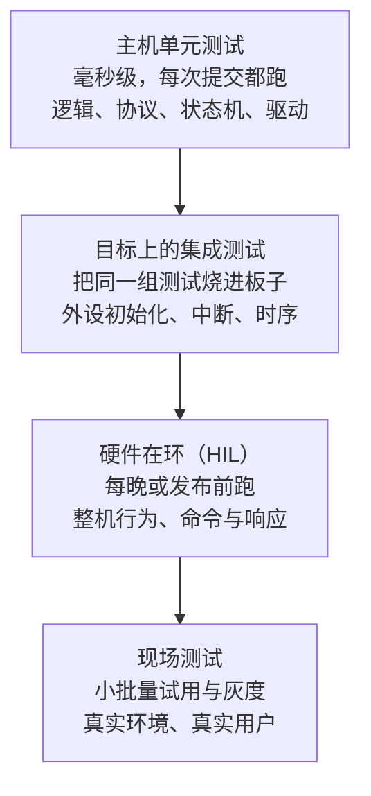
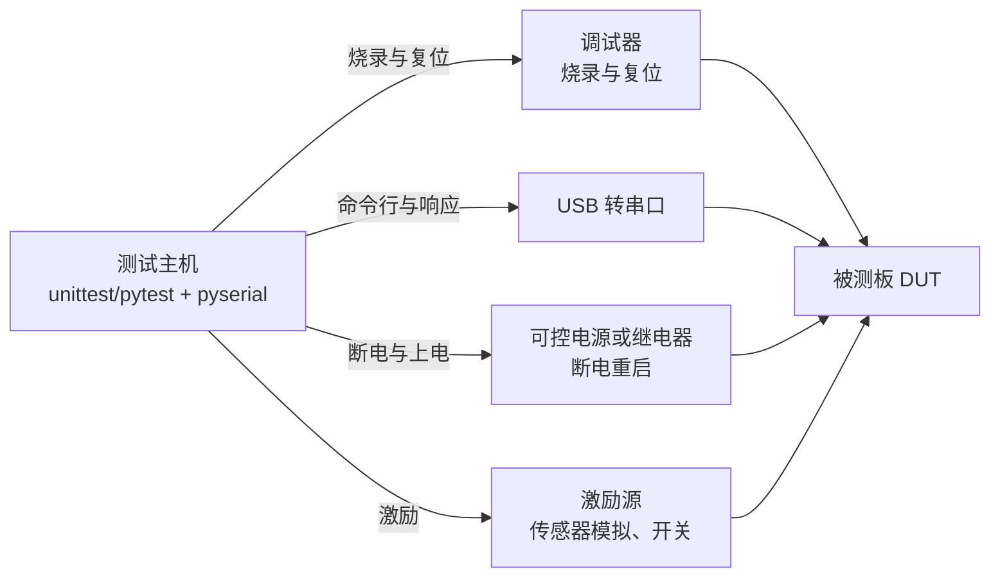

# 6.3 测试、逻辑分析与硬件在环

在传统单片机开发中，许多工程师习惯于极低效的“编译-烧录-抓串口”循环：哪怕仅仅微调了一行状态判断，也必须重新编译目标固件、触发烧录器写入 Flash、手动复位、打开串口终端，紧盯着跳动的几行字符以观察是否符合预期。这种开发模式不仅侵占了绝大部分心智带宽，将宝贵的编码时间消耗在无谓的物理等待中，更关键的是具有极大的脆弱性——许多涉及边界条件、总线协议时序或上电顺序的缺陷，在工作台上往往因偶然性无法复现，直到小批量现场交付时才在特定批次的元器件上集中爆发。

打破这种低效循环的核心，是依照“与物理硬件的解耦距离”对测试体系进行分层重构：将与芯片硬件无关的纯算法、协议解析、状态机以及可以通过接口抽象剥离的驱动逻辑，全面迁移到开发主机（PC）上以原生二进制的形式运行，在毫秒级时间内获得精确、可重复的断言反馈；仅将不可避免涉及真实外设初始化、中断响应与寄存器绑定的部分留给目标板级集成测试；对于整机交互、电源跌落与长期压力等复杂系统行为，则交由自动化的硬件在环（HIL）测试机台进行持续巡检。在这套多层防线中，辅以逻辑分析仪对物理总线时序的深入观测，便能以极高的置信度在代码合入前歼灭绝大多数潜伏缺陷。

## 1. 固件测试的层次



测试金字塔在嵌入式体系中表现为物理距离与执行成本的递增规律：越靠近底层的现场测试与整机验证，执行周期越漫长、软硬件环境搭建成本越高，偶发故障的复现也越发困难；但其环境真实度最高。相对地，金字塔顶层的主机单元测试执行速度极快、执行成本微乎其微，并能以确定性的方式反复验证边界输入。合理的工程分配策略，是将尽可能多的验证逻辑前置推向主机单元测试层；凡是主机层由于缺乏物理外设而无法触达的硬件初始化与中断时钟逻辑，收敛到第二层的目标集成测试；将完整的通信协议应答与断电恢复留给第三层的硬件在环机台；而最终的现场小批量试用，仅仅用于捕获前三层自动化防护网在设计之初未能预料到的环境边缘工况。

深入审视便会发现，嵌入式固件中可以在主机端独立验证的模块占比极高。通信帧的分包与组包解析、复杂的业务状态机跳转、滑动窗口滤波算法、工程物理量单位换算、环形缓冲区管理以及交互命令行解析，这些核心逻辑在本质上完全是确定性的数据计算，仅仅依赖基础 C 语言的输入与输出。阻碍它们在主机端运行的唯一障碍，是工程代码往往将这些业务算法与特定微控制器的外设寄存器操作杂糅在了一起。只要在代码架构中贯彻 [3.1 驱动接口、CMSIS 与设备头文件](/教程/正文/嵌入式/3_驱动_通信与中间件/3_1_驱动接口_CMSIS与设备头文件) 确立的抽象规范，就能极为顺畅地将业务层从目标芯片中剥离出来。

## 2. 让代码能在主机上编译

### 2.1 回顾：驱动依赖接口

3.1 里的 `uart_init(USART_TypeDef *u, uint32_t pclk_hz, ...)` 接收外设实例，不写死 `USART1`；`board_led_set()` 把引脚与有效电平藏在板级模块里。这两条让应用层与板级都不含 STM32 的东西，主机上编一份假的 `board.c` 就能链接。

驱动层还要直接读写 `USART_TypeDef` 的寄存器。办法有三种，按侵入性从小到大：伪造寄存器、伪造总线、链接替换。

::: compare left-title="驱动里写死外设地址" right-title="外设指针作参数"

```c
void uart_putc(char c) {
    while ((USART1->SR & USART_SR_TXE) == 0u) {
    }
    USART1->DR = c;
}
```

---

```c
bool uart_putc(struct uart_regs *u, uint8_t byte, uint32_t max_polls) {
    for (uint32_t i = 0; i < max_polls; ++i) {
        if ((u->sr & UART_SR_TXE) != 0u) {
            u->dr = byte;
            return true;
        }
    }
    return false;
}
```

:::

左边只能在有 `USART1` 的目标上编，测试要么烧板子，要么根本测不了。右边把外设当成一个结构体指针，测试时在 RAM 里分配一个同布局的对象传进去，寄存器读写变成普通内存读写，一切都能在 PC 上做。真实固件里传入的指针就是 `USART1`，调用点没有额外开销。

<Quiz
  type="single"
  :options="[
    { label: '在测试里把 usart_send 换成 printf 的宏', value: 'A' },
    { label: '让驱动接收外设结构体指针，测试时传入 RAM 里的同布局对象', value: 'B' },
    { label: '用 #ifdef UNIT_TEST 把寄存器访问换成内存访问', value: 'C' },
    { label: '把驱动编成静态库，测试时链接另一个库', value: 'D' }
  ]"
  answer="B"
>

<template #question>

一页 UART 驱动里写死了 `USART1`，要在 PC 上测试它，改动最小又能保留产品代码原样的是什么做法？

</template>

正确答案是 **B**。把外设实例改成参数，函数体一句不改，测试时在 RAM 里分配一个结构体传进去，寄存器读写自然变成内存读写。C 能让它在 PC 上跑，但产品与测试走了两条路径，测过的不等于出货的。A、D 都改不了「代码里写死 USART1」这个事实。

</Quiz>

### 2.2 伪造寄存器

`fake_usart/uart_byte.h` 用一个只含三个字段的结构体代替 `USART_TypeDef`：

```c
struct uart_regs {
    volatile uint32_t sr;
    volatile uint32_t dr;
    volatile uint32_t cr1;
};
```

驱动实现按 `sr` 的 `TXE` 位轮询，`max_polls` 给等待设一个上限：

```c
bool uart_putc(struct uart_regs *u, uint8_t byte, uint32_t max_polls) {
    for (uint32_t i = 0; i < max_polls; ++i) {
        if ((u->sr & UART_SR_TXE) != 0u) {
            u->dr = byte;
            return true;
        }
    }
    return false;
}
```

真实寄存器没有超时这一说，硬件保证 `TXE` 最终会置位。但对测试来说，一个能在「永远不置位」时停下来的接口更好验证，而且这个上限在产品里也能防止外设彻底坏掉时死等。

测试直接操作这个结构体：

```c
static struct uart_regs g_uart;

void setUp(void) {
    memset(&g_uart, 0, sizeof g_uart);
}

static void test_putc_txe_ready(void) {
    g_uart.sr = UART_SR_TXE;
    TEST_ASSERT_TRUE(uart_putc(&g_uart, 'A', 10u));
    TEST_ASSERT_EQUAL_HEX8('A', g_uart.dr & 0xFFu);
}

static void test_putc_timeout(void) {
    g_uart.sr = 0u; /* TXE 永远是 0 */
    TEST_ASSERT_FALSE(uart_putc(&g_uart, 'C', 100u));
    TEST_ASSERT_EQUAL_HEX8(0u, g_uart.dr & 0xFFu); /* 放弃时不能写数据 */
}
```

`setUp()` 在每个测试之前重置假外设，`tearDown()` 在每个测试之后清理。这两个函数由运行器调用，测试之间因此不会互相污染。这是单元测试框架最基本的约定，`memset` 一行就够。

运行结果：

::: terminal title="PowerShell - 伪造寄存器的 USART 测试"

```text
$ gcc -std=c17 -Wall -Wextra -I. -I../common uart_byte.c test_uart_byte.c -o test_uart
$ ./test_uart
RUN  test_putc_txe_ready
RUN  test_putc_timeout
RUN  test_putc_no_overwrite_before_txe
RUN  test_getc_empty
RUN  test_getc_ready
10 checks, 0 failures
```

:::

看第三个测试：上一次发送还没完成时再次调用，`uart_putc` 返回失败，且不能覆盖 `DR` 里的旧值。这类「调用者不守规矩」的测试，在真实板子上很难构造，在假寄存器上只要一行 `g_uart.sr = 0u`。

### 2.3 伪造总线

设备驱动（MPU6050、W25Q64、显示屏）依赖的是总线事务。把总线抽象成一组函数指针，测试时换成记录事务的假实现：

```c
struct i2c_bus {
    int (*write_reg)(void *ctx, uint8_t addr, uint8_t reg,
                     const uint8_t *data, size_t len);
    int (*read_reg)(void *ctx, uint8_t addr, uint8_t reg,
                    uint8_t *data, size_t len);
    void *ctx;
};
```

`ctx` 是不透明指针，真实实现里放寄存器地址或驱动状态，测试里放假总线的状态。`mpu6050.c` 只调用这两个函数，不知道 I²C 的起始条件、地址格式与时钟频率：

```c
bool mpu6050_init(struct mpu6050 *dev, const struct i2c_bus *bus) {
    uint8_t who = 0;
    dev->bus = *bus;
    if (dev->bus.read_reg(dev->bus.ctx, MPU6050_ADDR,
                          MPU6050_REG_WHO_AM_I, &who, 1u) != 0) {
        return false;
    }
    if (who != MPU6050_WHO_AM_I_VALUE) {
        return false;
    }
    uint8_t wake = 0x00u;
    return dev->bus.write_reg(dev->bus.ctx, MPU6050_ADDR,
                              MPU6050_REG_PWR_MGMT_1, &wake, 1u) == 0;
}
```

假总线记录每一次事务，并按寄存器号预置返回值：

```c
struct fake_i2c {
    uint8_t txn_addr[16];
    uint8_t txn_reg[16];
    int txn_count;
    uint8_t who_am_i;
    uint8_t accel[6];
    int fail_read_reg; /* 等于这个寄存器号时返错，-1 表示不返错 */
};
```

有了这份记录，测试除了返回值，还能断言「驱动按什么顺序访问了什么」：

```c
static void test_init_ok(void) {
    struct mpu6050 dev;
    struct i2c_bus bus = make_bus();

    TEST_ASSERT_TRUE(mpu6050_init(&dev, &bus));
    TEST_ASSERT_EQUAL_HEX8(MPU6050_ADDR, g_bus.txn_addr[0]);
    TEST_ASSERT_EQUAL_HEX8(MPU6050_REG_WHO_AM_I, g_bus.txn_reg[0]);
    TEST_ASSERT_EQUAL_HEX8(MPU6050_REG_PWR_MGMT_1, g_bus.txn_reg[1]);
}
```

`test_init_wrong_device` 把 `who_am_i` 改成 0x70，断言初始化失败且只发生了一次事务，型号不对就不该继续写配置寄存器。`test_read_bus_error` 让读加速度时返回错误，断言驱动返回 `false`，不会卡在等待里。这三类正是现场最容易出问题的地方：接错芯片、总线 NACK、设备中途掉线。

::: terminal title="PowerShell - 伪造总线的测试"

```text
$ gcc -std=c17 -Wall -Wextra -I. -I../common mpu6050.c test_mpu6050.c -o test_mpu6050
$ ./test_mpu6050
RUN  test_init_ok
RUN  test_init_wrong_device
RUN  test_init_bus_nack
RUN  test_read_raw_positive
RUN  test_read_raw_negative
RUN  test_read_bus_error
RUN  test_to_mg
19 checks, 0 failures
```

:::

补码换算这类纯函数也顺手测了：`ax = 0xC000` 必须解成 -16384，`az = 0x4000` 必须解成 16384 并换算成 1000 mg。符号位搞错的驱动在板子上只会表现为「数据方向不对」，不做这组测试很难发现。

### 2.4 链接替换

有些实现没有外设结构体可传，比如 `tick_now()`、`flash_write()`、`printf` 重定向。这类函数可以把测试构建的源文件列表换掉：产品构建链接 `tick.c`，测试构建链接 `fake_tick.c`，两者提供同一个 `tick_now()`。

`fake_tick.c` 让测试直接设置时间：

```c
static uint32_t g_now;

uint32_t tick_now(void) {
    return g_now;
}

void fake_tick_set(uint32_t ms) {
    g_now = ms;
}
```

CMake 里是两个不同的目标，源文件列表各写各的：

```cmake
# 产品构建
add_executable(firmware main.c app_logic.c tick.c ...)

# 测试构建：用 fake_tick.c 换掉 tick.c
add_executable(test_blink
    link_replace/app_logic.c
    link_replace/fake_tick.c
    link_replace/test_blink.c)
target_link_libraries(test_blink PRIVATE test_assert)
```

测试可以精确控制时间，把平时要靠 `vTaskDelay` 等半秒的场景变成一行赋值：

```c
static void test_toggles_at_500ms(void) {
    struct blink_ctx ctx;
    blink_init(&ctx, tick_now());

    fake_tick_set(499u);
    blink_step(&ctx, tick_now());
    TEST_ASSERT_FALSE(ctx.led_on); /* 还没到 */

    fake_tick_set(500u);
    blink_step(&ctx, tick_now());
    TEST_ASSERT_TRUE(ctx.led_on);
}
```

`test_tick_counter_wrap` 直接把起点设在 `0xFFFFFF00`，验证 32 位节拍计数器回绕时差值计算仍然正确。真板子上要等 49 天才回绕一次，测试里一秒钟就跑完了。

::: terminal title="PowerShell - 链接替换的测试"

```text
$ gcc -std=c17 -Wall -Wextra -I. -I../common app_logic.c fake_tick.c test_blink.c -o test_blink
$ ./test_blink
RUN  test_initial_state
RUN  test_toggles_at_500ms
RUN  test_tick_counter_wrap
8 checks, 0 failures
```

:::

### 2.5 CMSIS 内建函数在主机上

`__disable_irq()`、`__DSB()`、`__WFI()` 这类 CMSIS 内建函数在 x86 上编不过（内联汇编或特殊寄存器）。测试构建里给它们一份空实现：

```c
/* fake_cmsis.c：只在测试构建里链接 */
void __disable_irq(void) {
}

void __enable_irq(void) {
}

void __DSB(void) {
}

void __WFI(void) {
}
```

如果代码用 `PRIMASK` 判断中断是否关闭，空实现会让这类判断永远为假，测试要意识到这一点：它测不到「临界区真的关了中断」，只能测「临界区里的逻辑对不对」。前者的验证留给第二层。

::: tip 条件编译只作最后手段

`#ifdef UNIT_TEST` 散落在驱动里，会让产品代码与测试代码走两条不同的路径，测过的东西不等于出货的东西。能用外设指针、函数指针表、链接替换解决的，都不该用条件编译。确实要用时，把它限制在一个文件里并写清原因。

:::

## 3. Unity 单元测试

手写 `CHECK` 宏当然能用——[4.5 内存与资源管理](/教程/正文/嵌入式/4_RTOS与固件架构/4_5_内存与资源管理) 的内存池测试就没有框架。但测试多了以后，框架提供的几样东西省事：`setUp`/`tearDown` 自动调用、失败信息带文件名与行号、断言种类齐全、运行器统计通过数。

Unity 是嵌入式圈子里用得最广的轻量框架，两个文件（`unity.c`、`unity.h`），MIT 许可，几 KB 代码，能编到目标上。它的断言是一组宏：

```c
TEST_ASSERT_EQUAL_INT(expected, actual);
TEST_ASSERT_EQUAL_HEX8(expected, actual);
TEST_ASSERT_NOT_NULL(ptr);
TEST_ASSERT_TRUE(cond);
```

运行器也是宏，`RUN_TEST(...)` 展开成「打印名字、调 `setUp`、调测试函数、调 `tearDown`」，最后 `UNITY_END()` 返回失败数：

```c
int main(void) {
    UNITY_BEGIN();
    RUN_TEST(test_putc_txe_ready);
    RUN_TEST(test_putc_timeout);
    /* ... */
    return UNITY_END();
}
```

本教程的示例不把 Unity 的源码提交进仓库，`common/test_assert.h` 实现了同名同形的几个宏，换 Unity 时把 `unity.c` 链接进来、把头文件一换，测试代码不用改。什么时候用 Unity：测试文件多、要接 CI、团队里多人写测试。什么时候不必：一两个文件、几十个断言，自己写个 `CHECK` 宏更快。

更重型的自动化工具链是 Ceedling 与 CMock。Ceedling 作为基于 Ruby 的构建工具，将 Unity、CMock 与 gcov 等组件深度集成，通过一份 YAML 配置文件驱动完整的编译与报告生成；CMock 则能够通过解析 C 头文件自动生成插桩的 mock 对象，省去手工编写仿真总线的大量模板代码。这种自动化带来的代价是引入了额外的语言运行时依赖，且当自动生成的桩代码与项目复杂的宏定义发生冲突时，排错过程往往相当费力。在工程实践中，一种务实的演化策略是：在项目早期或接口数量有限时，手写极简的伪造对象往往比引入重型框架更为轻便可控；只有当外设依赖剧增、多个模块的模拟行为出现大量重复结构时，才值得引入 CMock 等全自动生成方案。

### 3.1 覆盖率

覆盖率回答的是「测试跑过哪些行、哪些分支没跑过」。GCC 加 `--coverage`（等价于 `-fprofile-arcs -ftest-coverage`）编译和链接，跑完测试后用 `gcov` 生成报告：

```
gcc -std=c17 -Wall -Wextra --coverage -O0 -I. mpu6050.c test_mpu6050.c -o test_mpu6050
./test_mpu6050
gcov -b test_mpu6050-mpu6050.gcda
```

::: terminal title="PowerShell - gcov 的行覆盖"

```text
$ gcov -b test_mpu6050-mpu6050.gcda
File 'mpu6050.c'
Lines executed:95.83% of 24
Branches executed:100.00% of 10
Taken at least once:80.00% of 10
Calls executed:100.00% of 3
Creating 'mpu6050.c.gcov'
```

:::

生成的 `mpu6050.c.gcov` 在每行前面标出执行次数，没执行过的行标 `#####`，分支信息跟在对应行下面：

::: terminal title="text - mpu6050.c.gcov（节选）"

```text
function mpu6050_init called 6 returned 100% blocks executed 92%
        6:    8:bool mpu6050_init(struct mpu6050 *dev, const struct i2c_bus *bus) {
        6:    9:    uint8_t who = 0;
        6:   10:    if (bus == NULL || bus->read_reg == NULL) {
branch  0 taken 100% (fallthrough)
branch  1 taken 0%
    #####:   11:        return false;
        -:   12:    }
        6:   13:    dev->bus = *bus;
```

:::

`mpu6050_init` 跑了 6 次，但第 11 行一次都没执行：所有测试传的都是合法的 `bus`，`bus == NULL` 这条分支没覆盖。这就是覆盖率的用处：它不告诉你测试写得好不好，只告诉你哪里根本没测。95.83% 的行覆盖率、80% 的分支覆盖率，说明还有一处没走到的分支，补一个「传 NULL」的测试就能把它拿掉。

覆盖率的目标不必定在 100%。初始化失败的路径、硬件错误的分支往往需要专门的构造才能覆盖，值不值得取决于这段代码的重要性；驱动里的错误分支值得，而一些防御性的 `default` 分支常常不值。开发与工程基础 [14 覆盖率与模糊测试](/教程/正文/开发与工程基础/14_覆盖率与模糊测试) 讲了更系统的用法。

## 4. 在目标上测试

主机测试覆盖不了外设初始化、中断、DMA 与真实时序。第二层把同一组测试交叉编译进一个测试固件，烧进板子，结果从 UART 出来。

两层用的是同一组测试：测试文件一行不改，只换一个入口。测试文件的 `main()` 里调用 `UNITY_BEGIN()` 与 `UNITY_END()`，输出走 `printf`；目标构建里把 `_write` 接到串口，并在 `main` 之前初始化 USART1：

```c
int _write(int fd, const char *buf, int len) {
    (void)fd;
    for (int i = 0; i < len; ++i) {
        while ((USART1->SR & USART_SR_TXE) == 0u) {
        }
        USART1->DR = (uint8_t)buf[i];
    }
    return len;
}

__attribute__((constructor)) static void target_console_init(void) {
    RCC->APB2ENR |= RCC_APB2ENR_IOPAEN | RCC_APB2ENR_USART1EN;
    GPIOA->CRH = (GPIOA->CRH & ~(0xFFu << 4)) | (0x4Bu << 4);
    USART1->BRR = 72000000u / 115200u;
    USART1->CR1 = USART_CR1_TE | USART_CR1_RE | USART_CR1_UE;
}
```

`__attribute__((constructor))` 让 `target_console_init` 在 `main` 之前运行，不必改测试文件的 `main`。链接时把 `target_init.c`、驱动源文件与测试文件一起编进去：

::: terminal title="PowerShell - 交叉编译测试固件"

```text
$ arm-none-eabi-gcc -std=c11 -mcpu=cortex-m3 -mthumb -O2 -g -DSTM32F103xB ^
    -ffunction-sections -fdata-sections -Wall -Wextra ^
    -Icommon -Ifake_i2c -ICMSIS/Core/Include -I cmsis_device_f1/Include ^
    -nostartfiles --specs=nano.specs --specs=nosys.specs -Wl,--gc-sections ^
    -T ../../common/stm32f103c8.ld ^
    target_test/target_init.c fake_i2c/mpu6050.c fake_i2c/test_mpu6050.c ^
    ../../common/startup_stm32f103.c -o test_fw_target.elf
$ arm-none-eabi-size test_fw_target.elf
   text    data     bss     dec     hex filename
   6064      92    1952    8108    1fac test_fw_target.elf
```

:::

6 KB 的测试固件，接上串口就能看到和主机上一模一样的输出。这个固件不进入产品发布，只用于测试。

目标上新增的测试与主机测试放在同一套文件里，用宏区分：

```c
#if defined(TARGET_BUILD)
static void test_usart_baud_register(void) {
    /* 真实初始化之后检查 BRR 的值 */
    console_init(72000000u, 115200u);
    TEST_ASSERT_EQUAL_HEX16(0x271u, USART1->BRR);
}
#endif
```

`0x271` 是 72 MHz / 115200 的四舍五入结果（625），这个值用主机测试测不了，因为它依赖真实时钟与外设。这类测试只在第二层写，主机层不重复。

测试固件与产品固件必须用同一套驱动源码。如果测试固件链接的是「专门为测试改过的驱动副本」，测试通过不能说明产品通过。这一点靠构建系统保证：两层用同一个源文件列表，只有入口与替换实现不同。

## 5. 逻辑分析仪

即使主机单元测试验证了上层业务算法，目标集成测试确认了控制器的寄存器写入无误，物理总线上的电气交互依然可能偏离预期。硬件引脚的电平跳变是否符合协议规范、时钟极性与相位是否匹配、总线是否发生未预料的握手失败，都需要借助专用仪器进行微观审视。逻辑分析仪（Logic Analyzer）能够对高速数字信号进行多通道采样，将离散的电平变化绘制为精确的时序波形并进行协议解析，是排查通信异常不可或缺的利器。

### 5.1 采样率与触发

采样率决定能看到的细节。经验值是信号最高频率的 4 倍起步，10 倍更保险：

::: tip 采样率的取法

信号里最快的边沿决定采样率。UART 在 115200 波特率下位宽约 8.7 μs，1 MS/s 采样率每比特采到 8 个点，够用；SPI 时钟 18 MHz 时，至少要 72 MS/s 才不至于把时钟认错。拿不准就按「时钟频率 × 10」设。

:::

触发（trigger）决定什么时候开始记录。查 UART 时触发在起始位；查 I²C 时触发在地址字节的某个值；查「偶发丢数据」时让分析仪一直采样、按条件触发，否则数据量太大。多数廉价分析仪只有几 MB 的缓冲，8 通道 1 MS/s 下只能存几百毫秒，触发条件设不好就抓不到想看的瞬间。

### 5.2 协议解码

分析仪软件能做协议解码：把电平还原成字节、地址、ACK 位与帧的首尾。以 sigrok（开源，配合 PulseView 图形界面或 sigrok-cli 命令行）为例，抓一次 I²C 读事务的命令是：

```text
sigrok-cli -d fx2lafw -c samplerate=1m -C D0=SDA,D1=SCL \
    -P i2c:sda=D0:scl=D1 -A i2c
```

解码输出照 sigrok 文档的格式，类似：

::: details sigrok-cli 解码 I²C 的输出（照 sigrok 文档，输出类似）

```text
i2c-1: Start
i2c-1: Address write: D0
i2c-1: Data write: 75
i2c-1: Address read: D1
i2c-1: Data read: 68
i2c-1: Stop
```

:::

这一段对应读 MPU6050 的 `WHO_AM_I`（寄存器 0x75）：起始条件、写地址 0xD0、写寄存器号 0x75、重复起始、读地址 0xD1、读回 0x68、停止。每个字节后面跟着 ACK 或 NACK，解码器会把它们标出来。

### 5.3 典型问题

逻辑分析仪最常抓到的几类问题：

| 现象 | 波形上的样子 | 原因 |
| --- | --- | --- |
| I²C 读不到数据 | 地址字节后紧跟 NACK | 地址错了：7 位地址 0x68 左移一位写成 0xD0，读方向要加 1 成 0xD1 |
| 有时能通有时不通 | SCL 上升沿很慢，或高电平不足 3.3 V | 上拉电阻太大或总线电容过大，属于模拟问题，要用示波器看 |
| SPI 数据全错位 | 数据在错误的时钟沿变化 | CPOL/CPHA 与从设备不匹配，模式 0 与模式 3 最容易混 |
| 串口收到乱码 | 位宽与预期不符，停止位对不上 | 波特率有偏差：时钟源不准、BRR 计算用错总线时钟 |
| I²C 总线卡死 | SDA 一直被从设备拉低 | 从设备在等时钟，需要发 9 个时钟脉冲解锁 |

I²C 地址左移是最常见的错误，这里展开一句。7 位地址 0x68 在总线上是「地址 7 位 + 读写位」共 8 位：写是 0xD0，读是 0xD1。代码里写 `0x68 << 1` 得到 0xD0 是对的，写 `0x68` 直接传给硬件就错了。逻辑分析仪会把这个字节原样解出来，一眼就能对照。

::: tip 逻辑分析仪与示波器分工

逻辑分析仪只看「0 还是 1」，判断不了电平是否合规、边沿是否太慢、有没有振铃。上拉电阻不对、驱动能力不足、电源纹波这类问题要用示波器。手边只有逻辑分析仪时，先确认它解出来的协议结构是对的，再去借示波器看模拟量。

:::

## 6. 硬件在环

当单元测试和板级测试逐一通过后，依然存在大量必须在全系统协同状态下才能暴露的集成缺陷：例如在高速全双工通信时，系统是否会因接收中断过于频繁而饿死低优先级任务？设备在遭遇突发掉电并重新上电后，能否可靠地从损坏的文件系统中自愈？命令行协议解析器在面对畸形报文时是否会发生内存溢出？

解决这一层级问题的标准方案是硬件在环（Hardware-in-the-Loop, HIL）测试。测试台将真实的待测设备（DUT）置于由自动化测试主机掌控的闭环环境中，通过可控的串口、调试器、可编程电源以及信号激励源，自动化地施加物理刺激并断言整机的黑盒行为。

### 6.1 测试台的组成



每块测试台未必需要全部组件。最小的一套是「调试器 + USB 转串口」：调试器负责烧录和复位，串口负责发命令、收响应。可控电源用在一个容易被忽略的测试上：断电重启后的行为，尤其是掉电时正在写 Flash 的那次操作。激励源用来模拟传感器读数、按键、外部中断。

### 6.2 unittest 与串口

Python 侧的基本结构是「打开串口、发命令、按时间等响应、断言内容」。`hil/test_cli.py` 用标准库的 `unittest` 写，pytest 也能直接运行同一个文件；测试对应一个协议：上电打印 `mdr-sensor ready, build <id>`，命令 `rate <n>` 改上报周期，随后每周期的数据行形如 `t=<ms> ax=.. ay=.. az=..`。

```python
def test_rate_command_and_throughput(self):
    self.wait_for(r"mdr-sensor ready", 2.0)
    self.dev.write(b"rate 50\n")
    self.wait_for(r"ok rate=50", 1.0)

    start = time.monotonic()
    lines = 0
    while time.monotonic() - start < 1.0:
        if re.match(r"t=\d+ ", self.dev.readline().decode(errors="replace")):
            lines += 1
    self.assertGreaterEqual(lines, 48, "1 秒内的上报行数偏少：%d" % lines)
    self.assertLessEqual(lines, 52, "1 秒内的上报行数偏多：%d" % lines)
```

三个测试分别验证：启动横幅在 2 秒内出现、`rate 50` 之后 1 秒内收到 48–52 行、未知命令回错误。第二条同时验证了「命令生效」与「吞吐量达标」，比只断言回了一行 `ok` 强。

没有硬件时，测试需要一个假设备。pySerial 自带 `loop://` 与 `socket://` 两种 URL 处理器：`loop://` 把写出去的数据原样读回来，适合测「测试脚本自己」；`socket://host:port` 把串口接到一个 TCP 端口，可以另起一个 Python 进程扮演设备。示例里的 `FakeDevice` 更进一步：它在进程内实现了 `readline`、`write`、`close` 三个方法，行为与 `serial.Serial` 相同，测试代码不需要知道背后是真串口还是假设备。

::: terminal title="PowerShell - 没有硬件时跑 HIL 测试"

```text
$ python test_cli.py
test_banner_within_2s (__main__.HilTest.test_banner_within_2s) ... ok
test_rate_command_and_throughput (__main__.HilTest.test_rate_command_and_throughput) ... ok
test_unknown_command_reports_error (__main__.HilTest.test_unknown_command_reports_error) ... ok

----------------------------------------------------------------------
Ran 3 tests in 1.001s

OK
```

:::

接上真板子时把 `--port COM5` 传进去，同一个测试类改用 `serial.Serial`。先让脚本在假设备上通过，再换真硬件，这一步能把「测试脚本本身写错」和「设备行为不对」分开；否则第一次跑就失败，你不知道该改哪边。

<Quiz
  type="single"
  :options="[
    { label: '把仿真器换成真板子，再跑一遍', value: 'A' },
    { label: '先把测试脚本在假设备上跑通，再换成真串口', value: 'B' },
    { label: '跳过单元测试，直接上 HIL', value: 'C' },
    { label: '把超时改成一分钟，等设备慢慢回', value: 'D' }
  ]"
  answer="B"
>

<template #question>

第一次接上 HIL 测试台，全部测试失败。先做哪一件事？

</template>

正确答案是 **B**。HIL 失败有两个来源：测试脚本写错，或设备行为不对。先让同一个脚本在假设备上通过，就能把「脚本本身的问题」排除掉，剩下的才是硬件或固件的问题。A 只是重复失败；C 丢掉了最便宜的一层；D 会让失败来得更慢。

</Quiz>

等待响应要带超时，不能无限读。`wait_for()` 用截止时间循环，超时就 `fail` 并打印等的是什么。串口读取用 `timeout=0.5`，`readline` 在规定时间内没读到一行就返回空串，脚本继续下一轮。

### 6.3 Renode 与虚拟 HIL

没有板子、又要测真固件时，可以用 Renode。它是开源的指令级仿真器，支持 STM32F103（Blue Pill），能跑真实的 ELF、模拟 USART、GPIO、I²C 外设，还能把串口映射到 TCP 端口让 Python 脚本连上来。测试台的结构与真硬件完全一样，只是把「被测板」换成仿真器。

Renode 常与 Robot Framework 搭配：Robot 负责测试用例的编排，Renode 的 monitor 命令负责加载 ELF、启动、复位、读串口。这套组合适合放进 CI，因为它不需要真实硬件，也没有接线问题。局限也明显：仿真器不模拟模拟量、不模拟真实时序与电源，能测协议与逻辑，测不了「上拉电阻太大」这类问题。

### 6.4 接进 CI

HIL 测试需要一台连着测试台的机器，云端运行器接不到测试台，所以用自托管运行器（self-hosted runner）。流水线里 HIL 放在夜间或发布前，不放在每次提交上：一次 HIL 跑十几分钟，每次提交都跑会拖慢反馈。

CI 里的步骤大致是：拉代码、构建、烧录、跑 pytest、收集结果与串口日志。测试台被占用时要排队，两块板子可以并行，一块板子只能串行。这些细节与 [18 持续集成](/教程/正文/开发与工程基础/18_持续集成) 里讲的一致，区别只在「被测对象是硬件，失败时要保留串口日志与测试台的当前状态」。

::: concept emb63-hil-definition title="硬件在环测的是什么"

HIL 测试把真实固件跑在真实（或仿真）硬件上，由外部脚本施加激励并检查响应。它覆盖的是整机行为：命令协议、时序要求、异常恢复、断电重启。它不替代单元测试：HIL 跑一次要分钟级，单元测试毫秒级；HIL 失败时定位到具体函数的成本远高于单元测试。

:::

## 7. 习题

### 7.1 巩固

<Exercise id="60617" :d="1" :w="1">

六个待测模块与三种剥离手段（伪造寄存器、伪造总线、链接替换、不改代码直接上板）如下，每种手段可以重复使用：

- (a) `uart_putc()`，内部读写 `USART_TypeDef`
- (b) `mpu6050_read_raw()`，经 `struct i2c_bus` 访问设备
- (c) `blink_step()`，调用 `tick_now()`
- (d) `w25q64_erase_sector()`，内部调用 SPI 寄存器
- (e) `_write()`，输出到 `USART1`
- (f) `USART1_IRQHandler()`，真实中断里的状态机

(1) 给每一项选一种手段，写一句理由。哪两项必须上板，为什么？
(2) `code/嵌入式/6_质量_安全与交付/6_3_测试_逻辑分析与硬件在环/fake_usart/test_uart_byte.c` 运行后的统计行是 `10 checks, 0 failures`。五个测试里每个各贡献几条检查？把算式写出来，再实际运行核对。
(3) `test_putc_timeout` 里 `g_uart.sr = 0u` 之后断言 `uart_putc` 返回 `false` 且 `dr` 不变。这两条断言分别防的是哪种缺陷？如果驱动写成 `while (!(u->sr & TXE)) {}`，这个测试会怎样结束？
(4) `setUp()` 在每个测试前 `memset` 假外设。删掉 `setUp` 里的这一句，五个测试里哪一个会开始失败？说明原因。

</Exercise>

<Exercise id="60618" :d="2" :w="2">

```text
function mpu6050_init called 6 returned 100% blocks executed 92%
        6:    8:bool mpu6050_init(struct mpu6050 *dev, const struct i2c_bus *bus) {
        6:    9:    uint8_t who = 0;
        6:   10:    if (bus == NULL || bus->read_reg == NULL) {
branch  0 taken 100% (fallthrough)
branch  1 taken 0%
    #####:   11:        return false;
        -:   12:    }
        6:   13:    dev->bus = *bus;
```

(1) 第 11 行前面的 `#####` 表示什么？这一行与 `branch 1 taken 0%` 说的是同一件事吗？
(2) 函数被调用了 6 次，第 11 行一次都没执行。这 6 次调用里传的 `bus` 有什么共同点？本页的测试列表里为什么没有一次传 `NULL`？
(3) 条件写成 `bus == NULL || bus->read_reg == NULL`。如果先写 `bus->read_reg == NULL`，会发生什么？这与第 11 行没被覆盖有什么关系？
(4) 补一个测试 `test_init_null_bus`，断言返回 `false` 且 `g_bus.txn_count` 仍为 0。写出函数，并说明为什么这个测试在主机上能跑、在真板子上反而难以构造。
(5) `--coverage` 展开成哪两个选项？为什么这一轮加 `-O0`？换成 `-O2` 后 `#####` 标记还可能准确吗？
(6) `blocks executed` 是 92%，页面的总统计里 `Lines executed` 是 95.83%（24 行里 23 行执行过）。两个百分比的分母各是什么？为什么它们可以不一样？
(7) 本页正文已经指出「补一个传 `NULL` 的测试就能把它拿掉」。按同样的标准判断：`bus->read_reg == NULL` 这一半呢？如果 `mpu6050_init` 去掉整行检查，而某个调用点传进了未初始化的 `struct i2c_bus`，程序会在哪里出错？这个后果由测试保证还是由接口约定保证？

</Exercise>

<Exercise id="60619" :d="2" :w="3">

某次抓包的解码输出如下：

```text
i2c-1: Start
i2c-1: Address write: D0
i2c-1: Data write: 3B
i2c-1: Address read: D1
i2c-1: Data read: 40
i2c-1: Data read: 00
i2c-1: Stop
```

(1) 这一段访问的是哪颗芯片的哪个寄存器？读回了什么值？`0x40 0x00` 按大端补码解释成多少？
(2) 如果代码里把地址写成 `0x68` 而不是 `0x68 << 1`，解码器会显示什么？逻辑分析仪上第一个字节会变成多少？
(3) 分析仪采样率 1 MS/s，通道 D0 接 SDA、D1 接 SCL。SCL 频率 400 kHz 时每个 SCL 周期采到几个点？按本页「信号最高频率 4 倍起步」的经验，够不够？
(4) 同一块板子上换到 SPI，时钟 9 MHz，至少要多少采样率？给出一台 24 MS/s 的分析仪下每个时钟周期能采到几个点，够不够判断 CPOL/CPHA。
(5) 这份解码能看出上拉电阻太大吗？说明逻辑分析仪能回答与不能回答的问题各是什么。
(6) 写 `i2c_summary.py`：从 stdin 读 sigrok-cli 的解码文本，把一次抓包里每个「Start … Stop」事务整理成一行，形如 `W 0xD0/0x3B -> R 0xD1 : 40 00`，并统计事务数与读到的总字节数。用上面的输出验证，再自己造一段带 NACK 与重复起始的输入测一遍。

验收：(1) 到 (5) 的数值与结论完整；(6) 对给定输入打印 1 个事务、读 2 字节。

</Exercise>

### 7.2 编程

<Exercise id="60620" :d="3" :w="3">

`fake_usart` 的假外设只在测试开头被赋值一次，`TXE` 要么一直有、要么一直没有。真实外设的状态会在轮询之间变化，把这一点补上。

(1) 给 `struct uart_regs` 增加两个字段：`uint32_t busy_polls`（还剩几次轮询才置 `TXE`）与 `void (*on_poll)(struct uart_regs *u)`。在 `uart_putc` 的循环里每次读完 `sr` 后调用 `on_poll`（非空时）。实现 `fake_uart_step()`：`busy_polls` 大于 0 时减一，减到 0 时置 `TXE`。说明为什么必须由驱动每轮「报到」一次，测试才能模拟「等待期间外设状态改变」。
(2) 写 `uart_puts(struct uart_regs *u, const char *s, uint32_t max_polls)`：逐字节发送，任一个字节超时就返回已发送的字节数。测试三种情况：全部发完返回 `strlen(s)`；第二个字节在预算内等到；预算不够时返回 1。
(3) 让 `busy_polls = 3`、`max_polls = 3`，`uart_putc` 会成功还是失败？换成 `max_polls = 4` 呢？先写出推理，再用测试验证。注意循环里调用 `on_poll` 的时机在比较 `sr` 之后还是之前，会改变答案。
(4) 用 `gcc -std=c17 -Wall -Wextra -I. -I../common uart_byte.c test_uart_byte.c -o test_uart` 重新编译，贴出 `N checks, 0 failures` 的实际输出。新增的检查数与你预期的一致吗？
(5) 真实硬件没有 `max_polls` 这个上限，本页说「这个上限在产品里也能防止外设彻底坏掉时死等」。这句话在裸机固件里成立吗？外设彻底坏掉、`TXE` 永远为 0 时，一次 `uart_putc` 在 72 MHz 的 F103 上大约要多久才返回？给出量级估算。

验收：`N checks, 0 failures`，其中 `N` 比原来的 10 多出你新增的检查；(3) 的结论与测试结果一致。

</Exercise>

<Exercise id="60621" :d="3" :w="3">

现有的假总线把写入的数据丢掉了（`(void)data`），所以「初始化时真的把 0 写进了 `PWR_MGMT_1`」这件事从没被验证过。

(1) 给 `struct fake_i2c` 增加一个 256 字节的寄存器镜像 `uint8_t regs[256]`，让 `fake_write_reg` 把数据存进去，`fake_read_reg` 从镜像里读。`WHO_AM_I` 与 `ACCEL_XOUT_H` 的预置值改为在 `fake_reset()` 里写进镜像。
(2) 补 `test_init_clears_sleep_bit`：断言初始化之后 `g_bus.regs[MPU6050_REG_PWR_MGMT_1]` 等于 0。再补 `test_init_write_nack`：让写 `PWR_MGMT_1` 返回错误，断言 `mpu6050_init` 返回 `false`。
(3) 补 `test_read_raw_request_length`：断言 `mpu6050_read_raw` 只发起一次读事务、长度为 6、起始寄存器为 `0x3B`。`fake_i2c` 里已有 `txn_len`，说明这个断言防的是哪一类缺陷。
(4) `mpu6050_read_raw` 没有检查 `dev` 或 `out` 是否为 `NULL`。给它加上检查并写一条测试，说明加检查与不加检查各自由谁负责。
(5) 运行 `test_mpu6050` 与 `test_mpu6050_cov`，贴出统计行与新的 `gcov` 结果。行覆盖率与分支覆盖率分别是多少？

验收：所有测试通过；`gcov` 里 `mpu6050.c` 的行覆盖率达到 100%，分支覆盖率不低于 90%。

</Exercise>

<Exercise id="60622" :d="3" :w="3">

`app_logic.c` 的闪烁周期是写死的 500 ms，函数也没有处理「运行中改周期」。

(1) `struct blink_ctx` 里已经有 `period_ms` 与 `led_on`，还缺一个「改周期时要不要立刻生效」的约定。实现 `void blink_set_period(struct blink_ctx *ctx, uint32_t period_ms)`：改周期时以上一次翻转的时刻为基准，不立刻翻转，也不重置计时。
(2) 写测试 `test_period_change_applies_immediately`：从 0 起正常走到 400 ms，此时把周期改成 200 ms 再调用一次 `blink_step`，断言灯在 400 ms 就翻转；之后 450 ms 与 599 ms 都不再翻转，600 ms 翻转。说明每次翻转后 `last_toggle_ms` 取的是哪个值。
(3) 写测试 `test_period_change_after_toggle`：先在 500 ms 正常翻转一次，到 520 ms 才把周期改成 100 ms，然后验证 599 ms 不翻转、600 ms 翻转。说明如果 `blink_set_period` 里顺手把 `last_toggle_ms` 更新成调用时刻，下一次翻转会落到哪个时刻，这个行为对不对。
(4) 周期改成 0 时会发生什么？在 `blink_set_period` 里给出一个明确行为（例如保持原值并返回 `false`），改接口并补测试。
(5) `blink_step` 用 `(uint32_t)(now_ms - ctx->last_toggle_ms) >= ctx->period_ms`。把 `now_ms` 设为 `0xF0u`、`last_toggle_ms` 设为 `0xFFFFFF00u`、周期 500 ms，翻转会不会发生？写成 `now_ms >= last + period` 呢？两个表达式在位宽回绕处的差别是什么。

验收：`test_blink` 的统计行里检查数比原来的 8 多出至少 4 条，全部通过；`gcc -std=c17 -Wall -Wextra` 无警告。

</Exercise>

<Exercise id="60623" :d="4" :w="4">

HIL 脚本现在只能验证「启动横幅、改速率、未知命令」。补上复位与状态恢复，并把假设备换成一个真的 TCP 服务。

(1) 给协议加一条命令 `reset`：设备收到后重新打印横幅，并把速率恢复为 10。在 `FakeDevice.write` 里实现，写 `test_reset_recovers`：改速率到 50、发 `reset`、断言 2 秒内重新出现横幅、再断言上报速率回到约 10 行/秒。
(2) 写 `test_timeout_is_bounded`：`wait_for` 等一个永远不会出现的字符串，断言它在 0.5 秒左右（0.4–0.8 秒之间）失败。用 `time.monotonic()` 测，说明这个测试为什么值得存在。
(3) 写 `fake_device_server.py`：用 `socketserver` 在 `127.0.0.1:20003` 上监听，把 `FakeDevice` 的 `readline`/`write` 接到 TCP 连接上；再用 pySerial 的 `socket://127.0.0.1:20003` 跑同一个测试类。给出 `python test_cli.py --port socket://127.0.0.1:20003` 的输出。
(4) TCP 与 `loop://` 两种 URL 各适合发现哪一类脚本问题？`loop://` 为什么测不了 (1)？
(5) 五个测试在假设备上跑一次约两三秒，接真板子时启动要等 0.5 秒、烧录要十几秒。给出 CI 里该跑哪几组、本地提交前该跑哪几组的分工。

验收：`python test_cli.py` 输出 5 个测试全部 OK；(3) 的 TCP 方式给出完整命令行与输出。

</Exercise>

### 7.3 综合与挑战

<Exercise id="60624" :d="5" :w="5" scope="*">

把三层测试串成一套能在 CI 里跑的流水线，并用数据说明每层的价值。

(1) 写 `run_tests.py`，依次执行：主机单元测试（`gcc` 编译 `test_uart`、`test_mpu6050`、`test_blink` 并运行）、覆盖率（`test_mpu6050_cov` 与 `gcov`）、HIL（`python hil/test_cli.py`）。任何一步返回非零就停下并打印失败的那一步。
(2) 每一步记录耗时与检查条数（从 `N checks, 0 failures` 里解析），最后打印一张表：层、耗时、检查数、每秒检查数。
(3) 故意制造三个缺陷，各跑一次流水线，记录哪一个缺陷在哪一层被抓到：把 `mpu6050_read_raw` 的高低位拼接反过来；把 `mpu6050_to_mg` 的除数改成 16384；把 HIL 的 `rate 50` 响应改成 `ok rate=51`。三次各贴出失败输出与退出码。
(4) 从 (3) 的结果说明：为什么 HIL 层抓不到前两个缺陷，而单元测试抓不到第三个缺陷。把你观察到的现象写成一句可复用的判断。
(5) 给流水线加一个 `--layer=unit|coverage|hil|all` 参数，说明 CI 里夜间任务与每次提交各该用哪个值，理由与 HIL 跑一次的耗时有关。
(6) 本页的测试固件与产品固件共用一份驱动源码。如果有人在 `fake_i2c/mpu6050.c` 里加 `#ifdef TARGET_BUILD` 改一处行为，三层测试还能发现吗？说明为什么本页把条件编译列为最后手段。

验收：(3) 的三次失败分别来自单元测试、单元测试与 HIL；`run_tests.py` 在全部通过时退出码为 0。

</Exercise>

## 8. 参考资料

- Unity（ThrowTheSwitch）：https://github.com/ThrowTheSwitch/Unity
- Ceedling 与 CMock：https://www.throwtheswitch.org/
- James W. Grenning, *Test-Driven Development for Embedded C*, Pragmatic Bookshelf, 2011（ISBN 978-1-934356-62-3）
- Memfault, *Embedded C/C++ Unit Testing Basics*：https://interrupt.memfault.com/blog/unit-testing-basics
- Memfault, *Embedded C/C++ Unit Testing with Mocks*：https://interrupt.memfault.com/blog/unit-testing-mocking
- sigrok 项目主页：https://sigrok.org/wiki/Main_Page
- sigrok-cli 文档：https://sigrok.org/wiki/Sigrok-cli
- pySerial URL handlers（`loop://`、`socket://`）：https://pyserial.readthedocs.io/en/latest/url_handlers.html
- pytest 文档：https://docs.pytest.org/
- Renode 支持的板卡（STM32F103）：https://renode.readthedocs.io/en/latest/introduction/supported-boards.html
- GCC, Instrumentation Options（`--coverage`、`gcov`）：https://gcc.gnu.org/onlinedocs/gcc/Instrumentation-Options.html
