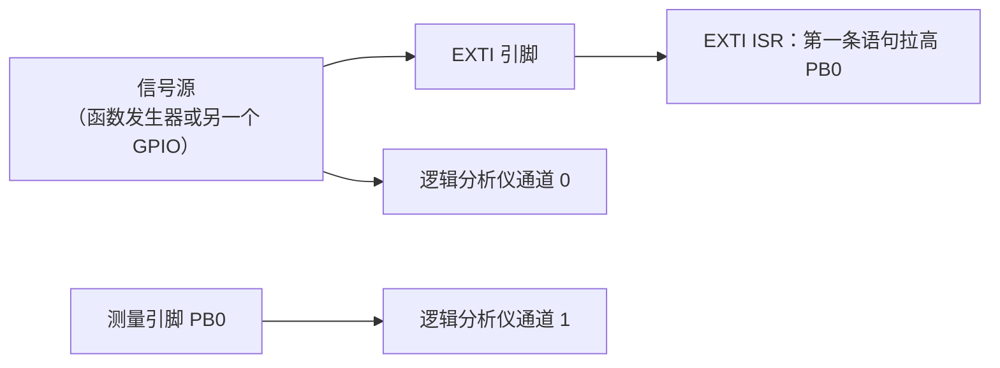

# 6.5 实时性、性能与功耗测量

在嵌入式系统的理论分析与工程预算中，诸多核心推论都依赖几个看似基础的关键物理量：在 [4.6 优先级反转、死锁与实时性](/教程/正文/嵌入式/4_RTOS与固件架构/4_6_优先级反转_死锁与实时性) 的调度分析中，可调度性判据建立在各个任务的最坏情况执行时间（WCET）之上；在 [6.1 固件架构、配置与资源预算](/教程/正文/嵌入式/6_质量_安全与交付/6_1_固件架构_配置与资源预算) 的架构评审中，时间预算需要真实的系统 CPU 负载作为硬约束，而电池寿命预估则以全工作周期的平均动态电流为基石。

然而在真实的工程现场，这些关键数据往往极难凭借理论推演凭空获得。凭经验主观估算的执行时间往往过于乐观，忽视了分支预测失效、等待状态以及嵌套中断带来的长尾延迟；而简单凭借数据手册标称值累加得出的静态功耗，又常常无法反映无线射频突发脉冲与低功耗模式转换期间的真实动态电荷消耗。无论是时间预算超标导致的偶发掉期，还是功耗超支引发的电池过早衰竭，都会在设备规模量产后造成灾难性的返工。

因此，建立基于物理仪器与片上观察单元的真实测量体系，是让系统设计脱离纸上谈兵的关键一环。本节将测量对象拆解为时间与电荷两个核心维度：在时间维度上，借助 Cortex-M 内核的 DWT 硬件周期计数器精准捕捉代码段的执行开销，利用物理 GPIO 引脚翻转与逻辑分析仪量化中断响应延迟，并依托固定桶直方图还原最坏延迟的长尾分布；在电荷维度上，阐明动态电流的采样机理与平均功耗的电荷积分法则，构建从单点实测到电池寿命量化评估的严密闭环。

## 1. 测什么

嵌入式里的「性能」包含几组不同的量，测量方法也不一样：

| 量 | 定义 | 常用工具 | 看什么 |
| --- | --- | --- | --- |
| 执行时间 | 一段代码从进入到返回的周期数 | DWT、GPIO + 逻辑分析仪 | 平均值与最坏值 |
| 中断延迟 | 中断请求到 ISR 第一条指令 | GPIO + 逻辑分析仪 | 最坏值 |
| 响应时间 | 事件发生到任务处理完成 | GPIO、跟踪工具（4.9） | 最坏值 |
| 抖动 | 周期任务实际唤醒时刻与计划时刻的偏差 | DWT、主机高精度计时器 | 最大值与分布 |
| CPU 负载 | 忙的时间占总时间的比例 | 空闲计数、运行时统计（4.9） | 峰值与随时间的变化 |
| 平均电流 | 一个工作周期内的平均消耗 | 分流电阻 + 示波器、功耗分析仪 | 平均值与峰值 |

::: concept emb-measure-worst-case title="实时系统看最大值与分布，不看平均值"

平均执行时间 10 μs、最坏 800 μs 的一段代码，在平均值的意义上占 CPU 不到 1%，在截止时间的意义上却可能让一个 100 μs 周期的任务连续错过好几轮。实时性由最坏值决定，所以每次测量都要记录最大值；样本太少时最大值本身也不可靠，还要看分布的形状。

:::

<Quiz
  type="single"
  :options="[
    { label: '周期 10 ms 的任务，平均执行 1 ms，一定可调度', value: 'A' },
    { label: '平均执行 200 μs、最坏 3 ms 的一段代码，按 200 μs 做预算', value: 'B' },
    { label: '响应时间的最坏值超过截止时间，就说明这组任务不可调度', value: 'C' },
    { label: '抖动很小说明最坏响应时间也小', value: 'D' }
  ]"
  answer="C"
>

<template #question>

关于「按最坏值判断」，下面哪一句是对的？

</template>

正确答案是 **C**。截止时间是对最坏情况的要求，最坏响应时间超过它，系统就不可调度。A 与 B 都是用平均值替代最坏值，D 把抖动与最坏响应时间混为一谈：抖动只描述周期任务唤醒时刻的偏差，与某次事件从发生到处理完的最长耗时不是一回事。

</Quiz>

## 2. DWT 周期计数器

Cortex-M3 的内核里有一个数据观察点与跟踪单元（Data Watchpoint and Trace, DWT），其中的 `CYCCNT` 每来一个内核时钟周期加一。72 MHz 下分辨率约 13.9 ns，比 1 ms 的 SysTick 细五个数量级。32 位计数在 72 MHz 下约 59.65 秒回绕一次，用「当前值减起始值」的差值比较，回绕不影响结果。

启动它要两步。先打开调试单元的总开关，再打开计数器本身：

| 寄存器 | 地址 | 位 | 名称 | 作用 |
| --- | --- | --- | --- | --- |
| DEMCR | 0xE000EDFC | 24 | TRCENA | 跟踪与调试单元总使能，不开这个，DWT 的所有功能都不工作 |
| DWT_CTRL | 0xE0001000 | 0 | CYCCNTENA | 周期计数器使能 |
| DWT_CYCCNT | 0xE0001004 | 31:0 | CYCCNT | 32 位周期计数，只读可写，可清零 |

CMSIS 把这三个寄存器都定义好了，用名字访问比写地址清楚：

```c
static inline void dwt_cycles_init(void) {
    CoreDebug->DEMCR |= CoreDebug_DEMCR_TRCENA_Msk;
    DWT->CYCCNT = 0u;
    DWT->CTRL |= DWT_CTRL_CYCCNTENA_Msk;
}

static inline uint32_t dwt_cycles(void) {
    return DWT->CYCCNT;
}

/* 成对使用：先 DWT_BEGIN() 再 DWT_END()，差值是这段代码的周期数 */
#define DWT_BEGIN() uint32_t dwt_t0_ = dwt_cycles()
#define DWT_END() (dwt_cycles() - dwt_t0_)
```

arm-none-eabi-gcc 13.3 在 `-O2` 下把这段宏展开成三条指令：

::: terminal title="bash - 测量宏生成的指令（arm-none-eabi-objdump -d）"

```text
00000000 <measure_empty>:
   0:	4b02      	ldr	r3, [pc, #8]	@ (c <measure_empty+0xc>)
   2:	685a      	ldr	r2, [r3, #4]        ; 第一次读 DWT_CYCCNT
   4:	6858      	ldr	r0, [r3, #4]        ; 第二次读 DWT_CYCCNT
   6:	1a80      	subs	r0, r0, r2          ; 相减得到空区间的周期数
   8:	4770      	bx	lr
```

:::

空区间本身也要花几个周期：两次读计数器、相减、函数调用与返回。测量极短的代码之前先测一次空区间，把它的值作扣除。这个值随 Flash 等待周期、流水线状态与优化等级变化，只能在目标板上实测，不能从别处抄一个数。

同一个函数在同一块板子上跑两次，周期数也可能不同，原因在 Flash 的取指速度。72 MHz 时 Flash 需要 2 个等待周期（[2.3 时钟与复位](/教程/正文/嵌入式/2_MCU裸机开发/2_3_时钟与复位) 的 FLASH_ACR），预取缓冲能让顺序执行的取指变快，遇到跳转就可能要等。C 代码对齐到 4 字节还是 8 字节、循环体是否跨了 Flash 的一行，都会让同一段逻辑相差几个周期。要比较两个实现，用同一套编译选项、同一份链接脚本，并且多测几次取最坏值。

::: tip 减去测量本身的开销

`DWT_BEGIN()` 与 `DWT_END()` 各包含几条指令，量一个函数调用、一次移位这类几周期的东西时，开销占比很大。先跑一遍空区间拿到基线，再从结果里减掉。量几百个周期以上的代码时，这点开销可以忽略。

:::

## 3. GPIO 与逻辑分析仪

DWT 只能测「代码内部」的时间，测不到「事件发生到代码开始执行」这一段。中断延迟就是后者：信号到达引脚，到 ISR 第一条指令执行，中间隔着 NVIC 的响应、流水线清空、向量表取址、压栈保存现场。这一段在 M3 上通常是十几个周期加上若干等待状态，靠软件量不出来。

办法是让 ISR 自己在第一条语句翻转一个 GPIO。逻辑分析仪同时抓信号源与这根测量引脚，两条边沿之间的时间就是中断延迟。逻辑分析仪的采样率、触发与协议解码在 [6.3 测试、逻辑分析与硬件在环](/教程/正文/嵌入式/6_质量_安全与交付/6_3_测试_逻辑分析与硬件在环) 已经讲过，这里只用它测时间，不做协议解码：



测量引脚用 BSRR 写入，一条 `str` 指令完成，不读改写 ODR：

```c
static inline void probe_init(void) {
    RCC->APB2ENR |= RCC_APB2ENR_IOPBEN;
    GPIOB->CRL = (GPIOB->CRL & ~(0xFu << 0)) | (0x2u << 0); /* PB0：2 MHz 推挽输出 */
    GPIOB->BRR = 1u << 0;
}

static inline void probe_high(void) {
    GPIOB->BSRR = 1u << 0;
}

static inline void probe_low(void) {
    GPIOB->BRR = 1u << 0;
}
```

在 ISR 的首尾各放一句，脉冲宽度就是执行时间：

```c
void EXTI0_IRQHandler(void) {
    PROBE_ISR_ENTER();           /* 第一条语句拉高 */
    EXTI->PR = EXTI_PR_PR0;
    process_event();
    PROBE_ISR_EXIT();            /* 最后一条拉低 */
}
```

`probe_high()` 本身占一条指令，脉冲宽度里包含了这一条，量出来的值比真实执行时间多一两个周期。需要更精确时，用 DWT 在 ISR 内部测，GPIO 只作为「延迟」的时间基准。

逻辑分析仪与 DWT 各有各的用处：

| 方面 | DWT | GPIO + 逻辑分析仪 |
| --- | --- | --- |
| 能测的量 | 代码段内部的周期数 | ISR 执行时间、中断延迟、任务响应时间、引脚时序 |
| 是否需要额外仪器 | 不需要 | 需要逻辑分析仪或示波器 |
| 长时间统计 | 需要自己写记录代码 | 仪器可以连续抓几秒、看余辉或直方图 |
| 对被测代码的影响 | 几条指令 | 两条引脚操作，外加一根线 |
| 多路同时观测 | 一次一段 | 通道够就能同时看好几路 |

观察时序分布是物理仪器的核心强项。让同一个中断以固定频率连续触发数万次，将示波器置于“无限余辉”模式或启用逻辑分析仪的统计直方图功能，屏幕上展现的不再是孤立的单次脉冲，而是一条具有明显厚度的统计光带。如果每次中断响应时间完全恒定，余辉重叠后只会是一根纤细的线条；而光带的宽度直接反映了时延抖动的大小，其最右侧的外边缘便代表了该工况下的最坏情况延迟（WCET）。在初次进行长时域统计测量时，实测数据往往会打破开发者的乐观预期：一个常态平均延迟仅 1 μs 的中断例程，其最坏情况延迟飙升至 5 μs 乃至更高在复杂系统中屡见不鲜。其背后的诱因多种多样，可能恰逢底层驱动正在擦写 Flash 导致总线挂起，或是某个高优先级任务刚刚进入一段临界区关闭了全局中断。正是这类长尾极端值，最终决定了硬实时系统能否守住安全底线。

<Quiz
  type="multi"
  :options="[
    { label: '把信号源直接接到分析仪的一个通道，不需要改固件', value: 'A' },
    { label: '在 EXTI ISR 的第一条语句翻转一根测量引脚', value: 'B' },
    { label: '同时抓信号源与测量引脚，两条边沿的时间差就是延迟', value: 'C' },
    { label: '只在主循环里翻转测量引脚', value: 'D' }
  ]"
  :answer="['B', 'C']"
>

<template #question>

要测 EXTI 中断从引脚电平变化到 ISR 第一条指令的中断延迟，需要做哪些事？

</template>

正确答案是 **B、C**。测量点必须放在 ISR 的入口，且要与信号源同时被同一台仪器抓到，两条边沿的时间差才是延迟。A 少了测量点，只能看到信号；D 的翻转发生在主循环里，量到的是「中断加完整的任务响应」，不是中断延迟。

</Quiz>

## 4. 统计与呈现

单次测量的数字没有多少意义。要判断一段代码「够不够快」，需要几百上千个样本的最小值、最大值、平均值与分位数。在 MCU 上存不下几千个样本，也不该用浮点，固定桶直方图是合适的结构：桶宽固定，样本落进对应的桶，只占「桶数 × 4 字节」。

```c
#define HIST_MAX_BINS 64

typedef struct {
    uint32_t bin_width;
    uint32_t bins[HIST_MAX_BINS];
    unsigned count;   /* 桶数，最后一个为溢出桶 */
    unsigned samples;
    uint32_t min;
    uint32_t max;
    uint64_t sum;
} hist_t;

void hist_add(hist_t *h, uint32_t value) {
    unsigned idx = hist_bin_index(h, value);
    if (h->samples == 0u || value < h->min) {
        h->min = value;
    }
    if (h->samples == 0u || value > h->max) {
        h->max = value;
    }
    ++h->bins[idx];
    ++h->samples;
    h->sum += value;
}
```

主机上的单元测试用一组手工构造的样本验证桶号与统计量：

::: terminal title="PowerShell - test_hist.exe"

```text
样本 13 个，最小 12 us，最大 130 us，平均 48 us
p50 = 40 us，p90 = 70 us，p99 = 70 us
  [  0,  10)   0
  [ 10,  20)   3
  [ 20,  30)   2
  [ 30,  40)   1
  [ 40,  50)   2
  [ 50,  60)   1
  [ 60,  70)   1
  [ 70,  80)+  3
```

:::

最后一格是溢出桶，装的是 70 μs 以上的三个样本（75、90、130）。百分位返回的是所在桶的下界，精度就是一格桶宽，桶宽选得合适时够用。130 μs 与 75 μs 落进同一格，这是有意的：桶数有限，统计的目的是看形状与最坏值。

### 4.1 一个通用操作系统的抖动

为了说明「看最大值」这件事，在 Windows 上请求每 1 ms 唤醒一次，用 `QueryPerformanceCounter` 读取实际间隔，样本进同一个直方图。程序跑两轮，第二轮之前调用 `timeBeginPeriod(1)` 把系统定时器分辨率提高到 1 ms：

::: terminal title="PowerShell - jitter_win.exe"

```text
QPC 频率 10000000 Hz
默认定时器分辨率：
  运行 1011 ms，唤醒 67 次
  实际间隔：最小 9472 us，平均 15101 us，p99 15500 us，最大 15828 us
timeBeginPeriod(1) 之后：
  运行 1001 ms，唤醒 513 次
  实际间隔：最小 1004 us，平均 1951 us，p99 2000 us，最大 2603 us
```

:::

上面是一次真实运行的输出，再跑一次数字会不一样——通用操作系统的抖动本来就是这样，看结论不要看具体某个数。第一轮里请求的周期是 1 ms，实际最小间隔是 9.5 ms。Windows 的默认定时器节拍通常是 15.6 ms（64 Hz），`Sleep(1)` 只是「至少睡 1 ms」，调度器在下一个节拍才把它唤醒，于是间隔被拉长到十几毫秒，唤醒次数只有 67 次，按 1 ms 的周期本该接近 1000 次。用平均值看，会得出「这个线程每 15 ms 跑一次」的结论；用最大值看，结论是「它随时可能被推迟 15.8 ms」。对实时性来说后者才是有用的信息。

第二轮把定时器分辨率改成 1 ms，间隔回到 1～2 ms，但最大值仍然是 2.6 ms，比最小值多出一倍多。这是通用操作系统（general-purpose operating system）的常态：它优化的是吞吐量与公平性，不承诺任何响应时间的上界。同样一段代码放在裸机或 RTOS 上，抖动会小一两个数量级，但同样有最坏值，同样要测。

::: compare left-title="只看平均值" right-title="看最大值"

```text
请求周期 1 ms，唤醒 67 次
平均间隔 15.1 ms
结论：把周期改成 15 ms 就对了
```

---

```text
请求周期 1 ms，唤醒 67 次
平均间隔 15.1 ms，最大 15.8 ms
结论：这个平台上做不了 1 ms 的周期任务，
      要么换平台，要么把对时序的要求降到 16 ms 以上
```

:::

## 5. CPU 负载

CPU 负载是忙的时间占总时间的比例。RTOS 上最省事的办法是看空闲任务占了多少：空闲任务的占比就是空转的比例，剩下的是负载。

FreeRTOS 自带运行时统计，打开 `configGENERATE_RUN_TIME_STATS` 之后由内核在每次任务切换时累加各任务的运行时间，`vTaskGetRunTimeStatistics()` 输出一张表。计数器频率、配置项与输出格式在 [4.9 RTOS 固件架构、跟踪与测试](/教程/正文/嵌入式/4_RTOS与固件架构/4_9_RTOS固件架构_跟踪与测试) 已经讲过，这里只把它当作负载的另一种读法。

没有开运行时统计时，空闲钩子里数计数就够了。内核在每个空闲循环里调用一次 `vApplicationIdleHook()`，在钩子里给一个全局计数加一，同时用 DWT 记下空闲循环总共花掉的周期：

```c
static volatile uint32_t g_idle_iterations;

void vApplicationIdleHook(void) {
    ++g_idle_iterations;
}
```

固定时间窗口（比如 1 s）内读一次计数与总周期数，两者相减得到这一秒的增量，空闲增量占总增量的比例就是空转时间。下面这个换算程序用一组构造的计数演示计算与呈现，窗口 1 s、计数器每秒 100 万次：

::: terminal title="PowerShell - load_meter.exe"

```text
窗口   空闲计数    总计数   负载
  1     985000    1000000    1.5%
  2     742000    1000000   25.8%
  3     118000    1000000   88.2%
  4      63000    1000000   93.7%
  5     410000    1000000   59.0%
峰值负载 93.7%
```

:::

五个窗口的负载从 1.5% 一路爬到 93.7%，又回落到 59.0%。只看最后一列的平均（约 53.6%）会漏掉 93.7% 那个尖峰：它意味着有某个窗口里任务几乎把 CPU 占满了，一旦再来一个事件就会丢截止时间。记录负载要按窗口记时间序列，不要只存一个总分。

空闲计数法测的是「空闲任务有没有得到 CPU」，它不区分「CPU 在等中断」与「CPU 在空转」。开了无节拍空闲（[4.7 FreeRTOS](/教程/正文/嵌入式/4_RTOS与固件架构/4_7_FreeRTOS) 第 7 节）之后，空闲任务大部分时间在睡，计数增长变慢，换算出来的负载会偏高。这种时候用 DWT 的周期差当分母、用「非空闲任务的累计运行时间」当分子更准确，代价是要在每个任务里埋点。

## 6. 功耗测量

低功耗模式的配置与用万用表测静态电流在 [2.10 看门狗、低功耗与故障处理](/教程/正文/嵌入式/2_MCU裸机开发/2_10_看门狗_低功耗与故障处理) 已经讲过。这里补的是动态电流：设备在「醒着算」与「睡着等」之间来回切换，耗电并不恒定，万用表读到的是一个被平均过的数，看不出尖峰。

### 6.1 三种测法

**分流电阻加示波器**。在供电线上串一个已知阻值的小电阻（比如 10 Ω），用示波器测它两端的压差，除以阻值就是电流。阻值要小到不影响设备工作（10 Ω 上流过 20 mA 就是 0.2 V 的压降，可能让 3.3 V 的器件欠压），又要大到让示波器看得清。示波器用差分探头或者两通道相减，带宽选够，不然几十微秒的电流尖峰会被平滑掉。

**功耗分析仪**。Nordic Power Profiler Kit II、ST X-NUCLEO-LPM01A、Joulescope 这类仪器把分流电阻、放大器与高速采样做在一起，量程自动切换，配套软件直接给出电流曲线、平均电流与电荷量。测电池供电的节点时它们比示波器省事得多，精度也好，缺点是价格。

**库仑计**。有些电池模块自带库仑计芯片，直接读出累计电荷。它测的是整机长时间的平均，做不了波形分析，适合验证寿命估算。

::: tip 测功耗之前断开调试器

调试器连着的时候，芯片的调试单元在工作，电流比正常运行时高；更麻烦的是 `DBGMCU_CR` 里的 `DBG_SLEEP`、`DBG_STOP`、`DBG_STANDBY` 位会让芯片在低功耗模式下保持时钟，测出来的「Stop 模式电流」可能到毫安级，比 Stop 模式应有的微安级高几个数量级。用电池供电、拔掉调试器再测，或者确认这三位都是 0。

:::

### 6.2 让测量不失真的几个细节

万用表测电流要串进电路，量程切换时内部的继电器会短暂断开，设备可能因此复位；自动量程在 μA 与 mA 之间跳来跳去时读数也不稳。测占空比工作的设备，万用表给出的平均值只对「电流平稳」的负载有意义。

未用的 GPIO 要设成模拟输入。浮空的输入引脚会让输入缓冲器在两个状态之间来回翻转，每个翻转都消耗电流，几个引脚加起来能多出几十微安——对一个目标 14 μA 的 Stop 模式来说，这是致命的。

开发板上的电源指示灯、USB 转串口芯片、稳压器的静态电流都不属于 MCU。想知道芯片本身消耗多少，得断开板上其他负载，或者从芯片的电源引脚单独供电。整板测出来的数字通常比芯片手册大一个数量级以上。

::: warning 用开发板测出来的电流不能代表产品

开发板上的 LED、LDO、USB 转串口芯片一直在耗电，测出来的是整板电流。要做功耗预算，必须在自己的板子上、拔掉调试器、关掉无关外设之后测，或者从芯片电源引脚单独测量。

:::

## 7. 能耗与电池寿命

占空比工作的设备，一个周期里有几段不同的电流，平均电流是各段电流按时间加权的和：

$$\bar I = \frac{1}{T}\sum_{i} I_i t_i$$

电池寿命就是可用容量除以平均电流：

$$t = \frac{C \cdot \eta}{\bar I}$$

其中 $C$ 是标称容量，$\eta$ 是可用比例，要扣掉自放电、低温容量损失与终止电压的影响。锂电池按 80% 估算是个常见的起点，一次性电池的可用比例更低。

下面这个程序算一个「每分钟醒来采样、每 10 分钟发送一次」的节点。采样与发送的电流是示例取值，待机电流取 DS5319 表 16 中 Stop 模式的典型值 14 µA：

```c
const double sample_s = 0.020 * 60.0; /* 每分钟一次，每次 20 ms */
const double send_s = 2.0 * 6.0;      /* 每 10 分钟一次，每次 2 s */
const double standby_s = 3600.0 - sample_s - send_s;

const phase_t phases[] = {
    {"采样（72 MHz，ADC + I2C）", 15.0, sample_s},
    {"发送（MCU + 无线模块）", 120.0, send_s},
    {"待机（Stop，RTC 走时）", 0.014, standby_s},
};
```

运行结果：

::: terminal title="PowerShell - battery_life.exe"

```text
采样（72 MHz，ADC + I2C）  15.000 mA ×     1.20 s/h =   18.0000 mA·s/h
发送（MCU + 无线模块） 120.000 mA ×    12.00 s/h = 1440.0000 mA·s/h
待机（Stop，RTC 走时）   0.014 mA ×  3586.80 s/h =   50.2152 mA·s/h

平均电流 0.419 mA，可用容量 1600 mAh，预计 3819 小时，约 159.1 天
各阶段占比：采样 1.2%，发送 95.5%，待机 3.3%
```

:::

分析上述加权结果，能够清晰揭示低功耗设计的优化杠杆所在：微控制器的待机电流仅有 14 µA，比采样阶段的 15 mA 低了三个数量级，但由于其在整整一个小时内占据了 3586.8 秒的时长，累计消耗的电荷仍占总量的 3.3%；而射频发射阶段虽然每小时仅持续区区 12 秒，却因瞬间 120 mA 的高电流贡献了高达 95.5% 的总能耗。这一严酷的数据对比指明了系统优化的主攻方向：试图费尽周折将 MCU 的待机休眠电流由 14 µA 极限压缩至 5 µA，对整机寿命的改善微乎其微；而只要通过提升无线波特率或优化包结构将单次发送时长缩减 200 ms，就能立竿见影地为设备赢回数十天的续航周期。

在低功耗工程实践中，这种反直觉的能耗分布只能依靠严密的阶段积分推算得出。在建立数学模型后，再借助功耗分析仪对原型机进行长时域闭环实测；一旦实测平均电流显著超出模型预估，往往提示我们在状态机跳转的间隙中存在未关闭的时钟源，或是有浮空引脚在休眠期间发生寄生漏电。

::: concept emb-energy-duty-cycle title="平均电流按电荷加权，不按时间加权"

一个周期内各阶段的电荷是 $I_i t_i$，平均电流是总电荷除以周期长度。持续时间长但电流极小的阶段（如 Stop 模式）与持续时间短但电流很大的阶段（如无线发送）都要换算成电荷再比较，不能按时间占比直接判断谁更耗电。

:::

## 8. 习题

### 8.1 巩固

<Exercise id="60634" :d="1" :w="1">

正文的测量宏有两个版本。第一个是成对使用的：

```c
#define DWT_BEGIN() uint32_t dwt_t0_ = dwt_cycles()
#define DWT_END() (dwt_cycles() - dwt_t0_)
```

(1) 把它用在 `if` 的单条语句位置上：

```c
if (ready)
    DWT_BEGIN();
```

把预处理之后的代码写出来，说明编译报什么错。

(2) 在同一个作用域里连续写两次 `DWT_BEGIN();`，报什么错？把它包进 `do { … } while (0)` 能解决第一个问题，能不能解决第二个？

(3) 改成 `static inline` 的两个函数，给出参数与返回值类型。说明为什么编译器在 `-O2` 下仍能把它内联成同样的两条 `ldr`。

(4) 一个中断在 `DWT_BEGIN()` 与 `DWT_END()` 之间到达并执行了 300 个周期。用宏量出来的值包含这 300 个周期吗？如果那段代码正是被测对象，这个偏差属于哪一类误差？

</Exercise>

<Exercise id="60635" :d="2" :w="3">

正文的直方图例子用 8 个桶、桶宽 10 μs，`hist_bin_index()` 把超出范围的样本压进最后一格。16 个样本如下（单位 μs）：

```text
12  15  18  21  24  27  30  33  36  42  48  55  63  70  85  130
```

(1) 逐个算出桶号，写出八格的计数。最后一格里有几个样本？它们与这一格的下界各差多少？

(2) 百分位的算法是：目标名次为 $\lceil p\% \cdot n \rceil$，从第 0 格开始累加计数，累计值首次达到名次的那一格就是答案，报这一格的下界；溢出格按最后一格算。按这个算法算 p50、p90、p99，写出每一步的下标与取值。p90 与 p99 报的是同一个数，各是什么原因造成的？

(3) 把桶宽改成 20 μs，重算一遍 p50、p90、p99。桶宽变粗之后，哪个百分位的变化最大？

(4) 桶宽取多大合适？给出一个由「关注的精度」与「最大样本」推出桶宽与桶数的关系式，并说明 64 个桶、每桶 4 字节时表本身占多少 RAM。

(5) `hist_add` 里的 `sum` 是 64 位，而样本是 32 位。样本最多 100 万个、每个不超过 65535 时，换成 32 位的 `sum` 会在第几个样本上溢出？算出这个数与总样本数的比值，说明 64 位在这个场景下是不是过度设计。

</Exercise>

<Exercise id="60636" :d="2" :w="3">

正文用 DWT 测代码段、用 GPIO 加逻辑分析仪测中断延迟。下面五组需求，各选一种手段并说明理由：

| 组 | 需求 |
| --- | --- |
| A | 某个 ISR 执行时间的分布，连续抓 20 s |
| B | 一个纯计算函数在两种写法下的周期数 |
| C | 从上位机发出命令到 MCU 拉低应答引脚之间的延迟 |
| D | 四个任务各自的唤醒间隔是否稳定 |
| E | 一次擦除 Flash 期间中断被推迟了多久 |

(1) 逐组给出选择，写成一张表：手段、要不要额外仪器、测出来的是哪个量。

(2) A 与 E 都要看最坏值。用 GPIO 打点时，脉冲宽度里包含了 `probe_high()` 本身的那一条指令。这条指令的影响对 A 和 E 各自有多大？给出估算依据。

(3) C 的延迟里包含中断延迟、任务唤醒与处理时间。只用一根测量引脚能不能把它拆成两段？画出接线与两段的时间边界。

(4) D 用 DWT 还是用它自己记录的唤醒时刻？后者需要什么做时间基准，为什么不能用 `xTaskGetTickCount()`？

</Exercise>

### 8.2 编程

<Exercise id="60637" :d="3" :w="4">

正文的 `load_meter` 用一组构造的计数演示 CPU 负载。现在给它加上时间序列与告警。

(1) 定义 `load_sample_t { uint32_t window; uint32_t idle_delta; uint32_t total_delta; }`，写 `void load_push(load_sample_t s)` 把样本存进一个 32 项的环形缓冲，缓冲满时覆盖最旧的一项。

(2) 实现 `double load_percent(const load_sample_t *s)`，负载 = (total − idle) / total。窗口内 `total_delta` 为 0 时返回什么？给出你的取值与理由。

(3) 用下面六组数据运行，打印每个窗口的负载与峰值，输出格式对齐正文的表格：

```text
窗口  空闲计数   总计数
  1    941000   1000000
  2    903000   1000000
  3    820000   1000000
  4    214000   1000000
  5      5000   1000000
  6    455000   1000000
```

(4) 加一条规则：连续三个窗口负载超过 85% 就打印告警，并带上这三个窗口的编号。用上面的数据运行，告警会触发吗？把阈值改成能在这组数据上触发的值，说明你选这个值的依据。

(5) 窗口长度取 1 s 还是 100 ms？在 1 MHz 计数下分别算出每窗的计数与 ±1 个计数的相对误差，再说明窗口缩短之后，除计数分辨率之外还有哪两个因素让读数更难解释。

</Exercise>

<Exercise id="60638" :d="3" :w="4">

正文的 `battery_life` 用一个节点算平均电流。改成一个可配置的工具，并对参数做灵敏度分析。

(1) 把三个阶段写成数组：采样 12.0 mA 持续 1.2 s/h（每分钟一次、每次 20 ms），发送 95.0 mA 持续 9 s/h（每 10 分钟一次、每次 1.5 s），待机 0.008 mA 持续其余时间。算出平均电流、1600 mAh 电池按 80% 可用时的寿命（小时与天），以及各阶段的电荷占比。

(2) 发送时间从 1.5 s 改成 1.0 s、3.0 s，各算一次寿命。待机电流从 8 μA 降到 4 μA，再算一次。哪一项改动带来的收益最大？用数字说明。

(3) 把结果做成表格，列为：参数、原值、新值、平均电流、寿命（天）、相对变化。

(4) 实测平均电流比计算值大 25%。按电荷守恒，反推「发送电流」需要多大才能解释这个差，其他参数不变。

(5) 电池按 80% 可用是常见起点。如果产品要在 −20 ℃ 工作，这个比例该怎么取？说明低温从哪两个方面同时削减可用容量。

</Exercise>

<Exercise id="60639" :d="4" :w="4">

下面是一段在主机上跑的采样估算程序。它把 10 ms 的周期按采样率切成若干点，每点按相位判断落在「醒着」还是「睡着」，再求平均：

```c
#include <math.h>

/* 周期 10 ms，前 200 us 电流 12 mA，其余 8 uA */
double estimate(double fs, double phase) {
    int n = (int)(fs * 0.010 + 0.5);
    double sum = 0.0;
    for (int k = 0; k < n; ++k) {
        double t = fmod(k / fs + phase, 0.010);
        sum += (t < 200e-6) ? 12.0 : 0.008;
    }
    return sum / n;
}
```

(1) 算出真实平均电流。把 `fs` 取 1 k、2 k、5 k、10 k、100 k，`phase` 取 0，各跑一次，列出结果。1 k 与 2 k 为什么偏离得那么厉害？5 k 与 10 k 在 `phase` 为 0 时恰好给出正确值，这是方法对了还是取样点碰巧对齐？

(2) 把 `phase` 从 0 以 1 μs 为步长扫到 10 ms，对 1 k、2 k、5 k、10 k、100 k、200 k 各记下估计值的最大与最小。为什么相位每转过一格，估计值就可能跳一个台阶？台阶的高度与什么成正比？写出这个误差上界，并算出「误差不超过真实值 5%」需要多高的采样率。

(3) 示波器上「电流尖峰被平滑掉」是同一个道理吗？从带宽与采样率两个角度说明区别。

(4) 分流电阻取 10 Ω，设备工作电流 20 mA。算出压降；如果器件最低供电是 3.0 V、电源是 3.3 V，这个电阻还能用吗？给出可行范围与要付出的代价。

(5) 让程序只统计落入「醒着」窗口的样本比例，再乘以 12 mA。这个估计与 (1) 的平均值在什么条件下相等？在什么条件下系统性偏小？

</Exercise>

### 8.3 综合与挑战

<Exercise id="60640" :d="5" :w="5" scope="**">

给一块 F103 板子做一份测量报告，把正文的时间与功耗两条线接起来。需要开发板、调试器与一台能看波形的仪器；没有仪器时只做 (1) 与 (5) 的估算部分，并说明其余各步在仪器到位后怎么补。

(1) 先用 DWT 测空区间基线与一个已知长度的忙等循环（比如 1000 次自减），换算出每周期的纳秒数。说明基线为什么要实测，不能从别处抄。

(2) 用 GPIO 打点测一个 EXTI 中断的执行时间，样本不少于 200 个，进 `hist_t`。给出最小值、最大值、p50、p99 与溢出桶计数，并说明最坏值出现在哪些样本上。

(3) 打开 IWDG 并把超时设为 1 s，在 ISR 里插入一次 20 ms 的忙等，观察是否触发复位。若触发，说明是 ISR 本身太长还是喂狗点安排不当，给出两种改法。

(4) 用分流电阻加示波器测同一段代码运行时的电流波形，读出「醒着」与「睡着」两段的电流与持续时间，按电荷算出平均电流。

(5) 把 (2) 的执行时间与 (4) 的电流相乘，估算这次测量本身的电荷开销。它相对一次升级的电荷占多少？给出结论：测量代码本身要不要算进功耗预算。

</Exercise>

<Exercise id="60641" :d="6" :w="5" scope="**">

正文第 4.1 节在 Windows 上测 `Sleep(1)` 的抖动。把这套方法迁到目标板上，做一份裸机、RTOS 与通用操作系统三者的对照。需要 F103 开发板；只做 (1) 与 (4) 的主机部分也可以，但要说明缺了哪几行数据、结论还能不能成立。

(1) 在主机上重跑 `jitter_win`：请求 1 ms，每轮固定跑满 1 秒而不是固定样本数，分别在默认定时器分辨率与 `timeBeginPeriod(1)` 之后各跑一轮，记录唤醒次数、最小、平均、最大间隔。贴出你的输出（数字会与正文不同），说明为什么两轮的唤醒次数差别那么大，以及为什么必须固定窗口而不是固定样本数才能比出这个差别。

(2) 在 F103 上用 `SysTick` 每 1 ms 触发一次，在 ISR 里记录 DWT 的 `CYCCNT`，主循环把相邻两次的差值存进 `hist_t`。给出 200 个样本的直方图与最大值，单位为周期。

(3) 在 FreeRTOS 上做同样的事：一个周期 1 ms 的任务用 `vTaskDelayUntil()`，记录实际唤醒时刻与计划时刻之差。与 (2) 比较最大值与分布形状，说明多出来的那部分来自哪里。

(4) 三组结果放在同一张表里，列为：平台、请求周期、实测最小、平均、最大、唤醒次数。用一句话概括「实时性由谁决定」。

(5) 把 (2) 的 SysTick 换成 100 μs 的重装值，重跑。最大值下降了吗？DWT 的分辨率与 SysTick 的分辨率各是多少，谁成了瓶颈？

</Exercise>

<Exercise id="60642" :d="3" :w="3" scope="*">

设计一个「低功耗节点的能耗核算表」，把正文的功耗测量与电池寿命估算变成能进 CI 的检查。

(1) 定义阶段表：

```c
typedef struct {
    const char *name;
    double current_ma;
    double seconds_per_hour;
    double tolerance_pct;
} phase_t;
```

写 `int energy_check(const phase_t *phases, size_t n, double budget_ma)`，返回平均电流是否超过预算，并打印每个阶段的电荷与占比。

(2) 每个阶段的电流允许有容差。若某阶段实测值超出容差，打印超出量与「要回到预算内，这个阶段最多还能用多少 mA」。给出全部阶段同时超差时最坏情况的算法。

(3) 用正文的节点（采样 15 mA/1.2 s、发送 120 mA/12 s、待机 14 μA/3586.8 s）验证：平均电流应为 0.419 mA，发送占 95.5%。再把预算取 0.42 mA、发送电流的容差设为 10%，判断是否通过；把预算收紧到 0.40 mA，求发送电流最多还能是多少。

(4) 把「阶段时长」改成可变项：发送时长从 2 s 涨到 4 s（每 10 分钟一次，即每小时 24 s），其余不变，平均电流变成多少？寿命（1600 mAh、80%）从多少天变成多少天？

(5) 在没有功耗分析仪的情况下，怎么用万用表加一个 GPIO 打点得到每个阶段的电流？写出测量步骤与要记录的三个量，并说明为什么不能用万用表直接读占空比工作的设备。

(6) 这份核算表放进 CI 需要哪些输入？如果实测值来自人工抄录，它还能拦住什么问题、拦不住什么？

</Exercise>

## 9. 参考资料

1. Arm, [*Armv7-M Architecture Reference Manual*](https://developer.arm.com/documentation/ddi0403/latest/)：DWT 的 `CYCCNT`、`DEMCR.TRCENA` 与调试单元的整体结构。
2. Arm, [*Cortex-M3 Devices Generic User Guide*](https://developer.arm.com/documentation/dui0552/a/)：DWT 寄存器一览与 CYCCNT 的行为。
3. Memfault, [*Profiling Firmware on Cortex-M*](https://interrupt.memfault.com/blog/profiling-firmware-on-cortex-m)：DWT 周期计数、GPIO 打点与采样精度的工程经验。
4. FreeRTOS, [*Mastering the FreeRTOS Real Time Kernel*](https://github.com/FreeRTOS/FreeRTOS-Kernel-Book)：第 11 章 Low Power Support、第 12 章 Developer Support（运行时统计）。
5. STMicroelectronics, [*DS5319: STM32F103x8/xB datasheet*](https://www.st.com/resource/en/datasheet/stm32f103c8.pdf)：表 16 低功耗模式典型电流，表 19 运行模式电流。
6. STMicroelectronics, [*RM0008 Reference manual*, Rev 21](https://www.st.com/resource/en/reference_manual/rm0008-stm32f101xx-stm32f102xx-stm32f103xx-stm32f105xx-and-stm32f107xx-advanced-armbased-32bit-mcus-stmicroelectronics.pdf)：第 5 章 FLASH_ACR 的等待周期与预取，第 8 章 PWR，第 9 章 DBGMCU。
7. Nordic Semiconductor, [*Power Profiler Kit II*](https://www.nordicsemi.com/Products/Development-hardware/Power-Profiler-Kit-2)：功耗分析仪的测量范围与用法。
8. Microsoft, [*Acquiring high-resolution time stamps*](https://learn.microsoft.com/en-us/windows/win32/sysinfo/acquiring-high-resolution-time-stamps)：`QueryPerformanceCounter` 与 `QueryPerformanceFrequency` 的用法与精度说明。
9. Microsoft, [*timeBeginPeriod function*](https://learn.microsoft.com/en-us/windows/win32/api/timeapi/nf-timeapi-timebeginperiod)：系统定时器分辨率的设置与其对 `Sleep` 的影响。
10. Elecia White, *Making Embedded Systems*, 2nd ed., O'Reilly, 2024：功耗测量与电池寿命估算一章。
11. 本页的终端输出均为实测：主机侧程序在 MinGW gcc 13.2 上编译运行，DWT 与 GPIO 测量代码用 Arm GNU Toolchain 13.3 编译，反汇编取自实际产物。`jitter_win` 的数字每次运行都不同，换一台机器差别更大，照着做时以自己的输出为准。
