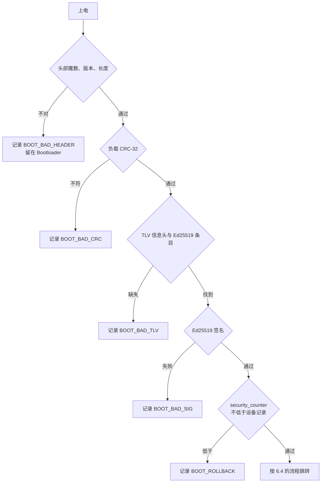
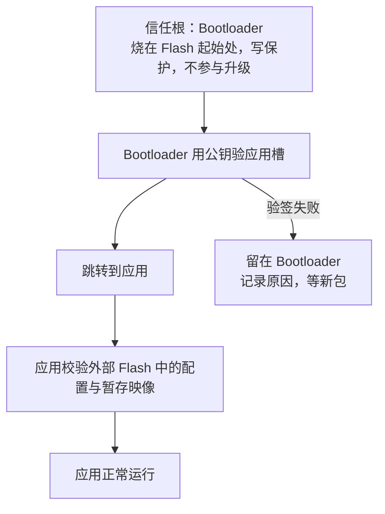

# 6.7 安全启动、映像校验与密钥

在 [6.4 Bootloader 与固件升级](/教程/正文/嵌入式/6_质量_安全与交付/6_4_Bootloader与固件升级) 中，Bootloader 在将控制权移交之前，会严格核对应用程序槽与镜像头部记录的 CRC-32 校验码。这一机制能够高效过滤由于总线噪声或传输丢包引起的随机位翻转，确保损坏的二进制代码绝不会被装载运行。然而，CRC 校验本质上仅仅是对物理传输偶发错误的冗余检查，完全不具备任何密码学层面的真实性保障：任何具有逆向能力的攻击者，都可以自行编译一份恶意固件、计算出匹配的 CRC-32 校验值并灌入存储器，原有的 Bootloader 会毫无察觉地校验通过并执行跳转。在安全威胁模型中，CRC 无法分辨数据是“意外损坏”还是“被恶意掉包”，它从未回答过最关键的溯源问题——“这份固件到底出自谁手”。

本节致力于构建基于密码学信任链的安全启动（Secure Boot）体系。首先厘清数据完整性（Integrity）与来源真实性（Authenticity）的本质边界；继而在固件结构中引入现代非对称签名算法（Ed25519），确立“私钥离线保存在安全签名机、终端设备内部仅固化公钥”的非对称信任锚点；结合单向单调递增的安全计数器（Security Counter）防御版本降级重放攻击；最后剖析微控制器的芯片级读写保护屏障与密钥全生命周期管理策略，清晰界定主流通用 MCU 所能构筑的纵深防御边界。

## 1. 威胁与目标

对一个装在现场的设备，值得防的事有四类：

| 威胁 | 攻击者要做什么 | 不设防的后果 |
| --- | --- | --- |
| 装入恶意映像 | 改掉升级包，或直接写暂存区与应用槽 | 设备按攻击者的代码运行，等于交出了控制权 |
| 降级到旧版本 | 重放一个曾经合法、后来修掉了漏洞的升级包 | 已知漏洞重新出现，签名校验也拦不住 |
| 读出固件克隆 | 用 SWD 或串口读 Flash | 抄板、找漏洞、提取里面的密钥 |
| 经调试接口篡改 | 接上调试器改 Flash 或 RAM | 跳过校验、改掉判断结果 |

前两类是远程攻击，后两类要求接触设备。这一页防的是「能改包、能重放、能接调试器读写 Flash」的攻击者；拆开芯片封装、用显微镜读存储单元、用电压毛刺让 CPU 跳过校验指令、靠功耗波形推测密钥这类芯片级手段，不在本页能解决的范围里。把这句话说在前面，是因为安全方案最常见的错误是声称自己挡住了挡不住的东西。

## 2. 完整性与真实性

四种机制经常被混为一谈，区别在「谁能生成这个值」：

| 机制 | 能发现什么 | 验证方拿什么 | 设备上要存秘密吗 | 谁能生成 |
| --- | --- | --- | --- | --- |
| CRC-32 | 传输、存储过程中的随机错误 | 同一个多项式 | 不需要 | 任何人 |
| SHA-256 | 内容与某个哈希对不上 | 一份可信的哈希 | 不需要 | 任何人 |
| HMAC-SHA256 | 内容被改，且对方不知道密钥 | 共享密钥 | 要，每台设备都有一份 | 持密钥的一方 |
| Ed25519 签名 | 内容被改，或签名不是私钥持有者做的 | 公钥 | 不需要 | 只有持私钥的一方 |

CRC 与哈希只能发现内容变了，说不出固件是谁给的。拿到固件的人可以改内容、再算一遍 CRC 或哈希，两个值照样一致。SHA-256 比 CRC 强在找不到碰撞，但只要哈希值本身和固件放在一起，攻击者把两者一起换掉就行。

HMAC 把密钥放进等式里，没有密钥就算不出正确的值，这一下挡住了伪造。问题在密钥放在哪里：验证方也要持有同一把密钥，设备里就多了一份能伪造固件的秘密。为了省事让所有设备共用一把，读出一台就等于拿到全部；就算每台设备各有一把，被攻破的那台仍然能被装上任意固件，而把不同的密钥安全地送进每台设备，本身又是一道工序。

数字签名把生成能力和验证能力分开。私钥只在签名机上，设备里只有公钥；公钥可以随便公开，读到它既不能签名，也不能反推私钥。

::: concept emb-secboot-public-key title="设备只需要公钥"

签名验证只需要公钥。Ed25519 的公钥 32 字节、签名 64 字节，验证方用公钥、签名和原始数据做一次运算，结果只可能是通过或不通过。私钥不参与验证，也不需要出现在设备上。设备被读出 Flash 时泄漏的是公钥，泄漏它不会让攻击者获得签发固件的能力。

:::

::: compare left-title="HMAC：设备里存共享密钥" right-title="签名：设备里只存公钥"

```c
/* 服务器与所有设备共用一把密钥。读出一台，就等于拿到全部设备的签发权 */
static const uint8_t hmac_key[32] = {
    0x9c, 0x1f, 0x4a, 0x77, /* ... 32 字节，产线烧进每一台 ... */
};

/* 验证时用同一把密钥重算，再与包里带来的值比较 */
bool image_ok(const uint8_t *img, size_t len, const uint8_t mac[32]) {
    uint8_t calc[32];
    hmac_sha256(hmac_key, sizeof hmac_key, img, len, calc);
    return memcmp(calc, mac, 32) == 0;
}
```

---

```c
/* 设备里只有公钥。读出来也没用，私钥在签名机上 */
static const uint8_t public_key[32] = {
    0x4b, 0x53, 0xa9, 0x42, /* ... 32 字节，可公开 ... */
};

/* 验证只用公钥、签名与原始数据，不需要任何秘密 */
bool image_ok(const uint8_t *img, size_t len, const uint8_t sig[64]) {
    return crypto_ed25519_check(sig, public_key, img, len) == 0;
}
```

:::

签名算法用 Ed25519，因为它在实现与使用上都简单：Ed25519 的签名由私钥和消息唯一确定，不需要随机数，也就不存在「随机数重复导致私钥可被算出」这一类事故；公钥与签名都是定长 32 与 64 字节，编进映像头或 TLV 不需要长度字段。MCUboot、U-Boot 的 FIT 签名、OpenSSL 与 TPM 都支持它。ECDSA P-256 的优势在硬件加速器与某些认证要求，用到时再换，TLV 里的类型号本来就是为了容纳多种算法。

<Quiz
  type="single"
  :options="[
    { label: 'CRC-32 能发现传输错误，也能发现有人替换了固件', value: 'A' },
    { label: 'SHA-256 能防篡改，前提是哈希值本身可信', value: 'B' },
    { label: 'HMAC 的密钥只在服务器上，设备不需要', value: 'C' },
    { label: '签名把私钥发给设备，由设备验证', value: 'D' }
  ]"
  answer="B"
>

<template #question>

关于完整性与真实性，下面哪一句是对的？

</template>

正确答案是 **B**。

- A 错在「也能」：CRC 谁都能算，换掉固件再算一遍就通过了。
- C 说反了，HMAC 要求验证方也持有同一把密钥。
- D 错在私钥的方向：私钥只用来签名，验证用的是公钥。

</Quiz>

## 3. 给映像签名

签名要覆盖「头部 + 负载」，并且放在映像尾部。头部的字段先定稿，再算签名，否则签完名又改头部，校验必然失败。6.4 的映像头有 0x200 字节，前 32 字节已经排满，这一页在 0x20 处加两个字段，头部版本号从 1 升到 2：

| 偏移 | 字段 | 含义 |
| --- | --- | --- |
| 0x20 | `security_counter` | 防回滚计数，见第 5 节 |
| 0x24 | `tlv_size` | 尾部 TLV 区的总长度，含 4 字节信息头 |

其余字段不变，`image_size` 仍然只算「头部 + 负载」，签名尾部不在其中。这样 Bootloader 算 CRC 的范围、跳转的地址、上位机打包的工具都不用改。头部版本号升一级，是因为 6.4 的 Bootloader 会检查它：旧 Bootloader 拿到新映像会以 `BOOT_BAD_HEADER` 拒绝，这正是版本号该起的作用。升级 Bootloader 与升级映像要成对做——先把新 Bootloader 烧进去，再发带签名的新映像。

尾部是一个 TLV 区：4 字节信息头（魔数 `0x6907` 与总长度），后面跟若干个条目，每条 4 字节条目头（类型、填充、长度）加变长的值。这一页只有一种条目，就是 64 字节的 Ed25519 签名：

<BitField
  mode="frame"
  title="带签名的映像（按地址顺序，从应用槽起始处排下去）"
  :fields="[
    { name: '映像头', bytes: 512, tone: 'brand', desc: '6.4 的 0x200 字节头部，新增 security_counter 与 tlv_size' },
    { name: '负载', bytes: 896, tone: 'green', desc: 'app.bin，向量表在偏移 0x200 处' },
    { name: 'TLV 信息头', bytes: 4, value: '07 69 48 00', tone: 'yellow', desc: '魔数 0x6907 与 TLV 区总长 0x0048，按小端存放' },
    { name: 'TLV 条目头', bytes: 4, value: '01 00 40 00', tone: 'yellow', desc: '类型 0x01（Ed25519）、填充 0、长度 0x0040' },
    { name: '签名', bytes: 64, tone: 'purple', desc: '签名覆盖前面的头部与负载' }
  ]"
/>

TLV 的形状仿照 MCUboot：它同样在映像尾部放一个 4 字节信息头加若干条目，用类型号区分签名算法、公钥哈希与哈希值。这一页的类型号是自己定的（`0x01` 表示 Ed25519），要和 MCUboot 的映像互通，得用它的 `imgtool` 与它规定的类型编号，不能把这里的尾部直接搬过去。

主机上有三个小工具：`keygen` 生成私钥种子并打印公钥，`sign` 给 `app.bin` 加头、加 TLV、签名，`verify` 按与 Bootloader 相同的顺序检查一遍。签名用到的几步是这样：

```c
/* sign.c：头部的每个字段先填好，再追加 TLV，最后签名 */
h->image_size = IMAGE_HEADER_SIZE + (uint32_t)payload_size;
h->security_counter = (uint32_t)strtoul(argv[4], NULL, 10);
h->tlv_size = (uint32_t)tlv_size;
memcpy(image + IMAGE_HEADER_SIZE, payload, payload_size);

tlv_header_t *th = (tlv_header_t *)(image + h->image_size);
th->magic = TLV_MAGIC;
th->size = (uint16_t)tlv_size;
tlv_entry_t *entry = (tlv_entry_t *)(th + 1);
entry->type = TLV_TYPE_ED25519;
entry->len = ED25519_SIG_SIZE;

crypto_ed25519_key_pair(secret_key, public_key, seed);
crypto_ed25519_sign((uint8_t *)(entry + 1), secret_key, image, h->image_size);
```

`crypto_ed25519_key_pair` 的第三个参数是 32 字节种子，函数结束时会把这块内存清零。所以 `keygen` 先写文件、再调用它；`sign` 在调用之后不再需要种子，直接把读进来的缓冲区交出去。公钥由种子唯一决定，同样的种子在任何实现里推出的公钥都一样，这一点下面用 OpenSSL 验证。

跑一遍。输入是 6.4 里那个 896 字节的 `app.bin`，安全计数器取 1：

::: terminal title="PowerShell - keygen、sign 与 verify（MinGW gcc 13.2 实际输出）"

```text
> .\keygen.exe dev_seed.bin
私钥已写入 dev_seed.bin，公钥：
0x4B, 0x53, 0xA9, 0x42, 0xD0, 0x8E, 0x8B, 0x45,
0x31, 0x44, 0x35, 0xB7, 0x71, 0x15, 0x24, 0x84,
0xF4, 0x86, 0x33, 0xBE, 0x7E, 0xC6, 0x05, 0xD5,
0x22, 0x6F, 0x9B, 0x34, 0x63, 0x14, 0x46, 0x51,

> .\sign.exe app.bin demo.img dev_seed.bin 1
负载 896 字节，映像 1480 字节，安全计数器 1
负载 CRC-32 = 0x7B5273C5
签名：d525476a31b86adef5822b457dae9a6181151fc3d779bde2da5520fc8317bc0ecf0d2697654c307df47d23c38cc466fe645aeafcdb8aed816f49aa0ddf81d701
公钥：4b53a942d08e8b45314435b771152484f48633be7ec605d5226f9b3463144651

> .\verify.exe demo.img 1
demo.img：通过

> .\verify.exe demo.img 2
demo.img：安全计数器低于设备记录
```

:::

1480 = 512 加 896 加 72，其中 72 是 4 字节信息头、4 字节条目头与 64 字节签名。第二行 `verify` 传的 2 是设备上记录的最低安全计数，映像里写的是 1，低一等的映像被拒绝，这一条留到第 5 节细说。

接下来看三种篡改，分别动负载、动负载再补 CRC、动头部里的安全计数：

::: terminal title="PowerShell - 三种篡改都被拒绝（MinGW gcc 13.2 实际输出）"

```text
> .\verify.exe tampered_payload.img 1
tampered_payload.img：负载 CRC-32 不符

> .\verify.exe tampered_crc.img 1
tampered_crc.img：签名校验失败

> .\verify.exe tampered_counter.img 1
tampered_counter.img：签名校验失败
```

:::

`tampered_crc.img` 是攻击者最直接的想法：改掉负载里的一个字节，重算 CRC-32 填回头部。CRC 这一关过了，签名这一关过不去，因为签名覆盖的是头部与负载的原始字节，攻击者没有私钥，改不了签名。`tampered_counter.img` 只动了头部 4 个字节，同样被签名拦住——这正是「签名覆盖头部」的意义，否则把安全计数改成 0 就能绕过防回滚。

::: warning 别用 `crypto_eddsa_*` 代替 `crypto_ed25519_*`

Monocypher 的 `crypto_eddsa_*` 系列用的是 BLAKE2b 版的 EdDSA，与 RFC 8032 的标准 Ed25519 不兼容：同一份 32 字节种子，两种算法推出的公钥不同，签名也互不认可。要跟 OpenSSL、MCUboot 的 `imgtool`、U-Boot 互通，必须用 `optional/monocypher-ed25519.c` 里的 `crypto_ed25519_*`。同一份种子下两者的公钥对比：

```text
crypto_eddsa 公钥：  15c92e3d9696782a690e978af041921db4cf692288e854b5616fa7ffe4903ced
crypto_ed25519 公钥：4b53a942d08e8b45314435b771152484f48633be7ec605d5226f9b3463144651
```

:::

互通性可以直接验证。用 OpenSSL 生成一把 Ed25519 私钥，取 PKCS#8 里的最后 32 字节——那正是种子——交给 `sign`，看它推出的公钥与 OpenSSL 自己算的：

::: terminal title="bash - OpenSSL 私钥与 Monocypher 互通（Git Bash + OpenSSL 3.5.6 实际输出）"

```text
$ openssl genpkey -algorithm ed25519 -out priv.pem
$ openssl pkey -in priv.pem -outform DER | tail -c 32 > seed.bin
$ ./sign.exe app.bin demo_ossl.img seed.bin 2
负载 896 字节，映像 1480 字节，安全计数器 2
负载 CRC-32 = 0x7B5273C5
签名：2b5baf830dc044a9ad1e4f05a3264ef63384018758844c45c2d1508be061778ca6763e39f7a88476ebc1a7eaf279e5669656ee00a77b0ac54765a71263dcb10b
公钥：810d7e93cff833418b5bfeb7b7304ad24626092ef072a08e4c4db515dcc86220
$ openssl pkey -in priv.pem -pubout -outform DER | tail -c 32 | xxd
00000000: 810d 7e93 cff8 3341 8b5b feb7 b730 4ad2  ..~...3A.[...0J.
00000010: 4626 092e f072 a08e 4c4d b515 dcc8 6220  F&...r..LM....b
```

:::

两处打印的公钥逐字节相同。反过来也一样：把 Monocypher 的签名交给 `openssl pkeyutl -verify -rawin` 能通过，而同一私钥、同一消息下，OpenSSL 与 Monocypher 生成的签名逐字节相同——Ed25519 的签名是确定性的，不掷骰子。这条性质在发布流程里很有用：同一份固件在两台机器上签名，得到的映像哈希一致。

## 4. 在 Bootloader 中校验

Bootloader 里的检查顺序与主机上的 `verify` 完全一样：先看头部字段，再算 CRC（先挡掉损坏的映像，代价低），再找 TLV，然后验签，最后比安全计数。顺序有意义：CRC 在几毫秒内就能拒掉绝大多数坏包，不必每次都为损坏的映像跑一遍椭圆曲线运算。



```c
/* boot_verify.c：公钥编译进 Bootloader，校验直接读 Flash 里的映像 */
static const uint8_t boot_public_key[ED25519_PUB_SIZE] = {
    0x4B, 0x53, 0xA9, 0x42, 0xD0, 0x8E, 0x8B, 0x45, 0x31, 0x44, 0x35, 0xB7, 0x71, 0x15, 0x24, 0x84,
    0xF4, 0x86, 0x33, 0xBE, 0x7E, 0xC6, 0x05, 0xD5, 0x22, 0x6F, 0x9B, 0x34, 0x63, 0x14, 0x46, 0x51,
};

int boot_check_image(uint32_t slot, uint32_t slot_end, uint32_t security_counter) {
    const uint8_t *image = (const uint8_t *)slot;
    const image_header_t *h = (const image_header_t *)image;
    if (h->magic != IMAGE_MAGIC || h->header_version != IMAGE_HEADER_VERSION ||
        h->header_size != IMAGE_HEADER_SIZE) {
        return BOOT_BAD_HEADER;
    }
    if (h->image_size < IMAGE_HEADER_SIZE || slot + h->image_size + h->tlv_size > slot_end) {
        return BOOT_BAD_HEADER;
    }
    if (crc32(image + IMAGE_HEADER_SIZE, h->image_size - IMAGE_HEADER_SIZE) != h->payload_crc32) {
        return BOOT_BAD_CRC;
    }
    const tlv_header_t *th = (const tlv_header_t *)(image + h->image_size);
    if (th->magic != TLV_MAGIC || th->size != h->tlv_size) {
        return BOOT_BAD_TLV;
    }
    const tlv_entry_t *entry = (const tlv_entry_t *)(th + 1);
    if (entry->type != TLV_TYPE_ED25519 || entry->len != ED25519_SIG_SIZE) {
        return BOOT_BAD_TLV;
    }
    if (crypto_ed25519_check((const uint8_t *)(entry + 1), boot_public_key, image, h->image_size) != 0) {
        return BOOT_BAD_SIG;
    }
    if (h->security_counter < security_counter) {
        return BOOT_ROLLBACK;
    }
    return BOOT_OK;
}
```

校验不需要缓冲区。片内 Flash 是内存映射的，`image` 就是应用槽的地址，`crypto_ed25519_check` 拿着指针按顺序读过去，内部不会先复制一份。F103 只有 20 KiB SRAM，这一点很要紧：应用槽有 46 KiB 的余量，复制一份根本放不下，而直接读 Flash 只占调用栈。

公钥是一个 `static const` 数组，和代码一起烧进 Bootloader 区。公钥公开出去不要紧，但必须写在 Bootloader 里：应用自己验自己，攻击者换掉应用时顺手把校验也删了。

校验失败时的动作要写清楚，不能只是「不跳转」：把原因（上面那组返回码）写进 [6.2](/教程/正文/嵌入式/6_质量_安全与交付/6_2_日志_断言与故障诊断) 的诊断记录并打印到串口，保留旧映像不动，留在 Bootloader 里等下一次升级。如果应用槽里根本没有一份能通过校验的映像，设备就停在 Bootloader，靠串口或网络收新包（[7.3](/教程/正文/嵌入式/7_综合实践/7_3_联网固件)）。这比「跳过去试试看」安全，也比「校验失败就擦掉」好得多——擦掉之后连恢复的余地都没有了。

每次启动都验，还是只在新映像装好之后验一次？前者每启动一次付出一次验签时间，后者要把「已经验过」记在某个地方，而那个标记本身是可写的 Flash，攻击者能改它。既然信任根的整个思路就是「不信任可写的东西」，就每次启动都验。MCUboot 也是这么做的。

代价可以用 `arm-none-eabi-gcc -Os` 加 `--gc-sections` 量出来。两个构建用同一份 `main` 与启动文件，唯一差别是校验函数：

::: terminal title="bash - Bootloader 的体积（arm-none-eabi-gcc 13.3，-mcpu=cortex-m3 -Os）"

```text
$ arm-none-eabi-size boot_crc2.elf boot.elf
   text    data     bss     dec     hex filename
    544       0    1536    2080     820 boot_crc2.elf
  11384       0    1536   12920    3278 boot.elf

$ arm-none-eabi-size -A boot.elf | grep -E 'isr_vector|\.text|\.rodata'
.isr_vector           236   134217728
.text                9228   134217968
.rodata              1920   134227200
```

:::

`boot_crc2.elf` 只校验头部、CRC-32 与安全计数，没有签名；`boot.elf` 加上 TLV 解析与 Ed25519 校验。增量是 11384 减 544，约 10.6 KiB，总占用 11.1 KiB，16 KiB 的 Bootloader 区还剩约 4.9 KiB。这几个数决定了 6.4 里 Bootloader 区的大小不用改；换个带更多功能的 Bootloader，余量会先不够，那时要么裁功能、要么把区扩到 20 KiB（F103C8 上得从应用槽里借）。

这 10.6 KiB 是 `--gc-sections` 换来的。Monocypher 是一个完整的密码库，里面还有 ChaCha20、Argon2、BLAKE2b，不按函数分节链接的话整个库都会被拉进来，链接器会直接报容量不够：

::: terminal title="bash - 不分节链接时的结果"

```text
boot_nogc.elf section `.text' will not fit in region `FLASH'
region `FLASH' overflowed by 24740 bytes
```

:::

所以编译 Monocypher 时 `-ffunction-sections -fdata-sections` 与链接时的 `-Wl,--gc-sections` 都是必须的。另一条路是只使用需要的源文件，Monocypher 的 `monocypher.c` 与 `monocypher-ed25519.c` 一共只有两个文件，做不了更细的裁剪，靠链接器删掉没人调用的函数最省事。

栈也要算。`-fstack-usage` 给出的最深处是这样一条调用链：`boot_check_image` 16 字节，`crypto_ed25519_check` 64 字节，`crypto_eddsa_check_equation` 1088 字节，再往下是 `ge_add` 112 字节这类小帧，合计约 1.3 KiB。Bootloader 的栈要按这个数留出一倍以上的余量，别把启动文件里那 1 KiB 的默认值当成够用。

校验要花多少时间，本页不给数字。它取决于主频、Flash 等待周期与编译器版本，只能在板上用 [6.5](/教程/正文/嵌入式/6_质量_安全与交付/6_5_实时性_性能与功耗测量) 的 DWT 周期计数器测：在进入 `boot_check_image` 前后各读一次 `DWT->CYCCNT`，差值除以主频。这个时间是要算进开机延迟的，别指望它和 CRC 一个量级——CRC 是逐字节查表，签名是椭圆曲线点运算，两者差着几个数量级。

<Quiz
  type="single"
  :options="[
    { label: '先把映像复制到 RAM，再对副本做哈希', value: 'A' },
    { label: '直接把 Flash 中映像的地址交给校验函数，按顺序读', value: 'B' },
    { label: '先把映像解压到外部 Flash，再校验', value: 'C' },
    { label: '在主机上算好哈希写进头部，设备只比哈希', value: 'D' }
  ]"
  answer="B"
>

<template #question>

在只有 20 KiB SRAM 的 STM32F103 上校验一份 46 KiB 的映像，正确的做法是哪一个？

</template>

正确答案是 **B**。片内 Flash 可以按地址直接读，Monocypher 的校验函数拿着指针顺序处理，不需要把映像搬进 RAM。

- A 放不下，46 KiB 的映像比整块 SRAM 还大。
- C 多此一举，而且外部 Flash 里的副本同样要防篡改。
- D 哈希值本身在可写的头部里，攻击者改完映像再把哈希改掉就通过了，这正是签名要解决的问题。

</Quiz>

## 5. 防回滚

签名确认了固件由谁签发，管不到版本的新旧。一个两个月前签过名、后来修掉了严重漏洞的版本，签名依然有效；攻击者把它重新推给设备，设备验签通过，漏洞回来了。这类攻击叫回滚 (rollback)，对应的防护叫防回滚 (anti-rollback)。

做法是给映像加一个只增的计数。映像头里的 `security_counter` 在签名覆盖的范围内，设备上另存一个「最低允许值」，校验时要求 `security_counter >= 最低允许值`。设备记下的值只能往上走，装过一个计数器为 5 的版本之后，计数器为 4 的映像再也进不来。

这个「最低允许值」不能放在普通 Flash 页里随便写，否则攻击者用调试器把它改小就行。有两种常见位置：

- 有 OTP（一次性可编程）存储区的芯片，把值写进 OTP，写一次就改不了。
- 没有 OTP 的芯片，用一页 Flash 做单调计数器：整页擦成 `0xFF`，每提升一次，把一个位从 1 清成 0，计数值等于已清零的位数。Flash 编程只能把 1 写成 0，断电最多让这一次少清一位，不会让计数变小。

F103 没有 OTP，用第二种。计数器放在 `0x08003C00`–`0x08003FFF` 这一页：6.4 的存储划分不变，应用槽与配置页都不动，而 Bootloader 实际只占前 11.1 KiB（页 0～11），后面几页空着，正好借一页出来。

这一页不能开写保护。WRP 挡住的是所有擦写，包括 Bootloader 自己——计数器每次提升都要编程一次，被保护了就写不进去。它靠的是读保护：RDP 打开之后调试器既读不到也改不了 Flash，而应用正常运行时根本不知道这个地址。写保护和计数器各管一头，第 6 节细说。

```c
/* 单调计数器：page 初始全 1，提升到 n 就清掉前 n 个位 */
#define COUNTER_BITS 256u

static void counter_set(counter_t *c, uint32_t value) {
    for (uint32_t i = 0; i < value; ++i) {
        c->page[i / 8u] &= (uint8_t)~(1u << (i % 8u));
    }
}

static uint32_t counter_get(const counter_t *c) {
    uint32_t ones = 0;
    for (size_t i = 0; i < sizeof c->page; ++i) {
        for (int bit = 0; bit < 8; ++bit) {
            ones += (c->page[i] >> bit) & 1u;
        }
    }
    return COUNTER_BITS - ones;
}
```

在主机上把掉电也模拟进来：提升到 10 的过程中断在第 10 位之前，前 9 位已经清零，第 10 位仍是 1，整页也没有被擦回去，重新上电读出 9。9 比 10 松一格，但比原来的 3 严，旧映像照样进不来——少清一位只会让门槛暂时低一档，不会放行更旧的版本。

::: terminal title="PowerShell - 单调计数器与降级拒绝（MinGW gcc 13.2 实际输出）"

```text
> .\rollback.exe
空白页读出 0
提升到 3 之后读出 3
重复提升到 3 之后读出 3
提升到 10 时掉电，重新上电读出 9
映像安全计数 1，设备记录 9：拒绝降级
```

:::

安全计数器与普通版本号的职责不同。`fw_version` 每次发布都变，1.4.1、1.4.2 一路排下去；`security_counter` 只在「必须让旧版本再也装不回来」时才提升，也就是修了安全问题、或者旧版本与新的数据格式已经不兼容的时候。每次发布都提升计数，等于把所有设备都锁死在最新版上，现场一旦发现新版有问题，想退回上一版都退不了——回滚防护和「留一条退路」是有冲突的，只在需要时收紧。

计数器在什么时候提升，也要写进发布流程（[6.8](/教程/正文/嵌入式/6_质量_安全与交付/6_8_发布_现场升级与维护)）：签名工具从命令行拿这个数，发布说明里注明这一次是否提升。设备端在确认新映像可以启动之后再提升计数器，顺序反了会出现「计数已经提高、新映像却没装成」的局面。

## 6. 信任根与 STM32F103 的局限

前面每一节都默认了一件事：Bootloader 里的公钥和校验代码本身没有被改过。如果攻击者能改写 Bootloader，后面所有校验都是他自己写的，验什么都能通过。所以整条链要有一个不依赖校验的起点，这个起点叫信任根 (root of trust)，整条链叫信任链 (chain of trust)：



信任根的要求是「改不了」。STM32F103 没有硬件安全启动，芯片出厂的系统存储器引导程序（BOOT0 接高时进入的那个）也不验签，能用的只有选项字节里的两项保护。

| 选项 | 作用 | 挡得住 | 挡不住 |
| --- | --- | --- | --- |
| 写保护 WRP | 禁止擦写受保护的页 | 误擦 Bootloader；调试器改写受保护的页 | 没开 RDP 时，调试器改写选项字节、解除保护 |
| 读保护 RDP（Level 1） | 调试接口读不到 Flash 与备份寄存器 | 用 SWD 读出固件做克隆、在线上改 Flash | 芯片级读取；解除保护会触发整片擦除，但擦除之后设备也空了 |

F103C8 的 64 KiB Flash 是 64 个 1 KiB 页，每个 WRP 位管 4 页：WRP0 管 0～3 页，WRP1 管 4～7 页，依次类推。Bootloader 占 0～11 页，把 WRP0、WRP1、WRP2 置上就行；WRP3 管 12～15 页，留着不动，计数器那一页才能被 Bootloader 编程。两项都写在选项字节里。读保护 OpenOCD 有现成命令，`lock` 设成 Level 1，`unlock` 解除，解除时会整片擦除：

```text
# 读保护：lock 设置 RDP Level 1，unlock 解除（解除时整片擦除）
stm32f1x lock 0
stm32f1x unlock 0
```

写保护用 STM32CubeProgrammer 的 Option Bytes 面板勾选 WRP0～WRP3，或者在自己的 Bootloader 里写选项字节（[3.9](/教程/正文/嵌入式/3_驱动_通信与中间件/3_9_Flash_EEPROM_SD与文件系统) 的 Flash 编程步骤加解锁选项字节的键序列）。OpenOCD 的 `stm32f1x` 驱动没有直接改 WRP 的命令，别照着对读保护的那两条命令套。

`unlock` 会把受保护的页恢复成可写，因此这条命令本身也是一把钥匙：能接上调试器的人，只要设备没开 RDP，就能先 `unlock` 再改写 Bootloader。两项要一起用——WRP 挡住运行时与误操作的擦写，RDP 挡住调试器的读与写；RDP 的解除会触发整片擦除，设备被清空，攻击者既拿不到可用的固件，也留不下自己的固件。RDP 一旦打开，重新烧录程序前必须先解除保护，开发阶段别在生产板上随手开。

注意这里有一个绕不开的事实：计数器那一页为了能被 Bootloader 编程，没有 WRP 保护；而设备正常运行时，写这一页的代码只有 Bootloader 自己。如果应用能在运行时调 Flash 编程接口，它也能改计数器。所以应用的代码里不应当留一条「能写 Bootloader 区」的路径，或者把这一页的写操作限制在启动阶段——这属于代码设计上的约束，硬件本身没有对应的保护，写的时候要清楚。

结论要说得直白：这套组合能挡住远程篡改、能挡住用调试接口读出固件做克隆、能挡住把旧版本重放进来，挡不住有芯片级手段的人。开盖、去封装、微探针、电压毛刺跳过比较指令、功耗分析，这些都不在 F103 的防御范围内。安全从来是成本对成本：让攻击者花的钱超过设备本身的价值，方案就算合格。

要求更高时，选带硬件安全启动的芯片：STM32H5、STM32U5 这类带 TrustZone 的型号可以配合 TF-M，把密钥与校验放进安全世界，调试接口按生命周期状态分级开放；再高一层是外挂安全芯片（如 Microchip ATECC608、NXP SE050），私钥连主控都读不出来，签名操作在安全芯片内部完成。作者判断：民用产品做到「签名 + 防回滚 + RDP + Bootloader 写保护」这一层，配合服务端的升级鉴权，已经能挡住绝大多数现实攻击；涉及支付、身份或人身安全的设备，直接上带安全单元的方案，不要自己攒。

<Quiz
  type="multi"
  :options="[
    { label: '远程推送一份自己签不了名的固件', value: 'A' },
    { label: '接上 SWD 读出整片 Flash，用于克隆', value: 'B' },
    { label: '把设备放进低温恒温箱，靠功耗波形推密钥', value: 'C' },
    { label: '改写 Flash 里已经装好的应用，把它换成别的程序', value: 'D' }
  ]"
  :answer="['A', 'B', 'D']"
>

<template #question>

签名校验加上 WRP、RDP，能挡住下列哪些攻击？

</template>

正确答案是 **A、B、D**。签名挡住伪造，RDP 挡住调试器读出，WRP 挡住改写受保护的页。

- C 属于侧信道与物理分析，F103 没有任何针对它的防护，本页也不涉及。

</Quiz>

## 7. 密钥管理

签名方案的安全性最终完全系于私钥的保密性，代码逻辑写得再严密，私钥一旦外泄，整个防御体系就会瞬间瓦解。无论工程规模大小，团队都必须在生命周期管理中恪守以下准则：

- 私钥必须严格驻留在物理受控的签名机或硬件安全模块（HSM）中，绝对不得签入代码版本仓库，也不得以明文形式注入持续集成的流水线配置。CI 环境的构建日志、临时缓存与制品产物都存在非预期暴露的可能，将私钥直接作为自动化构建参数是一种极其常见的失密途径。工程上的合规做法是在隔离受控的网络区域内设立独立的签名服务，持续集成流水线仅负责输出编译完成的待签名 `.bin`，经由受控通道完成签名封装后再执行后续打包。
- 研发调试密钥与量产生产密钥必须从物理上严格分离，并对应完全不同的公钥证书。实验室工程板烧录开发公钥，量产商业固件则统一使用生产私钥签发；这样即便研发测试阶段的私钥遭遇泄露，也不会危及外部已售设备的安全性，同时又保障了内部开发调试板的自由刷机权限。固件元数据头部应包含清晰的密钥版本索引，防止因调试固件误刷入生产设备而引发难以排查的“验签失败”误报。
- Bootloader 内部应当预留多套公钥插槽并关联密钥编号（在 TLV 中扩充独立条目即可），以此支撑未来的密钥轮换与吊销机制。当现役私钥发生泄露风险时，新版固件采用新私钥签发，同时在过渡期内保留对旧公钥的兼容识别；待存量设备平稳迁移至中间版本后，再在最终镜像中彻底剔除泄露的旧公钥，完成安全闭环。在实际工程权衡中，绝大多数物联网产品采用“一把日常在线主钥 + 一把离线冷备份私钥”的配置即可满足防灾需求：主钥用于常规迭代签发，备份私钥则存放在物理隔离的离线介质或保险柜中，仅在主钥确认失密时方才启用。
- 签名工序必须作为发布交付流水线的审计环节，与语义化版本号、构建 ID、安全防回滚计数严格绑定建档：每一次正式发布由哪一枚密钥签发、签名对应的原始 ELF 编译产物哈希为何，都必须具备可追溯的证据链。相关归档规范在 [6.8 发布、现场升级与维护](/教程/正文/嵌入式/6_质量_安全与交付/6_8_发布_现场升级与维护) 中有完整实现。

## 8. 嵌入式 Linux 的对应做法

Cortex-A 的芯片把同一套思路做成了硬件和标准流程，分三级：

第一级由片内 BootROM 完成。STM32MP157 的 BootROM 在上电时读出 OTP 里烧好的公钥哈希，用它验证第一级引导程序（TF-A 的 BL2）头部的 ECDSA P-256 签名，验不过就不启动。公钥哈希烧进 OTP 之后无法更改，这就是这颗芯片的信任根。

第二级由 U-Boot 完成，验的是 FIT 映像。FIT 把内核、设备树、可选的 ramdisk 打进一个容器，签名覆盖的是「配置」节点——也就是「用哪个内核配哪个设备树启动」这个组合，单独换掉其中任何一项都会让校验失败。签名与验签的命令是 `mkimage`：

```text
# 生成密钥对，签名 FIT，并把公钥写进 U-Boot 的设备树
openssl genpkey -algorithm ed25519 -out dev.key
mkimage -f fit.its -k keys/ -K u-boot.dtb -r fit.itb
```

`-k` 指定密钥目录，`-K` 指定把公钥写入哪个设备树，`-r` 表示这个配置必须验签通过才能启动。U-Boot 启动时用设备树里的公钥验证 `fit.itb`，通过才 `bootm`。输出随 U-Boot 版本与板子配置而变，以所用版本的文档为准。

第三级在内核里。根文件系统是只读的，内核用 dm-verity 在块层校验它：每个数据块的哈希收在哈希树里，树根再被上一级签名保护。读一个块就验一个块，被改过的块读出来直接返回 I/O 错误。

| 级别 | 验证者 | 验证对象 | 信任来自 |
| --- | --- | --- | --- |
| 一级 | BootROM | 第一级引导程序 | OTP 中的公钥哈希 |
| 二级 | U-Boot | FIT 中的内核、设备树与 ramdisk | 设备树中的公钥，由上一级保护 |
| 三级 | 内核 dm-verity | 只读根文件系统的每个块 | 哈希树根，由上一级签名保护 |

每一级都验证下一级，任何一级被换掉，上一级都通不过。这和 F103 上「Bootloader 验应用」是同一件事，只是级数更多、每一级的载体不同。

::: generate emb-secboot-chain-analogy kind=explanation concepts=emb-secboot-public-key

面向第一次接触安全启动的读者，用「接力传送密封文件」作类比讲信任链：为什么第一棒必须由大家本来就信的人发出（信任根），每一棒只验上一棒的印章（只验签名、不读内容），中间任何一棒被换掉会怎样被发现，以及最后一级（dm-verity）为什么改成逐块校验。

:::

## 9. 习题

### 9.1 巩固

<Exercise id="66651" :d="2" :w="2">

`demo.img` 的映像头里 `image_size` 为 0x0000_0580，`tlv_size` 为 0x0000_0048。文件末尾 72 字节的开头 8 个字节是：

```text
07 69 48 00 01 00 40 00
```

(1) 按小端读出 TLV 信息头的魔数与总长度，说明总长度与「4 字节信息头 + 4 字节条目头 + 64 字节签名」是否一致。

(2) 条目头四个字节各表示什么？长度字段为什么等于 0x40？

(3) 整个 `demo.img` 有多少字节？写出算式。

(4) 只把 TLV 信息头里的总长度改成 0x44，其余不动，Bootloader 会返回哪个错误码？如果把头部里的 `tlv_size` 也一起改成 0x44，返回的又是哪个？说明这两次改动分别被哪一道检查拦住。

</Exercise>

<Exercise id="66652" :d="2" :w="2">

`boot_check_image` 按「头部 → CRC → TLV → 签名 → 安全计数」的顺序检查。下面五种被改过的映像分别得到哪个返回码：

1. 负载里改了一个字节，`payload_crc32` 没动。
2. 负载里改了一个字节，并按新内容重算了 `payload_crc32`。
3. 只把头部的 `security_counter` 从 5 改成 1。
4. 把 TLV 信息头的魔数改成 0x6908。
5. 把 `image_size` 改成 0x0001_0000，超出应用槽末尾。

再回答：为什么 CRC 检查放在签名之前，而不是先验签？两者对调之后，一份损坏的映像每次启动要多付出什么代价？结合第 2 节的表格说明：读出设备 Flash 的人拿到的是公钥还是私钥，他能不能据此签出一份新固件。

</Exercise>

<Exercise id="66653" :d="3" :w="2">

F103C8 的 64 KiB Flash 是 64 个 1 KiB 页，WRP 按第 6 节的划分管页：WRP0 管 0～3 页，WRP1 管 4～7 页，依次类推。本页的布局是 Bootloader 占 0x0800_0000～0x0800_2FFF，单调计数器放在 0x0800_3C00 开始的一页。

(1) 计数器那一页是第几页？它归哪个 WRP 管？

(2) 要让 Bootloader 的 12 页全部受写保护、计数器页仍能被 Bootloader 编程，WRP0～WRP3 各应置上还是留空？

(3) 有人把 Bootloader 从 11.1 KiB 扩到接近 16 KiB，占满 0～15 页，仍想用 WRP 保护整段。指出这样做与单调计数器冲突的原因，并给出两条替代办法。

(4) 只开 WRP、不开 RDP 时，接上调试器的人怎样绕过保护？本页说 `unlock` 会把受保护的页恢复成可写，那开了 RDP、`unlock` 触发整片擦除之后，攻击者为什么仍然拿不到可用的固件？

</Exercise>

### 9.2 编程

<Exercise id="66654" :d="3" :w="3">

本页的 TLV 区只有一个条目。实际产品里会同时放签名、密钥编号、公钥哈希等条目，Bootloader 必须能跳过不认识的类型继续找。写一个遍历函数：

```c
struct tlv_view {
    uint8_t type;
    const uint8_t *value;
    uint16_t len;
};

/* 在 [tlv, tlv + tlv_len) 里找第一个 type 匹配的条目。
   找到返回 0 并填 out；没有找到返回 -1；结构不合法返回 -2。 */
int tlv_find(const uint8_t *tlv, size_t tlv_len, uint8_t type, struct tlv_view *out);
```

格式与前文一致：4 字节信息头（`uint16_t magic`、`uint16_t size`，小端），随后若干个 4 字节条目头（`uint8_t type`、`uint8_t pad`、`uint16_t len`，小端）加 `len` 字节值，条目之间不填充。要求：

1. 校验魔数、`size` 与 `tlv_len` 一致、每个条目头与值都不越过 `tlv_len`。
2. 写一个主机测试，把下面这段十六进制写成文件读入，找出类型 0x02 的条目并打印其值：

```text
07 69 50 00 02 00 04 00 11 22 33 44 01 00 40 00
```

后面还有 64 字节签名，测试里用 0xAA 填满即可。

3. 再构造三条畸形输入各测一次：`size` 比实际短 2 字节、某条目 `len` 大于剩余空间、条目头只剩 2 字节。三条都应返回 -2，程序不能读出缓冲区。
4. 说明为什么函数必须接收 `tlv_len`，而不能只信信息头里的 `size`。

验收：正常输入打印 `type=0x02 len=4 value=11223344`；三条畸形输入都返回 -2，用 `-fsanitize=address` 跑不报错。

</Exercise>

<Exercise id="66655" :d="3" :w="3">

不装 Monocypher，只用 OpenSSL 3.x 的 `pkeyutl` 完成一次与设备端等价的验签练习。

1. 生成私钥，取出 PKCS#8 DER 的最后 32 字节作为种子，再用 `openssl pkey -pubout -outform DER` 取出公钥。写出两条命令，并说明为什么 Ed25519 的私钥 DER 末尾正好是 32 字节种子、公钥 DER 末尾正好是 32 字节公钥。
2. 对一份 100 字节左右的 `msg.bin` 签名，再验签；然后改掉消息里的一个字节，确认验签失败。把命令与输出贴出来。
3. 用同一把私钥对同一份消息连签两次，比较两个签名文件。解释结果为什么相同，以及这条性质对「同一份固件在两台机器上签名」有什么好处。
4. 用另一把私钥签同一份消息，用第一把的公钥验签，记录 OpenSSL 的退出码与错误输出。
5. 把第 1 步取出的公钥与 `sign` 工具打印的公钥对比。如果两者不同，列出两种可能原因，各给一条排查命令；再说明消息被改动会表现在哪一步、不会表现在哪一步。

验收：第 2 步正常验签退出码为 0，篡改后非 0；第 3 步两个签名文件逐字节相同；第 4 步退出码非 0。

</Exercise>

<Exercise id="66656" :d="4" :w="3">

实现并测试单调计数器。主机上用 32 字节数组模拟一页的前 256 位，初始全 0xFF：

```c
#define COUNTER_BITS 256u

struct counter {
    uint8_t page[COUNTER_BITS / 8u];
};

uint32_t counter_get(const struct counter *c);
int counter_raise(struct counter *c, uint32_t target); /* 只能升，不能降 */
```

要求：

1. `counter_raise` 从当前值开始，逐位把 1 清成 0，直到达到 `target`；`target` 小于当前值时不做任何事并返回 -1；相等时返回 0。
2. 写一个掉电注入测试：在 `counter_raise(&c, 10)` 的每一次「清一位」之后模拟断电，重新读出的值必须落在旧值与 10 之间，且再次调用 `counter_raise(&c, 10)` 能继续完成。对旧值 0、3、9 各跑一遍。
3. 断言整个过程中没有任何字节的值变大（Flash 只能把 1 写成 0），并统计从 3 提升到 10 清了几位。
4. 解释为什么「掉电后读到 9」比「读到 3」安全，又为什么它不会让更旧的映像通过。

验收：三组掉电注入全部满足旧值 ≤ 读出值 ≤ 10；完成后读出 10；字节单调性断言不触发。

</Exercise>

<Exercise id="66657" :d="4" :w="3">

给校验器加密钥编号。TLV 里增加一个类型 0x02、长度 1 的条目，值为密钥编号；Bootloader 里放一张表：

```c
struct key_entry {
    uint8_t id;
    uint8_t public_key[32];
};
```

1. 写 `int select_key(uint8_t id, const struct key_entry *keys, size_t n, const uint8_t **pub)`，找不到时返回 -1。
2. 改 `boot_check_image`：先找签名条目，再找密钥编号条目；编号缺失时用编号 1（兼容旧映像），编号未知时返回 `BOOT_BAD_TLV`。把新增的返回码写进诊断记录。
3. 为了不依赖 Monocypher 就能测选择逻辑，把验签包成函数指针：

```c
typedef int (*verify_fn)(const uint8_t *sig, const uint8_t *pub,
                         const uint8_t *msg, size_t len);
```

测试里注入一个只比较 `pub` 首字节的桩，覆盖四种情况：编号 1 验签通过、编号 2 但签名由 1 号钥生成、编号缺失、编号未知。打印每种情况选中的公钥指针与返回值。

4. 结合第 7 节说明：轮换时为什么至少留一把备用公钥，且备用钥不能和主钥放在同一台机器上；吊销旧钥的那次升级必须由哪把钥签出来。

验收：四种情况的选择结果与返回码符合上面的约定；桩函数被调用的次数等于「找到签名且找到密钥」的次数。

</Exercise>

### 9.3 综合与挑战

<Exercise id="66658" :d="5" :w="4">

把 6.4 的 `mkimage` 升级到第 3 节的头部版本 2。

1. 在头部 0x20 处加 `security_counter`，0x24 处加 `tlv_size`，`header_version` 改成 2；`image_size` 仍然只算头部加负载。写出新的头部结构体与各字段的赋值顺序。
2. 签名覆盖「头部 + 负载」，而 `tlv_size` 又是头部字段。说明为什么必须先把 `tlv_size` 算好、填进头部，再签名；如果签完名才发现 TLV 长度算错，正确的补救是什么。
3. 写测试，在签名之后依次改四个位置，记录 `verify` 的结果：头部保留区的一个字节、签名本身的一个字节、TLV 信息头的魔数、TLV 条目头里的填充字节。前两个应是签名校验失败，第三个应是 TLV 校验失败。第四个会得到什么？由此说明签名实际上覆盖了哪一段字节，以及要让 TLV 区也受保护，签名范围应该怎么改、改完之后 `image_size` 与 TLV 的位置要不要动。
4. 用 6.4 的旧 Bootloader（只认 `header_version == 1`）加载新映像，确认得到 `BOOT_BAD_HEADER`。说明为什么升级顺序必须是「先烧新 Bootloader，再发新映像」，反过来会怎样。

验收：四个位置改动后的结果与你的分析一致；旧 Bootloader 的返回码是 `BOOT_BAD_HEADER`；新 Bootloader 接受未改动的映像。

</Exercise>

<Exercise id="66659" :d="5" :w="4">

写一个回归脚本 `regress.sh`，把签名工具的行为固定下来。输入是一个 896 字节的 `app.bin` 和一把开发种子。

1. 生成 `demo.img`，断言文件大小是 1480 字节，`verify demo.img 1` 通过。
2. 用同一份输入再签一次，比较两个文件的 SHA-256，必须相同。说明这条断言依赖 Ed25519 的哪条性质。
3. 生成六种坏映像并断言 `verify` 的结果：负载改一字节（`负载 CRC-32 不符`）、负载改一字节并补 CRC（`签名校验失败`）、安全计数改小（`签名校验失败`）、头部保留区改一字节（`签名校验失败`）、TLV 魔数改坏（与 `BOOT_BAD_TLV` 对应的文字）、文件截掉最后 10 字节（以非零退出并报长度不足，进程不崩溃）。
4. 断言 `verify demo.img 2` 报「安全计数器低于设备记录」。
5. 脚本末尾打印通过项数与失败项数，任一失败时退出码非 0。

验收：`./regress.sh` 输出 10 项通过、0 项失败。说明截断映像为什么必须先被长度检查拦住，而不能直接交给验签函数。

</Exercise>

<Exercise id="66660" :d="7" :w="6" scope="*">

用主机上的文件模拟第 8 节的三级信任链，不要求 U-Boot 与内核，只用 OpenSSL 和 C。

1. 一级：`otp.txt` 里存 `bl2.bin` 的 SHA-256。写 `stage1` 校验它，哈希不符时拒绝启动。
2. 二级：`bl2.bin` 里带一份配置清单（文本即可），列出内核文件名与设备树文件名；用 Ed25519 对清单签名，`stage2` 验签后再按清单去加载两个文件。单独替换设备树、不重签清单，必须被拒绝。
3. 三级：把 `rootfs.img` 按 4 KiB 分块，对每块算 SHA-256，再对块哈希算上一层，直到一个根哈希；根哈希放在已签名的清单里。写 `stage3` 读指定块，校验失败时返回 I/O 错误而不是内容。
4. 在三级各做一次篡改（改 `bl2.bin`、换设备树、改根文件系统的一个块），记录是哪一级发现的、错误信息是什么。
5. 画一张表，把这三个模拟级与 F103 上「Bootloader 验应用」的对应关系写清楚：每一级的验证者、验证对象、信任来自哪里。说明为什么 F103 只有一级，而 Cortex-A 需要三级。

验收：三次篡改分别被一级、二级、三级拦住；未篡改时整条链走通；第 5 步的表覆盖三个模拟级与 F103 的一级。

</Exercise>

## 10. 参考资料

- Monocypher 手册，Ed25519：https://monocypher.org/manual/ed25519
- Monocypher 项目主页：https://monocypher.org/
- RFC 8032, Edwards-Curve Digital Signature Algorithm (EdDSA)：https://www.rfc-editor.org/rfc/rfc8032
- MCUboot Design（映像格式、TLV、安全计数器）：https://docs.mcuboot.com/design.html
- MCUboot imgtool：https://docs.mcuboot.com/imgtool.html
- ST PM0075, STM32F10xxx Flash memory programming manual（选项字节：读保护与写保护）：https://www.st.com/resource/en/programming_manual/pm0075-stm32f10xxx-flash-memory-microcontrollers-stmicroelectronics.pdf
- OpenOCD User's Guide, Flash Commands（stm32f1x）：https://openocd.org/doc/html/Flash-Commands.html
- U-Boot FIT Signature Verification：https://docs.u-boot.org/en/latest/usage/fit/signature.html
- Linux 内核文档，dm-verity：https://docs.kernel.org/admin-guide/device-mapper/verity.html
- ST Wiki, STM32MP15 secure boot：https://wiki.st.com/stm32mpu/wiki/STM32MP15_secure_boot
- Trusted Firmware-M 文档：https://tf-m-user-guide.trustedfirmware.org/
