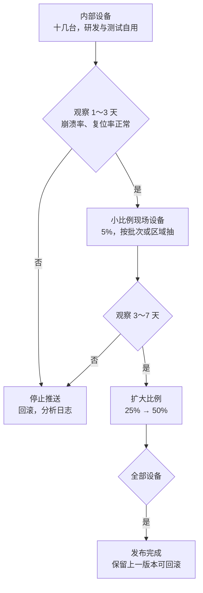

# 6.8 发布、现场升级与维护

当现场运维传来紧急警报，称某台远程部署的设备每隔数小时便会异常复位，而回传的崩溃日志中仅仅孤零零地记录着一个程序计数器地址 `0x08005A3C` 时，研发团队往往会陷入巨大的困境。这个物理地址本身不包含任何符号信息，它能否被破译为有价值的代码行号，完全取决于我们能否在本地资产库中迅速检索到那份与现场设备正在运行的目标码**严格逐位一致**的 ELF 调试镜像。然而，如果项目在发布阶段缺乏规范的追溯机制，无法确定该设备是在哪一天出厂、依据哪次提交编译、或是由哪台机器链接生成的，那么这个十六进制地址就如同一串毫无意义的死码。

固件研发的终点绝非“代码在本地构建通过”的那一瞬间。从工程实践的角度看，当二进制固件被签发的那一刻起，它才刚刚开启充满挑战的交付生命周期。本节系统梳理固件在“构建交付之后”的全生命周期质量闭环：通过 Git 描述符与 GNU Build ID 为每一次构建烙印确定性的二进制身份；借助标准化的构建注入规避时间戳污染，实现严格可复现的发布包归档；设计支持向后兼容、断电安全、参数平滑迁移与灰度放量的现场升级策略；以及依托持续的软件依赖清单（SBOM）与合规流程，建立覆盖现场日志回溯与长期安全补丁交付的坚固闭环。

## 1. 版本与构建信息

对外说的版本号用语义化版本（Semantic Versioning, SemVer）2.0：`主.次.修订`，主版本在有不兼容改动时升，次版本在向后兼容地加功能时升，修订号在只修缺陷时升。这一条与 [开发与工程基础第 19 章](/教程/正文/开发与工程基础/19_文档_版本与发布) 一致，那里讲了标签、变更日志与发布节奏，这里只说固件特有的部分：版本号不能只写在发布说明里，它必须编进固件。

对内的身份比版本号细。`git describe --tags --dirty --always` 给出的是一个能反查到提交的字符串：

::: terminal title="bash - git describe 的三种结果（临时仓库实际输出）"

```text
$ git describe --tags --dirty --always
v1.3.0
$ git describe --tags --dirty --always
v1.3.0-2-g700b21a
$ git describe --tags --dirty --always
v1.3.0-2-g700b21a-dirty
```

:::

三种结果分别是：正打在 `v1.3.0` 标签上；标签之后又提交了两次，当前提交是 `700b21a`；工作区还有未提交的改动。最后那个 `-dirty` 很重要——带 `-dirty` 的构建永远不应该是发布物，它对应的源码状态在仓库里根本不存在，事后无法复现。

把这几项写进头文件的脚本很短，构建前跑一次：

```sh
#!/bin/sh
# 生成 version.h。用法：gen_version.sh <输出文件> <版本号>
set -eu

out=$1
version=$2
describe=$(git describe --tags --dirty --always)
commit=$(git rev-parse --short HEAD)

cat >"$out" <<HEADER
/* 由 gen_version.sh 生成，不要手改。 */
#ifndef VERSION_H
#define VERSION_H

#define FW_VERSION_STRING "$version"
#define FW_GIT_DESCRIBE  "$describe"
#define FW_GIT_COMMIT    "$commit"

#endif
HEADER
```

生成的产物与版本号一起进映像头（[6.4](/教程/正文/嵌入式/6_质量_安全与交付/6_4_Bootloader与固件升级) 的 `build_id` 字段）：前者给人看，后者给工具查。CMake 里用 `add_custom_command` 把它挂到构建目标前面，或者干脆在 CI 的脚本里先跑它，再把生成的目录加进包含路径。

### 1.1 GNU 构建 ID

`git describe` 有一个弱点：它描述的是源码状态，管不到二进制。同一个提交用不同的编译器、不同的选项编两次，得到的是两份不同的固件，`git describe` 却说不出区别。GNU 构建 ID (build ID) 补的就是这一层：链接器对输出做一次哈希，把结果写进一个 note 段，同一份二进制每次算出来都一样，不同二进制几乎不会相同。

用法只有一条链接选项：

```sh
arm-none-eabi-gcc ... -Wl,--build-id=sha1 -o app.elf
```

链接脚本里给它一个位置和一对边界符号，运行时就能读出来：

```text
.note.gnu.build-id :
{
    __build_id_start = .;
    KEEP(*(.note.gnu.build-id))
    __build_id_end = .;
} > FLASH
```

```c
/* 链接脚本给出的两个边界符号 */
extern const uint8_t __build_id_start[];
extern const uint8_t __build_id_end[];

/* 从 note 段取出构建 ID，len 返回字节数 */
static const uint8_t *build_id_bytes(size_t *len) {
    const note_header_t *nh = (const note_header_t *)__build_id_start;
    const uint8_t *desc = __build_id_start + sizeof *nh + ((nh->namesz + 3u) & ~3u);
    if (desc + nh->descsz > __build_id_end) {
        *len = 0;
        return NULL;
    }
    *len = nh->descsz;
    return desc;
}
```

note 的头有 12 字节（名字长度、描述长度、类型），之后是补齐到 4 字节的名字（`GNU\0`），再之后才是描述符，也就是构建 ID 本身。`arm-none-eabi-readelf -n` 把它直接印出来：

::: terminal title="bash - arm-none-eabi-readelf -n（arm-none-eabi-gcc 13.3 实际输出）"

```text
$ arm-none-eabi-readelf -n app.elf

Displaying notes found in: .note.gnu.build-id
  Owner                Data size 	Description
  GNU                  0x00000014	NT_GNU_BUILD_ID (unique build ID bitstring)
    Build ID: 05d889c8e5dadd5ae18a07cea12e81b108a48d4f
```

:::

0x14 是 20 字节，SHA-1 的长度。启动横幅里打印它的前 8 个十六进制字符就够了：`05d889c8`。现场日志带上这 8 个字符，服务器就能在存档里精确定位是哪一份二进制，不用靠日期去猜。

`git describe` 和构建 ID 各有各的用处，两个都要：前者回答「这是哪一段源码」，人读得懂；后者回答「这是哪一次链接」，工具对得上。发布时把两者都记进发布记录。

### 1.2 不要用 `__DATE__` 与 `__TIME__`

想记录构建时间，最顺手的写法是 `__DATE__` 和 `__TIME__`。它们会破坏可重复构建：同一份源码两次编译，产物的字节不同。

::: compare left-title="用 __DATE__ 记录构建时间" right-title="用构建脚本注入固定值"

```c
const char banner[] =
    "mdr-fw " __DATE__ " " __TIME__;
```

---

```c
#ifndef BUILD_STAMP
#define BUILD_STAMP "unknown"
#endif
const char banner[] = "mdr-fw " BUILD_STAMP;
```

:::

同一个源文件编译两次，用 `__DATE__` 的那份 `.o` 哈希不同，`strings` 里能看到两个相差两秒的时间：

::: terminal title="bash - __DATE__ 让两次编译的产物不同（arm-none-eabi-gcc 13.3 实际输出）"

```text
$ arm-none-eabi-gcc -mcpu=cortex-m3 -mthumb -Os -c banner.c -o banner1.o
$ arm-none-eabi-gcc -mcpu=cortex-m3 -mthumb -Os -c banner.c -o banner2.o
$ sha256sum banner1.o banner2.o
32e9bba1376742c83a45784ca8128ab06ac1b2da77449ab4347ab5e428132481 *banner1.o
a3018c5497b89ca74dd33852c3fcdab52464d52b31cd7ffbc01e12ce5ce95059 *banner2.o
$ strings banner1.o | head -1
mdr-fw Oct 21 2026 21:16:27
$ strings banner2.o | head -1
mdr-fw Oct 21 2026 21:16:29
```

:::

改成由构建脚本传 `-DBUILD_STAMP="2026-10-21"`，同样的两次编译得到相同的哈希：

::: terminal title="bash - 固定字符串后两次编译一致（arm-none-eabi-gcc 13.3 实际输出）"

```text
$ arm-none-eabi-gcc -mcpu=cortex-m3 -mthumb -Os -DBUILD_STAMP='"2026-10-21"' -c banner.c -o fixed1.o
$ arm-none-eabi-gcc -mcpu=cortex-m3 -mthumb -Os -DBUILD_STAMP='"2026-10-21"' -c banner.c -o fixed2.o
$ sha256sum fixed1.o fixed2.o
3b8f45900737b59d030932ff85c68d91ee1d903df4f87ce999e565c1a2757868 *fixed1.o
3b8f45900737b59d030932ff85c68d91ee1d903df4f87ce999e565c1a2757868 *fixed2.o
$ strings fixed1.o | head -1
mdr-fw 2026-10-21
```

:::

当构建流程确实需要嵌入时间信息时，应当严格遵循 `SOURCE_DATE_EPOCH` 规范：构建系统读取这一由外部注入的标准参数（Unix 时间戳秒数），将其作为固化构建时间写入二进制产物，不再直接读取宿主编译机当前波动的硬件时钟。这一由可重复构建组织（reproducible-builds.org）推动的工业标准已经被主流的 GCC、Clang、CMake 以及各类打包工具原生支持。在固件工程中，标准的落地方式是由上游构建脚本将该数值转换为特定宏定义或注入 `version.h` 描述串，杜绝在源码中直接调用 `__DATE__` 与 `__TIME__`。

## 2. 发布包与可重复构建

一次发布交给生产、售后或 OTA 服务器的是一个完整的发布包，通常包含这些文件：

| 文件 | 内容 | 谁用 |
| --- | --- | --- |
| `mdr-fw-v1.4.0.bin` | 待烧录的裸二进制，或已签名的 `.img` | 产线、Bootloader、OTA |
| `mdr-fw-v1.4.0.elf` | 未剥离符号的完整 ELF | 事后解析崩溃地址 |
| `mdr-fw-v1.4.0.map` | 链接器映射，段与符号的地址 | 分析 Flash/RAM 占用、查符号 |
| `sha256sums` | 上面每个文件的 SHA-256 | 校验传输出错、防止张冠李戴 |
| `sbom.spdx.json` 或 `bom.cdx.json` | 软件物料清单（SBOM） | 漏洞跟踪（第 7 节） |
| 发布说明 | 版本、变更摘要、安全计数、已知问题 | 人 |
| 签名记录 | 哪个密钥签的、被签文件的哈希 | 审计 |

`.elf` 与 `.map` 一定要留。剥离过的 `.bin` 没有符号表，`addr2line` 查不出函数名和行号；而一旦仓库里的构建环境变了，重新编一次也未必得到同样地址的二进制——这正是下面要说的可重复构建要解决的问题。

打包脚本把这件事固定下来。只在「当前提交带标签」且「工作区干净」时才肯打包，别的状态一律拒绝：

```sh
#!/bin/sh
# 打包发布物。当前提交必须带标签，工作区必须干净。
set -eu

tag=$(git describe --tags --exact-match 2>/dev/null || true)
if [ -z "$tag" ]; then
    echo "当前提交没有标签，拒绝发布" >&2
    exit 1
fi
if [ -n "$(git status --porcelain)" ]; then
    echo "工作区不干净，拒绝发布" >&2
    exit 1
fi

version=${tag#v}
mkdir -p build
./gen_version.sh build/version.h "$version"
gcc -std=c17 -Wall -Wextra -O2 -g -Wl,--no-insert-timestamp \
    main.c -o "build/app.elf" -Wl,-Map="build/app.map"
objcopy -O binary "build/app.elf" "build/app.bin"

rm -rf dist
mkdir -p dist
cp build/app.elf "dist/mdr-fw-$tag.elf"
cp build/app.map "dist/mdr-fw-$tag.map"
cp build/app.bin "dist/mdr-fw-$tag.bin"

(cd dist && sha256sum mdr-fw-* >sha256sums)
echo "发布包 dist/（$tag，版本 $version）："
ls -1 dist
```

文件名里的版本取自标签（去掉开头的 `v`），`version.h` 里的字符串也取自同一个标签。手写版本号很容易和标签对不上，能推出来的就不要抄一遍。

在临时仓库里跑一次，标签 `v1.4.0`，工作区干净：

::: terminal title="bash - release.sh 正常执行（Git Bash 实际输出）"

```text
$ ./release.sh
发布包 dist/（v1.4.0，版本 1.4.0）：
mdr-fw-v1.4.0.bin
mdr-fw-v1.4.0.elf
mdr-fw-v1.4.0.map
sha256sums
$ cat dist/sha256sums
2155d211baef18cae6a1e6e2649497ac3831a80a699cbf3d92e59f2824518f08 *mdr-fw-v1.4.0.bin
b163a8913a1561917242ed676ba3ade0a9a92e282451d55d6915e6702afee495 *mdr-fw-v1.4.0.elf
6fa5c9d361f7e5e2c017e774f0de40568cc411d9e70cef3bf9212e1159c6090e *mdr-fw-v1.4.0.map
```

:::

工作区有未提交的改动时：

::: terminal title="bash - 工作区不干净时拒绝发布（Git Bash 实际输出）"

```text
$ ./release.sh
工作区不干净，拒绝发布
```

:::

脚本里没有 OTA 服务器、也没有签名步骤，这两件事分别在 [7.3](/教程/正文/嵌入式/7_综合实践/7_3_联网固件) 与 [6.7](/教程/正文/嵌入式/6_质量_安全与交付/6_7_安全启动_映像校验与密钥) 里。发布包做出来之后，签名在受控环境里单独完成，服务器分发的必须是签过名的那一份。

### 2.1 可重复构建

可重复构建 (reproducible build) 指的是：同一份源码、同一套工具链、同样的选项，在任何机器上任何时间构建，得到的产物逐字节相同。它对嵌入式特别有用——发布包里的 `.elf` 与二进制必须能互相对上，而团队里每个人、每台 CI 机器的路径、时间、环境都不一样。

前面几处已经处理了两个来源：`__DATE__`／`__TIME__`、PE 文件头里的时间戳。还有第三个：源码的绝对路径。断言与日志里用到的 `__FILE__` 会把编译时的路径写进只读数据，两个人在不同目录下编译，产物就不同。GCC 的 `-ffile-prefix-map` 把路径前缀换成一个固定字符串：

```sh
gcc -ffile-prefix-map=/home/alice/project=/src -c main.c -o main.o
```

同一份源码放在两个不同目录下编出的 `.o`，不加这个选项时哈希不同，字符串表里能看到各自的绝对路径：

::: terminal title="bash - __FILE__ 把编译路径写进产物（MinGW gcc 13.2 实际输出）"

```text
$ gcc -std=c17 -Wall -Wextra -c C:/tmp/mdr-pm/a/src/msg.c -o a/msg.o
$ gcc -std=c17 -Wall -Wextra -c C:/tmp/mdr-pm/b/src/msg.c -o b/msg.o
$ sha256sum a/msg.o b/msg.o
74694af9315a5efd23ba10297ec9d889a9fde0f9635b8d69bda24fd55e028aa3 *a/msg.o
f681657d20cc51ec30b87ddfa2f2f83fec40cdeaf0118f312fe08760c3cffff3 *b/msg.o
$ strings a/msg.o | grep msg.c
C:/tmp/mdr-pm/a/src/msg.c
$ strings b/msg.o | grep msg.c
C:/tmp/mdr-pm/b/src/msg.c
```

:::

把两个目录分别映射成同一个前缀 `/src`，产物就一致了：

::: terminal title="bash - 用 -ffile-prefix-map 去掉路径差异（MinGW gcc 13.2 实际输出）"

```text
$ gcc -ffile-prefix-map=C:/tmp/mdr-pm/a/src=/src -c C:/tmp/mdr-pm/a/src/msg.c -o a/msg3.o
$ gcc -ffile-prefix-map=C:/tmp/mdr-pm/b/src=/src -c C:/tmp/mdr-pm/b/src/msg.c -o b/msg3.o
$ sha256sum a/msg3.o b/msg3.o
e56636124c34560b04b7b9331364add1675eb14f44fe6074d3ace742ec5b2772 *a/msg3.o
e56636124c34560b04b7b9331364add1675eb14f44fe6074d3ace742ec5b2772 *b/msg3.o
$ strings a/msg3.o | grep msg.c
/src/msg.c
```

:::

Windows 上的路径带盘符，把 `cygpath -m` 的结果传给 `-ffile-prefix-map` 即可，正斜杠与反斜杠不必手动换。

在主机上验证一遍。同一份源码间隔两秒编两次：

::: terminal title="bash - 两次构建的 sha256（MinGW gcc 13.2 实际输出）"

```text
$ gcc -DBUILD_STAMP='"fixed"' rep.c -o ts1/r.exe
$ gcc -DBUILD_STAMP='"fixed"' rep.c -o ts2/r.exe
$ sha256sum ts1/r.exe ts2/r.exe
e29041f39c3c417cbe7c9bf980a3dba8363804d870c76aa96cfdd8174d86f0c6 *ts1/r.exe
5b71cdb5ec74b8a32c7164f65337b8e0228cd7ba381a00e6ea82303a72a0247d *ts2/r.exe
```

:::

哈希不同与源码无关：`BUILD_STAMP` 已经固定了，差异出在 PE 头里的时间戳。加上 `-Wl,--no-insert-timestamp`，「当前时间」不再进产物：

::: terminal title="bash - 加 -Wl,--no-insert-timestamp 之后（MinGW gcc 13.2 实际输出）"

```text
$ gcc -DBUILD_STAMP='"fixed"' -Wl,--no-insert-timestamp rep.c -o ts1/n.exe
$ gcc -DBUILD_STAMP='"fixed"' -Wl,--no-insert-timestamp rep.c -o ts2/n.exe
$ sha256sum ts1/n.exe ts2/n.exe
16d4e7cc4c4656850377f891daaf2e45fa4e724830547f5d97970f23d11fc839 *ts1/n.exe
16d4e7cc4c4656850377f891daaf2e45fa4e724830547f5d97970f23d11fc839 *ts2/n.exe
```

:::

两个哈希一致。这个选项是 PE 链接器才有的（MinGW 下是 `-Wl,--no-insert-timestamp`，MSVC 下是 `/Brepro`）；ARM 的 ELF 产物原本就没有这个时间戳，用 `arm-none-eabi-gcc` 链接时不需要它。跨平台的构建脚本按目标平台加选项，别把 Windows 的选项抄到目标构建里。

可重复构建还要固定工具链版本。`gcc 13.2` 与 `gcc 13.3` 生成的代码可能不同，`-Os` 在不同版本间的取舍也不同。CI 里把编译器的完整版本号写进构建记录，发布说明里注明用的是哪一个；作者判断：追求「任何 GCC 都能复现」代价太大，固定一个版本、把工具链本身存档更实际——毕竟五年后要用同一版编译器，比用同一份源码更难。

## 3. 升级渠道与兼容性

升级的通道有三种，各有适用范围：

| 渠道 | 典型接口 | 适用 | 注意 |
| --- | --- | --- | --- |
| 本地升级 | 串口、USB、SD 卡 | 研发、产线、售后现场 | 需要人操作，要有防误刷的确认 |
| 网络 OTA | Wi-Fi、以太网、蜂窝 | 已联网的设备 | 需要断点续传、校验、重试（[7.3](/教程/正文/嵌入式/7_综合实践/7_3_联网固件)） |
| 整机映像 | 存储卡、USB 盘 | 嵌入式 Linux 设备 | 分区与引导程序的更新顺序（第 6 节） |

设备在装新固件之前，除了签名，还要检查「装得上吗」：

- 硬件版本：映像头的 `hw_version` 必须与设备匹配。同一份固件刷到改过硬件的板子上，引脚定义可能已经变了，跑起来是另一回事。
- 最低 Bootloader 版本：新固件可能依赖 Bootloader 提供的新功能（例如 TLV 里的新条目类型）。映像头里可以加一个字段记这个要求，Bootloader 版本太低就拒绝。
- 可用空间：应用槽放不下就早说，别等到擦除了一半才发现。

跳过这些检查的后果在现场很难查：设备升级之后不启动，日志里又什么都没有。检查放在最前面，失败就带着原因退出。

### 3.1 配置数据迁移

升级固件时，设备上已有的配置不能丢。配置记录的格式在 [3.9](/教程/正文/嵌入式/3_驱动_通信与中间件/3_9_Flash_EEPROM_SD与文件系统) 里定下了：魔数、版本号、序号、CRC-32 加负载。新固件读到一个旧版本的记录时，不能直接按新结构解释——字段位置变了、单位变了、新字段还不存在。

做法是显式迁移。每一版格式有一个读取函数，新固件认识从 v1 到当前版的全部格式；读到旧版就按旧版的布局解析，缺的字段填默认值，需要换算的做换算，最后统一成内存里的当前结构：

```c
/* config_migrate.c：每一版一个读取函数，新固件认识全部旧格式 */
static void load_v1(config_t *cfg, const uint8_t *p) {
    memcpy(&cfg->sample_rate_hz, p, 2);
    memcpy(&cfg->report_ms, p + 2, 2);
}

/* v2：在 v1 后面追加量程 */
static void load_v2(config_t *cfg, const uint8_t *p) {
    load_v1(cfg, p);
    memcpy(&cfg->accel_range_g, p + 4, 1);
}

/* v3 在 v2 的尾部追加滤波档位与设备名，旧字段的位置一个都没动 */
static void load_v3(config_t *cfg, const uint8_t *p) {
    load_v1(cfg, p);
    memcpy(&cfg->accel_range_g, p + 4, 1);
    memcpy(&cfg->filter, p + 5, 1);
    memcpy(cfg->device_name, p + 6, CONFIG_NAME_MAX);
}

const char *config_migrate(config_t *out, const config_blob_t *blob) {
    if (blob->magic != CONFIG_MAGIC) {
        return "魔数不对";
    }
    if (config_crc(blob) != blob->crc32) {
        return "CRC 不符";
    }
    set_defaults(out);
    switch (blob->version) {
    case 1:
        load_v1(out, blob->payload);
        /* v1 → v3：v2 新增的量程与 v3 新增的滤波、设备名都用默认值 */
        out->accel_range_g = 2u;
        break;
    case 2:
        load_v2(out, blob->payload);
        break;
    case 3:
        load_v3(out, blob->payload);
        break;
    default:
        return "未知的配置版本";
    }
    return NULL;
}
```

每一版读取函数只在自己这一版新增的字段上动手，前面能复用的就复用。v1 的记录走到 `load_v1` 之后停下，v2 才有的 `accel_range_g` 与 v3 才有的 `filter`、`device_name` 都保持 `set_defaults` 填的值：旧数据有的用旧数据，旧数据没有的用默认值。哪一版真的改了已有字段的位置或单位，就必须为它单独写一个解析函数，在 `switch` 里显式换算，不能靠「在尾部追加」这套办法；这也正是加字段时总追加在尾部的原因：改动最小，旧代码读新记录时至少前面的字段还是对的。

迁移函数可以在主机上完整测试，不需要硬件。三种情况各造一条记录，跑一遍看结果：

::: terminal title="PowerShell - 配置迁移的主机测试（MinGW gcc 13.2 实际输出）"

```text
> .\test_config.exe
v1 → v3：采样率 200，上报 500 ms，量程 2 g
v2 → v3：采样率 400，上报 250 ms，量程 8 g
v3：采样率 1000，上报 20 ms，量程 16 g，滤波 2，名称 mdr-imu
CRC 不符：CRC 不符
未知版本：未知的配置版本
全部通过
```

:::

前三条是正常升级路径：v1 直接升到 v3、v2 升到 v3、v3 原样读出。后两条是拒绝路径：CRC 不符的记录当损坏处理，未知版本的记录不猜、直接报错——猜错的代价是把用户的配置写坏。

配置迁移要与固件升级绑在一起做，不能分开：新固件第一次启动时读旧记录、迁移、写回新格式，然后再正常工作。写回失败就继续用迁移后的内存值，下次启动再试一次，记录本身还是旧的，重来一遍没有副作用。

::: tip 把 Bootloader 当固定件

Bootloader 本身原则上不升级。它一旦升级失败，设备就彻底不启动了，而它要做的判断逻辑又很少变化。确实需要升级时，用双 Bootloader：两个槽互相校验，一个坏了另一个还能启动并修复。这个做法不常见，代价是 Flash 划分和启动流程都复杂一层；作者判断：中小项目里，把 Bootloader 做小、做稳、一次写对，比给它加自升级能力划算得多。

:::

## 4. 发布策略

固件推出去了才发现问题，比在实验室里发现贵得多。所以按批次逐步推：



每一批看两件事：崩溃率（单位时间内进入 HardFault 的次数）与复位率（每千台设备每天的复位次数）。这两个数在升级前后要能对比，设备就得把它们报上来，第 5 节会讲怎么上报。数字偏离基线就停下来，赶在故障扩散到更多设备之前处理。

「停下来」还得有地方退。回滚有两条路：一是把新固件的安全计数设置得与旧版相同，让设备可以按普通升级装回旧版本；二是靠 [6.4](/教程/正文/嵌入式/6_质量_安全与交付/6_4_Bootloader与固件升级) 的试运行与备份槽，在设备自己发现启动失败时自动退回去。前一条要求发布时就把旧版留好，后一条要求安全计数没有提升——这两个条件是发布计划里必须提前写清的东西，事到临头再想就晚了。

升级流程还要能跳版本。现场设备可能几个月没联网，装机时是 1.2.0，现在最新是 1.6.0，中间隔了四次发布。设备的升级逻辑要能从任意旧版本直接升到最新版，不必先升 1.3.0、再升 1.4.0 这样一级一级走。这就要求配置迁移支持跨版本（3.1 的迁移函数本来就是从任意旧版到当前版），也要求 OTA 服务器在设备请求时直接返回最新版。

分多少批、每批多大、观察多久，按产品规模与回滚代价定。几百台的设备，内部十几台加上 5%、25%、100% 四批就够；几万台、装在无人值守场合的设备，批次更多，观察期更长，还要留一段「可以停止但已升级的设备不回退」的缓冲期。

<Quiz
  type="single"
  :options="[
    { label: '一次推全量，出问题再统一回滚', value: 'A' },
    { label: '先在内部设备上跑，再按比例逐步扩大', value: 'B' },
    { label: '只推给新出厂的设备，老设备不动', value: 'C' },
    { label: '等所有设备都离线时再推', value: 'D' }
  ]"
  answer="B"
>

<template #question>

一个装在现场、总量几千台的设备要做一次 OTA，合理的发布方式是哪一个？

</template>

正确答案是 **B**。分批让你在影响面小的时候发现问题，也让你在发现问题时还有大部分设备没被波及。

- A 把全部设备当成试验场，一旦新固件有系统性缺陷，回滚本身也是一次高风险操作。
- C 让现场设备永远拿不到修复，漏洞与缺陷一直留着。
- D 推送恰恰需要设备在线，离线推送不成立。

</Quiz>

## 5. 现场数据

要让分批发布的判断有依据，设备得把自己的状况报上来。启动后上报这几项：

- 版本号与 `git describe`
- 构建 ID 的前 8 个十六进制字符
- 复位原因（上电、看门狗、软件复位、Brown-out，[2.3](/教程/正文/嵌入式/2_MCU裸机开发/2_3_时钟与复位) 的 `reset_cause_get`）
- 最近的诊断记录或核心转储（[6.2](/教程/正文/嵌入式/6_质量_安全与交付/6_2_日志_断言与故障诊断)）

有了构建 ID，服务器就能在存档里找到对应的 ELF，把上报的崩溃地址翻译成函数与行号。`addr2line` 的用法：

::: terminal title="bash - 用存档的 ELF 还原崩溃地址（arm-none-eabi 13.3 实际输出）"

```text
$ arm-none-eabi-nm app.elf | grep handle_overrange
080042f2 t handle_overrange
$ arm-none-eabi-addr2line -e app.elf -f -C 0x080042f2
handle_overrange
./app_main.c:18
$ arm-none-eabi-addr2line -e app.elf -f -C 0x08005a3c
??
??:0
```

:::

最后一条是故意查一个不存在的地址，得到 `??`。这个结果本身就是一条信息：地址落在符号表之外，要么是野指针跳到了空白区域，要么是手里这份 ELF 根本不是设备上那一版。拿错 ELF 时 `addr2line` 不会报错，只会给出一个看起来像模像样的函数名和行号——这比查询失败危险得多。用另一个版本（1.4.1）的 ELF 去解同一类地址，得到的函数就完全不同：

::: terminal title="bash - 拿错版本的 ELF 会给出错误答案（arm-none-eabi 13.3 实际输出）"

```text
$ arm-none-eabi-addr2line -e app-1.4.0.elf -f -C 0x08004308
main
./app_main.c:23
$ arm-none-eabi-addr2line -e app-1.4.1.elf -f -C 0x08004308
handle_overrange
./app_main.c:24
```

:::

同一个地址在两份 ELF 里指向不同的函数、不同的行。存档要按构建 ID 建立，按「差不多那几天的版本」去挑，挑中的往往是另一份二进制。

::: tip 存档 ELF 与构建 ID 一一对应

发布包里保留未剥离的 `.elf`，按构建 ID 命名或建索引：`artifacts/05d889c8e5dadd5ae18a07cea12e81b108a48d4f/app.elf`。服务器收到设备上报的构建 ID，直接按这个 ID 取文件，不需要人去猜是哪一版。磁盘上留几份 ELF 的成本可以忽略，查错时省下的时间却很可观。

:::

指标也要定得少而稳。常用的几个：

- 每千台设备每天的复位次数：区分复位原因，看门狗复位与上电复位含义完全不同。
- 升级成功率：发出去多少台，成功多少台，失败的原因分布。
- 崩溃地址的聚集：同一个函数出现在很多设备的崩溃记录里，说明这是系统性缺陷。

这些指标的统计口径要固定，否则升级前后没法比较。口径变了就要在报表上注记，不能悄悄换。

<Quiz
  type="multi"
  :options="[
    { label: '设备上报构建 ID，服务器据此找到存档的 ELF', value: 'A' },
    { label: '设备上报版本号字符串，服务器按日期找最接近的 ELF', value: 'B' },
    { label: '发布时同时保留 .elf 与 .map，并长期存档', value: 'C' },
    { label: '每次发布都用不同的编译器，看哪个版本编出来的能跑', value: 'D' }
  ]"
  :answer="['A', 'C']"
>

<template #question>

要让现场的崩溃地址能还原成源码位置，必须做到哪些？

</template>

正确答案是 **A、C**。构建 ID 把二进制与存档精确对应，`.elf` 与 `.map` 是把地址翻译回函数与行的原料。

- B 靠日期猜版本，两个版本相隔很近时必然找错；`addr2line` 不会报错，只会拿出一份看似合理的函数名和行号。
- D 与还原地址无关，反而破坏了可重复构建。

</Quiz>

## 6. 嵌入式 Linux 的升级

嵌入式 Linux 设备升级的是整个根文件系统，涉及的文件比 MCU 固件多得多。两种常见方案：

一种是整映像升级。把根文件系统做成一份完整映像，升级时整块写入备用物理分区，写完并校验成功后，由引导程序修改启动指向新分区。这要求根文件系统规划 A、B 两套镜像槽位，每套都能独立引导系统，用户数据则单独存放于第三个持久化分区。槽位切换具备严格的原子性——引导程序的启动环境参数中活动分区号一旦完成安全翻转，下次启动便直接进入新槽位；若翻转未完成，系统依然稳定回退至旧槽位。该方案的代价在于需要预留双倍的磁盘镜像空间。

另一种是按包升级。设备上运行包管理器服务，升级时逐个组件增量替换。它节省磁盘空间，但若升级过程遭遇突发掉电，极易留下一半新、一半旧的损坏系统，需要包管理器自身具备极高的事务回滚保证。在高可靠性的嵌入式工业场景中，对此必须保持审慎。

三种常用工具的做法与适用场景：

| 工具 | 升级单元 | 切换方式 | 适合 |
| --- | --- | --- | --- |
| RAUC | 整映像（bundle） | A/B 分区，引导程序切换 | 需要强原子性、系统集成度高的产品 |
| SWUpdate | 整映像或单个文件 | 由脚本或引导程序环境配置决定 | 更新内容多样、需要细粒度控制的设备 |
| Mender | 整映像 | A/B 分区，带服务端 | 需要现成的设备管理与分批发布后台 |

三者都能与 U-Boot 的持久化环境配置良好配合以达成原子切换，并无缝集成非对称验签机制。选型主要考量后台设施的成熟度：已有专用物联网设备管理平台的，优先选用平台原生集成的框架；从零起步的自建体系，推荐从 RAUC 或 SWUpdate 切入，其服务端依赖轻量且易于维护。

无论采用何种工具，根文件系统在运行时都应当挂载为只读模式，可写的数据集中收拢在单独的持久化分区中。只读根文件系统让“升级”与“业务运行”在物理上彻底解耦：后台升级写入备用分区时，正在运行的系统不受分毫干扰；而用户数据在切换后依然原样保留，平滑衔接。这一存储布局在 [5.10 用户空间服务、部署与调试](/教程/正文/嵌入式/5_嵌入式Linux/5_10_用户空间服务_部署与调试) 中已有实践范例。

## 7. 长期维护

发布处在产品生命周期的中段，之后还有三件事要长期做：

维护分支与补丁回移。发布出去的每个大版本建一个维护分支，只在上面修安全漏洞与严重缺陷，补丁从主分支挑选过来（cherry-pick），主分支上的新功能不跟着下来。嵌入式设备的固件更新代价高，用户不会愿意为了修一个漏洞而接受一堆新功能。

依赖清单与漏洞跟踪。第三方组件都有漏洞公告：FreeRTOS 在内核的 GitHub 仓库发布安全公告，lwIP 在 Savannah 的 bug tracker 上有 CVE 标记，mbedTLS 有专门的安全公告页，Linux 内核有 CVE 与各稳定分支的公告。做法是给每个第三方组件记录版本号，订阅它的公告渠道，出漏洞时对照自己的版本判断是否受影响。SBOM 就是为了这件事准备的：有了它，就能查「我们用的是哪一版、这个漏洞影响哪些版本」。

欧盟《网络弹性法案》（Cyber Resilience Act, Regulation (EU) 2024/2847）把这类义务写进了法律。截至 2026 年 10 月，时间表是：2026 年 9 月 11 日起，制造商须报告被积极利用的漏洞与严重安全事件；2027 年 12 月 11 日起全面适用，包括漏洞处理与安全更新的义务。受影响的是在欧盟市场销售带数字元素产品的厂商，不论厂商在不在欧盟境内。这一页只陈述日期与义务类别，不做法条解读；具体适用与合规方式查欧盟委员会的官方页面或咨询法务。

告知支持期限。产品销售时必须明确声明技术支持截止年份，在此生命周期内向用户兑现安全补丁承诺。在工业实践中，支持期限的承诺应与硬件生命周期高度匹配：工业级设备建议按预期物理寿命的 1.2 至 1.5 倍规划软件维护周期，消费类智能硬件通常保持 3 至 5 年。承诺更长的周期需要专门的技术维护预算支撑，切忌在合同中开出无法履约的无限期支票。

## 8. 习题

### 8.1 巩固

<Exercise id="66661" :d="2" :w="2">

某仓库的提交历史如下，新提交在上：

```text
9f31c2e 修正 IMU 量程换算
700b21a 增加上报间隔配置项
1c4e0a7 发布 1.3.0        <- 标签 v1.3.0
```

(1) 工作区干净、HEAD 在 `9f31c2e` 时，`git describe --tags --dirty --always` 输出什么？HEAD 退到 `1c4e0a7` 时呢？仓库里一个标签都没有时又输出什么？

(2) 改了 `app_main.c` 但没提交，HEAD 仍在 `9f31c2e`，输出变成什么？为什么带这个后缀的构建不能作为发布物？

(3) 这次发布里的提交全是修缺陷的，版本号从 1.3.0 升到多少？如果同一批提交里还加了一个向后兼容的配置项，又该升到多少？说出理由。

(4) `version.h` 里的版本字符串手写成 `1.3.1`，而本次构建实际在标签 `v1.3.0` 之后两个提交上。现场会看到什么现象？映像头里哪个字段能避免这种对不上？

</Exercise>

<Exercise id="66662" :d="2" :w="2">

`readelf -n` 报告构建 ID 为 `05d889c8e5dadd5ae18a07cea12e81b108a48d4f`，note 段开头的字节是：

```text
04 00 00 00 14 00 00 00 03 00 00 00 47 4e 55 00
05 d8 89 c8 e5 da dd 5a e1 8a 07 ce a1 2e 81 b1
08 a4 8d 4f
```

(1) 按小端读出名字长度、描述长度与类型，说明它们各占几个字节。

(2) 描述符从第几个字节开始？长度多少？这段字节和 `readelf` 打印的 `Data size 0x14` 是什么关系？

(3) 启动横幅只打印构建 ID 的前 8 个十六进制字符，写出来。服务器按这个值在磁盘上找 ELF，路径应该长什么样？

(4) 现场只上报了一个崩溃地址 `0x08004308`。用 1.4.0 的 ELF 查到 `main` 于 `app_main.c:23`，用 1.4.1 的 ELF 查到 `handle_overrange` 于 `app_main.c:24`。哪一种情况更危险？`addr2line` 输出 `??` 时反而说明了什么？

(5) 如果某个链接器写出的名字长度是 5 而不是 4，描述符的起点该怎么算？

</Exercise>

### 8.2 编程

<Exercise id="66663" :d="3" :w="2">

不看正文的脚本，自己写一份 `gen_version.sh`，再写一个读取它的 `banner.c`：

1. 脚本用法为 `gen_version.sh <输出文件> <版本号>`，生成 `version.h`，里面定义 `FW_VERSION_STRING`、`FW_GIT_DESCRIBE`、`FW_GIT_COMMIT` 三个字符串宏，文件头注明「由脚本生成，不要手改」。
2. `banner.c` 的三个宏都允许被 `-D` 覆盖（`#ifndef` 保护），`main` 里用 `printf` 打印三行：`version: …`、`describe: …`、`commit: …`。
3. 在一个临时 Git 仓库里跑四种状态，各贴一次输出：没有任何标签、正好在标签上、标签后两个提交、标签后两个提交且工作区有改动。
4. 说明为什么 `version.h` 要生成而不是手写，以及把它纳入版本控制会带来什么问题。

验收：四次的 `describe:` 行与同一状态下手工执行 `git describe --tags --dirty --always` 的结果逐字相同；`gcc -std=c17 -Wall -Wextra` 无警告。

</Exercise>

<Exercise id="66664" :d="3" :w="3">

正文的 `build_id_bytes` 直接用了链接脚本符号，没法在主机上测。改写成接受指针区间的版本并测试：

```c
/* 从 note 段 [start, end) 里取出构建 ID 的描述符。
   成功返回描述符指针并写 *len；结构不合法返回 NULL 且 *len 为 0。 */
static const uint8_t *build_id_bytes(const uint8_t *start, const uint8_t *end, size_t *len);
```

1. 按 note 的格式解析：12 字节头（名字长度、描述长度、类型，均小端），名字按 4 字节补齐，之后是描述符。
2. 用三组输入测试：正常的 GNU note（名字 4 字节、描述 20 字节）；名字长度写成 5 的变体（补齐到 8 字节）；描述长度超出 `end` 的截断输入。前两组应返回描述符并给出正确的长度，第三组返回 `NULL`。
3. 写一个 `bidump` 程序，把取到的描述符按小端逐字节打印成十六进制，再额外打印前 4 字节拼成的 8 个字符。用 8.1 节那道题里的字节数组跑，输出应与 `readelf -n` 的 `Build ID:` 一致。
4. 在固件里真正用链接脚本符号调一次：给出 `__build_id_start`／`__build_id_end` 的声明和一个包装函数。说明这两个符号为什么必须用 `extern const uint8_t []` 声明，而不能声明成 `uint32_t`。

验收：三组测试的结果符合预期；`bidump` 输出 `05d889c8e5dadd5ae18a07cea12e81b108a48d4f`，前 8 字符为 `05d889c8`；用 `-fsanitize=address` 跑截断输入不越界。

</Exercise>

<Exercise id="66665" :d="3" :w="3">

在自己的机器上复现「同一份源码编两次结果不同」，再逐个消除原因。

1. 把同一份 `msg.c`（里面用 `__FILE__` 打印文件名）分别放在两个不同目录下编译，比较两个 `.o` 的 SHA-256，用 `strings` 找出差异来源。
2. 给两边加上 `-ffile-prefix-map`，把各自的目录映射到同一个前缀，再比较哈希。在 Windows 上写出你实际用的 `cygpath -m` 写法。
3. 链接成可执行文件，连编两次，比较哈希。若在 Windows 上不同，用 `objdump` 或 `strings` 找出 PE 头里的时间戳，加 `-Wl,--no-insert-timestamp` 后再比。目标平台是 ARM 时这一项要不要加？
4. 用 `SOURCE_DATE_EPOCH` 固定构建时间：写一个 `repro.sh`，设置此环境配置两次构建同一目标，断言两个产物的哈希相等，不等时以非零码退出并打印两边的哈希。
5. 列一张表：`__DATE__`／`__TIME__`、绝对路径、PE 时间戳、工具链版本，各自被哪一步消除，哪几项靠脚本消除不了。

验收：第 2 步之后两个 `.o` 哈希一致；第 3 步加上选项后两个可执行文件哈希一致；`repro.sh` 正常退出码为 0，故意改一个源文件后退出码非 0。

</Exercise>

<Exercise id="66666" :d="4" :w="3">

3.1 的配置格式要升到 v4，在负载末尾（v3 的设备名之后）追加 1 字节有符号的温度零点偏移，单位 0.5 °C。外层沿用 [3.9](/教程/正文/嵌入式/3_驱动_通信与中间件/3_9_Flash_EEPROM_SD与文件系统) 那套魔数加版本加 CRC 的思路，这一题用一个带变长负载的简化版本，字段如下：

```c
typedef struct {
    uint32_t magic;        /* 0x43464731 */
    uint16_t version;      /* 1～4 */
    uint16_t seq;          /* 单调递增序号 */
    uint32_t crc32;        /* 覆盖 payload_len 字节的负载 */
    uint16_t payload_len;
    uint8_t payload[64];
} config_blob_t;
```

1. 补上 `load_v4`，扩展 `config_migrate` 的 `switch`。v1 升上来时温度偏移取默认值 0，v2、v3 同样是 0。沿用正文「每版只处理自己新增的字段」的写法。
2. 写测试，构造 v1、v2、v3、v4 各一条记录，加上一条 CRC 被改坏的、一条 `version` 写成 5 的，断言六种结果的字段值与返回字符串。各版本的负载内容自定，但要把期望值写进测试。
3. 构造一条「`version` 字段被改成 4、负载却还是 v3 布局」的记录。按现在的 CRC 范围，它会通过校验吗？读出来会发生什么？给出一个修复方案，并说明改动后 v1～v3 的旧记录是否还能通过。
4. 说明为什么新字段只能追加在尾部；如果 v4 必须把 `report_ms` 的单位从毫秒改成 0.1 秒，迁移函数要多做什么。

验收：六条记录的输出与期望逐字一致；第 3 步说清漏洞与修复；`gcc -std=c17 -Wall -Wextra` 无警告。

</Exercise>

<Exercise id="66667" :d="4" :w="4">

在正文的 `release.sh` 之上做一个能自检的发布包。产物目录至少包含：

```text
dist/
├── mdr-fw-v1.4.0.bin
├── mdr-fw-v1.4.0.elf
├── mdr-fw-v1.4.0.map
├── build-id.txt
├── sbom.spdx.json
├── 发布说明.txt
└── sha256sums
```

1. 打包脚本在现有检查之外，从 ELF 里取出构建 ID 写进 `build-id.txt`（用 `arm-none-eabi-readelf -n` 解析即可），并生成一份最小的 SPDX JSON，列出工具链（名称、版本）与三个第三方组件（名称、版本）。
2. 发布说明由脚本生成，至少含版本号、标签、构建 ID、安全计数、使用的编译器完整版本。
3. 写 `verify_bundle.sh`：检查七个文件齐全、`sha256sum -c sha256sums` 通过、ELF 里的构建 ID 与 `build-id.txt` 一致。任一项失败时打印原因并以非零码退出。
4. 在临时仓库里制造三种坏情况各验证一次：删掉 `.map`、改掉 `.bin` 一个字节、手改 `build-id.txt`。三种都应被 `verify_bundle.sh` 拦住，且错误信息能指出是哪一项。
5. 说明为什么 `sha256sums` 本身不能防住「整包被换掉」，发布包还需要哪一步（本页第 2 节末尾已经提到）。

验收：正常包 `verify_bundle.sh` 退出码为 0；三种坏情况各退出非零且报出对应原因。

</Exercise>

### 8.3 综合与挑战

<Exercise id="66668" :d="5" :w="3">

下面是一份现场支持流程的摘录，每一行至少有一处缺陷。

```text
1. CI 里用 git describe --tags --always 生成版本信息，然后打包上传。
2. 发布目录只保存 mdr-fw-vX.Y.Z.bin 与 sha256sums。
3. version.h 由发布负责人手工填写版本号。
4. 现场报来崩溃地址后，从归档里挑日期最接近的那份 ELF 用 addr2line 查。
5. 指标口径在第二次发布时改过一次，报表上未注记；内部测试通过后直接推全量。
```

(1) 逐条指出缺陷、它在现场的后果，以及最小改法。把改法落在代码上：给出修好第 1、2、3 条之后的 `release.sh` 片段（版本信息生成、产物清单、`version.h` 来源），能直接替换正文脚本里对应的几行。

(2) 现在拿到一批数据：内部 12 台观察 3 天，复位 0.8 次/千台/天，无崩溃，基线是 0.9；5% 批次 240 台观察 3 天，复位 2.7 次/千台/天，崩溃 3 起，地址都是 `0x08005A3C`。按第 4 节的规则，下一步该做什么？还需要哪些信息才能判断这 3 起崩溃是不是同一个缺陷？

(3) 如果决定停推并回滚，回滚能否成功取决于发布时留下的哪两个条件？逐条说明在本页的哪一节里提出。

(4) 第 5 条缺陷会让「升级前」与「升级后」的指标怎样比较？给出一个不改口径也能比较的补救办法。

</Exercise>

<Exercise id="66669" :d="6" :w="5" scope="*">

给一款 Cortex-A 设备设计升级与长期维护方案，三部分都要做。

1. 分区与切换。根文件系统分 A、B 两份，数据单独一个分区，引导程序用非易失环境配置记录当前活动槽。定义一个最小状态机：

```c
enum ota_state {
    OTA_IDLE,        /* 正常运行 */
    OTA_DOWNLOADING, /* 正在写备用槽 */
    OTA_READY,       /* 写完并校验通过，等重启 */
    OTA_TRIAL,       /* 新槽首次启动，试运行 */
    OTA_CONFIRMED,   /* 收到确认，正式使用 */
    OTA_ROLLBACK     /* 试运行失败，切回旧槽 */
};
```

写出状态转换表（事件包括：下载完成、校验失败、重启、试运行超时未确认、收到服务器确认），用 C 实现转换函数，并说明每个状态在掉电后如何恢复。启动环境参数的一次写入如何做到「要么指旧槽、要么指新槽」？

2. 工具选型。分别给三种情形选 RAUC、SWUpdate、Mender 中的一个并说明理由：已有设备管理后台；设备更新内容既有整机映像也有单个配置文件；团队只有两个人、没有后台。

3. 支持期限。产品是工业设备，2027 年 3 月上市，设计寿命 8 年。按本页的工程建议写出支持到哪一年，并列出第 7 节那几个法规日期分别要求厂商做什么。再给出一条「支持期限写进合同」与「在线漏洞公告」之间的取舍判断。

验收：转换表覆盖六种状态与五类事件，且不存在「掉电后无法判断所在状态」的转换；C 实现用 `-Wall -Wextra` 无警告编译；三个选型各有一句可核对的理由；日期与第 7 节一致。

</Exercise>

## 9. 参考资料

- Semantic Versioning 2.0.0：https://semver.org/
- Memfault, Proper Release Versioning Goes a Long Way：https://interrupt.memfault.com/blog/release-versioning
- Memfault, GNU Build IDs for Firmware：https://interrupt.memfault.com/blog/gnu-build-id-for-firmware
- Memfault, Reproducible Firmware Builds：https://interrupt.memfault.com/blog/reproducible-firmware-builds
- SOURCE_DATE_EPOCH：https://reproducible-builds.org/docs/source-date-epoch/
- git-describe 文档：https://git-scm.com/docs/git-describe
- SPDX：https://spdx.dev/
- CycloneDX：https://cyclonedx.org/
- RAUC：https://rauc.io/
- SWUpdate：https://sbabic.github.io/swupdate/
- Mender：https://docs.mender.io/
- 欧盟委员会，Cyber Resilience Act：https://digital-strategy.ec.europa.eu/en/policies/cyber-resilience-act
- 欧盟委员会，CRA reporting obligations：https://digital-strategy.ec.europa.eu/en/policies/cra-reporting
- Regulation (EU) 2024/2847：https://eur-lex.europa.eu/eli/reg/2024/2847/oj
