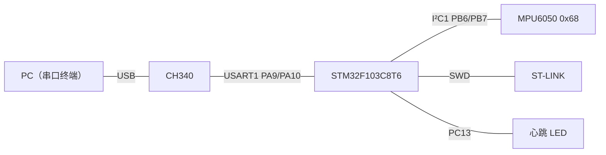
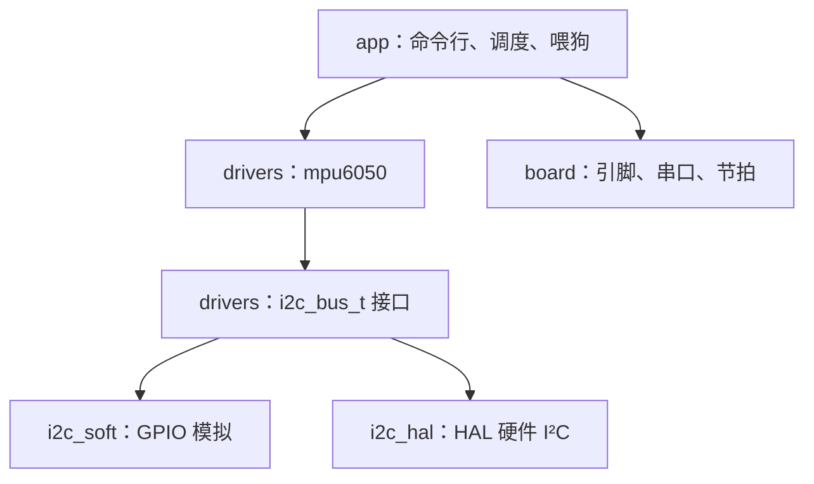
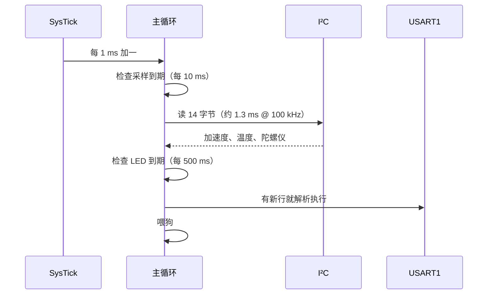

# 7.1 裸机外设驱动

前面几章的内容是分开学的：第 2 章逐个摆弄寄存器，第 3 章把外设包装成驱动，第 6 章讲工程结构与测试。每一块单独看都不难，合到一个能用的设备上才是真正的问题。这一页把零件拼起来，做一个不带操作系统的小项目：板子每 10 ms 读一次 MPU6050，串口上敲命令查询数据和开关连续输出。

读完这一页，应当能独立写出这样一套代码：一个只依赖函数表、能换后端的总线层；一个不认识寄存器地址以外任何硬件的传感器驱动；一个能把中断收到的字节攒成行的命令行；一套在 PC 上不接硬件就能跑的单元测试。工程代码在 `code/嵌入式/7_综合实践/7_1_裸机外设驱动/`，正文只摘关键部分。

## 1. 需求与硬件

功能一共四条：

1. 每 10 ms 读一次 MPU6050，得到三轴加速度与倾角。
2. 串口命令行支持 `help`、`id`、`read`、`stream on|off`、`rate <Hz>`。
3. 板载 LED 以 1 Hz 心跳，指示主循环还在运行。
4. 主循环被卡住时由独立看门狗复位，启动时打印复位原因。

硬件是一块 Blue Pill（STM32F103C8T6）加一个 MPU6050 模块：

| 信号 | 引脚 | 说明 |
| --- | --- | --- |
| USART1 TX / RX | PA9 / PA10 | 接 CH340，115200 8N1 |
| I²C SCL | PB6 | 外部 4.7 kΩ 上拉到 3.3 V |
| I²C SDA | PB7 | 同上 |
| MPU6050 INT | PA8 | 本页不用，留给习题 |
| SWD | PA13 / PA14 | ST-LINK |
| LED | PC13 | 板载，低电平亮 |

MPU6050 的 7 位地址由 AD0 引脚决定：接低是 `0x68`，接高是 `0x69`。[2.8 SPI 与 I²C](/教程/正文/嵌入式/2_MCU裸机开发/2_8_SPI与I2C) 的 AT24C02 也是这条总线上的设备，地址 `0x50`，两个设备互不干扰，因为 I²C 的寻址带在每次事务开头。



层与层的关系是这一页的主线：



`mpu6050.c` 只包含 `i2c_bus.h`，编译器层面就看不到 GPIO 寄存器。换一个后端，驱动一行不用改；在 PC 上做测试，塞一个假总线进去就行。

## 2. 工程结构与构建

目录分三层，依赖只能从上往下：

```text:no-line-numbers
7_1_裸机外设驱动/
├── app/          # 应用层：main.c 调度，cli.c 命令表
├── board/        # 板级：引脚、串口中断、节拍
├── drivers/      # i2c_bus.h 接口，i2c_soft/i2c_hal 后端，mpu6050 驱动
├── tests/        # 主机测试：伪造总线、命令行分词
└── CMakeLists.txt
```

`app/` 可以包含 `board/` 与 `drivers/`，`board/` 可以包含 `drivers/`，反过来不行。`tests/` 只包含 `drivers/` 与 `app/` 里不含硬件访问的部分。

这棵树里没有 `clock.c`。[2.3 时钟与复位](/教程/正文/嵌入式/2_MCU裸机开发/2_3_时钟与复位) 的时钟初始化要读 RCC 寄存器，属于板级代码，本页把那段照抄进 `board_stm32f103.c`，工程因此只依赖 `common/` 里的启动文件与链接脚本。[1.8 复位、启动与链接](/教程/正文/嵌入式/1_平台与工具链/1_8_复位_启动与链接) 的 `stm32f103_firmware()` 负责选项、链接脚本和 `size`：

```cmake
include("${CMAKE_CURRENT_LIST_DIR}/../../common/firmware.cmake")

if(CMAKE_CROSSCOMPILING)
    stm32f103_firmware(mdr_bare
        app/main.c
        app/cli.c
        board/board_stm32f103.c
        drivers/i2c_soft.c
        drivers/mpu6050.c)
    target_include_directories(mdr_bare PRIVATE
        "${CMAKE_CURRENT_LIST_DIR}/board"
        "${CMAKE_CURRENT_LIST_DIR}/drivers"
        "${CMAKE_CURRENT_LIST_DIR}/app"
        "${CMSIS_INCLUDE_DIR}")
    target_link_libraries(mdr_bare PRIVATE m)
else()
    add_executable(test_mpu6050 tests/test_mpu6050.c drivers/mpu6050.c)
    target_compile_options(test_mpu6050 PRIVATE -std=c17 -Wall -Wextra)
    target_include_directories(test_mpu6050 PRIVATE
        "${CMAKE_CURRENT_LIST_DIR}/drivers")
endif()
```

目标构建与主机测试是两套源文件：测试不需要 `board/`，也不链接启动文件。用 Arm GNU Toolchain 13.3 构建，`-Wall -Wextra` 下没有警告，链接时 libc_nano 会报几条 `_close is not implemented`，那是 `printf` 拖进来的系统调用桩，与自己的代码无关：

::: terminal title="PowerShell - 构建目标固件"

```console
$ cmake -B build -G Ninja --toolchain ../../common/arm-none-eabi.cmake `
      -DARM_TOOLCHAIN_DIR=C:/tools/arm/bin `
      -DCMSIS_INCLUDE_DIR=C:/tools/cmsis
$ cmake --build build
[7/7] Linking C executable mdr_bare.elf
   text    data     bss     dec     hex filename
  13128     100    2260   15488    3c80 mdr_bare.elf
```

:::

13 KB 代码、2.3 KB 静态 RAM（`data` 与 `bss` 之和），64 KB Flash 与 20 KB SRAM 的 F103C8 用掉不到四分之一。其中相当一部分是浮点库，第 6 节会算这笔账。

## 3. 时钟、时基与心跳

板级初始化按固定顺序来：

```c
/* code/嵌入式/7_综合实践/7_1_裸机外设驱动/board/board_stm32f103.c */
void board_init(void) {
    /* 1. LED：PC13 推挽输出，复位后默认灭 */
    RCC->APB2ENR |= RCC_APB2ENR_IOPCEN;
    GPIOC->BSRR = GPIO_BSRR_BS13;
    GPIOC->CRH = (GPIOC->CRH & ~(0xFu << 20)) | (0x2u << 20);

    clock_init_72mhz();
    tick_init();

    board_console_init();
    i2c_soft_create(&g_i2c_bus);
}
```

先点 LED 再切时钟，是为了让板子在中途卡死时有一个可见的迹象：时钟起不来（晶振没焊、HSE 坏）时程序会停在 `while` 里，LED 保持复位后的熄灭状态，而不是瞎闪。

节拍用 SysTick 每 1 ms 进一次中断，计数对象是 32 位的：

```c
static volatile uint32_t g_ms;

void SysTick_Handler(void) {
    ++g_ms;
}

uint32_t board_tick_now(void) {
    return g_ms;
}
```

`board_tick_now()` 在 Cortex-M3 上是一条 `ldr` 读 32 位对齐的字，天然原子，主循环与中断之间不需要关中断（[4.1 临界区与 RTOS 边界](/教程/正文/嵌入式/4_RTOS与固件架构/4_1_临界区与RTOS边界)）。周期判断一律用有符号差值：

```c
if ((int32_t)(now - next_sample) >= 0) {
    next_sample += SAMPLE_PERIOD_MS;
    ...
}
```

这样写有两个好处。`now - next_sample` 是无符号减法，节拍计数回绕时差值仍然正确；转成 `int32_t` 之后，只有真的到期（差值非负）才触发，避免了 `now >= next` 在回绕那一刻的漏判。同一段代码在 49.7 天后照样工作。

心跳 LED 也在超级循环里，每 500 ms 翻转：

```c
static void board_led_set(int on) {
    /* PC13 低电平亮 */
    if (on != 0) {
        GPIOC->BSRR = GPIO_BSRR_BR13;
    } else {
        GPIOC->BSRR = GPIO_BSRR_BS13;
    }
}
```

用 BSRR 而不是 `ODR ^= ...`，后者是读-改-写，被中断打断时可能丢掉别的引脚的变化。LED 只有自己用，这条在这里不影响行为，但凡是共享端口都该养成写 BSRR 的习惯。

启动横幅打印复位原因。2.3 的 `reset_cause_get()` 读 `RCC->CSR` 的各个标志位，读完还要写 `RMVF` 清掉，否则下一次复位后读到的还是旧值：

```c
const char *board_reset_cause_name(void) {
    uint32_t csr = RCC->CSR;
    const char *name = "未知";

    if ((csr & RCC_CSR_LPWRRSTF) != 0u) {
        name = "低功耗";
    } else if ((csr & RCC_CSR_WWDGRSTF) != 0u) {
        name = "窗口看门狗";
    } else if ((csr & RCC_CSR_IWDGRSTF) != 0u) {
        name = "独立看门狗";
    } else if ((csr & RCC_CSR_SFTRSTF) != 0u) {
        name = "软件复位";
    } else if ((csr & RCC_CSR_PORRSTF) != 0u) {
        name = "上电";
    } else if ((csr & RCC_CSR_PINRSTF) != 0u) {
        name = "复位引脚";
    }
    RCC->CSR |= RCC_CSR_RMVF;
    return name;
}
```

判断顺序有讲究：任何内部复位都会同时把 `PINRSTF` 置位，所以具体复位源必须排在引脚复位前面判断。这一点在 2.3 讲过，这里的代码照那个顺序写。

::: tip 看门狗只喂在主循环末尾

IWDG 一旦启动就停不下来，调试时只能靠复位。本页把它放在主循环所有工作做完之后喂：采样、命令解析、LED 任何一步卡住，2 秒后芯片自动复位，串口重新打出复位原因。调试期间可以用 `DBGMCU_CR` 的 `DBG_IWDG_STOP` 位让内核暂停时冻结计数器，这个位只在调试器连接时有效，产品里不会起作用。

:::

## 4. 命令行

串口接收走中断：每个字节进中断，写进一个 256 字节的环形缓冲区，主循环从这里取。环形缓冲区的写法在 [3.4 数据帧、环形缓冲区与状态机](/教程/正文/嵌入式/3_驱动_通信与中间件/3_4_数据帧_环形缓冲区与状态机) 已经讲过，这里只强调两处：容量取 2 的幂可以用按位与代替取模；缓冲区满时丢新字节，绝不在中断里等。

```c
void USART1_IRQHandler(void) {
    if ((USART1->SR & USART_SR_RXNE) != 0u) {
        uint8_t byte = (uint8_t)USART1->DR;
        uint32_t next = (g_head + 1u) % CONSOLE_RING_SIZE;
        if (next != g_tail) {
            g_ring[g_head] = byte;
            g_head = next;
        }
        /* 满了就丢新字节：命令行丢一两个字符不影响使用，不能在这里等 */
    }
}
```

主循环按行取出。回车、换行、退格在 `board_console_try_read_line()` 里处理，返回一行完整的文本：

```c
int board_console_try_read_line(char *buf, int max) {
    while (g_tail != g_head) {
        char c = (char)g_ring[g_tail];
        g_tail = (g_tail + 1u) % CONSOLE_RING_SIZE;

        if (c == '\r') {
            continue;
        }
        if (c == '\n') {
            int len = g_line_len;
            g_line[g_line_len] = '\0';
            g_line_len = 0;
            if (len > max - 1) {
                len = max - 1;
            }
            memcpy(buf, g_line, (size_t)len + 1u);
            return 1;
        }
        if (c == '\b' || (uint8_t)c == 0x7Fu) {
            if (g_line_len > 0) {
                --g_line_len;
            }
            continue;
        }
        if (g_line_len < (int)sizeof g_line - 1) {
            g_line[g_line_len++] = c;
        }
    }
    return 0;
}
```

命令本身是一张表，每项三个字段：

```c
struct cli_command {
    const char *name;
    const char *help;
    int (*run)(const char *args);
};

static const struct cli_command k_commands[] = {
    {"help", "帮助", cmd_help},
    {"id", "读 WHO_AM_I", cmd_id},
    {"read", "读一次数据", cmd_read},
    {"stream", "stream on|off", cmd_stream},
    {"rate", "rate <Hz>", cmd_rate},
};
```

命令函数只收一个参数串，需要多个参数时自己再分词。`cli_dispatch()` 找到名字，把第一个空格之后的整段交出去：

```c
int cli_dispatch(const struct cli_command *table, size_t count, char *line) {
    /* 跳过前导空白，取命令名 */
    ...
    size_t len = strlen(p);
    while (len > 0 && is_space(p[len - 1])) {
        p[--len] = '\0';
    }

    for (size_t i = 0; i < count; ++i) {
        if (strcmp(name, table[i].name) == 0) {
            return table[i].run(p);
        }
    }
    printf("未知命令: %s（输入 help 查看可用命令）\n", name);
    return -1;
}
```

参数串先去掉尾部空白，命令函数拿到的就是干净的一段，不必各自再处理 `\r`。

::: compare left-title="if 链按名字比较" right-title="命令表 + 函数指针"

```c
if (strcmp(line, "help") == 0) {
    cmd_help();
} else if (strcmp(line, "id") == 0) {
    cmd_id();
} else if (strcmp(line, "read") == 0) {
    cmd_read();
} else if (strcmp(line, "stream") == 0) {
    cmd_stream(args);
} else if (strcmp(line, "rate") == 0) {
    cmd_rate(args);
}
```

---

```c
static const struct cli_command k_commands[] = {
    {"help", "帮助", cmd_help},
    {"id", "读 WHO_AM_I", cmd_id},
    {"read", "读一次数据", cmd_read},
    {"stream", "stream on|off", cmd_stream},
    {"rate", "rate <Hz>", cmd_rate},
};

(void)cli_dispatch(k_commands,
                   sizeof k_commands / sizeof k_commands[0], line);
```

:::

两种写法的执行开销差不多，区别在维护。命令表加一条命令只动数组，`help` 的输出自动跟着变；`if` 链要改两处，忘了改 `help` 就会对不上。命令表还多一个好处：可以只把表交给测试，不启动硬件就验证分发逻辑。

## 5. I²C 总线层

### 5.1 一个只含两个函数指针的接口

总线层的作用是让驱动不去碰引脚。接口就是一张函数表：

```c
typedef struct i2c_bus {
    bool (*write)(void *ctx, uint8_t addr7, const uint8_t *data, size_t len);
    bool (*write_read)(void *ctx, uint8_t addr7, const uint8_t *wr, size_t wr_len,
                       uint8_t *rd, size_t rd_len);
    void *ctx;
} i2c_bus_t;
```

`write_read` 是 I²C 上最常见的操作：先写一个寄存器地址，再发重复起始条件把内容读回来。带寄存器地址的器件几乎都这么访问，所以专门给它一个函数，免得每个驱动都要自己拼两段。两个便捷函数放在头文件里：

```c
static inline bool i2c_read_reg(const i2c_bus_t *bus, uint8_t addr7, uint8_t reg,
                                uint8_t *value) {
    return bus->write_read(bus->ctx, addr7, &reg, 1u, value, 1u);
}
```

::: concept emb71-i2c-7bit title="I²C 地址是 7 位，总线上的字节是地址左移一位"

驱动里写 `0x68`，总线上的第一个字节是 `0xD0`（写）或 `0xD1`（读）。手册上给的地址一般已经是 7 位形式；有的资料写 `0xD0`，那是左移过的结果。把 `0xD0` 再左移一次，从机永远不应答。

:::

2.8 的 AT24C02 驱动直接调用 `soft_i2c` 里的全局函数，页面上只有一份代码时没有问题。工程里有两个后端，又要在主机上换成假总线，就必须隔一层：

::: compare left-title="驱动直接调用具体后端" right-title="驱动依赖总线接口"

```c
#include "soft_i2c.h"

bool mpu6050_init(void) {
    uint8_t id;
    i2c_start();
    i2c_write_byte(0x68 << 1);
    ...
}
```

---

```c
#include "i2c_bus.h"

bool mpu6050_init(mpu6050_t *dev, const i2c_bus_t *bus, uint8_t addr7,
                  uint8_t *who) {
    uint8_t id;
    if (!i2c_read_reg(bus, addr7, MPU6050_REG_WHO_AM_I, &id)) {
        return false;
    }
    ...
}
```

:::

左栏的驱动只能在有 GPIO 的板子上跑，测试时要么真接硬件，要么编译一份假的 `soft_i2c.c` 覆盖符号，两种都麻烦。右栏的驱动在任何实现 `i2c_bus_t` 的对象上都能跑。

### 5.2 GPIO 模拟后端

模拟后端的逐位时序与 2.8 相同，多了两样工程上必需的东西。

第一样是时钟延展的超时。从机可以在一个字节中间拉住 SCL 不放，主机必须等，但不能无限等：

```c
/* 释放 SCL 后等它真正变高；返回 false 表示从机一直拉着不放 */
static bool scl_high_with_timeout(void) {
    scl(1u);
    for (uint32_t i = 0; i < I2C_SOFT_STRETCH_TIMEOUT; ++i) {
        if ((GPIOB->IDR & GPIO_IDR_IDR6) != 0u) {
            return true;
        }
    }
    return false;
}
```

轮询一万次大约几毫秒，正常器件不会拉这么久，超过就说明器件或线路有问题。

第二样是总线恢复。某个从机在传半个字节时被复位，它可能一直拉着 SDA，后面的所有事务都失败。I²C 规范 UM10204 给的办法是主机在 SCL 上补发 9 个时钟，让从机把那个字节走完，再发一个停止条件：

```c
/* 9 个时钟把卡住的从机走完当前字节，再补一个停止条件 */
static void bus_recover(void) {
    sda(1u);
    for (uint32_t i = 0; i < 9u; ++i) {
        scl(1u);
        delay_half();
        scl(0u);
        delay_half();
    }
    stop();
}
```

`soft_write()` 与 `soft_write_read()` 在返回失败之前都调一次恢复，下一次事务就从干净的总线开始。

为什么是 9 个：一个字节加一个应答位是 9 个时钟。从机卡在第 n 位，补 9 个时钟一定能让它把当前字节走完、释放 SDA。

### 5.3 HAL 后端

HAL 后端的两个函数只是把 HAL 的返回值翻译成 `false`：

```c
static bool hal_write_read(void *ctx, uint8_t addr7, const uint8_t *wr, size_t wr_len,
                           uint8_t *rd, size_t rd_len) {
    (void)ctx;
    HAL_StatusTypeDef st =
        HAL_I2C_Master_Transmit(&g_hi2c1, (uint16_t)(addr7 << 1), (uint8_t *)wr,
                                (uint16_t)wr_len, I2C_HAL_TIMEOUT_MS);
    if (st != HAL_OK) {
        return false;
    }
    st = HAL_I2C_Master_Receive(&g_hi2c1, (uint16_t)((addr7 << 1) | 1u), rd,
                                (uint16_t)rd_len, I2C_HAL_TIMEOUT_MS);
    return st == HAL_OK;
}
```

注意 `addr7 << 1` 在这里出现：HAL 收的是左移过的地址，接口约定的是 7 位地址，由后端负责转换。

两个后端的选择沿用 2.8 的判断：F1 的硬件 I²C 事件序列繁琐，ES096 勘误里还有几处与时序有关的问题，产品里一般直接用 HAL（它已经绕过了那些坑），或者干脆用 GPIO 模拟。HAL 版本的本页只做了编译检查，因为把它接到板上需要额外链接 HAL 源文件；接线与地址相同，换后端只改 `board_init()` 里的一行构造函数。

## 6. MPU6050 驱动

驱动只认识寄存器和总线接口。初始化要做的四件事：校验身份、唤醒、设置采样率与低通滤波。

```c
#define MPU6050_REG_SMPLRT_DIV   0x19u
#define MPU6050_REG_CONFIG       0x1Au
#define MPU6050_REG_ACCEL_CONFIG 0x1Cu
#define MPU6050_REG_ACCEL_XOUT_H 0x3Bu
#define MPU6050_REG_PWR_MGMT_1   0x6Bu
#define MPU6050_REG_WHO_AM_I     0x75u
```

| 寄存器 | 地址 | 本页写入 | 作用 |
| --- | --- | --- | --- |
| `SMPLRT_DIV` | 0x19 | 0 | 采样率 = 1 kHz / (1 + 0) = 1 kHz |
| `CONFIG` | 0x1A | 0x03 | 数字低通滤波约 44 Hz |
| `ACCEL_CONFIG` | 0x1C | 不改 | 复位值 ±2 g，16384 LSB/g |
| `ACCEL_XOUT_H` | 0x3B | — | 从这里连续读 14 字节 |
| `PWR_MGMT_1` | 0x6B | 0x01 | 退出睡眠，时钟取 X 轴陀螺 PLL |
| `WHO_AM_I` | 0x75 | — | 固定返回 0x68 |

::: concept emb71-mpu6050-14b title="一次读 14 字节"

从 `ACCEL_XOUT_H`（0x3B）开始连续 14 个字节依次是：加速度 X/Y/Z 各 2 字节、温度 2 字节、陀螺仪 X/Y/Z 各 2 字节。每个量都是高字节在前（大端）。I²C 读操作在读到最后一个字节之前给应答，最后一个给非应答，从机据此停下。

:::

初始化函数把校验放在最前面，ID 不对就不写了：

```c
bool mpu6050_init(mpu6050_t *dev, const i2c_bus_t *bus, uint8_t addr7, uint8_t *who) {
    dev->bus = bus;
    dev->addr7 = addr7;

    uint8_t id = 0u;
    if (!i2c_read_reg(bus, addr7, MPU6050_REG_WHO_AM_I, &id)) {
        return false;
    }
    if (who != NULL) {
        *who = id;
    }
    if (id != MPU6050_ADDR7) {
        return false;
    }

    if (!i2c_write_reg(bus, addr7, MPU6050_REG_PWR_MGMT_1, PWR_MGMT_1_WAKE)) {
        return false;
    }
    if (!i2c_write_reg(bus, addr7, MPU6050_REG_SMPLRT_DIV, 0u)) {
        return false;
    }
    if (!i2c_write_reg(bus, addr7, MPU6050_REG_CONFIG, CONFIG_DLPF_44HZ)) {
        return false;
    }
    return true;
}
```

`who` 通过指针返回，ID 不对时调用方也能打印实际读到的值。这一条在排错时非常省事：读到 `0x00` 通常是没接上拉或线路断，读到 `0xFF` 是 SDA 一直高（没接器件），读到 `0x70` 之类是别的芯片。

读取与换算：

```c
bool mpu6050_read_all(mpu6050_t *dev, mpu6050_sample_t *out) {
    uint8_t reg = MPU6050_REG_ACCEL_XOUT_H;
    uint8_t buf[14];

    if (!dev->bus->write_read(dev->bus->ctx, dev->addr7, &reg, 1u, buf, sizeof buf)) {
        return false;
    }

    out->ax = mpu6050_raw_to_mg(be16(&buf[0]));
    out->ay = mpu6050_raw_to_mg(be16(&buf[2]));
    out->az = mpu6050_raw_to_mg(be16(&buf[4]));
    ...
}
```

`raw_to_mg()` 是整数换算，四舍五入：

```c
int16_t mpu6050_raw_to_mg(int16_t raw) {
    int32_t scaled = (int32_t)raw * 1000;
    if (scaled >= 0) {
        return (int16_t)((scaled + MPU6050_LSB_PER_G / 2) / MPU6050_LSB_PER_G);
    }
    return (int16_t)((scaled - MPU6050_LSB_PER_G / 2) / MPU6050_LSB_PER_G);
}
```

负数的除零方向与正数不同，所以正负分开处理，否则 `-8` 会被舍到 `0` 而不是 `-0.49` 该去的方向。这一点在主机测试里验证过，见第 8 节。

倾角用 `atan2f` 算：

```c
static void print_attitude(const mpu6050_sample_t *s) {
    float ax = (float)s->ax / 1000.0f;
    float ay = (float)s->ay / 1000.0f;
    float az = (float)s->az / 1000.0f;
    float pitch = atan2f(ax, sqrtf(ay * ay + az * az)) * 57.29578f;
    float roll = atan2f(ay, sqrtf(ax * ax + az * az)) * 57.29578f;

    printf("ax=%5d ay=%5d az=%5d mg  pitch=%6.1f roll=%6.1f deg\n", s->ax, s->ay,
           s->az, (double)pitch, (double)roll);
}
```

F103 没有 FPU，`float` 的加减乘除都走 `__aeabi_f*` 系列函数，`atan2f` 还要拖进 `atanf`、`__ieee754_atan2f`、`sqrtf`、`__ieee754_sqrtf` 和一堆双精度辅助函数。`nm` 能看到这些符号（地址随链接顺序变化，这里的数值只对应本页这次构建）：

::: terminal title="bash - 浮点相关的符号"

```text
$ arm-none-eabi-nm build/mdr_bare.elf | grep -E " (sqrtf|atanf|__aeabi_f(add|mul|div))$"
08000470 T __aeabi_fadd
080007e8 T __aeabi_fdiv
08000680 T __aeabi_fmul
08001968 T sqrtf
08001b98 T atanf
080019a4 T __ieee754_sqrtf
08001a88 T __ieee754_atan2f
```

:::

整份固件去掉倾角计算、只打印 mg 是多少，前面构建时量过：13128 字节变成 9360 字节，少了 3768 字节，占这份固件的 29%，接近 64 KB Flash 的五分之一。这不代表 `atan2f` 不能用，它说明放在哪里用。采样与控制里不应该出现浮点，倾角算出来只是给人看的，命令行 `read` 命令或 `stream` 输出时才算一次，10 Hz 的输出频率下这点开销无关紧要。要在采样周期里做倾角（比如用于姿态保持），就该换成整数算法或者查表，这个思路在 [6.1 固件架构、配置与资源预算](/教程/正文/嵌入式/6_质量_安全与交付/6_1_固件架构_配置与资源预算) 的体积预算里也提过。

::: warning 浮点库一进来就撤不出去

只要调用了一次 `atan2f`，链接器就会把整个浮点支持链拉进来，哪怕这条路径实际上很少执行。面积紧张的芯片上，把浮点计算挪到独立的构建选项后面（例如只在调试固件里打开），比事后 `--gc-sections` 更有效。

:::

## 7. 应用：超级循环

主循环做四件事，每件的触发条件都不同：

```c
int main(void) {
    board_init();
    iwdg_init();

    printf("\n7.1 裸机外设驱动：复位原因 %s\n", board_reset_cause_name());

    if (!mpu6050_init(&g_dev, board_i2c_bus(), MPU6050_ADDR7, &g_who)) {
        printf("MPU6050 初始化失败：WHO_AM_I = 0x%02X。检查接线与地址（AD0）。\n",
               (unsigned)g_who);
    } else {
        printf("MPU6050 就绪，WHO_AM_I = 0x%02X\n", (unsigned)g_who);
    }

    uint32_t next_sample = board_tick_now();
    uint32_t next_led = board_tick_now();
    char line[64];
    mpu6050_sample_t s = {0};

    for (;;) {
        uint32_t now = board_tick_now();

        if ((int32_t)(now - next_sample) >= 0) {
            next_sample += SAMPLE_PERIOD_MS;
            (void)mpu6050_read_all(&g_dev, &s);
        }

        if (g_stream) {
            uint32_t period = 1000u / g_rate_hz;
            if ((uint32_t)(now - g_last_stream_ms) >= period) {
                g_last_stream_ms = now;
                print_attitude(&s);
            }
        }

        if ((int32_t)(now - next_led) >= 0) {
            next_led += LED_PERIOD_MS;
            board_led_toggle();
        }

        if (board_console_try_read_line(line, (int)sizeof line)) {
            (void)cli_dispatch(k_commands, sizeof k_commands / sizeof k_commands[0],
                               line);
            printf("> ");
        }

        iwdg_feed();
    }
}
```

采样与 LED 用绝对时刻递推（`next += period`），输出用相对时刻（`g_last_stream_ms = now`）。前者保证长期不漂移，后者在输出本身较慢时自动降低频率而不是堆积。

时间线大致是这样：



一次 14 字节的读事务包含两个地址字节、一个寄存器地址字节和 14 个数据字节，每个字节连同应答占 9 个时钟，（2 + 1 + 14）× 9 = 153 个时钟，在 100 kHz 下约 1.5 ms。10 ms 的周期里占 15%，所以主循环在 100 Hz 采样下还有余量处理命令行。把速率调高到 200 Hz 就会开始紧张，这也解释了 7.2 为什么要换成多任务。

IWDG 的配置在 `iwdg_init()` 里：

```c
static void iwdg_init(void) {
    /* LSI ≈ 40 kHz，预分频 64，重装值 1249：4 × 2^4 × 1250 / 40 kHz = 2.0 s */
    IWDG->KR = 0x5555u; /* 允许写 PR/RLR */
    IWDG->PR = 0x04u;   /* 64 分频 */
    IWDG->RLR = IWDG_RELOAD;
    IWDG->KR = 0xAAAAu; /* 首次喂狗 */
    IWDG->KR = 0xCCCCu; /* 启动 */
}
```

三个魔数依次是：解锁、喂狗、启动，任何一个写错都不会生效，且不会报错。[2.10 看门狗、低功耗与故障处理](/教程/正文/嵌入式/2_MCU裸机开发/2_10_看门狗_低功耗与故障处理) 讲过这几个值，抄的时候一个字符都不能差。

## 8. 测试

驱动不碰单片机，测试就能在 PC 上跑。假总线记录每次事务、按预置内容应答：

```c
struct fake_bus {
    uint8_t regs[128];
    uint8_t last_write[16];
    size_t last_write_len;
    uint8_t last_reg;
    int fail_at; /* 第几次事务失败，-1 表示永不失败 */
    int transactions;
};
```

`fail_at` 让测试能模拟“第 n 次事务无应答”，也就是插拔器件时的场景。测试用五组用例覆盖驱动的主要情形：正常初始化、ID 不符、14 字节拼接与换算、中途无应答、舍入方向。

```c
printf("[3] read_all with one 14-byte transaction\n");
CHECK(mpu6050_read_all(&dev, &s));
CHECK(s.ax == 1000);
CHECK(s.ay == -1000);
CHECK(s.az == 500);
CHECK(s.temp == 3653);
CHECK(s.gx == 100);
CHECK(s.gy == -100);
```

`CHECK` 是个宏，失败时打印文件与行号并计数，最后统一返回。不用 Unity 是刻意的：一份 200 行的测试不需要测试框架，一个宏够用；要换成 Unity 也简单，把 `CHECK` 换成 `TEST_ASSERT_TRUE` 即可。

用 MinGW gcc 13.2 编译运行：

::: terminal title="PowerShell - 主机单元测试"

```console
$ gcc -std=c17 -Wall -Wextra -O2 tests/test_mpu6050.c drivers/mpu6050.c `
      -Idrivers -o test_mpu6050.exe
$ ./test_mpu6050.exe
[1] init with WHO_AM_I = 0x68
    init ok, PWR_MGMT_1 = 0x01, CONFIG = 0x03
[2] init with WHO_AM_I = 0x70
    rejected as expected, no write follows
[3] read_all with one 14-byte transaction
    ax=1000 ay=-1000 az=500 mg, temp=3653, gx=100 gy=-100 gz=0
[4] read_all with NACK on first transaction
    returned false as expected
[5] raw_to_mg rounding
    8->0 9->1 -9->-1 16384->1000

all tests passed
```

:::

命令行分词单独测了一组：

::: terminal title="PowerShell - 命令行测试"

```console
$ gcc -std=c17 -Wall -Wextra -O2 tests/test_cli.c app/cli.c `
      -Iapp -o test_cli.exe
$ ./test_cli.exe
[1] split by runs of spaces and tabs
    argv[0]=rate argv[1]=25
[2] empty line
[3] dispatch trims trailing whitespace from args
    args=hello
[4] unknown command returns -1
未知命令: frobnicate（输入 help 查看可用命令）
[5] two words are not split into two args
    args=a b

all tests passed
```

:::

第 3 组用例顺带定下了一个设计：分派函数负责去掉参数尾部空白，命令函数不再自己处理行尾。这条规则不写在接口上，测试就是它的文档。

::: tip 先写测试再接硬件

`WHO_AM_I` 不符、读数拼接错位、负值舍入方向，这三类错误在板子上表现为“数据看起来不对”，很难定位。主机测试里每种都有明确的期望值，改一行代码跑一次，比拿万用表量引脚快得多。真机上再验一遍 `id` 和 `read` 两条命令，就能把驱动和接线分开判断。

:::

<Quiz
  type="single"
  :options="[
    { label: '把命令分派写成 if 链，省掉一个数组', value: 'A' },
    { label: '让 mpu6050.c 只依赖 i2c_bus_t，主机测试塞入假总线', value: 'B' },
    { label: '把 I²C 的逐位时序写进 mpu6050.c，减少一层调用', value: 'C' },
    { label: '让驱动直接读 GPIOB 寄存器，省掉两个函数指针', value: 'D' }
  ]"
  answer="B"
>

<template #question>

要让 MPU6050 驱动在 PC 上不接硬件就能测试，关键的一步是什么？

</template>

正确答案是 **B**。驱动只依赖接口，测试就能提供一份记录事务、预置数据的假实现。C 和 D 都把驱动焊死在具体硬件上，换平台或做测试只能改源码。A 与可测试性无关，命令表的真正价值在分发逻辑可以单独测。

</Quiz>

## 9. 下载、调试与排错

构建产物是 `mdr_bare.elf`，同时生成 `.bin` 与 `.hex`。[1.7 SWD、JTAG 与片上调试](/教程/正文/嵌入式/1_平台与工具链/1_7_SWD_JTAG与片上调试) 的 OpenOCD 用法直接可用：

::: terminal title="bash - 烧录"

```console
$ openocd -f interface/stlink.cfg -f target/stm32f1x.cfg
$ arm-none-eabi-gdb build/mdr_bare.elf
(gdb) target extended-remote :3333
(gdb) monitor reset halt
(gdb) load
(gdb) monitor reset run
```

:::

调试技巧沿用 1.7 与 [2.10 看门狗、低功耗与故障处理](/教程/正文/嵌入式/2_MCU裸机开发/2_10_看门狗_低功耗与故障处理)：在 `mpu6050_read_all` 里下断点看 `buf` 的内容，或者在 `HardFault_Handler` 里停住看寄存器。本页的 `Default_Handler` 是一个死循环，所有没实现的中断都会落到那里，遇到莫名的死机先看这里有没有断点命中。

常见故障按症状分四类。

**读数全是 0xFF，`id` 命令打印 `0x00` 或初始化失败**。SDA 一直为高，从机根本没应答。先查地址：驱动里写的是 7 位地址 `0x68`，若模块的 AD0 接了高电平就是 `0x69`。再查上拉：模块自带 4.7 kΩ 时可以不外接，直接接裸芯片就必须外接。最后查接线：PB6/PB7 接反是新手最常见的错误，症状与断线一样。

**读数偶尔错位，加速度值看起来像温度**。14 字节的读事务被中途打断，或者驱动里的寄存器偏移算错了。前者用逻辑分析仪抓一次完整事务（[6.3 测试、逻辑分析与硬件在环](/教程/正文/嵌入式/6_质量_安全与交付/6_3_测试_逻辑分析与硬件在环) 讲了触发设置），后者用主机测试核对每个字段的期望值。

**`id` 正常但 `read` 返回失败**。初始化成功说明地址与上拉都没问题，问题在时钟延展或总线卡死。先看 `scl_high_with_timeout()` 的返回值，再用示波器看 SCL 有没有被拉低不放。恢复函数 `bus_recover()` 能救回大部分情况，但连续失败说明是硬件问题。

**串口全是乱码**。时钟没切到 72 MHz，波特率的分频值算出来是错的。检查 HSE 是否起振、`SystemCoreClock` 是否等于 72000000。2.3 的时钟树图能帮上忙。

::: warning I²C 地址写两遍就错了

`HAL_I2C_Master_Transmit()` 收的是左移过的地址，`i2c_bus_t` 收的是 7 位地址。接口层已经约定好，后端负责左移；如果驱动里也左移一次，总线上出现的是 `0xD0`，从机不应答，表现和没接器件一样。

:::

## 10. 习题

### 10.1 巩固

<Exercise id="67701" :d="2" :w="2">

`board_reset_cause_name()` 按固定顺序判断 `RCC->CSR` 的标志，读完写 `RMVF`。

(1) 一次独立看门狗复位后，`CSR` 里同时置起 `IWDGRSTF` 与 `PINRSTF`。若把判断顺序改成从 `PINRSTF` 开始，串口会打出什么？给出正确的顺序并说明依据。

(2) 启动横幅打印完之后再调用一次该函数，第二次返回什么？`RMVF` 的写入在什么时候生效？

(3) 主循环用 `if ((int32_t)(now - next_sample) >= 0)` 判断采样到期。设 `next_sample = 0xFFFFFFF6`，回绕后 `now = 0x00000002`：分别算出这个条件与 `now >= next_sample` 的结果。后者为假时 `next_sample` 不会被推进，下一次触发要等到什么时候？用 32 位毫秒数算出这段延迟折合多少天。

(4) 把 `g_ms` 换成 64 位计数能否顺带解决回绕？说明正文为什么仍用 32 位。

</Exercise>

<Exercise id="67702" :d="3" :w="2">

`board_console_try_read_line()` 在行超过调用方缓冲区时截断：

```c
if (len > max - 1) {
    len = max - 1;
}
memcpy(buf, g_line, (size_t)len + 1u);
```

`g_line` 有 80 字节，主循环传来的 `buf` 是 64 字节。串口输入一行 70 个字符再回车。

(1) 写出 `memcpy` 实际复制的下标区间，说明 `buf[63]` 是什么、`strlen(buf)` 会读到哪去。

(2) 给出两种改法：复制前把 `g_line[max - 1]` 置 0；或者复制后显式补 0。比较两者对 `g_line` 里后续字符的影响。

(3) 写一个主机测试复现：把同一段收尾逻辑抽成函数，喂入 70 个字符，打印 `buf[63]` 与 `strlen(buf)`。验收：修复前能看到 `buf[63]` 不是 0、`strlen` 超过 63；修复后 `strlen` 恰为 63。

</Exercise>

### 10.2 编程

<Exercise id="67703" :d="3" :w="3">

`tests/test_mpu6050.c` 里的读数都是整 g。给假总线灌入下面 14 个字节（从 `ACCEL_XOUT_H` 起）：

```text
40 00  FF FF  80 00  00 D2  00 83  FF 7D  00 00
```

(1) 先手算再运行验证。验收：`ax=1000 ay=0 az=-2000 temp=3714 gx=100 gy=-100 gz=0`。说明 `ay` 的原始值是多少、为什么换算后不是 −1。

(2) `mpu6050_raw_to_mg(-8)` 与 `(-9)` 各是多少？把实现里的正负分支合并成 `(raw * 1000 + 8192) / 16384`，重跑这两组和 `-16384`，给出错误的结果并说明错在舍入方向。

(3) 给温度和陀螺仪各补两条断言（`raw = -340`、`raw = 131`），写进测试并运行。

</Exercise>

<Exercise id="67704" :d="3" :w="3">

`cmd_rate()` 接受 1～100，主循环用 `period = 1000 / g_rate_hz` 再按毫秒比较。

(1) `rate 99` 与 `rate 37` 下 `period` 各是多少，实际输出频率是多少？

(2) 写主机程序遍历 1～100，统计有多少个不同的实际频率，并列出被并到同一档的全部取值。验收：不同实际频率 53 个，91～100 全部落在 100 Hz。

(3) 改成累计式计时：`next_stream += 1000 / rate` 与 `next_stream = now + 1000 / rate`，说明两者在小数频率上的长期误差差别，并给出一种把余数带到下一周期的写法。

</Exercise>

<Exercise id="67705" :d="3" :w="3">

`iwdg_init()` 的注释写 2.0 s，那是按 LSI = 40 kHz 算的。

(1) 按数据手册的 LSI 范围 30～60 kHz，算出 PR = 4、RLR = 1249 时超时的上下限。验收：约 1.33～2.67 s。

(2) 主循环最坏的一轮是 1.5 ms 的 I²C 事务加一次几毫秒的阻塞输出。它会不会把 1.33 s 这个最短超时吃掉？说明在这个量级上影响可以忽略，以及真正会吃掉超时的是哪一类故障。

(3) 写一个主机程序 `iwdg_table.c`，遍历 PR 0～6（分频分别是 4、8、16、32、64、128、256），对每一档取“按 60 kHz 这个最短超时算也不低于 2 s”的最小 RLR，打印 PR、分频、RLR 与按 30 / 40 / 60 kHz 算出的三个超时值。验收：PR = 3 一行是 32、3749、4.00 / 3.00 / 2.00 秒，PR = 4 一行是 64、1874、4.00 / 3.00 / 2.00 秒；PR = 0、1、2 三档即便 RLR 取满 4095，按 60 kHz 也只有 0.27、0.55、1.09 秒，达不到 2 s。说明够用的那几档为什么给出同一组超时值。

(4) 本页的 `PR = 4`、`RLR = 1249` 按 60 kHz 只有 1.33 s。要求最坏情况下也不低于 2 s，应改成哪一组？写出寄存器值与三个频率下的验算。

(5) 调试时打开 `DBGMCU_CR` 的 `DBG_IWDG_STOP`，说明它只在什么条件下有效，为什么不能把它当成产品的喂狗方案。

(6) 把喂狗点从循环末尾挪到 `mpu6050_read_all()` 之后，说明一次卡住命令解析的故障还能不能被看门狗发现。

</Exercise>

<Exercise id="67706" :d="3" :w="4">

给命令行加一条 `scan` 命令：遍历 7 位地址 `0x08`～`0x77`，有应答就打印。

(1) 只调用 `bus->write`、长度传 0 实现 `cmd_scan()`。说明为什么这里不用 `write_read`，以及空写在总线上是什么样子。

(2) 在假总线上测试：假总线只对 `0x50`、`0x68` 应答。验收输出：

```text
扫描 0x08..0x77：0x50 0x68
找到 2 个设备
```

(3) 正文说命令表的好处是 `help` 输出自动跟着变，本页的 `cmd_help()` 却是手写的一串。指出两者的差别，改成用 `cli_print_help(k_commands, ...)` 生成，并说明这样改之后新命令的 `help` 字段要求。

(4) 真机上同时扫到 `0x68` 与 `0x69` 说明什么？两个都扫不到又说明什么？后者该先查地址、上拉还是 PB6/PB7 接反，给出一个能一次区分它们的实验。

</Exercise>

<Exercise id="67707" :d="5" :w="4">

在主机上复现 `i2c_soft.c` 的两条异常路径，不接硬件。把 `scl()`、`sda()`、`sda_read()` 换成操作全局电平，从机模型可以在第 n 个时钟之后一直拉住 SDA 或 SCL。

(1) 让从机在第 5 个 SCL 高电平后拉住 SCL。验证 `scl_high_with_timeout()` 返回 false、`soft_write()` 返回 false，并在退出前调用一次 `bus_recover()`；用打印计数证明补了 9 个时钟。

(2) 让从机拉住 SDA，验证恢复之后下一次事务能成功。说明恢复末尾为什么必须补 `stop()`。

(3) 把 `I2C_SOFT_STRETCH_TIMEOUT` 从 10000 改成 100，记录一次失败事务的轮询次数与判定时间，说明这个上限该按什么定。

(4) 验收：程序打印每次事务的 SCL 脉冲数；正常读 14 字节为 153 个，恢复路径在此基础上多出 9 个时钟加一个停止条件。

</Exercise>

### 10.3 综合与挑战

<Exercise id="67708" :d="5" :w="4">

本页量过：去掉倾角计算后固件从 13128 字节降到 9360 字节。

(1) 写一个只用整数的倾角函数 `int16_t tilt_ddeg(int16_t a, int16_t b, int16_t c)`，计算 `atan2(a, sqrt(b*b + c*c))`，返回 0.1°。用 0～90° 的 16 点查找表加线性插值，不要浮点。

(2) 在主机上与 `atan2f` 版本对比每 1° 的 91 个角度，给出最大误差与平均误差。验收：最大误差不超过 0.5°。

(3) 用它替换 `print_attitude()` 里的浮点调用，重新构建目标固件，用 `arm-none-eabi-size` 对比 `text` 段，给出省下的字节数并与 3768 字节对照。

(4) `a`、`b`、`c` 同时为 0 时函数返回什么？说明查表法在这里为什么仍要做保护。

</Exercise>

<Exercise id="67709" :d="5" :w="4" scope="*">

MPU6050 的 INT（PA8）本页没用上。把它接成数据就绪中断，替换 10 ms 轮询。

(1) 查 Register Map，写出 `INT_PIN_CFG`（0x37）与 `INT_ENABLE`（0x38）要写什么值，才能在新样本就绪时从 INT 输出一个脉冲。

(2) 按 2.5 的步骤把 PA8 配成下降沿触发：AFIO 时钟、`EXTICR`、`RTSR`/`FTSR`、`IMR`、NVIC 优先级，写出 `EXTI9_5_IRQHandler`。

(3) 中断里只置一个 `volatile` 标志，与在中断里直接读 14 字节，两种做法各写一遍。说明 100 Hz 下哪一种更合适，以及标志方式下主循环该怎么处理“两次中断之间没来得及读”的情况。

(4) 不接 INT 引脚时，用 `EXTI->SWIER` 软件触发验证中断路径。给出验收现象，并说明这验证不到什么。

</Exercise>

<Exercise id="67710" :d="6" :w="5">

同一组 PB6/PB7 上再挂一片 AT24C02（0x50），用来存校准值：`magic`、版本、`baud`、校准值、CRC16。

(1) 设计记录布局，写出只依赖 `i2c_bus_t` 的 `cal_save()` 与 `cal_load()` 接口。写入后要按 2.8 的写法轮询应答，等 EEPROM 的写周期结束。

(2) 在主机上写假总线，同时模拟 0x50 与 0x68 两个从机：按地址分派，AT24C02 有 5 ms 写周期、地址指针回绕。把本页的 `mpu6050` 测试与校准测试放进同一个可执行文件，验收两者都通过。

(3) 注入“写到一半掉电”：假总线在第 k 个字节后不再应答。验收 `cal_load()` 返回上一份完整记录，CRC 不匹配的那份被跳过。

(4) 说明 0x50 与 0x68 为什么不会互相干扰，以及为什么校准记录不能只靠 `magic` 判断有效性。

</Exercise>

## 11. 参考资料

- STMicroelectronics, *RM0008 Reference Manual* Rev 21：GPIO、USART、I2C、RCC、IWDG 各章。https://www.st.com/resource/en/reference_manual/rm0008-stm32f101xx-stm32f102xx-stm32f103xx-stm32f105xx-and-stm32f107xx-advanced-armbased-32bit-mcus-stmicroelectronics.pdf
- STMicroelectronics, *PM0056 Programming Manual*：Cortex-M3 内核、向量表与异常模型。
- STMicroelectronics, *ES096 Errata Sheet*：STM32F103 中容量器件的 I²C 与 USART 已知问题。https://www.st.com/resource/en/errata_sheet/es096-stm32f101x8b-stm32f102x8b-and-stm32f103x8b-mediumdensity-device-limitations-stmicroelectronics.pdf
- NXP, *UM10204 I²C-bus specification and user manual*：总线恢复与时钟延展。https://www.nxp.com/docs/en/user-guide/UM10204.pdf
- InvenSense, *MPU-6000/MPU-6050 Product Specification* 与 *Register Map*。https://invensense.tdk.com/products/motion-tracking/6-axis/mpu-6050/
- STMicroelectronics, *STM32F1 HAL 驱动*（1.1.10）：`HAL_I2C_Master_Transmit`、`HAL_I2C_Mem_Read`。https://github.com/STMicroelectronics/stm32f1xx-hal-driver
- ThrowTheSwitch, *Unity*：本页测试的宏风格参照它。https://github.com/ThrowTheSwitch/Unity
- OpenOCD, *OpenOCD User's Guide*：ST-LINK 与 STM32F1 的配置。https://openocd.org/doc/html/index.html
- 本项目源码：`code/嵌入式/7_综合实践/7_1_裸机外设驱动/` 下的 `drivers/`、`app/`、`board/`、`tests/`，本页构建与测试输出均在其中实测。
