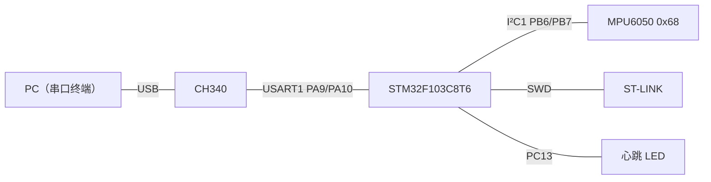
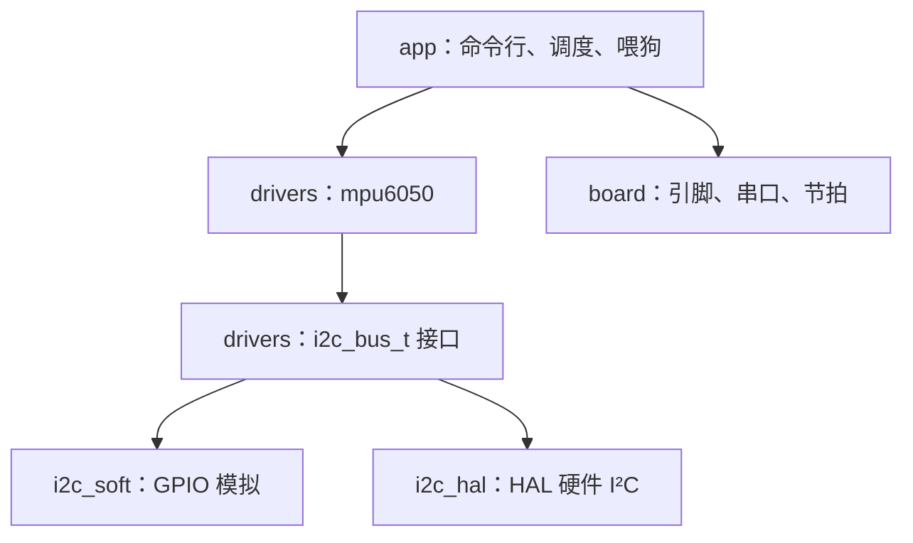
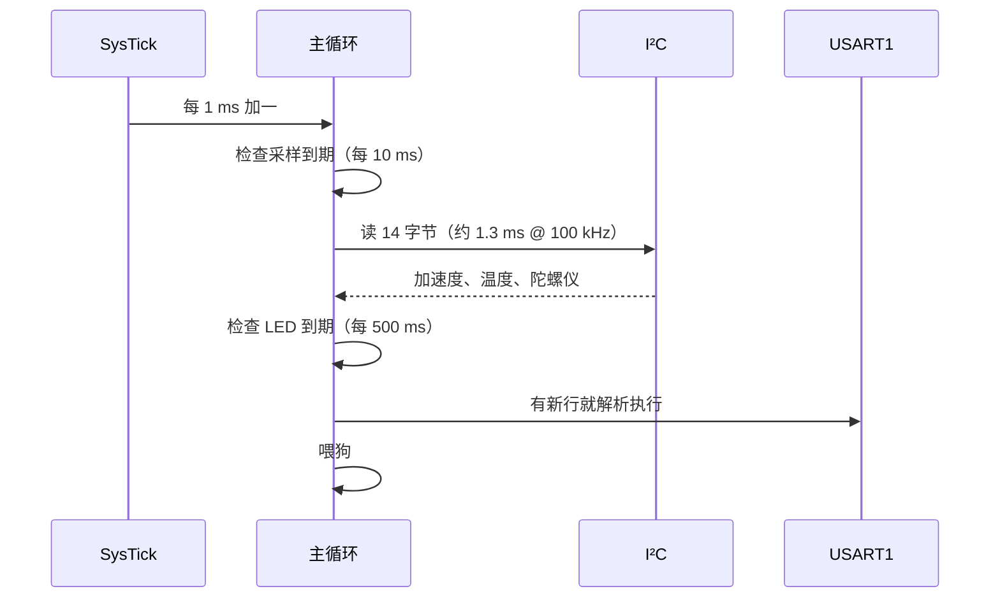

# 7.1 裸机外设驱动

在单独学习各个硬件模块时，开发往往聚焦于局部逻辑：第 2 章专注于直接配置寄存器建立对外设的直观控制，第 3 章逐步将外设包装为具备通用接口的驱动模块，第 6 章则探讨了工程目录组织与测试手段。当把这些彼此独立的环节汇聚到一个完整运转的物理设备上时，真正的工程挑战才显现出来——多个外设如何井然有序地协作、中断与主循环如何安全传递数据、以及驱动如何摆脱对具体单片机型号的强依赖。

这里通过一个不依赖任何实时操作系统的裸机工程，展示系统级驱动与应用的协同方式：目标板以固定的 10 ms 间隔轮询读取 MPU6050 六轴运动传感器，同时串口终端提供交互式命令行，支持查询即时加速度与姿态角，并允许动态开启或关闭高速数据流输出。整个实现坚持严格的分层解耦：总线层仅依托抽象的函数指针表，随时能够切换底层实现；传感器驱动与具体硬件寄存器地址彻底隔离，不依赖任何特定单片机的 GPIO；串口中断负责接收单字节并压入环形队列，由应用层按行拼装与分派；而整套核心算法与分词逻辑，无需连接任何物理硬件即可在宿主机上执行完备的单元测试。工程完整源码位于 `code/嵌入式/7_综合实践/7_1_裸机外设驱动/`。

## 1. 需求与硬件

功能一共四条：

1. 每 10 ms 读一次 MPU6050，得到三轴加速度与倾角。
2. 串口命令行支持 `help`、`id`、`read`、`stream on|off`、`rate <Hz>`。
3. 板载 LED 以 1 Hz 心跳，指示主循环还在运行。
4. 主循环被卡住时由独立看门狗复位，启动时打印复位原因。

硬件是一块 Blue Pill（STM32F103C8T6）加一个 MPU6050 模块：

| 信号 | 引脚 | 说明 |
| --- | --- | --- |
| USART1 TX / RX | PA9 / PA10 | 接 CH340，115200 8N1 |
| I²C SCL | PB6 | 外部 4.7 kΩ 上拉到 3.3 V |
| I²C SDA | PB7 | 同上 |
| MPU6050 INT | PA8 | 本页不用，留给习题 |
| SWD | PA13 / PA14 | ST-LINK |
| LED | PC13 | 板载，低电平亮 |

MPU6050 的 7 位 I²C 设备地址由 AD0 引脚的电平状态决定：引脚接地时设备地址为 `0x68`，接高电平时则为 `0x69`。[2.8 SPI 与 I²C](/教程/正文/嵌入式/2_MCU裸机开发/2_8_SPI与I2C) 中讨论的 AT24C02 存储芯片同样挂接在这一总线上，地址为 `0x50`。由于 I²C 规范要求每次传输事务的首个字节必须包含目标从机地址与读写指示位，两个物理特性各异的器件在同一组线路上共存并通信，彼此完全独立。



清晰的层级边界是整个架构设计的核心线索：



在驱动实现层面，`mpu6050.c` 只需包含抽象的 `i2c_bus.h` 接口定义，在编译阶段就彻底切断了与微控制器 GPIO 或特定寄存器的联系。将来若要在不同硬件之间迁移，或是将软件模拟 I²C 无缝替换为硬件外设控制器，驱动的核心代码一行也无需更动；而在宿主机上开展离线验证时，只需向驱动注入一套记录并回放总线通信的纯软件测试桩即可。

## 2. 工程结构与构建

目录划分为三个层级，模块间的依赖关系严格限制为由上至下单向流动：

```text:no-line-numbers
7_1_裸机外设驱动/
├── app/          # 应用层：main.c 调度，cli.c 命令表
├── board/        # 板级：引脚、串口中断、节拍
├── drivers/      # i2c_bus.h 接口，i2c_soft/i2c_hal 后端，mpu6050 驱动
├── tests/        # 主机测试：伪造总线、命令行分词
└── CMakeLists.txt
```

应用层 `app/` 可以根据需要调用 `board/` 与 `drivers/` 提供的能力，板级支持 `board/` 也可以挂接特定外设驱动，但底层的驱动与板级代码绝对不可越权反向依赖上层应用。至于位于 `tests/` 下的宿主机验证套件，则仅链接 `drivers/` 以及 `app/` 中与具体硬件读写脱钩的纯逻辑模块。

在这套目录组织中并未单独建立 `clock.c` 文件。回顾 [2.3 时钟与复位](/教程/正文/嵌入式/2_MCU裸机开发/2_3_时钟与复位) 可以发现，时钟初始化深度依赖特定芯片的 RCC 寄存器映射，本质上属于板级硬件契约，因而将其直接整合进 `board_stm32f103.c`。此时工程在平台底层只依赖 `common/` 目录下提供的启动汇编与链接脚本，借助 [1.8 复位、启动与链接](/教程/正文/嵌入式/1_平台与工具链/1_8_复位_启动与链接) 中的 `stm32f103_firmware()` 统筹编译开关、内存布局分配以及固件体积报表：

```cmake
include("${CMAKE_CURRENT_LIST_DIR}/../../common/firmware.cmake")

if(CMAKE_CROSSCOMPILING)
    stm32f103_firmware(mdr_bare
        app/main.c
        app/cli.c
        board/board_stm32f103.c
        drivers/i2c_soft.c
        drivers/mpu6050.c)
    target_include_directories(mdr_bare PRIVATE
        "${CMAKE_CURRENT_LIST_DIR}/board"
        "${CMAKE_CURRENT_LIST_DIR}/drivers"
        "${CMAKE_CURRENT_LIST_DIR}/app"
        "${CMSIS_INCLUDE_DIR}")
    target_link_libraries(mdr_bare PRIVATE m)
else()
    add_executable(test_mpu6050 tests/test_mpu6050.c drivers/mpu6050.c)
    target_compile_options(test_mpu6050 PRIVATE -std=c17 -Wall -Wextra)
    target_include_directories(test_mpu6050 PRIVATE
        "${CMAKE_CURRENT_LIST_DIR}/drivers")
endif()
```

目标固件构建与宿主机测试对应两套截然不同的源码编排逻辑：主机测试既不需要板级驱动，也无需链接单片机的硬件启动文件。在交叉编译环境下使用 Arm GNU Toolchain 13.3 构建，全开 `-Wall -Wextra` 能够保持零警告通过。链接时 libc_nano 打印的若干条关于 `_close is not implemented` 等系统调用桩信息，源于标准库内部 `printf` 带来的底层依赖，并不会干扰应用固件的正常执行：

::: terminal title="PowerShell - 构建目标固件"

```console
$ cmake -B build -G Ninja --toolchain ../../common/arm-none-eabi.cmake `
      -DARM_TOOLCHAIN_DIR=C:/tools/arm/bin `
      -DCMSIS_INCLUDE_DIR=C:/tools/cmsis
$ cmake --build build
[7/7] Linking C executable mdr_bare.elf
   text    data     bss     dec     hex filename
  13128     100    2260   15488    3c80 mdr_bare.elf
```

:::

从最终的内存分布来看，约 13 KB 的代码段与 2.3 KB 的静态 RAM 占用（由 `data` 与 `bss` 共同构成），对于具备 64 KB Flash 与 20 KB SRAM 的 STM32F103C8 微控制器而言，仅占用了不到四分之一的片上资源。其中代码段有相当可观的比例来自于软件模拟浮点数学库的开销，后文在驱动细节部分会对这笔资源账进行详尽分析。

## 3. 时钟、时基与心跳

板级初始化按固定顺序来：

```c
/* code/嵌入式/7_综合实践/7_1_裸机外设驱动/board/board_stm32f103.c */
void board_init(void) {
    /* 1. LED：PC13 推挽输出，复位后默认灭 */
    RCC->APB2ENR |= RCC_APB2ENR_IOPCEN;
    GPIOC->BSRR = GPIO_BSRR_BS13;
    GPIOC->CRH = (GPIOC->CRH & ~(0xFu << 20)) | (0x2u << 20);

    clock_init_72mhz();
    tick_init();

    board_console_init();
    i2c_soft_create(&g_i2c_bus);
}
```

在系统初始化序列中，优先点亮或配置指示灯引脚，随后再启动外部晶振与主时钟锁相环，体现了一种经典的硬件防御性设计考量：当板载无源晶振虚焊、负载电容不匹配或高频振荡电路故障导致时钟切换阻塞在死循环时，硬件引脚状态能够保持在最基础的已知初始态，方便开发人员直接通过指示灯状态快速定位硬件故障区间。

系统的基准时基由 Cortex-M3 内核的 SysTick 定时器提供，配置为每 1 ms 产生一次节拍中断，对一个 32 位的全局无符号整型对象执行自增：

```c
static volatile uint32_t g_ms;

void SysTick_Handler(void) {
    ++g_ms;
}

uint32_t board_tick_now(void) {
    return g_ms;
}
```

在 32 位 ARM 内核规范下，读取一个按字对齐的 32 位整型对象仅需单条 `ldr` 指令即可完成，在总线层面天然具备原子性，主循环和中断处理之间无需通过关闭全局中断来防范数据撕裂（详见 [4.1 临界区与 RTOS 边界](/教程/正文/嵌入式/4_RTOS与固件架构/4_1_临界区与RTOS边界)）。主循环在检测各任务周期是否到来时，全部依赖带符号数的差值运算：

```c
if ((int32_t)(now - next_sample) >= 0) {
    next_sample += SAMPLE_PERIOD_MS;
    ...
}
```

利用差值进行周期判断具有极其稳健的数学保障。`now - next_sample` 本身属于无符号整型减法，在 C 语言的无符号溢出算术规则下，即便是连续运行 49.7 天后节拍计数由 `0xFFFFFFFF` 回绕归零，二者的模差值依然准确反映了时间推进的绝对距离；当该差值被强制转换为有符号整数 `int32_t` 之后，只要目标时刻未到，在补码表示下其最高位为 1，对应负数值；一旦到达或略微滞后，最高位恢复为 0，差值落在非负数区间从而触发任务执行。相比之下，简单的绝对大小比对如 `now >= next`，在回绕临界点会产生致命的逻辑误判，致使任务调度中断数周之久。

状态指示 LED 的周期性翻转同样挂接在超级循环内部，以 500 ms 为步进周期执行状态切换：

```c
static void board_led_set(int on) {
    /* PC13 低电平亮 */
    if (on != 0) {
        GPIOC->BSRR = GPIO_BSRR_BR13;
    } else {
        GPIOC->BSRR = GPIO_BSRR_BS13;
    }
}
```

对引脚电平的置位与复位操作直接针对 BSRR 寄存器执行单向写入，避免采用对输出数据寄存器执行 `ODR ^= ...` 的读-改-写指令。对 ODR 寄存器的复合操作需要将 16 位整组引脚数据读入寄存器、异或后再写回，一旦在读写间隙被更高优先级的中断打断且中断服务修改了同端口其他引脚状态，返回后就会引发难以追踪的引脚电平被篡改现象。依靠硬件原子支持的 BSRR 寄存器不仅时序紧凑，而且彻底免除了竞争风险。

在串口终端启动之初，系统通过读取复位标志输出复位成因，帮助工程师判断设备上电来源。在 [2.3 时钟与复位](/教程/正文/嵌入式/2_MCU裸机开发/2_3_时钟与复位) 中介绍过的 `RCC->CSR` 寄存器存储了诸如低功耗唤醒、独立看门狗动作、软件触发以及外部复位引脚拉低等多种标志；需要注意的是，读取分析完成后必须向 `RMVF` 控制位写入 1 完成清零，否则残留的状态会污染下一次启动判定：

```c
const char *board_reset_cause_name(void) {
    uint32_t csr = RCC->CSR;
    const char *name = "未知";

    if ((csr & RCC_CSR_LPWRRSTF) != 0u) {
        name = "低功耗";
    } else if ((csr & RCC_CSR_WWDGRSTF) != 0u) {
        name = "窗口看门狗";
    } else if ((csr & RCC_CSR_IWDGRSTF) != 0u) {
        name = "独立看门狗";
    } else if ((csr & RCC_CSR_SFTRSTF) != 0u) {
        name = "软件复位";
    } else if ((csr & RCC_CSR_PORRSTF) != 0u) {
        name = "上电";
    } else if ((csr & RCC_CSR_PINRSTF) != 0u) {
        name = "复位引脚";
    }
    RCC->CSR |= RCC_CSR_RMVF;
    return name;
}
```

这里对各个标志位的判断顺序体现了芯片内部逻辑的内在逻辑：绝大多数内部复位（例如软件复位或看门狗溢出）在发生时，硬件电路都会同步拉起外部引脚复位标志 `PINRSTF`。如果将通用引脚复位放在最优先分支比对，所有内部硬件故障都将被错误归类为外部复位，因此具体的专用复位源必须在条件分支中优先判定。

::: tip 看门狗只喂在主循环末尾

微控制器的独立看门狗（IWDG）一旦开启便持续递减，只能依托主程序定期重置计数值。为了最大化监控效果，喂狗动作严格安置在主循环全部任务执行完成的最末端：传感器采集、终端指令分派或指示灯调度中只要任何一个环节发生死锁，看门狗在两秒之后即强制实施系统重置，并在控制台重新打出复位成因。调试期间可结合 `DBGMCU_CR` 寄存器中的 `DBG_IWDG_STOP` 控制位使得内核单步断点暂停时计数器同步挂起，但该特性仅在调试器连接时生效，量产固件仍必须依赖主循环周期执行。

:::

## 4. 命令行

控制台的串口数据接收依靠中断服务驱动：每当硬件捕获一个字节，中断服务程序便将其追加至容量为 256 字节的环形缓冲区，主循环在运行期间适时调取并解析。环形队列的基本设计思想在 [3.4 数据帧、环形缓冲区与状态机](/教程/正文/嵌入式/3_驱动_通信与中间件/3_4_数据帧_环形缓冲区与状态机) 中有过展开，在工程应用中尤为关注两点工程考量：容量选择 2 的幂次有助于借助位与逻辑消除昂贵的除法取模开销；当接收队列饱和时果断放弃新收字节，中断函数内绝不进行长时间等待或阻塞。

```c
void USART1_IRQHandler(void) {
    if ((USART1->SR & USART_SR_RXNE) != 0u) {
        uint8_t byte = (uint8_t)USART1->DR;
        uint32_t next = (g_head + 1u) % CONSOLE_RING_SIZE;
        if (next != g_tail) {
            g_ring[g_head] = byte;
            g_head = next;
        }
        /* 满了就丢新字节：命令行丢一两个字符不影响使用，不能在这里等 */
    }
}
```

主循环利用 `board_console_try_read_line()` 轮询缓冲区，并在检测到行结束符时打包为完整的文本指令字符串交出，同时自动处理常见的回车、换行以及退格擦除等终端控制符：

```c
int board_console_try_read_line(char *buf, int max) {
    while (g_tail != g_head) {
        char c = (char)g_ring[g_tail];
        g_tail = (g_tail + 1u) % CONSOLE_RING_SIZE;

        if (c == '\r') {
            continue;
        }
        if (c == '\n') {
            int len = g_line_len;
            g_line[g_line_len] = '\0';
            g_line_len = 0;
            if (len > max - 1) {
                len = max - 1;
            }
            memcpy(buf, g_line, (size_t)len + 1u);
            return 1;
        }
        if (c == '\b' || (uint8_t)c == 0x7Fu) {
            if (g_line_len > 0) {
                --g_line_len;
            }
            continue;
        }
        if (g_line_len < (int)sizeof g_line - 1) {
            g_line[g_line_len++] = c;
        }
    }
    return 0;
}
```

支持的命令集合被统一抽象为静态表结构，每个表项绑定名称、帮助说明以及对应的执行函数指针：

```c
struct cli_command {
    const char *name;
    const char *help;
    int (*run)(const char *args);
};

static const struct cli_command k_commands[] = {
    {"help", "帮助", cmd_help},
    {"id", "读 WHO_AM_I", cmd_id},
    {"read", "读一次数据", cmd_read},
    {"stream", "stream on|off", cmd_stream},
    {"rate", "rate <Hz>", cmd_rate},
};
```

各命令函数接收完整的参数子串输入，多参数的具体拆解由各功能模块自行实施。`cli_dispatch()` 负责对输入文本进行前导命令名匹配，并自动将参数部分的起始指针传递给对应的执行逻辑：

```c
int cli_dispatch(const struct cli_command *table, size_t count, char *line) {
    /* 跳过前导空白，取命令名 */
    ...
    size_t len = strlen(p);
    while (len > 0 && is_space(p[len - 1])) {
        p[--len] = '\0';
    }

    for (size_t i = 0; i < count; ++i) {
        if (strcmp(name, table[i].name) == 0) {
            return table[i].run(p);
        }
    }
    printf("未知命令: %s（输入 help 查看可用命令）\n", name);
    return -1;
}
```

在参数字符串分派之前，框架统一剥离尾部残留的空白字符，这样下游命令函数就能直接获取整洁的文本切片，免于在每个回调中重复处理行尾空白。

::: compare left-title="if 链按名字比较" right-title="命令表 + 函数指针"

```c
if (strcmp(line, "help") == 0) {
    cmd_help();
} else if (strcmp(line, "id") == 0) {
    cmd_id();
} else if (strcmp(line, "read") == 0) {
    cmd_read();
} else if (strcmp(line, "stream") == 0) {
    cmd_stream(args);
} else if (strcmp(line, "rate") == 0) {
    cmd_rate(args);
}
```

---

```c
static const struct cli_command k_commands[] = {
    {"help", "帮助", cmd_help},
    {"id", "读 WHO_AM_I", cmd_id},
    {"read", "读一次数据", cmd_read},
    {"stream", "stream on|off", cmd_stream},
    {"rate", "rate <Hz>", cmd_rate},
};

(void)cli_dispatch(k_commands,
                   sizeof k_commands / sizeof k_commands[0], line);
```

:::

两类方案在指令执行效率上相差无几，但对长期维护的友好程度存在显著差异。命令表结构将新命令的注册收敛在单一数组中，`help` 命令的帮助输出能够自动与之同步；而在长分支判断中增删指令则容易漏改帮助信息。更关键的是，基于数组的表结构可以在脱离具体微控制器的宿主机测试中直接被加载验证，极大方便了分词与分发逻辑的单元测试。

## 5. I²C 总线层

### 5.1 一个只含两个函数指针的接口

总线层的作用是让驱动不去碰引脚。接口就是一张函数表：

```c
typedef struct i2c_bus {
    bool (*write)(void *ctx, uint8_t addr7, const uint8_t *data, size_t len);
    bool (*write_read)(void *ctx, uint8_t addr7, const uint8_t *wr, size_t wr_len,
                       uint8_t *rd, size_t rd_len);
    void *ctx;
} i2c_bus_t;
```

复合的 `write_read` 操作构成了绝大多数 I²C 传感器通信的核心范式：主机首先发送包含寄存器地址的写事务，随后在不释放总线的前提下发出重复起始条件（Repeated START），立即转换为读事务将数据顺次读回。几乎所有具备内部寄存器寻址的数字传感器都依循这一时序契约，将其提升为总线接口的一等公民方法，能够避免每个上层驱动重复拼装时序。总线头文件中一并提供了轻量级的内联辅助函数：

```c
static inline bool i2c_read_reg(const i2c_bus_t *bus, uint8_t addr7, uint8_t reg,
                                uint8_t *value) {
    return bus->write_read(bus->ctx, addr7, &reg, 1u, value, 1u);
}
```

::: concept emb71-i2c-7bit title="I²C 地址是 7 位，总线上的字节是地址左移一位"

在驱动代码中配置的设备地址通常为 7 位形式（如 `0x68`），而在物理总线上穿行发送的首个字节，则是将该 7 位地址左移一位后在最低位拼接读写标志：写操作对应 `0xD0`，读操作对应 `0xD1`。芯片官方数据手册给出的地址多已采用 7 位规约；部分第三方资料若标出 `0xD0`，往往是已经预先左移的结果。若在驱动中误将其二次左移，总线上的从机将永远无法识别并产生应答。

:::

在 [2.8 SPI 与 I²C](/教程/正文/嵌入式/2_MCU裸机开发/2_8_SPI与I2C) 中，AT24C02 的操作直接绑定在底层软件模拟函数上，这种做法在单模块实验中直观直接；但在具有多套物理后端并需要兼顾离线宿主机测试的系统工程中，建立清晰的抽象层便成为工程规范的必然选择：

::: compare left-title="驱动直接调用具体后端" right-title="驱动依赖总线接口"

```c
#include "soft_i2c.h"

bool mpu6050_init(void) {
    uint8_t id;
    i2c_start();
    i2c_write_byte(0x68 << 1);
    ...
}
```

---

```c
#include "i2c_bus.h"

bool mpu6050_init(mpu6050_t *dev, const i2c_bus_t *bus, uint8_t addr7,
                  uint8_t *who) {
    uint8_t id;
    if (!i2c_read_reg(bus, addr7, MPU6050_REG_WHO_AM_I, &id)) {
        return false;
    }
    ...
}
```

:::

左侧的代码实现强行绑定了开发板的特定 GPIO 引脚与微控制器环境，进行测试时要么必须连接真实物理器件，要么需要在编译期利用复杂的符号替换注入伪造实现。而右侧面向接口的驱动实现，则可以挂接到任何遵守 `i2c_bus_t` 契约的对象上运转。

### 5.2 GPIO 模拟后端

软件模拟后端的逐位电气时序与 2.8 节一脉相承，但作为工业级应用，必须补齐两项维系系统鲁棒性的关键机制。

其一是防范从机时钟延展（Clock Stretching）导致的死锁。根据规范，从机若在处理内部状态时来不及响应，允许在字节传输间隙主动将 SCL 时钟线拉低以强行挂起主机；主机必须等待其释放总线，但绝不能无休止地无限等待：

```c
/* 释放 SCL 后等它真正变高；返回 false 表示从机一直拉着不放 */
static bool scl_high_with_timeout(void) {
    scl(1u);
    for (uint32_t i = 0; i < I2C_SOFT_STRETCH_TIMEOUT; ++i) {
        if ((GPIOB->IDR & GPIO_IDR_IDR6) != 0u) {
            return true;
        }
    }
    return false;
}
```

将轮询上限设定为一万次循环，折合数毫秒的容忍时间。对于常规数字传感器而言，内部就绪通常在微秒级别，超过这一阈值即可断定硬件线路异常或从机已失控挂起。

其二是总线挂死后的异常恢复（Bus Recovery）。假设微控制器在从机向外传输数据的途中遭遇偶发复位或被异常打断，从机可能恰好停留在拉低 SDA 的时钟状态，导致整条总线后续所有的 START 条件均因数据线被锁死而失效。NXP 官方规范 UM10204 明确定义了标准的恢复方法：由主机在 SCL 线上连续补发 9 个时钟方波脉冲，强行驱动从机内部移位寄存器走完当前字节，并在最末尾紧跟一个 STOP 停止条件：

```c
/* 9 个时钟把卡住的从机走完当前字节，再补一个停止条件 */
static void bus_recover(void) {
    sda(1u);
    for (uint32_t i = 0; i < 9u; ++i) {
        scl(1u);
        delay_half();
        scl(0u);
        delay_half();
    }
    stop();
}
```

无论 `soft_write()` 还是 `soft_write_read()`，只要通信由于超时或无应答宣告失败，退出前均会主动调用一次 `bus_recover()`，确保下一次总线事务能够在电平彻底归位的纯净状态下重新起步。

之所以选取 9 个时钟，是因为一个完整的 I²C 传输单元由 8 位数据加 1 位 ACK/NACK 构成。无论从机恰巧停滞在当前字节的第几个二进制位上，连续 9 个外部驱动脉冲都足以迫使其消耗完残余时钟槽位、交出对 SDA 线的主动拉低控制权。

### 5.3 HAL 后端

针对硬件控制器实现的 HAL 后端，主要职责在于将意法半导体库函数的执行状态映射为布尔结果：

```c
static bool hal_write_read(void *ctx, uint8_t addr7, const uint8_t *wr, size_t wr_len,
                           uint8_t *rd, size_t rd_len) {
    (void)ctx;
    HAL_StatusTypeDef st =
        HAL_I2C_Master_Transmit(&g_hi2c1, (uint16_t)(addr7 << 1), (uint8_t *)wr,
                                (uint16_t)wr_len, I2C_HAL_TIMEOUT_MS);
    if (st != HAL_OK) {
        return false;
    }
    st = HAL_I2C_Master_Receive(&g_hi2c1, (uint16_t)((addr7 << 1) | 1u), rd,
                                (uint16_t)rd_len, I2C_HAL_TIMEOUT_MS);
    return st == HAL_OK;
}
```

注意在此处显式执行了 `addr7 << 1`：STM32 HAL 库要求传入已预先左移对齐的设备地址，而抽象接口约定的则是 7 位原生地址，各后端负责处理这一表示形式的转换。

关于硬件外设与软件模拟的选择，依然延续 2.8 节中的工程结论：早期 STM32F1 系列微控制器的硬件 I²C 状态机极其脆弱，官方勘误手册 ES096 记录了多处关于事件标志位清除顺序的硬件时序缺陷。在量产产品中，要么依赖封装成熟且内置规避策略的 HAL 库，要么采用基于开漏 GPIO 的软件模拟。在本工程中，HAL 实现完成了编译期语法与类型检查，由于其引脚定义与软模拟完全对应，若需在板级切换只需调整 `board_init()` 中的初始化调用即可。

## 6. MPU6050 驱动

传感器驱动的核心职责在于操控内部寄存器状态机与数据换算。完整的初始化流程包含四项明确目标：芯片握手自检、退出休眠并选择时钟基准、设置采样分频以及配置硬件模拟/数字低通滤波器。

```c
#define MPU6050_REG_SMPLRT_DIV   0x19u
#define MPU6050_REG_CONFIG       0x1Au
#define MPU6050_REG_ACCEL_CONFIG 0x1Cu
#define MPU6050_REG_ACCEL_XOUT_H 0x3Bu
#define MPU6050_REG_PWR_MGMT_1   0x6Bu
#define MPU6050_REG_WHO_AM_I     0x75u
```

| 寄存器 | 地址 | 本页写入 | 作用 |
| --- | --- | --- | --- |
| `SMPLRT_DIV` | 0x19 | 0 | 采样率 = 1 kHz / (1 + 0) = 1 kHz |
| `CONFIG` | 0x1A | 0x03 | 数字低通滤波约 44 Hz |
| `ACCEL_CONFIG` | 0x1C | 不改 | 复位值 ±2 g，16384 LSB/g |
| `ACCEL_XOUT_H` | 0x3B | — | 从这里连续读 14 字节 |
| `PWR_MGMT_1` | 0x6B | 0x01 | 退出睡眠，时钟取 X 轴陀螺 PLL |
| `WHO_AM_I` | 0x75 | — | 固定返回 0x68 |

::: concept emb71-mpu6050-14b title="一次读 14 字节"

自加速度起始地址 `ACCEL_XOUT_H`（0x3B）开始连续读出 14 个字节，数据结构依次对应：三轴加速度各 2 字节、芯片温度 2 字节、以及三轴角速度各 2 字节。每个物理量均以高位在前的大端格式（Big-Endian）打包输出。在 I²C 突发读取过程中，主机接收前 13 个字节时均向从机回复 ACK，在第 14 个字节时主动回复 NACK 并紧跟 STOP，指示从机终止后续寄存器地址自增。

:::

初始化函数严格坚持“校验先行”原则，若器件身份与预期不符则立即终止后续所有写入指令：

```c
bool mpu6050_init(mpu6050_t *dev, const i2c_bus_t *bus, uint8_t addr7, uint8_t *who) {
    dev->bus = bus;
    dev->addr7 = addr7;

    uint8_t id = 0u;
    if (!i2c_read_reg(bus, addr7, MPU6050_REG_WHO_AM_I, &id)) {
        return false;
    }
    if (who != NULL) {
        *who = id;
    }
    if (id != MPU6050_ADDR7) {
        return false;
    }

    if (!i2c_write_reg(bus, addr7, MPU6050_REG_PWR_MGMT_1, PWR_MGMT_1_WAKE)) {
        return false;
    }
    if (!i2c_write_reg(bus, addr7, MPU6050_REG_SMPLRT_DIV, 0u)) {
        return false;
    }
    if (!i2c_write_reg(bus, addr7, MPU6050_REG_CONFIG, CONFIG_DLPF_44HZ)) {
        return false;
    }
    return true;
}
```

通过指针回传读取到的实际 `who` 值，在排障过程中价值巨大：若读得 `0x00` 通常暗示缺少上拉电阻或物理线路开路；若读出 `0xFF` 则代表 SDA 处于持续上拉悬空状态（从机未上电或根本未接入）；而读到诸如 `0x70` 之类的值，则往往意味着接错了同系列的其他衍生型号芯片。

突发采集与数据换算流程紧密衔接：

```c
bool mpu6050_read_all(mpu6050_t *dev, mpu6050_sample_t *out) {
    uint8_t reg = MPU6050_REG_ACCEL_XOUT_H;
    uint8_t buf[14];

    if (!dev->bus->write_read(dev->bus->ctx, dev->addr7, &reg, 1u, buf, sizeof buf)) {
        return false;
    }

    out->ax = mpu6050_raw_to_mg(be16(&buf[0]));
    out->ay = mpu6050_raw_to_mg(be16(&buf[2]));
    out->az = mpu6050_raw_to_mg(be16(&buf[4]));
    ...
}
```

原始码字转换为毫重力加速度（mg）时采用纯整型算术，并严格执行对称四舍五入：

```c
int16_t mpu6050_raw_to_mg(int16_t raw) {
    int32_t scaled = (int32_t)raw * 1000;
    if (scaled >= 0) {
        return (int16_t)((scaled + MPU6050_LSB_PER_G / 2) / MPU6050_LSB_PER_G);
    }
    return (int16_t)((scaled - MPU6050_LSB_PER_G / 2) / MPU6050_LSB_PER_G);
}
```

在 C 标准中，有符号整数的除法遵循向零截断（truncate towards zero）机制。正数运算时通过加上半个除数实现四舍五入，但在处理负数时必须相应减去半个除数，否则诸如 `-8` 这样对应的负小数值在截断时就会偏向 0 而不是向 `-1` 靠拢。后文的宿主机测试用例对此有专门的断言覆盖。

至于终端展示所需的倾角，借助数学库中的 `atan2f` 展开解算：

```c
static void print_attitude(const mpu6050_sample_t *s) {
    float ax = (float)s->ax / 1000.0f;
    float ay = (float)s->ay / 1000.0f;
    float az = (float)s->az / 1000.0f;
    float pitch = atan2f(ax, sqrtf(ay * ay + az * az)) * 57.29578f;
    float roll = atan2f(ay, sqrtf(ax * ax + az * az)) * 57.29578f;

    printf("ax=%5d ay=%5d az=%5d mg  pitch=%6.1f roll=%6.1f deg\n", s->ax, s->ay,
           s->az, (double)pitch, (double)roll);
}
```

STM32F103 的 Cortex-M3 内核未搭载硬件单精度浮点单元（FPU），所有针对 `float` 的四则运算都被编译器自动重写为针对软浮点接口 `__aeabi_f*` 的函数调用，而三角函数 `atan2f` 的引入更是级联拉入了一整套软件数学实现，包括 `sqrtf`、双精度转换及其底层的多项式拟合例程。通过 `nm` 工具可以直观审视这些被拖入符号表中的代码：

::: terminal title="bash - 浮点相关的符号"

```text
$ arm-none-eabi-nm build/mdr_bare.elf | grep -E " (sqrtf|atanf|__aeabi_f(add|mul|div))$"
08000470 T __aeabi_fadd
080007e8 T __aeabi_fdiv
08000680 T __aeabi_fmul
08001968 T sqrtf
08001b98 T atanf
080019a4 T __ieee754_sqrtf
08001a88 T __ieee754_atan2f
```

:::

进行对比测算可以发现：若完全剥离倾角的浮点运算、在控制台仅输出整型 mg 数值，整个固件的体积将由 13128 字节大幅锐减至 9360 字节，节省出整整 3768 字节，占到当前固件代码体积的近三成。这并不否定在嵌入式系统中使用标准浮点算法的价值，而是强调架构设计中对于执行路径的权衡意识：在高频周期的传感器采集与闭环控制主线上应当杜绝低效的软浮点运算；而控制台仅仅以 10 Hz 的低频向用户直观展示姿态角，此时单次运算的开销对于系统总利用率而言完全处于安全裕度内。若未来要在硬实时主循环内实现姿态闭环控制，则应参考 [6.1 固件架构、配置与资源预算](/教程/正文/嵌入式/6_质量_安全与交付/6_1_固件架构_配置与资源预算) 中所提倡的，采用整型三角查表法或定点数运算。

::: warning 浮点库一进来就撤不出去

在没有硬件 FPU 的架构下，只要编译依赖链中存在对标准数学函数的一次调用，链接器就会将庞大的整套软浮点支持代码全量打包进固件中。对于存储空间极度受限的微控制器，在架构规划期通过配置宏将浮点运算隔离在可选的调试路径之外，远比在链接阶段指望 `--gc-sections` 优化更为彻底。

:::

## 7. 应用：超级循环

主循环做四件事，每件的触发条件都不同：

```c
int main(void) {
    board_init();
    iwdg_init();

    printf("\n7.1 裸机外设驱动：复位原因 %s\n", board_reset_cause_name());

    if (!mpu6050_init(&g_dev, board_i2c_bus(), MPU6050_ADDR7, &g_who)) {
        printf("MPU6050 初始化失败：WHO_AM_I = 0x%02X。检查接线与地址（AD0）。\n",
               (unsigned)g_who);
    } else {
        printf("MPU6050 就绪，WHO_AM_I = 0x%02X\n", (unsigned)g_who);
    }

    uint32_t next_sample = board_tick_now();
    uint32_t next_led = board_tick_now();
    char line[64];
    mpu6050_sample_t s = {0};

    for (;;) {
        uint32_t now = board_tick_now();

        if ((int32_t)(now - next_sample) >= 0) {
            next_sample += SAMPLE_PERIOD_MS;
            (void)mpu6050_read_all(&g_dev, &s);
        }

        if (g_stream) {
            uint32_t period = 1000u / g_rate_hz;
            if ((uint32_t)(now - g_last_stream_ms) >= period) {
                g_last_stream_ms = now;
                print_attitude(&s);
            }
        }

        if ((int32_t)(now - next_led) >= 0) {
            next_led += LED_PERIOD_MS;
            board_led_toggle();
        }

        if (board_console_try_read_line(line, (int)sizeof line)) {
            (void)cli_dispatch(k_commands, sizeof k_commands / sizeof k_commands[0],
                               line);
            printf("> ");
        }

        iwdg_feed();
    }
}
```

在调度策略上，传感器采样与心跳指示灯采用“绝对时刻递推”（即 `next += period`），而交互式数据流推送则采用“相对时刻推进”（即 `g_last_stream_ms = now`）。这种区分反映了不同的系统考量：传感器采集与信号滤波要求维持严格的等时采样间隔离散化，绝对时刻递推即便在偶发局部波动后也能锁定长期的平均采样率，避免相位漂移累加；而串口数据推送属于尽力而为的次要交互，一旦串口发送阻塞拖慢了主循环，相对时刻推进能够自适应降低实际输出帧率，避免积压大量待发请求反而进一步拖垮系统。

整个主循环在一个典型周期内的执行时序如下：



深入审视其物理通信开销可以发现：一次典型的 14 字节连续读取事务由两个起始地址字节、一个寄存器寻址字节以及 14 个连续的数据字节组成。按照每个字节附带 1 位应答信号的规则，整笔事务累计占用（2 + 1 + 14）× 9 = 153 个 SCL 时钟周期。在标准 100 kHz 的总线速率下，传输耗时大约为 1.5 ms。在 10 ms 的采样周期中，仅总线 I/O 就占用了微控制器约 15% 的时间片，主循环尚有充分的算力余量来兼顾串口命令解析与指示灯调度。然而，倘若将采样率提升至 200 Hz（周期 5 ms），总线阻塞占比将骤增至 30% 以上，一旦叠加复杂的控制解算或突发通信，裸机单循环的响应延迟就会急剧恶化，这也是后续 7.2 节引入抢占式多任务内核的根本动力。

看门狗参数的固化封装于 `iwdg_init()` 中：

```c
static void iwdg_init(void) {
    /* LSI ≈ 40 kHz，预分频 64，重装值 1249：4 × 2^4 × 1250 / 40 kHz = 2.0 s */
    IWDG->KR = 0x5555u; /* 允许写 PR/RLR */
    IWDG->PR = 0x04u;   /* 64 分频 */
    IWDG->RLR = IWDG_RELOAD;
    IWDG->KR = 0xAAAAu; /* 首次喂狗 */
    IWDG->KR = 0xCCCCu; /* 启动 */
}
```

向键寄存器依次写入的三组控制指令（`0x5555` 解锁写保护、`0xAAAA` 装载计数值、`0xCCCC` 激活看门狗）是芯片内部状态机的硬性规约，写入顺序与数值必须丝毫不差，在 [2.10 看门狗、低功耗与故障处理](/教程/正文/嵌入式/2_MCU裸机开发/2_10_看门狗_低功耗与故障处理) 中对其状态机转移机制有更完整的论述。

## 8. 测试

驱动与具体单片机寄存器的彻底解耦，使得绝大部分功能验证得以无缝搬迁至宿主机运行。测试桩构建了一套假总线结构，用来记录每一次发起的通信事务并按照预置数据响应：

```c
struct fake_bus {
    uint8_t regs[128];
    uint8_t last_write[16];
    size_t last_write_len;
    uint8_t last_reg;
    int fail_at; /* 第几次事务失败，-1 表示永不失败 */
    int transactions;
};
```

结构体中的 `fail_at` 字段赋予了测试用例精准实施“故障注入”的能力，可以模拟器件在第 n 次事务中突然断线或失去应答的边缘异常。测试套件设计了五组典型的验证场景：芯片正常初始化流程、设备 ID 不匹配时的防御性拦截、14 字节连续数据的大端拼接与工程量程换算、中途出现 NACK 异常时的错误返回、以及定点整数换算中正负数值的对称四舍五入。

```c
printf("[3] read_all with one 14-byte transaction\n");
CHECK(mpu6050_read_all(&dev, &s));
CHECK(s.ax == 1000);
CHECK(s.ay == -1000);
CHECK(s.az == 500);
CHECK(s.temp == 3653);
CHECK(s.gx == 100);
CHECK(s.gy == -100);
```

此处封装的 `CHECK` 宏在断言失败时输出当前源文件行号与上下文信息并累计错误计数，保持了测试骨架的轻量简洁。整个测试仅有约 200 行，避免了引入繁重第三方框架的额外学习负担；若后续需要纳入持续集成流水线，也可低成本迁移至 Unity 等专业嵌入式测试套件。

在 MinGW gcc 13.2 环境下编译并运行单元测试：

::: terminal title="PowerShell - 主机单元测试"

```console
$ gcc -std=c17 -Wall -Wextra -O2 tests/test_mpu6050.c drivers/mpu6050.c `
      -Idrivers -o test_mpu6050.exe
$ ./test_mpu6050.exe
[1] init with WHO_AM_I = 0x68
    init ok, PWR_MGMT_1 = 0x01, CONFIG = 0x03
[2] init with WHO_AM_I = 0x70
    rejected as expected, no write follows
[3] read_all with one 14-byte transaction
    ax=1000 ay=-1000 az=500 mg, temp=3653, gx=100 gy=-100 gz=0
[4] read_all with NACK on first transaction
    returned false as expected
[5] raw_to_mg rounding
    8->0 9->1 -9->-1 16384->1000

all tests passed
```

:::

命令行解析与参数分词逻辑同样拥有完备的宿主机测试用例：

::: terminal title="PowerShell - 命令行测试"

```console
$ gcc -std=c17 -Wall -Wextra -O2 tests/test_cli.c app/cli.c `
      -Iapp -o test_cli.exe
$ ./test_cli.exe
[1] split by runs of spaces and tabs
    argv[0]=rate argv[1]=25
[2] empty line
[3] dispatch trims trailing whitespace from args
    args=hello
[4] unknown command returns -1
未知命令: frobnicate（输入 help 查看可用命令）
[5] two words are not split into two args
    args=a b

all tests passed
```

:::

第 3 组测试用例在行为层面上固化了一项架构约定：命令调度器统一承担剥离参数尾部空白字符的职责，而下游各独立命令函数则专注于参数解析，不再各自处理行尾噪声。这种测试用例本身就构成了精准且具有可执行约束力的设计契约。

::: tip 先写测试再接硬件

在嵌入式开发中，`WHO_AM_I` 读数不匹配、多字节错位拼接、以及负数舍入偏置这三类软硬件边界问题，在真实板载环境下通常仅表现为模糊的“数据看起来不对”，往往让开发者在电气接触不良与代码逻辑缺陷之间无所适从。在宿主机测试环境中，每一类行为都有精确可度量的预期基准，修改代码并验证只需毫秒级反馈，远比反复接驳调试器与万用表更为高效。在离线测试通过后再接入硬件，此时任何异常都能快速收敛至物理连线与电气噪声层面。

:::

<Quiz
  type="single"
  :options="[
    { label: '把命令分派写成 if 链，省掉一个数组', value: 'A' },
    { label: '让 mpu6050.c 只依赖 i2c_bus_t，主机测试塞入假总线', value: 'B' },
    { label: '把 I²C 的逐位时序写进 mpu6050.c，减少一层调用', value: 'C' },
    { label: '让驱动直接读 GPIOB 寄存器，省掉两个函数指针', value: 'D' }
  ]"
  answer="B"
>

<template #question>

要让 MPU6050 驱动在 PC 上不接硬件就能测试，关键的一步是什么？

</template>

正确答案是 **B**。通过让驱动面向抽象接口设计，单元测试才能通过软件模拟注入可预期的数据与行为序列。选项 C 和 D 均直接将传感器逻辑与具体的微控制器外设寄存器焊死，失去脱离物理硬件独立测试的能力。选项 A 仅关涉字符分发，与传感器驱动的可测试性无关。

</Quiz>

## 9. 下载、调试与排错

项目最终构建输出为 `mdr_bare.elf`，并同步导出可以直接烧录的 `.bin` 与 `.hex` 镜像文件。在 [1.7 SWD、JTAG 与片上调试](/教程/正文/嵌入式/1_平台与工具链/1_7_SWD_JTAG与片上调试) 中配置好的 OpenOCD 与 GDB 脚本可直接开箱即用：

::: terminal title="bash - 烧录"

```console
$ openocd -f interface/stlink.cfg -f target/stm32f1x.cfg
$ arm-none-eabi-gdb build/mdr_bare.elf
(gdb) target extended-remote :3333
(gdb) monitor reset halt
(gdb) load
(gdb) monitor reset run
```

:::

针对目标板的调试方法延续 1.7 与 [2.10 看门狗、低功耗与故障处理](/教程/正文/嵌入式/2_MCU裸机开发/2_10_看门狗_低功耗与故障处理) 的经典经验：可在 `mpu6050_read_all` 处设置断点审查接收数组 `buf` 的十六进制内容，或在 `HardFault_Handler` 处截住异常并观察通用寄存器现场。启动汇编中的 `Default_Handler` 统一安置了无限循环，所有未显式定义的中断最终都会汇总到这里，当单片机发生未知的假死时，首先排查是否有断点命中了该入口。

在实机联调中，典型故障通常呈现四种明确模式：

**所有读数均为 0xFF，`id` 命令读出 `0x00` 或报错初始化失败**。这说明 SDA 信号线处于恒定高电平，从机未能产生任何 ACK 下拉。排查第一步是核实 7 位设备地址：代码中设定为 `0x68`，但模块上的 AD0 引脚若被拉高至 3.3 V 则设备地址为 `0x69`；其次检查上拉电阻：部分核心板模块未预置 4.7 kΩ 上拉电阻，单纯依赖单片机内部弱上拉通常无法维系正常方波；最后核实接线是否颠倒：PB6（SCL）与 PB7（SDA）接反是常见的偶发失误，其外在表象与断线一致。

**读数偶发错位，加速度数值跳变为接近温度的异常数量级**。这通常意味着 14 字节突发读取事务被外部高优先级中断过度打断，或者在驱动解包时偏移索引出现偏差。前者可通过逻辑分析仪捕获一次连续的总线通信波形（触发方式与协议解码详见 [6.3 测试、逻辑分析与硬件在环](/教程/正文/嵌入式/6_质量_安全与交付/6_3_测试_逻辑分析与硬件在环)），后者可在宿主机单元测试中通过注入标准字节流来快速判定。

**`id` 命令读取正常，但后续 `read` 数据频繁返回失败**。设备能够应答 ID 表明地址与物理上拉无误，问题大多源于从机时钟延展超时或总线锁死。此时需核查 `scl_high_with_timeout()` 的超时判定是否过于苛刻，或用示波器观察 SCL 是否被从机异常钳位在地电平。总线恢复函数 `bus_recover()` 可以化解多数突发锁死，但若每次读取均反复触发恢复，则需要进一步排查电源纹波与地线噪声。

**串口控制台输出全为杂乱乱码**。时钟树未成功锁定 72 MHz 外部主频，导致基于默认时钟预设算出的串口波特率除数与实际时钟频率错位。应使用调试器审查 HSE 振荡器是否稳定起振、以及系统核心全局时钟 `SystemCoreClock` 是否等于预期数值。回顾 2.3 节的时钟树拓扑图可以理清各总线的分频节点。

::: warning I²C 地址写两遍就错了

`HAL_I2C_Master_Transmit()` 要求传入左移后的 8 位格式地址，而通用抽象接口 `i2c_bus_t` 约定的则是 7 位标准地址。接口层已在规约中明确要求后端实现来完成左移对齐；若驱动层误将传入的 7 位地址二次左移，总线上发出的字节就会由 `0xD0` 异化为 `0xA0`，导致从机彻底失去响应。

:::

## 10. 习题

### 10.1 巩固

<Exercise id="67701" :d="2" :w="2">

`board_reset_cause_name()` 按固定顺序判断 `RCC->CSR` 的标志，读完写 `RMVF`。

(1) 一次独立看门狗复位后，`CSR` 里同时置起 `IWDGRSTF` 与 `PINRSTF`。若把判断顺序改成从 `PINRSTF` 开始，串口会打出什么？给出正确的顺序并说明依据。

(2) 启动横幅打印完之后再调用一次该函数，第二次返回什么？`RMVF` 的写入在什么时候生效？

(3) 主循环用 `if ((int32_t)(now - next_sample) >= 0)` 判断采样到期。设 `next_sample = 0xFFFFFFF6`，回绕后 `now = 0x00000002`：分别算出这个条件与 `now >= next_sample` 的结果。后者为假时 `next_sample` 不会被推进，下一次触发要等到什么时候？用 32 位毫秒数算出这段延迟折合多少天。

(4) 把 `g_ms` 换成 64 位计数能否顺带解决回绕？说明正文为什么仍用 32 位。

</Exercise>

<Exercise id="67702" :d="3" :w="2">

`board_console_try_read_line()` 在行超过调用方缓冲区时截断：

```c
if (len > max - 1) {
    len = max - 1;
}
memcpy(buf, g_line, (size_t)len + 1u);
```

`g_line` 有 80 字节，主循环传来的 `buf` 是 64 字节。串口输入一行 70 个字符再回车。

(1) 写出 `memcpy` 实际复制的下标区间，说明 `buf[63]` 是什么、`strlen(buf)` 会读到哪去。

(2) 给出两种改法：复制前把 `g_line[max - 1]` 置 0；或者复制后显式补 0。比较两者对 `g_line` 里后续字符的影响。

(3) 写一个主机测试复现：把同一段收尾逻辑抽成函数，喂入 70 个字符，打印 `buf[63]` 与 `strlen(buf)`。验收：修复前能看到 `buf[63]` 不是 0、`strlen` 超过 63；修复后 `strlen` 恰为 63。

</Exercise>

### 10.2 编程

<Exercise id="67703" :d="3" :w="3">

`tests/test_mpu6050.c` 里的读数都是整 g。给假总线灌入下面 14 个字节（从 `ACCEL_XOUT_H` 起）：

```text
40 00  FF FF  80 00  00 D2  00 83  FF 7D  00 00
```

(1) 先手算再运行验证。验收：`ax=1000 ay=0 az=-2000 temp=3714 gx=100 gy=-100 gz=0`。说明 `ay` 的原始值是多少、为什么换算后不是 −1。

(2) `mpu6050_raw_to_mg(-8)` 与 `(-9)` 各是多少？把实现里的正负分支合并成 `(raw * 1000 + 8192) / 16384`，重跑这两组和 `-16384`，给出错误的结果并说明错在舍入方向。

(3) 给温度和陀螺仪各补两条断言（`raw = -340`、`raw = 131`），写进测试并运行。

</Exercise>

<Exercise id="67704" :d="3" :w="3">

`cmd_rate()` 接受 1～100，主循环用 `period = 1000 / g_rate_hz` 再按毫秒比较。

(1) `rate 99` 与 `rate 37` 下 `period` 各是多少，实际输出频率是多少？

(2) 写主机程序遍历 1～100，统计有多少个不同的实际频率，并列出被并到同一档的全部取值。验收：不同实际频率 53 个，91～100 全部落在 100 Hz。

(3) 改成累计式计时：`next_stream += 1000 / rate` 与 `next_stream = now + 1000 / rate`，说明两者在小数频率上的长期误差差别，并给出一种把余数带到下一周期的写法。

</Exercise>

<Exercise id="67705" :d="3" :w="3">

`iwdg_init()` 的注释写 2.0 s，那是按 LSI = 40 kHz 算的。

(1) 按数据手册的 LSI 范围 30～60 kHz，算出 PR = 4、RLR = 1249 时超时的上下限。验收：约 1.33～2.67 s。

(2) 主循环最坏的一轮是 1.5 ms 的 I²C 事务加一次几毫秒的阻塞输出。它会不会把 1.33 s 这个最短超时吃掉？说明在这个量级上影响可以忽略，以及真正会吃掉超时的是哪一类故障。

(3) 写一个主机程序 `iwdg_table.c`，遍历 PR 0～6（分频分别是 4、8、16、32、64、128、256），对每一档取“按 60 kHz 这个最短超时算也不低于 2 s”的最小 RLR，打印 PR、分频、RLR 与按 30 / 40 / 60 kHz 算出的三个超时值。验收：PR = 3 一行是 32、3749、4.00 / 3.00 / 2.00 秒，PR = 4 一行是 64、1874、4.00 / 3.00 / 2.00 秒；PR = 0、1、2 三档即便 RLR 取满 4095，按 60 kHz 也只有 0.27、0.55、1.09 秒，达不到 2 s。说明够用的那几档为什么给出同一组超时值。

(4) 本页的 `PR = 4`、`RLR = 1249` 按 60 kHz 只有 1.33 s。要求最坏情况下也不低于 2 s，应改成哪一组？写出寄存器值与三个频率下的验算。

(5) 调试时打开 `DBGMCU_CR` 的 `DBG_IWDG_STOP`，说明它只在什么条件下有效，为什么不能把它当成产品的喂狗方案。

(6) 把喂狗点从循环末尾挪到 `mpu6050_read_all()` 之后，说明一次卡住命令解析的故障还能不能被看门狗发现。

</Exercise>

<Exercise id="67706" :d="3" :w="4">

给命令行加一条 `scan` 命令：遍历 7 位地址 `0x08`～`0x77`，有应答就打印。

(1) 只调用 `bus->write`、长度传 0 实现 `cmd_scan()`。说明为什么这里不用 `write_read`，以及空写在总线上是什么样子。

(2) 在假总线上测试：假总线只对 `0x50`、`0x68` 应答。验收输出：

```text
扫描 0x08..0x77：0x50 0x68
找到 2 个设备
```

(3) 正文说命令表的好处是 `help` 输出自动跟着变，本页的 `cmd_help()` 却是手写的一串。指出两者的差别，改成用 `cli_print_help(k_commands, ...)` 生成，并说明这样改之后新命令的 `help` 字段要求。

(4) 真机上同时扫到 `0x68` 与 `0x69` 说明什么？两个都扫不到又说明什么？后者该先查地址、上拉还是 PB6/PB7 接反，给出一个能一次区分它们的实验。

</Exercise>

<Exercise id="67707" :d="5" :w="4">

在主机上复现 `i2c_soft.c` 的两条异常路径，不接硬件。把 `scl()`、`sda()`、`sda_read()` 换成操作全局电平，从机模型可以在第 n 个时钟之后一直拉住 SDA 或 SCL。

(1) 让从机在第 5 个 SCL 高电平后拉住 SCL。验证 `scl_high_with_timeout()` 返回 false、`soft_write()` 返回 false，并在退出前调用一次 `bus_recover()`；用打印计数证明补了 9 个时钟。

(2) 让从机拉住 SDA，验证恢复之后下一次事务能成功。说明恢复末尾为什么必须补 `stop()`。

(3) 把 `I2C_SOFT_STRETCH_TIMEOUT` 从 10000 改成 100，记录一次失败事务的轮询次数与判定时间，说明这个上限该按什么定。

(4) 验收：程序打印每次事务的 SCL 脉冲数；正常读 14 字节为 153 个，恢复路径在此基础上多出 9 个时钟加一个停止条件。

</Exercise>

### 10.3 综合与挑战

<Exercise id="67708" :d="5" :w="4">

本页量过：去掉倾角计算后固件从 13128 字节降到 9360 字节。

(1) 写一个只用整数的倾角函数 `int16_t tilt_ddeg(int16_t a, int16_t b, int16_t c)`，计算 `atan2(a, sqrt(b*b + c*c))`，返回 0.1°。用 0～90° 的 16 点查找表加线性插值，不要浮点。

(2) 在主机上与 `atan2f` 版本对比每 1° 的 91 个角度，给出最大误差与平均误差。验收：最大误差不超过 0.5°。

(3) 用它替换 `print_attitude()` 里的浮点调用，重新构建目标固件，用 `arm-none-eabi-size` 对比 `text` 段，给出省下的字节数并与 3768 字节对照。

(4) `a`、`b`、`c` 同时为 0 时函数返回什么？说明查表法在这里为什么仍要做保护。

</Exercise>

<Exercise id="67709" :d="5" :w="4" scope="*">

MPU6050 的 INT（PA8）本页没用上。把它接成数据就绪中断，替换 10 ms 轮询。

(1) 查 Register Map，写出 `INT_PIN_CFG`（0x37）与 `INT_ENABLE`（0x38）要写什么值，才能在新样本就绪时从 INT 输出一个脉冲。

(2) 按 2.5 的步骤把 PA8 配成下降沿触发：AFIO 时钟、`EXTICR`、`RTSR`/`FTSR`、`IMR`、NVIC 优先级，写出 `EXTI9_5_IRQHandler`。

(3) 中断里只置一个 `volatile` 标志，与在中断里直接读 14 字节，两种做法各写一遍。说明 100 Hz 下哪一种更合适，以及标志方式下主循环该怎么处理“两次中断之间没来得及读”的情况。

(4) 不接 INT 引脚时，用 `EXTI->SWIER` 软件触发验证中断路径。给出验收现象，并说明这验证不到什么。

</Exercise>

<Exercise id="67710" :d="6" :w="5">

同一组 PB6/PB7 上再挂一片 AT24C02（0x50），用来存校准值：`magic`、版本、`baud`、校准值、CRC16。

(1) 设计记录布局，写出只依赖 `i2c_bus_t` 的 `cal_save()` 与 `cal_load()` 接口。写入后要按 2.8 的写法轮询应答，等 EEPROM 的写周期结束。

(2) 在主机上写假总线，同时模拟 0x50 与 0x68 两个从机：按地址分派，AT24C02 有 5 ms 写周期、地址指针回绕。把本页的 `mpu6050` 测试与校准测试放进同一个可执行文件，验收两者都通过。

(3) 注入“写到一半掉电”：假总线在第 k 个字节后不再应答。验收 `cal_load()` 返回上一份完整记录，CRC 不匹配的那份被跳过。

(4) 说明 0x50 与 0x68 为什么不会互相干扰，以及为什么校准记录不能只靠 `magic` 判断有效性。

</Exercise>

## 11. 参考资料

- STMicroelectronics, *RM0008 Reference Manual* Rev 21：GPIO、USART、I2C、RCC、IWDG 各章。https://www.st.com/resource/en/reference_manual/rm0008-stm32f101xx-stm32f102xx-stm32f103xx-stm32f105xx-and-stm32f107xx-advanced-armbased-32bit-mcus-stmicroelectronics.pdf
- STMicroelectronics, *PM0056 Programming Manual*：Cortex-M3 内核、向量表与异常模型。
- STMicroelectronics, *ES096 Errata Sheet*：STM32F103 中容量器件的 I²C 与 USART 已知问题。https://www.st.com/resource/en/errata_sheet/es096-stm32f101x8b-stm32f102x8b-and-stm32f103x8b-mediumdensity-device-limitations-stmicroelectronics.pdf
- NXP, *UM10204 I²C-bus specification and user manual*：总线恢复与时钟延展。https://www.nxp.com/docs/en/user-guide/UM10204.pdf
- InvenSense, *MPU-6000/MPU-6050 Product Specification* 与 *Register Map*。https://invensense.tdk.com/products/motion-tracking/6-axis/mpu-6050/
- STMicroelectronics, *STM32F1 HAL 驱动*（1.1.10）：`HAL_I2C_Master_Transmit`、`HAL_I2C_Mem_Read`。https://github.com/STMicroelectronics/stm32f1xx-hal-driver
- ThrowTheSwitch, *Unity*：本页测试的宏风格参照它。https://github.com/ThrowTheSwitch/Unity
- OpenOCD, *OpenOCD User's Guide*：ST-LINK 与 STM32F1 的配置。https://openocd.org/doc/html/index.html
- 本项目源码：`code/嵌入式/7_综合实践/7_1_裸机外设驱动/` 下的 `drivers/`、`app/`、`board/`、`tests/`，本页构建与测试输出均在其中实测。
