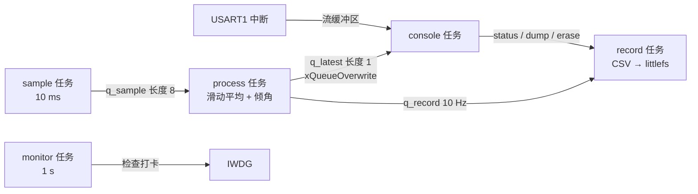

# 7.2 RTOS 多任务设备

[7.1 裸机外设驱动](/教程/正文/嵌入式/7_综合实践/7_1_裸机外设驱动) 的超级循环里塞进两件事之后就不够用了：把每 100 ms 的样本写进外部 Flash，同时响应命令导出数据。W25Q64 擦一个 4 KB 扇区要几十毫秒，这几十毫秒里采样一定错过；导出几 KB 日志会占住串口，命令行和其他工作都排不上队。主循环里没有“插队”这个说法，所有工作按代码顺序走，谁慢谁拖累别人。

这一页把设备升级成基于 FreeRTOS 的姿态记录仪。读者读完应当能：按时间要求和阻塞点划分任务并给优先级；把 7.1 的驱动改成多任务可用的形式（总线加锁、DMA 完成通知、串口走流缓冲区）；让记录任务在 littlefs 上按大小轮转写 CSV；用打卡加监视任务配合看门狗；在两个构建目标（目标板与模拟器）之间切换并把集成测试跑起来。

工程在 `code/嵌入式/7_综合实践/7_2_RTOS多任务设备/`，`stm32f103` 与 `sim` 两个目标共用 `app/` 下的全部逻辑。

## 1. 需求与任务划分

功能清单：

1. 以 100 Hz 采样三轴加速度，算滑动平均与倾角。
2. 每 100 ms 把一条样本追加到 W25Q64 上的 CSV 日志。
3. 命令行支持 `status`、`dump`、`erase`、`rate`、`hang`。
4. 板载 LED 指示运行状态。
5. 任一关键任务卡住时，看门狗复位。

按 [4.6 优先级反转、死锁与实时性](/教程/正文/嵌入式/4_RTOS与固件架构/4_6_优先级反转_死锁与实时性) 的方法划分：时间要求不同的分开，会阻塞等待的外设各自有人负责。得到五个任务：

| 任务 | 优先级 | 周期或触发 | 预计 WCET | 栈（字） |
| --- | --- | --- | --- | --- |
| sample | 4 | 10 ms，`xTaskDelayUntil` | 0.6 ms | 256 |
| process | 3 | 队列收到样本 | 1.5 ms | 320 |
| record | 3 | 队列收到记录（10 Hz） | 12 ms | 384 |
| console | 2 | 串口有行 / 500 ms 轮询 | 4 ms | 384 |
| monitor | 1 | 1000 ms | 0.1 ms | 256 |

优先级数值大表示优先级高，这是 FreeRTOS 的约定。sample 最高，因为 10 ms 的周期最紧；record 的 WCET 有 12 ms，但它的截止时间是 100 ms，可以放低；console 是给人用的，慢一点察觉不到。

数据流：



用 4.6 的 `rta` 程序检查这个任务集。输入是每行 `C T B`（毫秒），按周期从短到长排，周期短的优先级高：

```text
0.6 10 0
1.5 10 0
12.0 100 0
```

::: terminal title="PowerShell - rta（本页任务集）"

```text
任务数 3，总利用率 U = 0.330，Liu-Layland 上界 0.780
利用率不超过上界：上界保证可调度
  任务 0（C=0.6 T=10.0 B=0.0）：
    第  1 轮：R = 0.6 + 0.0 + 0.0 = 0.6
  -> 响应时间 0.6 <= 截止时间 10.0
  任务 1（C=1.5 T=10.0 B=0.0）：
    第  1 轮：R = 1.5 + 0.0 + 0.6 = 2.1
    第  2 轮：R = 1.5 + 0.0 + 0.6 = 2.1
  -> 响应时间 2.1 <= 截止时间 10.0
  任务 2（C=12.0 T=100.0 B=0.0）：
    第  1 轮：R = 12.0 + 0.0 + 4.2 = 16.2
    第  2 轮：R = 12.0 + 0.0 + 4.2 = 16.2
  -> 响应时间 16.2 <= 截止时间 100.0
结论：全部任务可调度
```

:::

注意这里把 process 的周期也记成 10 ms、B 记 0。前者偏保守：process 实际由队列唤醒，最坏情况下和 sample 同频，按 10 ms 算不会低估。后者是因为总线用互斥量保护、有优先级继承，阻塞时间有上界，可以并入 C；把阻塞单独算进去，结果也只从 2.1 ms 变成 2.8 ms，仍在截止时间内：

::: terminal title="PowerShell - rta（把总线阻塞算进 B）"

```text
任务数 3，总利用率 U = 0.330，Liu-Layland 上界 0.780
  任务 1（C=1.5 T=10.0 B=0.7）：
    第  1 轮：R = 1.5 + 0.7 + 0.6 = 2.8
    第  2 轮：R = 1.5 + 0.7 + 0.6 = 2.8
  -> 响应时间 2.8 <= 截止时间 10.0
结论：全部任务可调度
```

:::

利用率 0.33 相对上界 0.78 留了很大的余量，但这不是可以掉以轻心的理由：WCET 全是估的，记录任务的 12 ms 只算了擦除与写入，littlefs 的垃圾回收偶尔会超过。把采样与记录分开的任务划分本身，就是为了让这种超时只影响记录，不影响采样。

<Quiz
  type="single"
  :options="[
    { label: '按功能重要性，核心的日志记录放最高优先级', value: 'A' },
    { label: '按截止时间紧迫程度，10 ms 周期的采样任务放最高', value: 'B' },
    { label: '所有任务同优先级，靠时间片公平分配', value: 'C' },
    { label: '命令任务优先级最高，保证人机交互流畅', value: 'D' }
  ]"
  answer="B"
>

<template #question>

这个任务集里，优先级应该按什么排？

</template>

正确答案是 **B**。优先级决定谁能先拿到 CPU，依据是截止时间。采样任务的周期最短，错过就直接丢样本；记录任务虽然工作量大，但 100 ms 内完成即可。C 会让长任务拖住短周期任务；D 与本页的实际需求相反。

</Quiz>

## 2. 工程结构

在 7.1 的工程上加了 FreeRTOS 与 littlefs，并且分出两个构建目标：

```text:no-line-numbers
7_2_RTOS多任务设备/
├── app/
│   ├── recorder.h        # 样本类型、优先级、队列长度
│   ├── tasks.c           # 五个任务与 recorder_start()
│   ├── log.c / log.h     # littlefs 上的轮转 CSV
│   └── console_task.c    # 命令表与命令处理
├── sim_main.c            # 模拟器板级：查表传感器、lfs_rambd、标准输入
├── stm32_board.c         # 目标板级：MPU6050、W25Q64、USART1、IWDG
├── FreeRTOSConfig_sim.h
├── FreeRTOSConfig_target.h
├── tests/                # littlefs 主机测试
└── CMakeLists.txt
```

两个板级文件实现同一组函数：`sensor_read_raw()`、`board_console_read_line()`、`board_lfs_*()`、`board_watchdog_feed()`。`app/` 下的代码只调用这些函数，编译进哪个目标都不改一行。

FreeRTOS 的配置分两份。目标板的堆只有 10 KB，中断优先级数值要满足 4.4 的规则；模拟器上堆给 48 KB，也不存在 NVIC：

```c
/* FreeRTOSConfig_target.h 摘录 */
#define configTOTAL_HEAP_SIZE                   ( ( size_t ) ( 10 * 1024 ) )
#define configKERNEL_INTERRUPT_PRIORITY         ( 15u << 4 )
#define configMAX_SYSCALL_INTERRUPT_PRIORITY    ( 5u << 4 )
#define vPortSVCHandler     SVC_Handler
#define xPortPendSVHandler  PendSV_Handler
#define xPortSysTickHandler SysTick_Handler
```

模拟器的堆大，是因为 [4.7 FreeRTOS](/教程/正文/嵌入式/4_RTOS与固件架构/4_7_FreeRTOS) 的 Windows 移植层每个任务除了申请到的栈还要额外占内存；目标板上的数值才是产品要核算的。

构建分两条命令，源码同一份：

```cmake
if(CMAKE_CROSSCOMPILING)
    stm32f103_firmware(recorder_stm32
        ${APP_SRCS} ${FREERTOS_CORE_SRCS} ${LITTLEFS_SRCS}
        "${CMAKE_CURRENT_LIST_DIR}/stm32_board.c"
        "${FREERTOS_KERNEL_PATH}/portable/GCC/ARM_CM3/port.c")
else()
    add_executable(recorder_sim
        ${APP_SRCS} ${FREERTOS_CORE_SRCS} ${LITTLEFS_SRCS}
        "${LITTLEFS_PATH}/bd/lfs_rambd.c"
        "${CMAKE_CURRENT_LIST_DIR}/sim_main.c"
        "${PORT_SRC}")
endif()
```

FreeRTOS-Kernel 用 V11.3.0，littlefs 用 v2.11.3，都按 `--depth 1 --branch` 拉取、不进仓库。模拟器目标在 Windows 上要链接 `winmm`，这是移植层的要求，4.7 讲过。

## 3. 驱动的多任务化

7.1 的驱动是给超级循环写的：每次调用从头等到尾，没人跟它抢。多任务下有三处要改。

### 3.1 总线加锁

两个任务可能同时访问 I²C 总线：sample 读传感器，console 的 `status` 也可能读一次。I²C 事务不能交错，必须串行化。两种做法：

::: compare left-title="总线加互斥量" right-title="总线守门任务"

```c
/* mpu6050_read_all 内部 */
xSemaphoreTake(g_i2c_mutex, portMAX_DELAY);
ok = bus->write_read(...);
xSemaphoreGive(g_i2c_mutex);

/* 调用者不知道有锁，代码照旧 */
```

---

```c
typedef struct {
    uint8_t addr7;
    uint8_t reg;
    uint8_t buf[14];
    TaskHandle_t waiter;
} i2c_req_t;

/* 调用者发请求、等通知，由守门任务执行 */
xQueueSend(g_i2c_q, &req, portMAX_DELAY);
xTaskNotifyWait(0, UINT32_MAX, NULL, portMAX_DELAY);
```

:::

互斥量简单，等待时间就是最长的一次事务（14 字节约 1.5 ms），配合优先级继承，高优先级任务不会被中优先级任务无限拖住。守门任务把总线访问集中到一个任务里，RAM 要多一个队列与一个任务栈，代码也多一层，好处是驱动完全不用关心锁，且以后要按顺序做“配置 + 读取”这类复合事务很方便。

本页用互斥量。理由很实际：本设备对总线的访问只有一处高频（采样）和一处低频（命令），互斥量的开销与复杂度都更小。习题会要求改成守门任务并比较。

### 3.2 DMA 完成通知

目标板上把 HAL 的阻塞式读换成 DMA：采样任务发起一次 DMA 传输，然后去睡，完成中断里给它一个任务通知：

```c
/* 采样任务 */
HAL_I2C_Mem_Read_DMA(&hi2c1, MPU6050_ADDR7 << 1, MPU6050_REG_ACCEL_XOUT_H,
                     I2C_MEMADD_SIZE_8BIT, buf, 14);
ulTaskNotifyTake(pdTRUE, pdMS_TO_TICKS(20));

/* 完成回调 */
void HAL_I2C_MemRxCpltCallback(I2C_HandleTypeDef *hi2c) {
    BaseType_t woken = pdFALSE;
    vTaskNotifyGiveFromISR(g_sample_task, &woken);
    portYIELD_FROM_ISR(woken);
}
```

任务通知比二值信号量省 RAM、快一点，且天然是“一对一”（[4.4 中断与任务协作](/教程/正文/嵌入式/4_RTOS与固件架构/4_4_中断与任务协作)）。20 ms 的超时对应两个采样周期：两次都等不到就说明总线出问题了，采样任务放弃这一次并计数。

模拟器上没有 DMA，`sensor_read_raw()` 直接查表返回，接口不变。

如果后端用的是 7.1 的 GPIO 模拟实现，那么它被抢占时只会把某个时钟周期拉长，不会错位：每一位的高低电平都由代码主动摆出来，任务被切换走只是让当前这一位多持续一会儿，从机看到的是时钟延展，协议允许。所以模拟后端不需要关中断，也不需要额外的锁——总线互斥量保护的是“一次事务不被打断”，不是“位的时序不被打断”。

### 3.3 串口与控制台

USART1 的接收中断把字节写进 FreeRTOS 流缓冲区，console 任务按行取：

```c
void USART1_IRQHandler(void) {
    BaseType_t woken = pdFALSE;

    if ((USART1->SR & USART_SR_RXNE) != 0u) {
        uint8_t byte = (uint8_t)USART1->DR;
        (void)xStreamBufferSendFromISR(g_rx_stream, &byte, 1u, &woken);
    }
    portYIELD_FROM_ISR(woken);
}
```

流缓冲区与 3.4 的环形缓冲区是同一类东西，区别在它由内核维护、自带阻塞与通知，读的一方可以睡在 `xStreamBufferReceive()` 里等数据。比手写环形缓冲区少一段读下标的原子性考虑（[4.4 中断与任务协作](/教程/正文/嵌入式/4_RTOS与固件架构/4_4_中断与任务协作)）。

输出方向只有一个任务会打印吗？不是：monitor 任务在发现任务卡住时也会打印。两边都用 `recorder_console_printf()`，内部用互斥量或临界区把整次格式化输出包起来，避免两行交错。模拟器上这个函数是临界区里的 `vprintf` 加 `fflush`——FreeRTOS 官方 Windows 演示也这么做，因为 Windows 的 C 运行库不是线程安全的。

### 3.4 时基与中断优先级

RTOS 工程里 SysTick 归内核管，HAL 的时基必须换一个定时器，否则 `HAL_Delay()` 与 `HAL_GetTick()` 会和调度器抢同一个计数器。本工程用 TIM4，初始化时把 `HAL_InitTick()` 的时基源改过去，[4.7 FreeRTOS](/教程/正文/嵌入式/4_RTOS与固件架构/4_7_FreeRTOS) 给了完整写法。

中断优先级必须满足一条：能调用 `FromISR` API 的中断，其 NVIC 优先级数值不能小于 `configMAX_SYSCALL_INTERRUPT_PRIORITY`（这里是 5）。

| 中断 | NVIC 优先级 | 能否调用 FromISR API | 说明 |
| --- | --- | --- | --- |
| SysTick | 15（内核设定） | 是 | 调度器节拍 |
| USART1 | 6 | 是 | 接收流缓冲区 |
| DMA1_Channel7 | 6 | 是 | I²C 接收完成 |
| EXTI9_5 | 6 | 是 | MPU6050 数据就绪（习题） |
| TIM4 | 7 | 是 | HAL 时基 |

优先级数值小于 5 的中断不受内核临界区屏蔽，它们里面既不能调用 `FromISR` API，也不能碰任何内核对象。这条规则违反了不会编译报错，只会在运行时偶尔死机——4.4 讲过现场。

## 4. 采样与处理

采样任务用 `xTaskDelayUntil()` 固定节拍。与 `vTaskDelay()` 的区别是它按“上一次唤醒时刻 + 周期”计算下一次，处理时间被自动扣掉，不会累积漂移：

```c
static void sample_task(void *arg) {
    TickType_t last = xTaskGetTickCount();

    for (;;) {
        int16_t ax = 0;
        int16_t ay = 0;
        int16_t az = 0;

        if (sensor_read_raw(&ax, &ay, &az)) {
            sample_t s = {
                .tick = (uint32_t)xTaskGetTickCount(),
                .ax = ax, .ay = ay, .az = az,
            };
            ++g_sample_count;
            if (xQueueSend(g_q_sample, &s, 0) != pdTRUE) {
                ++g_sample_dropped; /* 处理任务来不及，丢这一次采样，不阻塞 */
            }
        }
        monitor_check_in(0);
        (void)xTaskDelayUntil(&last, pdMS_TO_TICKS(10));
    }
}
```

队列长度 8 是按处理任务最长停顿算的：记录任务持锁擦除时 process 最多堵几十毫秒，10 ms 一条样本，8 条正好覆盖。发送用零等待：队列满说明下游已经跟不上，此时阻塞采样任务只会让情况更糟，丢一条并计数，`status` 里能看到。

处理任务做 4 点滑动平均，把单次采样的尖峰压掉：

```c
static int16_t mean4(const int16_t *hist) {
    return (int16_t)(((int32_t)hist[0] + hist[1] + hist[2] + hist[3]) / 4);
}
```

倾角只在每 10 条样本（10 Hz）时算一次，原因和 7.1 一样：F103 没有 FPU，`atan2f` 是软件浮点，没必要每个采样都算。

最新结果用长度 1 的队列保存：

```c
(void)xQueueOverwrite(g_q_latest, &latest);
```

`xQueueOverwrite()` 只会用在长度为 1 的队列上，写的时候直接覆盖旧值，读的一方用 `xQueuePeek()` 拿最新的一份，不会把队列取空。这是 [4.3 队列、信号量、互斥量与事件](/教程/正文/嵌入式/4_RTOS与固件架构/4_3_队列_信号量_互斥量与事件) 讲的“信箱”模式，适合“只关心最新值”的场合，比如命令行查询当前姿态。

## 5. 记录

### 5.1 littlefs 的线程安全

littlefs 的移植在 [3.9 Flash、EEPROM、SD 与文件系统](/教程/正文/嵌入式/3_驱动_通信与中间件/3_9_Flash_EEPROM_SD与文件系统) 讲过：四个块设备回调、一份 `lfs_config`、`lfs_mount` 与 `lfs_format`。多任务下要打开 `LFS_THREADSAFE`，并提供 `lock`/`unlock`：

```c
static int lfs_lock(const struct lfs_config *cfg) {
    (void)cfg;
    return xSemaphoreTakeRecursive(g_lfs_mutex, portMAX_DELAY) == pdTRUE ? 0 : -1;
}

static int lfs_unlock(const struct lfs_config *cfg) {
    (void)cfg;
    return xSemaphoreGiveRecursive(g_lfs_mutex) == pdTRUE ? 0 : -1;
}
```

用递归互斥量而不是普通互斥量，因为 littlefs 内部会嵌套调用自己的 API（例如打开文件时往上查目录），外层已经拿了锁，内层再拿一次不能自锁。`LFS_THREADSAFE` 让每一次 lfs 调用都在锁里，**调用者不用再加锁**。

::: warning 锁要覆盖整次文件操作，不是单次 read/write

`lfs_file_write()` 可能因为缓存满触发一次 flush，flush 里要擦除、要改元数据。如果只在单次读写外面加锁，两次调用之间别的任务插进来，文件系统状态就会错。`LFS_THREADSAFE` 的锁是加在每次 API 调用上的，所以要么全程打开它，要么调用方自己用一把锁把“打开—写—关闭”整段包起来。

:::

### 5.2 按大小轮转

记录任务收到样本后格式化成一行 CSV，追加到文件：

```c
snprintf(line, sizeof line, "%lu,%d,%d,%d,%d,%d\n", (unsigned long)s.tick, s.ax,
         s.ay, s.az, s.pitch, s.roll);
if (log_append(line) == 0) {
    ++g_record_count;
}
```

`log_append()` 在文件超过 4 KB 时换下一个编号，写满 `LOG_MAX_FILES`（4 个）再回到 0 覆盖最旧的：

```c
if (g_current_size >= LOG_FILE_LIMIT) {
    g_current = (g_current + 1) % LOG_MAX_FILES;
    g_current_size = 0;
    make_name(name, sizeof name, g_current);
    (void)lfs_remove(&g_lfs, name);
}
```

用 `lfs_remove()` 删掉旧文件再创建，而不是原地截断，因为 littlefs 没有 `truncate` 到 0 的公开接口。4 个 4 KB 的文件放在 W25Q64 从 `0x030000` 起的分区里，分区表见跨页约定。

一个块 4 KB、64 个块，总容量 256 KB，日志最多 16 KB。为什么留这么大余量：littlefs 的垃圾回收需要空闲块周转，块数太少时写满一次要搬很多数据，写入延迟会变得不可预测。日志区只占一小块，把剩余的空间留给磨损均衡。

### 5.3 时间戳的来历

CSV 第一列是 `xTaskGetTickCount()` 的值，单位毫秒。它不是墙上时间，设备重启就归零；7.3 联网之后用 SNTP 同步时间，再按“启动时刻 + 节拍差”换算。本页只保证同一份日志内的相对时间正确，这一点对后面的加速度曲线分析已经够用。

## 6. 命令行任务

`status` 打印最近一秒的速率、堆与任务表：

```c
recorder_console_printf("采样 %lu 条（%lu/s），队列丢弃 %lu，记录 %lu 条（%lu/s）\n",
                        (unsigned long)g_sample_count, rate,
                        (unsigned long)g_sample_dropped,
                        (unsigned long)g_record_count, rrate);
```

速率用两次 `status` 之间的差值除以经过的节拍数算，不用累加平均值：

```c
unsigned long rate = (dt == 0) ? 0 : (unsigned long)((uint64_t)ds * 1000u / dt);
```

乘 1000 之前先转成 64 位，否则 32 位乘法在采样数较多时会溢出。

任务表用 `vTaskList()`，它要求打开 `configUSE_TRACE_FACILITY` 与 `configUSE_STATS_FORMATTING_FUNCTIONS`，输出需要一块缓冲区，长度按任务数估：

```c
char *buf = pvPortMalloc(768);
if (buf == NULL) {
    recorder_console_printf("堆不足，无法列出任务\n");
    return;
}
vTaskList(buf);
recorder_console_printf("名称      状态 优先级 剩余栈 序号\n%s", buf);
vPortFree(buf);
```

`dump` 把日志文件读出来，只显示前几行并给出总行数，避免刷屏：

```c
recorder_console_printf("--- log_%03d.csv：%d 行 ---\n", i, file_lines);
```

读文件的缓冲区 2 KB 放在静态区，不放栈上：console 任务的栈只有 384 字（1536 字节），2 KB 的局部数组一进函数就溢出。这类错误在模拟器上会触发栈溢出钩子并打印任务名，在目标板上则是一串随机故障。

`hang` 是给测试用的故障注入：

```c
/* HANG_MS 在本文件开头定义为 2500 */
if (g_record_hung) {
    vTaskDelay(pdMS_TO_TICKS(HANG_MS));
    g_record_hung = false;
}
```

命令把标志置位，记录任务下一条样本进来时卡 2.5 秒。监视任务每秒检查一次，这段时间里它至少有一次发现 record 没打卡，于是不再喂狗——若卡得更久，超过 IWDG 的 2 秒超时，芯片会真的复位。故障注入的时长选在超时附近，既能观察到监视记录，又不至于每次运行都重启。

## 7. 健康监视

`monitor_check_in()` 在每个任务的循环里被调用一次，本质是给每个任务一个递增的计数：

```c
void monitor_check_in(int task_index) {
    if (task_index >= 0 && task_index < 5) {
        ++g_check_in[task_index];
    }
}
```

监视任务每秒比对一次：

```c
static const char *const k_watched[] = {"sample", "process", "record"};

for (int i = 0; i < 3; ++i) {
    if (g_check_in[i] == last[i]) {
        all_alive = false;
        recorder_console_printf("[监视] 任务 %s 超过 1 秒没有打卡\n", k_watched[i]);
    }
    last[i] = g_check_in[i];
}
if (all_alive) {
    board_watchdog_feed();
}
```

只监视 sample、process、record 三个周期任务。console 任务可能长时间等输入，本来就不该每秒打卡；monitor 自己是检查者。这一条如果不写清楚，会出现“命令任务不打卡，监视任务一直报错”的假故障。

看门狗只在全部正常时喂，任何一环卡住，2 秒后芯片复位，启动时打印复位原因与上次的故障记录（[6.2 日志、断言与故障诊断](/教程/正文/嵌入式/6_质量_安全与交付/6_2_日志_断言与故障诊断)）。接通 [4.9 RTOS 固件架构、跟踪与测试](/教程/正文/嵌入式/4_RTOS与固件架构/4_9_RTOS固件架构_跟踪与测试) 的打卡 + 监视 + 看门狗结构，本页只是把它接到姿态记录仪上。

::: concept emb72-watchdog-layering title="喂狗点放在监视任务，不放在各个业务任务"

业务任务只打卡、不喂狗。喂狗集中在一个地方，它只在所有被监视任务都活着时执行。这样任何一个任务卡住都会停喂，而不是各喂各的让看门狗失效。

:::

<Quiz
  type="single"
  :options="[
    { label: '记录任务卡在擦除里，看门狗发现后复位', value: 'A' },
    { label: 'console 任务在等输入，监视任务报它超时', value: 'B' },
    { label: '采样任务丢样本，队列计数增加，监视任务继续喂狗', value: 'C' },
    { label: '记录任务卡住，监视任务停止喂狗，2 秒后复位', value: 'D' }
  ]"
  answer="D"
>

<template #question>

执行 `hang` 命令后，按本页的实现会发生什么？

</template>

正确答案是 **D**。记录任务的打卡停 2.5 秒，监视任务在下一秒发现它没动，于是不再喂狗；IWDG 超时复位。B 不会发生，因为 console 不在监视名单里。C 的采样丢样本由队列与计数处理，不影响打卡。A 的“发现后复位”要经过停喂与 IWDG 超时两步，不是立即的。

</Quiz>

## 8. 资源预算与验证

### 8.1 目标构建

用 arm-none-eabi-gcc 13.3 构建，`-Wall -Wextra` 下只有第三方源码的警告（FreeRTOS 移植层的一个未使用对象），自己的代码干净：

::: terminal title="PowerShell - 构建目标固件"

```console
$ cmake -B build_stm -G Ninja --toolchain ../../common/arm-none-eabi.cmake `
      -DARM_TOOLCHAIN_DIR=C:/tools/arm/bin `
      -DCMSIS_INCLUDE_DIR=C:/tools/cmsis `
      -DFREERTOS_KERNEL_PATH=C:/deps/FreeRTOS-Kernel `
      -DLITTLEFS_PATH=C:/deps/littlefs
$ cmake --build build_stm
   text    data     bss     dec     hex filename
  44952     192   14656   59800    e998 recorder_stm32.elf
```

:::

Flash 用了约 44 KB / 64 KB，静态 RAM 用了约 14.5 KB / 20 KB。bss 里最大的一项是 10 KB 的 FreeRTOS 堆和 littlefs 的静态缓冲，任务栈都从堆里分配。链接脚本的 `_Min_Heap_Size` 与 `_Min_Stack_Size` 另外占了 1.5 KB。

对比 7.1：裸机版 13 KB，这一版 44 KB。多出来的主要是 littlefs（用 `nm --size-sort` 把 `lfs_` 开头的函数加起来约 18 KB）、FreeRTOS 内核与移植层（约 6.4 KB），其余是浮点库、`vTaskList` 的格式化代码与命令处理。20 KB SRAM 的芯片做联网加文件系统确实紧，这也是 7.3 要把协议栈放进模块的原因之一。

### 8.2 模拟器上的运行

模拟器的传感器是查表的正弦，日志写在 RAM 块设备上。给一个脚本文件，每行“等待毫秒 命令”，输出顺序才稳定：

```text
500 status
300 dump
100 hang
1200 status
100 quit
```

::: terminal title="PowerShell - 模拟器集成测试"

```text
$ ./recorder_sim.exe demo_script.txt
姿态记录仪：模拟器构建
采样 51 条（102/s），队列丢弃 0，记录 5 条（10/s）
堆：空闲 30176 字节，历史最小 30176 字节
名称      状态 优先级 剩余栈 序号
console        	X	2	381	4
IDLE           	R	0	509	6
sample         	B	4	253	1
monitor        	B	1	253	5
record         	B	3	381	3
process        	B	3	317	2
--- log_000.csv：8 行 ---
92,183,167,778,1295,1180
192,251,296,812,1619,1920
292,444,250,908,2524,1389
392,376,122,874,2307,730
...（其余 4 行略）
日志共 8 行
记录任务将在下一条样本时卡住 2.5 秒
[监视] 任务 record 超过 1 秒没有打卡
采样 211 条（100/s），队列丢弃 0，记录 9 条（2/s）
堆：空闲 30176 字节，历史最小 28944 字节
名称      状态 优先级 剩余栈 序号
console        	X	2	381	4
IDLE           	R	0	509	6
sample         	B	4	253	1
monitor        	B	1	253	5
record         	B	3	381	3
process        	B	3	317	2
```

:::

这份输出里有几处可以直接读：

- 采样速率 100/s，记录 10/s，与设计一致。
- 队列丢弃 0，说明处理跟得上。
- `hang` 之后监视任务报 record 没打卡；第二次 `status` 时记录速率从 10/s 掉到 2/s，正是那 2.5 秒卡住摊在统计窗口里的结果。记录条数从 8 涨到 9，说明记录任务恢复后接着写，没有丢数据。
- 第一个数字是 102/s 而不是 100/s：速率用两次 `status` 之间的差值除以节拍差算出来，模拟器的定时不精确，窗口边缘多算了一条。**模拟器不是实时系统**，这类数字只作参考。
- `vTaskList` 的“剩余栈”一列：sample 显示 253，是创建时给 256 字、高水位只剩 253 字。这一列在模拟器上没有参考价值——Windows 移植层给每个任务分配的栈与目标板不同，栈高水位的数字只能来自目标构建的静态分析或板上实测（第 4 章的模拟器约定）。

每次运行的输出并非逐字节相同：调度顺序与 Windows 定时器的精度都会让速率、行数有几个数的出入。上面这一份是其中一次的结果，读者自己跑出来的数字会接近但不相等。脚本的总时长也刻意压在 3 秒左右：Windows 移植层的节拍线程在更长的运行里偶发不同步，示例脚本写长之后偶尔会卡住不退，这不是应用代码的问题。

### 8.3 littlefs 的主机测试

记录层的格式与掉电行为单独测，不启动任何任务：

::: terminal title="PowerShell - littlefs 主机测试"

```text
$ ./test_log.exe
[1] format: 0
[2] mount: 0
[3] write /a.csv and read back
    read 30 bytes:
1,10,20,30,0,0
2,11,21,31,1,2
[4] remount and stat
    stat: err=0 size=30

all tests passed
```

:::

第 4 步卸载再挂载，模拟掉电重启，`lfs_stat` 仍然读到 30 字节。littlefs 的掉电安全来自设计（每次提交要么完整要么不生效），3.9 讲过；这里验证的是“按本页的打开方式写进去，重新挂载还读得出来”。

### 8.4 栈与堆的估算

模拟器上的高水位线不能外推，目标板上只能靠静态分析：`arm-none-eabi-objdump -d` 找出每个任务函数调用的最深调用链，把每层栈帧大小加起来。粗估的规则是：

1. 只算最深的一条链，不是所有调用的总和。
2. `snprintf` 与 `vprintf` 的栈开销最大，`newlib-nano` 下一次格式化大约 200～400 字节。
3. 中断处理函数用的栈是当前任务栈，嵌套的中断也占同一块。

本页给的栈（256～384 字）偏紧，`dump` 命令的 2 KB 缓冲因此放在静态区。真正上板时用 [4.5 内存与资源管理](/教程/正文/嵌入式/4_RTOS与固件架构/4_5_内存与资源管理) 的 `uxTaskGetStackHighWaterMark()` 跑一段时间再收窄，比一次算准更实际。

::: details 完整工程的构建命令与目录

```text
code/嵌入式/7_综合实践/7_2_RTOS多任务设备/
├── app/tasks.c、log.c、console_task.c、recorder.h、board.h
├── sim_main.c、stm32_board.c
├── FreeRTOSConfig_sim.h、FreeRTOSConfig_target.h
├── tests/test_log.c、sim_lfs.c
├── demo_script.txt
└── CMakeLists.txt
```

```bash
# 模拟器
cmake -B build_sim -G Ninja \
      -DFREERTOS_KERNEL_PATH=<FreeRTOS-Kernel> -DLITTLEFS_PATH=<littlefs>
cmake --build build_sim
./build_sim/recorder_sim demo_script.txt

# 目标板
cmake -B build_stm -G Ninja --toolchain ../../common/arm-none-eabi.cmake \
      -DARM_TOOLCHAIN_DIR=<工具链 bin> -DCMSIS_INCLUDE_DIR=<CMSIS 头文件> \
      -DFREERTOS_KERNEL_PATH=<FreeRTOS-Kernel> -DLITTLEFS_PATH=<littlefs>
cmake --build build_stm
```

:::

## 9. 习题

### 9.1 巩固

<Exercise id="67711" :d="2" :w="2">

本页的任务表里 sample 优先级 4、process 与 record 同为 3、console 2、monitor 1。

(1) 把 sample 与 record 的优先级对调。record 一次擦除 12 ms，这期间 sample 拿不到 CPU，每擦一次会漏掉几个 10 ms 周期？漏掉的采样还能不能在 `q_sample` 里补回来？说明队列长度在这里为什么帮不上忙。

(2) `xQueueSend(g_q_sample, &s, 0)` 的等待时间为什么取 0？改成 `portMAX_DELAY` 后，处理任务来不及时会连锁发生什么？

(3) 队列长度 8 是按什么算出来的？若 record 持锁擦除让 process 最长堵 200 ms，长度应取多少？给出算式。超过长度之后丢的是哪一条，为什么这里选择丢而不是阻塞发送。

(4) `xQueueOverwrite(g_q_latest, ...)` 为什么要求队列长度为 1？console 用 `xQueuePeek()` 而不是 `xQueueReceive()`，两种读法在“关机后再读一次”时各拿到什么？

</Exercise>

<Exercise id="67712" :d="3" :w="2">

采样任务每轮做 0.6 ms 的活，之后调 `xTaskDelayUntil(&last, pdMS_TO_TICKS(10))`。

(1) 若改成 `vTaskDelay(pdMS_TO_TICKS(10))`，实际周期是多少？跑 10 秒后落后多少个周期？用算出的频率说明 100 Hz 的名义值变成多少。

(2) `xTaskDelayUntil()` 在某一轮耗时超过 10 ms 时会怎样？连续超时之后它会不会一次性补发多次？查 FreeRTOS 文档确认，并说明这与 7.1 里 `next_sample += SAMPLE_PERIOD_MS` 的差别。

(3) `monitor_check_in(0)` 现在放在循环体末尾。把它挪进 `if (sensor_read_raw(...))` 的成功分支里，在模拟器上让 `sensor_read_raw()` 连续 3 秒返回 false，说明监视任务会报什么、看门狗会不会复位。给出正确的打卡位置与理由：打卡要证明“任务还在跑”，还是“业务成功”？

</Exercise>

<Exercise id="67713" :d="3" :w="3">

`log.c` 把 littlefs 的 `lock`/`unlock` 接到递归互斥量上，并打开 `LFS_THREADSAFE`。

(1) 正文说必须用递归互斥量，理由是 littlefs 内部可能嵌套调用自己的 API。到 littlefs 的 README 与 `lfs.c` 里找依据：`lock`/`unlock` 回调的说明有没有“必须递归”之类的约束？v2.11.3 里哪些公开 API 会调用另一个同样加锁的公开 API，哪些改走 `lfs_raw*` 版本从而不重入？把 `xSemaphoreCreateRecursiveMutex()` 换成 `xSemaphoreCreateMutex()`、`Take` 换成 `xSemaphoreTake`，说明一旦发生重入会卡在哪里、现象是什么（任务停在 `portMAX_DELAY` 上，看门狗与 `status` 各会怎样）。如果查下来本页用到的调用都不重入，这个递归互斥量是多余的吗？给出你的判断。

(2) 给定的 `lfs_config` 没有填 `read_buffer`、`prog_buffer`、`lookahead_buffer`。查 littlefs 源码，说明这三块缓冲此时从哪里分配（哪几个函数、多大），在目标板上它们会不会算进 FreeRTOS 的 10 KB 堆；给出改成静态缓冲的写法，并说明这样改之后 `size` 的 `bss` 和 `data` 各会怎么变。

(3) 正文的 warning 说锁要覆盖“打开—写—关闭”。在 `LFS_THREADSAFE` 打开的前提下，`log_append()` 是否已经满足？如果关掉它、自己在 `log_append()` 外加一把普通互斥量，仍可能错在哪里？

(4) 用 `xSemaphoreGetMutexHolder()` 在 `lfs_lock` 里打印持有者，跑模拟器确认 `dump` 与 `record` 不会同时进入。

</Exercise>

### 9.2 编程

<Exercise id="67714" :d="3" :w="3">

正文说本页用互斥量，习题要改成守门任务并比较。

(1) 按第 3.1 节右栏的 `i2c_req_t` 实现 `i2c_gatekeeper` 任务：队列收请求，执行 `bus->write_read`，用 `xTaskNotifyGive(req.waiter)` 叫醒调用方。写出任务体与两个包装函数 `gk_read_reg()`、`gk_read_all()`。

(2) 把 sample 与 console 的访问都改成走守门任务，在模拟器上跑 `demo_script.txt`，验收 `status` 里采样仍是 100/s、记录 10/s、队列丢弃 0。

(3) 量出两种做法的 RAM：守门任务栈（字）+ 队列（项数 × 项长 + 队列结构）+ 一个 `i2c_req_t` 的临时量，与互斥量的约 80 字节比较。给出各自的数字。

(4) 用 `vTaskPrioritySet` 把 console 临时提到 5，在两种实现下各插一次 `status`，记录 sample 被推迟的最长节拍。说明互斥量版为什么要靠优先级继承，守门任务版为什么不会出现无界反转。

(5) 说明守门任务版在“配置 + 读取”这类复合事务上方便在哪里，举一个本设备用得上的例子。

</Exercise>

<Exercise id="67715" :d="3" :w="4">

把目标板的阻塞式 HAL 读换成 DMA + 任务通知（第 3.2 节）。

(1) 写出 `sample_task` 的发起与等待两段：`HAL_I2C_Mem_Read_DMA()`、`ulTaskNotifyTake(pdTRUE, pdMS_TO_TICKS(20))`，以及超时后计数的分支。

(2) `HAL_I2C_MemRxCpltCallback()` 里为什么用 `vTaskNotifyGiveFromISR()` 而不是 `xSemaphoreGiveFromISR()`？从 RAM 与开销两方面说。

(3) 任务通知只有一个计数值。若 DMA 完成回调在上一次通知还没被取走时又来一次，计数会怎样？这对 10 ms 周期、一次只发起一个传输的本设计有影响吗？

(4) 在模拟器上把 `sensor_read_raw()` 改成“每 5 次成功、1 次失败”，验证失败那轮 `status` 里的采样数与丢弃数各增加多少。验收：采样数不增，超时计数增加。

(5) 说明 DMA 版与 7.1 的 GPIO 模拟后端为什么都不需要关中断，而总线互斥量仍然必要。

</Exercise>

<Exercise id="67716" :d="4" :w="4">

`log_init()` 用“编号最大且非空的文件”接着写：

```c
if (lfs_stat(&g_lfs, name, &info) == LFS_ERR_OK && info.size > 0) {
    g_current = i;
    g_current_size = (lfs_size_t)info.size;
}
```

(1) 造一个场景证明它选错：4 个文件轮转一圈回到 0 之后重启，文件大小为 `log_000=1 KB`、`log_001..003=4 KB`，重启后从哪个文件接着写？会丢掉什么？

(2) 给出修正：在每个文件头写一行元数据，或按修改序号选最新。写出你选用的方案与 `log_init()` 的改动，说明为什么不能只看“编号最大”。

(3) 给 `log.c` 加掉电注入：`board_lfs_prog` 在写满 N 次后返回 `LFS_ERR_IO`。验收三组：正常写满 4 个文件并回到 0；在第 5 个文件创建前注入，重启后能读到前 4 个；在一个文件写到一半注入，重启后该文件要么完整要么不存在。

(4) 4 个 4 KB 文件、每行约 31 字节、10 Hz 记录时，一轮循环覆盖多长时间？把 `LOG_MAX_FILES` 改成 8 后呢？与 256 KB 分区里 littlefs 需要的周转空间一起考虑，说明上限能取多大。

</Exercise>

<Exercise id="67717" :d="4" :w="3">

`print_status()` 的速率与计数器有几处经不起推敲。

(1) 模拟器第一次 `status` 打出 102/s。用“两次 `status` 之间差值 ÷ 节拍差”的算法说明多出来的 1～2 条从哪来，以及为什么第二次之后稳定到 100/s。

(2) 两次 `status` 落在同一毫秒时 `dt == 0`，代码返回 0。构造一种让 `dt` 很小但不为 0 的输入，算出速率的可能范围，说明界面上的数字该怎么呈现。

(3) `erase` 命令把 `g_record_count` 清零，而记录任务可能正在 `++g_record_count`。写出交错顺序，说明下一次 `status` 会打出多离谱的记录速率；给出修正（用差值基准而不是清零）。

(4) `pvPortMalloc(768)` 每敲一次 `status` 申请一次。在 10 KB 堆的目标板上，把 `dump` 的 2 KB 静态缓冲与这块 768 字节放在一起算，说明为什么任务表缓冲也该改成静态数组。

</Exercise>

<Exercise id="67718" :d="4" :w="4" math="M">

用 `code/嵌入式/4_RTOS与固件架构/4_6_优先级反转_死锁与实时性/rta.c` 复核本页的任务集。

(1) 把 sample、process、record 写成 `tasks.txt`（`0.6 10 0`、`1.5 10 0`、`12 100 0`），运行并核对正文的 0.330、0.780 与三条响应时间。

(2) 记录任务的 WCET 从 12 ms 涨到多少时第一次超期？从 12 往上二分，写出临界值与那次迭代的每一轮数字。验收：C = 79 时 R = 100.0 恰好按时，C = 80 时 R = 101.0 超期。

(3) 把 B 从 0 改成 0.7 ms（总线阻塞），重新求临界值。验收：C = 78 时 99.7 通过，C = 79 时 100.7 超期。说明 0.7 ms 的阻塞为什么让临界值降了 1 ms，而不是 0.7 ms。

(4) C = 79 时总利用率是多少？Liu-Layland 上界给出什么结论？这个例子说明上界与响应时间分析各自的作用是什么。

(5) 给任务集再加一个 console 任务（C = 4 ms、T = 500 ms、B = 0，优先级最低），重算 U 与它的响应时间。验收：U = 0.338，R = 22.3 ms。

</Exercise>

### 9.3 综合与挑战

<Exercise id="67719" :d="5" :w="4">

在 20 KB SRAM 上把 RAM 账算平。`sample_t` 在 Cortex-M3 上是 16 字节。

(1) 按 `recorder.h`、`tasks.c` 与 `FreeRTOSConfig_target.h` 算出：三个队列的项存储（不含队列结构）、五个任务的栈（字 → 字节）、隐藏的空闲任务（`configMINIMAL_STACK_SIZE` 个字）、六个 TCB（按每个约 88 字节估），合计多少字节。写出每一项的算式。

(2) 与 `configTOTAL_HEAP_SIZE = 10 KB` 比较，剩多少余量。再算上队列结构本身（每条约 80 字节）、littlefs 的缓存（`cache_size` 512 字节，几块、在哪里分配由源码决定）与 16 字节 lookahead，说明这些缓冲在目标板上走的是哪个堆，会不会占用这 10 KB。给出你据此得到的余量修正。

(3) 用 `-fstack-usage` 或 `arm-none-eabi-objdump -d` 找出 `console_task` 的最深调用链（`cmd_dump` → `recorder_console_printf` → `vprintf`），按 `vprintf` 200～400 字节估，判断 384 字的栈是否够。给出结论与理由。

(4) `status` 里能读到 `xPortGetFreeHeapSize()`。说明为什么模拟器上的 30176 字节不能用来推算目标板的余量，列出至少三项尺寸差异。

(5) 把 `configTOTAL_HEAP_SIZE` 改成 8 KB，按你算出的账说明最先失败的是哪一个对象（`xTaskCreate()` 创建的五个任务之一，还是 `vTaskStartScheduler()` 里创建的空闲任务），失败时会发生什么（结合 `configUSE_MALLOC_FAILED_HOOK`），以及为什么 `recorder_start()` 对 `xTaskCreate()` 的返回值不检查是个隐患。

</Exercise>

<Exercise id="67720" :d="6" :w="5" scope="*">

把两个构建目标接进 CI：同一份 `app/`，模拟器上跑集成测试，目标板上只做链接与尺寸检查。

(1) 写一份测试脚本，扩展 `demo_script.txt` 的格式，加入期望输出：每行 `等待毫秒 命令 [期望子串]`。脚本结束后按期望逐条比对，缺一条就返回非零。给出脚本与模拟器输出的对应关系。

(2) 把 `hang` 场景做成断言：`hang` 之后 1.5 秒内必须出现 `[监视] 任务 record 超过 1 秒没有打卡`，2.5 秒后记录速率降到 5/s 以下，恢复后计数继续增长。写出匹配这三条的正则与容差。

(3) 目标板构建加一道尺寸闸门：`text` 不超过 48 KB、`bss` 不超过 16 KB，超了让 CI 失败。给出 CMake 或脚本的实现，并说明阈值该留多少余量。

(4) 同一套逻辑在两个目标上行为不同（模拟器的定时不精确、栈高水位无意义）。列出集成测试里必须放宽的三处判断，以及哪些判断在两处都必须严格。

(5) 说明这套 CI 发现不了哪一类缺陷，举出本页正文里提到的一个例子。

</Exercise>

## 10. 参考资料

- FreeRTOS, *Mastering the FreeRTOS Real Time Kernel*：任务、队列、通知、资源管理与软件定时器。https://github.com/FreeRTOS/FreeRTOS-Kernel-Book
- FreeRTOS, *FreeRTOS-Kernel* V11.3.0 源码与文档：`xTaskDelayUntil`、`xQueueOverwrite`、`xStreamBufferSendFromISR`、`vTaskList`。https://github.com/FreeRTOS/FreeRTOS-Kernel
- littlefs 项目，*README.md* 与 *DESIGN.md*：线程安全、掉电安全与垃圾回收。https://github.com/littlefs-project/littlefs
- STMicroelectronics, *STM32F1 HAL 驱动* 1.1.10：`HAL_I2C_Mem_Read_DMA` 与完成回调。https://github.com/STMicroelectronics/stm32f1xx-hal-driver
- Winbond, *W25Q64JV Data Sheet*：扇区擦除时间与页编程。https://www.winbond.com/
- Memfault, *A Guide to Watchdog Timers for Embedded Systems*：打卡与监视任务的组织方式。https://interrupt.memfault.com/blog/firmware-watchdog-best-practices
- STMicroelectronics, *RM0008 Reference Manual* Rev 21：SPI、DMA、TIM 各章。
- 本项目源码：`code/嵌入式/7_综合实践/7_2_RTOS多任务设备/`，本页的 RTA、目标构建、模拟器运行与 littlefs 测试输出均在其中实测。
