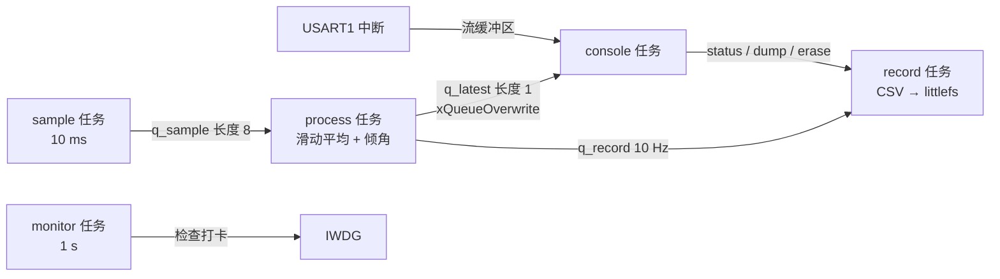

# 7.2 RTOS 多任务设备

在 [7.1 裸机外设驱动](/教程/正文/嵌入式/7_综合实践/7_1_裸机外设驱动) 中构建的超级循环架构，在应对复杂业务场景时会迅速遇到瓶颈。假定为系统追加两项常见需求：将传感器每隔 100 ms 采集的样本持久化存入外部 SPI Flash，同时允许用户随时通过控制台敲入命令将历史数据批量导出。此时，单循环的局限性暴露无遗：W25Q64 擦除一个 4 KB 的物理扇区往往需要耗费数十毫秒，在此期间 CPU 处于等待状态，必然导致 10 ms 周期的传感器采样产生漏帧；而向串口连续吐出数千字节的日志文本更是会长久霸占通信接口，使得命令行响应与其他实时任务彻底停摆。在裸机顺序执行结构中，所有逻辑单元只能排队流转，任何一个局部外设的阻塞等待都会拖垮整个系统的响应节拍。

这里将设备架构重构为基于 FreeRTOS 的多任务姿态记录仪。整个设计围绕系统实时性展开：依据时间紧迫度与阻塞特性合理拆分任务并分配静态优先级；对底层外设驱动实施多任务化改造（引入总线互斥锁、DMA 传输完成通知与内核流缓冲区）；利用 littlefs 文件系统实现具备尺寸限制的滚动日志记录；通过打卡心跳机制协同监控任务与独立硬件看门狗；同时在工程结构上保持高内聚抽象，实现目标硬件与 PC 模拟器两套构建目标的无缝切换。工程源码位于 `code/嵌入式/7_综合实践/7_2_RTOS多任务设备/`。

## 1. 需求与任务划分

系统主要承担五项关键职责：

1. 以严格的 100 Hz 频率采集三轴加速度分量，执行 4 点滑动平均滤波并解算俯仰与翻滚角。
2. 每隔 100 ms 将一条综合姿态记录以 CSV 格式追加写入挂载于 W25Q64 上的日志文件。
3. 串口控制台提供 `status`、`dump`、`erase`、`rate` 以及故障注入指令 `hang`。
4. 板载指示灯根据系统运转状态维持节拍闪烁。
5. 部署全局健康监控机制，一旦任一关键业务任务发生死锁，看门狗强制复位系统。

依照 [4.6 优先级反转、死锁与实时性](/教程/正文/嵌入式/4_RTOS与固件架构/4_6_优先级反转_死锁与实时性) 中介绍的工程方法划分系统模块：将对时间精度敏感的高频任务与耗时较长的长任务解耦，让阻塞性外设 I/O 由独立任务分别承担。由此规划出五个独立的系统任务：

| 任务 | 优先级 | 周期或触发 | 预计 WCET | 栈（字） |
| --- | --- | --- | --- | --- |
| sample | 4 | 10 ms，`xTaskDelayUntil` | 0.6 ms | 256 |
| process | 3 | 队列收到样本 | 1.5 ms | 320 |
| record | 3 | 队列收到记录（10 Hz） | 12 ms | 384 |
| console | 2 | 串口有行 / 500 ms 轮询 | 4 ms | 384 |
| monitor | 1 | 1000 ms | 0.1 ms | 256 |

在 FreeRTOS 中，优先级数值越大代表抢占能力越强。采样任务 `sample` 拥有最高的优先级 4，因为其 10 ms 的时间周期对抖动最为敏感，一旦被推迟就会引发离散化采样的失真；记录任务 `record` 的最坏执行时间（WCET）虽然长达 12 ms，但其响应窗口宽达 100 ms，因此可以降级运行；控制台交互面向人类用户操作，数十毫秒的微小延迟完全不影响交互感知，因而配置较低优先级。

系统各任务之间的数据流与通信拓扑如下：



利用 4.6 节提供的实时分析程序 `rta` 对此任务集进行调度可行性校验。输入数据依执行周期由短到长顺次排列（周期最短者赋予最高静态优先级），每行对应 `计算时间 周期 阻塞上限`（单位均为毫秒）：

```text
0.6 10 0
1.5 10 0
12.0 100 0
```

::: terminal title="PowerShell - rta（本页任务集）"

```text
任务数 3，总利用率 U = 0.330，Liu-Layland 上界 0.780
利用率不超过上界：上界保证可调度
  任务 0（C=0.6 T=10.0 B=0.0）：
    第  1 轮：R = 0.6 + 0.0 + 0.0 = 0.6
  -> 响应时间 0.6 <= 截止时间 10.0
  任务 1（C=1.5 T=10.0 B=0.0）：
    第  1 轮：R = 1.5 + 0.0 + 0.6 = 2.1
    第  2 轮：R = 1.5 + 0.0 + 0.6 = 2.1
  -> 响应时间 2.1 <= 截止时间 10.0
  任务 2（C=12.0 T=100.0 B=0.0）：
    第  1 轮：R = 12.0 + 0.0 + 4.2 = 16.2
    第  2 轮：R = 12.0 + 0.0 + 4.2 = 16.2
  -> 响应时间 16.2 <= 截止时间 100.0
结论：全部任务可调度
```

:::

在模型输入中，处理任务 `process` 的周期保守设定为 10 ms，阻塞时间 B 记为 0。这一设定具备充分的物理合理性：`process` 任务完全由上游队列驱动唤醒，最坏情形下的触发频率恰好等于采样频率；同时由于底层物理总线受带优先级继承机制的互斥量保护，最高闭锁时间存在确定上限，可以并入计算耗时中。即便是单独将潜在的总线等待时间显式计入阻塞参数 B，计算得出的最坏响应时间也仅由 2.1 ms 微增至 2.8 ms，依然远远低于 10 ms 的截止门限：

::: terminal title="PowerShell - rta（把总线阻塞算进 B）"

```text
任务数 3，总利用率 U = 0.330，Liu-Layland 上界 0.780
  任务 1（C=1.5 T=10.0 B=0.7）：
    第  1 轮：R = 1.5 + 0.7 + 0.6 = 2.8
    第  2 轮：R = 1.5 + 0.7 + 0.6 = 2.8
  -> 响应时间 2.8 <= 截止时间 10.0
结论：全部任务可调度
```

:::

虽然当前系统约 0.33 的 CPU 总利用率相对 0.78 的理论上界留出了极宽的算力余量，但在工程设计中绝不能过度乐观：WCET 往往是基于常规执行路径的估算，记录任务在 littlefs 执行底层垃圾回收（Garbage Collection）时偶尔会出现反常的擦写耗时毛刺。将采样与记录拆解为不同优先级的独立任务，其核心设计目的正是构建一道坚固的隔离屏障——让下层日志写入过程中的偶发毛刺局限在存储侧，绝不波及上层高精度的周期性传感器采样。

<Quiz
  type="single"
  :options="[
    { label: '按功能重要性，核心的日志记录放最高优先级', value: 'A' },
    { label: '按截止时间紧迫程度，10 ms 周期的采样任务放最高', value: 'B' },
    { label: '所有任务同优先级，靠时间片公平分配', value: 'C' },
    { label: '命令任务优先级最高，保证人机交互流畅', value: 'D' }
  ]"
  answer="B"
>

<template #question>

这个任务集里，优先级应该按什么排？

</template>

正确答案是 **B**。在实时系统设计中，静态优先级的分配依据是各任务截止时间的紧迫程度（速率单调调度 RMS 原则）。采样任务的执行周期最短，一旦错过截止期就会造成采样点永久丢失；存储记录虽然计算与 I/O 吞吐大，但在 100 ms 窗口内按需完成即可。选项 C 会导致耗时长的擦写逻辑频繁打断甚至拖垮周期性任务；选项 D 则混淆了人机交互的感知阈值与硬实时约束的本质区别。

</Quiz>

## 2. 工程结构

整个项目在 7.1 裸机工程的基础上引入了 FreeRTOS 内核与 littlefs 文件系统，并分离出面向真实开发板与面向宿主机模拟器的两套构建目标：

```text:no-line-numbers
7_2_RTOS多任务设备/
├── app/
│   ├── recorder.h        # 样本类型、优先级、队列长度
│   ├── tasks.c           # 五个任务与 recorder_start()
│   ├── log.c / log.h     # littlefs 上的轮转 CSV
│   └── console_task.c    # 命令表与命令处理
├── sim_main.c            # 模拟器板级：查表传感器、lfs_rambd、标准输入
├── stm32_board.c         # 目标板级：MPU6050、W25Q64、USART1、IWDG
├── FreeRTOSConfig_sim.h
├── FreeRTOSConfig_target.h
├── tests/                # littlefs 主机测试
└── CMakeLists.txt
```

两份板级支持代码面向应用层统一实现了一套标准契约接口：包括 `sensor_read_raw()`、`board_console_read_line()`、`board_lfs_*()` 以及 `board_watchdog_feed()`。位于 `app/` 目录下的全部业务任务与状态机仅依赖这组抽象接口，因此无论编译至真实硬件固件还是编译为宿主机控制台可执行文件，应用核心代码都无需修改一行。

针对物理目标板与宿主机环境，FreeRTOS 的内核配置分立为两份独立文件。在真实单片机上，受限于芯片总计 20 KB 的 SRAM 容量，内核堆空间严格限定为 10 KB，中断优先级分组配置也必须严密契合硬件 NVIC 寄存器规则；而在宿主机模拟器端，堆内存可放宽至 48 KB，且完全摆脱了 ARM 中断控制器的硬件约束：

```c
/* FreeRTOSConfig_target.h 摘录 */
#define configTOTAL_HEAP_SIZE                   ( ( size_t ) ( 10 * 1024 ) )
#define configKERNEL_INTERRUPT_PRIORITY         ( 15u << 4 )
#define configMAX_SYSCALL_INTERRUPT_PRIORITY    ( 5u << 4 )
#define vPortSVCHandler     SVC_Handler
#define xPortPendSVHandler  PendSV_Handler
#define xPortSysTickHandler SysTick_Handler
```

模拟器环境之所以需要配置更大的堆空间，是因为在 [4.7 FreeRTOS](/教程/正文/嵌入式/4_RTOS与固件架构/4_7_FreeRTOS) 中讨论过的 Windows/POSIX 移植层中，每个任务除了自身名义上的执行栈外，底层宿主机线程运行库还需要为其额外分配线程上下文和信号量同步结构；而在真实单片机上，所有开销均被精确定量在嵌入式 SRAM 的物理边界之内。

CMake 构建系统通过两套编译指令分别编排源码拓扑：

```cmake
if(CMAKE_CROSSCOMPILING)
    stm32f103_firmware(recorder_stm32
        ${APP_SRCS} ${FREERTOS_CORE_SRCS} ${LITTLEFS_SRCS}
        "${CMAKE_CURRENT_LIST_DIR}/stm32_board.c"
        "${FREERTOS_KERNEL_PATH}/portable/GCC/ARM_CM3/port.c")
else()
    add_executable(recorder_sim
        ${APP_SRCS} ${FREERTOS_CORE_SRCS} ${LITTLEFS_SRCS}
        "${LITTLEFS_PATH}/bd/lfs_rambd.c"
        "${CMAKE_CURRENT_LIST_DIR}/sim_main.c"
        "${PORT_SRC}")
endif()
```

工程依赖的 FreeRTOS-Kernel 锁定为 V11.3.0，littlefs 锁定为 v2.11.3，二者均按 `--depth 1 --branch` 拉取、以浅克隆方式接入，不污染主仓库。模拟器目标在 Windows 平台链接时引入 `winmm` 系统多媒体定时器库，以保证宿主机线程节拍的调度精度。

## 3. 驱动的多任务化

7.1 节中的外设驱动是在单线程超级循环假设下编写的：函数自发起至结束始终独占 CPU，不存在任何并发干扰。在抢占式多任务环境下，驱动设计必须针对共享冲突与上下文切换展开改造。

### 3.1 总线加锁

系统存在两个独立的并发任务可能触碰 I²C 物理总线：高优先级的 `sample` 任务周期性读取 MPU6050，而低优先级的 `console` 任务在响应终端用户键入 `status` 指令时也可能即时读取一次芯片状态。如果两个任务的物理总线操作发生时钟交织，总线电平状态机必将彻底紊乱。在工程上存在两种经典的串行化范式：

::: compare left-title="总线加互斥量" right-title="总线守门任务"

```c
/* mpu6050_read_all 内部 */
xSemaphoreTake(g_i2c_mutex, portMAX_DELAY);
ok = bus->write_read(...);
xSemaphoreGive(g_i2c_mutex);

/* 调用者不知道有锁，代码照旧 */
```

---

```c
typedef struct {
    uint8_t addr7;
    uint8_t reg;
    uint8_t buf[14];
    TaskHandle_t waiter;
} i2c_req_t;

/* 调用者发请求、等通知，由守门任务执行 */
xQueueSend(g_i2c_q, &req, portMAX_DELAY);
xTaskNotifyWait(0, UINT32_MAX, NULL, portMAX_DELAY);
```

:::

互斥量方案结构轻量，由于通信事务耗时极短（单次 14 字节突发读取仅耗时约 1.5 ms），在内核内置的优先级继承（Priority Inheritance）机制守护下，即便控制台任务低优先级持锁，一旦高优先级的采样任务发起申请，控制台任务的临时优先级便会被瞬间提升至 4，彻底防范了被中间优先级的记录任务长期插队导致的无界优先级反转。相比之下，守门任务（Gatekeeper Task）通过私有请求队列将物理外设的操控彻底收归为单任务独占，上层调用者转化为纯粹的客户端；虽然其架构完全免除了互斥锁争用，并极便于编排复合原子指令序列，但代价是额外引入了一套任务栈空间与消息队列缓冲，对于 SRAM 紧张的微控制器而言负担较重。

本工程选用互斥量方案。这一抉择契合当下的访问频次特征：整套系统中针对 I²C 总线的操作仅有一处高频采集和一处极低频的交互查询，互斥量的内存消耗与调度开销均为最优解。

### 3.2 DMA 完成通知

在物理硬件上，驱动将传统的轮询阻塞式读取重构为基于 DMA 控制器的异步收发模式：采样任务向 I²C 外设注册 DMA 传输请求后立即主动转入阻塞休眠，将 CPU 算力完全让渡给下游任务，直至硬件传输结束触发中断回调：

```c
/* 采样任务 */
HAL_I2C_Mem_Read_DMA(&hi2c1, MPU6050_ADDR7 << 1, MPU6050_REG_ACCEL_XOUT_H,
                     I2C_MEMADD_SIZE_8BIT, buf, 14);
ulTaskNotifyTake(pdTRUE, pdMS_TO_TICKS(20));

/* 完成回调 */
void HAL_I2C_MemRxCpltCallback(I2C_HandleTypeDef *hi2c) {
    BaseType_t woken = pdFALSE;
    vTaskNotifyGiveFromISR(g_sample_task, &woken);
    portYIELD_FROM_ISR(woken);
}
```

任务通知机制（Task Notification）相比通用的二值信号量具有明显优势：其状态标志直接嵌入任务控制块（TCB）内部，完全免除了独立的同步对象分配开销，并且在上下文投递路径上具备更高的微秒级响应性能（详见 [4.4 中断与任务协作](/教程/正文/嵌入式/4_RTOS与固件架构/4_4_中断与任务协作)）。此处设定 20 ms 的阻塞等待超时门限，相当于两个采样周期；若硬件 DMA 连续两次都无法完成传输，表明物理总线已严重失锁，采样任务会安全超时退出并累加错误计数。

在宿主机模拟器环境中，由于缺乏真实的 DMA 控制器，`sensor_read_raw()` 直接查表并瞬时返回，两端接口保持完全一致。

需要补充说明的是，倘若底层采用 7.1 节中的 GPIO 软件模拟 I²C 实现，即便在逐位翻转过程中被外部中断或更高优先级任务抢占，也绝不会导致总线数据错位：因为每一位高低电平都由代码显式控制，任务被切出仅仅是将当前时钟周期的某一半周略微延长，从机视角的表现完全等同于工业标准所允许的时钟延展（Clock Stretching）。因此软件模拟实现无需强行关闭全局中断，外层互斥量保护的是整笔事务逻辑的原子性，而非单比特翻转的微观时钟等宽。

### 3.3 串口与控制台

USART1 硬件接收中断将捕获的字符逐个推入 FreeRTOS 流缓冲区（Stream Buffer），由控制台任务在后台监听并按行解析：

```c
void USART1_IRQHandler(void) {
    BaseType_t woken = pdFALSE;

    if ((USART1->SR & USART_SR_RXNE) != 0u) {
        uint8_t byte = (uint8_t)USART1->DR;
        (void)xStreamBufferSendFromISR(g_rx_stream, &byte, 1u, &woken);
    }
    portYIELD_FROM_ISR(woken);
}
```

流缓冲区与 3.4 节讨论的裸机环形队列同属单生产者-单消费者队列模型，核心差异在于内核原生的流缓冲区内置了轻量级的事件挂起机制，使得读取端任务可以在没有数据时调用 `xStreamBufferReceive()` 完全休眠，无需主循环执行空转轮询，同时也免除了开发者自行处理多核与中断原子性下标的复杂性。

在终端字符打印方向，系统中并非只有控制台一个任务会发起输出：当后台监控任务察觉到某个业务任务发生卡顿时，也会主动向终端打印告警。为了防止多任务打印的字符在终端上交错混乱，所有格式化输出统一收敛至 `recorder_console_printf()`，其内部通过互斥量或微型临界区保护整个字符串拼装与串口发送序列。在模拟器环境下，该接口内部使用临界区包裹标准 `vprintf` 与 `fflush`，以应对宿主机 C 运行库非线程安全的潜在隐患。

### 3.4 时基与中断优先级

在集成 RTOS 的固件系统中，ARM Cortex-M 架构的 SysTick 定时器被内核全权接管充当任务调度节拍器。在此背景下，HAL 库的基准时基必须转移至其他独立的通用定时器（本工程选用 TIM4），否则 `HAL_Delay()` 及 `HAL_GetTick()` 将与内核调度器争夺同一个硬件计数值。在初始化阶段需通过重载 `HAL_InitTick()` 将底层时基重定向，具体工程范式已在 [4.7 FreeRTOS](/教程/正文/嵌入式/4_RTOS与固件架构/4_7_FreeRTOS) 中完整建立。

系统中断优先级配置必须严格恪守一条硬件底线：任何需要调用 `FromISR` 结尾内核接口的物理中断，其 NVIC 抢占优先级在数值上绝对不能高于内核受管的最高阈值 `configMAX_SYSCALL_INTERRUPT_PRIORITY`（在本工程中配置为 5，数值越小优先级越高）：

| 中断 | NVIC 优先级 | 能否调用 FromISR API | 说明 |
| --- | --- | --- | --- |
| SysTick | 15（内核设定） | 是 | 调度器节拍 |
| USART1 | 6 | 是 | 接收流缓冲区 |
| DMA1_Channel7 | 6 | 是 | I²C 接收完成 |
| EXTI9_5 | 6 | 是 | MPU6050 数据就绪（习题） |
| TIM4 | 7 | 是 | HAL 时基 |

抢占优先级数值小于 5（如优先级 0 到 4）的极端中断属于系统的高级无抖动事件，它们完全不受内核临界区（`BASEPRI`）的屏蔽机制约束，因而绝对禁止在其服务函数中调用任何 FreeRTOS API 或操作内核同步对象。若触碰这一规则，编译阶段无法察觉，但在运行时会诱发极端随机的内核链表损坏或假死故障。

## 4. 采样与处理

采样任务用 `xTaskDelayUntil()` 固定节拍。与 `vTaskDelay()` 的区别是它按“上一次唤醒时刻 + 周期”计算下一次，处理时间被自动扣掉，不会累积漂移：

```c
static void sample_task(void *arg) {
    TickType_t last = xTaskGetTickCount();

    for (;;) {
        int16_t ax = 0;
        int16_t ay = 0;
        int16_t az = 0;

        if (sensor_read_raw(&ax, &ay, &az)) {
            sample_t s = {
                .tick = (uint32_t)xTaskGetTickCount(),
                .ax = ax, .ay = ay, .az = az,
            };
            ++g_sample_count;
            if (xQueueSend(g_q_sample, &s, 0) != pdTRUE) {
                ++g_sample_dropped; /* 处理任务来不及，丢这一次采样，不阻塞 */
            }
        }
        monitor_check_in(0);
        (void)xTaskDelayUntil(&last, pdMS_TO_TICKS(10));
    }
}
```

队列深度设定为 8 是基于对下游处理任务最坏停顿时间的严格度量：当下层记录任务持锁执行 Flash 扇区擦除时，中间的处理任务可能会被短暂停顿数十毫秒；按每 10 ms 产生一个样本推算，8 个深度的环形缓冲恰好能完全吸收这期间的瞬时积压。在向队列投递数据时采用零等待超时（等待周期传 0）：队列满载明确传递出下游处理链路已不堪重负的信号，此时若让最高优先级的采集任务阻塞等待，不仅无法缓解拥塞，反而会瞬间破坏采集的时序等间隔性。果断舍弃当前点并累加丢弃计数，能够让异常状态在控制台 `status` 查询中清晰暴露。

中间处理任务对连续样本执行 4 点滑动平均滤波，以此滤除微机械传感器高频物理振动产生的尖峰毛刺：

```c
static int16_t mean4(const int16_t *hist) {
    return (int16_t)(((int32_t)hist[0] + hist[1] + hist[2] + hist[3]) / 4);
}
```

姿态倾角的三角函数解算严格限制为每 10 个样本执行一次（即折合 10 Hz 频率），其底层权衡与 7.1 节一致：STM32F103 缺乏硬件浮点加速单元，`atan2f` 属于开销显著的软浮点运算，无需在 100 Hz 的每一轮高频采集中重复浪费计算周期。

计算生成的最新物理姿态由一个深度为 1 的专用队列承载：

```c
(void)xQueueOverwrite(g_q_latest, &latest);
```

`xQueueOverwrite()` 专用于深度为 1 的单单元队列，写入操作始终强制覆写旧数据；而外部读取端（如控制台任务）则通过 `xQueuePeek()` 检视当前快照，既能随时获取最新状态，又不会清空队列内容。这正是 [4.3 队列、信号量、互斥量与事件](/教程/正文/嵌入式/4_RTOS与固件架构/4_3_队列_信号量_互斥量与事件) 中总结的“信箱”（Mailbox）设计模式，非常适用于状态监测类场景。

## 5. 记录

### 5.1 littlefs 的线程安全

littlefs 在裸机环境下的基本移植方法在 [3.9 Flash、EEPROM、SD 与文件系统](/教程/正文/嵌入式/3_驱动_通信与中间件/3_9_Flash_EEPROM_SD与文件系统) 中已有系统探讨：涉及实现底层的读、写、擦、同步四个块设备回调函数，构建 `lfs_config` 配置实体，并调用挂载与格式化接口。在多任务并发场景下，必须开启配置宏 `LFS_THREADSAFE`，并向其注册基于互斥量的加锁与解锁钩子：

```c
static int lfs_lock(const struct lfs_config *cfg) {
    (void)cfg;
    return xSemaphoreTakeRecursive(g_lfs_mutex, portMAX_DELAY) == pdTRUE ? 0 : -1;
}

static int lfs_unlock(const struct lfs_config *cfg) {
    (void)cfg;
    return xSemaphoreGiveRecursive(g_lfs_mutex) == pdTRUE ? 0 : -1;
}
```

此处必须绑定递归互斥量（Recursive Mutex），严禁使用普通互斥锁。littlefs 内部的复杂 API 在执行过程中经常发生深度函数重入（例如在打开文件的底层逻辑中会嵌套调用目录遍历与校验），当前执行上下文已经持有锁的前提下再次申请锁，若使用普通互斥量会导致自身陷入不可调和的永久自锁。开启 `LFS_THREADSAFE` 之后，文件系统的每一次高层 API 调用都会由内核自动置于互斥临界区内，调用方上层无需再手动加锁。

::: warning 锁要覆盖整次文件操作，不是单次 read/write

在调用 `lfs_file_write()` 时，内部缓存满溢随时会诱发底层的扇区物理擦除与元数据同步刷新。如果开发者仅仅在单次读写函数外层匆忙加锁，两次操作之间的微小空隙一旦被其他并发任务插足，整个文件系统的内部状态机就会遭遇严重破坏。因此必须依赖全局配置由 `LFS_THREADSAFE` 在底层把关，或者由调用方使用专用互斥量完整包裹“打开—多次写入—关闭”的全事务生命周期。

:::

### 5.2 按大小轮转

记录任务在从队列接收到解算样本后，将其格式化为标准的逗号分隔 CSV 文本行并追加至文件：

```c
snprintf(line, sizeof line, "%lu,%d,%d,%d,%d,%d\n", (unsigned long)s.tick, s.ax,
         s.ay, s.az, s.pitch, s.roll);
if (log_append(line) == 0) {
    ++g_record_count;
}
```

`log_append()` 在检测到当前日志文件体量突破 4 KB 门限后，自动自增日志文件索引序号；当达到预设的 `LOG_MAX_FILES`（4 个文件）上限后，序号回绕至 0 并主动覆写最早的历史日志：

```c
if (g_current_size >= LOG_FILE_LIMIT) {
    g_current = (g_current + 1) % LOG_MAX_FILES;
    g_current_size = 0;
    make_name(name, sizeof name, g_current);
    (void)lfs_remove(&g_lfs, name);
}
```

这里通过 `lfs_remove()` 主动销毁旧文件并重建，而非采用就地截断，原因在于 littlefs 原生未暴露将已有文件直接截断至 0 尺寸的公共接口。总计 4 个最大 4 KB 的日志文件全部定址在 SPI Flash 起始于 `0x030000` 的专用存储分区中。

从存储布局来看，整块日志分区规划了 64 个物理块（单块 4 KB，累计容量 256 KB），而实际活跃的日志数据量最多仅占 16 KB。这种看似巨大的冗余空间是经过深思熟虑的工程实践：littlefs 依托动态块重定位来实现掉电安全与磨损均衡，垃圾回收算法在搬运压缩有效数据时必须依赖足够充裕的空闲物理块周转。如果物理块总数过于逼近有效数据上限，每一次写入都将迫使文件系统在极狭窄的空间内频繁实施全局数据搬移，导致写入延迟呈指数级劣化。将实际数据量压制在总空间的极小比例内，能为底层磨损均衡算法提供广阔的游刃空间。

### 5.3 时间戳的来历

导出的 CSV 记录中第一列由 `xTaskGetTickCount()` 提供，表达系统自启动以来累加的内核毫秒节拍数。这并非绝对的日历时钟，设备每次断电重启均会归零；在后续 7.3 节接通网络后，系统将依托 SNTP 网络对时服务获取真实的 Unix 时间戳，再结合内核节拍偏移完成换算。在当前的离线记录仪形态下，毫秒计数器足以确保同一记录周期内的相对时间精确对齐，满足对动态加速度波形的完整频域分析。

## 6. 命令行任务

控制台的 `status` 指令能够以人类易读的格式综合打印近一秒内的系统吞吐、堆内存状态与任务表摘要：

```c
recorder_console_printf("采样 %lu 条（%lu/s），队列丢弃 %lu，记录 %lu 条（%lu/s）\n",
                        (unsigned long)g_sample_count, rate,
                        (unsigned long)g_sample_dropped,
                        (unsigned long)g_record_count, rrate);
```

吞吐速率基于两次触发 `status` 指令期间的增量差值与流逝的系统节拍数动态折算，而非对启动以来的总均值进行平摊：

```c
unsigned long rate = (dt == 0) ? 0 : (unsigned long)((uint64_t)ds * 1000u / dt);
```

在执行乘 1000 放大运算之前，差值被显式提升至 64 位无符号整型，彻底杜绝了 32 位整型在长期大吞吐累积下可能诱发的算术溢出。

任务状态表调用内核提供的 `vTaskList()` 接口生成，该能力依赖在配置文件中激活 `configUSE_TRACE_FACILITY` 与 `configUSE_STATS_FORMATTING_FUNCTIONS` 开关。格式化输出需要预分配一块足够容纳全部任务描述符的文本缓冲区：

```c
char *buf = pvPortMalloc(768);
if (buf == NULL) {
    recorder_console_printf("堆不足，无法列出任务\n");
    return;
}
vTaskList(buf);
recorder_console_printf("名称      状态 优先级 剩余栈 序号\n%s", buf);
vPortFree(buf);
```

数据导出指令 `dump` 用于读出存储在 Flash 中的 CSV 日志，为了避免终端因大量文本涌入陷入假死，设计上仅展示文件前若干行并附带总行数统计：

```c
recorder_console_printf("--- log_%03d.csv：%d 行 ---\n", i, file_lines);
```

此处用于读取日志块的 2 KB 暂存缓冲区被安置在全局静态存储区（BSS 段），绝对禁止作为局部数组分配在任务栈上：控制台任务配置的执行栈深度仅为 384 字（折合 1536 字节），一旦在函数内尝试分配 2 KB 的局部存储，瞬间便会打穿栈底引发灾难性的内存踩踏。这类栈溢出在模拟器端能够直接被钩子截获并打印任务名称，但在真实单片机上则往往引发毫无规律的偶发硬件异常。

针对系统鲁棒性验证，控制台专门集成了故障注入指令 `hang`：

```c
/* HANG_MS 在本文件开头定义为 2500 */
if (g_record_hung) {
    vTaskDelay(pdMS_TO_TICKS(HANG_MS));
    g_record_hung = false;
}
```

输入该命令后，相关控制标志被置位，记录任务在接收到下一次样本时会强行休眠 2.5 秒。在后台运行的监视任务每隔 1 秒核查一次全员健康状况，在此期间必定会抓到记录任务断打卡的异常现场并停止对硬件看门狗的喂狗指令。将注入时长标定在看门狗 2 秒超时门限附近，既能充分观察到告警日志打印，又能评估系统由停滞走向硬件强行复位重启的完整恢复链条。

## 7. 健康监视

多任务的健康检测机制依托 `monitor_check_in()` 达成，各业务任务在其主循环内周期性打卡，其本质是原子递增各自对应的打卡计数对象：

```c
void monitor_check_in(int task_index) {
    if (task_index >= 0 && task_index < 5) {
        ++g_check_in[task_index];
    }
}
```

独立的后台监视任务每隔 1 秒对各任务的打卡数值实施全量比对：

```c
static const char *const k_watched[] = {"sample", "process", "record"};

for (int i = 0; i < 3; ++i) {
    if (g_check_in[i] == last[i]) {
        all_alive = false;
        recorder_console_printf("[监视] 任务 %s 超过 1 秒没有打卡\n", k_watched[i]);
    }
    last[i] = g_check_in[i];
}
if (all_alive) {
    board_watchdog_feed();
}
```

需要着重指出的是，被纳入受监控名单的仅有 `sample`、`process` 以及 `record` 三个周期性业务任务。控制台交互任务由于大部分时间都静默挂起在等待键盘输入上，天生不具备秒级周期性；而监视任务自身充当裁判，自然不能自我度量。若将事件驱动的终端任务也盲目纳入打卡队列，就会产生大量“因用户未敲击键盘而误报系统故障”的虚假异常。

独立看门狗硬件喂狗指令严格坚持“全员健康才喂狗”的全局裁决原则：只要受监视的任一任务发生锁死停摆，喂狗动作立即终止，微控制器在 2 秒后被硬件强制复位，重启后在终端打出故障诊断现场（详见 [6.2 日志、断言与故障诊断](/教程/正文/嵌入式/6_质量_安全与交付/6_2_日志_断言与故障诊断)）。这种结构正是 [4.9 RTOS 固件架构、跟踪与测试](/教程/正文/嵌入式/4_RTOS与固件架构/4_9_RTOS固件架构_跟踪与测试) 中阐明的“业务打卡 + 独立监视 + 硬件看门狗”黄金三角体系在姿态仪工程中的规范落地。

::: concept emb72-watchdog-layering title="喂狗点放在监视任务，不放在各个业务任务"

业务任务只向状态表履行打卡义务，绝不直接执行物理喂狗指令。物理看门狗的刷新操作被高度收敛在单一监控者内部，只有所有被监控的任务在检查窗口内均保持活性，才允许向硬件发出喂狗信号。这一架构杜绝了某个无害任务不断喂狗而掩盖其他核心任务早已死锁的严重漏洞。

:::

<Quiz
  type="single"
  :options="[
    { label: '记录任务卡在擦除里，看门狗发现后复位', value: 'A' },
    { label: 'console 任务在等输入，监视任务报它超时', value: 'B' },
    { label: '采样任务丢样本，队列计数增加，监视任务继续喂狗', value: 'C' },
    { label: '记录任务卡住，监视任务停止喂狗，2 秒后复位', value: 'D' }
  ]"
  answer="D"
>

<template #question>

执行 `hang` 命令后，按本页的实现会发生什么？

</template>

正确答案是 **D**。记录任务因注入的延迟停顿 2.5 秒，独立监视任务在 1 秒检查窗口到达时捕获到其打卡计数值未发生变化，判定其失活并立即终止后续喂狗动作；独立看门狗在得不到喂狗信号 2 秒后强制引发硬件复位。选项 B 错误，因为控制台交互任务未被列入周期性监控名单；选项 C 描述的丢样处理属于队列容量层面的自我保护，只要任务循环仍在执行就不会中断打卡；选项 A 忽略了软件停止喂狗与硬件超时触发之间的时钟物理延迟。

</Quiz>

## 8. 资源预算与验证

### 8.1 目标构建

用 arm-none-eabi-gcc 13.3 构建，`-Wall -Wextra` 下只有第三方源码的警告（FreeRTOS 移植层的一个未使用对象），自己的代码干净：

::: terminal title="PowerShell - 构建目标固件"

```console
$ cmake -B build_stm -G Ninja --toolchain ../../common/arm-none-eabi.cmake `
      -DARM_TOOLCHAIN_DIR=C:/tools/arm/bin `
      -DCMSIS_INCLUDE_DIR=C:/tools/cmsis `
      -DFREERTOS_KERNEL_PATH=C:/deps/FreeRTOS-Kernel `
      -DLITTLEFS_PATH=C:/deps/littlefs
$ cmake --build build_stm
   text    data     bss     dec     hex filename
  44952     192   14656   59800    e998 recorder_stm32.elf
```

:::

在存储资源分布上，编译生成的代码段占用了约 44 KB（芯片总容量 64 KB），静态 RAM 占用约 14.5 KB（总容量 20 KB）。在 BSS 段中，最大的单块开销是为 FreeRTOS 动态分配预留的 10 KB 堆内存以及 littlefs 静态文件缓冲区，各任务的执行栈均由此堆空间集中划拨。链接脚本预留的最小底层系统栈与堆进一步占用了约 1.5 KB。

对比 7.1 节的纯裸机工程可以清晰看到系统演进的资源成本：裸机固件仅耗用 13 KB Flash，而本章系统膨胀至 44 KB。增量中占比最大的是 littlefs 文件系统组件（通过 `nm --size-sort` 统计，以 `lfs_` 开头的函数总计占用约 18 KB），其次是 FreeRTOS 调度内核与 ARM Cortex-M 移植层（约 6.4 KB），余下部分主要由软浮点数学运算支持、`vTaskList` 字符串格式化逻辑以及扩展的命令行解析构成。在仅拥有 20 KB 片上 SRAM 的资源受限芯片上，既支撑复杂文件系统又维系多任务并发已接近内存天花板，这也深刻解释了后续 7.3 节为什么必须将复杂的网络协议栈完全外包给独立的专用通信模块。

### 8.2 模拟器上的运行

在宿主机模拟器环境中，传感器数据来源于预置的正弦查表生成器，CSV 日志则写入内存开辟的虚拟块设备（RAM Block Device）。通过传入指令脚本文件（每行定义 `等待时间(ms) 目标命令`），能够获得极具复现性的确定性输出时序：

```text
500 status
300 dump
100 hang
1200 status
100 quit
```

::: terminal title="PowerShell - 模拟器集成测试"

```text
$ ./recorder_sim.exe demo_script.txt
姿态记录仪：模拟器构建
采样 51 条（102/s），队列丢弃 0，记录 5 条（10/s）
堆：空闲 30176 字节，历史最小 30176 字节
名称      状态 优先级 剩余栈 序号
console        	X	2	381	4
IDLE           	R	0	509	6
sample         	B	4	253	1
monitor        	B	1	253	5
record         	B	3	381	3
process        	B	3	317	2
--- log_000.csv：8 行 ---
92,183,167,778,1295,1180
192,251,296,812,1619,1920
292,444,250,908,2524,1389
392,376,122,874,2307,730
...（其余 4 行略）
日志共 8 行
记录任务将在下一条样本时卡住 2.5 秒
[监视] 任务 record 超过 1 秒没有打卡
采样 211 条（100/s），队列丢弃 0，记录 9 条（2/s）
堆：空闲 30176 字节，历史最小 28944 字节
名称      状态 优先级 剩余栈 序号
console        	X	2	381	4
IDLE           	R	0	509	6
sample         	B	4	253	1
monitor        	B	1	253	5
record         	B	3	381	3
process        	B	3	317	2
```

:::

仔细审阅此输出能够验证多项设计契约的达成情况：

- 实际采样速率稳定在 100/s，文件记录速率稳定在 10/s，完全符合预设模型。
- 队列丢弃数恒为 0，证实中间处理流水线具备充裕的吞吐承载力。
- 注入 `hang` 指令后，后台监视任务在下一个检查周期准确报出 record 任务断打卡；在随后的 `status` 轮询中，记录速率从 10/s 暴跌至 2/s，精准对应了 2.5 秒停滞在统计平摊窗口内的数学投影；而记录总条数由 8 条递增至 9 条，证明记录任务从休眠恢复后无损续写，未发生内部队列或文件状态紊乱。
- 值得注意的是首个状态采集中速率显示为 102/s：这是因为宿主机 Windows 环境下的定时器在微秒尺度上存在抖动，时间差分母受到微观微扰影响。宿主机模拟器旨在快速验证状态机与数据流逻辑，不能替代硬实时物理验证。
- 任务列表中“剩余栈”字段展示各任务执行栈的历史高水位。模拟器环境下的绝对数值不具备硬件外推价值，因为宿主机操作系统移植层分配并托管的线程栈结构与微控制器内部的物理栈帧存在本质差异。在真实嵌入式硬件上，必须依托目标固件的调用链静态分析与在线栈底探针进行精准核算。

### 8.3 littlefs 的主机测试

记录模块的物理布局格式与掉电原子性可在不启动复杂 RTOS 调度的宿主机环境中实施独立的单元级验证：

::: terminal title="PowerShell - littlefs 主机测试"

```text
$ ./test_log.exe
[1] format: 0
[2] mount: 0
[3] write /a.csv and read back
    read 30 bytes:
1,10,20,30,0,0
2,11,21,31,1,2
[4] remount and stat
    stat: err=0 size=30

all tests passed
```

:::

在第 4 步测试中主动卸载文件系统并重新挂载，以此模拟设备突发掉电重启后重新识别介质的真实场景。`lfs_stat` 能够完整重现先前写入的 30 字节数据，印证了其写时复制与元数据双日志机制对文件完整性的坚实守护。

### 8.4 栈与堆的估算

对于嵌入式固件而言，确定各任务栈的分配深度通常依赖静态分析工具链辅助推导：利用 `arm-none-eabi-objdump -d` 审查反汇编指令，梳理出任务函数可能触发的最深函数调用链路，并将各级栈帧申请指令（如 `sub sp, #imm` 或压栈 `push`）的字节尺寸依序累加。静态估算应把握三项核心基准：

1. 寻找最深单一调用路径作为极值基准，而非盲目将所有分支的栈消耗累加。
2. 高度警惕复杂的字符串格式化函数，例如在微型库 `newlib-nano` 支撑下，单次 `snprintf` 调用通常需要占用 200 至 400 字节的局部栈深度。
3. 在未配置独立中断硬件栈的系统拓扑中，物理中断服务程序执行时会借用当前正处于运行态的任务栈空间，深层中断嵌套时的瞬时开销必须纳入峰值预算。

本工程中为任务配置的栈深度（256 至 384 字）属于偏紧凑的实用预算，因此导出大尺寸日志的 2 KB 缓冲区必须强制放置在全局静态存储区。在真实目标板运行期间，应结合 [4.5 内存与资源管理](/教程/正文/嵌入式/4_RTOS与固件架构/4_5_内存与资源管理) 介绍的 `uxTaskGetStackHighWaterMark()` 探针在严苛极限负载下连续采集峰值水位，以此作为栈安全收窄的最终度量凭证。

::: details 完整工程的构建命令与目录

```text
code/嵌入式/7_综合实践/7_2_RTOS多任务设备/
├── app/tasks.c、log.c、console_task.c、recorder.h、board.h
├── sim_main.c、stm32_board.c
├── FreeRTOSConfig_sim.h、FreeRTOSConfig_target.h
├── tests/test_log.c、sim_lfs.c
├── demo_script.txt
└── CMakeLists.txt
```

```bash
# 模拟器
cmake -B build_sim -G Ninja \
      -DFREERTOS_KERNEL_PATH=<FreeRTOS-Kernel> -DLITTLEFS_PATH=<littlefs>
cmake --build build_sim
./build_sim/recorder_sim demo_script.txt

# 目标板
cmake -B build_stm -G Ninja --toolchain ../../common/arm-none-eabi.cmake \
      -DARM_TOOLCHAIN_DIR=<工具链 bin> -DCMSIS_INCLUDE_DIR=<CMSIS 头文件> \
      -DFREERTOS_KERNEL_PATH=<FreeRTOS-Kernel> -DLITTLEFS_PATH=<littlefs>
cmake --build build_stm
```

:::

## 9. 习题

### 9.1 巩固

<Exercise id="67711" :d="2" :w="2">

本页的任务表里 sample 优先级 4、process 与 record 同为 3、console 2、monitor 1。

(1) 把 sample 与 record 的优先级对调。record 一次擦除 12 ms，这期间 sample 拿不到 CPU，每擦一次会漏掉几个 10 ms 周期？漏掉的采样还能不能在 `q_sample` 里补回来？说明队列长度在这里为什么帮不上忙。

(2) `xQueueSend(g_q_sample, &s, 0)` 的等待时间为什么取 0？改成 `portMAX_DELAY` 后，处理任务来不及时会连锁发生什么？

(3) 队列长度 8 是按什么算出来的？若 record 持锁擦除让 process 最长堵 200 ms，长度应取多少？给出算式。超过长度之后丢的是哪一条，为什么这里选择丢而不是阻塞发送。

(4) `xQueueOverwrite(g_q_latest, ...)` 为什么要求队列长度为 1？console 用 `xQueuePeek()` 而不是 `xQueueReceive()`，两种读法在“关机后再读一次”时各拿到什么？

</Exercise>

<Exercise id="67712" :d="3" :w="2">

采样任务每轮做 0.6 ms 的活，之后调 `xTaskDelayUntil(&last, pdMS_TO_TICKS(10))`。

(1) 若改成 `vTaskDelay(pdMS_TO_TICKS(10))`，实际周期是多少？跑 10 秒后落后多少个周期？用算出的频率说明 100 Hz 的名义值变成多少。

(2) `xTaskDelayUntil()` 在某一轮耗时超过 10 ms 时会怎样？连续超时之后它会不会一次性补发多次？查 FreeRTOS 文档确认，并说明这与 7.1 里 `next_sample += SAMPLE_PERIOD_MS` 的差别。

(3) `monitor_check_in(0)` 现在放在循环体末尾。把它挪进 `if (sensor_read_raw(...))` 的成功分支里，在模拟器上让 `sensor_read_raw()` 连续 3 秒返回 false，说明监视任务会报什么、看门狗会不会复位。给出正确的打卡位置与理由：打卡要证明“任务还在跑”，还是“业务成功”？

</Exercise>

<Exercise id="67713" :d="3" :w="3">

`log.c` 把 littlefs 的 `lock`/`unlock` 接到递归互斥量上，并打开 `LFS_THREADSAFE`。

(1) 正文说必须用递归互斥量，理由是 littlefs 内部可能嵌套调用自己的 API。到 littlefs 的 README 与 `lfs.c` 里找依据：`lock`/`unlock` 回调的说明有没有“必须递归”之类的约束？v2.11.3 里哪些公开 API 会调用另一个同样加锁的公开 API，哪些改走 `lfs_raw*` 版本从而不重入？把 `xSemaphoreCreateRecursiveMutex()` 换成 `xSemaphoreCreateMutex()`、`Take` 换成 `xSemaphoreTake`，说明一旦发生重入会卡在哪里、现象是什么（任务停在 `portMAX_DELAY` 上，看门狗与 `status` 各会怎样）。如果查下来本页用到的调用都不重入，这个递归互斥量是多余的吗？给出你的判断。

(2) 给定的 `lfs_config` 没有填 `read_buffer`、`prog_buffer`、`lookahead_buffer`。查 littlefs 源码，说明这三块缓冲此时从哪里分配（哪几个函数、多大），在目标板上它们会不会算进 FreeRTOS 的 10 KB 堆；给出改成静态缓冲的写法，并说明这样改之后 `size` 的 `bss` 和 `data` 各会怎么变。

(3) 正文的 warning 说锁要覆盖“打开—写—关闭”。在 `LFS_THREADSAFE` 打开的前提下，`log_append()` 是否已经满足？如果关掉它、自己在 `log_append()` 外加一把普通互斥量，仍可能错在哪里？

(4) 用 `xSemaphoreGetMutexHolder()` 在 `lfs_lock` 里打印持有者，跑模拟器确认 `dump` 与 `record` 不会同时进入。

</Exercise>

### 9.2 编程

<Exercise id="67714" :d="3" :w="3">

正文说本页用互斥量，习题要改成守门任务并比较。

(1) 按第 3.1 节右栏的 `i2c_req_t` 实现 `i2c_gatekeeper` 任务：队列收请求，执行 `bus->write_read`，用 `xTaskNotifyGive(req.waiter)` 叫醒调用方。写出任务体与两个包装函数 `gk_read_reg()`、`gk_read_all()`。

(2) 把 sample 与 console 的访问都改成走守门任务，在模拟器上跑 `demo_script.txt`，验收 `status` 里采样仍是 100/s、记录 10/s、队列丢弃 0。

(3) 量出两种做法的 RAM：守门任务栈（字）+ 队列（项数 × 项长 + 队列结构）+ 一个 `i2c_req_t` 的临时量，与互斥量的约 80 字节比较。给出各自的数字。

(4) 用 `vTaskPrioritySet` 把 console 临时提到 5，在两种实现下各插一次 `status`，记录 sample 被推迟的最长节拍。说明互斥量版为什么要靠优先级继承，守门任务版为什么不会出现无界反转。

(5) 说明守门任务版在“配置 + 读取”这类复合事务上方便在哪里，举一个本设备用得上的例子。

</Exercise>

<Exercise id="67715" :d="3" :w="4">

把目标板的阻塞式 HAL 读换成 DMA + 任务通知（第 3.2 节）。

(1) 写出 `sample_task` 的发起与等待两段：`HAL_I2C_Mem_Read_DMA()`、`ulTaskNotifyTake(pdTRUE, pdMS_TO_TICKS(20))`，以及超时后计数的分支。

(2) `HAL_I2C_MemRxCpltCallback()` 里为什么用 `vTaskNotifyGiveFromISR()` 而不是 `xSemaphoreGiveFromISR()`？从 RAM 与开销两方面说。

(3) 任务通知只有一个计数值。若 DMA 完成回调在上一次通知还没被取走时又来一次，计数会怎样？这对 10 ms 周期、一次只发起一个传输的本设计有影响吗？

(4) 在模拟器上把 `sensor_read_raw()` 改成“每 5 次成功、1 次失败”，验证失败那轮 `status` 里的采样数与丢弃数各增加多少。验收：采样数不增，超时计数增加。

(5) 说明 DMA 版与 7.1 的 GPIO 模拟后端为什么都不需要关中断，而总线互斥量仍然必要。

</Exercise>

<Exercise id="67716" :d="4" :w="4">

`log_init()` 用“编号最大且非空的文件”接着写：

```c
if (lfs_stat(&g_lfs, name, &info) == LFS_ERR_OK && info.size > 0) {
    g_current = i;
    g_current_size = (lfs_size_t)info.size;
}
```

(1) 造一个场景证明它选错：4 个文件轮转一圈回到 0 之后重启，文件大小为 `log_000=1 KB`、`log_001..003=4 KB`，重启后从哪个文件接着写？会丢掉什么？

(2) 给出修正：在每个文件头写一行元数据，或按修改序号选最新。写出你选用的方案与 `log_init()` 的改动，说明为什么不能只看“编号最大”。

(3) 给 `log.c` 加掉电注入：`board_lfs_prog` 在写满 N 次后返回 `LFS_ERR_IO`。验收三组：正常写满 4 个文件并回到 0；在第 5 个文件创建前注入，重启后能读到前 4 个；在一个文件写到一半注入，重启后该文件要么完整要么不存在。

(4) 4 个 4 KB 文件、每行约 31 字节、10 Hz 记录时，一轮循环覆盖多长时间？把 `LOG_MAX_FILES` 改成 8 后呢？与 256 KB 分区里 littlefs 需要的周转空间一起考虑，说明上限能取多大。

</Exercise>

<Exercise id="67717" :d="4" :w="3">

`print_status()` 的速率与计数器有几处经不起推敲。

(1) 模拟器第一次 `status` 打出 102/s。用“两次 `status` 之间差值 ÷ 节拍差”的算法说明多出来的 1～2 条从哪来，以及为什么第二次之后稳定到 100/s。

(2) 两次 `status` 落在同一毫秒时 `dt == 0`，代码返回 0。构造一种让 `dt` 很小但不为 0 的输入，算出速率的可能范围，说明界面上的数字该怎么呈现。

(3) `erase` 命令把 `g_record_count` 清零，而记录任务可能正在 `++g_record_count`。写出交错顺序，说明下一次 `status` 会打出多离谱的记录速率；给出修正（用差值基准而不是清零）。

(4) `pvPortMalloc(768)` 每敲一次 `status` 申请一次。在 10 KB 堆的目标板上，把 `dump` 的 2 KB 静态缓冲与这块 768 字节放在一起算，说明为什么任务表缓冲也该改成静态数组。

</Exercise>

<Exercise id="67718" :d="4" :w="4" math="M">

用 `code/嵌入式/4_RTOS与固件架构/4_6_优先级反转_死锁与实时性/rta.c` 复核本页的任务集。

(1) 把 sample、process、record 写成 `tasks.txt`（`0.6 10 0`、`1.5 10 0`、`12 100 0`），运行并核对正文的 0.330、0.780 与三条响应时间。

(2) 记录任务的 WCET 从 12 ms 涨到多少时第一次超期？从 12 往上二分，写出临界值与那次迭代的每一轮数字。验收：C = 79 时 R = 100.0 恰好按时，C = 80 时 R = 101.0 超期。

(3) 把 B 从 0 改成 0.7 ms（总线阻塞），重新求临界值。验收：C = 78 时 99.7 通过，C = 79 时 100.7 超期。说明 0.7 ms 的阻塞为什么让临界值降了 1 ms，而不是 0.7 ms。

(4) C = 79 时总利用率是多少？Liu-Layland 上界给出什么结论？这个例子说明上界与响应时间分析各自的作用是什么。

(5) 给任务集再加一个 console 任务（C = 4 ms、T = 500 ms、B = 0，优先级最低），重算 U 与它的响应时间。验收：U = 0.338，R = 22.3 ms。

</Exercise>

### 9.3 综合与挑战

<Exercise id="67719" :d="5" :w="4">

在 20 KB SRAM 上把 RAM 账算平。`sample_t` 在 Cortex-M3 上是 16 字节。

(1) 按 `recorder.h`、`tasks.c` 与 `FreeRTOSConfig_target.h` 算出：三个队列的项存储（不含队列结构）、五个任务的栈（字 → 字节）、隐藏的空闲任务（`configMINIMAL_STACK_SIZE` 个字）、六个 TCB（按每个约 88 字节估），合计多少字节。写出每一项的算式。

(2) 与 `configTOTAL_HEAP_SIZE = 10 KB` 比较，剩多少余量。再算上队列结构本身（每条约 80 字节）、littlefs 的缓存（`cache_size` 512 字节，几块、在哪里分配由源码决定）与 16 字节 lookahead，说明这些缓冲在目标板上走的是哪个堆，会不会占用这 10 KB。给出你据此得到的余量修正。

(3) 用 `-fstack-usage` 或 `arm-none-eabi-objdump -d` 找出 `console_task` 的最深调用链（`cmd_dump` → `recorder_console_printf` → `vprintf`），按 `vprintf` 200～400 字节估，判断 384 字的栈是否够。给出结论与理由。

(4) `status` 里能读到 `xPortGetFreeHeapSize()`。说明为什么模拟器上的 30176 字节不能用来推算目标板的余量，列出至少三项尺寸差异。

(5) 把 `configTOTAL_HEAP_SIZE` 改成 8 KB，按你算出的账说明最先失败的是哪一个对象（`xTaskCreate()` 创建的五个任务之一，还是 `vTaskStartScheduler()` 里创建的空闲任务），失败时会发生什么（结合 `configUSE_MALLOC_FAILED_HOOK`），以及为什么 `recorder_start()` 对 `xTaskCreate()` 的返回值不检查是个隐患。

</Exercise>

<Exercise id="67720" :d="6" :w="5" scope="*">

把两个构建目标接进 CI：同一份 `app/`，模拟器上跑集成测试，目标板上只做链接与尺寸检查。

(1) 写一份测试脚本，扩展 `demo_script.txt` 的格式，加入期望输出：每行 `等待毫秒 命令 [期望子串]`。脚本结束后按期望逐条比对，缺一条就返回非零。给出脚本与模拟器输出的对应关系。

(2) 把 `hang` 场景做成断言：`hang` 之后 1.5 秒内必须出现 `[监视] 任务 record 超过 1 秒没有打卡`，2.5 秒后记录速率降到 5/s 以下，恢复后计数继续增长。写出匹配这三条的正则与容差。

(3) 目标板构建加一道尺寸闸门：`text` 不超过 48 KB、`bss` 不超过 16 KB，超了让 CI 失败。给出 CMake 或脚本的实现，并说明阈值该留多少余量。

(4) 同一套逻辑在两个目标上行为不同（模拟器的定时不精确、栈高水位无意义）。列出集成测试里必须放宽的三处判断，以及哪些判断在两处都必须严格。

(5) 说明这套 CI 发现不了哪一类缺陷，举出本页正文里提到的一个例子。

</Exercise>

## 10. 参考资料

- FreeRTOS, *Mastering the FreeRTOS Real Time Kernel*：任务、队列、通知、资源管理与软件定时器。https://github.com/FreeRTOS/FreeRTOS-Kernel-Book
- FreeRTOS, *FreeRTOS-Kernel* V11.3.0 源码与文档：`xTaskDelayUntil`、`xQueueOverwrite`、`xStreamBufferSendFromISR`、`vTaskList`。https://github.com/FreeRTOS/FreeRTOS-Kernel
- littlefs 项目，*README.md* 与 *DESIGN.md*：线程安全、掉电安全与垃圾回收。https://github.com/littlefs-project/littlefs
- STMicroelectronics, *STM32F1 HAL 驱动* 1.1.10：`HAL_I2C_Mem_Read_DMA` 与完成回调。https://github.com/STMicroelectronics/stm32f1xx-hal-driver
- Winbond, *W25Q64JV Data Sheet*：扇区擦除时间与页编程。https://www.winbond.com/
- Memfault, *A Guide to Watchdog Timers for Embedded Systems*：打卡与监视任务的组织方式。https://interrupt.memfault.com/blog/firmware-watchdog-best-practices
- STMicroelectronics, *RM0008 Reference Manual* Rev 21：SPI、DMA、TIM 各章。
- 本项目源码：`code/嵌入式/7_综合实践/7_2_RTOS多任务设备/`，本页的 RTA、目标构建、模拟器运行与 littlefs 测试输出均在其中实测。
