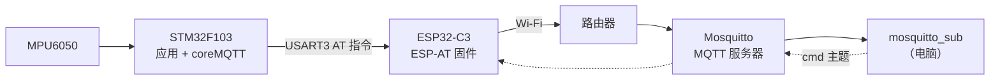
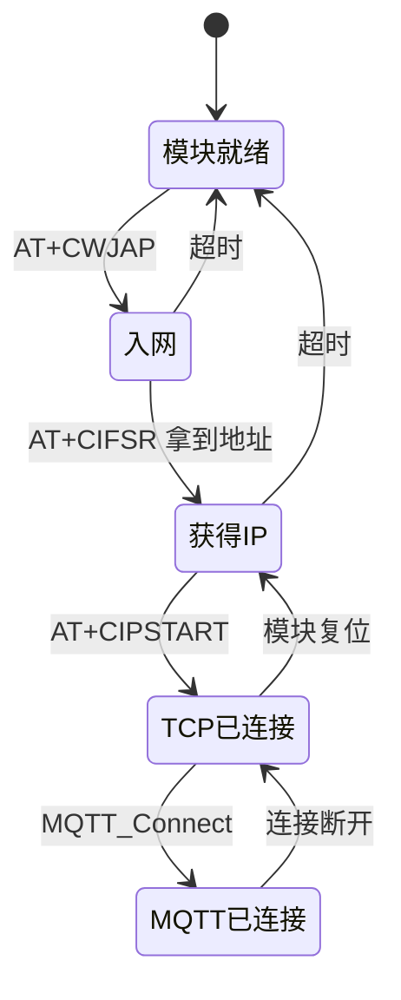
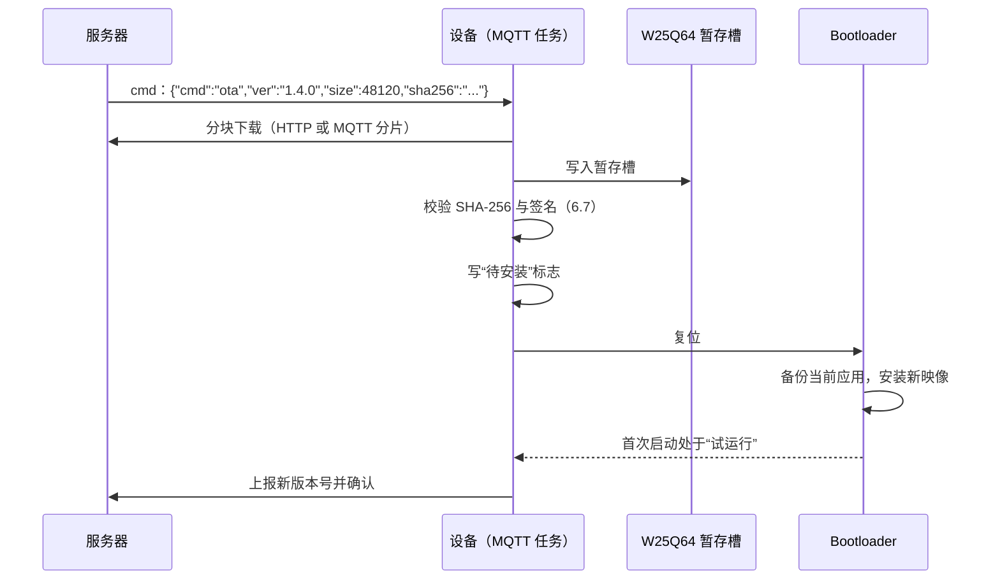

# 7.3 联网固件

STM32F103C8 没有以太网控制器，SRAM 只有 20 KB。把 lwIP 加 mbedTLS 塞进这样的芯片，光是 TCP 发送与接收缓冲就要占掉大半内存，剩下的不够跑 7.2 的记录仪。产品里常见的做法是把网络协议栈放进一个 Wi-Fi 模块，模块对外提供串口 AT 指令，MCU 只负责应用协议与设备逻辑。

这一页给 [7.2 RTOS 多任务设备](/教程/正文/嵌入式/7_综合实践/7_2_RTOS多任务设备) 的姿态记录仪加上联网：设备上电连 Wi-Fi，把遥测发布到 MQTT 服务器的 `mdr/<设备号>/telemetry`，订阅 `mdr/<设备号>/cmd` 接收 `rate`、`reboot`、`ota` 三类命令；断线后按指数退避加抖动重连，离线期间的样本继续写日志，恢复后补传。MQTT 报文用 coreMQTT 生成，传输层换成 AT 指令；同一份 MQTT 应用代码在 PC 上用 Winsock 传输也能跑，联调不必等硬件。

这一页的示例程序在 `code/嵌入式/7_综合实践/7_3_联网固件/`：一份 MQTT 报文构造器与回环联调程序，以及退避策略的对比程序，都在主机上跑。固件一侧的 AT 任务、传输层与 MQTT 任务的写法在这一页里给出关键部分；它们依赖 ESP32-C3 模块与 7.2 的工程，完整代码留到有了硬件再补。

## 1. 网络架构

一条遥测从传感器到订阅者的完整路径：



设备与服务器之间只有三个主题：

| 主题 | 方向 | 负载 | QoS |
| --- | --- | --- | --- |
| `mdr/<设备号>/telemetry` | 设备 → 服务器 | JSON 遥测 | 0 |
| `mdr/<设备号>/status` | 设备 → 服务器 | `online` / `offline`（遗嘱） | 1 |
| `mdr/<设备号>/cmd` | 服务器 → 设备 | JSON 命令 | 1 |

设备号取芯片的 96 位唯一 ID，存在 `0x1FFFF7E8` 起的 12 个字节里，读出后取低 32 位打印成 8 位十六进制。同一批设备不会撞号，也不必在产线上手工配置。

遥测负载的字段：

| 字段 | 单位 | 类型 | 说明 |
| --- | --- | --- | --- |
| `ts` | 秒 | 整数 | Unix 时间，SNTP 同步后填 |
| `ax` `ay` `az` | mg | 整数 | 三轴加速度 |
| `pitch` `roll` | 0.01° | 整数 | 倾角 |
| `seq` | — | 整数 | 设备启动后的递增序号 |

用 `snprintf()` 拼，不用 JSON 库：

```c
int n = snprintf(buf, sizeof buf,
                 "{\"ts\":%lu,\"ax\":%d,\"ay\":%d,\"az\":%d,"
                 "\"pitch\":%d,\"roll\":%d,\"seq\":%lu}",
                 (unsigned long)ts, s.ax, s.ay, s.az, s.pitch, s.roll,
                 (unsigned long)seq);
```

字段全是整数，格式固定，拼字符串就够了；上 JSON 库要额外几 KB Flash 和一层内存分配，20 KB 的芯片上不值得。

QoS 的选择：遥测用 0，服务器收不到就丢了，下一帧很快补上，重传反而占带宽；命令与状态用 1，至少要送达一次。遗嘱消息（Last Will and Testament，LWT）在 CONNECT 时报给服务器，设备异常掉线时服务器替它发 `offline`，订阅者据此知道设备离线，不需要额外的超时判断。

::: concept emb73-topic-convention title="主题与负载的约定"

主题固定为 `mdr/<设备号>/telemetry`、`mdr/<设备号>/status`、`mdr/<设备号>/cmd` 三个。遥测的 JSON 字段是 `ts`（Unix 秒）、`ax`/`ay`/`az`（mg）、`pitch`/`roll`（0.01°）、`seq`，全部是整数。设备号是芯片 96 位唯一 ID 的低 32 位，8 位十六进制小写。7.4 的 Linux 侧沿用同一套约定。

:::

<Quiz
  type="multi"
  :options="[
    { label: '遥测用 QoS 0，丢一帧下个周期就补上', value: 'A' },
    { label: '命令用 QoS 1，至少送达一次', value: 'B' },
    { label: '遗嘱消息让服务器在设备掉线后代发 offline', value: 'C' },
    { label: '所有主题都用 QoS 2，保证不重复', value: 'D' }
  ]"
  :answer="['A', 'B', 'C']"
>

<template #question>

关于本页的主题与 QoS 选择，哪些说法正确？

</template>

正确答案是 **A、B、C**。QoS 2 的握手要多两个来回，在 100 Hz 的遥测上完全没有必要；重复消息对遥测无害，对命令则可以在应用层用 `seq` 去重。D 把“可靠”理解成“最高等级”，忽略了代价。

</Quiz>

## 2. 两种 MQTT 做法

ESP-AT 固件自带一套 MQTT 指令，MCU 把主题与负载交给模块，模块自己维护连接与保活：

```text
AT+MQTTUSERCFG=0,1,"mdr-1a2b3c4d","user","pass",0,0,""
AT+MQTTCONN=0,"broker.example.com",1883,1
AT+MQTTPUB=0,"mdr/1a2b3c4d/telemetry","{\"ax\":12,...}",0,0
AT+MQTTSUB=0,"mdr/1a2b3c4d/cmd",1
```

另一条路是模块只提供 TCP（`AT+CIPSTART` 建连接，`AT+CIPSEND` 发数据，`+IPD` 收数据），MQTT 协议由 MCU 上的 coreMQTT 负责。

| 对比项 | 模块自带 MQTT | MCU 上跑 coreMQTT |
| --- | --- | --- |
| MCU Flash / RAM | 最省，只拼 AT 指令 | 多约 5～6 KB Flash 与 1～2 KB 静态缓冲 |
| 协议可控性 | 低，重连与保活由模块决定 | 高，退避、遗嘱、主题都在自己手里 |
| 换网络方案 | 换一家模块就要重写 | 换传输层即可，应用代码不动 |
| 调试 | 错了只能看模块日志 | 能抓 MQTT 报文字节 |

作者判断：产品最终形态如果是“一个模块 + 一台上位机”，用模块自带的 MQTT 更省事；需要换网络方案（Wi-Fi 换 4G、换以太网）、要在设备侧做复杂的主题与离线策略、或者要在 PC 上复现问题时，用 coreMQTT。本页的主线是后者，因为它与 7.4 的 Linux 侧能共用同一份应用代码，只换传输层。

coreMQTT 选 v2.3.1，协议版本 MQTT 3.1.1。v5.x 的接口不一样，不要混着看文档。

::: compare left-title="模块自带 MQTT" right-title="coreMQTT + TCP"

```c
/* MCU 只负责拼字符串，连接、保活、重连都在模块里 */
at_send("AT+MQTTPUB=0,\"mdr/%s/telemetry\",\"%s\",0,0", id, json);
```

---

```c
/* 传输层负责收发字节，协议由 coreMQTT 处理 */
MQTTStatus_t st = MQTTPublish(&ctx, topic, &payload);
if (st != MQTTSuccess) {
    /* 自己决定重连还是丢弃 */
}
```

:::

## 3. AT 任务

AT 指令是一条请求一条应答的串行协议，多个任务同时发指令会互相踩。做法和 7.2 的 I²C 总线一样：一个任务独占 USART3，其他任务提交请求。



状态机里每条失败边都回到上一个稳定状态，而不是回到起点全部重来：Wi-Fi 断了不必重新初始化模块。

接收用 7.2 同款的流缓冲区。`+IPD` 后面跟的是长度与数据，AT 任务先解析出头，再按长度精确读那么多字节，绝不能读到换行就以为结束——MQTT 报文里全是二进制，可能出现 `\r\n`：

```c
/* 从 +IPD,<len>: 里取出长度，再收 len 字节 */
int len = atoi(p);
uint8_t payload[512];
size_t got = 0;
while (got < (size_t)len) {
    got += xStreamBufferReceive(g_uart3_rx, &payload[got], len - got, pdMS_TO_TICKS(100));
}
```

URC（主动上报，Unsolicited Result Code）与应用数据会交错：`+IPD` 可能嵌在一条命令的应答中间。AT 任务里把这一层层剥开，按 [3.8 BLE、Wi-Fi 与通信模块](/教程/正文/嵌入式/3_驱动_通信与中间件/3_8_BLE_WiFi与通信模块) 的 at_parser 思路写，只是多了 `+IPD` 的定长分支。这一段在 PC 上用脚本化的输入测过，输出在 3.8 已经贴过，本页不重复。

其他任务提交请求的接口：

```c
enum at_op { AT_OP_CONNECT, AT_OP_SEND, AT_OP_RECV };

struct at_request {
    enum at_op op;
    const char *arg;
    uint8_t *buf;
    size_t len;
    TaskHandle_t waiter;
};

bool at_submit(const struct at_request *req, TickType_t timeout);
```

`at_submit()` 把请求放进队列，然后 `xTaskNotifyWait()` 等 AT 任务处理完再叫醒它。用任务通知而不是再开一个应答队列，是因为一个请求只有一个等着的人（[4.4 中断与任务协作](/教程/正文/嵌入式/4_RTOS与固件架构/4_4_中断与任务协作)）。

<Quiz
  type="single"
  :options="[
    { label: '按 +IPD 里的长度精确读这么多字节，前面可能有 \\r\\n', value: 'A' },
    { label: '读到 \\r\\n 就认为一个报文结束', value: 'B' },
    { label: '每次固定读 1024 字节再解析', value: 'C' },
    { label: '按行读，遇到 MQTT 报文就整行交给 coreMQTT', value: 'D' }
  ]"
  answer="A"
>

<template #question>

从 `+IPD` 里取 MQTT 数据时，接收端的读法应当是哪个？

</template>

正确答案是 **A**。`+IPD,<长度>:` 给了字节数，只能按长度读。B 与 D 把 MQTT 当成文本协议，而 MQTT 报文头里就有 `0x0D 0x0A` 的可能值（例如剩余长度字段之后的某些负载），按行切会把一条报文切成几段。C 固定读取会把下一条报文的数据一起吞掉。

</Quiz>

## 4. coreMQTT 的传输层

coreMQTT 不碰套接字，它只要求两个函数：

```c
typedef struct TransportInterface {
    TransportRecv_t recv;
    TransportSend_t send;
    NetworkContext_t *pNetworkContext;
} TransportInterface_t;
```

`send` 把一段字节发出去，返回实际发出的字节数；`recv` 最多读一段字节，返回读到的字节数。两者都不做重试：发不出去就返回错误，由上层决定重连还是丢弃。这一点是刻意的——传输层不知道应用在等什么，盲目重试会把一个“服务器拒绝连接”变成一个永远卡住的循环。

设备侧的 `send` 走 AT 指令：

```c
static int32_t esp_at_send(NetworkContext_t *ctx, const void *buf, size_t len) {
    struct at_request req = {
        .op = AT_OP_SEND,
        .arg = "AT+CIPSEND",
        .buf = (uint8_t *)buf,
        .len = len,
    };
    if (!at_submit(&req, pdMS_TO_TICKS(1000))) {
        return -1;
    }
    return (int32_t)len;
}
```

`AT+CIPSEND=<len>` 之后模块回 `>` 提示符，再发数据。AT 任务内部按这个顺序走，对 coreMQTT 来说就是一次普通的 send。

`recv` 从 AT 任务填好的环形缓冲区里取数据：

```c
static int32_t esp_at_recv(NetworkContext_t *ctx, void *buf, size_t len) {
    /* 不阻塞：coreMQTT 在 ProcessLoop 里会重复调用，每次少量读 */
    size_t got = xStreamBufferReceive(g_ipd_stream, buf, len, 0);
    return (int32_t)got;
}
```

返回 0 表示暂时没数据，coreMQTT 会过一会儿再调。返回负数才是连接错误。

PC 上的联调换一份实现，只改这两个函数：

```c
/* transport_winsock.c */
static int32_t winsock_send(NetworkContext_t *ctx, const void *buf, size_t len) {
    int n = send(ctx->sock, buf, (int)len, 0);
    return n < 0 ? -1 : n;
}

static int32_t winsock_recv(NetworkContext_t *ctx, void *buf, size_t len) {
    int n = recv(ctx->sock, buf, (int)len, 0);
    return n;
}
```

::: tip 传输层只做字节搬运

不要在 `send` 里加重连，也不要在 `recv` 里睡眠等待。传输层的错误返回是 coreMQTT 判断“连接坏了”的唯一依据，加了重试反而让它误以为连接正常，保活超时都不触发。

:::

## 5. MQTT 任务

MQTT 任务是唯一调用 coreMQTT 的地方。初始化时给它一块固定缓冲区，之后所有报文都在这里收发，不动态分配：

```c
static uint8_t g_network_buf[1024];
static MQTTFixedBuffer_t g_net_buf = {
    .pBuffer = g_network_buf,
    .size = sizeof g_network_buf,
};
static MQTTContext_t g_mqtt;
static TransportInterface_t g_transport;

/* coreMQTT 用它算保活与超时，单位毫秒 */
static uint32_t get_time_ms(void) {
    return (uint32_t)((uint64_t)xTaskGetTickCount() * 1000u / configTICK_RATE_HZ);
}

/* 收到 PUBLISH 等事件时被调用，命令在这里执行 */
static void on_event(MQTTContext_t *ctx, MQTTPacketInfo_t *info,
                     MQTTDeserializedInfo_t *deser) {
    (void)ctx;
    if ((info->type & 0xF0u) == MQTT_PACKET_TYPE_PUBLISH) {
        handle_command(deser->pPublishInfo);
    }
}

static bool mqtt_init(void) {
    g_transport.pNetworkContext = &g_net_ctx;
    g_transport.send = esp_at_send;
    g_transport.recv = esp_at_recv;

    MQTTStatus_t st = MQTT_Init(&g_mqtt, &g_transport, get_time_ms, on_event, &g_net_buf);
    return st == MQTTSuccess;
}
```

1024 字节的缓冲区放得下一条 48 字节的 CONNECT，也放得下一个几百字节的遥测，但放不下 `ota` 命令带下来的大块数据——升级通知里只带版本号与大小，实际下载走另一条路径（第 11 节）。

连接时填 keepalive、清会话、遗嘱：

```c
MQTTConnectInfo_t conn = {
    .cleanSession = true,
    .keepAliveSeconds = 30,
    .pClientIdentifier = device_id,
    .clientIdentifierLength = strlen(device_id),
    .pUserName = user,
    .userNameLength = strlen(user),
    .pPassword = pass,
    .passwordLength = strlen(pass),
};

MQTTPublishInfo_t will = {
    .qos = MQTTQoS1,
    .pTopicName = status_topic,
    .topicNameLength = strlen(status_topic),
    .pPayload = "offline",
    .payloadLength = 7,
};

bool session_present = false;
MQTTStatus_t st = MQTT_Connect(&g_mqtt, &conn, &will, 5000, &session_present);
```

连接成功之后发布一次 `online`，然后订阅命令主题：

```c
MQTTSubscribeInfo_t sub = {
    .qos = MQTTQoS1,
    .pTopicFilter = cmd_topic,
    .topicFilterLength = strlen(cmd_topic),
};
(void)MQTT_Subscribe(&g_mqtt, &sub, 1, packet_id++);
```

主循环靠 `MQTT_ProcessLoop()` 推进：它读数据、处理保活、分发收到的消息。节奏由两部分决定——保活 30 秒，所以至少每 30 秒要有一次完整循环；订阅了命令，希望尽快收到，所以循环本身要更勤：

```c
for (;;) {
    (void)MQTT_ProcessLoop(&g_mqtt, 100);

    if (xTaskGetTickCount() - last_pub >= pdMS_TO_TICKS(pub_period_ms)) {
        last_pub = xTaskGetTickCount();
        publish_telemetry();
    }
    monitor_check_in(5);
}
```

100 ms 的超时让 `ProcessLoop` 在没有数据时也按时返回，于是发布节奏与保活都不会被“一直收不到数据”卡住。

### 5.1 CONNECT 报文逐段看

CONNECT 是设备发出的第一个报文，字段最全。下面这份字节来自本页示例程序，客户端标识 `mdr-0001`，遗嘱主题 `mdr/0001/status`，遗嘱内容 `offline`，保活 30 秒：

```text
10 2E 00 04 4D 51 54 54 04 0E 00 1E
00 08 6D 64 72 2D 30 30 30 31
00 0F 6D 64 72 2F 30 30 30 31 2F 73 74 61 74 75 73
00 07 6F 66 66 6C 69 6E 65
```

逐段拆：

| 字节 | 含义 |
| --- | --- |
| `10` | 报文类型 1（CONNECT），标志 0 |
| `2E` | 剩余长度 46 |
| `00 04 4D 51 54 54` | 协议名 "MQTT"（长度 4 在前） |
| `04` | 协议级别 4，即 MQTT 3.1.1 |
| `0E` | 连接标志：清会话、有遗嘱、遗嘱 QoS 1 |
| `00 1E` | 保活 30 秒 |
| `00 08 …` | 客户端标识，长度 8 |
| `00 0F …` | 遗嘱主题，长度 15 |
| `00 07 offline` | 遗嘱内容，长度 7 |

连接标志的每一位：bit 1 是清会话，bit 2 是遗嘱标志，bit 3～4 是遗嘱 QoS，bit 5 是遗嘱保留，bit 6 是密码，bit 7 是用户名。本页的 `0x0E` 是 `0000 1110`：清会话、有遗嘱、遗嘱 QoS 1、密码与用户名都没置位。示例程序没用用户名口令，实际产品连 Mosquitto 时要按服务器配置改。

剩余长度是可变的：小于 128 用 1 字节，更大的数值按 7 位一组，最高位表示后面还有。46 小于 128，所以就是 1 字节 `0x2E`。

<Quiz
  type="single"
  :options="[
    { label: '0x10 是报文类型，0x2E 是剩余长度，46 字节', value: 'A' },
    { label: '0x10 是剩余长度，0x2E 是报文类型', value: 'B' },
    { label: '0x2E 是协议级别', value: 'C' },
    { label: '0x2E 是客户端标识的长度', value: 'D' }
  ]"
  answer="A"
>

<template #question>

`10 2E 00 04 4D 51 54 54 …` 里，前两个字节各是什么？

</template>

正确答案是 **A**。固定头第一字节的高 4 位是类型、低 4 位是标志，`0x10` 即 CONNECT、标志全 0；第二字节起是剩余长度，`0x2E` 的最高位为 0，说明只占一字节，值为 46。C 把协议级别 `0x04` 的位置记错了，D 的客户端标识长度在后面对应的字段里。

</Quiz>

## 6. 断线与重连

### 6.1 退避与抖动

固定间隔重连的问题是所有设备同时回来。一次区域停电后，一千台设备每 1 秒撞一次服务器，服务器扛不住又断，形成雪崩。指数退避把间隔逐步拉长，随机抖动则把设备的尝试时刻打散。

3.8 的习题做过 1/2/4/8 秒的固定倍数退避。这里用 FreeRTOS 的 backoffAlgorithm，它在指数退避的基础上加了抖动：

```c
static BackoffAlgorithmContext_t g_backoff;
static uint32_t g_backoff_seed; /* 从唯一 ID 取，各设备不同 */

BackoffAlgorithm_InitializeParams(&g_backoff, 1000, 64000, &g_backoff_seed,
                                  UINT16_MAX);

/* 每次失败后：取出本次的等待时间，溢出与重试次数上限由库处理 */
uint32_t next_ms = 0;
BackoffAlgorithmStatus_t st = BackoffAlgorithm_GetNextBackoff(&g_backoff, &next_ms);
if (st == BackoffAlgorithmSuccess) {
    vTaskDelay(pdMS_TO_TICKS(next_ms));
}
```

第一次等的上限是 1 秒，之后 2、4、8……到 64 秒封顶；每次实际等待取在上限的一半到上限之间，所以同一时刻连上的设备不会挤在一处。

本页的示例程序复现了这个策略，用线性同余发生器代替随机源，输出才能贴出来：

::: terminal title="PowerShell - 退避策略对比"

```text
固定间隔（8 次尝试，单位秒）：
    1.0  1.0  1.0  1.0  1.0  1.0  1.0  1.0
  累计 8 秒

指数退避加抖动（3 台设备，各 8 次尝试，单位秒）：
  设备 1：  0.6  1.0  3.4  6.3 15.7 18.3 47.0 34.2
          累计 126.5 秒
  设备 2：  0.9  1.8  2.9  6.2 15.6 29.7 34.0 33.4
          累计 124.5 秒
  设备 3：  0.6  1.1  3.4  6.0 15.5 25.0 53.0 32.7
          累计 137.3 秒

上限序列：1、2、4、8、16、32、64、64 秒，之后一直封顶在 64 秒
```

:::

固定间隔累计 8 秒就重试了 8 次，全打在服务器上；指数退避到第 8 次时单次已经等了半分钟，累计两分钟出头，但这段时间里服务器已经缓过来了。三台设备的数值互不相同，这就是抖动的效果。

::: compare left-title="固定间隔" right-title="指数退避加抖动"

```c
for (;;) {
    if (mqtt_connect()) {
        break;
    }
    vTaskDelay(pdMS_TO_TICKS(1000));
}
```

---

```c
for (;;) {
    if (mqtt_connect()) {
        BackoffAlgorithm_Reset(&g_backoff);
        break;
    }
    uint32_t wait_ms = 0;
    (void)BackoffAlgorithm_GetNextBackoff(&g_backoff, &wait_ms);
    vTaskDelay(pdMS_TO_TICKS(wait_ms));
}
```

:::

### 6.2 离线缓存与补传

断网期间样本照常写进 7.2 的 littlefs 日志，遥测直接停发。恢复之后不能一次把积压的上百条全发出去——那会把 100 Hz 的实时遥测挤掉。做法是限速补传：

```c
/* 每发一条实时遥测，最多补 1 条历史；补齐后再关掉补传 */
if (g_replay_count > 0 && g_replay_due) {
    send_one_replay();
    --g_replay_count;
}
send_one_realtime();
```

实时遥测永远优先，补传占用空闲带宽。补传读的就是记录文件，按行解析回结构体，不额外维护一份发送队列。

### 6.3 看门狗与网络

网络长时间不通时，不应让看门狗复位设备。网络故障是外部原因，复位解决不了，反而把已记录的日志与运行状态一起丢掉。本页的做法是：

1. MQTT 任务每轮循环都打卡，所以它在重连时也算“活着”，不触发看门狗。
2. 连续失败超过 5 分钟，复位 Wi-Fi 模块（拉它的复位引脚或发 `AT+RST`），等模块重新起来。
3. 命令主题收到的 `reboot` 才走受控重启。

这一条与 7.2 的打卡结构是一致的：看门狗管的是固件自己卡死，不是外部世界不配合。

::: warning 重连任务本身也要打卡

如果只在 MQTT 连接正常时打卡，断网就等于停止打卡，看门狗会在 2 秒后无限复位，设备永远连不上。打卡应当放在循环里，不放在成功分支里。

:::

<Quiz
  type="single"
  :options="[
    { label: '网络断开也算一次失败，等待 1 秒重试', value: 'A' },
    { label: '每次失败后等待时间按指数增长，并加随机抖动', value: 'B' },
    { label: '网络断开就整机复位，从头再来', value: 'C' },
    { label: '断开后立刻连续重连，直到成功为止', value: 'D' }
  ]"
  answer="B"
>

<template #question>

一千台设备同时掉线，服务器重启后怎样避免被重连风暴打垮？

</template>

正确答案是 **B**。指数退避把重试间隔拉开，抖动让设备错峰。A 等于固定间隔，所有设备仍会同步；C 会永久复位循环，很可能是设备不停重启却始终连不上；D 是最糟糕的，重连风暴会持续到服务器再次崩溃。

</Quiz>

## 7. 时间与配置

遥测的 `ts` 需要用真实时间。F103 没有 RTC 电池，上电后时间从零开始，靠 SNTP 同步：

```text
AT+CIPSNTPCFG=1,8,"ntp.aliyun.com"
AT+CIPSNTPTIME?
```

返回的字符串形如 `+CIPSNTPTIME:Fri Oct 23 18:42:11 2026`。AT 任务把它解析成 `struct tm`，再用 `timegm` 转成 Unix 秒——注意不是 `mktime`，后者按本地时区解释，SNTP 给的是 UTC。同步一次之后，本地用“启动时刻的 Unix 秒 + 节拍差”推算：

```c
uint32_t now = g_boot_unix + (xTaskGetTickCount() - g_boot_tick) / configTICK_RATE_HZ;
```

Wi-Fi 的 SSID、口令、服务器地址、端口、设备口令都存在 [3.9 Flash、EEPROM、SD 与文件系统](/教程/正文/嵌入式/3_驱动_通信与中间件/3_9_Flash_EEPROM_SD与文件系统) 的配置记录里，命令行写入。口令在任何情况下都不打印：`config show` 只显示长度与是否已设置。

## 8. 安全

TLS 放在模块上做。ESP-AT 的 `AT+CIPSTART` 可以指定 SSL 类型，证书用指令写进模块的存储，MCU 只负责把数据交给模块。这样 mbedTLS 的握手、证书链、会话密钥都留在模块里，F103 只看到明文。

为什么不在 F103 上跑 mbedTLS：一次 TLS 握手需要约 30 KB RAM 与几 KB 的代码，20 KB SRAM 的芯片放不下。[4.7 FreeRTOS](/教程/正文/嵌入式/4_RTOS与固件架构/4_7_FreeRTOS) 讲过 RAM 的分配，结论一样——不是算力不够，是内存不够。

服务器端的认证方式两种：用户名口令最简单，Mosquitto 配置一行就能开；客户端证书更安全，代价是每台设备的私钥要保护好。本页的示例程序用用户名口令，证书方式留给实际产品。

升级包仍按 [6.7 安全启动、映像校验与密钥](/教程/正文/嵌入式/6_质量_安全与交付/6_7_安全启动_映像校验与密钥) 签名。TLS 保护的是传输，不是来源——服务器被攻破时，坏固件照样能通过 TLS 送到设备上。签名在设备端验证，两道防线各管一段。

## 9. 在 PC 上联调

MQTT 应用代码与传输层是分开的，PC 上的版本换一份 Winsock 传输，其余原样。本页的示例程序把伪服务器与设备放在同一个进程里，用回环地址跑一遍完整流程，不依赖外部服务器：

::: terminal title="PowerShell - 回环联调"

```text
$ gcc -std=c17 -Wall -Wextra mqtt_demo.c mqtt_packet.c -lws2_32 -o mqtt_demo
$ ./mqtt_demo
[设备] CONNECT 报文 48 字节
       （48 字节）：10 2E 00 04 4D 51 54 54 04 0E 00 1E 00 08 6D 64 72 2D 30 30 30 31 00 0F 6D 64 72 2F 30 30 30 31 2F 73 74 61 74 75 73 00 07 6F 66 66 6C 69 6E 65
[服务器] 收到 CONNECT：（48 字节）：10 2E 00 04 4D 51 54 54 04 0E 00 1E 00 08 6D 64 72 2D 30 30 30 31 00 0F 6D 64 72 2F 30 30 30 31 2F 73 74 61 74 75 73 00 07 6F 66 66 6C 69 6E 65
[设备] 收到 CONNACK：（4 字节）：20 02 00 00
[服务器] 收到 SUBSCRIBE：（19 字节）：82 11 00 02 00 0C 6D 64 72 2F 30 30 30 31 2F 63 6D 64 00
[设备] 收到 SUBACK：（5 字节）：90 03 00 02 00
[设备] PUBLISH 报文 99 字节
[服务器] 收到 PUBLISH：主题 mdr/0001/telemetry，负载 {"ts":1761200000,"ax":12,"ay":-340,"az":995,"pitch":-1.9,"roll":19.0,"seq":1}
[服务器] 收到 PINGREQ，已回 PINGRESP
[设备] 收到 PINGRESP：（2 字节）：D0 00
[服务器] 收到 DISCONNECT
[结果] 收到 1 条 PUBLISH，最后一条：mdr/0001/telemetry -> {"ts":1761200000,"ax":12,"ay":-340,"az":995,"pitch":-1.9,"roll":19.0,"seq":1}
```

:::

示例里没有 coreMQTT，MQTT 报文由一份 150 行的构造器手工拼出来。这样做的目的不是替代 coreMQTT，而是让每个字节都摆在明面上：`10 2E`、`20 02 00 00`、`82 11`、`90 03` 这些固定头，换成 coreMQTT 之后完全一样。联调时看到一个报文不对，能对上这张表就知道是哪一段出了问题。

真连 Mosquitto 的读者把示例里的伪服务器换掉即可：

```bash
mosquitto_sub -h 127.0.0.1 -t 'mdr/+/telemetry' -v
```

Windows 上的端口用 25730–25739，示例绑的是 25731，只监听 `127.0.0.1`。

::: tip 先让字节对上，再调业务

MQTT 的问题分两类：连不上（TCP 或认证）与收到了但内容不对（主题或负载）。前者看 CONNACK 的返回码，后者把订阅者收到的原始主题与负载打印出来。本页的伪服务器把收到的每个报文都打出来，两类问题一眼能分开。

:::

## 10. 其他网络方案

**W5500**。一块硬件 TCP/IP 芯片，SPI 接口，内部实现 TCP/UDP/IP 与 8 个独立套接字，MCU 只操作寄存器。F103 想用网线联网时这是首选，[3.7 以太网、TCP/IP 与 lwIP](/教程/正文/嵌入式/3_驱动_通信与中间件/3_7_以太网_TCPIP与lwIP) 的作者判断里讲过。coreMQTT 的传输换成 W5500 的 socket API 就行，MQTT 任务一行不用改；ioLibrary 的移植量比 ESP-AT 小。

**带 MAC 的芯片 + lwIP**。STM32F407 这类芯片自带以太网 MAC，配一片 PHY 就能跑 lwIP。lwIP 在 RTOS 下分两种模式：`NO_SYS=1` 的裸机模式（3.7 讲过）与 OS 模式。OS 模式下 lwIP 有自己的 `tcpip_thread`，所有套接字操作都必须在这个线程里、或者加锁之后调用：

```c
/* OS 模式：应用的 socket 调用最终排到 tcpip_thread */
sock = lwip_socket(AF_INET, SOCK_STREAM, 0);
lwip_connect(sock, &addr, sizeof addr);
lwip_send(sock, buf, len, 0);
```

`sys_arch` 层把 lwIP 的信号量、互斥量、邮箱映射到 FreeRTOS 的对应对象，接口名是 `sys_sem_new`、`sys_mutex_new`、`sys_mbox_new` 这些。要改的地方不少，但都是机械的映射。

**模块自带 MQTT**。第 2 节已经对比过，最省资源，适合协议不复杂的产品。

选型的依据是网络方案的稳定程度：产品只用 Wi-Fi 且不打算换，模块方案最省事；要换 4G 或以太网，coreMQTT 加可替换传输层的结构能省下重写应用的功夫；必须用网线又不愿意换芯片，W5500 加 coreMQTT 是折中。

## 11. 接入远程升级

[6.4 Bootloader 与固件升级](/教程/正文/嵌入式/6_质量_安全与交付/6_4_Bootloader与固件升级) 与 6.7 的签名校验已经就位，7.3 只需把“升级通知”接到网络上：



命令负载里只有元数据，映像本身分块下载，每块校验。下载期间设备继续采样与记录，不能因为升级把当前工作停掉；分块下载与写入暂存槽都在低优先级任务里做，每块之间让出 CPU。

“待安装”标志写在片内 Flash 的配置页（3.9 的配置记录），只从 1 写到 0，掉电后能判断做到哪一步（6.4 讲过这个技巧）。新固件首次启动处于试运行，联网上报版本并收到服务器确认后才转为正式；没确认就重启会回滚到备份槽。

## 12. 习题

### 12.1 巩固

<Exercise id="67721" :d="2" :w="2">

第 5.1 节拆过一份 48 字节的 CONNECT（客户端标识 `mdr-0001`，遗嘱主题 `mdr/0001/status`，内容 `offline`，保活 30 秒）。

(1) 把保活改成 60 秒，哪些字节变化？写出新的报文并说明剩余长度为什么仍是 `2E`。

(2) 加上用户名 `mqtt` 与口令 `secret`，写出连接标志的二进制与十六进制、剩余长度、总长度，并给出新增的三个字段。验收：标志 `CE`，剩余长度 `3C`（60 字节），报文 62 字节。

(3) 客户端标识从 8 字节改成 40 字节，剩余长度与总长度各是多少？标识长度增加到多少时，剩余长度从 1 字节变成 2 字节（门槛是 128）？

(4) 报文里的“协议级别”是 `04`，把它改成 `05` 会发生什么？说明为什么不能只改这一个字节。

</Exercise>

<Exercise id="67722" :d="2" :w="2">

关于主题与 QoS 的取舍（第 1、2、10 节）。

(1) 遥测负载是 `{"ts":1761200000,"ax":12,"ay":-340,"az":995,"pitch":-1.9,"roll":19.0,"seq":1}`，主题 `mdr/0001/telemetry`。写出 QoS 0 报文的剩余长度与总长度；改成 QoS 1 后各是多少？验收：99 与 101 字节。

(2) 为什么命令用 QoS 1 就够，不需要 QoS 2？本页的 `seq` 字段在去重里起什么作用？如果设备重启后 `seq` 归零，服务器该按什么去重？

(3) 遗嘱消息为什么能替代“服务器定时判断设备超时”？把 keepalive 从 30 秒改成 300 秒，服务器多久才能发现掉线？

(4) 填一张三行的选型表：只用 Wi-Fi 且不打算换、需要换 4G、必须有网线且不换芯片。每行写方案与一条理由，并从“MCU Flash / RAM、协议可控性、换网络方案的成本”三列里各挑一列说明。

</Exercise>

<Exercise id="67723" :d="3" :w="2">

`mqtt_packet.c` 的 `put_remaining_length()` 是变长编码，`mqtt_build_connect()` 内部用 `uint8_t body[256]` 拼报文体。

(1) 对 0、46、127、128、16383、16384、2097152 写出编码后的字节序列，说明每多一字节的门槛在哪里。

(2) 写出 `size_t mqtt_remaining_length_size(size_t len)`，返回编码占用的字节数，用上面的数据验证。

(3) 报文体在 `put_string()` 之后才检查 `need > max`。客户端标识长度取 250、再带上遗嘱时，`put_string()` 往 `body[256]` 写到第几个下标？`-Wall -Wextra` 能不能发现？用下标断言或越界检测复现，给出修复：在每次 `put_string()` 之前检查 `p + 2 + strlen(s) <= sizeof body` 并返回 0。

(4) `mqtt_build_subscribe()` 的 `body[128]` 与 `mqtt_build_publish()` 不经过 `body` 的区别在哪里？后者为什么不会越界？它检查的 `need > max` 是否足够？

</Exercise>

### 12.2 编程

<Exercise id="67724" :d="3" :w="3">

`mqtt_packet.c` 只有 QoS 0 的 PUBLISH。补上 QoS 1：

```c
size_t mqtt_build_publish_qos1(uint8_t *out, size_t max, uint16_t packet_id,
                               const char *topic, const char *payload);
```

(1) 固定头第一字节应是什么？可变头里报文标识符放在哪个位置？把它插在主题之后、负载之前。

(2) 用 `mqtt_demo.c` 的同一份主题与负载、标识符取 7 构造，验收总长 101 字节、首字节 `32`、剩余长度 `63`、第 23、24 字节是 `00 07`（大端）。贴出完整十六进制。

(3) 给伪服务器加 `PUBACK`（类型 4，剩余长度 2，回带同一标识符），设备端收齐后打印。验收输出出现 `[设备] 收到 PUBACK：40 02 00 07`。

(4) 说明 QoS 1 的“至少一次”在设备端要做什么才能不重复执行命令：重发时同一个标识符会不会被服务器当成新消息？给出应用层的去重位置。

</Exercise>

<Exercise id="67725" :d="3" :w="3">

`backoff_demo.c` 的抖动取在 `[ceiling/2, ceiling]`，上限从 1 秒翻倍到 64 秒。

(1) 写出前 8 次尝试的上限序列，并说明 `ceiling` 初值为什么是 `BASE_MS / 2`。

(2) 把 `MAX_MS` 改成 30000，重新编译运行。写出新的上限序列与前 8 次的等待值，与原来的输出逐项对照。验收：三台设备的累计等待从 126.5 / 124.5 / 137.3 秒降到 96.6 / 89.8 / 96.9 秒，第 6 次之后不再翻倍。

(3) 用 `BackoffAlgorithm_GetNextBackoff()` 的接口把程序改成“读入种子，打印 N 次等待”，验证同一个种子可复现、不同种子在同一上限下取值不同。

(4) 统计 1000 个不同种子在 `ceiling = 8000` 时的均值，与理论中值 6000 比较，说明抖动为什么是“减一个随机量”而不是“加一个随机量”。

(5) 设备端把种子取什么最合适？用 7.3 的设备号（96 位唯一 ID 的低 32 位）说明这样做的两个好处。

</Exercise>

<Exercise id="67726" :d="4" :w="3">

第 6.2 节的补传只给了“每发一条实时遥测，最多补 1 条历史”。

(1) 实现 `replay_tick()`：维护 `g_replay_count` 与一个“本轮是否已补”的标志，写出实时优先的顺序，保证补传不会连续占用两个发送时隙。

(2) 断网 100 秒、10 Hz 记录，积压多少条？按 1:1 限速补齐需要多久？按每 3 条实时补 1 条呢？给出两个数。

(3) 补齐期间又断网 60 秒，积压会变成多少？说明为什么简单的计数器会无限增长，给出“只补最近 N 条、更早的丢弃”的策略与 N 的取值依据。

(4) 补传读的是记录文件。写出按行解析 `tick,ax,ay,az,pitch,roll` 的函数，处理跨文件边界（`log_000.csv` 读完接 `log_001.csv`）。

(5) 验收：模拟器上构造 5 条积压，`status` 里实时速率不变，日志行数不减少，补传结束后计数归零。

</Exercise>

<Exercise id="67727" :d="4" :w="4">

传输层的两个函数决定 coreMQTT 怎么判断连接好坏。

(1) `esp_at_recv()` 返回 0 表示暂时没数据。改成“没数据时 `vTaskDelay(100)` 再返回 0”会怎样？说明保活为什么可能永远不触发。

(2) 写一份主机上的假传输：`send` 记录字节数与时间，`recv` 按脚本返回“3 字节数据 → 0 → 0 → 负值”。配一个最小的 MQTT 状态循环，验证负值之后才进入重连分支。

(3) 在 `MQTT_ProcessLoop(&g_mqtt, 100)` 里，100 是毫秒超时。设为 0 与设为 `portMAX_DELAY` 时，发布节奏与保活各受什么影响？

(4) 第 6.3 节说 MQTT 任务每轮都打卡。把打卡放进“连接成功”分支，用 `hang` 之外的另一种方式构造断网（让假传输一直返回负值），说明看门狗为什么会在 2 秒后复位，而设备永远连不上。

(5) 给出“连续失败 5 分钟后复位 Wi-Fi 模块”的实现位置与判断条件，说明为什么不在 `send` 里做。

</Exercise>

<Exercise id="67728" :d="4" :w="4">

`AT+CIPSNTPTIME?` 返回 `+CIPSNTPTIME:Fri Oct 23 18:42:11 2026`。

(1) 写 `int parse_sntp(const char *s, struct tm *out)`，解析出年月日时分秒，星期字段允许丢弃。

(2) 不用 `timegm`（MinGW 没有），自己实现 `int64_t days_from_civil(int y, unsigned m, unsigned d)` 与 `int64_t tm_to_unix(const struct tm *tm)`。验收：`2026-10-23 18:42:11` → `1792780931`；`2028-02-29 12:00:00` → `1835438400`；`1970-01-01 00:00:00` → 0。

(3) 把 `timegm` 换成 `mktime`，在东八区的机器上运行，误差是多少小时？说明设备为什么必须用 UTC。

(4) 用“启动时刻的 Unix 秒 + 节拍差”推算当前时间，写出代码。设备连续运行 49.7 天后，`xTaskGetTickCount()` 回绕，推算会不会错？给出依据。

(5) 验收：程序对三个日期输出上面的值，并打印一次“同步后 1 小时”的推算结果。

</Exercise>

<Exercise id="67729" :d="4" :w="4">

`+IPD` 的定长读取只给了骨架，且注释说数据里可能出现 `\r\n`。

(1) 实现 `bool ipd_read_exact(StreamBufferHandle_t sb, uint8_t *dst, size_t len, TickType_t timeout)`：循环 `xStreamBufferReceive`，累计到 `len` 为止，超时返回 false 并给出已收字节数。

(2) 构造一段脚本化字节流：`\r\n+IPD,12:` 后跟 `41 42 0D 0A 4F 4B 00 7F 0D 0A 43 44`，再跟 `\r\nCLOSED\r\n`。验收：12 字节原样交给回调，`CLOSED` 仍作为行处理。

(3) 让 `+IPD` 嵌在 `AT+CIPSEND` 的应答中间（`OK` 之后、`>` 之前），说明 AT 任务该按什么顺序剥这两层，先读长度还是先等提示符。

(4) 把 `payload[512]` 改成按 `len` 动态检查：`len > sizeof payload` 时丢弃并计数，不能让 `atoi` 的结果直接进循环条件。用 `len = 5000` 测试。

(5) 说明为什么这里不能用“读到换行就结束”，并举出 MQTT 报文里出现 `0D 0A` 的一个具体位置。

</Exercise>

### 12.3 综合与挑战

<Exercise id="67730" :d="6" :w="5">

把第 11 节的升级流程做成可在主机上跑的状态机，并接上 6.7 的校验思路。

(1) 定义状态：`IDLE → 收到 ota 命令 → 下载中 → 校验 → 待安装 → 试运行 → 正式`，任一阶段的失败边写清楚。给出状态转移表。

(2) 分块下载 48120 字节的映像，块大小 1024，共几块？每块带序号与 CRC32，写出接收侧的重试与乱序丢弃逻辑。验收：丢掉第 7 块后能重传补齐，最终 CRC 一致。

(3) “待安装”标志写在片内 Flash 的配置页，只从 1 写到 0。设计三个标志位（已下载、已校验、已安装），说明掉电发生在每个阶段时重启后分别读到什么、应该做什么。

(4) 在主机上注入掉电：第 3 块下载后、校验后、写标志后各断一次，运行状态机并打印重启后的决策。验收三次都回到“继续下载”“重新校验”“继续安装”之一，不出现“把半个映像当完整映像”。

(5) 说明 TLS 与签名各防住什么、各防不住什么。服务器被攻破时，TLS 还能不能挡住坏固件？

(6) 试运行阶段没收到服务器确认就重启，为什么应回滚？回滚需要保留哪一份映像，占多少 Flash？

</Exercise>

## 13. 参考资料

- Espressif, *ESP-AT TCP/IP AT Commands*（ESP32-C3）：`AT+CIPSTART`、`AT+CIPSEND`、`+IPD`、`AT+CIPSNTPCFG`。https://docs.espressif.com/projects/esp-at/en/latest/esp32c3/AT_Command_Set/TCP-IP_AT_Commands.html
- Espressif, *ESP-AT MQTT AT Commands*（ESP32-C3）：模块自带 MQTT 的指令对照。https://docs.espressif.com/projects/esp-at/en/latest/esp32c3/AT_Command_Set/MQTT_AT_Commands.html
- FreeRTOS, *coreMQTT* v2.3.1：`MQTT_Init`、`MQTT_Connect`、`MQTT_ProcessLoop`、`TransportInterface_t`。https://github.com/FreeRTOS/coreMQTT
- OASIS, *MQTT Version 3.1.1*：CONNECT 报文、剩余长度、遗嘱消息与 QoS。https://docs.oasis-open.org/mqtt/mqtt/v3.1.1/os/mqtt-v3.1.1-os.html
- FreeRTOS, *backoffAlgorithm* v1.4.1：`BackoffAlgorithm_GetNextBackoff` 与抖动。https://github.com/FreeRTOS/backoffAlgorithm
- AWS Architecture Blog, *Exponential Backoff And Jitter*：抖动策略的比较。https://aws.amazon.com/blogs/architecture/exponential-backoff-and-jitter/
- Eclipse Foundation, *Eclipse Mosquitto*：服务器与 `mosquitto_sub` 的用法。https://mosquitto.org/
- lwIP, *Multithreading*：OS 模式、`tcpip_thread` 与线程安全规则。https://www.nongnu.org/lwip/2_1_x/multithreading.html
- WIZnet, *ioLibrary_Driver*：W5500 的 socket API。https://github.com/Wiznet/ioLibrary_Driver
- STMicroelectronics, *RM0008 Reference Manual* Rev 21：Device electronic signature 一节，96 位唯一 ID。
- 本项目源码：`code/嵌入式/7_综合实践/7_3_联网固件/` 下的 `mqtt_packet.c/h`、`mqtt_demo.c`、`backoff_demo.c`，本页的报文十六进制与退避序列均在其中实测。
