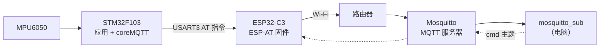
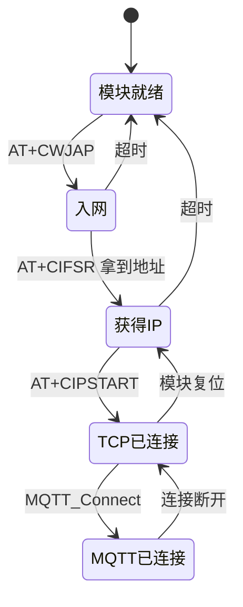
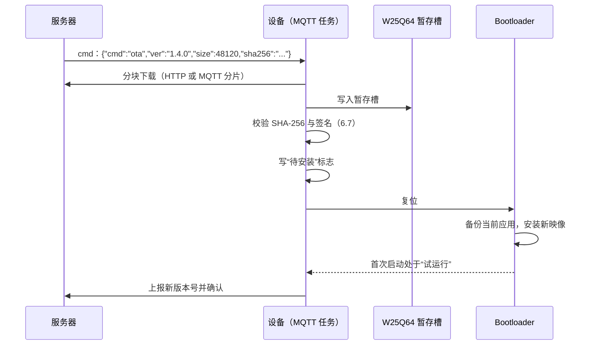

# 7.3 联网固件

在仅拥有 20 KB SRAM 的微控制器（例如 STM32F103C8）上构建物联网终端，开发者面临着严苛的物理资源约束。假若直接在主控芯片内强行编译运行 lwIP 协议栈并挂载 mbedTLS 加密库，光是维持 TCP 连接所需的滑动窗口收发缓冲与 TLS 握手状态，就会瞬间吃掉大半内存，剩余空间甚至无法维系基础的任务调度或传感器驱动。在工业级嵌入式架构中，一种极为经典且高效的分工模式应运而生：将繁重的 TCP/IP 协议栈与底层射频控制下放给独立的专用通信模组，主控 MCU 仅通过标准串口以 AT 指令与模组交互，自身则聚焦于应用层协议编排与核心物理业务逻辑。

这里为 [7.2 RTOS 多任务设备](/教程/正文/嵌入式/7_综合实践/7_2_RTOS多任务设备) 中的多任务姿态记录仪赋予完整的云端互联能力：系统启动后驱动通信模组自动连入 Wi-Fi 网络，周期性将姿态遥测数据推送到 MQTT 服务器的 `mdr/<设备号>/telemetry` 专用主题，同时订阅 `mdr/<设备号>/cmd` 以监听执行采样率微调、设备受控重启以及远程升级通知等云端指令；一旦偶发网络断连，调度层依托指数退避配合随机抖动的智能算法平滑发起重连，在离线期间传感器数据无缝写入底层 Flash 文件系统，待网络自愈后实施限速断点续传。在架构上，MQTT 报文依托轻量级开源栈 coreMQTT 生成，传输层被抽象为可插拔函数指针，使得完全相同的应用层业务逻辑既可在目标板上通过 AT 机制透传，亦可在宿主机 PC 环境下借助原生套接字（Winsock/POSIX）完成闭环单元调试。工程源码位于 `code/嵌入式/7_综合实践/7_3_联网固件/`。

## 1. 网络架构

一条传感器遥测数据自物理硬件采集直到远端订阅者接收的完整拓扑路径如下：



在云端主题规划上，设备与 MQTT 服务器之间仅维持三个精简的通信主题：

| 主题 | 方向 | 负载 | QoS |
| --- | --- | --- | --- |
| `mdr/<设备号>/telemetry` | 设备 → 服务器 | JSON 遥测 | 0 |
| `mdr/<设备号>/status` | 设备 → 服务器 | `online` / `offline`（遗嘱） | 1 |
| `mdr/<设备号>/cmd` | 服务器 → 设备 | JSON 命令 | 1 |

设备身份编号直接萃取自 STM32 芯片内置的 96 位硬件唯一 UID（定址于内部只读存储区 `0x1FFFF7E8` 起的 12 个字节中），读取后取其低 32 位格式化为 8 位十六进制文本。这种方案赋予了设备天然的全球唯一身份标识，彻底消除了量产烧录时人工分配与配置设备序列号的繁琐工序，杜绝了多机并网时的身份碰撞。

高频遥测数据包内部的数据字段规范如下：

| 字段 | 单位 | 类型 | 说明 |
| --- | --- | --- | --- |
| `ts` | 秒 | 整数 | Unix 纪元时间戳，依托 SNTP 网络对时填充 |
| `ax` `ay` `az` | mg | 整数 | 解算后的三轴物理加速度分量 |
| `pitch` `roll` | 0.01° | 整数 | 姿态俯仰角与翻滚角（放大 100 倍以整型存储） |
| `seq` | — | 整数 | 自系统上电以来单调自增的消息序列号 |

数据包的拼装直接借助紧凑的 `snprintf()` 格式化指令，避免引入任何第三方的动态 JSON 编解码库：

```c
int n = snprintf(buf, sizeof buf,
                 "{\"ts\":%lu,\"ax\":%d,\"ay\":%d,\"az\":%d,"
                 "\"pitch\":%d,\"roll\":%d,\"seq\":%lu}",
                 (unsigned long)ts, s.ax, s.ay, s.az, s.pitch, s.roll,
                 (unsigned long)seq);
```

由于所传输的全部为整型数值且格式高度固定，基于栈缓冲区的文本格式化不仅执行迅速，而且彻底免除了堆内存反复分配与释放带来的微观内存碎片隐患，对于内存极度紧凑的系统是最稳健的工程选择。

在服务质量等级（QoS）的选取上体现了清晰的业务分级思想：周期性高频遥测数据采用 QoS 0，即便在无线信道偶发衰落时丢失个别数据帧，下一个周期的新鲜数据也会在几十毫秒后迅速覆写，若强行开启 ACK 重传机制反而会大量消耗有限的串口带宽并引发通信队列积压；而针对控制指令与上下线状态，则必须采用 QoS 1 以确保“至少送达一次”。遗嘱消息（Last Will and Testament, LWT）在初始发起 CONNECT 握手时便预先向服务端备案，一旦设备遭遇异常断电或物理掉线，MQTT 服务器将代为自动广播 `offline` 离线报文，订阅方无需任何额外的轮询心跳即可即时感知设备异常。

::: concept emb73-topic-convention title="主题与负载的约定"

通信主题固定为 `mdr/<设备号>/telemetry`、`mdr/<设备号>/status` 以及 `mdr/<设备号>/cmd` 三项。遥测数据的 JSON 字段包含 `ts`（Unix 秒）、`ax`/`ay`/`az`（mg）、`pitch`/`roll`（0.01°）以及自增序列号 `seq`，全部使用标准整型表示。设备编号为芯片 96 位唯一硬件 ID 的低 32 位，采用 8 位十六进制小写格式。后续 7.4 节中的嵌入式 Linux 平台亦全面依循此项规范。

:::

<Quiz
  type="multi"
  :options="[
    { label: '遥测用 QoS 0，丢一帧下个周期就补上', value: 'A' },
    { label: '命令用 QoS 1，至少送达一次', value: 'B' },
    { label: '遗嘱消息让服务器在设备掉线后代发 offline', value: 'C' },
    { label: '所有主题都用 QoS 2，保证不重复', value: 'D' }
  ]"
  :answer="['A', 'B', 'C']"
>

<template #question>

关于本页的主题与 QoS 选择，哪些说法正确？

</template>

正确答案是 **A、B、C**。QoS 2 拥有最为繁重的四次握手确认流程，在 100 Hz 的遥测上完全没有必要——丢一帧下个周期就补上；偶发重复的数据帧对遥测分析毫无损害，而对于控制指令则可在应用层借助 `seq` 序列号轻松完成幂等去重。选项 D 盲目追求最高可靠等级，脱离了嵌入式通信的带宽与算力实际。

</Quiz>

## 2. 两种 MQTT 做法

在嵌入式通信模组选型中，通常存在两条截然不同的技术路线。第一种是直接使用模组固件内置的高层 MQTT 指令集，主控芯片仅需通过串口向模组抛送目标主题与字符串文本，由模组内部固件独立维护底层的 TCP 链路、定时保活心跳与断线重连：

```text
AT+MQTTUSERCFG=0,1,"mdr-1a2b3c4d","user","pass",0,0,""
AT+MQTTCONN=0,"broker.example.com",1883,1
AT+MQTTPUB=0,"mdr/1a2b3c4d/telemetry","{\"ax\":12,...}",0,0
AT+MQTTSUB=0,"mdr/1a2b3c4d/cmd",1
```

第二种路线是让外部通信模组仅充当透明的传输层通道（通过 `AT+CIPSTART` 建立基础 TCP 连接，`AT+CIPSEND` 发送裸字节，`+IPD` 接收原始字节流），完整的 MQTT 协议状态机则由运行在主控 MCU 上的轻量级 coreMQTT 协议栈统一接管。

| 对比项 | 模组自带 MQTT | MCU 运行 coreMQTT |
| --- | --- | --- |
| MCU 资源开销 | 最省，MCU 仅负责组装纯文本字符串 | 额外占用约 5～6 KB Flash 与 1～2 KB 静态收发缓冲 |
| 协议可控性 | 较低，重连节奏、心跳超时均受制于模组固件实现 | 极高，退避策略、遗嘱机制、分包重组完全由自身代码主导 |
| 网络硬件迁移 | 强依赖特定模组专有指令，更换模组需重写驱动 | 仅需重写底层传输层适配，上层核心应用代码 100% 保持不动 |
| 故障排查能力 | 黑盒运行，异常时只能被动观察模组返回的错误码 | 可直接在内存中断点审查协议二进制字节流，调试清晰透明 |

架构决策取决于产品生命周期的技术定位：倘若硬件方案高度定型且业务极其单一，使用模组自带指令确实最为直观省事；然而，一旦工程面临未来更换网络硬件（例如将 Wi-Fi 模组无缝替换为 4G Cat.1 模块或有线以太网控制器）、需要在边缘侧实施高度定制的离线重传与指数退避、或者需要在没有实体硬件接入的前提下在 PC 端提前开展全链路仿真测试，采用 coreMQTT 配合可插拔传输层是显而易见的专业选择。这也是本章重点展开的主线，其应用代码可无缝迁移至 7.4 节的 Linux 平台复用。

工程选用的 coreMQTT 锁定为 v2.3.1 版本，完整依循工业界广泛支持的 MQTT 3.1.1 协议规范。

::: compare left-title="模组自带 MQTT" right-title="coreMQTT + TCP"

```c
/* MCU 仅负责拼装文本，连接、心跳保活与重试完全受控于模组固件 */
at_send("AT+MQTTPUB=0,\"mdr/%s/telemetry\",\"%s\",0,0", id, json);
```

---

```c
/* 传输层仅负责字节搬运，MQTT 协议状态完全由 MCU 内部算法主导 */
MQTTStatus_t st = MQTTPublish(&ctx, topic, &payload);
if (st != MQTTSuccess) {
    /* 应用层完全自主掌控退避休眠、状态打卡与离线转存决策 */
}
```

:::

## 3. AT 任务

基于串口的 AT 指令交互本质上属于串行“请求-应答”半双工信道，一旦多个上层任务在未加防护的前提下并发向串口抛送指令，模组接收端收到的指令字节与回传应答必将错位践踏。因此其架构模型必须与 7.2 节中的硬件总线保持一致：专门设立一个独立的 `at_task` 独占操控 USART3 硬件外设，其他业务任务均作为客户端通过请求队列向其提交操作。



状态机的异常转移逻辑严格依循渐进回退原则：一旦检测到网络链路断开，状态机仅回退至就绪态重新建链，绝不轻易对通信模组实施物理下电复位。

模组回传数据的捕获延续了内核流缓冲区（Stream Buffer）的设计。通信模组在网络侧收到远端数据时，会通过形如 `+IPD,<len>:` 的未提示结果码（URC）主动上报；此时 AT 任务必须首先准确解析出长度参数 `len`，随后在流缓冲区中严格读取精准匹配的字节数，绝对禁止简单依据 `\r\n` 回车换行符来判断报文终结——因为 MQTT 作为纯二进制协议，其报文头部的剩余长度字段或承载的负载内容本身，均可能合法包含十六进制数值 `0x0D` 与 `0x0A`：

```c
/* 从 +IPD,<len>: 里取出长度，再收 len 字节 */
int len = atoi(p);
uint8_t payload[512];
size_t got = 0;
while (got < (size_t)len) {
    got += xStreamBufferReceive(g_uart3_rx, &payload[got], len - got, pdMS_TO_TICKS(100));
}
```

在真实的通信流中，模组的主动上报事件（URC）往往会冷不防穿插在常规指令执行的应答字符之间（例如在等待某个操作返回 `OK` 的间隙，网络侧突然涌入一段 `+IPD` 报文）。AT 任务内部通过构建轻量级的分层文本解析器，将包含定长截断逻辑的 `+IPD` 识别路径与常规状态码比对平滑分离，确保数据流边界的严丝合缝。

上层任务向 AT 服务提交请求的结构体规约如下：

```c
enum at_op { AT_OP_CONNECT, AT_OP_SEND, AT_OP_RECV };

struct at_request {
    enum at_op op;
    const char *arg;
    uint8_t *buf;
    size_t len;
    TaskHandle_t waiter;
};

bool at_submit(const struct at_request *req, TickType_t timeout);
```

`at_submit()` 在将任务描述放入通信队列后，立即调用 `xTaskNotifyWait()` 主动让出 CPU 并挂起等待。由于每个通信事务均严格归属于单一调用方，轻量高效的单任务通知机制足以完全替代重量级的信号量同步。

<Quiz
  type="single"
  :options="[
    { label: '按 +IPD 里的长度精确读这么多字节，前面可能有 \\r\\n', value: 'A' },
    { label: '读到 \\r\\n 就认为一个报文结束', value: 'B' },
    { label: '每次固定读 1024 字节再解析', value: 'C' },
    { label: '按行读，遇到 MQTT 报文就整行交给 coreMQTT', value: 'D' }
  ]"
  answer="A"
>

<template #question>

从 `+IPD` 里取 MQTT 数据时，接收端的读法应当是哪个？

</template>

正确答案是 **A**。协议中明确给出了载荷长度标识，解析时必须严格根据该参数实施定长字节读取。选项 B 与 D 错误地将二进制协议当做 ASCII 文本处理，当数据中恰好出现对应 `\r\n` 的连续十六进制字节 `0x0D 0x0A` 时，就会造成协议包被腰斩破碎；选项 C 强行固定块尺寸读取，则会把后续到来的新报文头部一并误吞，破坏数据流对齐。

</Quiz>

## 4. coreMQTT 的传输层

coreMQTT 协议库在架构上做到了与底层通信物理实现的彻底解耦，其并不关心数据是通过物理网卡、蜂窝模块还是虚拟套接字发出，仅要求宿主环境提供一张微型抽象接口表：

```c
typedef struct TransportInterface {
    TransportRecv_t recv;
    TransportSend_t send;
    NetworkContext_t *pNetworkContext;
} TransportInterface_t;
```

接口中的 `send` 负责将指定长度的二进制切片推向物理信道并返回实际传输字节数；`recv` 负责自接收缓冲区截取至多指定长度的数据。在设计哲学上，两个函数均要求保持“无记忆性”，严禁在内部隐式加入阻塞重试循环：一旦遇到底层链路中断或异常，函数必须如实向上层反馈失败，把系统层面的退避决策权完全交还给状态机管理者。若在传输层中盲目死等重试，反而会彻底破坏 coreMQTT 内置的心跳监控状态机。

在单片机硬件侧，`send` 函数将数据包组装为 AT 发送请求提交给独占任务：

```c
static int32_t esp_at_send(NetworkContext_t *ctx, const void *buf, size_t len) {
    struct at_request req = {
        .op = AT_OP_SEND,
        .arg = "AT+CIPSEND",
        .buf = (uint8_t *)buf,
        .len = len,
    };
    if (!at_submit(&req, pdMS_TO_TICKS(1000))) {
        return -1;
    }
    return (int32_t)len;
}
```

模组在接收到 `AT+CIPSEND=<len>` 指令后会先回复一个 `>` 引导提示符，随后才允许注入真实数据载荷。AT 任务在底层将这些时序细节完整封装，使得从 coreMQTT 的宏观视角审视，这不过是一次标准的二进制同步输出。

与此相对应，`recv` 接口则直接对接流缓冲区：

```c
static int32_t esp_at_recv(NetworkContext_t *ctx, void *buf, size_t len) {
    /* 不阻塞：coreMQTT 在 ProcessLoop 里会重复调用，每次少量读 */
    size_t got = xStreamBufferReceive(g_ipd_stream, buf, len, 0);
    return (int32_t)got;
}
```

当流缓冲区中暂无数据时，该接口立即返回 0，coreMQTT 会在轮询调度中合理安排重读间隙；只有当物理信道检测到断开或链路失效时，函数才返回负数错误代码以驱动上层状态机触发重连流程。

当代码运行在宿主机 PC 端时，完全相同的核心应用逻辑只需绑定基于 Winsock 的传输实现即可平滑运转：

```c
/* transport_winsock.c */
static int32_t winsock_send(NetworkContext_t *ctx, const void *buf, size_t len) {
    int n = send(ctx->sock, buf, (int)len, 0);
    return n < 0 ? -1 : n;
}

static int32_t winsock_recv(NetworkContext_t *ctx, void *buf, size_t len) {
    int n = recv(ctx->sock, buf, (int)len, 0);
    return n;
}
```

::: tip 传输层只做字节搬运

切勿在 `send` 接口内部隐式嵌入复杂的重试逻辑，也严禁在 `recv` 中进行长周期的死锁等待。传输层明确的错误返回是上层 coreMQTT 状态机精准判定“当前 TCP 链路已损毁”的唯一可靠依据；在底层滥加拦截不仅会导致网络心跳保活机制彻底失效，还会给系统引入难以预测的延迟隐患。

:::

## 5. MQTT 任务

MQTT 任务是整个固件中唯一被授权直接操作 coreMQTT 状态机的执行上下文。在初始化阶段，系统向其注入一块预先静态开辟的 1024 字节网络通信缓冲区，后续所有的握手、心跳以及遥测序列化均局限在此空间内流转，坚决杜绝运行期动态堆内存申请：

```c
static uint8_t g_network_buf[1024];
static MQTTFixedBuffer_t g_net_buf = {
    .pBuffer = g_network_buf,
    .size = sizeof g_network_buf,
};
static MQTTContext_t g_mqtt;
static TransportInterface_t g_transport;

/* coreMQTT 用它算保活与超时，单位毫秒 */
static uint32_t get_time_ms(void) {
    return (uint32_t)((uint64_t)xTaskGetTickCount() * 1000u / configTICK_RATE_HZ);
}

/* 收到 PUBLISH 等事件时被调用，命令在这里执行 */
static void on_event(MQTTContext_t *ctx, MQTTPacketInfo_t *info,
                     MQTTDeserializedInfo_t *deser) {
    (void)ctx;
    if ((info->type & 0xF0u) == MQTT_PACKET_TYPE_PUBLISH) {
        handle_command(deser->pPublishInfo);
    }
}

static bool mqtt_init(void) {
    g_transport.pNetworkContext = &g_net_ctx;
    g_transport.send = esp_at_send;
    g_transport.recv = esp_at_recv;

    MQTTStatus_t st = MQTT_Init(&g_mqtt, &g_transport, get_time_ms, on_event, &g_net_buf);
    return st == MQTTSuccess;
}
```

这块 1024 字节的静态缓冲区足以轻松容纳 48 字节的连接请求或数百字节的综合遥测报文，但显然无法直接承载动辄数十千字节的固件升级包（OTA 镜像）。在后文的系统演进中可以看到，远程升级通知仅承载元数据摘要，大块二进制镜像走独立的分片传输路径。

在建立连接时，需向协议上下文填入保活时钟、会话重置标志以及遗嘱参数：

```c
MQTTConnectInfo_t conn = {
    .cleanSession = true,
    .keepAliveSeconds = 30,
    .pClientIdentifier = device_id,
    .clientIdentifierLength = strlen(device_id),
    .pUserName = user,
    .userNameLength = strlen(user),
    .pPassword = pass,
    .passwordLength = strlen(pass),
};

MQTTPublishInfo_t will = {
    .qos = MQTTQoS1,
    .pTopicName = status_topic,
    .topicNameLength = strlen(status_topic),
    .pPayload = "offline",
    .payloadLength = 7,
};

bool session_present = false;
MQTTStatus_t st = MQTT_Connect(&g_mqtt, &conn, &will, 5000, &session_present);
```

当网络握手成功之后，客户端立即向状态主题广播 `online` 标记，并随即订阅专属命令主题：

```c
MQTTSubscribeInfo_t sub = {
    .qos = MQTTQoS1,
    .pTopicFilter = cmd_topic,
    .topicFilterLength = strlen(cmd_topic),
};
(void)MQTT_Subscribe(&g_mqtt, &sub, 1, packet_id++);
```

任务主循环的核心驱动引擎是 `MQTT_ProcessLoop()`：该例程负责自物理传输层提取输入数据流、触发保活 PINGREQ 心跳计数、并在捕获到有效下行报文时分发至事件回调。这里的轮询节拍体现了一种精巧的动态平衡——为满足 30 秒的 MQTT 心跳规约，内核必须在超时阈值内至少发起一次处理；而为了即时响应控制台下发的控制指令，事件循环需维持更高频度的检查：

```c
for (;;) {
    (void)MQTT_ProcessLoop(&g_mqtt, 100);

    if (xTaskGetTickCount() - last_pub >= pdMS_TO_TICKS(pub_period_ms)) {
        last_pub = xTaskGetTickCount();
        publish_telemetry();
    }
    monitor_check_in(5);
}
```

将 `ProcessLoop` 的内部接收阻塞窗口设定为 100 ms，使得即便在网络静默、无任何外部数据流入的常态下，循环体也能按时苏醒，既保证了遥测数据的按期推送，又杜绝了任务因长时间深陷等待而无法向健康监视表打卡的问题。

### 5.1 CONNECT 报文逐段看

CONNECT 报文作为设备并网发出的首个控制单元，涵盖了最完整的字段结构。以下展示示例程序实际发出的 48 字节报文十六进制切片（客户端标识 `mdr-0001`，遗嘱主题 `mdr/0001/status`，遗嘱内容 `offline`，保活周期 30 秒）：

```text
10 2E 00 04 4D 51 54 54 04 0E 00 1E
00 08 6D 64 72 2D 30 30 30 31
00 0F 6D 64 72 2F 30 30 30 31 2F 73 74 61 74 75 73
00 07 6F 66 66 6C 69 6E 65
```

逐层拆解其协议规范：

| 字节 | 含义 |
| --- | --- |
| `10` | 报文类型高 4 位为 1（CONNECT），标志位低 4 位保持全 0 |
| `2E` | 剩余长度字段，单字节表示十进制 46 |
| `00 04 4D 51 54 54` | 协议名称长度 4 字节，后跟 ASCII 字符串 "MQTT" |
| `04` | 协议级别版本号 4，对应 MQTT 3.1.1 规范 |
| `0E` | 连接标志字节：清空会话、开启遗嘱、遗嘱 QoS 1 |
| `00 1E` | 大端 16 位保活时间，数值为 30 秒 |
| `00 08 …` | 客户端标识符长度为 8，后跟 ASCII 字符串 `mdr-0001` |
| `00 0F …` | 遗嘱主题长度为 15，后跟 `mdr/0001/status` |
| `00 07 offline` | 遗嘱载荷长度为 7，后跟字符串 `offline` |

其中连接标志字节（`0x0E` 即二进制 `0000 1110`）的各二进制位具有明确的协议映射：bit 1 为 Clean Session（置 1 强制每次连接建立纯净会话），bit 2 为 Will Flag（置 1 声明携带遗嘱信息），bit 3～4 为 Will QoS（本例置为 `01` 对应 QoS 1），bit 5 为 Will Retain 保留标志，bit 6 与 bit 7 分别代表密码与用户名存在标志。

MQTT 的“剩余长度”（Remaining Length）采用精妙的变长无符号编码（Variable Byte Integer）：数值在 0 至 127 之间时仅耗用 1 个字节；当数值超越 127 时，最高位（MSB）置 1 充当延续标志，低 7 位承载有效数值位。由于当前报文后续有效长度为 46 字节，小于 128，因而单字节 `0x2E` 即可准确表达。

<Quiz
  type="single"
  :options="[
    { label: '0x10 是报文类型，0x2E 是剩余长度，46 字节', value: 'A' },
    { label: '0x10 是剩余长度，0x2E 是报文类型', value: 'B' },
    { label: '0x2E 是协议级别', value: 'C' },
    { label: '0x2E 是客户端标识的长度', value: 'D' }
  ]"
  answer="A"
>

<template #question>

`10 2E 00 04 4D 51 54 54 …` 里，前两个字节各是什么？

</template>

正确答案是 **A**。固定报头首字节高 4 位标明报文类别（`1` 对应 CONNECT），低 4 位为特定控制标志；自第二字节开始编码剩余长度，`0x2E` 最高位为 0 表明单字节终结，其数值折合十进制 46 字节。选项 C 混淆了后续的可变报头字段，选项 D 混淆了有效载荷部分。

</Quiz>

## 6. 断线与重连

### 6.1 退避与抖动

固定间隔重连的问题是所有设备同时回来。一次区域停电后，一千台设备每 1 秒撞一次服务器，服务器扛不住又断，形成雪崩。指数退避把间隔逐步拉长，随机抖动则把设备的尝试时刻打散。

3.8 的习题做过 1/2/4/8 秒的固定倍数退避。这里用 FreeRTOS 的 backoffAlgorithm，它在指数退避的基础上加了抖动：

```c
static BackoffAlgorithmContext_t g_backoff;
static uint32_t g_backoff_seed; /* 从唯一 ID 取，各设备不同 */

BackoffAlgorithm_InitializeParams(&g_backoff, 1000, 64000, &g_backoff_seed,
                                  UINT16_MAX);

/* 每次失败后：取出本次的等待时间，溢出与重试次数上限由库处理 */
uint32_t next_ms = 0;
BackoffAlgorithmStatus_t st = BackoffAlgorithm_GetNextBackoff(&g_backoff, &next_ms);
if (st == BackoffAlgorithmSuccess) {
    vTaskDelay(pdMS_TO_TICKS(next_ms));
}
```

在策略参数上，初始重试门限设定为 1 秒，后续按指数递增为 2、4、8……直至 64 秒触顶饱和；每次重试的实际休眠时长取在理论上限的一半至上限之间，这使得多台在相近时刻断网的设备，其后续所有的重试时刻都在时域上被均匀错开。

示例程序通过仿真模型直观呈现了这一机制的宏观表现：

::: terminal title="PowerShell - 退避策略对比"

```text
固定间隔（8 次尝试，单位秒）：
    1.0  1.0  1.0  1.0  1.0  1.0  1.0  1.0
  累计 8 秒

指数退避加抖动（3 台设备，各 8 次尝试，单位秒）：
  设备 1：  0.6  1.0  3.4  6.3 15.7 18.3 47.0 34.2
          累计 126.5 秒
  设备 2：  0.9  1.8  2.9  6.2 15.6 29.7 34.0 33.4
          累计 124.5 秒
  设备 3：  0.6  1.1  3.4  6.0 15.5 25.0 53.0 32.7
          累计 137.3 秒

上限序列：1、2、4、8、16、32、64、64 秒，之后一直封顶在 64 秒
```

:::

固定间隔策略在短促的 8 秒内便发起了 8 次高频撞击，若有成百上千台设备同时如此，服务器极易再度过载崩溃；而指数退避配合抖动后，第 8 次尝试单次休眠已自然拉长至半分钟，为云端基础设施的自我修复留出了长达两分钟的平稳窗口，同时三台设备的重试时钟彼此错落交替。

::: compare left-title="固定间隔" right-title="指数退避加抖动"

```c
for (;;) {
    if (mqtt_connect()) {
        break;
    }
    vTaskDelay(pdMS_TO_TICKS(1000));
}
```

---

```c
for (;;) {
    if (mqtt_connect()) {
        BackoffAlgorithm_Reset(&g_backoff);
        break;
    }
    uint32_t wait_ms = 0;
    (void)BackoffAlgorithm_GetNextBackoff(&g_backoff, &wait_ms);
    vTaskDelay(pdMS_TO_TICKS(wait_ms));
}
```

:::

### 6.2 离线缓存与补传

在外部网络物理中断期间，7.2 节建立的传感器采集流水线依然照常工作，并将解算后的姿态记录无损追加至 Flash 上的 littlefs 日志文件中，仅将实时网络推送挂起。当无线链路重新恢复连通后，系统绝不能将积压的历史样本一次性全量喷涌而出——那会瞬间耗尽串口传输能力并引发新的网络拥塞，甚至拖慢当前的实时控制。

工程采用交织限速的“按需平滑补传”策略：

```c
/* 每发一条实时遥测，最多补 1 条历史；补齐后再关掉补传 */
if (g_replay_count > 0 && g_replay_due) {
    send_one_replay();
    --g_replay_count;
}
send_one_realtime();
```

通过赋予即时采集的最新遥测以最高优先级，仅在每帧实时数据发出后的间隙，利用剩余通信配额自 Flash 文件中解析一条历史数据交织发出。这种设计确保了系统无论在离线积压多么庞大的状态下恢复，其当前的实时通信延迟都不会受到破坏。

### 6.3 看门狗与网络

在嵌入式固件体系中，必须建立清晰的故障责任边界：网络信号长时间断开属于不可控的外部环境异常，绝不应当被误判为微控制器的程序跑飞。单纯因外部基站断网而对 MCU 实施硬件强制复位毫无现实意义，反而会抹除内存中的关键工作状态并加剧内部介质擦写。

系统依循三项明确的健壮性防线：

1. MQTT 任务在每一轮重试循环中无条件向监视表执行打卡，向系统确凿证明“当前业务任务逻辑活跃，仅处于等待退避中”，从而免除独立看门狗误判。
2. 若连续重连失败时间跨度超过 5 分钟，调度层认定外部通信模组可能陷入未知的总线假死，通过引脚或复位指令单独对通信模组实施物理下电复位，主控程序自身保持稳健运行。
3. 只有当云端指令主题显式下发具备有效凭证的 `reboot` 命令时，系统才执行受控的有序软复位。

::: warning 重连任务本身也要打卡

若开发者将打卡动作错误地安放在“MQTT 握手成功”的分支内部，外部一旦出现持续断网，任务就会停止打卡，独立看门狗在 2 秒后强制引发系统硬件复位。随后设备不断在“启动—连不上网—看门狗复位”的死循环中挣扎，彻底丧失自愈能力。打卡动作必须始终位于主循环体内部。

:::

<Quiz
  type="single"
  :options="[
    { label: '网络断开也算一次失败，等待 1 秒重试', value: 'A' },
    { label: '每次失败后等待时间按指数增长，并加随机抖动', value: 'B' },
    { label: '网络断开就整机复位，从头再来', value: 'C' },
    { label: '断开后立刻连续重连，直到成功为止', value: 'D' }
  ]"
  answer="B"
>

<template #question>

一千台设备同时掉线，服务器重启后怎样避免被重连风暴打垮？

</template>

正确答案是 **B**。指数退避拉开尝试时间轴，随机抖动在时域上错开峰值流量。选项 A 会保留完全一致的时钟周期导致反复冲击；选项 C 会让设备陷入无尽的硬件复位死锁；选项 D 会瞬间发起高密度的 SYN 泛洪直接打瘫服务端。

</Quiz>

## 7. 时间与配置

遥测数据包中的 `ts` 时间戳要求具备真实的物理时间含义。由于 STM32F103 芯片未配备备用纽扣电池维系 RTC 运转，系统在每次初次连入互联网后，依托标准 SNTP 协议向远端时间服务器请求对时：

```text
AT+CIPSNTPCFG=1,8,"ntp.aliyun.com"
AT+CIPSNTPTIME?
```

模组回传的文本形如 `+CIPSNTPTIME:Fri Oct 23 18:42:11 2026`。AT 解析器将其格式化为标准的 `struct tm` 时间实体，并转化为从 1970 纪元开始的 UTC 秒级时间戳。对时完成后，后续的日常时间推进完全交由本地内核高精度节拍推算：

```c
uint32_t now = g_boot_unix + (xTaskGetTickCount() - g_boot_tick) / configTICK_RATE_HZ;
```

Wi-Fi 接入凭据（SSID 与密钥）、远端服务器域名端口等关键系统参数，均存储于 [3.9 Flash、EEPROM、SD 与文件系统](/教程/正文/嵌入式/3_驱动_通信与中间件/3_9_Flash_EEPROM_SD与文件系统) 规范的配置分区中，支持通过终端命令行安全录入。为了防止机密信息外泄，控制台查询指令无论在任何情况下都禁止反显密钥原文。

## 8. 安全

TLS 传输层加密全权下放给专用通信模组卸载（Offload）处理。ESP-AT 允许通过专有指令配置 SSL 客户端连接并将 CA 根证书写入模组的专用安全分区，主控 MCU 仅通过串口向模组抛送明文业务切片，所有的 TLS 握手、X.509 证书链校验与对称会话密钥加解密均在模组内部完成。

之所以坚决不在 STM32F103 内部运行 mbedTLS，是受制于严苛的硬件内存边界：一次标准 TLS 1.2 握手需要至少分配约 30 KB 的动态 RAM，这已远远超越了当前芯片仅有 20 KB 的 SRAM 物理总容量。

在端到端系统安全设计中，TLS 加密主要负责防范数据在公网传输过程中的监听与中间人篡改，而固件镜像的真实性防线则必须依托 [6.7 安全启动、映像校验与密钥](/教程/正文/嵌入式/6_质量_安全与交付/6_7_安全启动_映像校验与密钥) 讨论的基于公私钥体系的数字签名机制。即便远端服务器遭受意外渗透，未经开发者私钥签名的恶意固件在设备端落地时也会被 Bootloader 拦截销毁，两者构成了互为补充的双层纵深防御体系。

## 9. 在 PC 上联调

MQTT 应用层业务逻辑与底层物理传输层实现了彻底剥离，在宿主机 PC 上运行时只需替换为 Winsock 传输驱动即可平稳执行。示例工程将一个微型模拟 Broker 与设备客户端收拢在单进程内，依托本地回环地址（127.0.0.1）即可完成端到端的握手闭环：

::: terminal title="PowerShell - 回环联调"

```text
$ gcc -std=c17 -Wall -Wextra mqtt_demo.c mqtt_packet.c -lws2_32 -o mqtt_demo
$ ./mqtt_demo
[设备] CONNECT 报文 48 字节
       （48 字节）：10 2E 00 04 4D 51 54 54 04 0E 00 1E 00 08 6D 64 72 2D 30 30 30 31 00 0F 6D 64 72 2F 30 30 30 31 2F 73 74 61 74 75 73 00 07 6F 66 66 6C 69 6E 65
[服务器] 收到 CONNECT：（48 字节）：10 2E 00 04 4D 51 54 54 04 0E 00 1E 00 08 6D 64 72 2D 30 30 30 31 00 0F 6D 64 72 2F 30 30 30 31 2F 73 74 61 74 75 73 00 07 6F 66 66 6C 69 6E 65
[设备] 收到 CONNACK：（4 字节）：20 02 00 00
[服务器] 收到 SUBSCRIBE：（19 字节）：82 11 00 02 00 0C 6D 64 72 2F 30 30 30 31 2F 63 6D 64 00
[设备] 收到 SUBACK：（5 字节）：90 03 00 02 00
[设备] PUBLISH 报文 99 字节
[服务器] 收到 PUBLISH：主题 mdr/0001/telemetry，负载 {"ts":1761200000,"ax":12,"ay":-340,"az":995,"pitch":-1.9,"roll":19.0,"seq":1}
[服务器] 收到 PINGREQ，已回 PINGRESP
[设备] 收到 PINGRESP：（2 字节）：D0 00
[服务器] 收到 DISCONNECT
[结果] 收到 1 条 PUBLISH，最后一条：mdr/0001/telemetry -> {"ts":1761200000,"ax":12,"ay":-340,"az":995,"pitch":-1.9,"roll":19.0,"seq":1}
```

:::

测试程序中精巧地手工实现了 150 行的轻量级报文编解码器，使得每一段在信道上穿梭的原始十六进制字节均一目了然：无论是 CONNECT 固定头 `10 2E`、CONNACK 确认头 `20 02 00 00`，还是订阅响应 `90 03`，其底层布局与 coreMQTT 运行库高度吻合。在协议联调遭遇异常时，对照底层字节映射能够瞬间界定出是网络链路破损还是应用载荷解析失准。

::: tip 先让字节对上，再调业务

物联网网络调试通常可解耦为两个阶段：首先确认底层握手（TCP 连通性、CONNECT 认证与会话建立状态），其次审查业务层数据对齐（主题匹配与 JSON 字段完备度）。前者通过审查服务端的 CONNACK 返回码即可定位，后者可在宿主机上捕获原始主题与载荷直接排查，分阶段推进能极大压缩联调周期。

:::

## 10. 其他网络方案

**W5500 硬件协议栈方案**。W5500 是一款集成硬件 TCP/IP 协议栈的高集成度以太网控制芯片，通过 SPI 总线与 MCU 互联，其内部固化了完整的传输层状态机并提供 8 个物理套接字，主控 MCU 只需读写芯片内部寄存器即可完成收发。在必须依赖有线以太网且主控资源极其有限的场合，这是一种极为实用的工程权衡。coreMQTT 仅需将传输层的 `send` 与 `recv` 映射至 W5500 的 socket 接口，核心业务逻辑一行无需变动。

**集成 MAC 的主控 + lwIP OS 模式**。对于诸如 STM32F407 这类内置以太网 MAC 外设的高性能微控制器，通常外挂一片物理层 PHY 芯片即可在 MCU 内部完整运行开源协议栈 lwIP。在多任务 RTOS 环境下，lwIP 运行于多线程 OS 模式，所有外部套接字调用最终均汇总至专属的 `tcpip_thread` 核心服务线程处理：

```c
/* OS 模式：应用的 socket 调用最终排到 tcpip_thread */
sock = lwip_socket(AF_INET, SOCK_STREAM, 0);
lwip_connect(sock, &addr, sizeof addr);
lwip_send(sock, buf, len, 0);
```

操作系统抽象层 `sys_arch` 负责将 lwIP 内部所需的信号量、互斥锁与消息邮箱一一映射至 FreeRTOS 的原生内核对象，为主控芯片提供了完全自主可控的网络协议栈掌控力。

**模组固件内置 MQTT**。如第 2 节所对比，该方案对 MCU 的资源侵占最小，对于指令简单、无需深度定制重试策略的轻量级物联网设备是性价比较高的选择。

工程选型的评判依据在于网络物理形态的稳定性：若产品仅固定使用 Wi-Fi 且无迁移诉求，采用内置 MQTT 的模组方案最为快捷；若后续面临在 Wi-Fi、4G Cat.1 与有线网络之间灵活切换，coreMQTT 搭配抽象传输层的解耦架构能够最大限度沉淀业务资产；若必须使用有线网络且无法升级主控芯片，W5500 方案构成了极佳的工程折中。

## 11. 接入远程升级

[6.4 Bootloader 与固件升级](/教程/正文/嵌入式/6_质量_安全与交付/6_4_Bootloader与固件升级) 与 6.7 的签名校验已经就位，7.3 只需把“升级通知”接到网络上：



命令负载里只有元数据，映像本身分块下载，每块校验。下载期间设备继续采样与记录，不能因为升级把当前工作停掉；分块下载与写入暂存槽都在低优先级任务里做，每块之间让出 CPU。

“待安装”标志写在片内 Flash 的配置页（3.9 的配置记录），只从 1 写到 0，掉电后能判断做到哪一步（6.4 讲过这个技巧）。新固件首次启动处于试运行，联网上报版本并收到服务器确认后才转为正式；没确认就重启会回滚到备份槽。

## 12. 习题

### 12.1 巩固

<Exercise id="60721" :d="2" :w="2">

第 5.1 节拆过一份 48 字节的 CONNECT（客户端标识 `mdr-0001`，遗嘱主题 `mdr/0001/status`，内容 `offline`，保活 30 秒）。

(1) 把保活改成 60 秒，哪些字节变化？写出新的报文并说明剩余长度为什么仍是 `2E`。

(2) 加上用户名 `mqtt` 与口令 `secret`，写出连接标志的二进制与十六进制、剩余长度、总长度，并给出新增的三个字段。验收：标志 `CE`，剩余长度 `3C`（60 字节），报文 62 字节。

(3) 客户端标识从 8 字节改成 40 字节，剩余长度与总长度各是多少？标识长度增加到多少时，剩余长度从 1 字节变成 2 字节（门槛是 128）？

(4) 报文里的“协议级别”是 `04`，把它改成 `05` 会发生什么？说明为什么不能只改这一个字节。

</Exercise>

<Exercise id="60722" :d="2" :w="2">

关于主题与 QoS 的取舍（第 1、2、10 节）。

(1) 遥测负载是 `{"ts":1761200000,"ax":12,"ay":-340,"az":995,"pitch":-1.9,"roll":19.0,"seq":1}`，主题 `mdr/0001/telemetry`。写出 QoS 0 报文的剩余长度与总长度；改成 QoS 1 后各是多少？验收：99 与 101 字节。

(2) 为什么命令用 QoS 1 就够，不需要 QoS 2？本页的 `seq` 字段在去重里起什么作用？如果设备重启后 `seq` 归零，服务器该按什么去重？

(3) 遗嘱消息为什么能替代“服务器定时判断设备超时”？把 keepalive 从 30 秒改成 300 秒，服务器多久才能发现掉线？

(4) 填一张三行的选型表：只用 Wi-Fi 且不打算换、需要换 4G、必须有网线且不换芯片。每行写方案与一条理由，并从“MCU Flash / RAM、协议可控性、换网络方案的成本”三列里各挑一列说明。

</Exercise>

<Exercise id="60723" :d="3" :w="2">

`mqtt_packet.c` 的 `put_remaining_length()` 是变长编码，`mqtt_build_connect()` 内部用 `uint8_t body[256]` 拼报文体。

(1) 对 0、46、127、128、16383、16384、2097152 写出编码后的字节序列，说明每多一字节的门槛在哪里。

(2) 写出 `size_t mqtt_remaining_length_size(size_t len)`，返回编码占用的字节数，用上面的数据验证。

(3) 报文体在 `put_string()` 之后才检查 `need > max`。客户端标识长度取 250、再带上遗嘱时，`put_string()` 往 `body[256]` 写到第几个下标？`-Wall -Wextra` 能不能发现？用下标断言或越界检测复现，给出修复：在每次 `put_string()` 之前检查 `p + 2 + strlen(s) <= sizeof body` 并返回 0。

(4) `mqtt_build_subscribe()` 的 `body[128]` 与 `mqtt_build_publish()` 不经过 `body` 的区别在哪里？后者为什么不会越界？它检查的 `need > max` 是否足够？

</Exercise>

### 12.2 编程

<Exercise id="60724" :d="3" :w="3">

`mqtt_packet.c` 只有 QoS 0 的 PUBLISH。补上 QoS 1：

```c
size_t mqtt_build_publish_qos1(uint8_t *out, size_t max, uint16_t packet_id,
                               const char *topic, const char *payload);
```

(1) 固定头第一字节应是什么？可变头里报文标识符放在哪个位置？把它插在主题之后、负载之前。

(2) 用 `mqtt_demo.c` 的同一份主题与负载、标识符取 7 构造，验收总长 101 字节、首字节 `32`、剩余长度 `63`、第 23、24 字节是 `00 07`（大端）。贴出完整十六进制。

(3) 给伪服务器加 `PUBACK`（类型 4，剩余长度 2，回带同一标识符），设备端收齐后打印。验收输出出现 `[设备] 收到 PUBACK：40 02 00 07`。

(4) 说明 QoS 1 的“至少一次”在设备端要做什么才能不重复执行命令：重发时同一个标识符会不会被服务器当成新消息？给出应用层的去重位置。

</Exercise>

<Exercise id="60725" :d="3" :w="3">

`backoff_demo.c` 的抖动取在 `[ceiling/2, ceiling]`，上限从 1 秒翻倍到 64 秒。

(1) 写出前 8 次尝试的上限序列，并说明 `ceiling` 初值为什么是 `BASE_MS / 2`。

(2) 把 `MAX_MS` 改成 30000，重新编译运行。写出新的上限序列与前 8 次的等待值，与原来的输出逐项对照。验收：三台设备的累计等待从 126.5 / 124.5 / 137.3 秒降到 96.6 / 89.8 / 96.9 秒，第 6 次之后不再翻倍。

(3) 用 `BackoffAlgorithm_GetNextBackoff()` 的接口把程序改成“读入种子，打印 N 次等待”，验证同一个种子可复现、不同种子在同一上限下取值不同。

(4) 统计 1000 个不同种子在 `ceiling = 8000` 时的均值，与理论中值 6000 比较，说明抖动为什么是“减一个随机量”而不是“加一个随机量”。

(5) 设备端把种子取什么最合适？用 7.3 的设备号（96 位唯一 ID 的低 32 位）说明这样做的两个好处。

</Exercise>

<Exercise id="60726" :d="4" :w="3">

第 6.2 节的补传只给了“每发一条实时遥测，最多补 1 条历史”。

(1) 实现 `replay_tick()`：维护 `g_replay_count` 与一个“本轮是否已补”的标志，写出实时优先的顺序，保证补传不会连续占用两个发送时隙。

(2) 断网 100 秒、10 Hz 记录，积压多少条？按 1:1 限速补齐需要多久？按每 3 条实时补 1 条呢？给出两个数。

(3) 补齐期间又断网 60 秒，积压会变成多少？说明为什么简单的计数器会无限增长，给出“只补最近 N 条、更早的丢弃”的策略与 N 的取值依据。

(4) 补传读的是记录文件。写出按行解析 `tick,ax,ay,az,pitch,roll` 的函数，处理跨文件边界（`log_000.csv` 读完接 `log_001.csv`）。

(5) 验收：模拟器上构造 5 条积压，`status` 里实时速率不变，日志行数不减少，补传结束后计数归零。

</Exercise>

<Exercise id="60727" :d="4" :w="4">

传输层的两个函数决定 coreMQTT 怎么判断连接好坏。

(1) `esp_at_recv()` 返回 0 表示暂时没数据。改成“没数据时 `vTaskDelay(100)` 再返回 0”会怎样？说明保活为什么可能永远不触发。

(2) 写一份主机上的假传输：`send` 记录字节数与时间，`recv` 按脚本返回“3 字节数据 → 0 → 0 → 负值”。配一个最小的 MQTT 状态循环，验证负值之后才进入重连分支。

(3) 在 `MQTT_ProcessLoop(&g_mqtt, 100)` 里，100 是毫秒超时。设为 0 与设为 `portMAX_DELAY` 时，发布节奏与保活各受什么影响？

(4) 第 6.3 节说 MQTT 任务每轮都打卡。把打卡放进“连接成功”分支，用 `hang` 之外的另一种方式构造断网（让假传输一直返回负值），说明看门狗为什么会在 2 秒后复位，而设备永远连不上。

(5) 给出“连续失败 5 分钟后复位 Wi-Fi 模块”的实现位置与判断条件，说明为什么不在 `send` 里做。

</Exercise>

<Exercise id="60728" :d="4" :w="4">

`AT+CIPSNTPTIME?` 返回 `+CIPSNTPTIME:Fri Oct 23 18:42:11 2026`。

(1) 写 `int parse_sntp(const char *s, struct tm *out)`，解析出年月日时分秒，星期字段允许丢弃。

(2) 不用 `timegm`（MinGW 没有），自己实现 `int64_t days_from_civil(int y, unsigned m, unsigned d)` 与 `int64_t tm_to_unix(const struct tm *tm)`。验收：`2026-10-23 18:42:11` → `1792780931`；`2028-02-29 12:00:00` → `1835438400`；`1970-01-01 00:00:00` → 0。

(3) 把 `timegm` 换成 `mktime`，在东八区的机器上运行，误差是多少小时？说明设备为什么必须用 UTC。

(4) 用“启动时刻的 Unix 秒 + 节拍差”推算当前时间，写出代码。设备连续运行 49.7 天后，`xTaskGetTickCount()` 回绕，推算会不会错？给出依据。

(5) 验收：程序对三个日期输出上面的值，并打印一次“同步后 1 小时”的推算结果。

</Exercise>

<Exercise id="60729" :d="4" :w="4">

`+IPD` 的定长读取只给了骨架，且注释说数据里可能出现 `\r\n`。

(1) 实现 `bool ipd_read_exact(StreamBufferHandle_t sb, uint8_t *dst, size_t len, TickType_t timeout)`：循环 `xStreamBufferReceive`，累计到 `len` 为止，超时返回 false 并给出已收字节数。

(2) 构造一段脚本化字节流：`\r\n+IPD,12:` 后跟 `41 42 0D 0A 4F 4B 00 7F 0D 0A 43 44`，再跟 `\r\nCLOSED\r\n`。验收：12 字节原样交给回调，`CLOSED` 仍作为行处理。

(3) 让 `+IPD` 嵌在 `AT+CIPSEND` 的应答中间（`OK` 之后、`>` 之前），说明 AT 任务该按什么顺序剥这两层，先读长度还是先等提示符。

(4) 把 `payload[512]` 改成按 `len` 动态检查：`len > sizeof payload` 时丢弃并计数，不能让 `atoi` 的结果直接进循环条件。用 `len = 5000` 测试。

(5) 说明为什么这里不能用“读到换行就结束”，并举出 MQTT 报文里出现 `0D 0A` 的一个具体位置。

</Exercise>

### 12.3 综合与挑战

<Exercise id="60730" :d="6" :w="5">

把第 11 节的升级流程做成可在主机上跑的状态机，并接上 6.7 的校验思路。

(1) 定义状态：`IDLE → 收到 ota 命令 → 下载中 → 校验 → 待安装 → 试运行 → 正式`，任一阶段的失败边写清楚。给出状态转移表。

(2) 分块下载 48120 字节的映像，块大小 1024，共几块？每块带序号与 CRC32，写出接收侧的重试与乱序丢弃逻辑。验收：丢掉第 7 块后能重传补齐，最终 CRC 一致。

(3) “待安装”标志写在片内 Flash 的配置页，只从 1 写到 0。设计三个标志位（已下载、已校验、已安装），说明掉电发生在每个阶段时重启后分别读到什么、应该做什么。

(4) 在主机上注入掉电：第 3 块下载后、校验后、写标志后各断一次，运行状态机并打印重启后的决策。验收三次都回到“继续下载”“重新校验”“继续安装”之一，不出现“把半个映像当完整映像”。

(5) 说明 TLS 与签名各防住什么、各防不住什么。服务器被攻破时，TLS 还能不能挡住坏固件？

(6) 试运行阶段没收到服务器确认就重启，为什么应回滚？回滚需要保留哪一份映像，占多少 Flash？

</Exercise>

## 13. 参考资料

- Espressif, *ESP-AT TCP/IP AT Commands*（ESP32-C3）：`AT+CIPSTART`、`AT+CIPSEND`、`+IPD`、`AT+CIPSNTPCFG`。https://docs.espressif.com/projects/esp-at/en/latest/esp32c3/AT_Command_Set/TCP-IP_AT_Commands.html
- Espressif, *ESP-AT MQTT AT Commands*（ESP32-C3）：模块自带 MQTT 的指令对照。https://docs.espressif.com/projects/esp-at/en/latest/esp32c3/AT_Command_Set/MQTT_AT_Commands.html
- FreeRTOS, *coreMQTT* v2.3.1：`MQTT_Init`、`MQTT_Connect`、`MQTT_ProcessLoop`、`TransportInterface_t`。https://github.com/FreeRTOS/coreMQTT
- OASIS, *MQTT Version 3.1.1*：CONNECT 报文、剩余长度、遗嘱消息与 QoS。https://docs.oasis-open.org/mqtt/mqtt/v3.1.1/os/mqtt-v3.1.1-os.html
- FreeRTOS, *backoffAlgorithm* v1.4.1：`BackoffAlgorithm_GetNextBackoff` 与抖动。https://github.com/FreeRTOS/backoffAlgorithm
- AWS Architecture Blog, *Exponential Backoff And Jitter*：抖动策略的比较。https://aws.amazon.com/blogs/architecture/exponential-backoff-and-jitter/
- Eclipse Foundation, *Eclipse Mosquitto*：服务器与 `mosquitto_sub` 的用法。https://mosquitto.org/
- lwIP, *Multithreading*：OS 模式、`tcpip_thread` 与线程安全规则。https://www.nongnu.org/lwip/2_1_x/multithreading.html
- WIZnet, *ioLibrary_Driver*：W5500 的 socket API。https://github.com/Wiznet/ioLibrary_Driver
- STMicroelectronics, *RM0008 Reference Manual* Rev 21：Device electronic signature 一节，96 位唯一 ID。
- 本项目源码：`code/嵌入式/7_综合实践/7_3_联网固件/` 下的 `mqtt_packet.c/h`、`mqtt_demo.c`、`backoff_demo.c`，本页的报文十六进制与退避序列均在其中实测。
