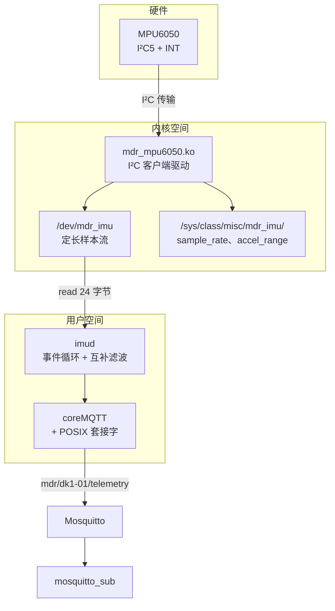
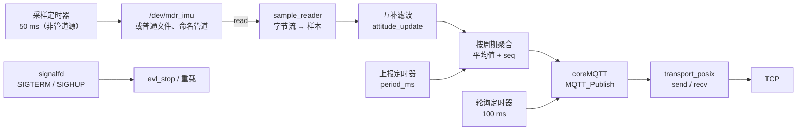

# 7.4 嵌入式 Linux 驱动与应用

同一个 MPU6050，[7.1 裸机外设驱动](/教程/正文/嵌入式/7_综合实践/7_1_裸机外设驱动) 里是逐位翻转的 I²C 时序，[7.2 RTOS 多任务设备](/教程/正文/嵌入式/7_综合实践/7_2_RTOS多任务设备) 里是采样、处理、记录等五个任务，[7.3 联网固件](/教程/正文/嵌入式/7_综合实践/7_3_联网固件) 里把遥测发上了 MQTT 服务器。三次都是在一个固件里写完所有事情：改一行代码，整片重烧。到了 STM32MP157 这样的 Linux 平台上，同一件事被拆成两个地址空间里的东西：内核里的驱动负责把传感器变成 `/dev` 下的一串字节，用户态的服务负责读、算、发。两者可以分别重新编译、分别替换，都不用重启另一侧。

这一页把这两个部分都做完：在第 5 章写过的 MPU6050 驱动基础上整理出可发布的模块（设备树覆盖层、线程化中断、定长样本的字符设备、可读写的 sysfs 属性），再写一个读取样本、计算倾角、发布 MQTT 的服务 `imud`，然后用 Buildroot 外部树把驱动、服务、配置打包进映像。示例在 QEMU 与宿主机上都能跑通，没有开发板也能走完除中断之外的全部路径。最后对照内核自带的 `inv_mpu6050` 驱动，说明产品里该选哪一个。

## 1. 目标与架构

产品的分层与第 5 章的三个驱动一脉相承，只是这次要拼成一台完整的设备：



驱动与服务的分工按 [5.7 字符设备与用户空间接口](/教程/正文/嵌入式/5_嵌入式Linux/5_7_字符设备与用户空间接口) 的判据来：内核只做“把寄存器变成字节”这一层，时间戳、量程换算在驱动里完成，因为这些数据只有驱动拿得到；互补滤波、聚合、网络都在用户态，因为这些逻辑改一次不该重编内核。中断线程与读者之间的队列、sysfs 的配置项，都是 5.8 与 5.9 讲过的机制，这一页只把它们拼起来。

硬件连接与 [5.8](/教程/正文/嵌入式/5_嵌入式Linux/5_8_platform_I2C与SPI驱动) 一致：

| 信号 | STM32MP157 DK 板 | 说明 |
| --- | --- | --- |
| SCL | Arduino 接口 D15（PA11），I²C5 | `dkx.dtsi` 里 I²C5 默认 `disabled`，要由覆盖层打开 |
| SDA | Arduino 接口 D14（PA12），I²C5 | 与 SCL 同一组复用 |
| INT | PA8 | 数据就绪中断，上升沿；接哪一根空闲 GPIO 都可以，覆盖层里改 |
| VDD | 3.3 V | 模块板自带稳压与上拉电阻 |
| GND | GND | 与板子共地 |

没有开发板的人走 QEMU 路线：用 vexpress-a9 跑 Buildroot 生成的系统，用 i2c-stub 模块模拟一颗 MPU6050。stub 后面没有真实硬件，读写都落在模块内部一个 256 字节的数组里，因此只能验证寄存器访问、量程换算与 sysfs 属性；没有中断线，驱动会自动退化为按需读取。中断路径只能在板子上验证。

## 2. 驱动定稿

### 2.1 设备树覆盖层

第 5 章的做法是直接改板级设备树文件。产品里更常见的做法是留主设备树不动，另写一个覆盖层 (overlay)，由 U-Boot 在启动时应用：

```text
/dts-v1/;
/plugin/;

/ {
	compatible = "st,stm32mp157a-dk1", "st,stm32mp157d-dk1",
		     "st,stm32mp157c-dk2", "st,stm32mp157f-dk2";

	fragment@0 {
		target = <&i2c5>;
		__overlay__ {
			status = "okay";

			imu@68 {
				compatible = "mdr,mpu6050";
				reg = <0x68>;
				interrupt-parent = <&gpioa>;
				interrupts = <8 1>;	/* PA8，上升沿 */
			};
		};
	};
};
```

`/plugin/;` 声明这是一个覆盖层，`fragment@0` 的 `target` 指向要改的节点标签，`__overlay__` 里的内容合并进去。`compatible` 一栏要列出所有可能的目标板，否则在别的型号上应用时 U-Boot 会拒绝。设备树覆盖层的语法与编译方法在 [5.5 设备树](/教程/正文/嵌入式/5_嵌入式Linux/5_5_设备树) 已经讲过。

`interrupts = <8 1>` 的两个数分别是 PA8 与触发方式，`1` 表示上升沿。MPU6050 的 INT 引脚默认是推挽、高电平有效、50 µs 脉冲，上升沿能抓住它。要改成低电平，第二个数写 `2`，同时把 `INT_PIN_CFG`（0x37）的 LATCH_INT_EN 置 1，让中断电平一直保持到被读走；不锁存的话，低电平只在事件发生后持续 50 µs，中断控制器来不及响应就会漏掉。

触发方式只写在设备树里，驱动注册中断时不传任何 `IRQF_TRIGGER_*`。5.9 讲过这个分工：中断控制器按设备树的描述配置硬件，驱动再传一次，两处不一致时行为取决于谁先设置，调起来很麻烦。驱动里只留 `IRQF_ONESHOT`，它的作用是让线程处理完之前不重新打开中断线。

::: tip 覆盖层放在哪里

DK 板从 SD 卡启动时，U-Boot 会在 `/boot` 分区里找 `overlays/` 目录下的 `.dtbo`。Buildroot 的 post-image 脚本把 `board/mdr/overlays/mdr-imu-overlay.dts` 编译好、拷进 `output/images/`，再随启动分区一起发布。不写覆盖层也可以，让 Buildroot 的 post-build 脚本把节点直接合进主设备树，代价是换板子时要重编整棵树。

:::

### 2.2 样本结构

`/dev/mdr_imu` 一次 `read()` 交出定长的一个样本，结构定义放在用户态与内核共用的头文件里：

```c
/* mdr_imu.h：驱动与 imud 都包含 */
#ifndef _UAPI_MDR_IMU_H
#define _UAPI_MDR_IMU_H

#include <linux/types.h>

struct mdr_imu_sample {
	__u64 timestamp_ns;
	__s16 accel[3];		/* x、y、z，单位 mg */
	__s16 gyro[3];		/* x、y、z，单位 0.01 °/s */
	__u16 accel_range;	/* 0～3：±2、±4、±8、±16 g */
	__u16 reserved;
};

#endif
```

24 字节，64 位对齐下 `__u64` 占 8 字节、后面三组 16 位数组占 12 字节、两个 `__u16` 占 4 字节，正好整除。时间戳用 `ktime_get_boottime_ns()` 取，单位纳秒，起点是系统启动。用户态用 `clock_gettime(CLOCK_BOOTTIME, ...)` 读到的是同一个时基，两边算出来的时间间隔可以直接相减。这比“假设采样率就是 100 Hz”可靠：I²C 传输慢的时候实际间隔会抖动，用时间戳算 `dt`，滤波结果不会被这个抖动带偏。

用定长结构而不是文本行，有两个好处。第一，解析开销为零：用户态 `read()` 出来的字节直接 `memcpy` 进结构体就能用，不用 `sscanf` 逐字段转换。第二，丢失一个样本不会拖垮后续的解析：每个样本固定 24 字节，丢一个少一个，不会把后面的字段拼错位。文本行格式在这两点上都做不到。

::: warning 两侧的字节序要对齐

结构体是按本机字节序直接写进用户空间的。ARM 上目标板与用户态都是小端，不存在问题；这套代码如果编译到别的架构，两边必须同时是大端或同时是小端。跨架构传递样本时，改成显式按小端拆字节，`imud/sample_io.c` 里的 `sample_to_le_bytes()` 与 `sample_from_le_bytes()` 就是给测试与记录用的。

:::

### 2.3 线程化中断与 kfifo

5.9 已经讲过 `devm_request_threaded_irq` 的用法。这里把它接到采样上：

```c
if (client->irq > 0) {
	ret = devm_request_threaded_irq(&client->dev, client->irq,
					mdr_imu_irq_top,
					mdr_imu_irq_thread,
					IRQF_ONESHOT,
					"mdr_mpu6050", priv);
	if (ret) {
		dev_err(&client->dev, "申请中断 %d 失败: %d\n",
			client->irq, ret);
		goto err_fifo;
	}
	priv->has_irq = true;
}
```

上半部 `mdr_imu_irq_top` 只返回 `IRQ_WAKE_THREAD`，线程里做真正的活：

```c
static irqreturn_t mdr_imu_irq_thread(int irq, void *dev_id)
{
	struct mdr_imu *priv = dev_id;
	struct mdr_imu_sample s;

	mutex_lock(&priv->lock);
	if (mdr_imu_fill(priv, &s) == 0)
		kfifo_in(&priv->fifo, &s, 1);
	mutex_unlock(&priv->lock);
	wake_up_interruptible(&priv->readq);
	return IRQ_HANDLED;
}
```

`mdr_imu_fill()` 里调用 `i2c_smbus_read_i2c_block_data()`，这个函数会睡眠，只有线程上下文才能调。`kfifo` 是内核自带的环形队列，`kfifo_in` 在这里只需要一次拷贝。读的路径：

```c
for (;;) {
	mutex_lock(&priv->lock);
	ret = kfifo_out(&priv->fifo, &s, 1);
	mutex_unlock(&priv->lock);
	if (ret == 1)
		break;
	if (!priv->has_irq) {
		/* 没有中断：主动读一次寄存器，当作一个样本 */
		mutex_lock(&priv->lock);
		ret = mdr_imu_fill(priv, &s);
		mutex_unlock(&priv->lock);
		if (ret)
			return ret;
		break;
	}
	if (file->f_flags & O_NONBLOCK)
		return -EAGAIN;
	ret = wait_event_interruptible(priv->readq,
				       !kfifo_is_empty(&priv->fifo));
	if (ret)
		return ret;
}
```

三个细节值得说。队列容量是 64 个样本：按 100 Hz 采样、每次 `read` 一个，用户态的循环远快于采样，队列通常只有一两个元素，64 是给用户态暂时被调度走时留的余地；队列满时新样本被丢掉，最旧的留下，这个选择对遥测合适，对需要“一个都不能丢”的场合要反过来。第二，`wait_event_interruptible` 返回非零表示被信号打断，这时直接返回这个负值，用户态看到 `EINTR`。第三，没有中断时的那条分支让同一个驱动在 i2c-stub 与 QEMU 上也能工作，代价是每次 `read` 都要发起一次 I²C 传输。

`poll` 的实现跟 5.7 的 `mdr_fifo` 一样：没有中断时永远可读，有中断时看队列是否非空。imud 自己把描述符交给了 epoll，靠可读事件决定何时 `read`，没有用到 `.poll`；但接口留着，`select`、`poll`、`epoll` 之外的用户程序，比如一个直接 `poll()` 再读的测试工具，仍能正常工作。

### 2.4 sysfs 属性

```c
static ssize_t sample_rate_store(struct device *dev,
				 struct device_attribute *attr,
				 const char *buf, size_t len)
{
	struct mdr_imu *priv = dev_get_drvdata(dev);
	unsigned int rate;
	u8 div;
	int ret;

	ret = kstrtouint(buf, 10, &rate);
	if (ret)
		return ret;
	/* 4～1000 Hz 才能用整数分频表示 */
	if (rate < 4 || rate > 1000)
		return -EINVAL;
	div = (u8)(1000 / rate - 1);

	mutex_lock(&priv->lock);
	ret = i2c_smbus_write_byte_data(priv->client,
					MDR_MPU6050_REG_SMPLRT_DIV, div);
	mutex_unlock(&priv->lock);
	if (ret < 0)
		return ret;
	return len;
}
static DEVICE_ATTR_RW(sample_rate);
```

写入的是采样率而不是分频值，用户不用查数据手册。DLPF 打开时芯片内部的采样基准是 1 kHz，分频值等于 `1000 / rate - 1`，所以 100 Hz 对应 9、200 Hz 对应 4。这个公式只在 rate 整除 1000 时精确：写 60 Hz 得到分频 15，实际是 1000 / 16 = 62.5 Hz（整数截断成 62）；写 300 Hz 得到分频 2，实际 333 Hz。驱动不去纠正这件事，但读回来的是实际生效的值，用户一看就知道。

`accel_range_store()` 把 0～3 的档位写进 `ACCEL_CONFIG` 的位 4:3，同时更新驱动里的量程表索引，下一次 `read` 换算出来的 mg 就换了一个比例。**读回属性要读硬件**，不是读缓存：

```c
static ssize_t sample_rate_show(struct device *dev,
				struct device_attribute *attr, char *buf)
{
	struct mdr_imu *priv = dev_get_drvdata(dev);
	u8 div;
	int ret;

	mutex_lock(&priv->lock);
	ret = i2c_smbus_read_byte_data(priv->client,
				       MDR_MPU6050_REG_SMPLRT_DIV);
	mutex_unlock(&priv->lock);
	if (ret < 0)
		return ret;
	div = (u8)ret;

	return sysfs_emit(buf, "%u\n", 1000 / (1 + div));
}
```

为什么不存一份缓存：芯片可能在别处被改，比如有人直接 `i2cset` 写了 `SMPLRT_DIV`；也可能复位后回到默认值。每次读硬件，属性反映的永远是当前状态，代价是每次 `cat` 都要一次 I²C 传输，几十微秒。

### 2.5 清理与休眠

`remove` 要做三件事：删掉属性、注销 misc 设备、让芯片回到休眠：

```c
static void mdr_imu_remove(struct i2c_client *client)
{
	struct mdr_imu *priv = i2c_get_clientdata(client);

	device_remove_file(priv->misc.this_device, &dev_attr_accel_range);
	device_remove_file(priv->misc.this_device, &dev_attr_sample_rate);
	misc_deregister(&priv->misc);
	kfifo_free(&priv->fifo);

	/* 回到休眠，省掉几毫安的静态电流 */
	i2c_smbus_write_byte_data(client, MDR_MPU6050_REG_PWR_MGMT_1, 0x40);
}
```

最后一行把 `PWR_MGMT_1` 的 SLEEP 位置 1。这一句在开发板上看不出效果，在电池供电的设备上决定待机时间：MPU6050 全功能工作电流约 3.9 mA，进入 SLEEP 后降到约 5 µA。模块卸载时驱动什么都没做，芯片就一直醒着，直到整机断电。

驱动写完后用内核自带的 `checkpatch.pl` 过一遍。它检查的是编码风格而不是逻辑，但风格问题在提交上游时会被逐条退回，早改早省事：

::: terminal title="bash - checkpatch（真实输出，Linux 6.18 的脚本）"

```text
$ perl linux-6.18/scripts/checkpatch.pl --no-tree --no-signoff -f mdr_mpu6050.c
total: 0 errors, 0 warnings, 415 lines checked

mdr_mpu6050.c has no obvious style problems and is ready for submission.
```

:::

`-f` 表示检查整个文件而不是一个补丁，`--no-tree` 跳过“是否在内核树里”的检查，`--no-signoff` 去掉 Signed-off-by 行的要求。这两项在树外检查自己的模块时都要加。

<Quiz
  type="single"
  :options="[
    { label: '上半部只返回 IRQ_WAKE_THREAD，I²C 读取放在线程函数里', value: 'A' },
    { label: '上半部直接调用 i2c_smbus_read_i2c_block_data 读六个字节', value: 'B' },
    { label: '上半部把中断号记下来，在 read 里才去读寄存器', value: 'C' },
    { label: '上半部用 msleep 等 1 毫秒凑够一个采样周期再读', value: 'D' }
  ]"
  answer="A"
>

<template #question>

MPU6050 的数据就绪中断到来时，下面哪种处理方式是对的？

</template>

正确答案是 **A**。`i2c_smbus_*` 会睡眠，不能在硬中断上下文调用；上半部只做最短的判断，把会睡眠的活交给线程。C 丢掉了中断的意义，传感器不会再提醒第二次；D 在中断里睡眠会直接触发内核警告。

</Quiz>

## 3. 服务 imud

`imud` 沿用 5.10 的 `sensord` 的骨架：evl 事件循环管定时器与信号，单线程里没有数据竞争。区别在于数据源是一个二进制样本流，输出端是 MQTT 而不是标准输出。



三个定时器分工不同。上报定时器按 `period_ms` 取这一周期的平均值发一条遥测；轮询定时器每 100 ms 转一圈 coreMQTT 的接收；采样定时器只在数据源不是命名管道时存在，每 50 ms 把描述符读到空。命名管道本身能提供可读事件，交给 epoll，不必轮询。

为什么字符设备也走轮询而不走 epoll：没有中断的 `/dev/mdr_imu`（i2c-stub 上的情况）的 `.poll` 永远报告可读，登记进 epoll 会让事件循环空转；有中断时它其实可以走 epoll，但为了两种模式走同一条代码路径，统一用轮询。50 ms 读一次，100 Hz 采样下每次只有五个样本，远小于驱动的 64 个槽位，不会丢。

### 3.1 字节流到样本

一次 `read()` 拿到的字节数不一定是 24 的整数倍。内核里 `kfifo` 保证每次取一个完整样本，但从命名管道或文件读的时候，一次能读到多少由写端决定，可能只写半个样本。所以用户态需要一个小拼装器：

```c
size_t sample_reader_feed(struct sample_reader *sr, const unsigned char *data,
                          size_t n, struct imu_sample *out, size_t cap) {
    size_t produced = 0;
    size_t off = 0;

    while (off < n) {
        size_t room = sizeof sr->buf - sr->len;
        size_t take = n - off < room ? n - off : room;

        if (take == 0) {
            return produced;
        }
        memcpy(sr->buf + sr->len, data + off, take);
        sr->len += take;
        off += take;

        while (sr->len >= SAMPLE_BYTES) {
            struct imu_sample s;
            size_t consumed;

            if (produced == cap) {
                return produced;
            }
            s = sample_from_le_bytes(sr->buf);
            consumed = SAMPLE_BYTES;
            sr->len -= consumed;
            memmove(sr->buf, sr->buf + consumed, sr->len);
            out[produced++] = s;
        }
    }
    return produced;
}
```

内部缓冲 4 KB，能装一百多个样本；调用方给的输出数组满了就停下，剩下的整样本留在缓冲里等下轮。这段代码的每一处都能在单元测试里用构造好的字节验证，第 6 节会做。`sample_from_le_bytes()` 显式按小端拆字段，因此这段解析不依赖本机字节序，主机上（x86 也是小端）与目标板上结果相同。

::: concept emb74-sample-framing title="/dev/mdr_imu 的读取单位"

`/dev/mdr_imu` 的每次 `read()` 返回一个 24 字节的 `struct mdr_imu_sample`，`read()` 的 `count` 小于 24 时返回 `-EINVAL`。字节流里没有分隔符，样本靠固定长度切分。用户态按 24 字节对齐切分，多出来的半个样本留到下一次 `read()` 再拼。

:::

### 3.2 互补滤波

加速度计能算出绝对倾角，但噪声大、对振动敏感；陀螺仪测角速度，积分平滑但会漂移。两者互补，各取一半：

```c
void attitude_update(struct attitude *a, const struct imu_sample *s, double dt,
                     double alpha) {
    /* 陀螺仪单位是 0.01 °/s，先换成 °/s */
    double gx = s->gyro[0] / 100.0;
    double gy = s->gyro[1] / 100.0;

    double pitch_acc = accel_pitch_deg(s);
    double roll_acc = accel_roll_deg(s);

    /* 陀螺仪积分预测，再用加速度计的低频分量修正 */
    a->pitch = alpha * (a->pitch + gx * dt) + (1.0 - alpha) * pitch_acc;
    a->roll = alpha * (a->roll + gy * dt) + (1.0 - alpha) * roll_acc;
}
```

`alpha` 取 0.98，时间常数是 `dt / (1 - alpha)`，在 100 Hz 下约 0.5 秒。含义是：陀螺仪积分的结果每半秒被加速度计拉回来一部分。`alpha` 越大越信陀螺仪，响应快但漂移抑制弱；越小越信加速度计，平稳但滞后。0.98 是这类静置或慢速转动场景的常用起点，快速动作的设备要按实际频谱调。

倾角本身用 `atan2` 算：

```c
double accel_pitch_deg(const struct imu_sample *s) {
    double ax = accel_to_g(s->accel[0]);
    double ay = accel_to_g(s->accel[1]);
    double az = accel_to_g(s->accel[2]);

    return atan2(-ax, sqrt(ay * ay + az * az)) * 180.0 / M_PI;
}
```

符号约定要说清楚，否则接线装反时角度会朝相反的方向走。这里取 `-ax`，因为 MPU6050 的 x 轴正向指向芯片标记那一侧，板子前端抬起时 `ax` 变负，取负号让“抬头”对应正角度。换一种安装方向就改这一处，其余代码不用动。

### 3.3 MQTT 应用代码

[7.3](/教程/正文/嵌入式/7_综合实践/7_3_联网固件) 定义了主题与负载格式，这一页原样沿用。`mqtt_glue.c` 里能改的只有传输层：

```c
static TransportInterface_t make_transport(struct mqtt_client *mc) {
    TransportInterface_t t = { 0 };

    t.recv = (TransportRecv_t)transport_recv;
    t.send = (TransportSend_t)transport_send;
    t.pNetworkContext = &mc->net;
    return t;
}
```

`transport_send` 与 `transport_recv` 在 `transport_posix.c` 里，一个用 `send()`、一个用 `recv()`，跟 7.3 的 ESP-AT 与 Winsock 版本是同一个接口。coreMQTT 的 `MQTT_Init`、`MQTT_Connect`、`MQTT_Publish`、`MQTT_ProcessLoop` 调用一行不改。

传输层里有一处细节要跟库的配置对上。coreMQTT 的接收逻辑认为 `recv` 返回 0 表示“暂时没数据、过一会儿再调”，收到报文开头之后，它用 `MQTT_RECV_POLLING_TIMEOUT_MS` 判断“多久没有新字节就算超时”。如果 `recv` 自己阻塞两三百毫秒，库内那个以毫秒计的判据就没意义了。所以这边给套接字设了 10 ms 的 `SO_RCVTIMEO`，超时后把 `EAGAIN` 翻译成 0 返回；同时把 `MQTT_RECV_POLLING_TIMEOUT_MS` 设成 30 ms，比传输层的超时大一倍，让库比传输层晚放弃。两者的关系是“库等多久”与“一次 recv 最多等多久”，顺序反了会看到频繁的 `MQTTRecvFailed`。

这里同时暴露了 coreMQTT 一个容易踩的坑：`MQTT_RECV_POLLING_TIMEOUT_MS` 在库内部使用，只在应用侧的头文件里改它不生效。下面的 4.3 节会看到，Buildroot 的包必须把同一份配置头喂给库的编译。

7.3 的读者可能会问，为什么 Linux 上还要用 coreMQTT，而不是直接上 libmosquitto 或 Paho。作者的选择是用同一个库：两边协议行为完全一致，联调时不用怀疑“是不是库的差异”，换了个传输层实现而已。Linux 产品里用 libmosquitto 更常见，它替你做了重连、线程、TLS 与自动重发，代价是引入一个较大的依赖。这个产品只有一个发布、一个订阅，coreMQTT 编出来的静态库约 30 KB，整个 imud 的代码段不到 40 KB，够用。

连接时的三项关键参数：

```c
connect_info.cleanSession = true;
connect_info.keepAliveSeconds = MQTT_KEEPALIVE_SECONDS;
connect_info.pClientIdentifier = client_id;
connect_info.clientIdentifierLength = (uint16_t)strlen(client_id);

will_info.qos = MQTTQoS0;
will_info.pTopicName = mc->topic_status;
will_info.topicNameLength = (uint16_t)strlen(mc->topic_status);
will_info.pPayload = "offline";
will_info.payloadLength = 7;
```

`cleanSession = true` 表示每次连接都从空白开始，服务器不保存订阅与未送达的消息。设备重启后重新订阅，这个语义对遥测合适。

遗嘱消息 (Last Will and Testament, LWT) 在这里用 QoS 0，与 7.3 的约定（status 用 QoS 1）不同，原因在 coreMQTT 的用法上：QoS 1 的发布要走状态机，需要先调 `MQTT_InitStatefulQoS()` 并给定发送记录数组；这个服务只发布 QoS 0 的遥测，没有初始化状态机，于是遗嘱与退出前的 `offline` 都跟着用 QoS 0。离线通知丢一条没有关系，`keepalive` 超时后服务器还会判一次。要改回 QoS 1，得先把状态机初始化好，否则发布调用直接返回 `MQTTBadParameter`。

cmd 主题的回调只认一个命令：

```c
if ((size_t)pub->topicNameLength == strlen(mc->topic_cmd) &&
    strncmp(pub->pTopicName, mc->topic_cmd, pub->topicNameLength) == 0) {
    char payload[64];
    size_t n = pub->payloadLength < sizeof payload - 1
                   ? pub->payloadLength
                   : sizeof payload - 1;

    memcpy(payload, pub->pPayload, n);
    payload[n] = '\0';

    int rate = 0;

    if (sscanf(payload, "rate=%d", &rate) == 1 && rate >= 4 &&
        rate <= 1000) {
        mc->cmd_rate_value = rate;
        mc->cmd_rate_pending = true;
    }
}
```

回调里只记下请求，不执行。原因跟 5.10 讲的一样：回调运行在 `MQTT_ProcessLoop` 里，此时改配置会让状态半新半旧。真正的动作放到下一轮 `on_poll` 里做，那里是普通的事件循环回调。

### 3.4 事件循环与轮询节奏

```c
srv->report_timer = evl_add_timer(srv->loop, srv->cfg.period_ms,
                                  srv->cfg.period_ms, on_report, srv);
srv->poll_timer = evl_add_timer(srv->loop, MQTT_POLL_MS, MQTT_POLL_MS,
                                on_poll, srv);
```

两个周期定时器：`on_report` 每 `period_ms` 聚合并发布一次，`on_poll` 每 100 ms 调一次 `MQTT_ProcessLoop()` 收报文、处理 keepalive。后者不能省：coreMQTT 是单线程库，所有收包都发生在 `ProcessLoop` 里，不调它就收不到 SUBACK、cmd 与 PINGRESP，服务器 30 秒后会认为设备失联。

`on_poll` 里做三件事：

```c
static void on_poll(evl_loop *loop, evl_timer *timer, void *arg) {
    struct imud *srv = arg;

    (void)loop;
    (void)timer;
    if (!srv->mqtt.connected) {
        return;
    }
    if (mqtt_client_poll(&srv->mqtt) < 0) {
        mqtt_client_disconnect(&srv->mqtt, false);
        logmsg("连接断开，%d 毫秒后重连", srv->reconnect_delay_ms);
        reconnect_schedule(srv, srv->reconnect_delay_ms);
        return;
    }
    if (srv->mqtt.cmd_rate_pending) {
        srv->mqtt.cmd_rate_pending = false;
        logmsg("收到 rate=%d 命令", srv->mqtt.cmd_rate_value);
        srv->cfg.sample_rate = srv->mqtt.cmd_rate_value;
        /* 采样率属于驱动，经 sysfs 下发；失败只记日志 */
        char path[256];
        FILE *fp;

        snprintf(path, sizeof path, "/sys/class/misc/mdr_imu/sample_rate");
        fp = fopen(path, "w");
        if (fp != NULL) {
            fprintf(fp, "%d\n", srv->cfg.sample_rate);
            fclose(fp);
            logmsg("采样率已设为 %d Hz", srv->cfg.sample_rate);
        } else {
            logmsg("写 %s 失败: %s", path, strerror(errno));
        }
    }
}
```

写 sysfs 用 `fopen` 加 `fprintf` 就够了，没必要为了一个数字上 `open`、`write`、`close` 三个系统调用。这个路径写死在代码里，因为驱动的名字在设备树里定了、不会变；做成可配置的项属于过度设计，等真需要换驱动名的那天再加。

重连采用指数退避，每次失败翻倍，上限 30 秒：

```c
static void on_reconnect(evl_loop *loop, evl_timer *timer, void *arg) {
    struct imud *srv = arg;

    (void)loop;
    (void)timer;
    srv->reconnect_timer = NULL; /* 这个一次性定时器马上会被 evl 释放 */
    if (mqtt_client_connect(&srv->mqtt, &srv->cfg) == 0) {
        srv->reconnect_delay_ms = RECONNECT_MIN_MS;
        return;
    }
    srv->reconnect_delay_ms *= 2;
    if (srv->reconnect_delay_ms > RECONNECT_MAX_MS) {
        srv->reconnect_delay_ms = RECONNECT_MAX_MS;
    }
    logmsg("%d 毫秒后重试", srv->reconnect_delay_ms);
    reconnect_schedule(srv, srv->reconnect_delay_ms);
}
```

`reconnect_timer = NULL` 那一行是必须的。evl 的一次性定时器在回调返回后就被释放，句柄随即失效；回调里如果又调 `reconnect_schedule()`，后者会先对旧句柄调 `evl_cancel_timer()`，而那块内存可能已经被 `malloc` 分给了别的东西，堆就此被写坏。这个 bug 的现场是：程序跑几分钟后莫名崩溃，回溯停在 `evl_add_timer` 里。把句柄清空、让取消操作跳过失效的句柄，问题消失。

### 3.5 配置文件

```text
# imud.conf
source = /dev/mdr_imu
host = 192.168.1.50
port = 1883
device_id = dk1-01
topic_prefix = mdr
period_ms = 1000
sample_rate = 100
alpha = 0.98
```

`config_load()` 先把缺省值填进一份临时对象，再逐行覆盖，全部通过才整体替换（5.10 讲过这个顺序）。取值超范围的项让整次加载失败，旧配置保留：`period_ms` 是 5 时打印一行错误、返回 -1，`SIGHUP` 重载时因此不会把服务带进每 5 ms 发一条的状态。

`sample_rate` 与 `alpha` 是服务自己的参数，与驱动的 sysfs 属性没有同步关系：驱动默认 100 Hz，配置文件里写 200 的时候，启动阶段应该顺带写一次 sysfs。这一点在示例里没做，因为把驱动配置也纳入配置文件会让“配置改了驱动没改”变成另一个坑；作者的选择是服务只读驱动给的样本，采样率由 `rate` 命令或 sysfs 单独设置。

<Quiz
  type="multi"
  :options="[
    { label: '每 100 ms 调一次 MQTT_ProcessLoop，处理收包与 keepalive', value: 'A' },
    { label: '把 MQTT_ProcessLoop 放在 on_report 里，每个上报周期调一次', value: 'B' },
    { label: '命令回调里只记录请求，真正的动作放到下一轮事件循环', value: 'C' },
    { label: '重连间隔固定为 1 秒，避免服务器被大量设备同时冲击', value: 'D' }
  ]"
  :answer="['A', 'C']"
>

<template #question>

关于 imud 的事件循环与 MQTT 处理，下列说法正确的是哪些？

</template>

正确答案是 **A、C**。B 的问题在于上报周期可能长达几秒，这段时间里收不到 cmd 也发不出 PINGREQ，服务器会判定连接超时；D 的固定间隔正是 7.3 用指数退避加抖动要解决的问题，一批设备同时断开后会在同一秒一起重连。

</Quiz>

## 4. 用 Buildroot 打包

产品交付的是一张 SD 卡，不是一堆手工拷进去的文件。5.4 讲过 Buildroot 的软件包与 `BR2_EXTERNAL` 外部树，这一节把三个包写出来。

### 4.1 外部树的目录

```text
br2-external/
├── external.desc
├── external.mk
├── Config.in
├── configs/
│   ├── mdr_stm32mp157_defconfig
│   └── mdr_qemu_defconfig
├── board/mdr/
│   ├── post-build.sh
│   ├── qemu-stub.fragment
│   ├── overlays/mdr-imu-overlay.dts
│   ├── rootfs-overlay/etc/imud.conf
│   ├── rootfs-overlay/etc/init.d/S60imud
│   └── rootfs-overlay-qemu/etc/init.d/S59i2cstub
└── package/
    ├── coremqtt/
    ├── mdr-imu/
    └── imud/
```

三个包的源码都不复制进来，`_SITE` 指回仓库里的 `driver/` 与 `imud/`，让同一份源码只有一个副本。`_SITE_METHOD = local` 表示不下载，直接从这个目录取。

`external.desc` 的 `name` 转成大写后，就是所有 `.mk` 里 `BR2_EXTERNAL_MDR_PATH` 的前缀：

```text
name: MDR
desc: MDR 的 IMU 产品：mdr_mpu6050 驱动、imud 服务与 coreMQTT
```

### 4.2 内核模块包

驱动包的 `.mk` 只有四行有效内容：

```make
MDR_IMU_VERSION = 1.0
MDR_IMU_SITE = $(BR2_EXTERNAL_MDR_PATH)/../driver
MDR_IMU_SITE_METHOD = local
MDR_IMU_LICENSE = GPL-2.0
MDR_IMU_LICENSE_FILES = mdr_mpu6050.c

$(eval $(kernel-module))
$(eval $(generic-package))
```

`kernel-module` 必须写在 `generic-package` 前面。前者提供 `MDR_IMU_MODULE_MAKE_OPTS`，里面是 `ARCH`、`CROSS_COMPILE`、`KDIR` 等交叉编译参数；后者按依赖顺序调度构建。顺序写反，编译出来的模块是宿主机架构的，装到板子上报 `Invalid module format`。`driver/Makefile` 只有一行 `obj-m += mdr_mpu6050.o`。

`Config.in` 里依赖内核：

```text
config BR2_PACKAGE_MDR_IMU
	bool "mdr-imu"
	depends on BR2_LINUX_KERNEL
	help
	  MPU6050 的字符设备驱动（7.4）。加载后出现 /dev/mdr_imu，
	  一次 read 交出一个带时间戳的定长样本；
	  /sys/class/misc/mdr_imu/ 下有 sample_rate 与 accel_range。
```

### 4.3 coreMQTT 包

coreMQTT 没有自己的构建系统，Buildroot 的包直接用 `TARGET_CC` 编三个 `.c` 文件、打包成静态库：

```make
COREMQTT_VERSION = v2.3.1
COREMQTT_SITE = $(call github,FreeRTOS,coreMQTT,$(COREMQTT_VERSION))
COREMQTT_LICENSE = MIT
COREMQTT_LICENSE_FILES = LICENSE
COREMQTT_INSTALL_STAGING = YES

COREMQTT_CONFIG_SRC = $(BR2_EXTERNAL_MDR_PATH)/../imud/core_mqtt_config.h
COREMQTT_CFLAGS = $(TARGET_CFLAGS) -O2 -I$(@D)/config

define COREMQTT_BUILD_CMDS
	$(INSTALL) -D -m 0644 $(COREMQTT_CONFIG_SRC) \
		$(@D)/config/core_mqtt_config.h
	$(TARGET_CC) $(COREMQTT_CFLAGS) -c -o $(@D)/core_mqtt.o \
		-I$(@D)/source/include -I$(@D)/source/interface \
		$(@D)/source/core_mqtt.c
	$(TARGET_CC) $(COREMQTT_CFLAGS) -c -o $(@D)/core_mqtt_serializer.o \
		-I$(@D)/source/include -I$(@D)/source/interface \
		$(@D)/source/core_mqtt_serializer.c
	$(TARGET_CC) $(COREMQTT_CFLAGS) -c -o $(@D)/core_mqtt_state.o \
		-I$(@D)/source/include -I$(@D)/source/interface \
		$(@D)/source/core_mqtt_state.c
	$(TARGET_AR) rcs $(@D)/libcoreMQTT.a \
		$(@D)/core_mqtt.o $(@D)/core_mqtt_serializer.o \
		$(@D)/core_mqtt_state.o
endef

define COREMQTT_INSTALL_STAGING_CMDS
	$(INSTALL) -D -m 0644 $(@D)/libcoreMQTT.a \
		$(STAGING_DIR)/usr/lib/libcoreMQTT.a
	mkdir -p $(STAGING_DIR)/usr/include/coreMQTT
	$(INSTALL) -m 0644 $(@D)/source/include/*.h \
		$(STAGING_DIR)/usr/include/coreMQTT/
	$(INSTALL) -m 0644 $(@D)/source/interface/*.h \
		$(STAGING_DIR)/usr/include/coreMQTT/
	$(INSTALL) -m 0644 $(@D)/config/core_mqtt_config.h \
		$(STAGING_DIR)/usr/include/coreMQTT/
endef

$(eval $(generic-package))
```

这里有一个容易想错的地方。`core_mqtt_config.h` 里的宏，比如 `MQTT_RECV_POLLING_TIMEOUT_MS` 与 `MQTT_SUB_UNSUB_MAX_VECTORS`，**在库自己的 `.c` 文件里被使用**：接收循环用前者判断“多久没数据算超时”，`MQTT_Subscribe` 用后者决定 writev 向量的数组大小。只在应用侧定义这些宏，库编出来的代码还是默认值，应用侧改了等于没改。所以配置头必须同时参与库与应用的编译：包把它拷进库的构建目录用 `-I` 加进去，再装一份进 staging 给应用用。

还有一个坑：`MQTT_SUB_UNSUB_MAX_VECTORS` 的默认值是 4，看着够用，但若把它改成小于 3，`MQTT_Subscribe` 里有一句 `assert(MQTT_SUB_UNSUB_MAX_VECTORS >= CORE_MQTT_SUBSCRIBE_PER_TOPIC_VECTOR_LENGTH)` 会直接让进程 abort，而 `CORE_MQTT_SUBSCRIBE_PER_TOPIC_VECTOR_LENGTH` 是 3。第一次把这里写成 2 的时候，联调进程就是这个死法，调试信息只有一行 assertion failed。

`INSTALL_STAGING = YES` 让这个包把头文件与库装进 `output/staging`，也就是 imud 编译时的 sysroot。不装 staging，imud 的 `find_library` 找不到 `libcoreMQTT.a`。

### 4.4 imud 包

```make
IMUD_VERSION = 1.0
IMUD_SITE = $(BR2_EXTERNAL_MDR_PATH)/../imud
IMUD_SITE_METHOD = local
IMUD_LICENSE = CC-BY-NC-SA-4.0
IMUD_DEPENDENCIES = coremqtt host-cmake
IMUD_CONF_OPTS = -DCMAKE_BUILD_TYPE=Release

define IMUD_INSTALL_CONF
	$(INSTALL) -D -m 0644 $(IMUD_PKGDIR)/imud.conf \
		$(TARGET_DIR)/etc/imud.conf
endef

define IMUD_INSTALL_INIT_SYSV
	$(INSTALL) -D -m 0755 $(IMUD_PKGDIR)/S60imud \
		$(TARGET_DIR)/etc/init.d/S60imud
endef

IMUD_POST_INSTALL_TARGET_HOOKS += IMUD_INSTALL_CONF

$(eval $(cmake-package))
```

`cmake-package` 把 `imud/CMakeLists.txt` 交给交叉编译的 cmake 跑，产物装进 `target/usr/bin/`。`IMUD_INSTALL_INIT_SYSV` 是一个约定名字，框架在安装阶段调用它；`IMUD_INSTALL_CONF` 是自定义的，通过 `POST_INSTALL_TARGET_HOOKS` 挂上去，因为配置文件不属于 CMake 的安装规则。

`CMakeLists.txt` 里有一段是为了 Buildroot 准备的：

```cmake
find_library(COREMQTT_LIBRARY NAMES coreMQTT)
find_path(COREMQTT_INCLUDE_DIR NAMES core_mqtt.h PATH_SUFFIXES coreMQTT)

set(COREMQTT_DIR "" CACHE PATH "coreMQTT 源码根目录（sysroot 里没有库时使用）")

if(COREMQTT_LIBRARY AND COREMQTT_INCLUDE_DIR)
    add_library(core_mqtt UNKNOWN IMPORTED)
    set_target_properties(core_mqtt PROPERTIES
        IMPORTED_LOCATION "${COREMQTT_LIBRARY}"
        INTERFACE_INCLUDE_DIRECTORIES "${COREMQTT_INCLUDE_DIR}"
    )
elseif(COREMQTT_DIR)
    add_library(core_mqtt STATIC
        ${COREMQTT_DIR}/source/core_mqtt.c
        ${COREMQTT_DIR}/source/core_mqtt_serializer.c
        ${COREMQTT_DIR}/source/core_mqtt_state.c
    )
    ...
endif()
```

宿主机开发时给 `-DCOREMQTT_DIR=...` 直接编源码，Buildroot 里则用 sysroot 里已经编好的静态库。同一个 `CMakeLists.txt` 服务两种场景，不必维护两份。

### 4.5 两份 defconfig

`mdr_stm32mp157_defconfig` 与 `mdr_qemu_defconfig` 的区别只有平台相关的几行：架构（Cortex-A7 对 Cortex-A9）、内核 defconfig（`multi_v7` 对 `vexpress_defconfig`）、设备树、以及 QEMU 版本里多一个内核配置片段：

```text
BR2_LINUX_KERNEL_CONFIG_FRAGMENT_FILES="$(BR2_EXTERNAL_MDR_PATH)/board/mdr/qemu-stub.fragment"
```

片段里打开 i2c-stub 与 i2c-dev：

```text
CONFIG_I2C=y
CONFIG_I2C_CHARDEV=y
CONFIG_I2C_STUB=m
```

`BR2_ROOTFS_OVERLAY` 指向的覆盖层在 QEMU 版本里换了另一份（`rootfs-overlay-qemu/`），多一个 `S59i2cstub` 启动脚本，用 `i2cset` 预置 MPU6050 的寄存器。开发板上不需要这个脚本，跑起来反而会因为找不到 i2c-stub 而报错。

### 4.6 构建

::: terminal title="bash - 用外部树构建（输出类似，取自 Buildroot 2026.02 手册与本次目录结构）"

```text
$ make BR2_EXTERNAL=$PWD/br2-external O=output mdr_qemu_defconfig
$ make BR2_EXTERNAL=$PWD/br2-external O=output -j$(nproc)
...
>>> coremqtt v2.3.1 Building
>>> coremqtt v2.3.1 Installing to staging directory
>>> mdr-imu 1.0 Building
>>> mdr-imu 1.0 Installing to target
>>> imud 1.0 Configuring
>>> imud 1.0 Building
>>> imud 1.0 Installing to target
...
$ ls output/images/
rootfs.ext2  rootfs.tar  vexpress-v2p-ca9.dtb  zImage
```

:::

首次构建要下载内核、BusyBox、工具链，一小时上下。之后改 imud 的源码，`make imud-rebuild` 只重编这一个包，半分钟。

`output/build/imud-1.0/` 里能看到 cmake 的完整输出，装进去的文件清单在 `output/target/usr/bin/` 下。驱动编完后在 `output/target/lib/modules/6.18.0/extra/mdr_mpu6050.ko`，`depmod` 由框架跑过，`modprobe mdr_mpu6050` 就能加载。

::: details 完整的外部树文件清单

```text
br2-external/
├── Config.in                    source 三个包的 Config.in
├── external.desc                name: MDR
├── external.mk                  wildcard 收集 package/*/*.mk
├── configs/
│   ├── mdr_qemu_defconfig
│   └── mdr_stm32mp157_defconfig
├── board/mdr/
│   ├── overlays/mdr-imu-overlay.dts
│   ├── post-build.sh            建 /data、加 imud 用户、写 mdev 规则
│   ├── qemu-stub.fragment       CONFIG_I2C_STUB=m
│   ├── rootfs-overlay/
│   │   └── etc/
│   │       ├── imud.conf        出厂配置
│   │       └── init.d/S60imud
│   └── rootfs-overlay-qemu/
│       └── etc/init.d/S59i2cstub
└── package/
    ├── coremqtt/{Config.in,coremqtt.mk}
    ├── mdr-imu/{Config.in,mdr-imu.mk}        _SITE 指向 ../driver
    └── imud/{Config.in,imud.mk,imud.conf,S60imud}   _SITE 指向 ../imud
```

`post-build.sh` 里除了建目录，还做两件事：把 `imud` 用户加进 `/etc/passwd`（服务不以 root 运行），把 `mdr_imu` 的 mdev 规则写进 `/etc/mdev.conf`，让设备节点的属主是 `root:imud`、权限 `0660`。这两件事覆盖层做不了，覆盖层只能拷文件，不能建用户。

:::

## 5. 部署与调试

### 5.1 开发期：scp 与 insmod

烧一次 SD 卡要几分钟，开发期没人这么干。板子跑 dropbear，宿主机直接传文件：

::: terminal title="bash - 开发期部署（输出类似）"

```text
$ make -C ~/linux-6.18 M=$PWD/driver ARCH=arm \
       CROSS_COMPILE=arm-none-linux-gnueabihf- modules
$ scp driver/mdr_mpu6050.ko root@192.168.1.10:/tmp/
$ scp imud/build/imud root@192.168.1.10:/usr/bin/
$ ssh root@192.168.1.10
# insmod /tmp/mdr_mpu6050.ko
[  102.418077] mdr_mpu6050 5-0068: MPU6050 就绪，地址 0x68，中断模式
# /usr/bin/imud -f /data/imud.conf &
imud 启动: pid=812 source=/dev/mdr_imu period_ms=1000
已连接 192.168.1.50:1883，主题 mdr/dk1-01/telemetry
```

:::

`insmod` 的模块必须有与目标内核完全一致的 vermagic。5.6 讲过这个坑：模块在宿主机上与在板子上都可能是 ARM，但内核版本、SMP、抢占配置任何一项不同都会拒绝加载。产品阶段模块是随内核一起由 Buildroot 编的，不存在这个问题；开发期手工编模块，`KDIR` 一定要指向目标内核的源码树，而不是宿主机的 `/lib/modules`。

### 5.2 dynamic debug

驱动里的 `dev_dbg()` 默认不输出。要看到它，按文件打开：

```text
# echo 'file mdr_mpu6050.c +p' > /sys/kernel/debug/dynamic_debug/control
```

之后 `dmesg` 里就有这个文件里所有 `dev_dbg()` 的输出了。调试完用 `-p` 关掉。`/sys/kernel/debug` 要挂 debugfs，Buildroot 的默认 inittab 一般会挂；没挂就 `mount -t debugfs none /sys/kernel/debug`。

`dev_dbg` 的代价在关闭时接近于零：开了 `CONFIG_DYNAMIC_DEBUG` 时它编成一次查表加条件跳转，查表项里的标志位没打开就不打印；没开动态调试时它展开成 `if (0) 打印`，编译器直接删掉。两种情况都不产生运行时的字符串格式化开销，所以驱动里可以放心地写详细的调试输出，不必用宏包起来。

### 5.3 数据对不对

服务里的滤波结果先跟一个独立来源对一遍。电脑上订阅遥测：

::: terminal title="bash - 电脑上订阅（输出类似）"

```text
$ mosquitto_sub -h 192.168.1.50 -t 'mdr/+/telemetry' -v
mdr/dk1-01/telemetry {"ts":1792598109,"ax":0,"ay":0,"az":1000,"pitch":0,"roll":0,"seq":0}
mdr/dk1-01/telemetry {"ts":1792598110,"ax":-499,"ay":0,"az":866,"pitch":1696,"roll":0,"seq":1}
```

:::

`az` 接近 1000 说明平放时重力读数正确，`pitch` 为 0 说明滤波初值没偏。板子倾斜一个已知角度（手机上的水平仪够用），`pitch` 应该稳定在这个角度附近，误差在 1° 以内。这一步能一次分清“数据不对”与“发布不对”：订阅者收到内容，说明网络与协议都没问题，问题在传感器或滤波。

读数据的地方也可以用 `od` 直接看：

```text
# dd if=/dev/mdr_imu bs=24 count=1 2>/dev/null | od -An -td2 -j8 -N6
    0    0 1000
```

前 8 字节是时间戳，`-j8` 跳过去；`-td2` 按 16 位有符号十进制显示；`-N6` 只取六个字节。平放时三个数是 `0 0 1000` 左右。

### 5.4 三个常见问题

**`probe` 没被调用**：按 5.8 的三步排查，`compatible` 逐字比对、`status` 是 `okay`、模块真的加载了且没有被 `inv_mpu6050` 抢走。7.4 的驱动用 `mdr,mpu6050` 这个厂商前缀，系统里装了内核自带的 `inv_mpu6050` 也不会冲突；如果一改 `compatible` 成 `invensense,mpu6050`，两个驱动会抢同一个设备，先注册的赢。

**读到全 0**：平放时 z 轴应该是 1000 mg，读到 `0 0 0` 说明芯片还在休眠或者 I²C 根本没通。先查 `PWR_MGMT_1` 的 SLEEP 位（`i2cget -y 5 0x68 0x6b` 应为 `0x00`），再查 `WHO_AM_I`。驱动的 `probe` 里如果写寄存器的某一步失败，`mdr_imu_hw_init()` 返回负值，`probe` 失败，dmesg 里会有一行错误。

**`/dev/mdr_imu` 权限不对**：默认权限 `0660`、属主 `root`，非 root 用户打不开。mdev 规则把组改成 `imud`，服务以 `imud` 用户运行；或者临时用 `chmod 0666` 验证一下，但产品里不要这么做。

### 5.5 gdbserver 调试服务

5.10 的 gdbserver 那一套对 imud 一样适用。区别在于数据源是一个字符设备，单步跟踪时可能被别的读者抢走样本；调试期间把 `source` 临时指向一个预先写好的样本文件，行为可控：

```text
(gdb) set args -f /tmp/imud-debug.conf
(gdb) break attitude_update
(gdb) continue
```

`imud-debug.conf` 里 `source = /tmp/samples.bin`，文件内容就是 24 字节一个的样本流。`scripts/make_samples.py --burst` 能生成这种文件，第 6 节的集成测试也用它。

## 6. 测试

### 6.1 单元测试

解析、滤波、配置这三块不依赖硬件，全部写在 `imud/tests/test_imud.c` 里，用最朴素的 `CHECK` 宏计数：

```c
static void test_reader_partial(void) {
    struct sample_reader sr;
    struct imu_sample out[4];
    unsigned char raw[24];
    size_t got;

    sample_reader_init(&sr);
    make_sample(raw, 1000, 0, 0, 1000);

    /* 先喂 10 字节：一个样本也凑不齐 */
    got = sample_reader_feed(&sr, raw, 10, out, 4);
    CHECK(got == 0);
    CHECK(sample_reader_pending(&sr) == 10);

    /* 再喂 14 字节，正好凑齐一个 */
    got = sample_reader_feed(&sr, raw + 10, 14, out, 4);
    CHECK(got == 1);
    CHECK(out[0].accel[2] == 1000);
```

::: terminal title="bash - 单元测试（真实输出，SignalX，gcc 14.2）"

```text
$ imud/build/test_imud
配置错误: period_ms = 5 超出范围
37 项检查，0 项失败
```

:::

那一行“配置错误”是测试里故意喂一份非法配置时程序打的，不是测试失败。`37 项检查，0 项失败` 才是结论。测试覆盖字节序往返、半个样本的拼接、输出数组满时把整样本留在缓冲里、平放时姿态角为 0、倾斜时的角度、陀螺仪积分与加速度计修正的稳态、配置的正常与非法输入。

### 6.2 用样本文件的集成测试

服务能不能跑起来，靠集成测试验证。数据源换成一个普通文件（追加上去就是“有新样本”），服务器用 `scripts/fake_broker.c`——一个只处理 CONNECT、SUBSCRIBE、QoS 0 PUBLISH、PINGREQ 的 MQTT 服务器，跟 7.3 的伪服务器思路一样，只是换到 POSIX 套接字上。

::: terminal title="bash - 集成测试（真实输出，SignalX）"

```text
$ ./scripts/run_demo.sh
=== imud
imud 启动: pid=1794889 source=.../demo1794837.data period_ms=300
收到信号 15，退出
已连接 127.0.0.1:25765，主题 mdr/dk1-01/telemetry
=== broker
PUBLISH mdr/dk1-01/telemetry {"ts":1792598109,"ax":0,"ay":0,"az":1000,"pitch":0,"roll":0,"seq":0}
PUBLISH mdr/dk1-01/telemetry {"ts":1792598110,"ax":-499,"ay":0,"az":866,"pitch":1696,"roll":0,"seq":1}
PUBLISH mdr/dk1-01/telemetry {"ts":1792598110,"ax":-499,"ay":0,"az":866,"pitch":2432,"roll":0,"seq":2}
PUBLISH mdr/dk1-01/telemetry {"ts":1792598111,"ax":-499,"ay":0,"az":866,"pitch":2751,"roll":0,"seq":3}
PUBLISH mdr/dk1-01/telemetry {"ts":1792598112,"ax":-499,"ay":0,"az":866,"pitch":2889,"roll":0,"seq":4}
PUBLISH mdr/dk1-01/telemetry {"ts":1792598113,"ax":-499,"ay":0,"az":866,"pitch":2949,"roll":0,"seq":5}
PUBLISH mdr/dk1-01/telemetry {"ts":1792598113,"ax":-499,"ay":0,"az":866,"pitch":2975,"roll":0,"seq":6}
PUBLISH mdr/dk1-01/telemetry {"ts":1792598114,"ax":-499,"ay":0,"az":866,"pitch":2986,"roll":0,"seq":7}
PUBLISH mdr/dk1-01/telemetry {"ts":1792598115,"ax":-499,"ay":0,"az":866,"pitch":2991,"roll":0,"seq":8}
PUBLISH mdr/dk1-01/status offline
```

:::

九条遥测对应两段输入。第一条是水平姿态，`az` 1000、`pitch` 0。后面八条是倾斜 30° 的样本，`ax` 与 `az` 对应 30° 的重力分量（`-1000·sin30° = -500`，`1000·cos30° ≈ 866`），`pitch` 从 16.96° 一路爬到 29.91°。这不是错误，而是互补滤波的过渡过程：每条遥测是那一个上报周期内所有样本的平均值，`alpha` 0.98、`dt` 0.01 秒对应 0.5 秒的时间常数，周期越往后，平均值越接近 30°。脚本一共喂了 8 批、每批 100 个倾斜样本，最后一次上报停在 29.91°，再喂一批就到 30° 附近了。

最后一条 `status offline` 是退出时主动发的，不是遗嘱。进程收到 `SIGTERM` 后调用 `MQTT_Publish` 发 `offline`，再 `MQTT_Disconnect` 正常断开；遗嘱只在异常断开时由服务器代发。

`run_demo.sh` 里的等待全部按“broker 收到第几条”轮询，不按固定 `sleep`。这台机器负载重的时候，shell 的 `sleep 0.5` 可能实际睡了两秒，用固定等待写的测试会随机失败，而轮询的版本无论快慢都能等到。

### 6.3 QEMU 与 i2c-stub 上的冒烟测试

驱动在 QEMU 上用 i2c-stub 验证：预置寄存器，读 sysfs 与字符设备，比对期望值。`scripts/stub_smoke_test.sh` 把这个过程写成脚本，输出是“输出类似”而不是真实输出——这需要板子或 QEMU 上的内核模块，本机没有条件跑：

::: terminal title="bash - QEMU 上的驱动冒烟测试（输出类似）"

```text
# ./stub_smoke_test.sh
ok   sample_rate = 100
ok   accel_range = 0
ok   样本 ax (mg) = 24
ok   样本 ay (mg) = -5
ok   样本 az (mg) = 1000
ok   写入后的 sample_rate = 200
ok   SMPLRT_DIV = 0x04
ok   拒绝非法值后的 sample_rate = 200
ok   卸载后的 PWR_MGMT_1 = 0x40
冒烟测试通过
```

:::

这九项检查覆盖了驱动的全部外部行为：默认配置、寄存器换算、样本打包、sysfs 写入与读回、非法值拒绝、卸载时的休眠。i2c-stub 里预置的字节是 `01 90 ff ae 40 00`，对应 `0x0190 = 400`（24 mg）、`0xffae = -82`（-5 mg）、`0x4000 = 16384`（1000 mg），跟 5.8 的算法一致，换了个接口。

中断路径在这里测不到：i2c-stub 没有中断线，驱动走的是 `has_irq == false` 的那条分支。中断是否真的把样本推进了队列，只能在板子上用逻辑分析仪或 `cat /proc/interrupts` 看计数。

### 6.4 发布前的检查清单

6.8 的发布检查清单对这类产品适用，这里只列 7.4 特有的几条：

- 驱动以 `mdr,mpu6050` 匹配，没有与 `inv_mpu6050` 抢设备；
- `/dev/mdr_imu` 的权限是 `0660`，属主是 `imud`，服务以普通用户运行；
- 配置文件放在 `/data`，根文件系统只读；
- 固件里没有把 Wi-Fi 口令、MQTT 口令打印进日志；
- 断网 30 秒后恢复，服务能自己重连，遥测的 `seq` 连续；
- 拔掉传感器再插上，`probe` 没有崩，dmesg 里没有 `BUG:` 或 `WARNING:`。

最后一条在开发板上试一次就够了，但一定要试。热插拔时 I²C 线瞬时短接、`probe` 里读寄存器超时都是真实会遇到的，而这类问题在实验室的静态环境里永远不出现。

## 7. 产品中怎样选

### 7.1 内核里已经有的驱动

如果只是读一颗 MPU6050，产品里不该自己写驱动。内核从 4.x 起就带 `inv_mpu6050`，位于 `drivers/iio/imu/inv_mpu6050/`，匹配的是 `invensense,mpu6050`：

```text
&i2c5 {
	status = "okay";

	imu@68 {
		compatible = "invensense,mpu6050";
		reg = <0x68>;
		interrupt-parent = <&gpioa>;
		interrupts = <8 1>;
	};
};
```

加载后设备出现在 `/sys/bus/iio/devices/iio:device0/` 下，提供三样东西：原始值（`in_accel_x_raw` 等）、按单位换算后的值（`in_accel_x_scale` 加上原始值）、以及触发缓冲区（`/dev/iio:device0` 加 `trigger/`）。这三种接口由 IIO 子系统 (Industrial I/O) 统一，用户态工具与库都认识。

两种读法放在一起对比：

::: compare left-title="自写驱动" right-title="IIO 驱动"

```c
/* 自己定义的接口，自己解析 */
struct mdr_imu_sample s;
int fd = open("/dev/mdr_imu", O_RDONLY);

if (read(fd, &s, sizeof s) != sizeof s) {
    return -1;
}
printf("ax=%d ay=%d az=%d\n", s.accel[0], s.accel[1], s.accel[2]);
```

---

```c
/* IIO 的标准接口，工具与库都能用 */
int raw, scale_nano;
FILE *fp;

fp = fopen("/sys/bus/iio/devices/iio:device0/in_accel_x_raw", "r");
fscanf(fp, "%d", &raw);
fclose(fp);
fp = fopen("/sys/bus/iio/devices/iio:device0/in_accel_x_scale", "r");
fscanf(fp, "%d", &scale_nano);   /* 单位：纳米，1 g = 1e9 */
fclose(fp);

printf("ax = %.3f g\n", (double)raw * scale_nano / 1e9);
```

:::

右边的代码边长好几倍，但它是标准接口：`iio_generic_buffer`、`libiio`、工业上位机都能直接对接，`scale` 的换算规则由子系统定义，不会因为换一个驱动就变。左边的代码短，但只有本产品的用户态认识这个接口。

### 7.2 自写驱动的代价

自写驱动的成本不在写，在维护。内核每升级一次，驱动要跟着改：`i2c_driver.probe` 从三个参数改成两个（6.3 起），`platform_driver.remove` 从返回 `int` 改成 `void`（6.11 起），`class_create` 从两个参数改成一个。这些改动在 [5.8](/教程/正文/嵌入式/5_嵌入式Linux/5_8_platform_I2C与SPI驱动) 已经遇到过，每一次都意味着驱动要重编、要重新验证。

内核自带的 `inv_mpu6050` 由社区跟着版本改，产品只要跟着内核走就行。一个中等规模的嵌入式 Linux 产品，内核从 5.10 升到 6.18 时，自写驱动少则改几十行，多则重写一遍；用现成驱动，这一块的工作量是零。

那什么时候自写？三种情况：设备在内核里没有对应驱动；内核驱动缺少你需要的能力（比如某种特殊采样方式）；这个驱动本身就是教程或研究目的。这个项目属于第三种：7.1 到 7.4 用同一颗传感器走完四种实现，目的是看清每一层的分工，不是为了给产品省几行代码。

### 7.3 四种实现放在一起

| | 7.1 裸机 | 7.2 RTOS | 7.3 联网固件 | 7.4 Linux |
| --- | --- | --- | --- | --- |
| 驱动代码量 | 约 160 行（传感器驱动加软件 I²C） | 驱动同上，另加五个任务 | 同 7.2 | 约 410 行（含中断、sysfs、字符设备） |
| 实时性 | 最好，中断延迟几微秒 | 好，任务切换几十微秒 | 好，网络任务另算 | 一般，线程化中断延迟百微秒量级 |
| 内存占用 | 20 KB SRAM 够用 | 20 KB SRAM 紧张 | 20 KB SRAM 不够，网络在模块里 | 几十 MB，最小系统也要 8 MB 以上 |
| 可维护性 | 改一行重烧整片 | 同左 | 同左 | 驱动与服务独立编译、独立替换 |
| 硬件成本 | 十几元（F103C8） | 同左 | 加一个 Wi-Fi 模块 | 几十到上百元（MP157 或同类） |
| 开发设备 | 一块开发板 | 同左 | 加一个 Wi-Fi 模块 | 一块板子加一根网线，或 QEMU |
| 适合的产品 | 实时控制、电池供电 | 多任务、有状态机 | 联网上报 | 网关、带界面、要跑复杂协议栈 |

这张表回答的是“这件事该在哪一层做”，不是“哪一层更好”。实时性排在第一位、成本压到极致的产品，第 7.1 节的实现就是终点；需要联网上报、远程升级、多协议对接的产品，7.4 的架构才对得起那些代码量。7.2 与 7.3 之间没有本质差别，加了网络就是 7.3，7.4 与前三者的差别在于操作系统把驱动与服务隔成了两个地址空间。

## 8. 习题

### 8.1 巩固

<Exercise id="67731" :d="2" :w="2">

`/dev/mdr_imu` 的样本是 24 字节定长结构。下面是从设备读出的 31 个字节，一次读跨越了一个样本的边界：

```text
0000  00 ca 9a 3b 00 00 00 00
0008  18 00 fb ff e8 03 83 00
0010  00 00 fa fe 01 00 00 00
0018  80 60 33 3c 00 00 00
```

(1) 按 `struct mdr_imu_sample` 的布局写出每个字段的偏移与长度，说明这个结构在 64 位对齐下为什么正好是 24 字节，不需要 `packed`。

(2) 解出第一个样本的 `timestamp_ns` 与三轴加速度（mg），以及 `gyro[0]`、`gyro[2]`（0.01 °/s）与 `accel_range`。多字节字段都是小端、有符号 16 位。

(3) 把 31 个字节一次交给 `sample_reader_feed()`，输出数组容量给 4，返回值是多少？`sample_reader_pending()` 是多少？再喂 17 个字节，两次合计产出几个样本、还剩多少字节？

(4) 用户态 `read()` 的 `count` 传 16 时驱动返回什么？为什么不让它返回半个样本？

(5) `sample_from_le_bytes()` 在 x86 与 ARM 上结果相同，靠的是什么？把一份记录下来的小端样本文件直接 `memcpy` 进结构体，在大端机器上会错在哪些字段？时间戳会错成什么量级？

</Exercise>

<Exercise id="67732" :d="3" :w="3">

`code/嵌入式/7_综合实践/7_4_嵌入式Linux驱动与应用/scripts/run_demo.sh` 的一次运行发布了九条遥测：第一条水平，后八条对应 30° 倾斜，`pitch` 从 16.96 升到 29.91。

(1) 九条遥测的 `seq` 是 0 到 8。说明它是进程启动后的第几条发布，而不是样本序号。脚本每批喂 100 个样本、批间隔 0.7 秒，`period_ms` 是 300，按时间算每批该出两三条，为什么实际每批只出一条？去读 `on_report()` 开头对 `period_samples == 0` 的处理与 `on_pump()` 每 50 ms 把描述符读空这一行为，用这两处解释「空周期不发」。这个设计对遥测有什么好处，对需要固定节奏的监控又有什么坏处？

(2) 倾斜批次里的陀螺仪读数为 0，加速度计恒为 `ax = -500`、`az = 866`。写出此时 `attitude_update()` 的递推式，证明从 0 开始、第 k 次更新后的 pitch 是 30 × (1 − 0.98^k)，并算出 k = 10、50、100、200 时的值（约 5.49、19.07、26.02、29.47）。再用等比数列求和算出前 100 个样本的平均 pitch（约 17.25）。正文那次运行的第一条倾斜遥测是 16.96，与 17.25 相差 0.29°，量级上吻合，说明这个平均值就是收敛过程的前一百步。自己跑出来的数字会有小幅出入；差得远时先打印这一周期的 `period_samples`，再看样本时间戳是否严格递增——不递增时 `source_consume()` 会跳过更新，`dt` 也退回 `1 / sample_rate`。

(3) 最后一条 `status offline` 是进程自己发的还是服务器代发的遗嘱？从 `mqtt_client_disconnect()` 的调用点说明。

(4) 把 `make_samples.py` 的角度改成 45° 与 90°，先写出预期的 `ax`、`az` 与滤波收敛后的 pitch，再改 `run_demo.sh` 跑一遍验证。验收：订阅输出里的 `ax`、`az` 与预测相差不超过 2，最后一条倾斜遥测的 pitch 与设定角度相差在 1° 以内。

(5) 把配置里的 `alpha` 改成 0.5 重跑。预测第一批倾斜样本对应的第一条遥测会落在什么范围，运行后对照，并用 `dt / (1 - alpha)` 说明原因。

</Exercise>

### 8.2 编程

<Exercise id="67733" :d="3" :w="3">

`sample_reader_feed()` 每取走一个样本就 `memmove` 一次剩余字节。数据量小时无所谓，但它是逐样本的线性搬移。写一个环形缓冲版本，并用差分测试证明两者等价。

(1) 定义 `struct sample_ring`：一个 4096 字节的数组加读、写下标与当前字节数。实现 `ring_init()`、`ring_pending()`、`ring_feed(sr, data, n, out, cap)`，语义与 `sample_reader_feed()` 完全一致：凑不满 24 字节的部分留在内部，输出数组满时整样本留在缓冲里等下一轮。

(2) 写差分测试：生成 5000 个字段随机的样本，用 `sample_to_le_bytes()` 序列化，再随机切成 1～97 字节的块，`cap` 在 1～7 之间随机。每一块同时喂给原实现与环形实现，逐字段比较两边产出的样本，并比较 `pending()`。验收：输出 `5000 samples, 0 mismatch`，且过程中没有越界（用 `-fsanitize=address,undefined` 编译并运行）。

(3) 让输入超过内部缓冲：一次喂 5000 字节、`cap` 给 4，原实现产出几个样本、`pending()` 是多少？把 4096 字节搬进缓冲、产出四个样本之后它就返回了，剩下的 904 字节既没进缓冲，也没有通过返回值告诉调用方，因为返回值是样本数而不是消耗的字节数。你的环形实现在同样的输入下是什么行为？它能不能把这 904 字节也收下？说明 imud 的调用点为什么碰不到这种情况（`read` 的缓冲区是 1024 字节、`cap` 是 64），并给出两种让接口能安全处理任意 `n` 的改法：约束 `n` 不超过剩余空间，或者把消耗的字节数通过出参返回。哪一种改动更小，哪一种更适合以后换成更大的缓冲？

(4) 说明环形实现省掉了什么操作，复杂度从多少降到多少；再说明为什么在 imud 的实际参数下（一次 `read` 最多 1024 字节、`cap` 为 64）原实现的搬运量其实很小。

</Exercise>

<Exercise id="67734" :d="4" :w="4">

`attitude_update()` 的 `dt` 来自样本时间戳。`source_consume()` 里时间戳不递增时会发生什么，用一个小程序就能量出来，结果与 `imud/main.c` 的那行 `double dt = 1.0 / sample_rate;` 给人的印象不一样。

(1) 写 `filter_lab.c`，链接 `imud/filter.c`。构造样本：加速度计恒定指向 30°（`ax = -500`、`az = 866`），陀螺仪三轴为 0，时间戳每 10 ms 递增。把 `struct attitude` 的 `pitch` 与 `roll` 先手工置 0（模拟此前一直是水平姿态），再对每个样本调 `attitude_update()`，连续喂 k 个样本，打印 pitch。验证它等于 30 × (1 − 0.98^k)，k 取 10、50、100、200 时分别约为 5.49、19.07、26.02、29.47。验收：与公式的偏差小于 0.01°。注意不要用 `attitude_init()`：它直接把加速度计算出的 30° 赋给 pitch，看不到过渡过程。

(2) 换成纯积分：加速度计平放（`ax = ay = 0`、`az = 1000`，accel pitch 为 0），`gyro[0]` 为 3000（即 30 °/s），时间戳间隔 20 ms，喂 50 个样本。第一个样本只做 `attitude_init()`，之后 49 次更新，pitch 应约为 18.5。

(3) 把所有样本的时间戳改成同一个值，再按 `source_consume()` 的原样逻辑走一遍：第一个样本做 `attitude_init()`，后面的样本因为 `s->timestamp_ns > srv->last_sample.timestamp_ns` 不成立而根本不调 `attitude_update()`。打印最终的 pitch，它停在 0。结论是那行 `dt = 1.0 / sample_rate` 在时间戳不递增时是死代码：它赋的值没有走到任何地方。据此回答：时间戳相等时应该是什么行为，把 `else if` 改成 `else` 并在时间戳不递增时保留这个回退 `dt` 是否合理？改动三行以内，用 (2) 的数据验证：把时间戳都设成同一个值后，50 个样本得到约 9.2，比 (2) 的 18.5 小一半，因为 `dt` 从 20 ms 降到 10 ms。

(4) 列出真实场景里时间戳相等或倒退的来源：普通文件数据源被重复读取、i2c-stub 没有真实采样节奏、`CLOCK_BOOTTIME` 在什么情况下会回退、以及同一批 24 字节样本被重复投递。`make_samples.py` 生成的文件重放两遍时，时间戳会怎样？imud 会表现为「读数一直不动」还是「角度跳变」？用 (3) 的结论回答。

(5) 列一张表：`dt` 为 10 ms 与 20 ms 时，`alpha` 取 0.9、0.95、0.98 各自的时间常数 `dt / (1 - alpha)`。说明为什么同一个 `alpha` 在 50 Hz 下滤波更慢，以及为什么 0.98 只适合 100 Hz 附近的场景。

</Exercise>

<Exercise id="67735" :d="4" :w="4">

`core_mqtt_config.h` 里的宏在库的 `.c` 文件里被使用，只在应用侧定义不起作用。用两个小实验把这件事做实。

(1) 写一个最小测试 `poll_timeout.c`：用 `MQTT_Init()` 配一个假 transport 与一个假时钟，假时钟由全局变量提供，`getTime` 返回它；`recv` 前两次分别交出 CONNACK 的类型字节 `0x20` 与剩余长度 `0x02`，之后一律返回 0（正文两个字节永远不来），并且每被调用一次就把假时钟往前拨 5 ms；`send` 直接返回长度。调一次 `MQTT_Connect(..., 5000, ...)`，打印 `recv` 被调用的次数、返回状态与假时钟读数。用库的默认配置（`MQTT_DO_NOT_USE_CUSTOM_CONFIG`）编译，应在 4 次 `recv`、20 ms 时得到 `MQTTRecvFailed`；把 `MQTT_RECV_POLLING_TIMEOUT_MS` 定为 30 重新编译库，应在 8 次、40 ms 时失败。前两次 `recv` 用来取报文类型与剩余长度，后面几次才是等报文体，等多久由这个宏决定。

(2) 只给应用加 `-DMQTT_RECV_POLLING_TIMEOUT_MS=30`、不给库加，重跑 (1)。结果与哪一次相同？用 `core_mqtt_config_defaults.h` 里的 `#ifndef` 与 `core_mqtt.c` 的包含顺序解释：这个宏是在库的翻译单元里展开的，应用编译时的宏定义到不了那里。

(3) 把 `MQTT_SUB_UNSUB_MAX_VECTORS` 改成 2 重建库，写一个只调用 `MQTT_Init()` 与 `MQTT_Subscribe()` 的程序（不连服务器，transport 的 `send` 直接返回长度），记录进程的死法与那行断言。断言里的两个数各来自哪里？SUBSCRIBE 每个主题要长度前缀、主题字符串、QoS 字节三个向量，再加上固定头，所以 4 个向量正好装一个主题。把值改成 5 再跑，`MQTT_Subscribe()` 一次带两个主题时的 `send` 调用次数是多少？与值 4 时相比有没有变化，为什么？

(4) 转到 Buildroot：`coremqtt.mk` 里的 `-I$(@D)/config` 与 `INSTALL_STAGING = YES` 各解决什么问题？删掉 `INSTALL_STAGING` 后 imud 的配置阶段会报什么错，把 CMake 的报错原文抄下来。

(5) 改了配置头之后，为什么必须 `make coremqtt-rebuild imud-rebuild`，只重编 imud 会看到什么现象？

</Exercise>

<Exercise id="67736" :d="4" :w="4">

这一页的调试手段分三层：驱动的 dynamic debug、服务的 gdbserver、以及不接调试器时的字节级核对。

(1) 驱动现在只有 `dev_info` 与 `dev_err`，没有 `dev_dbg`。在 `mdr_imu_irq_thread()`、`mdr_imu_probe()` 与 `mdr_imu_read()` 各加一条 `dev_dbg`，打印中断计数、采样率与本次交出的样本序号。给出在目标上打开这个文件调试输出、查看 `dmesg`、再关掉的三条命令。

(2) dynamic debug 的查询里，`file mdr_mpu6050.c` 比较的是每个调用点记录的源文件名（可以是相对源码根的路径，也可以是基名），不是模块名。说明树外模块用 `M=$PWD/driver` 编译时这个路径通常长什么样，为什么只写基名最稳；`module mdr_mpu6050` 为什么是另一种等价而更直接的写法。`+p` 与 `-p` 各做什么？`/sys/kernel/debug` 没有挂载时补哪条 `mount` 命令？

(3) 说明 `CONFIG_DYNAMIC_DEBUG` 打开与关闭时 `dev_dbg` 各被编成什么，为什么驱动里可以放心写详细的调试输出而不必用宏包起来。

(4) 用 gdbserver 调 imud：数据源指向 `scripts/make_samples.py --burst` 生成的样本文件，在 `attitude_update()` 下断点。写出目标侧与宿主机侧的命令序列，并说明为什么调试期间不能直接读 `/dev/mdr_imu`。`set sysroot` 在什么情况下必须加？

(5) 不接调试器时用 `dd` 与 `od` 核对：写出从 `/dev/mdr_imu` 读一个样本并打印三轴角速度的命令（时间戳占 8 字节，角速度从偏移 14 开始），以及打印 `accel_range` 的命令（偏移 20，2 字节，无符号）。验收：在 QEMU 的 i2c-stub 上输出与 `i2cget` 预置的寄存器值一致。

(6) 读到全 0 时，先查 `PWR_MGMT_1` 的 SLEEP 位，再查 `WHO_AM_I`。写出两条 `i2cget` 命令与期望值；并说明把 `compatible` 改成 `invensense,mpu6050` 后，为什么两个驱动会抢同一个设备、谁赢。

(7)（选做，需要 QEMU 或开发板）冒烟测试脚本 `scripts/stub_smoke_test.sh` 检查九项。运行它，把九行输出与每一步对应的接口对上：哪几项验证 sysfs、哪几项验证字符设备的样本打包、哪一项验证卸载路径。九项之外还有一件它测不了的事，就是中断是否真的把样本推进了队列；说明在板子上用 `/proc/interrupts` 的哪一列、在什么操作前后对比，能看出中断在计数，以及 i2c-stub 为什么给不出这个数。

</Exercise>

### 8.3 综合与挑战

<Exercise id="67737" :d="5" :w="5">

这一页的驱动有几处数值与语义只有对着内核源码才能确认。先算，再查，最后改。

(1) 采样率写入的是 Hz，落到 `SMPLRT_DIV` 的是分频值。填一张表：写入 100、200、300、60、7、4、1000、3、1001 时，`div = 1000 / rate - 1` 是多少，`cat sample_rate` 读回多少，读回值是否等于写入值。哪几次写入会被 `-EINVAL` 拒绝？

(2) 不接硬件，用一段程序把驱动里的两条公式各实现一遍，枚举 4～1000，统计写入后读回不变的取值有多少个（应为 59），并列出写入 36、39、42、44、46 时读回的值。验收：程序打印 59，五个映射分别是 37、40、43、45、47。

(3) i2c-stub 里预置的六个字节是 `01 90 ff ae 40 00`，对应原始值 400、−82、16384。按四个量程档位（LSB/g 为 16384、8192、4096、2048）算出样本里的 `ax`、`ay`、`az`（mg），列成四行，注意 C 的整数除法向零截断，`−82 × 1000 / 8192` 是 `−10` 而不是 `−11`。为什么在 stub 上改档位，读数会变而寄存器里的字节不变？`32767 × 1000 / 16384` 与 `−32768 × 1000 / 16384` 分别是多少，说明这个换算在 `__s16` 范围内为什么不会溢出。

(4) `accel_range_store()` 先写 `ACCEL_CONFIG`，成功后才更新 `priv->accel_range`。把顺序反过来，I²C 写失败时会出现什么状态？`sample_rate_show()` 每次都读寄存器而不缓存，举两个缓存会失真的场景，并说明这样做的代价有多大。

(5) 驱动用 `struct kfifo` 存样本。查 `include/linux/kfifo.h` 与 `lib/kfifo.c`：这个类型是定长数组还是动态分配，元素大小 `esize` 由 `kfifo_alloc()` 的哪个参数决定、取值是多少，`kfifo_in()` 的第三个参数按字节还是按元素计？`kfifo_alloc(..., 64 * sizeof(struct mdr_imu_sample), ...)` 实际拿到多少字节容量（`__kfifo_alloc()` 里有 `roundup_pow_of_two()`）？

(6) 用一个用户态小程序模拟这套 API 的语义：一个 `esize = 1` 的环形字节队列，`put(buf, n)` 只搬 n 个字节并返回实际搬动的字节数。分别用 `put(&s, 1)` 与 `put(&s, sizeof s)` 塞进三个不同的样本，再各自 `get` 回来，打印 `timestamp_ns` 与三轴加速度。按字节计数的那个版本里，只有 1 个字节被写入，其余 23 字节是调用者栈上原有的内容。据此说明：样本队列的第三个参数必须写 `sizeof s`，否则 `read()` 交出的结构体是半新半旧的，而 `sample_rate`、`accel_range` 这些不经过队列的路径照样正常，故障只在样本数据上暴露。这种「九项冒烟测试里只有样本三项失败」的现象，怎么用来反推问题出在队列而不是 I²C？

(7) 把驱动改成定长队列的形态：用 `DECLARE_KFIFO(fifo, struct mdr_imu_sample, 64)` 声明、`INIT_KFIFO()` 初始化、去掉 `kfifo_alloc()` 与 `err_fifo` 那条清理路径。这时下标与长度都按样本计，第三个参数写 1 就对了。改完回答：两种形态各占多少内存？字节形态下队列只剩 10 字节空闲时调 `kfifo_in(..., sizeof s)` 会发生什么（`__kfifo_in()` 把 `len` 截到剩余空间，返回值也相应变小），为什么必须在写入前用 `kfifo_avail()` 检查？100 Hz 采样、读者停 1 秒，两种实现各丢几个样本？

(8) 把丢弃数做成只读的 `dropped` 属性：计数加在哪一步之后，为什么必须与队列在同一把 `priv->lock` 里更新，属性在哪一处 `device_create_file()` 之后创建、卸载时按什么顺序删除？没有中断的轮询模式下这个计数应当是多少？

</Exercise>

<Exercise id="67738" :d="5" :w="4">

7.1 节说产品里更该用内核自带的 `inv_mpu6050`。这一题把那条路走完：写一个适配层，让 imud 不改一行就读到 IIO 驱动的数据。

(1) 写 `iio_feed.c`，用法 `iio_feed [-d sysfs 目录] [-r 采样率] [-n 条数]`。每隔 1/r 秒读一次三轴加速度的 `_raw` 与 `_scale`，换算成 mg，填进 24 字节的 `struct imu_sample`，写到标准输出。时间戳用 `clock_gettime(CLOCK_BOOTTIME)`，陀螺仪先填 0，`accel_range` 填 0；输出用 `sample_to_le_bytes()` 序列化，别直接 `fwrite` 结构体。

(2) 在主机上造一棵假的 sysfs 目录（普通文件即可）：`in_accel_x_raw` 等六个文件，`in_accel_x_scale` 等三份 scale 都写 `0.000598`，z 轴 raw 写 `16384`，x、y 写 0。用命名管道把 `iio_feed` 的输出接给 `imud -s`，配置里 `period_ms = 1000`、`source` 指向管道。验收：发布出来的 `ax`、`ay` 约为 0，`az` 在 1000 附近（误差 5 mg 以内），并且能连续发布十条以上。

(3) 现在的换算里有一个隐含的常数。查 IIO 的 ABI 文档确认 `in_accel_x_raw` 乘 `scale` 之后的单位，写出从该单位到 mg 的换算公式（1 g 取 9.80665 m/s²），并说明如果误当成 g，读数会差多少倍。再拿这份文档核对本页 7.1 节那段对比代码：它用 `fscanf(fp, "%d", &scale_nano)` 把 scale 当整数读，注释写「单位：纳米，1 g = 1e9」。ABI 里这个属性是什么格式？`%d` 读到的是什么？据此写出正确的读法与换算。最后用同一份文档回答：单值 sysfs 接口拿不到时间戳、拿不到带触发的时间序列、也拿不到硬件 FIFO 里的批量样本，这三件事分别由 IIO 的哪个接口补。

(4) 给 `iio_feed` 加上陀螺仪：读 `in_anglvel_x_raw` 与 `in_anglvel_x_scale`（单位 rad/s），换算成 0.01 °/s。验收：把 x 轴 raw 设为 1、scale 设为 1，输出应约为 5730（1 rad/s ≈ 57.3 °/s）。

(5) 对照 7.1 的两段读取代码，从代码量、接口通用性、对内核版本的依赖三方面比较自写驱动与 IIO 两条路。给出一个明确判断：什么产品直接上 IIO，什么情况下才值得保留自己的一套 `/dev` 接口。本项目为什么保留，7.2 节已经给了答案，用自己的话复述一遍。

</Exercise>

<Exercise id="67739" :d="6" :w="5">

发布检查清单里有一条「断网 30 秒后恢复，服务能自己重连，遥测的 seq 连续」。这一题把这条验收做实，并找出一个只在断线时才暴露的缺陷。

(1) 给 `scripts/fake_broker.c` 加一个参数 `--drop-after N`：发完第 N 条 PUBLISH 后直接 `close()` 客户端描述符。说明改在哪个函数、判断放在打印之后还是之前，以及为什么不能只关连接不退出 `serve_client()` 的循环。

(2) 启动 broker 与 imud，让 broker 在第 3 条后断开并保持端口关闭。记录 stderr 里「连接断开」与「毫秒后重试」两类日志，按时间顺序读出重试间隔：第一次是「连接断开，1000 毫秒后重连」，之后是 2000、4000、8000、16000、30000、30000。对照 `on_reconnect()` 的 `*= 2` 与上限截断，说明为什么日志里第一次重试显示 1000 而不是 2000。上限停在 30 秒，与 7.3 的退避参数相比是更保守还是更激进？

(3) 重新启动 broker，让服务自行恢复。比较断线前最后一条遥测的 `seq` 与恢复后第一条的 `seq`。若中间少了号，原因在 `on_report()` 的实参 `srv->seq++`：它在发布成败确定之前就已经自增。只有 `MQTT_Publish()` 真的返回错误（`send()` 在 RST 之后的写失败）才会触发，此时 stderr 上会先出现「发布失败，等待重连」。把它改成发布成功后再自增，并说明改动之后，断线期间漏掉的那些周期在 `seq` 上留下了什么痕迹（没有痕迹，因为根本没有自增），订阅者还能不能从 `seq` 判断出丢了几条。

(4) 修改后重跑，验收：恢复后 `seq` 连续，broker 日志里没有重复的 `seq`，断线期间没有发布，恢复后第一个周期就发出数据。写一个按 broker 日志轮询的脚本自动判定，不要用固定 `sleep`。

(5) 断线期间 `on_report()` 在 `connected == false` 时提前返回，但这一周期的 `pitch_sum` 与 `period_samples` 已经在返回前清零。这算不算缺陷？给出一种保留离线数据的选择（7.3 的离线缓存），并说明它的代价：`/data` 的写入频率、断电时的残留、以及恢复后补传会不会让订阅者看到时间戳倒退。

(6) 给重连加上抖动（0～上限的随机偏移）。说明为什么一批设备同时掉线时，固定 1 秒重连比指数退避加抖动更容易把服务器打垮；在 `reconnect_schedule()` 里加这个偏移需要动几行，验收时怎么从日志里看出偏移确实生效。

</Exercise>

## 9. 参考资料

1. Bootlin, [*Embedded Linux and kernel training*](https://bootlin.com/training/)：设备树、驱动模型、用户态服务与 Buildroot 的课程材料，本页的驱动与打包流程参考了这一套。
2. The Buildroot project, [*The Buildroot user manual*](https://buildroot.org/downloads/manual/manual.html)：`BR2_EXTERNAL`、`kernel-module`、`cmake-package`、`INSTALL_STAGING` 与 `_POST_INSTALL_TARGET_HOOKS` 的用法。
3. The kernel development community, [*i2c-stub*](https://docs.kernel.org/i2c/i2c-stub.html)：模块参数 `chip_addr` 与寄存器数组的语义。
4. The kernel development community, [*Industrial I/O*](https://docs.kernel.org/driver-api/iio/index.html)：IIO 的通道、`_raw` 与 `_scale` 属性、触发缓冲区。
5. Elixir Cross Referencer, [*drivers/iio/imu/inv_mpu6050/* (Linux v6.18)](https://elixir.bootlin.com/linux/v6.18/source/drivers/iio/imu/inv_mpu6050)：内核自带的 MPU6050 驱动，本文对照它的接口。
6. Linux kernel, [*invensense,mpu6050.yaml*](https://github.com/torvalds/linux/blob/master/Documentation/devicetree/bindings/iio/imu/invensense,mpu6050.yaml)：`inv_mpu6050` 接受的设备树属性。
7. FreeRTOS, [*coreMQTT*](https://github.com/FreeRTOS/coreMQTT)：`TransportInterface_t`、`MQTT_ProcessLoop` 与 QoS 状态机的用法；本页用的是 v2.3.1。
8. Analog Devices, [*libiio*](https://analogdevicesinc.github.io/libiio/)：IIO 设备的标准用户态库，本页只在 7.1 节提到。
9. STMicroelectronics, [*STM32MP157x-DKx hardware description*](https://wiki.st.com/stm32mpu/wiki/STM32MP157x-DKx_-_hardware_description)：Arduino 接口 D14/D15 与 I²C5 的对应关系。
10. InvenSense, [*MPU-6000 and MPU-6050 Register Map and Descriptions*](https://invensense.tdk.com/products/motion-tracking/6-axis/mpu-6050/)：寄存器地址、量程档位与 LSB 灵敏度。
11. The kernel development community, [*Driver Model*](https://docs.kernel.org/driver-api/driver-model/index.html) 与 [*Building External Modules*](https://docs.kernel.org/kbuild/modules.html)：模块的构建方式与 `devm` 资源管理。
