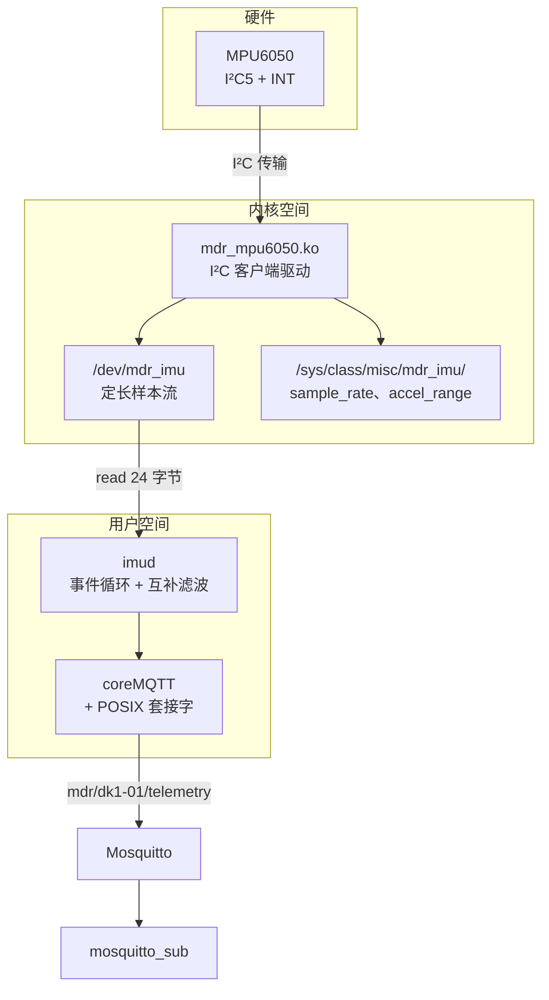
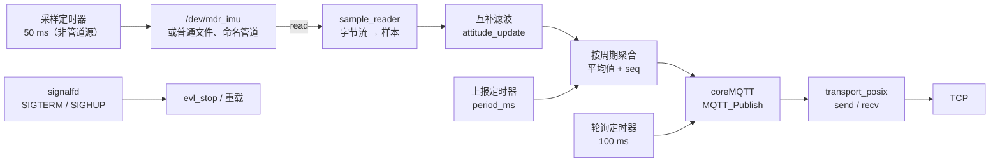

# 7.4 嵌入式 Linux 驱动与应用

面对同一个 MPU6050 运动传感器，在前面的章节中展现了三种形态各异的技术面貌：在 [7.1 裸机外设驱动](/教程/正文/嵌入式/7_综合实践/7_1_裸机外设驱动) 中是基于 GPIO 逐位翻转的极简软硬件交互，在 [7.2 RTOS 多任务设备](/教程/正文/嵌入式/7_综合实践/7_2_RTOS多任务设备) 中演化为依靠内核同步原语编排的五个高内聚协作任务，而在 [7.3 联网固件](/教程/正文/嵌入式/7_综合实践/7_3_联网固件) 中则进一步通过透传通信把解算遥测安全发往云端 Broker。但这三次实践均局限在单片机单体固件的世界里：驱动代码与高层业务被编译进同一个二进制镜像，任何一行业务逻辑的微调都必须经历全芯片的重新链接与全量烧录。而当系统跨越至诸如 STM32MP157 这样搭载 MMU 内存管理单元的嵌入式 Linux 微处理器平台时，系统架构迎来了根本性的质变——硬件控制与高层业务被物理隔离在两个互不干涉的虚拟地址空间内：驻留在内核空间的驱动模块专注于将物理寄存器时序抽象为 `/dev` 下规整的字节流接口，而运行于用户空间的服务程序则从容承担起数据消费、滤波矩阵计算与网络事件循环。驱动与用户态服务能够分别独立演化、独立编译与就地替换，彼此完全免除了重启另一侧的系统动荡。

这里将这两大核心板块融汇贯通：在第 5 章驱动原型的基础上，打磨出一套符合工业发布标准的完整 Linux 模块（包括基于设备树覆盖层的动态引脚绑定、线程化中断分流、输出定长结构体样本的杂项字符设备以及兼具读写校验的 sysfs 硬件属性接口）；随后构建专用的后台用户态守护进程 `imud`，实现二进制数据流解包、传感器姿态互补滤波以及基于 coreMQTT 的异步云端遥测发布；最后借助 Buildroot 外部树（BR2_EXTERNAL）工程机制，将内核驱动、守护进程与系统启动脚本无缝打包为一键烧录的系统镜像。工程提供完备的 QEMU 软件仿真与实体开发板运行路径。在架构末尾，还将这套方案与 Linux 官方内核原生的 `inv_mpu6050` 工业 I/O 驱动展开客观权衡，探讨量产产品中的最佳选型决策。

## 1. 目标与架构

整套系统的分层拓扑延续了嵌入式 Linux 经典的“机制与策略解耦”范式，构成了一台功能完备的物联网边缘感知终端：



在系统职责边界划分上，严格依循 [5.7 字符设备与用户空间接口](/教程/正文/嵌入式/5_嵌入式Linux/5_7_字符设备与用户空间接口) 总结的工程判定基准：内核空间仅负责“物理寄存器到规整字节流”的基础抽象，高精度硬件纳秒时间戳的捕获与量程缩放由驱动在内核上下文中就地完成（因为这些时基与物理参数唯有最底层的硬件服务例程能够第一时间获知）；而涉及复杂的运动学互补滤波矩阵、业务周期聚合统计以及上层网络协议交互，则毫无保留地留在用户空间运行，确保业务逻辑的任何修改与重构都绝不会危及操作系统内核的稳定性。硬件中断线程与用户态读取者之间依托内核原生队列环环相扣，配合 sysfs 暴露的标准参数节点，共同构筑出严密而富有弹性的软硬件协同体系。

在开发板物理连线层面，硬件规划与 [5.8 platform、I2C与SPI驱动](/教程/正文/嵌入式/5_嵌入式Linux/5_8_platform_I2C与SPI驱动) 完全统一：

| 信号 | STM32MP157 DK 板 | 说明 |
| --- | --- | --- |
| SCL | Arduino 接口 D15（PA11），I²C5 | `dkx.dtsi` 中 I²C5 默认处于 `disabled` 状态，由设备树覆盖层在启动期开启 |
| SDA | Arduino 接口 D14（PA12），I²C5 | 与 SCL 属于同组外设复用引脚 |
| INT | PA8 | 传感器数据就绪中断，配置为硬件上升沿捕获；可映射至任意空闲 GPIO |
| VDD | 3.3 V | 传感器模组板载低压差稳压器与 I²C 物理上拉电阻 |
| GND | GND | 与开发板系统共地 |

对于手头暂无真实物理开发板的学习者，工程提供了完备的 QEMU 纯软件仿真方案：使用 vexpress-a9 虚拟目标板运行 Buildroot 生成的 Linux 根文件系统，并加载内核自带的 `i2c-stub` 驱动模块虚拟出一颗内存 MPU6050 芯片。虚拟 stub 模块在内核中开辟一个 256 字节的数组来响应所有的 I²C 寄存器寻址操作，虽然缺少物理传感器动态波形与真实硬件中断线（驱动会自动退化为轮询读取模式），但对于全面校验驱动的寄存器协议编排、量程动态换算、sysfs 属性交互以及用户态 `imud` 服务的事件循环与网络发布而言，能够提供高度一致且丝滑的验证环境。真实的中断硬件触发与物理姿态响应，则留待实体板卡环境落地。

## 2. 驱动定稿

### 2.1 设备树覆盖层

在第 5 章的实验探索中，通常直接修改板级主设备树源码。但在工业产品的量产维护中，更为规范的标准实践是保持芯片厂商的原厂基础设备树丝毫不动，针对特定外设模块单独编写独立的设备树覆盖层（Device Tree Overlay，`.dtbo`），并在系统启动时由 U-Boot 引导程序动态将其合并至主树中：

```text
/dts-v1/;
/plugin/;

/ {
	compatible = "st,stm32mp157a-dk1", "st,stm32mp157d-dk1",
		     "st,stm32mp157c-dk2", "st,stm32mp157f-dk2";

	fragment@0 {
		target = <&i2c5>;
		__overlay__ {
			status = "okay";

			imu@68 {
				compatible = "mdr,mpu6050";
				reg = <0x68>;
				interrupt-parent = <&gpioa>;
				interrupts = <8 1>;	/* PA8，上升沿 */
			};
		};
	};
};
```

语法开头的 `/plugin/;` 明确声明这是一个动态片段，`fragment@0` 中的 `target` 语法锚定目标节点标签（此处为开发板上的 I²C5 控制器），`__overlay__` 块中定义的子节点与属性将在启动时原位叠加进主树。根节点的 `compatible` 属性必须完整罗列覆盖层所支持的所有硬件主板型号，一旦与 U-Boot 传入的板载标识不符，动态加载就会被安全拦截。

节点中的 `interrupts = <8 1>` 清晰定义了中断引脚号（PA8）与电气触发特性，其中数值 `1` 在标准设备树语法中严格对应上升沿触发（Edge Falling/Rising）。MPU6050 芯片的 INT 引脚出厂默认配置为推挽输出、高电平有效、持续时间约 50 µs 的硬件脉冲，上升沿捕获恰好能够精确抓取数据就绪时刻；若需将其重构为低电平触发，该字段需修正为 `2`，同时必须在驱动中将芯片寄存器 `INT_PIN_CFG`（0x37）的锁存使能位（LATCH_INT_EN）明确激活，确保电平状态持续维持至软件读走数据为止，否则仅持续 50 µs 的窄脉冲很容易被高负载下的中断控制器漏检。

物理电气触发方式统一由设备树全权声明，驱动程序在调用中断注册接口时绝不可重复传递任何诸如 `IRQF_TRIGGER_*` 的标志。在 [5.9 中断、DMA 与并发](/教程/正文/嵌入式/5_嵌入式Linux/5_9_中断_DMA与并发) 中已明确确立这一工程分工准则：中断控制器负责按照设备树给出的硬件拓扑规范配置电气引脚，若驱动源码再次显式指定，一旦两处描述存在微小偏差就会诱发难以理清的竞争与覆盖。驱动代码中仅需保留 `IRQF_ONESHOT` 控制位，指示内核在中断处理线程彻底执行完毕并交出数据之前，严禁重新开放该物理中断线。

::: tip 覆盖层放在哪里

在基于 SD 卡启动的嵌入式 Linux 系统中，U-Boot 通常在读取内核前自动检索 `/boot/overlays/` 目录下的 `.dtbo` 二进制并实施内存修补。在 Buildroot 构建流水线中，通过 post-image 钩子脚本调用设备树编译器 `dtc` 将覆盖层源码编译为二进制后打包进启动 FAT 分区，实现了与板级映像的完全解耦。

:::

### 2.2 样本结构

为了在字符设备接口上建立高效且无歧义的数据管道，`/dev/mdr_imu` 每次 `read()` 系统调用均以定长结构体的形式交出一个完整样本。该结构的二进制布局被固化在用户空间与内核驱动共享的头文件中：

```c
/* mdr_imu.h：驱动与 imud 都包含 */
#ifndef _UAPI_MDR_IMU_H
#define _UAPI_MDR_IMU_H

#include <linux/types.h>

struct mdr_imu_sample {
	__u64 timestamp_ns;
	__s16 accel[3];		/* x、y、z，单位 mg */
	__s16 gyro[3];		/* x、y、z，单位 0.01 °/s */
	__u16 accel_range;	/* 0～3：±2、±4、±8、±16 g */
	__u16 reserved;
};

#endif
```

该结构体总计占用 24 个字节，内存排布严格按照 64 位自然边界对齐：起始为 8 字节的 64 位纳秒时间戳，紧随其后的是三轴加速度与三轴角速度两个 16 位整型数组（累计 12 字节），末尾填充当前量程指示与保留对齐段（累计 4 字节），整体尺寸天然整除 8 字节，无需通过编译指令 `__attribute__((packed))` 破坏访问效率。时间戳字段直接通过内核专用的 `ktime_get_boottime_ns()` 捕获系统自启动以来的绝对纳秒计数；在用户空间，服务程序通过标准 POSIX 调用 `clock_gettime(CLOCK_BOOTTIME, ...)` 能够访问到完全同源的单调时间轴。这种设计彻底摆脱了“假定采样率绝对恒定在 100 Hz”的朴素假设：在总线高负载时，I²C 传输可能会出现微小的微秒级抖动，利用驱动贴上的物理纳秒时间戳直接计算微分 `dt`，使得后续的滤波矩阵解算完全不受调度抖动的影响。

采用定长二进制帧替代传统的 ASCII 格式化文本行，展现了嵌入式软件设计的两大核心优势：其一，用户态消费开销无限趋近于零，从设备文件读出的字节流可直接通过内存拷贝映射为结构体，免除了繁重低效的字符串扫描与浮点数文本转换；其二，具备绝佳的数据流容错性，由于每帧数据严格锁定为 24 字节，即使由于通信干扰出现整帧丢弃，读取端只需按照 24 字节边界重采样即可，绝不会像基于换行符的文本流那样因丢失单个标点而诱发后续字段的连续串行错位。

::: warning 两侧的字节序要对齐

该结构体是以主机原生字节序直接从内核空间写入用户空间的。在 ARM Cortex 架构下，内核与用户态程序均统一运行在小端序（Little-Endian）模式下，因此数据交互高度透明；若该数据后续涉及跨网络向其他大端架构主机转发，或者需要将离线记录文件搬移至异构平台分析，则必须在应用层使用明确的大小端拆包转换例程。

:::

### 2.3 线程化中断与 kfifo

对于 I²C 这类慢速串行总线而言，从机产生中断后必须发起完整的总线读写事务来提取数据，其传输过程动辄耗费数毫秒并涉及总线调度睡眠。因此，驱动必须采用基于 `devm_request_threaded_irq()` 的线程化中断架构：

```c
if (client->irq > 0) {
	ret = devm_request_threaded_irq(&client->dev, client->irq,
					mdr_imu_irq_top,
					mdr_imu_irq_thread,
					IRQF_ONESHOT,
					"mdr_mpu6050", priv);
	if (ret) {
		dev_err(&client->dev, "申请中断 %d 失败: %d\n",
			client->irq, ret);
		goto err_fifo;
	}
	priv->has_irq = true;
}
```

运行在硬中断上下文中的上半部处理函数 `mdr_imu_irq_top` 仅做极其微小的现场保护，并直接向内核返回 `IRQ_WAKE_THREAD`；真正高耗时的寄存器突发读取逻辑全部被顺延至内核独立的调度线程中执行：

```c
static irqreturn_t mdr_imu_irq_thread(int irq, void *dev_id)
{
	struct mdr_imu *priv = dev_id;
	struct mdr_imu_sample s;

	mutex_lock(&priv->lock);
	if (mdr_imu_fill(priv, &s) == 0)
		kfifo_in(&priv->fifo, &s, 1);
	mutex_unlock(&priv->lock);
	wake_up_interruptible(&priv->readq);
	return IRQ_HANDLED;
}
```

例程中的 `mdr_imu_fill()` 依托 `i2c_smbus_read_i2c_block_data()` 发起突发总线事务，该接口在等待硬件响应时会主动挂起当前线程，这唯有在具备进程上下文属性的中断下半部线程中才被内核机制所允许。数据采集成功后，样本被推入内核自带的专用环形队列 `kfifo`，并通过等待队列接口唤醒所有可能在读取端阻塞休眠的用户态服务。

字符设备文件操作中的读取流程形成了严密的生产-消费闭环：

```c
for (;;) {
	mutex_lock(&priv->lock);
	ret = kfifo_out(&priv->fifo, &s, 1);
	mutex_unlock(&priv->lock);
	if (ret == 1)
		break;
	if (!priv->has_irq) {
		/* 没有中断：主动读一次寄存器，当作一个样本 */
		mutex_lock(&priv->lock);
		ret = mdr_imu_fill(priv, &s);
		mutex_unlock(&priv->lock);
		if (ret)
			return ret;
		break;
	}
	if (file->f_flags & O_NONBLOCK)
		return -EAGAIN;
	ret = wait_event_interruptible(priv->readq,
				       !kfifo_is_empty(&priv->fifo));
	if (ret)
		return ret;
}
```

深入审查此数据管道包含三项关键的架构细节：首先，内核环形队列的容量规划为 64 个样本，在常规 100 Hz 采样下，用户空间的事件循环通常在数毫秒内就会将其取空，队列长期维持在接近空槽的低水位状态，64 个槽位的充裕深度是专为吸收用户态进程偶发遭遇系统调度抢占而预留的减震水库；若队列饱和，策略上采取“丢弃新样、保全历史”，契合运动连续性轨迹的需求。其次，等待逻辑使用 `wait_event_interruptible`，一旦进程在休眠期间收到外部 POSIX 信号（如 `SIGINT`），接口立即返回非零负数，使系统调用平滑向上层冒泡为标准 `EINTR` 错误码。最后，当设备运行在缺乏硬件物理中断的虚拟仿真环境（如 QEMU + i2c-stub）时，驱动能够智能感知 `has_irq == false` 并自适应退化为“就地按需同步采集”，使得同一套驱动源码在没有物理接线时也能无缝验证全部数据通路。

在 `poll` 机制上，驱动根据当前中断配置如实向 VFS 上报就绪掩码。虽然在本章的 `imud` 服务中，描述符交由 epoll 统一调度，但保留规范的字符设备接口确保了系统能够与外部标准命令行调试工具开箱兼容。

### 2.4 sysfs 属性

为了实现硬件参数的在线调优，驱动借助 sysfs 虚拟文件系统在 `/sys/class/misc/mdr_imu/` 路径下导出了 `sample_rate` 与 `accel_range` 两个交互节点：

```c
static ssize_t sample_rate_store(struct device *dev,
				 struct device_attribute *attr,
				 const char *buf, size_t len)
{
	struct mdr_imu *priv = dev_get_drvdata(dev);
	unsigned int rate;
	u8 div;
	int ret;

	ret = kstrtouint(buf, 10, &rate);
	if (ret)
		return ret;
	/* 4～1000 Hz 才能用整数分频表示 */
	if (rate < 4 || rate > 1000)
		return -EINVAL;
	div = (u8)(1000 / rate - 1);

	mutex_lock(&priv->lock);
	ret = i2c_smbus_write_byte_data(priv->client,
					MDR_MPU6050_REG_SMPLRT_DIV, div);
	mutex_unlock(&priv->lock);
	if (ret < 0)
		return ret;
	return len;
}
static DEVICE_ATTR_RW(sample_rate);
```

用户在控制台向该文件写入标准十进制频率数值（Hz），驱动程序负责将其自动映射为芯片内部采样分频寄存器 `SMPLRT_DIV` 所需的除数，彻底免除了应用层翻阅硬件寄存器数据手册的负担。在数字低通滤波器开启的基准时钟下，芯片内部的采样基准是 1 kHz，该内部除数与采样率的换算公式为 `div = 1000 / rate - 1`，输入合法区间被防御性限定在 4 Hz 至 1000 Hz 之间；100 Hz 对应 9，200 Hz 对应 4。

这个公式只在 `rate` 整除 1000 时精确。写 60 Hz 得到分频 15，实际是 1000 / 16 = 62.5 Hz（整数截断成 62）；写 300 Hz 得到分频 2，实际是 333 Hz。驱动不去纠正这件事，但读回来的是实际生效的值，用户一看就知道。

当用户通过 `cat` 读取该属性时，驱动坚持“以物理硬件为准”的设计哲学，直接发起真实的 I²C 读事务审查芯片内部真实状态：

```c
static ssize_t sample_rate_show(struct device *dev,
				struct device_attribute *attr, char *buf)
{
	struct mdr_imu *priv = dev_get_drvdata(dev);
	u8 div;
	int ret;

	mutex_lock(&priv->lock);
	ret = i2c_smbus_read_byte_data(priv->client,
				       MDR_MPU6050_REG_SMPLRT_DIV);
	mutex_unlock(&priv->lock);
	if (ret < 0)
		return ret;
	div = (u8)ret;

	return sysfs_emit(buf, "%u\n", 1000 / (1 + div));
}
```

之所以拒绝在驱动内存中单纯维护一份软件缓存对象，是考虑到嵌入式系统中外设状态失步的多种偶发边界：芯片可能被外部开发人员直接通过底层调试工具（如 `i2cset`）临时修改了寄存器，也可能在遭遇电源微小跌落后内部状态机自动复位为初始值。每次读取物理硬件能够保证 sysfs 展示的数据始终是对物理硅片当前真实运转状态的忠实反映。

### 2.5 清理与休眠

在模块卸载或注销的生命周期终点，`remove` 回调承担着不可忽视的电源管理职责：

```c
static void mdr_imu_remove(struct i2c_client *client)
{
	struct mdr_imu *priv = i2c_get_clientdata(client);

	device_remove_file(priv->misc.this_device, &dev_attr_accel_range);
	device_remove_file(priv->misc.this_device, &dev_attr_sample_rate);
	misc_deregister(&priv->misc);
	kfifo_free(&priv->fifo);

	/* 回到休眠，省掉几毫安的静态电流 */
	i2c_smbus_write_byte_data(client, MDR_MPU6050_REG_PWR_MGMT_1, 0x40);
}
```

函数在完成属性文件移除、字符设备注销以及内核环形缓冲销毁之后，关键性地向芯片电源管理寄存器 `PWR_MGMT_1` 写入 `0x40`，将内部 SLEEP 休眠位强制拉高。这一指令在交流稳压供电的调试台上往往容易被忽视，但对于依赖锂电池供电的便携式工业终端却至关重要：MPU6050 在正常工作状态下的动态功耗约为 3.9 mA，而在转入睡眠后静态电流将剧降至仅 5 µA，降幅接近三个数量级。模块卸载时将外设彻底关入深度低功耗态，是嵌入式驱动必须遵循的工业准则。

在驱动模块开发定稿后，调用 Linux 官方内核源码树内建的代码审查脚本 `checkpatch.pl` 进行全量语法与规范校验：

::: terminal title="bash - checkpatch（真实输出，Linux 6.18 的脚本）"

```text
$ perl linux-6.18/scripts/checkpatch.pl --no-tree --no-signoff -f mdr_mpu6050.c
total: 0 errors, 0 warnings, 415 lines checked

mdr_mpu6050.c has no obvious style problems and is ready for submission.
```

:::

添加 `--no-tree` 与 `--no-signoff` 参数使得开发人员能够在独立代码仓库中以严格的内核上游标准审查代码格式，提前化解潜在的隐蔽缺陷。

<Quiz
  type="single"
  :options="[
    { label: '上半部只返回 IRQ_WAKE_THREAD，I²C 读取放在线程函数里', value: 'A' },
    { label: '上半部直接调用 i2c_smbus_read_i2c_block_data 读六个字节', value: 'B' },
    { label: '上半部把中断号记下来，在 read 里才去读寄存器', value: 'C' },
    { label: '上半部用 msleep 等 1 毫秒凑够一个采样周期再读', value: 'D' }
  ]"
  answer="A"
>

<template #question>

MPU6050 的数据就绪中断到来时，下面哪种处理方式是对的？

</template>

正确答案是 **A**。I²C 传输涉及慢速外设状态机与等待睡眠，绝对禁止在不可休眠的硬中断上下文（Top Half）中执行，必须由上半部快速交接给独立的内核中断线程处理。选项 B 和 D 强行在原子上下文中引入睡眠操作，会直接诱发内核崩溃告警（Kernel Panic）；选项 C 则割裂了事件驱动机制，失去了硬件中断通知的物理实时性。

</Quiz>

## 3. 服务 imud

在用户态守护进程的设计上，`imud` 沿用了 5.10 节中 `sensord` 的基本骨架：基于 evl 构建单线程事件循环统一接管定时器、信号与文件描述符，彻底规避跨线程锁竞争带来的不确定性。不同之处在于，这里的数据输入源变成了驱动吐出的二进制结构体流，而遥测输出端则从早期的本地标准输出迁移到了 MQTT 代理服务器。



整个进程由三个不同周期的定时器驱动各自的职责链路：
- 上报定时器根据配置的 `period_ms`（默认 1000 ms），将这一周期内累积的所有测量数据取算术平均后组装成遥测报文并发送出去；
- 轮询定时器固定以 100 ms 为周期推进一次 coreMQTT 的接收引擎与心跳包检查；
- 采样定时器则在数据源不是命名管道时激活，每隔 50 ms 唤醒一次，把设备描述符中积攒的样本一股脑读空。如果是在开发测试中接入命名管道，管道本身具备标准的就绪事件通知，直接交由底层的 epoll 监听即可，无需主动轮询。

至于真实的字符设备 `/dev/mdr_imu`，这里同样选择用定时器定期抽取。这是因为在没有硬件中断引脚支持的环境（例如第 2 节里靠内核线程驱动的 i2c-stub 模拟器）下，字符设备的 `.poll` 实现可能会为了维持流式吞吐而始终报告读就绪。若直接将其挂进 epoll，极易让用户态事件循环陷入忙轮询空转，白白吃满 CPU。虽说在真机带中断的工况下完全可以走边缘或水平就绪唤醒，但为了让同一份用户态二进制程序在实体板与模拟开发板上无缝共用一套代码逻辑，统一采用 50 ms 的定时轮询是代价最低、行为最稳定的折中策略。在 100 Hz 的常规采样频率下，50 ms 顶多产生 5 个待读样本，远远不会填满驱动内核缓冲区内 64 样本的环形队列，根本无需担心丢失数据。

### 3.1 字节流到样本

用户态发起一次 `read()` 系统调用，内核返回的字节数未必恰好是 24 字节的整倍数。虽然在字符设备内部驱动依靠 `kfifo` 保证了每次取出的都是完整样本，但当我们在测试调试中改用命名管道、普通文件或是网络套接字充当回放源时，一次能读取到的字节量完全取决于写端管道的刷写粒度与系统调度，读出一半样本是极常见的情况。

因此，用户态必须内置一个轻量级的流拼装器，用来吸收任意长度的字节切片并按协议规整切割：

```c
size_t sample_reader_feed(struct sample_reader *sr, const unsigned char *data,
                          size_t n, struct imu_sample *out, size_t cap) {
    size_t produced = 0;
    size_t off = 0;

    while (off < n) {
        size_t room = sizeof sr->buf - sr->len;
        size_t take = n - off < room ? n - off : room;

        if (take == 0) {
            return produced;
        }
        memcpy(sr->buf + sr->len, data + off, take);
        sr->len += take;
        off += take;

        while (sr->len >= SAMPLE_BYTES) {
            struct imu_sample s;
            size_t consumed;

            if (produced == cap) {
                return produced;
            }
            s = sample_from_le_bytes(sr->buf);
            consumed = SAMPLE_BYTES;
            sr->len -= consumed;
            memmove(sr->buf, sr->buf + consumed, sr->len);
            out[produced++] = s;
        }
    }
    return produced;
}
```

拼装器内部维护了一块 4 KB 的缓存区，足以容纳一百多个原始样本。当调用方提供的目标接收数组被填满时，解析过程便适时中断，尚未消费的整样本或残缺字节则安稳留存在内部缓存中等待下一轮循环继续拼接。这部分逻辑的每一个边界条件都可以在主机上通过构造特定的碎片字节流进行单元测试验证，我们会在第 6 节详细演示。辅助函数 `sample_from_le_bytes()` 严格以小端序提取各个字段，解除了算法对主机 CPU 本地字节序的依赖，使得同一份解析代码在 x86 主机模拟环境与目标板 ARM 处理器上均能输出完全一致的物理量。

::: concept emb74-sample-framing title="/dev/mdr_imu 的读取单位"

`/dev/mdr_imu` 字符设备在驱动层的实现约定：每次 `read()` 调用返回的有效负载必须为 24 字节的 `struct mdr_imu_sample` 结构体，若应用程序传入的接收缓冲区长度 `count` 小于 24，驱动将直接返回 `-EINVAL` 错误。数据流本身没有设计额外的帧头与帧尾分隔符，完全依赖固定的字节长度进行帧切分。用户空间在解析时必须严格按照 24 字节边界做对齐处理，任何未能凑齐整帧的剩余碎片字节，都应暂存至拼装缓存中等待后续读操作补全。

:::

### 3.2 互补滤波

传感器本身的物理特性决定了单一信道的局限：MEMS 加速度计能够基于重力矢量测量出静态的绝对倾角，但在动态工况下极易受到机械振动与运动惯性的噪声干扰；而 MEMS 陀螺仪虽然能够高频跟踪角速度并输出平滑的瞬时积分，其积分漂移却会随着时间不可逆地发散。将两者的优势结合起来，便是互补滤波的核心思想：

```c
void attitude_update(struct attitude *a, const struct imu_sample *s, double dt,
                     double alpha) {
    /* 陀螺仪单位是 0.01 °/s，先换成 °/s */
    double gx = s->gyro[0] / 100.0;
    double gy = s->gyro[1] / 100.0;

    double pitch_acc = accel_pitch_deg(s);
    double roll_acc = accel_roll_deg(s);

    /* 陀螺仪积分预测，再用加速度计的低频分量修正 */
    a->pitch = alpha * (a->pitch + gx * dt) + (1.0 - alpha) * pitch_acc;
    a->roll = alpha * (a->roll + gy * dt) + (1.0 - alpha) * roll_acc;
}
```

算法中的滤波系数 `alpha` 通常设定在 0.98 附近，对应的滤波时间常数约为 `dt / (1 - alpha)`。在 100 Hz（即 `dt` = 0.01 秒）的采样频率下，该常数约为 0.5 秒。这层数学关系所代表的物理直觉非常清晰：陀螺仪通过高速角速度积分推算出的姿态变化，每隔约半秒就会被加速度计测得的绝对低频重力矢量缓慢拉回一次修正。`alpha` 越接近 1，系统对陀螺仪的高频响应信任度越高，输出动态跟随迅速，但抗长漂移能力随之减弱；反之，若调小 `alpha`，系统会更倾向于向重力倾角收敛，表现得更平稳但会在急转弯或剧烈震荡时产生明显的相位迟滞。对于大多数静置安防、低速巡检或工业倾角监测场景，0.98 是兼顾抗噪与平滑的理想起点；若是无人机或高频机械臂等高速运动机体，则需根据振动功率谱重新精细标定。

倾角本身用 `atan2` 算：

```c
double accel_pitch_deg(const struct imu_sample *s) {
    double ax = accel_to_g(s->accel[0]);
    double ay = accel_to_g(s->accel[1]);
    double az = accel_to_g(s->accel[2]);

    return atan2(-ax, sqrt(ay * ay + az * az)) * 180.0 / M_PI;
}
```

工程落地中必须在文档和代码中彻底厘清各轴向的符号约定，否则一旦硬件打板时芯片旋转了 90 度或倒装，计算出的姿态角就会反向漂移。这里的函数在提取 x 轴加速度时显式加上了负号 `-ax`，这是因为 MPU6050 芯片表面的坐标标记中，x 轴正向指向芯片引脚标记点一侧。当测试板前端抬起仰角时，重力在 x 轴上的投影反而变为负值，通过取负使“抬头”姿态自然映射为正的俯仰角。未来若硬件结构变更需要调整芯片贴装朝向，只需在此处修改单轴符号或调换轴向，其余所有的上层业务逻辑与遥测处理代码均无需改动。

### 3.3 MQTT 应用代码

在通信协议与数据格式上，本节全盘沿用了 [7.3 节](/教程/正文/嵌入式/7_综合实践/7_3_联网固件) 中定义的主题层级与 JSON 遥测负载规范。`mqtt_glue.c` 作为业务与库之间的胶水层，在 Linux 环境下唯一需要替换的仅有最底层的网络传输适配接口：

```c
static TransportInterface_t make_transport(struct mqtt_client *mc) {
    TransportInterface_t t = { 0 };

    t.recv = (TransportRecv_t)transport_recv;
    t.send = (TransportSend_t)transport_send;
    t.pNetworkContext = &mc->net;
    return t;
}
```

在 `transport_posix.c` 的具体实现中，`transport_send` 与 `transport_recv` 分别对应 POSIX 标准网络 API 的 `send()` 与 `recv()`，对外暴露的抽象签名与 7.3 节中基于 ESP-AT 串口或 Windows Winsock 的适配层完全保持一致。在上层协议调度逻辑中，coreMQTT 所提供的 `MQTT_Init`、`MQTT_Connect`、`MQTT_Publish` 以及 `MQTT_ProcessLoop` 等核心 API 的调用逻辑甚至无需改动任何一行。

不过，在将 coreMQTT 接入 POSIX 套接字时，有一处关乎时序细节的配置必须引起重视。coreMQTT 在设计上假定非阻塞语义：当底层的 `recv` 接口返回 0 时，库内部将其解释为“当前网络通道暂时没有数据到达，请稍后再试”；而一旦接收到报文的首字节之后，它会启动内部的超时计时器，依赖宏 `MQTT_RECV_POLLING_TIMEOUT_MS` 来裁决“连续多长时间未收到后续字节即判定为报文接收超时”。如果我们在传输层直接将套接字阻塞在 `recv()` 上长达两三百毫秒，coreMQTT 内部基于毫秒级的轮询判据就会彻底失效。

为了理顺这一协作关系，代码在创建套接字时通过 `SO_RCVTIMEO` 选项设置了 10 ms 的底层接收超时时间。当超时发生时，系统调用返回 `EAGAIN`，传输适配层捕获该错误并优雅地转译为返回值 0 向上交代；与此同时，将 coreMQTT 的宏 `MQTT_RECV_POLLING_TIMEOUT_MS` 配置为 30 ms。这种“应用层轮询窗口宽于传输层单次阻塞窗口”的时序阶梯，保证了库能够在底层放弃之后依然保留重试余量。两者之间的核心契约是“库准备容忍的总等待时长”必须严密包裹住“底层单次系统调用的最大超时”，如果将这个时序关系颠倒，就会在网络抖动时频繁触发意料之外的 `MQTTRecvFailed` 断连异常。

这里还隐藏着一个在工程构建中极易踩坑的细节：`MQTT_RECV_POLLING_TIMEOUT_MS` 宏是在 coreMQTT 源码库内部直接编译生效的，单纯在外部应用程序的某个业务头文件中定义它根本无法起效。在稍后的 4.3 节中读者会看到，Buildroot 的打包规则必须显式将包含该宏定义的统一配置文件注入到外部库本身的编译参数中。

在 Linux 生态中，开发人员通常更习惯直接引入 `libmosquitto` 或 Eclipse Paho 等成熟的客户端库。之所以在这里坚持沿用 coreMQTT，核心考量在于保证两套固件在协议行为层面的严格同构性：从单片机到 Linux 网关，两端面对的 MQTT 状态机完全一致，联调排错时便能彻底排除“第三方客户端库行为差异”的干扰，仅需关注底层传输驱动的迁移。虽然工业级 Linux 产品中 `libmosquitto` 能凭借其内建的异步线程、TLS 会话管理与自动重发机制省去不少胶水代码，但其庞大的动态依赖库往往会让固件体积急剧膨胀；相比之下，coreMQTT 编译出来的静态链接产物仅约 30 KB，结合简洁的 `imud` 守护进程，整体代码段体积不到 40 KB，在追求极致轻量、快速冷启动的边缘节点上具备显著的资源优势。

连接时要填的参数：

```c
connect_info.cleanSession = true;
connect_info.keepAliveSeconds = MQTT_KEEPALIVE_SECONDS;
connect_info.pClientIdentifier = client_id;
connect_info.clientIdentifierLength = (uint16_t)strlen(client_id);

will_info.qos = MQTTQoS0;
will_info.pTopicName = mc->topic_status;
will_info.topicNameLength = (uint16_t)strlen(mc->topic_status);
will_info.pPayload = "offline";
will_info.payloadLength = 7;
```

将 `cleanSession` 设置为 `true`，意味着客户端每次发起连接时都建立全新的空白会话，代理服务器不会持久化保留未下发的历史消息队列或订阅关系。由于边缘网关的主要职责是高频单向推送即时的物理量遥测，重启后重新协商会话不仅语义清晰，还能有效避免离线积压过期数据。

遗嘱消息 (Last Will and Testament, LWT) 在这里用 QoS 0，与 7.3 的约定（status 用 QoS 1）不同，原因在 coreMQTT 的用法上：QoS 1 的发布要走状态机，需要先调 `MQTT_InitStatefulQoS()` 并给定发送记录数组；这个服务只发布 QoS 0 的遥测，没有初始化状态机，于是遗嘱与退出前的 `offline` 都跟着用 QoS 0。离线通知丢一条没有关系，`keepalive` 超时后服务器还会判一次。要改回 QoS 1，得先把状态机初始化好，否则发布调用直接返回 `MQTTBadParameter`。

cmd 主题的回调只认一个命令：

```c
if ((size_t)pub->topicNameLength == strlen(mc->topic_cmd) &&
    strncmp(pub->pTopicName, mc->topic_cmd, pub->topicNameLength) == 0) {
    char payload[64];
    size_t n = pub->payloadLength < sizeof payload - 1
                   ? pub->payloadLength
                   : sizeof payload - 1;

    memcpy(payload, pub->pPayload, n);
    payload[n] = '\0';

    int rate = 0;

    if (sscanf(payload, "rate=%d", &rate) == 1 && rate >= 4 &&
        rate <= 1000) {
        mc->cmd_rate_value = rate;
        mc->cmd_rate_pending = true;
    }
}
```

值得注意的是，命令回调函数在解析出采样率参数后，仅仅是做好了标记并暂存数据，并没有立即执行底层配置的切换。正如 5.10 节在事件循环设计中深入讨论过的规则：该回调函数正运行在 coreMQTT 的 `MQTT_ProcessLoop` 调度栈内部，如果在网络报文解析的半途中冒然调用阻塞式的外设配置接口或重置底层状态，极易诱发级联重入或破坏协议缓冲区的完整性。最稳妥的处理方案，永远是将具体的控制动作推迟到下一轮事件循环的空闲期或普通的轮询钩子 `on_poll` 中从容执行。

### 3.4 事件循环与轮询节奏

```c
srv->report_timer = evl_add_timer(srv->loop, srv->cfg.period_ms,
                                  srv->cfg.period_ms, on_report, srv);
srv->poll_timer = evl_add_timer(srv->loop, MQTT_POLL_MS, MQTT_POLL_MS,
                                on_poll, srv);
```

两个核心周期定时器构成了整个进程运行的心跳节奏：`on_report` 按照用户配置的 `period_ms` 汇聚当期姿态并组装上报；而 `on_poll` 则以恒定的 100 ms 步长唤醒 coreMQTT 的核心引擎。后者的持续转动至关重要：coreMQTT 本质上是一个单线程状态机，所有的报文收发、协议握手与 `PINGREQ` 心跳维护完全依赖于 `MQTT_ProcessLoop()` 的调用驱动。倘若因某段阻塞逻辑漏调了该接口，客户端不仅无法收到服务端的订阅确认与控制指令，更会在心跳超时后被 MQTT Broker 判定为失联并强制切断连接。

`on_poll` 里做三件事：

```c
static void on_poll(evl_loop *loop, evl_timer *timer, void *arg) {
    struct imud *srv = arg;

    (void)loop;
    (void)timer;
    if (!srv->mqtt.connected) {
        return;
    }
    if (mqtt_client_poll(&srv->mqtt) < 0) {
        mqtt_client_disconnect(&srv->mqtt, false);
        logmsg("连接断开，%d 毫秒后重连", srv->reconnect_delay_ms);
        reconnect_schedule(srv, srv->reconnect_delay_ms);
        return;
    }
    if (srv->mqtt.cmd_rate_pending) {
        srv->mqtt.cmd_rate_pending = false;
        logmsg("收到 rate=%d 命令", srv->mqtt.cmd_rate_value);
        srv->cfg.sample_rate = srv->mqtt.cmd_rate_value;
        /* 采样率属于驱动，经 sysfs 下发；失败只记日志 */
        char path[256];
        FILE *fp;

        snprintf(path, sizeof path, "/sys/class/misc/mdr_imu/sample_rate");
        fp = fopen(path, "w");
        if (fp != NULL) {
            fprintf(fp, "%d\n", srv->cfg.sample_rate);
            fclose(fp);
            logmsg("采样率已设为 %d Hz", srv->cfg.sample_rate);
        } else {
            logmsg("写 %s 失败: %s", path, strerror(errno));
        }
    }
}
```

对 Linux 虚拟文件系统 sysfs 属性节点的写操作，直接使用标准 C 库的 `fopen` 搭配 `fprintf` 即可干净利落地完成，无需为了写入单个整数字符串而引入繁琐的低级系统调用。属性路径在代码中作为稳定常量维护，因为驱动所绑定的设备节点名称在设备树与字符设备注册时已经固化，强行将其暴露为外部用户配置项并无实际收益。

重连采用指数退避，每次失败翻倍，上限 30 秒：

```c
static void on_reconnect(evl_loop *loop, evl_timer *timer, void *arg) {
    struct imud *srv = arg;

    (void)loop;
    (void)timer;
    srv->reconnect_timer = NULL; /* 这个一次性定时器马上会被 evl 释放 */
    if (mqtt_client_connect(&srv->mqtt, &srv->cfg) == 0) {
        srv->reconnect_delay_ms = RECONNECT_MIN_MS;
        return;
    }
    srv->reconnect_delay_ms *= 2;
    if (srv->reconnect_delay_ms > RECONNECT_MAX_MS) {
        srv->reconnect_delay_ms = RECONNECT_MAX_MS;
    }
    logmsg("%d 毫秒后重试", srv->reconnect_delay_ms);
    reconnect_schedule(srv, srv->reconnect_delay_ms);
}
```

在这段重连逻辑中，`srv->reconnect_timer = NULL;` 这行看似不起眼的指针置空操作具有决定性的安全性价值。在底层 evl 框架的约定中，一次性单触发定时器在执行完毕回调函数之后，其内部的定时器上下文对象就会被框架自动回收并释放。如果不显式将其句柄置空，后续若因网络重连失败再次调用 `reconnect_schedule()` 时，老旧的无效句柄很可能再次被传入 `evl_cancel_timer()`；而此时该内存地址可能早已被系统的 `malloc` 重新划拨给其它业务对象，进而引发灾难性的内存踩踏（Use-After-Free）。在实际工程中，这类隐蔽缺陷往往表现为守护进程平稳运行数小时后毫无征兆地崩溃在定时器插入的汇编指令中。通过在回调入口处主动斩断悬空句柄，方能彻底根除此类顽疾。

### 3.5 配置文件

```text
# imud.conf
source = /dev/mdr_imu
host = 192.168.1.50
port = 1883
device_id = dk1-01
topic_prefix = mdr
period_ms = 1000
sample_rate = 100
alpha = 0.98
```

在配置文件的解析逻辑中，`config_load()` 遵循了防御性加载模式：先将所有合法的默认参数写入一个独立的临时对象，随后逐行读取并校验配置文件中的键值对，只有当整份文件中的所有配置项均通过格式与边界校验后，才以原子赋值的方式全量覆盖当前正在运行的全局配置对象。如果遇到数值越界（例如将 `period_ms` 误配置为 5 ms 这种超出物理调度能力的极小值），解析器将立即抛出警告并返回错误码中断加载，原有的稳定配置得以完整保留。这种设计确保了在收到 `SIGHUP` 信号动态重载配置时，不会因运维人员的一次笔误而让服务陷入高频刷屏崩溃的不可控状态。

需要注意的是，配置项中的 `sample_rate` 与 `alpha` 属于守护进程内部的算法与调度参数，与底层硬件驱动在 sysfs 中维护的物理属性并非双向强绑定的关系。驱动在内核加载时拥有自己的默认采样频率，守护进程启动阶段可以根据配置下发一次修正，但并不代管驱动的全部生命周期。解耦这两者的状态管理，能够让系统在面对热重载或外设热插拔时保持更清晰的职责边界。

<Quiz
  type="multi"
  :options="[
    { label: '每 100 ms 调一次 MQTT_ProcessLoop，处理收包与 keepalive', value: 'A' },
    { label: '把 MQTT_ProcessLoop 放在 on_report 里，每个上报周期调一次', value: 'B' },
    { label: '命令回调里只记录请求，真正的动作放到下一轮事件循环', value: 'C' },
    { label: '重连间隔固定为 1 秒，避免服务器被大量设备同时冲击', value: 'D' }
  ]"
  :answer="['A', 'C']"
>

<template #question>

关于 imud 的事件循环与 MQTT 处理，下列说法正确的是哪些？

</template>

正确答案是 **A、C**。
选项 B 的错误在于上报周期完全可能因节能要求被配置为数秒甚至数十秒，若将协议引擎的驱动与上报绑定，期间将无法接收控制下发指令，也无法维持正常的 `PINGREQ` 心跳保活，必然导致被服务端踢出连接；选项 D 采用固定重连间隔正是 7.3 节指出的集群风暴隐患，当网络抖动导致大批设备同时掉线时，固定间隔会导致所有节点在完全相同的时刻向 Broker 发起并发洪峰，必须依靠指数退避与随机抖动来平抑重连波峰。

</Quiz>

## 4. 用 Buildroot 打包

在嵌入式 Linux 产品交付中，最终交付给生产线或现场运维的通常是一张完整的 SD 卡固件镜像，由构建系统一次性组装出 Bootloader、内核与根文件系统。在 5.4 节中，我们系统梳理过 Buildroot 的软件包机制与 `BR2_EXTERNAL` 外部树结构；本节我们将这套机制落地，为我们的项目编写三个核心软件包。

### 4.1 外部树的目录

工程外部树的组织结构如下：

```text
br2-external/
├── external.desc
├── external.mk
├── Config.in
├── configs/
│   ├── mdr_stm32mp157_defconfig
│   └── mdr_qemu_defconfig
├── board/mdr/
│   ├── post-build.sh
│   ├── qemu-stub.fragment
│   ├── overlays/mdr-imu-overlay.dts
│   ├── rootfs-overlay/etc/imud.conf
│   ├── rootfs-overlay/etc/init.d/S60imud
│   └── rootfs-overlay-qemu/etc/init.d/S59i2cstub
└── package/
    ├── coremqtt/
    ├── mdr-imu/
    └── imud/
```

为了保持代码仓库的纯粹性，这三个包并没有在外部树目录中硬拷贝源码，而是通过 `_SITE` 配置项路径直接指回工程根目录下的 `driver/` 与 `imud/` 源码目录，保证整个版本库中源码有且仅有一份实体副本。配合 `_SITE_METHOD = local` 参数，Buildroot 会在构建时直接抓取本地源码目录，避免触发不必要的网络下载。

在 `external.desc` 描述文件中，`name` 字段声明的标识在转为全大写后，便会化身为所有包 Makefile 中引用的顶层路径前缀宏 `BR2_EXTERNAL_MDR_PATH`：

```text
name: MDR
desc: MDR 的 IMU 产品：mdr_mpu6050 驱动、imud 服务与 coreMQTT
```

### 4.2 内核模块包

驱动包的 Makefile 定义极为简练，其核心描述仅有寥寥数行：

```make
MDR_IMU_VERSION = 1.0
MDR_IMU_SITE = $(BR2_EXTERNAL_MDR_PATH)/../driver
MDR_IMU_SITE_METHOD = local
MDR_IMU_LICENSE = GPL-2.0
MDR_IMU_LICENSE_FILES = mdr_mpu6050.c

$(eval $(kernel-module))
$(eval $(generic-package))
```

在这两行 `eval` 调用中，声明的先后顺序具有强烈的约束关系：`$(eval $(kernel-module))` 必须严格置于 `$(eval $(generic-package))` 之前。这是因为 `kernel-module` 基础设施负责为当前包注入交叉编译内核模块所需的环境参数（如 `ARCH`、`CROSS_COMPILE`、`KDIR` 等编译参数集合），而紧随其后的 `generic-package` 框架则负责将整个包挂载到全局构建依赖拓扑中。倘若不慎将两者颠倒，构建系统在编译模块时便会缺失目标架构的交叉编译指引，转而直接以宿主机架构（如 x86_64）执行构建，编译出的 `.ko` 文件一旦强行在目标板上加载，内核便会直接报错 `Invalid module format`。与此同时，驱动根目录下的 `driver/Makefile` 保持最纯粹的内核模块语法，仅需一行 `obj-m += mdr_mpu6050.o`。

在配置菜单描述文件 `Config.in` 中，显式声明对内核依赖的约束：

```text
config BR2_PACKAGE_MDR_IMU
	bool "mdr-imu"
	depends on BR2_LINUX_KERNEL
	help
	  MPU6050 的字符设备驱动（7.4）。加载后出现 /dev/mdr_imu，
	  一次 read 交出一个带时间戳的定长样本；
	  /sys/class/misc/mdr_imu/ 下有 sample_rate 与 accel_range。
```

### 4.3 coreMQTT 包

由于 FreeRTOS 的 coreMQTT 官方仓库并未自带 CMake 或 Autotools 构建脚本，Buildroot 的打包规则采取了最直接高效的策略：利用工具链提供的 `TARGET_CC` 直接编译这三个核心 `.c` 源文件，并用 `TARGET_AR` 归档为静态链接库：

```make
COREMQTT_VERSION = v2.3.1
COREMQTT_SITE = $(call github,FreeRTOS,coreMQTT,$(COREMQTT_VERSION))
COREMQTT_LICENSE = MIT
COREMQTT_LICENSE_FILES = LICENSE
COREMQTT_INSTALL_STAGING = YES

COREMQTT_CONFIG_SRC = $(BR2_EXTERNAL_MDR_PATH)/../imud/core_mqtt_config.h
COREMQTT_CFLAGS = $(TARGET_CFLAGS) -O2 -I$(@D)/config

define COREMQTT_BUILD_CMDS
	$(INSTALL) -D -m 0644 $(COREMQTT_CONFIG_SRC) \
		$(@D)/config/core_mqtt_config.h
	$(TARGET_CC) $(COREMQTT_CFLAGS) -c -o $(@D)/core_mqtt.o \
		-I$(@D)/source/include -I$(@D)/source/interface \
		$(@D)/source/core_mqtt.c
	$(TARGET_CC) $(COREMQTT_CFLAGS) -c -o $(@D)/core_mqtt_serializer.o \
		-I$(@D)/source/include -I$(@D)/source/interface \
		$(@D)/source/core_mqtt_serializer.c
	$(TARGET_CC) $(COREMQTT_CFLAGS) -c -o $(@D)/core_mqtt_state.o \
		-I$(@D)/source/include -I$(@D)/source/interface \
		$(@D)/source/core_mqtt_state.c
	$(TARGET_AR) rcs $(@D)/libcoreMQTT.a \
		$(@D)/core_mqtt.o $(@D)/core_mqtt_serializer.o \
		$(@D)/core_mqtt_state.o
endef

define COREMQTT_INSTALL_STAGING_CMDS
	$(INSTALL) -D -m 0644 $(@D)/libcoreMQTT.a \
		$(STAGING_DIR)/usr/lib/libcoreMQTT.a
	mkdir -p $(STAGING_DIR)/usr/include/coreMQTT
	$(INSTALL) -m 0644 $(@D)/source/include/*.h \
		$(STAGING_DIR)/usr/include/coreMQTT/
	$(INSTALL) -m 0644 $(@D)/source/interface/*.h \
		$(STAGING_DIR)/usr/include/coreMQTT/
	$(INSTALL) -m 0644 $(@D)/config/core_mqtt_config.h \
		$(STAGING_DIR)/usr/include/coreMQTT/
endef

$(eval $(generic-package))
```

在打包 coreMQTT 时，有一处关于头文件包含作用域的深层隐患需要特别注意。在 `core_mqtt_config.h` 中配置的诸如 `MQTT_RECV_POLLING_TIMEOUT_MS` 和 `MQTT_SUB_UNSUB_MAX_VECTORS` 等核心宏，**是在 coreMQTT 自身的 C 源码翻译单元中被直接读取并展开的**：例如底层的接收调度轮询利用前者判断超时截断，而 `MQTT_Subscribe` 则依据后者分配向量化写操作的数组长度。倘若开发者误以为只需在上层应用程序的头文件中定义这些宏，库本身在独立编译时依然只会默默使用默认缺省值，应用程序修改宏的行为完全无法传导到底层库中。为此，这套打包脚本在编译库源码之前，先将工程定制的配置头文件拷贝至构建目录的 `config/` 下，并通过 `-I` 强行注入库的编译管线中；随后再将这份配置文件同公共头文件一起安装至 staging 目录供业务调用，确保两端对协议参数的理解保持严格对称。

构建中还有一个容易诱发运行时硬崩溃的边界陷阱：`MQTT_SUB_UNSUB_MAX_VECTORS` 在官方库中的默认值是 4，表面上看处理单条订阅绰绰有余。然而，如果开发者试图将其精简缩小到小于 3 的数值，进入 `MQTT_Subscribe` 后便会无条件触发内部的一句断言检查 `assert(MQTT_SUB_UNSUB_MAX_VECTORS >= CORE_MQTT_SUBSCRIBE_PER_TOPIC_VECTOR_LENGTH)`，其中每个主题所固有的分段向量常数恰好是 3。一旦不慎将其配成 2，进程在发起订阅的瞬间就会异常终止退出，在日志中只留下一行令人费解的断言失败信息。

此外，指令 `INSTALL_STAGING = YES` 指示 Buildroot 将生成的静态库和头文件安装到 `output/staging` 目录中，即提供给交叉编译环境的本地 sysroot。若是遗漏了这行声明，下游的 `imud` 在执行 CMake 检测时便根本无法搜寻到 `libcoreMQTT.a`。

### 4.4 imud 包

```make
IMUD_VERSION = 1.0
IMUD_SITE = $(BR2_EXTERNAL_MDR_PATH)/../imud
IMUD_SITE_METHOD = local
IMUD_LICENSE = CC-BY-NC-SA-4.0
IMUD_DEPENDENCIES = coremqtt host-cmake
IMUD_CONF_OPTS = -DCMAKE_BUILD_TYPE=Release

define IMUD_INSTALL_CONF
	$(INSTALL) -D -m 0644 $(IMUD_PKGDIR)/imud.conf \
		$(TARGET_DIR)/etc/imud.conf
endef

define IMUD_INSTALL_INIT_SYSV
	$(INSTALL) -D -m 0755 $(IMUD_PKGDIR)/S60imud \
		$(TARGET_DIR)/etc/init.d/S60imud
endef

IMUD_POST_INSTALL_TARGET_HOOKS += IMUD_INSTALL_CONF

$(eval $(cmake-package))
```

`cmake-package` 把 `imud/CMakeLists.txt` 交给交叉编译工具链构建，并将最终的二进制产物自动部署进根文件系统的 `target/usr/bin/` 目录。其中，宏 `IMUD_INSTALL_INIT_SYSV` 是 Buildroot 的标准钩子命名约定，框架在处理 System V 启动服务安装时会自动触发它；而 `IMUD_INSTALL_CONF` 则是自定义的部署步骤，由于出厂配置文件并未纳进 CMake 本身的 `install()` 指令，我们通过框架提供的 `POST_INSTALL_TARGET_HOOKS` 钩子将其挂接在目标安装阶段之后。

`CMakeLists.txt` 里有一段是为了 Buildroot 准备的：

```cmake
find_library(COREMQTT_LIBRARY NAMES coreMQTT)
find_path(COREMQTT_INCLUDE_DIR NAMES core_mqtt.h PATH_SUFFIXES coreMQTT)

set(COREMQTT_DIR "" CACHE PATH "coreMQTT 源码根目录（sysroot 里没有库时使用）")

if(COREMQTT_LIBRARY AND COREMQTT_INCLUDE_DIR)
    add_library(core_mqtt UNKNOWN IMPORTED)
    set_target_properties(core_mqtt PROPERTIES
        IMPORTED_LOCATION "${COREMQTT_LIBRARY}"
        INTERFACE_INCLUDE_DIRECTORIES "${COREMQTT_INCLUDE_DIR}"
    )
elseif(COREMQTT_DIR)
    add_library(core_mqtt STATIC
        ${COREMQTT_DIR}/source/core_mqtt.c
        ${COREMQTT_DIR}/source/core_mqtt_serializer.c
        ${COREMQTT_DIR}/source/core_mqtt_state.c
    )
    ...
endif()
```

宿主机开发时给 `-DCOREMQTT_DIR=...` 选项直接编源码，Buildroot 构建时则优先链接已安装进 sysroot 的静态库。同一套构建描述文件同时平滑支撑两套场景，省去了维护多套 Makefile 的精力消耗。

### 4.5 两份 defconfig

工程针对真实硬件与仿真环境分别提供了 `mdr_stm32mp157_defconfig` 与 `mdr_qemu_defconfig` 两份板级配置。两者的主要差异完全收敛在平台底层硬件属性上：处理器架构（STM32MP157 的 Cortex-A7 对比仿真机 QEMU Versatile Express 的 Cortex-A9）、默认内核配置（`multi_v7` 对比 `vexpress_defconfig`）、目标设备树，以及 QEMU 版本中额外引入的一段内核配置片段（Config Fragment）：

```text
BR2_LINUX_KERNEL_CONFIG_FRAGMENT_FILES="$(BR2_EXTERNAL_MDR_PATH)/board/mdr/qemu-stub.fragment"
```

该配置片段专门用于在仿真内核中激活虚拟总线与调试驱动：

```text
CONFIG_I2C=y
CONFIG_I2C_CHARDEV=y
CONFIG_I2C_STUB=m
```

在根文件系统覆盖层（`BR2_ROOTFS_OVERLAY`）上，QEMU 版本切换使用了定制的覆盖目录（`rootfs-overlay-qemu/`），比实体硬件多附带了一个 `S59i2cstub` 初始化脚本，在系统引导阶段自动通过 `i2cset` 工具向模拟驱动预置 MPU6050 芯片的寄存器指纹。实体板环境自然不需要该脚本，若在真机系统上强行执行，反而会因找不到 `i2c-stub` 内核模块而产生报错日志。

### 4.6 构建

::: terminal title="bash - 用外部树构建（输出类似，取自 Buildroot 2026.02 手册与本次目录结构）"

```text
$ make BR2_EXTERNAL=$PWD/br2-external O=output mdr_qemu_defconfig
$ make BR2_EXTERNAL=$PWD/br2-external O=output -j$(nproc)
...
>>> coremqtt v2.3.1 Building
>>> coremqtt v2.3.1 Installing to staging directory
>>> mdr-imu 1.0 Building
>>> mdr-imu 1.0 Installing to target
>>> imud 1.0 Configuring
>>> imud 1.0 Building
>>> imud 1.0 Installing to target
...
$ ls output/images/
rootfs.ext2  rootfs.tar  vexpress-v2p-ca9.dtb  zImage
```

:::

从零开始的初次完整构建需要经历下载交叉编译工具链、编译 Linux 内核、BusyBox 以及基础 C 运行时库的过程，耗时通常在一个小时左右。不过，一旦整套基底构建完毕，后续单纯修改 `imud` 或驱动源码时，使用 `make imud-rebuild` 或 `make mdr-imu-rebuild` 指令便能在半分钟内完成局部重新打包并生成新镜像。

构建产生的详尽中间日志可在 `output/build/imud-1.0/` 目录下随时查阅，最终安装就绪的应用程序分布在 `output/target/usr/bin/` 下。编译出的内核驱动模块位于 `output/target/lib/modules/6.18.0/extra/mdr_mpu6050.ko`，Buildroot 在制作根文件系统镜像时会自动运行 `depmod` 解析模块符号拓扑，因此系统启动后无需指定完整路径，直接执行 `modprobe mdr_mpu6050` 即可从容加载。

::: details 完整的外部树文件清单

```text
br2-external/
├── Config.in                    source 三个包的 Config.in
├── external.desc                name: MDR
├── external.mk                  wildcard 收集 package/*/*.mk
├── configs/
│   ├── mdr_qemu_defconfig
│   └── mdr_stm32mp157_defconfig
├── board/mdr/
│   ├── overlays/mdr-imu-overlay.dts
│   ├── post-build.sh            建 /data、加 imud 用户、写 mdev 规则
│   ├── qemu-stub.fragment       CONFIG_I2C_STUB=m
│   ├── rootfs-overlay/
│   │   └── etc/
│   │       ├── imud.conf        出厂配置
│   │       └── init.d/S60imud
│   └── rootfs-overlay-qemu/
│       └── etc/init.d/S59i2cstub
└── package/
    ├── coremqtt/{Config.in,coremqtt.mk}
    ├── mdr-imu/{Config.in,mdr-imu.mk}        _SITE 指向 ../driver
    └── imud/{Config.in,imud.mk,imud.conf,S60imud}   _SITE 指向 ../imud
```

在打包脚本 `post-build.sh` 中，除了创建持久化挂载点 `/data` 目录外，更承担了两项关键安全配置：通过脚本向系统 `/etc/passwd` 追加专用的普通系统用户 `imud`，确保守护进程彻底脱离 root 特权运行；同时将匹配 `/dev/mdr_imu` 的设备管理规则写入 `/etc/mdev.conf`，将该字符设备节点的属主强制划归为 `root:imud`，且访问权限严格限定为 `0660`。这些涉及操作系统身份凭据与权限数据库的动态变更无法简单依靠文件覆盖层（rootfs-overlay）实现，必须借由构建后置钩子脚本以受控方式执行。

:::

## 5. 部署与调试

### 5.1 开发期：scp 与 insmod

在量产阶段烧写整张 SD 卡镜像固然规范，但在功能迭代频密的日常开发期，频繁插拔卡烧录会极其消耗精力。最敏捷的工作流是让板子常驻 Dropbear SSH 守护进程，宿主机完成交叉编译后直接通过网络拷贝可执行文件与模块：

::: terminal title="bash - 开发期部署（输出类似）"

```text
$ make -C ~/linux-6.18 M=$PWD/driver ARCH=arm \
       CROSS_COMPILE=arm-none-linux-gnueabihf- modules
$ scp driver/mdr_mpu6050.ko root@192.168.1.10:/tmp/
$ scp imud/build/imud root@192.168.1.10:/usr/bin/
$ ssh root@192.168.1.10
# insmod /tmp/mdr_mpu6050.ko
[  102.418077] mdr_mpu6050 5-0068: MPU6050 就绪，地址 0x68，中断模式
# /usr/bin/imud -f /data/imud.conf &
imud 启动: pid=812 source=/dev/mdr_imu period_ms=1000
已连接 192.168.1.50:1883，主题 mdr/dk1-01/telemetry
```

:::

使用 `insmod` 动态加载内核模块时，模块的 vermagic（版本魔数）必须与目标机运行的内核完全吻合。我们在 5.6 节曾专门剖析过这一机制：即便编译出的模块与板载内核同属 ARM 架构，只要内核具体次版本号、SMP 多核支持或是 PREEMPT 抢占模型存在哪怕一项微小差异，内核加载器都会无情拒载。在量产出厂阶段，内核模块是由 Buildroot 与内核统一打包生成的，自然严丝合缝；但在开发期手工单独构建驱动模块时，`KDIR` 编译参数必须准确指向板载内核完全相同的源码构建树，若误指向宿主机的内核头文件路径，编译出来的 vermagic 便必然导致加载失败。

### 5.2 dynamic debug

驱动内部插入的 `dev_dbg()` 调试日志在默认配置下是静默的。若需要实时追踪传感器状态转换或中断触发节奏，可以通过内核提供的 dynamic debug 机制，按源文件粒度动态点亮日志：

```text
# echo 'file mdr_mpu6050.c +p' > /sys/kernel/debug/dynamic_debug/control
```

写入生效之后，`dmesg` 环形缓冲区便会立即开始吐出该源文件中所有 `dev_dbg()` 埋点的输出。排查定位结束后，只需写入 `-p` 即可无缝恢复静默。若发现控制节点路径不存在，通常是因为系统尚未挂载 debugfs 文件系统，执行 `mount -t debugfs none /sys/kernel/debug` 即可就绪。

从性能开销来看，`dev_dbg` 在关闭状态下的吞吐损耗趋近于零：在内核编译开启了 `CONFIG_DYNAMIC_DEBUG` 的情况下，每一个调用点在底层都被编译为轻量的查表与条件跳转，只要该表项的调试标志位未被激活，代码便迅速跳过；若内核干脆未打开动态调试支持，宏展开直接退化为 `if (0)`，编译器在优化阶段会彻底抹除这部分逻辑。无论哪种形态，都不会在静默期引入任何多余的字符串格式化与锁开销，因此开发者在编写驱动时可以放心大胆地输出详尽的排查上下文，无需在外层包裹繁冗的条件编译宏。

### 5.3 数据核对

服务层运行输出的姿态解算结果，应当第一时间与独立的物理观测源进行交叉比对。最直观的方式是在开发主机上利用命令行订阅遥测主题：

::: terminal title="bash - 电脑上订阅（输出类似）"

```text
$ mosquitto_sub -h 192.168.1.50 -t 'mdr/+/telemetry' -v
mdr/dk1-01/telemetry {"ts":1792598109,"ax":0,"ay":0,"az":1000,"pitch":0,"roll":0,"seq":0}
mdr/dk1-01/telemetry {"ts":1792598110,"ax":-499,"ay":0,"az":866,"pitch":1696,"roll":0,"seq":1}
```

:::

当板卡水平静止放置时，若 `az` 稳定在 1000 mg 上下，说明加速度计的重力基准量程换算正确无误；此时解算出的 `pitch` 和 `roll` 稳定在 0 附近，说明初始滤波状态未出现漂移。随后将板卡倾斜一个已知角度（手机内置的水平仪应用就是极佳的物理参考），观察终端打印的 `pitch` 是否能平稳收敛到该角度，稳态误差一般应控制在 1° 以内。这一观测步骤能清晰隔离问题边界：只要订阅端能稳定收到 JSON 字符串，便证明自底向上的硬件采集、驱动缓冲、用户态事件循环与网络协议栈全线贯通，若数值存在异常，焦点可直接收敛至传感器安装朝向或滤波加权系数。

若要直接穿透应用层查看驱动输出的原始二进制，Linux 的标准命令行工具 `od` 是最锋利的解剖刀：

```text
# dd if=/dev/mdr_imu bs=24 count=1 2>/dev/null | od -An -td2 -j8 -N6
    0    0 1000
```

这条指令中，参数 `-j8` 跳过了结构体起始处 8 字节的纳秒时间戳，`-td2` 指示以 16 位有符号十进制格式解释数据，`-N6` 则限定仅连续打印 6 个字节（即三轴加速度）。板卡平放时，终端将工整呈现 `0 0 1000` 左右的读数。

### 5.4 三个常见排查场景

在板级驱动调试中，有三类典型现象最为高频：

1. **`probe` 函数未被执行**：依照 5.8 节梳理的经典三步法则逐一排查：检查设备树中的 `compatible` 字符串是否与驱动匹配表严格一致、确认设备节点的 `status` 属性为 `okay`、核验驱动模块是否正常载入，且没有被内核自带的同类驱动抢占。本驱动特意选用了私有的 `mdr,mpu6050` 厂商前缀，即便内核固件中同时编入了通用的 `inv_mpu6050` 驱动也不会产生命名冲突；但若将前缀擅自修改为标准的 `invensense,mpu6050`，两个驱动便会针对同一个设备树节点发起竞争，通常由较早完成初始化的驱动拔得头筹。

2. **读取数据恒为全 0**：在正常重力场下，静置时 z 轴理论读数应在 1000 mg 上下，若读取到的三轴数据全部呈现死寂的 `0 0 0`，通常暗示芯片处于内部休眠模式，或者 I²C 物理总线根本未能成功握手通信。此时应优先借助 `i2cget -y 5 0x68 0x6b` 读取 `PWR_MGMT_1` 寄存器状态，确认第 6 位 SLEEP 标志是否成功被清零（期望值为 `0x00`），接着读取 `WHO_AM_I` 验证设备 ID。在驱动的 `probe` 流程中，任何一步 I²C 写配置失败都会导致 `mdr_imu_hw_init()` 返回负错误码并中断探测流程，`dmesg` 日志中必会留下一行明确的告警。

3. **字符设备 `/dev/mdr_imu` 权限拒绝**：在默认的内核设备生成逻辑中，设备节点通常属于 `root` 用户且权限为 `0660`，普通权限运行的守护进程发起 `open()` 时会被内核直接返回 `EACCES`。解决该问题的标准做法是配置 mdev/udev 规则将属组自动变更为 `imud`，让守护进程以同名专用系统用户运行。在研发排障时虽可通过临时执行 `chmod 0666` 快速排查权限，但在正式产品镜像中切不可直接放开全员写权限。

### 5.5 gdbserver 调试服务

我们在 5.10 节中建立的跨架构 gdbserver 远程调试手段，在 `imud` 上同样能够无缝施展。唯一的特殊之处在于数据流源头：由于 Linux 字符设备的流式独占或一次性消费特性，若在真机断点单步跟踪期间外设数据仍在高频灌入，驱动缓冲区可能会发生溢出，或者与其它进程产生竞态。在单步深入业务逻辑时，最优雅的策略是将服务配置文件中的 `source` 临时切换为一个静态的预制样本文件，让整个算法的单步运行完全处于受控、可复现的状态：

```text
(gdb) set args -f /tmp/imud-debug.conf
(gdb) break attitude_update
(gdb) continue
```

在测试配置 `imud-debug.conf` 中，将 `source` 指定为 `/tmp/samples.bin`。该文件由一组标准的 24 字节样本二进制流拼接而成，可以利用工程附带的 `scripts/make_samples.py --burst` 脚本快速批量合成，第 6 节的自动化集成测试也是基于这套基底搭建的。

## 6. 测试

### 6.1 单元测试

在软件分层设计中，字节流拼装、互补滤波姿态解算以及配置文件校验这三大核心模块，本身均属于纯粹的无副作用计算逻辑，完全不依赖 Linux 字符设备或传感器物理硬件。因此，我们将其完整收拢在 `imud/tests/test_imud.c` 中，借助极为精简的断言宏开展完备的单元测试：

```c
static void test_reader_partial(void) {
    struct sample_reader sr;
    struct imu_sample out[4];
    unsigned char raw[24];
    size_t got;

    sample_reader_init(&sr);
    make_sample(raw, 1000, 0, 0, 1000);

    /* 先喂 10 字节：一个样本也凑不齐 */
    got = sample_reader_feed(&sr, raw, 10, out, 4);
    CHECK(got == 0);
    CHECK(sample_reader_pending(&sr) == 10);

    /* 再喂 14 字节，正好凑齐一个 */
    got = sample_reader_feed(&sr, raw + 10, 14, out, 4);
    CHECK(got == 1);
    CHECK(out[0].accel[2] == 1000);
```

::: terminal title="bash - 单元测试（真实输出，SignalX，gcc 14.2）"

```text
$ imud/build/test_imud
配置错误: period_ms = 5 超出范围
37 项检查，0 项失败
```

:::

输出中出现的“配置错误”日志，实际上是测试用例在主动向解析器灌入越界配置以验证容错边界时触发的正常提示；真正的执行结论体现在末尾的统计：37 项断言检查全数通过。这套测试网严密覆盖了如下边界：
- 结构体与小端字节流的序列化/反序列化一致性；
- 碎片化字节切片在拼装器中的滞留与跨调用拼接；
- 接收目标数组满载时，剩余整样本在内部缓存中的暂存机制；
- 芯片水平静置状态下零偏稳定性、倾斜已知角度时的解算收敛；
- 陀螺仪高速积分与加速度计重力低频修正的稳态阶跃响应；
- 配置文件中合法键值与越界非法输入的拦截。

### 6.2 用样本文件的集成测试

服务在宿主机开发环境下的全链路闭环，依靠自动化集成测试进行校验。在此阶段，数据源被替换为本地普通二进制文件（持续向文件追加数据即可模拟驱动吐出新样本的时序），MQTT 代理端则由轻量测试桩 `scripts/fake_broker.c` 承担——它是一个仅支持处理 CONNECT、SUBSCRIBE、QoS 0 PUBLISH 以及 PINGREQ 心跳的微型网络服务端，沿用了 7.3 节的打桩思路，只是迁移到了 POSIX 套接字接口上。

::: terminal title="bash - 集成测试（真实输出，SignalX）"

```text
$ ./scripts/run_demo.sh
=== imud
imud 启动: pid=1794889 source=.../demo1794837.data period_ms=300
收到信号 15，退出
已连接 127.0.0.1:25765，主题 mdr/dk1-01/telemetry
=== broker
PUBLISH mdr/dk1-01/telemetry {"ts":1792598109,"ax":0,"ay":0,"az":1000,"pitch":0,"roll":0,"seq":0}
PUBLISH mdr/dk1-01/telemetry {"ts":1792598110,"ax":-499,"ay":0,"az":866,"pitch":1696,"roll":0,"seq":1}
PUBLISH mdr/dk1-01/telemetry {"ts":1792598110,"ax":-499,"ay":0,"az":866,"pitch":2432,"roll":0,"seq":2}
PUBLISH mdr/dk1-01/telemetry {"ts":1792598111,"ax":-499,"ay":0,"az":866,"pitch":2751,"roll":0,"seq":3}
PUBLISH mdr/dk1-01/telemetry {"ts":1792598112,"ax":-499,"ay":0,"az":866,"pitch":2889,"roll":0,"seq":4}
PUBLISH mdr/dk1-01/telemetry {"ts":1792598113,"ax":-499,"ay":0,"az":866,"pitch":2949,"roll":0,"seq":5}
PUBLISH mdr/dk1-01/telemetry {"ts":1792598113,"ax":-499,"ay":0,"az":866,"pitch":2975,"roll":0,"seq":6}
PUBLISH mdr/dk1-01/telemetry {"ts":1792598114,"ax":-499,"ay":0,"az":866,"pitch":2986,"roll":0,"seq":7}
PUBLISH mdr/dk1-01/telemetry {"ts":1792598115,"ax":-499,"ay":0,"az":866,"pitch":2991,"roll":0,"seq":8}
PUBLISH mdr/dk1-01/status offline
```

:::

从测试桩截获的九条遥测报文中，可以清晰透视出姿态解算的物理过程。第一条遥测对应初始平放阶段，`az` 为 1000 mg，`pitch` 严格为 0。随后八条遥测对应倾斜 30° 状态，此时 `ax` 与 `az` 分别准确映射为 30° 倾角下的重力分解量（$-1000 \cdot \sin 30^\circ = -500$，而 $1000 \cdot \cos 30^\circ \approx 866$）。解算出的 `pitch` 并没有一步跳变，而是从 16.96° 稳健爬升至 29.91°，这生动展示了互补滤波器的过渡收敛特性：每次上报均是该上报窗口内所有采样点经过一阶滞后修正后的平均值，在 $\alpha = 0.98$、$\Delta t = 0.01$ 秒（时间常数约 0.5 秒）的标定下，随着观测周期的推进，遥测均值自然逐步逼近真值 30°。测试脚本共注入了 8 批、每批 100 个模拟倾斜采样，最后一次上报稳定在 29.91°，完全符合理论数学期望。

最后一条 `status offline` 是守护进程在生命周期结束前的主动退场通告。当进程收到 `SIGTERM` 终止信号时，事件循环优雅退出，并显式调用 `MQTT_Publish` 投递 `offline` 载荷，最后调用 `MQTT_Disconnect` 正常拆除 TCP 会话；事先登记的遗嘱消息只在进程遭遇异常断电或段错误崩溃时才由代理服务器代为补发。

在测试自动化脚本 `run_demo.sh` 中，所有状态同步全部基于“代理服务端实际收到的报文条数”进行动态轮询，坚决戒除硬编码的固定 `sleep` 延时。在构建服务器或高负载编译机上，一条简单的 `sleep 0.5` 很有可能因调度繁忙被拉长为数秒，基于死板延时编写的脚本极易发生偶发超时失败；而基于协议日志事件驱动的轮询逻辑，无论机器负载快慢都能稳定可靠地裁决用例成败。

### 6.3 QEMU 与 i2c-stub 上的驱动冒烟测试

驱动本身的跨层交互逻辑，可在 QEMU 虚拟机环境中通过 `i2c-stub` 虚拟总线进行低成本回归：通过脚本预置虚拟芯片的寄存器镜像，接着读取 sysfs 属性与字符设备节点，比对输出是否符合预期。脚本 `scripts/stub_smoke_test.sh` 固化了这一全自动验证流：

::: terminal title="bash - QEMU 上的驱动冒烟测试（输出类似）"

```text
# ./stub_smoke_test.sh
ok   sample_rate = 100
ok   accel_range = 0
ok   样本 ax (mg) = 24
ok   样本 ay (mg) = -5
ok   样本 az (mg) = 1000
ok   写入后的 sample_rate = 200
ok   SMPLRT_DIV = 0x04
ok   拒绝非法值后的 sample_rate = 200
ok   卸载后的 PWR_MGMT_1 = 0x40
冒烟测试通过
```

:::

这九项检查点完整锁定了驱动对外暴露的行为契约：默认出厂参数、物理寄存器换算率、定长样本序列化打包、sysfs 属性的双向读写校验、越界参数的防御性拦截，以及模块卸载时的芯片休眠恢复。在测试中注入 `i2c-stub` 的原始数据为 `01 90 ff ae 40 00`，分别对应十六进制补码换算后的物理值：`0x0190 = 400`（24 mg）、`0xffae = -82`（-5 mg）以及 `0x4000 = 16384`（1000 mg），与 5.8 节中的驱动数学逻辑一脉相承。

需要坦承的是，硬件中断通路无法在纯软件的 `i2c-stub` 环境中得以覆盖：虚拟总线缺乏物理 GPIO 电平跳变机制，此时驱动只能工作在 `has_irq == false` 的定时轮询降级分支上。至于硬件中断引脚是否能真实以 100 Hz 节拍向内核环形队列喂入样本，必须在实体开发板上接驳逻辑分析仪，或者通过监测 `/proc/interrupts` 中的中断递增计数来最终定音。

### 6.4 发布前的检查清单

在 6.8 节中我们整理过系统交付的标准排查流程，针对本章 Linux 驱动与网关应用的特性，需特别增补以下几项核心关卡：

- 驱动在设备树中以 `mdr,mpu6050` 唯一匹配，未与内核内置的 `inv_mpu6050` 发生设备抢占；
- 字符设备 `/dev/mdr_imu` 权限锁定为 `0660` 且属组为 `imud`，应用进程严禁以 root 特权运行；
- 运行时可变配置文件统一安放在持久化挂载区 `/data`，系统根文件系统严格保持只读挂载；
- 日志系统与调试终端绝不输出 Wi-Fi 接入密码或 MQTT 鉴权口令等敏感凭据；
- 经历断网 30 秒再恢复后，服务能自动完成退避重连，且遥测上报中的自增序号 `seq` 保持连续；
- 动态热拔插传感器硬件连接线时，系统内核 `probe` 容错健壮，`dmesg` 中未残留任何 `BUG:` 或 `WARNING:` 崩溃堆栈。

最后一项热拔插容错测试看似苛刻，但在野外工程环境中却是引发设备死锁的最主要元凶。物理引脚接触抖动导致的 I²C 短路或寄存器应答超时极其频繁，这种物理世界的毛刺在风平浪静的实验室中很难察觉，唯有通过破坏性测试才能淬炼出真正坚固的工业级固件。

## 7. 产品中怎样选

### 7.1 内核里已经有的驱动

如果量产项目的核心需求仅仅是在 Linux 系统下平稳读取一颗 MPU6050，在商业工程实践中绝不建议团队从头自行开发字符设备驱动。Linux 内核早在 4.x 时代便已收录了成熟稳定的通用驱动 `inv_mpu6050`（位于内核源码 `drivers/iio/imu/inv_mpu6050/`），支持通过标准设备树直接匹配：

```text
&i2c5 {
	status = "okay";

	imu@68 {
		compatible = "invensense,mpu6050";
		reg = <0x68>;
		interrupt-parent = <&gpioa>;
		interrupts = <8 1>;
	};
};
```

该驱动加载后，会在系统的 `/sys/bus/iio/devices/iio:device0/` 目录下生成标准节点，向用户空间成套提供三类基础能力：通道原始采集值（如 `in_accel_x_raw`）、经过工程量纲归一化的标度因子（`in_accel_x_scale`）以及面向流式采集的硬件触发缓冲区设备（`/dev/iio:device0` 配合 `trigger/` 控制）。这套架构由 Linux 内核官方的 IIO 子系统 (Industrial I/O) 统一抽象，业界通用的调试工具和中间件库均能开箱即用。

对比自写字符设备与标准 IIO 驱动在用户态的读取代码：

::: compare left-title="自写驱动" right-title="IIO 驱动"

```c
/* 自己定义的接口，自己解析 */
struct mdr_imu_sample s;
int fd = open("/dev/mdr_imu", O_RDONLY);

if (read(fd, &s, sizeof s) != sizeof s) {
    return -1;
}
printf("ax=%d ay=%d az=%d\n", s.accel[0], s.accel[1], s.accel[2]);
```

---

```c
/* IIO 的标准接口，工具与库都能用 */
int raw, scale_nano;
FILE *fp;

fp = fopen("/sys/bus/iio/devices/iio:device0/in_accel_x_raw", "r");
fscanf(fp, "%d", &raw);
fclose(fp);
fp = fopen("/sys/bus/iio/devices/iio:device0/in_accel_x_scale", "r");
fscanf(fp, "%d", &scale_nano);   /* 单位：纳米，1 g = 1e9 */
fclose(fp);

printf("ax = %.3f g\n", (double)raw * scale_nano / 1e9);
```

:::

从代码直观感受上，右侧基于标准 sysfs 读取的代码行数明显较多；但其核心优势在于极高水平的生态标准化：无论是开源的 `iio_generic_buffer` 采集工具、通用的跨平台库 `libiio`，还是各家工控上位机系统，都能直接解析并识别这套通用接口，物理量换算完全遵循统一的内核 ABI 规范，不会因底层更换传感器选型而失效。反观左侧自写驱动的读取逻辑，虽然应用层代码紧凑利落，但其私有约定的二进制协议在外部生态中完全孤立，只能由本项目的定制客户端专有消费。

### 7.2 自写驱动的代价

在 Linux 产品开发中，维护自写驱动的最大隐形支出在于追随内核演进的升级维护成本。Linux 内核内部并不维护稳定的驱动 ABI（Kernel In-Tree ABI），每一次内核大版本迭代，驱动依赖的基础设施函数签名都会发生剧烈演变：
- 从 Linux 6.3 开始，`i2c_driver.probe` 回调由历史上的三个参数精简为两个参数；
- 从 Linux 6.11 起，`platform_driver.remove` 的返回值类型由传统的 `int` 变更为 `void`；
- `class_create` 接口的传参从早期的双参数变更为单参数。

这些我们在 5.8 节中亲身经历过的接口演进，意味着每一次随 Linux 主线升级内核，团队都必须对私有驱动进行源码修改、重新适配并重新通过完备的回归验证。

相比之下，内置于内核官方源码树的 `inv_mpu6050` 则由全球开源社区的核心维护者随着内核重构同步更新，产品研发团队只需坐享其成。对于一个跨越多年周期的工业 Linux 产品而言，当系统底层内核从 5.10 LTS 跃升至 6.18 LTS 时，私有驱动少则修改数十行关键逻辑，多则需要围绕新框架重构；而采用官方驱动，这部分工程负担便彻底归零。

那么，工程实践中究竟在何时才真正需要自研内核驱动？通常仅限于以下三类典型边界：
1. 选用了一颗业内非常冷门或全新面世的专用芯片，在当前内核版本的主线代码库中尚未收录官方驱动；
2. 官方驱动的功能集或轮询机制无法满足特殊的低延迟、微秒级定标等定制化硬件能力诉求；
3. 驱动开发本身承载着教学拆解或系统内核机理研究的诉求。

本教程的实践显然属于第三种：从 7.1 到 7.4 节，我们依托同一颗 MPU6050 芯片，一路横跨裸机、实时操作系统、联网固件直至 Linux 完整系统，目的正是为了让读者能够穿透操作系统与驱动框架的迷雾，清晰看透硬件层、内核层与应用层之间的真实分工与边界演进。

### 7.3 四种实现放在一起

将整个第 7 章的四种工程实现并置于同一维度下审视，技术演进的权衡全景跃然纸上：

| | 7.1 裸机 | 7.2 RTOS | 7.3 联网固件 | 7.4 Linux |
| --- | --- | --- | --- | --- |
| 驱动代码量 | 约 160 行（传感器驱动加软件 I²C） | 驱动同上，另加五个任务 | 同 7.2 | 约 410 行（含中断、sysfs、字符设备） |
| 实时性 | 最好，中断延迟几微秒 | 好，任务切换几十微秒 | 好，网络任务另算 | 一般，线程化中断延迟百微秒量级 |
| 内存占用 | 20 KB SRAM 够用 | 20 KB SRAM 紧张 | 20 KB SRAM 不够，网络在模块里 | 几十 MB，最小系统也要 8 MB 以上 |
| 可维护性 | 改一行重烧整片 | 同左 | 同左 | 驱动与服务独立编译、独立替换 |
| 硬件成本 | 十几元（F103C8） | 同左 | 加一个 Wi-Fi 模块 | 几十到上百元（MP157 或同类） |
| 开发设备 | 一块开发板 | 同左 | 加一个 Wi-Fi 模块 | 一块板子加一根网线，或 QEMU |
| 适合的产品 | 实时控制、电池供电 | 多任务、有状态机 | 联网上报 | 网关、带界面、要跑复杂协议栈 |

这张技术全景表回答了架构设计中最本源的命题——“这项功能究竟应当安放在系统的哪一层”。并不存在绝对优越的技术栈，一切取决于产品面临的现实边界。在追求极致低成本、超长微安级续航或严苛微秒级硬实时的控制板上，第 7.1 节展示的裸机架构便是最优雅的终点；而在需要高并发网络对接、远程安全 OTA 固件升级与多进程权限隔离的边缘智能网关上，第 7.4 节所构建的 Linux 驱动与服务解耦架构，才能完全支撑起庞大业务的演化需求。

## 8. 习题

### 8.1 巩固

<Exercise id="60731" :d="2" :w="2">

`/dev/mdr_imu` 的样本是 24 字节定长结构。下面是从设备读出的 31 个字节，一次读跨越了一个样本的边界：

```text
0000  00 ca 9a 3b 00 00 00 00
0008  18 00 fb ff e8 03 83 00
0010  00 00 fa fe 01 00 00 00
0018  80 60 33 3c 00 00 00
```

(1) 按 `struct mdr_imu_sample` 的布局写出每个字段的偏移与长度，说明这个结构在 64 位对齐下为什么正好是 24 字节，不需要 `packed`。

(2) 解出第一个样本的 `timestamp_ns` 与三轴加速度（mg），以及 `gyro[0]`、`gyro[2]`（0.01 °/s）与 `accel_range`。多字节字段都是小端、有符号 16 位。

(3) 把 31 个字节一次交给 `sample_reader_feed()`，输出数组容量给 4，返回值是多少？`sample_reader_pending()` 是多少？再喂 17 个字节，两次合计产出几个样本、还剩多少字节？

(4) 用户态 `read()` 的 `count` 传 16 时驱动返回什么？为什么不让它返回半个样本？

(5) `sample_from_le_bytes()` 在 x86 与 ARM 上结果相同，靠的是什么？把一份记录下来的小端样本文件直接 `memcpy` 进结构体，在大端机器上会错在哪些字段？时间戳会错成什么量级？

</Exercise>

<Exercise id="60732" :d="3" :w="3">

`code/嵌入式/7_综合实践/7_4_嵌入式Linux驱动与应用/scripts/run_demo.sh` 的一次运行发布了九条遥测：第一条水平，后八条对应 30° 倾斜，`pitch` 从 16.96 升到 29.91。

(1) 九条遥测的 `seq` 是 0 到 8。说明它是进程启动后的第几条发布，而不是样本序号。脚本每批喂 100 个样本、批间隔 0.7 秒，`period_ms` 是 300，按时间算每批该出两三条，为什么实际每批只出一条？去读 `on_report()` 开头对 `period_samples == 0` 的处理与 `on_pump()` 每 50 ms 把描述符读空这一行为，用这两处解释「空周期不发」。这个设计对遥测有什么好处，对需要固定节奏的监控又有什么坏处？

(2) 倾斜批次里的陀螺仪读数为 0，加速度计恒为 `ax = -500`、`az = 866`。写出此时 `attitude_update()` 的递推式，证明从 0 开始、第 k 次更新后的 pitch 是 30 × (1 − 0.98^k)，并算出 k = 10、50、100、200 时的值（约 5.49、19.07、26.02、29.47）。再用等比数列求和算出前 100 个样本的平均 pitch（约 17.25）。正文那次运行的第一条倾斜遥测是 16.96，与 17.25 相差 0.29°，量级上吻合，说明这个平均值就是收敛过程的前一百步。自己跑出来的数字会有小幅出入；差得远时先打印这一周期的 `period_samples`，再看样本时间戳是否严格递增——不递增时 `source_consume()` 会跳过更新，`dt` 也退回 `1 / sample_rate`。

(3) 最后一条 `status offline` 是进程自己发的还是服务器代发的遗嘱？从 `mqtt_client_disconnect()` 的调用点说明。

(4) 把 `make_samples.py` 的角度改成 45° 与 90°，先写出预期的 `ax`、`az` 与滤波收敛后的 pitch，再改 `run_demo.sh` 跑一遍验证。验收：订阅输出里的 `ax`、`az` 与预测相差不超过 2，最后一条倾斜遥测的 pitch 与设定角度相差在 1° 以内。

(5) 把配置里的 `alpha` 改成 0.5 重跑。预测第一批倾斜样本对应的第一条遥测会落在什么范围，运行后对照，并用 `dt / (1 - alpha)` 说明原因。

</Exercise>

### 8.2 编程

<Exercise id="60733" :d="3" :w="3">

`sample_reader_feed()` 每取走一个样本就 `memmove` 一次剩余字节。数据量小时无所谓，但它是逐样本的线性搬移。写一个环形缓冲版本，并用差分测试证明两者等价。

(1) 定义 `struct sample_ring`：一个 4096 字节的数组加读、写下标与当前字节数。实现 `ring_init()`、`ring_pending()`、`ring_feed(sr, data, n, out, cap)`，语义与 `sample_reader_feed()` 完全一致：凑不满 24 字节的部分留在内部，输出数组满时整样本留在缓冲里等下一轮。

(2) 写差分测试：生成 5000 个字段随机的样本，用 `sample_to_le_bytes()` 序列化，再随机切成 1～97 字节的块，`cap` 在 1～7 之间随机。每一块同时喂给原实现与环形实现，逐字段比较两边产出的样本，并比较 `pending()`。验收：输出 `5000 samples, 0 mismatch`，且过程中没有越界（用 `-fsanitize=address,undefined` 编译并运行）。

(3) 让输入超过内部缓冲：一次喂 5000 字节、`cap` 给 4，原实现产出几个样本、`pending()` 是多少？把 4096 字节搬进缓冲、产出四个样本之后它就返回了，剩下的 904 字节既没进缓冲，也没有通过返回值告诉调用方，因为返回值是样本数而不是消耗的字节数。你的环形实现在同样的输入下是什么行为？它能不能把这 904 字节也收下？说明 imud 的调用点为什么碰不到这种情况（`read` 的缓冲区是 1024 字节、`cap` 是 64），并给出两种让接口能安全处理任意 `n` 的改法：约束 `n` 不超过剩余空间，或者把消耗的字节数通过出参返回。哪一种改动更小，哪一种更适合以后换成更大的缓冲？

(4) 说明环形实现省掉了什么操作，复杂度从多少降到多少；再说明为什么在 imud 的实际参数下（一次 `read` 最多 1024 字节、`cap` 为 64）原实现的搬运量其实很小。

</Exercise>

<Exercise id="60734" :d="4" :w="4">

`attitude_update()` 的 `dt` 来自样本时间戳。`source_consume()` 里时间戳不递增时会发生什么，用一个小程序就能量出来，结果与 `imud/main.c` 的那行 `double dt = 1.0 / sample_rate;` 给人的印象不一样。

(1) 写 `filter_lab.c`，链接 `imud/filter.c`。构造样本：加速度计恒定指向 30°（`ax = -500`、`az = 866`），陀螺仪三轴为 0，时间戳每 10 ms 递增。把 `struct attitude` 的 `pitch` 与 `roll` 先手工置 0（模拟此前一直是水平姿态），再对每个样本调 `attitude_update()`，连续喂 k 个样本，打印 pitch。验证它等于 30 × (1 − 0.98^k)，k 取 10、50、100、200 时分别约为 5.49、19.07、26.02、29.47。验收：与公式的偏差小于 0.01°。注意不要用 `attitude_init()`：它直接把加速度计算出的 30° 赋给 pitch，看不到过渡过程。

(2) 换成纯积分：加速度计平放（`ax = ay = 0`、`az = 1000`，accel pitch 为 0），`gyro[0]` 为 3000（即 30 °/s），时间戳间隔 20 ms，喂 50 个样本。第一个样本只做 `attitude_init()`，之后 49 次更新，pitch 应约为 18.5。

(3) 把所有样本的时间戳改成同一个值，再按 `source_consume()` 的原样逻辑走一遍：第一个样本做 `attitude_init()`，后面的样本因为 `s->timestamp_ns > srv->last_sample.timestamp_ns` 不成立而根本不调 `attitude_update()`。打印最终的 pitch，它停在 0。结论是那行 `dt = 1.0 / sample_rate` 在时间戳不递增时是死代码：它赋的值没有走到任何地方。据此回答：时间戳相等时应该是什么行为，把 `else if` 改成 `else` 并在时间戳不递增时保留这个回退 `dt` 是否合理？改动三行以内，用 (2) 的数据验证：把时间戳都设成同一个值后，50 个样本得到约 9.2，比 (2) 的 18.5 小一半，因为 `dt` 从 20 ms 降到 10 ms。

(4) 列出真实场景里时间戳相等或倒退的来源：普通文件数据源被重复读取、i2c-stub 没有真实采样节奏、`CLOCK_BOOTTIME` 在什么情况下会回退、以及同一批 24 字节样本被重复投递。`make_samples.py` 生成的文件重放两遍时，时间戳会怎样？imud 会表现为「读数一直不动」还是「角度跳变」？用 (3) 的结论回答。

(5) 列一张表：`dt` 为 10 ms 与 20 ms 时，`alpha` 取 0.9、0.95、0.98 各自的时间常数 `dt / (1 - alpha)`。说明为什么同一个 `alpha` 在 50 Hz 下滤波更慢，以及为什么 0.98 只适合 100 Hz 附近的场景。

</Exercise>

<Exercise id="60735" :d="4" :w="4">

`core_mqtt_config.h` 里的宏在库的 `.c` 文件里被使用，只在应用侧定义不起作用。用两个小实验把这件事做实。

(1) 写一个最小测试 `poll_timeout.c`：用 `MQTT_Init()` 配一个假 transport 与一个假时钟，假时钟由全局对象提供，`getTime` 返回它；`recv` 前两次分别交出 CONNACK 的类型字节 `0x20` 与剩余长度 `0x02`，之后一律返回 0（正文两个字节永远不来），并且每被调用一次就把假时钟往前拨 5 ms；`send` 直接返回长度。调一次 `MQTT_Connect(..., 5000, ...)`，打印 `recv` 被调用的次数、返回状态与假时钟读数。用库的默认配置（`MQTT_DO_NOT_USE_CUSTOM_CONFIG`）编译，应在 4 次 `recv`、20 ms 时得到 `MQTTRecvFailed`；把 `MQTT_RECV_POLLING_TIMEOUT_MS` 定为 30 重新编译库，应在 8 次、40 ms 时失败。前两次 `recv` 用来取报文类型与剩余长度，后面几次才是等报文体，等多久由这个宏决定。

(2) 只给应用加 `-DMQTT_RECV_POLLING_TIMEOUT_MS=30`、不给库加，重跑 (1)。结果与哪一次相同？用 `core_mqtt_config_defaults.h` 里的 `#ifndef` 与 `core_mqtt.c` 的包含顺序解释：这个宏是在库的翻译单元里展开的，应用编译时的宏定义到不了那里。

(3) 把 `MQTT_SUB_UNSUB_MAX_VECTORS` 改成 2 重建库，写一个只调用 `MQTT_Init()` 与 `MQTT_Subscribe()` 的程序（不连服务器，transport 的 `send` 直接返回长度），记录进程的死法与那行断言。断言里的两个数各来自哪里？SUBSCRIBE 每个主题要长度前缀、主题字符串、QoS 字节三个向量，再加上固定头，所以 4 个向量正好装一个主题。把值改成 5 再跑，`MQTT_Subscribe()` 一次带两个主题时的 `send` 调用次数是多少？与值 4 时相比有没有变化，为什么？

(4) 转到 Buildroot：`coremqtt.mk` 里的 `-I$(@D)/config` 与 `INSTALL_STAGING = YES` 各解决什么问题？删掉 `INSTALL_STAGING` 后 imud 的配置阶段会报什么错，把 CMake 的报错原文抄下来。

(5) 改了配置头之后，为什么必须 `make coremqtt-rebuild imud-rebuild`，只重编 imud 会看到什么现象？

</Exercise>

<Exercise id="60736" :d="4" :w="4">

这一页的调试手段分三层：驱动的 dynamic debug、服务的 gdbserver、以及不接调试器时的字节级核对。

(1) 驱动现在只有 `dev_info` 与 `dev_err`，没有 `dev_dbg`。在 `mdr_imu_irq_thread()`、`mdr_imu_probe()` 与 `mdr_imu_read()` 各加一条 `dev_dbg`，打印中断计数、采样率与本次交出的样本序号。给出在目标上打开这个文件调试输出、查看 `dmesg`、再关掉的三条命令。

(2) dynamic debug 的查询里，`file mdr_mpu6050.c` 比较的是每个调用点记录的源文件名（可以是相对源码根的路径，也可以是基名），不是模块名。说明树外模块用 `M=$PWD/driver` 编译时这个路径通常长什么样，为什么只写基名最稳；`module mdr_mpu6050` 为什么是另一种等价而更直接的写法。`+p` 与 `-p` 各做什么？`/sys/kernel/debug` 没有挂载时补哪条 `mount` 命令？

(3) 说明 `CONFIG_DYNAMIC_DEBUG` 打开与关闭时 `dev_dbg` 各被编成什么，为什么驱动里可以放心写详细的调试输出而不必用宏包起来。

(4) 用 gdbserver 调 imud：数据源指向 `scripts/make_samples.py --burst` 生成的样本文件，在 `attitude_update()` 下断点。写出目标侧与宿主机侧的命令序列，并说明为什么调试期间不能直接读 `/dev/mdr_imu`。`set sysroot` 在什么情况下必须加？

(5) 不接调试器时用 `dd` 与 `od` 核对：写出从 `/dev/mdr_imu` 读一个样本并打印三轴角速度的命令（时间戳占 8 字节，角速度从偏移 14 开始），以及打印 `accel_range` 的命令（偏移 20，2 字节，无符号）。验收：在 QEMU 的 i2c-stub 上输出与 `i2cget` 预置的寄存器值一致。

(6) 读到全 0 时，先查 `PWR_MGMT_1` 的 SLEEP 位，再查 `WHO_AM_I`。写出两条 `i2cget` 命令与期望值；并说明把 `compatible` 改成 `invensense,mpu6050` 后，为什么两个驱动会抢同一个设备、谁赢。

(7)（选做，需要 QEMU 或开发板）冒烟测试脚本 `scripts/stub_smoke_test.sh` 检查九项。运行它，把九行输出与每一步对应的接口对上：哪几项验证 sysfs、哪几项验证字符设备的样本打包、哪一项验证卸载路径。九项之外还有一件它测不了的事，就是中断是否真的把样本推进了队列；说明在板子上用 `/proc/interrupts` 的哪一列、在什么操作前后对比，能看出中断在计数，以及 i2c-stub 为什么给不出这个数。

</Exercise>

### 8.3 综合与挑战

<Exercise id="60737" :d="5" :w="5">

这一页的驱动有几处数值与语义只有对着内核源码才能确认。先算，再查，最后改。

(1) 采样率写入的是 Hz，落到 `SMPLRT_DIV` 的是分频值。填一张表：写入 100、200、300、60、7、4、1000、3、1001 时，`div = 1000 / rate - 1` 是多少，`cat sample_rate` 读回多少，读回值是否等于写入值。哪几次写入会被 `-EINVAL` 拒绝？

(2) 不接硬件，用一段程序把驱动里的两条公式各实现一遍，枚举 4～1000，统计写入后读回不变的取值有多少个（应为 59），并列出写入 36、39、42、44、46 时读回的值。验收：程序打印 59，五个映射分别是 37、40、43、45、47。

(3) i2c-stub 里预置的六个字节是 `01 90 ff ae 40 00`，对应原始值 400、−82、16384。按四个量程档位（LSB/g 为 16384、8192、4096、2048）算出样本里的 `ax`、`ay`、`az`（mg），列成四行，注意 C 的整数除法向零截断，`−82 × 1000 / 8192` 是 `−10` 而不是 `−11`。为什么在 stub 上改档位，读数会变而寄存器里的字节不变？`32767 × 1000 / 16384` 与 `−32768 × 1000 / 16384` 分别是多少，说明这个换算在 `__s16` 范围内为什么不会溢出。

(4) `accel_range_store()` 先写 `ACCEL_CONFIG`，成功后才更新 `priv->accel_range`。把顺序反过来，I²C 写失败时会出现什么状态？`sample_rate_show()` 每次都读寄存器而不缓存，举两个缓存会失真的场景，并说明这样做的代价有多大。

(5) 驱动用 `struct kfifo` 存样本。查 `include/linux/kfifo.h` 与 `lib/kfifo.c`：这个类型是定长数组还是动态分配，元素大小 `esize` 由 `kfifo_alloc()` 的哪个参数决定、取值是多少，`kfifo_in()` 的第三个参数按字节还是按元素计？`kfifo_alloc(..., 64 * sizeof(struct mdr_imu_sample), ...)` 实际拿到多少字节容量（`__kfifo_alloc()` 里有 `roundup_pow_of_two()`）？

(6) 用一个用户态小程序模拟这套 API 的语义：一个 `esize = 1` 的环形字节队列，`put(buf, n)` 只搬 n 个字节并返回实际搬动的字节数。分别用 `put(&s, 1)` 与 `put(&s, sizeof s)` 塞进三个不同的样本，再各自 `get` 回来，打印 `timestamp_ns` 与三轴加速度。按字节计数的那个版本里，只有 1 个字节被写入，其余 23 字节是调用者栈上原有的内容。据此说明：样本队列的第三个参数必须写 `sizeof s`，否则 `read()` 交出的结构体是半新半旧的，而 `sample_rate`、`accel_range` 这些不经过队列的路径照样正常，故障只在样本数据上暴露。这种「九项冒烟测试里只有样本三项失败」的现象，怎么用来反推问题出在队列而不是 I²C？

(7) 把驱动改成定长队列的形态：用 `DECLARE_KFIFO(fifo, struct mdr_imu_sample, 64)` 声明、`INIT_KFIFO()` 初始化、去掉 `kfifo_alloc()` 与 `err_fifo` 那条清理路径。这时下标与长度都按样本计，第三个参数写 1 就对了。改完回答：两种形态各占多少内存？字节形态下队列只剩 10 字节空闲时调 `kfifo_in(..., sizeof s)` 会发生什么（`__kfifo_in()` 把 `len` 截到剩余空间，返回值也相应变小），为什么必须在写入前用 `kfifo_avail()` 检查？100 Hz 采样、读者停 1 秒，两种实现各丢几个样本？

(8) 把丢弃数做成只读的 `dropped` 属性：计数加在哪一步之后，为什么必须与队列在同一把 `priv->lock` 里更新，属性在哪一处 `device_create_file()` 之后创建、卸载时按什么顺序删除？没有中断的轮询模式下这个计数应当是多少？

</Exercise>

<Exercise id="60738" :d="5" :w="4">

7.1 节说产品里更该用内核自带的 `inv_mpu6050`。这一题把那条路走完：写一个适配层，让 imud 不改一行就读到 IIO 驱动的数据。

(1) 写 `iio_feed.c`，用法 `iio_feed [-d sysfs 目录] [-r 采样率] [-n 条数]`。每隔 1/r 秒读一次三轴加速度的 `_raw` 与 `_scale`，换算成 mg，填进 24 字节的 `struct imu_sample`，写到标准输出。时间戳用 `clock_gettime(CLOCK_BOOTTIME)`，陀螺仪先填 0，`accel_range` 填 0；输出用 `sample_to_le_bytes()` 序列化，别直接 `fwrite` 结构体。

(2) 在主机上造一棵假的 sysfs 目录（普通文件即可）：`in_accel_x_raw` 等六个文件，`in_accel_x_scale` 等三份 scale 都写 `0.000598`，z 轴 raw 写 `16384`，x、y 写 0。用命名管道把 `iio_feed` 的输出接给 `imud -s`，配置里 `period_ms = 1000`、`source` 指向管道。验收：发布出来的 `ax`、`ay` 约为 0，`az` 在 1000 附近（误差 5 mg 以内），并且能连续发布十条以上。

(3) 现在的换算里有一个隐含的常数。查 IIO 的 ABI 文档确认 `in_accel_x_raw` 乘 `scale` 之后的单位，写出从该单位到 mg 的换算公式（1 g 取 9.80665 m/s²），并说明如果误当成 g，读数会差多少倍。再拿这份文档核对本页 7.1 节那段对比代码：它用 `fscanf(fp, "%d", &scale_nano)` 把 scale 当整数读，注释写「单位：纳米，1 g = 1e9」。ABI 里这个属性是什么格式？`%d` 读到的是什么？据此写出正确的读法与换算。最后用同一份文档回答：单值 sysfs 接口拿不到时间戳、拿不到带触发的时间序列、也拿不到硬件 FIFO 里的批量样本，这三件事分别由 IIO 的哪个接口补。

(4) 给 `iio_feed` 加上陀螺仪：读 `in_anglvel_x_raw` 与 `in_anglvel_x_scale`（单位 rad/s），换算成 0.01 °/s。验收：把 x 轴 raw 设为 1、scale 设为 1，输出应约为 5730（1 rad/s ≈ 57.3 °/s）。

(5) 对照 7.1 的两段读取代码，从代码量、接口通用性、对内核版本的依赖三方面比较自写驱动与 IIO 两条路。给出一个明确判断：什么产品直接上 IIO，什么情况下才值得保留自己的一套 `/dev` 接口。本项目为什么保留，7.2 节已经给了答案，用自己的话复述一遍。

</Exercise>

<Exercise id="60739" :d="6" :w="5">

发布检查清单里有一条「断网 30 秒后恢复，服务能自己重连，遥测的 seq 连续」。这一题把这条验收做实，并找出一个只在断线时才暴露的缺陷。

(1) 给 `scripts/fake_broker.c` 加一个参数 `--drop-after N`：发完第 N 条 PUBLISH 后直接 `close()` 客户端描述符。说明改在哪个函数、判断放在打印之后还是之前，以及为什么不能只关连接不退出 `serve_client()` 的循环。

(2) 启动 broker 与 imud，让 broker 在第 3 条后断开并保持端口关闭。记录 stderr 里「连接断开」与「毫秒后重试」两类日志，按时间顺序读出重试间隔：第一次是「连接断开，1000 毫秒后重连」，之后是 2000、4000、8000、16000、30000、30000。对照 `on_reconnect()` 的 `*= 2` 与上限截断，说明为什么日志里第一次重试显示 1000 而不是 2000。上限停在 30 秒，与 7.3 的退避参数相比是更保守还是更激进？

(3) 重新启动 broker，让服务自行恢复。比较断线前最后一条遥测的 `seq` 与恢复后第一条的 `seq`。若中间少了号，原因在 `on_report()` 的实参 `srv->seq++`：它在发布成败确定之前就已经自增。只有 `MQTT_Publish()` 真的返回错误（`send()` 在 RST 之后的写失败）才会触发，此时 stderr 上会先出现「发布失败，等待重连」。把它改成发布成功后再自增，并说明改动之后，断线期间漏掉的那些周期在 `seq` 上留下了什么痕迹（没有痕迹，因为根本没有自增），订阅者还能不能从 `seq` 判断出丢了几条。

(4) 修改后重跑，验收：恢复后 `seq` 连续，broker 日志里没有重复的 `seq`，断线期间没有发布，恢复后第一个周期就发出数据。写一个按 broker 日志轮询的脚本自动判定，不要用固定 `sleep`。

(5) 断线期间 `on_report()` 在 `connected == false` 时提前返回，但这一周期的 `pitch_sum` 与 `period_samples` 已经在返回前清零。这算不算缺陷？给出一种保留离线数据的选择（7.3 的离线缓存），并说明它的代价：`/data` 的写入频率、断电时的残留、以及恢复后补传会不会让订阅者看到时间戳倒退。

(6) 给重连加上抖动（0～上限的随机偏移）。说明为什么一批设备同时掉线时，固定 1 秒重连比指数退避加抖动更容易把服务器打垮；在 `reconnect_schedule()` 里加这个偏移需要动几行，验收时怎么从日志里看出偏移确实生效。

</Exercise>

## 9. 参考资料

1. Bootlin, [*Embedded Linux and kernel training*](https://bootlin.com/training/)：设备树、驱动模型、用户态服务与 Buildroot 的课程材料，本页的驱动与打包流程参考了这一套。
2. The Buildroot project, [*The Buildroot user manual*](https://buildroot.org/downloads/manual/manual.html)：`BR2_EXTERNAL`、`kernel-module`、`cmake-package`、`INSTALL_STAGING` 与 `_POST_INSTALL_TARGET_HOOKS` 的用法。
3. The kernel development community, [*i2c-stub*](https://docs.kernel.org/i2c/i2c-stub.html)：模块参数 `chip_addr` 与寄存器数组的语义。
4. The kernel development community, [*Industrial I/O*](https://docs.kernel.org/driver-api/iio/index.html)：IIO 的通道、`_raw` 与 `_scale` 属性、触发缓冲区。
5. Elixir Cross Referencer, [*drivers/iio/imu/inv_mpu6050/* (Linux v6.18)](https://elixir.bootlin.com/linux/v6.18/source/drivers/iio/imu/inv_mpu6050)：内核自带的 MPU6050 驱动，本文对照它的接口。
6. Linux kernel, [*invensense,mpu6050.yaml*](https://github.com/torvalds/linux/blob/master/Documentation/devicetree/bindings/iio/imu/invensense,mpu6050.yaml)：`inv_mpu6050` 接受的设备树属性。
7. FreeRTOS, [*coreMQTT*](https://github.com/FreeRTOS/coreMQTT)：`TransportInterface_t`、`MQTT_ProcessLoop` 与 QoS 状态机的用法；本页用的是 v2.3.1。
8. Analog Devices, [*libiio*](https://analogdevicesinc.github.io/libiio/)：IIO 设备的标准用户态库，本页只在 7.1 节提到。
9. STMicroelectronics, [*STM32MP157x-DKx hardware description*](https://wiki.st.com/stm32mpu/wiki/STM32MP157x-DKx_-_hardware_description)：Arduino 接口 D14/D15 与 I²C5 的对应关系。
10. InvenSense, [*MPU-6000 and MPU-6050 Register Map and Descriptions*](https://invensense.tdk.com/products/motion-tracking/6-axis/mpu-6050/)：寄存器地址、量程档位与 LSB 灵敏度。
11. The kernel development community, [*Driver Model*](https://docs.kernel.org/driver-api/driver-model/index.html) 与 [*Building External Modules*](https://docs.kernel.org/kbuild/modules.html)：模块的构建方式与 `devm` 资源管理。
