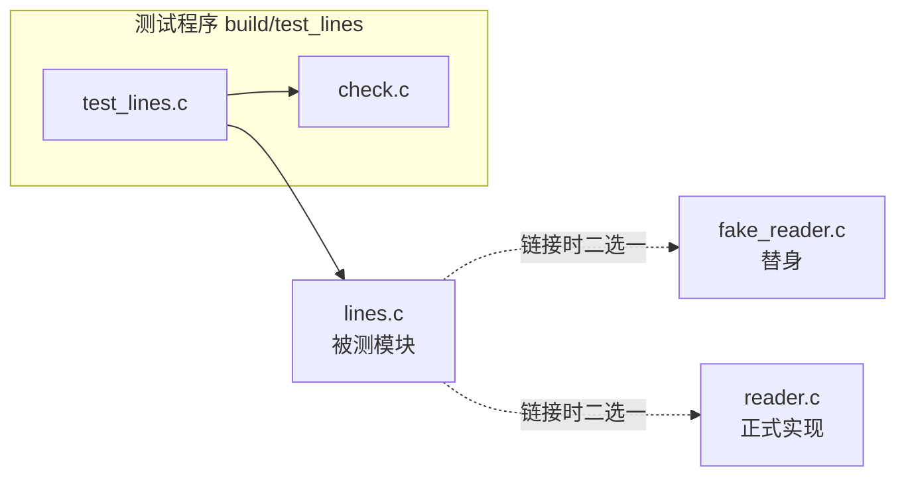

# 11. 自动化测试

在 wordfreq 项目的演化过程中，`token.c` 内部包含一段把大写字母逐一转换成小写的循环逻辑。在一次针对该逻辑的代码重构之后，开发者顺手拿示例文件 `tests/data/sample.txt` 运行了一次程序，终端给出了如下的输出：

::: terminal title="zsh - ./wordfreq -n 3"

```console
$ ./wordfreq -n 3 tests/data/sample.txt
      2 The
      2 on
      2 sat
```

:::

屏幕上打印出来的三行数字排布整齐，粗看之下符合常理，这次改动便被顺利提交进了代码仓库。直到后续在另一组场景下放宽显示行数，潜在的缺陷才暴露出破绽：

::: terminal title="zsh - ./wordfreq -n 10"

```console
$ ./wordfreq -n 10 tests/data/sample.txt
      2 The
      2 on
      2 sat
      2 the
      1 cat
      1 dog
      1 log
      1 mat
```

:::

仔细观察这一组频率统计可以发现，大写的 `The` 与全小写的 `the` 并没有被合并，而是被当成两个独立的词条各自计数，各出现了两次。按照原本的程序规格，所有字母都应折叠为小写，正确的统计结果应当是 `the` 统一出现四次。在初次验证时，由于命令行仅请求输出前三行结果，大写的 `The` 恰巧排在前三名，人工用肉眼快速扫视很难察觉其中的反常。

人工比对程序的输出极易受到采样范围与注意力的影响，稍不留神就会遗漏边界处的差错。要稳定地抓住这类疏漏，最稳妥的手段是将程序输出与预先准备好的期望基准逐字比对——这也正是自动化测试交由机器代劳的核心任务。

本章将为 wordfreq 建立规范的 `tests/` 测试体系。我们将先用数十行代码实现一个轻量实用的测试框架，随后为关键模块补充单元测试，搭建比对整机输出的端到端测试，并将它们无缝接入 CMake 构建系统。在构建系统中，一条测试命令即可驱动全量用例，并依据标准进程退出状态汇总测试结论。在此基础上，后文还将讨论用于解耦外部依赖的测试替身技术，以及几条让测试套件长期保持健壮可维护的工程准则。

## 1. 测试是一个检查行为的程序

从本质结构来看，测试本身就是一个普通的 C 语言程序。它的基本执行流程清晰直接：准备好所需的输入数据，调用被测模块的函数接口，比对调用结果与预期基准是否一致，最终通过进程退出状态向外部报告结论。

在标准 C 与现代操作系统的进程模型中，退出状态是程序向外传递运行成败的核心媒介。第 2 章提到过，退出状态 0 代表程序正常执行完毕，任何非 0 值都指示执行过程中遭遇了错误。Shell 中的条件链操作符 `&&`、自动化构建工具 `make`，以及测试执行器 `ctest`，都严格依赖这个数字裁定下一步走向。哪怕测试程序在控制台打印了多行排版精良的失败警告，只要 `main` 函数最终返回了 0，外部系统依然会将其视作通过。

一个最精简的独立测试程序，只需十来行代码即可成型：

```c
#include <stdio.h>
#include <string.h>

#include "wf/token.h"

int main(void) {
    const char *text = "The";
    wf_tokenizer tz;
    wf_tokenizer_init(&tz, text, strlen(text));
    char word[WF_WORD_MAX];

    wf_tokenizer_next(&tz, word, sizeof word);
    if (strcmp(word, "the") != 0) {
        fprintf(stderr, "word is \"%s\", expected \"the\"\n", word);
        return 1;
    }
    return 0;
}
```

在 `wordfreq/` 目录下完成编译并执行。第一次编译时链接正确的 `token.c` 源码，第二次则特意链接第 5 节预留的缺陷版本：

::: terminal title="zsh - 编译并运行最小测试"

```console
$ gcc -std=c17 -Wall -Wextra -Iinclude -o build/mini_test mini_test.c src/token.c
$ ./build/mini_test
$ echo $?
0
$ gcc -std=c17 -Wall -Wextra -Iinclude -o build/mini_bug mini_test.c ../bugs/token_lowercase_starts_at_1.c
$ ./build/mini_bug
word is "The", expected "the"
$ echo $?
1
```

:::

这段小程序完整涵盖了自动化测试的核心要素：它清楚掌握期望达成的预期值，能够独立对比并判断正误，在断言受挫时给出易于理解的排错线索，并通过非 0 退出状态准确告知上层调用者。

直接使用 `if (strcmp(...) != 0)` 编写测试虽然直观，但在工程实践中难以规模化：每增加一项判定就需要手工补充一组 `if` 分支，各处的失败提示格式五花八门，一旦开发者疏忽遗漏了 `return 1`，用例就会在失败时静默放行。测试框架的作用，正是把这套判定、格式化输出与错误计数的流程固化下来。

测试代码通常与被测生产代码链接在同一个二进制库中。在第 7 章中，我们把分词、词频统计与报表输出拆解成了清晰的三个模块；第 8 章进一步将其打造成了静态库 `libwf`。测试程序同应用程序入口 `app/main.c` 处于对等的地位，同样链接这个静态库。每当业务代码有所更动，应用程序与测试套件都会同步更新。与此同时，测试程序只需包含公开头文件 `wf/token.h`，它所能感知的函数签名与日常调用者毫无二致，从而自然避免了对模块私有 `static` 函数的过度耦合。

根据被测对象的跨度与隔离级别，测试通常划分为三类，本章将逐一实现：

| 名称 | 被测对象 | wordfreq 中的例子 |
| --- | --- | --- |
| 单元测试 (unit test) | 单个模块的公开接口 | 给 `wf_tokenizer_next` 传入一段测试字符串，逐个核对提取出的单词 |
| 端到端测试 (end-to-end test) | 完整程序流水线，覆盖命令行参数到标准输出 | 执行 `wordfreq -n 3 tests/data/sample.txt`，对最终标准输出做全文字节比对 |
| 回归测试 (regression test) | 已修复的历史缺陷 | 在第 5 节重新引入大小写折叠的特定错误，验证测试套件能否稳定报警 |

单元测试执行速度极快，定位出的错误能直接对应到具体的函数调用，在开发过程中占据绝大多数篇幅。端到端测试运行开销稍大，但能够穿透参数解析、文件 I/O 以及报表格式化等单元测试触及不到的外部边界。回归测试则沿用前两者的实现形态，其核心价值在于来源：每修补好一处已确认的缺陷，都应在测试集中沉淀出一条可重复触发的检验规则，防止未来重构时让同一个错误悄然重现。

::: concept test-failure-exit-status title="测试失败必须让进程以非 0 状态退出"

当测试用例出现失败时，`main` 函数必须以非 0 状态码退出。现代构建系统、持续集成平台与命令行脚本均以进程退出状态作为自动化决策的依据。无论程序向终端输送了多少行错误日志，只要最终以 0 退出，机器就会判定该任务圆满成功。因此，测试框架的汇总汇报函数必须忠实地将未通过的用例计数映射为非 0 退出码。

:::

## 2. 为什么不直接用 assert

在日常编写 C 代码时，`<assert.h>` 提供的 `assert` 宏往往是最触手可及的检查工具，语法与标准库篇的 [14.1 `<assert.h>`](/教程/正文/语法和标准库/14_文本转换_错误与程序生命周期/14_1_assert) 详细介绍过它的用法以及 `NDEBUG` 宏对其行为的控制。如果把上一节的极简测试改用 `assert` 来写，核心逻辑仅仅需要三行：

```c
wf_tokenizer_next(&tz, word, sizeof word);
assert(strcmp(word, "the") == 0);
wf_tokenizer_next(&tz, word, sizeof word);
assert(strcmp(word, "the") == 0);
```

尽管书写极其简练，但在构建严肃的自动化测试套件时，直接使用 `assert` 会遇到几个关键障碍，其中前两项在实际测试运行中会立刻带来困扰。我们使用同一段包含三个词的测试输入 `"The THE tHe"`，配合前文提到的大小写缺陷版 `token.c`，对比两种不同的测试实现：

::: compare vertical left-title="用 assert" right-title="用测试框架的宏"

```c
#include <assert.h>
#include <string.h>

#include "wf/token.h"

int main(void) {
    const char *text = "The THE tHe";
    wf_tokenizer tz;
    wf_tokenizer_init(&tz, text, strlen(text));
    char word[WF_WORD_MAX];

    wf_tokenizer_next(&tz, word, sizeof word);
    assert(strcmp(word, "the") == 0);
    wf_tokenizer_next(&tz, word, sizeof word);
    assert(strcmp(word, "the") == 0);
    wf_tokenizer_next(&tz, word, sizeof word);
    assert(strcmp(word, "the") == 0);
    return 0;
}
```

---

```c
#include <string.h>

#include "check.h"
#include "wf/token.h"

int main(void) {
    const char *text = "The THE tHe";
    wf_tokenizer tz;
    wf_tokenizer_init(&tz, text, strlen(text));
    char word[WF_WORD_MAX];

    wf_tokenizer_next(&tz, word, sizeof word);
    CHECK_STR_EQ(word, "the");
    wf_tokenizer_next(&tz, word, sizeof word);
    CHECK_STR_EQ(word, "the");
    wf_tokenizer_next(&tz, word, sizeof word);
    CHECK_STR_EQ(word, "the");
    return check_report("test_token");
}
```

:::

将两段代码分别编译并运行（环境为 Linux，GCC 14.2，链接缺陷版 `token.c`）：

::: terminal title="zsh - 两种写法的失败输出"

```text
$ ./assert_token
assert_token: assert_token.c:13: main: Assertion `strcmp(word, "the") == 0' failed.
Aborted
$ echo $?
134
$ ./check_token
check_token.c:13: word is "The", expected "the"
check_token.c:15: word is "The", expected "the"
test_token: 3 checks, 2 failed
$ echo $?
1
```

:::

从输出的对比中可以直观看到第一处分歧：`assert` 在遇到第一个不满足的条件时便会调用 `abort()` 强行终止进程，后续针对第二、第三个单词的校验完全没有机会执行。在真实的开发迭代中，这就意味着开发者修复了一处错误后重新运行测试，才会看到下一处报错，调试节奏被频频打断。

此外，终止时产生的退出状态码 134 源自 `SIGABRT` 信号引发的异常终止，CI 或调用者只能得知进程崩溃，却无法统计究竟执行了多少项检查、累积了多少次失败。更关键的是，终端中打印出的诊断日志仅仅是条件表达式的源码字面量 `strcmp(word, "the") == 0`，至于程序在运行时实际产出的词字符串究竟是什么，断言本身无法直接回答，依然需要借助调试器或临时打印去排查。

第二个限制关乎发布构建的宏定义规则。在常见的 C 语言工程中，发布版本（Release build）通常会定义 `NDEBUG` 宏以移除运行时代价，此时所有的 `assert` 宏调用都会被预处理器直接展开为空语句。我们可以通过一个小程序直观观察这种变化：

```c
#include <assert.h>
#include <stdio.h>

int main(void) {
    int n = 0;
    assert(n > 0);
    printf("continue with n = %d\n", n);
    return 0;
}
```

::: terminal title="zsh - NDEBUG 删除断言"

```console
$ gcc -std=c17 -Wall -Wextra -o ndebug ndebug.c
$ ./ndebug
ndebug: ndebug.c:6: main: Assertion `n > 0' failed.
Aborted
$ gcc -std=c17 -Wall -Wextra -DNDEBUG -o ndebug_nd ndebug.c
$ ./ndebug_nd
continue with n = 0
$ echo $?
0
```

:::

相同的源代码在加入了 `-DNDEBUG` 选项之后，检查逻辑彻底蒸发，程序带着非法的状态一路向下执行。测试套件的核心使命就是在任何构建形态下都能执行严谨的校验，若校验逻辑在特定编译开关下被轻易剔除，测试便形同虚设。基于这一特性，专业的测试代码绝不会定义 `NDEBUG`，而内部的断言实现也必须摆脱对标准 `assert` 的依赖。

更深层的原因在于两者设计定位的差异。标准 `assert` 的语义是“此处断言的状态必须绝对成立，否则意味着程序内部契约彻底破裂，应当立即中止防止灾难扩大”，它本就不负责在批量用例中收集统计数据或格式化比对细节。测试所追求的恰恰是尽量完整地执行完一批用例、记录差错上下文并输出汇总报表。明确了这几点需求，我们便可以着手规划测试框架的具体职责。

::: tip 本机编译时加 `-D__USE_MINGW_ANSI_STDIO=1`

在 Windows 平台上使用 MinGW-w64 GCC 13.2 编译代码时，编译器可能会对标准格式占位符 `%zu` 抛出格式警告，尽管实际的格式化输出完全正确。第 3 章第 7 节详细解析过该平台的标准 I/O 兼容机制。若在终端手动编译本章的测试程序，加上 `-D__USE_MINGW_ANSI_STDIO=1` 定义即可消除相关警告。而在通过 CMake 构建时，`wordfreq/CMakeLists.txt` 的 `if(MINGW)` 分支中已经统一配置了这一宏定义。

:::

## 3. 一个小型测试框架

我们的测试辅助库由 `check.h` 与 `check.c` 组成，整体代码量仅有八十余行。它清晰地承担三项职责：用宏记录每一次单项检查的结果、在失败时输出带上下文信息的格式化日志，以及在测试套件执行完毕后汇总成败并给出标准退出状态。头文件声明如下：

::: code-group

```c [tests/check.h]
/*
 * 一个很小的测试框架：CHECK 系列宏记录一次检查的结果，
 * check_report 在 main 末尾打印汇总并给出退出状态。
 */
#ifndef CHECK_H
#define CHECK_H

#include <stddef.h>
#include <string.h>

void check_pass(void);
void check_fail(const char *file, int line, const char *fmt, ...);

/* 打印「<suite>: <总数> checks, <失败数> failed」；有失败返回 1，否则返回 0 */
int check_report(const char *suite);

/* 失败信息为「文件:行: 条件原文」 */
#define CHECK(cond)                                                            \
    do {                                                                       \
        if (cond) {                                                            \
            check_pass();                                                      \
        } else {                                                               \
            check_fail(__FILE__, __LINE__, "%s", #cond);                       \
        }                                                                      \
    } while (0)

/* 比较两个 size_t；失败信息为「表达式 is 实际值, expected 期望值」 */
#define CHECK_EQ_SIZE(actual, expected)                                        \
    do {                                                                       \
        size_t check_actual_ = (actual);                                       \
        size_t check_expected_ = (expected);                                   \
        if (check_actual_ == check_expected_) {                                \
            check_pass();                                                      \
        } else {                                                               \
            check_fail(__FILE__, __LINE__, "%s is %zu, expected %zu",          \
                       #actual, check_actual_, check_expected_);               \
        }                                                                      \
    } while (0)

/* 比较两个字符串；失败信息形如 word is "The", expected "the" */
#define CHECK_STR_EQ(actual, expected)                                         \
    do {                                                                       \
        const char *check_actual_ = (actual);                                  \
        const char *check_expected_ = (expected);                              \
        if (check_actual_ != NULL && check_expected_ != NULL &&                \
            strcmp(check_actual_, check_expected_) == 0) {                     \
            check_pass();                                                      \
        } else {                                                               \
            check_fail(__FILE__, __LINE__, "%s is \"%s\", expected \"%s\"",    \
                       #actual, check_actual_ != NULL ? check_actual_ : "(null)", \
                       check_expected_ != NULL ? check_expected_ : "(null)");  \
        }                                                                      \
    } while (0)

#endif
```

```c [tests/check.c]
#include "check.h"

#include <stdarg.h>
#include <stdio.h>
#include <string.h>

/* 计数只在本文件里，头文件不定义对象 */
static int total_checks = 0;
static int failed_checks = 0;

void check_pass(void) { total_checks++; }

void check_fail(const char *file, int line, const char *fmt, ...) {
    total_checks++;
    failed_checks++;

    fprintf(stderr, "%s:%d: ", file, line);
    va_list ap;
    va_start(ap, fmt);
    vfprintf(stderr, fmt, ap);
    va_end(ap);
    fputc('\n', stderr);
}

int check_report(const char *suite) {
    printf("%s: %d checks, %d failed\n", suite, total_checks, failed_checks);
    return failed_checks == 0 ? 0 : 1;
}
```

:::

我们在格式化失败信息时采用了 `文件:行号: 说明` 的结构，这种规范与 GCC、Clang 等现代编译器的诊断格式保持一致。多数终端仿真器、文本编辑器和集成开发环境都能原生解析这种模式，支持点击直接跳转到出错源码行。将第 5 节预备的缺陷版 `token.c` 换入工程后，手动编译测试程序并运行：

::: terminal title="zsh - 一个失败的测试"

```text
$ gcc -std=c17 -Wall -Wextra -Iinclude -Itests \
      -o build/test_token_bug tests/test_token.c tests/check.c ../bugs/token_lowercase_starts_at_1.c
$ ./build/test_token_bug
tests/test_token.c:44: word is "The", expected "the"
tests/test_token.c:46: word is "The", expected "the"
test_token: 27 checks, 2 failed
$ echo $?
1
```

:::

两行错误输出分别精准锁定了 `test_token.c` 的第 44 行与第 46 行，这正是触发断言的 `CHECK_STR_EQ` 宏调用位置。末尾的汇总行将执行总数与未通过数集中呈现，`main` 函数把 `check_report` 的返回值直接透传给操作系统，令整个测试进程最终以状态码 1 退出。

测试计数器被封装在 `check.c` 中，而不是置于头文件内。如第 6 章在模块化机制中所讨论的，若在头文件中定义具备外部链接的对象，一旦该头文件被多个源文件同时包含，链接期就会遭遇符号冲突；哪怕冠以 `static`，各个编译单元也会各自维护一份独立的计数副本，导致跨文件的测试汇总彻底失效。因此，我们将 `total_checks` 和 `failed_checks` 限制在 `check.c` 的内部翻译单元中，外部测试代码统一通过 `check_pass` 与 `check_fail` 函数修改统计。这种设计在排查故障时还会带来额外的便利：调试过程中只需在 `check_fail` 函数处设置一个断点，任何一处检查未通过时执行流都会在此暂停，查看上一层调用栈即可获知是哪个测试用例的哪一行未能通过（第 12 章中将实际应用此技巧）。

框架中的三个宏都严密地封装在 `do { ... } while (0)` 结构中，这是预处理宏编写中的经典防御手法。若省略外层的循环块，宏体会展开为多条孤立的语句；一旦这类宏紧跟在未带大括号的 `if` 之后，后续的 `else` 就会与内层结构产生歧义绑定：

::: compare vertical left-title="宏体没有包起来" right-title="用 do { } while (0)"

```c
#define CHECK_BAD(cond)                                                        \
    if (cond) {                                                                \
    } else {                                                                   \
        check_fail(__FILE__, __LINE__, "%s", #cond);                           \
    }

if (verbose)
    CHECK_BAD(value > 0);
else
    printf("quiet\n");
```

---

```c
#define CHECK(cond)                                                            \
    do {                                                                       \
        if (cond) {                                                            \
            check_pass();                                                      \
        } else {                                                               \
            check_fail(__FILE__, __LINE__, "%s", #cond);                       \
        }                                                                      \
    } while (0)

if (verbose)
    CHECK(value > 0);
else
    printf("quiet\n");
```

:::

左栏的宏展开后，结构变成 `if (verbose) if (value > 0) {} else { ... } else`，外层的 `else` 找不到正确的宿主，GCC 会直接报错 `error: 'else' without a previous 'if'`，并提示补齐显式花括号。右栏通过 `do { ... } while (0)` 与调用处末尾的分号组合，整体在语法上表现为单条复合语句，外层的分支结构能够准确维系既有语义。

另一个至关重要的防御设计是保证实参仅求值一次。若简单地将 `CHECK_EQ_SIZE` 展开为 `if ((actual) == (expected))`，`actual` 表达式虽然在比较时计算了一次，但若判定失败，它在构造错误信息的参数中又会被二次计算。当调用者写出 `CHECK_EQ_SIZE(i++, 0)` 时，带有副作用的表达式就会被执行两次，导致对象被递增两次。头文件中的实现通过引入 `check_actual_` 与 `check_expected_` 两个局部对象，在宏展开伊始便将表达式的求值结果缓存下来，后续的比对与日志打印均操作该局部缓存。下面这段代码验证了单次求值的保证：

```c
#include <stddef.h>

#include "check.h"

int main(void) {
    size_t i = 0;
    CHECK_EQ_SIZE(i++, 0);
    CHECK_EQ_SIZE(i, 1);
    return check_report("test_once");
}
```

两项检查均顺利通过，证明 `i++` 确实只触发了一次求值：

::: terminal title="zsh - 实参只求值一次"

```console
$ ./once
test_once: 2 checks, 0 failed
```

:::

宏实现中还融入了两处工程细节：由于 `sizeof` 的求值结果类型固定为 `size_t`，`CHECK_EQ_SIZE` 将两个入参统一转换为 `size_t`，避免了有符号整型与无符号整型混合比对时潜藏的符号扩展隐患；`CHECK_STR_EQ` 在调用 `strcmp` 之前先进行空指针防御校验，若遇空指针则在错误信息中将其显式格式化为 `(null)`，防止因标准库在某些平台上解引用空指针导致测试进程直接崩溃，从而确保断言失败时能够优雅输出上下文。

在整个宏定义中，`do { ... } while (0)` 保障了语法的语句完整性，而 `#cond` 字符串化操作符则将代码表达式的原文原样捕获为文本字符串，直接嵌入故障说明。

::: concept test-macro-single-evaluation title="测试宏的实参只能求值一次"

测试宏内部通常需要兼顾结果核验与日志打印两项工作。为防止副作用累加，宏展开时必须先将输入实参求值并存入作用域内的局部临时对象，后续的所有比对与格式化均基于该临时对象进行。若直接在不同语句中多次展开实参，诸如 `CHECK(i++)` 这样的表达式便会执行多次，在测试内部引入意外的状态污染。同时，使用 `do { ... } while (0)` 封装宏体，能够确保在嵌套的分支与循环语句中保持稳固的语法归属。

:::

<Quiz
  type="single"
  :options="[
    { label: '因为 assert 打印的信息不够详细', value: 'A' },
    { label: '因为定义 NDEBUG 后 assert 会被编译掉，测试在发布构建里不再执行', value: 'B' },
    { label: '因为 assert 只能在 C++ 里使用', value: 'C' },
    { label: '因为 assert 不能检查字符串', value: 'D' }
  ]"
  answer="B"
>

测试程序为什么不能建立在 `assert` 之上？

正确答案是 **B**。`assert` 宏受控于编译期宏 `NDEBUG`。一旦发布配置或上层构建脚本定义了该宏，所有的断言检查都会从二进制文件中剔除，使测试程序失去检验能力。选项 A 虽然指出了 `assert` 缺乏预期值比对的不足，但这属于易于弥补的展示层缺陷，并非不能用作测试的根本制约；选项 C 与 D 则与 C 语言标准规范不符。

</Quiz>

## 4. 为模块写单元测试

测试文件按模块分开：`tests/test_token.c` 检查分词，`tests/test_counter.c` 检查计数。每个测试是一个 `static` 函数，名字说明它检查的行为，函数体按「准备—执行—检查」三段写；`main` 依次调用它们，最后 `return check_report(...)`。分词测试全文（`tests/test_token.c`）：

```c
#include "check.h"

#include <string.h>

#include "wf/token.h"

static void test_plain_words(void) {
    const char *text = "cat dog";
    wf_tokenizer tz;
    wf_tokenizer_init(&tz, text, strlen(text));
    char word[WF_WORD_MAX];

    CHECK_EQ_SIZE(wf_tokenizer_next(&tz, word, sizeof word), 3);
    CHECK_STR_EQ(word, "cat");
    CHECK_EQ_SIZE(wf_tokenizer_next(&tz, word, sizeof word), 3);
    CHECK_STR_EQ(word, "dog");
    CHECK_EQ_SIZE(wf_tokenizer_next(&tz, word, sizeof word), 0);
}

static void test_punctuation_and_digits(void) {
    const char *text = "hello, world! 123 foo_bar";
    wf_tokenizer tz;
    wf_tokenizer_init(&tz, text, strlen(text));
    char word[WF_WORD_MAX];

    CHECK_EQ_SIZE(wf_tokenizer_next(&tz, word, sizeof word), 5);
    CHECK_STR_EQ(word, "hello");
    CHECK_EQ_SIZE(wf_tokenizer_next(&tz, word, sizeof word), 5);
    CHECK_STR_EQ(word, "world");
    CHECK_EQ_SIZE(wf_tokenizer_next(&tz, word, sizeof word), 3);
    CHECK_STR_EQ(word, "foo");
    CHECK_EQ_SIZE(wf_tokenizer_next(&tz, word, sizeof word), 3);
    CHECK_STR_EQ(word, "bar");
    CHECK_EQ_SIZE(wf_tokenizer_next(&tz, word, sizeof word), 0);
}

static void test_lowercase_folding(void) {
    const char *text = "The THE tHe";
    wf_tokenizer tz;
    wf_tokenizer_init(&tz, text, strlen(text));
    char word[WF_WORD_MAX];

    CHECK_EQ_SIZE(wf_tokenizer_next(&tz, word, sizeof word), 3);
    CHECK_STR_EQ(word, "the");
    CHECK_EQ_SIZE(wf_tokenizer_next(&tz, word, sizeof word), 3);
    CHECK_STR_EQ(word, "the");
    CHECK_EQ_SIZE(wf_tokenizer_next(&tz, word, sizeof word), 3);
    CHECK_STR_EQ(word, "the");
    CHECK_EQ_SIZE(wf_tokenizer_next(&tz, word, sizeof word), 0);
}

static void test_no_words(void) {
    const char *text = "12345 !@#$%";
    wf_tokenizer tz;
    wf_tokenizer_init(&tz, text, strlen(text));
    char word[WF_WORD_MAX];

    CHECK_EQ_SIZE(wf_tokenizer_next(&tz, word, sizeof word), 0);
}

static void test_truncation(void) {
    const char *text = "abcdef next";
    wf_tokenizer tz;
    wf_tokenizer_init(&tz, text, strlen(text));
    char word[4];

    CHECK_EQ_SIZE(wf_tokenizer_next(&tz, word, sizeof word), 3);
    CHECK_STR_EQ(word, "abc");
    CHECK_EQ_SIZE(wf_tokenizer_next(&tz, word, sizeof word), 3);
    CHECK_STR_EQ(word, "nex");
    CHECK_EQ_SIZE(wf_tokenizer_next(&tz, word, sizeof word), 0);
}

int main(void) {
    test_plain_words();
    test_punctuation_and_digits();
    test_lowercase_folding();
    test_no_words();
    test_truncation();
    return check_report("test_token");
}
```

这五个独立的测试函数各司其职，分别覆盖一个清晰的行为维度：常规英文单词的边界切分与终止、标点符号与数字下划线的跳过与隔离、英文字母的大小写折叠、全符号无有效单词输入的边界处理，以及接收缓冲区容量受限时的截断行为。每组测试所选取的输入样本都刻意保持短小精炼，无需复杂的计算即可直观推导并验证预期值。在 `test_truncation` 中，我们为缓冲区传入了 `char word[4]`，依据 `wf_tokenizer_next` 的接口契约，最多写入 3 个字符加一个末尾空字符。因此长单词 `abcdef` 被截断提取为 `abc`，多余的字符被果断跳过；随后的提取直接读取下一单词 `next`，截取前三字符得到 `nex`。这项用例同时确认了未装下的多余字符不会溢出或错误渗入后续词条。

将二十项校验混杂堆砌在单一大函数中，远不如将它们拆解为语义明晰的若干用例。打开 `test_token.c` 源码，读者一眼就能看清本测试套件覆盖了哪五大行为场景，终端输出的检查项数也能与代码结构精准对应。在给函数命名时，应当避免 `test1`、`test2` 这类抽象编号，类似 `test_lowercase_folding` 这样的函数名能够在失败汇总中自解释，帮助排查人员迅速锁定出问题的具体契约。

词频计数器模块的测试结构保持完全一致，其核心验证重点聚焦在排序与检索契约（`tests/test_counter.c`）：

```c
#include "check.h"

#include "wf/counter.h"

static void test_add_and_get(void) {
    wf_counter *c = wf_counter_create();
    CHECK(c != NULL);

    CHECK_EQ_SIZE(wf_counter_size(c), 0);
    CHECK_EQ_SIZE(wf_counter_get(c, "the"), 0);

    CHECK(wf_counter_add(c, "the") == 0);
    CHECK(wf_counter_add(c, "cat") == 0);
    CHECK(wf_counter_add(c, "the") == 0);

    CHECK_EQ_SIZE(wf_counter_size(c), 2);
    CHECK_EQ_SIZE(wf_counter_get(c, "the"), 2);
    CHECK_EQ_SIZE(wf_counter_get(c, "cat"), 1);
    CHECK_EQ_SIZE(wf_counter_get(c, "dog"), 0);

    wf_counter_destroy(c);
}

static void test_top_sorting(void) {
    wf_counter *c = wf_counter_create();
    CHECK(c != NULL);

    const char *words[] = {"the", "cat", "sat", "on", "the", "mat",
                           "the", "dog", "sat", "on", "the", "log"};
    for (size_t i = 0; i < sizeof words / sizeof words[0]; i++) {
        CHECK(wf_counter_add(c, words[i]) == 0);
    }

    wf_entry top[3];
    size_t n = wf_counter_top(c, top, 3);
    CHECK_EQ_SIZE(n, 3);
    CHECK_STR_EQ(top[0].word, "the");
    CHECK_EQ_SIZE(top[0].count, 4);
    CHECK_STR_EQ(top[1].word, "on");
    CHECK_EQ_SIZE(top[1].count, 2);
    CHECK_STR_EQ(top[2].word, "sat");
    CHECK_EQ_SIZE(top[2].count, 2);

    wf_counter_destroy(c);
}

static void test_top_more_than_size(void) {
    wf_counter *c = wf_counter_create();
    CHECK(c != NULL);

    CHECK(wf_counter_add(c, "a") == 0);
    CHECK(wf_counter_add(c, "b") == 0);

    wf_entry top[10];
    size_t n = wf_counter_top(c, top, 10);
    CHECK_EQ_SIZE(n, 2);
    CHECK_STR_EQ(top[0].word, "a");
    CHECK_STR_EQ(top[1].word, "b");

    wf_counter_destroy(c);
}

int main(void) {
    test_add_and_get();
    test_top_sorting();
    test_top_more_than_size();
    return check_report("test_counter");
}
```

在 `test_top_sorting` 中，我们注入了样例文本的词汇频次：`the` 出现 4 次，`on` 与 `sat` 各出现 2 次。根据规则，频次相同的高频词按照 `strcmp` 的字典序升序排列，因此 `on` 稳稳排在 `sat` 之前。这项检查将设计规格中的双重排序规则精确锁定，恰好能拦截本章开篇的故事场景：若未能正确折叠大小写，统计表里便会多出单独的 `The` 词条，`the` 的计数值也会从 4 骤降为 2。

`test_top_more_than_size` 验证了当外部请求的排行榜长度超过哈希表内已有不同词项的总数时，接口能够安全返回实际装载的数量；而 `test_add_and_get` 则核实了未收录词条返回计数值 0、重复添加只累加计数不增加条目数等核心语义。这几个函数全量覆盖了 `add`、`get`、`size` 与 `top` 等公开 API 的预期行为，整套测试没有一行代码去刺探内部动态数组的具体物理排布。内部存储结构纯属私有实现细节，在第 15 章我们将其从线性检索重构为有序数组甚至平衡树时，这组单元测试无需修改任何一行源码便能继续运转；若测试中轻率地假定“第 0 项一定是 `the`，因为它最早加入”，底层实现的任何升级都会误触虚假的失败报警。

在终端中手动编译并执行这两组测试程序，记得将辅助库 `tests/check.c` 一并列入编译源文件：

::: terminal title="zsh - 直接运行测试程序"

```console
$ gcc -std=c17 -Wall -Wextra -Iinclude -Itests -o build/test_token \
      tests/test_token.c tests/check.c src/token.c
$ ./build/test_token
test_token: 27 checks, 0 failed
$ echo $?
0
$ gcc -std=c17 -Wall -Wextra -Iinclude -Itests -o build/test_counter \
      tests/test_counter.c tests/check.c src/counter.c
$ ./build/test_counter
test_counter: 36 checks, 0 failed
$ echo $?
0
```

:::

控制台打印出的 27 与 36 分别对应着测试中实际执行的断言次数，`0 failed` 表明全部校验无误，进程返回的 0 退出码可以直接交付给后续的上层脚本。目前我们依旧是在终端手动逐条执行编译命令，在第 7 节中，我们将把这些可执行程序与端到端测试统一编入 CMake 的管理范畴，实现单条 `ctest` 指令跑完全量用例。

<Quiz
  type="multi"
  :options="[
    { label: '测试通过时打印的信息里带上函数名和实际值', value: 'A' },
    { label: '每个测试函数只查一个行为，名字说明查的是什么', value: 'B' },
    { label: '断言计数器的内部数组顺序，保证实现不变', value: 'C' },
    { label: '只通过公开头文件里的接口调用被测模块', value: 'D' }
  ]"
  :answer="['B', 'D']"
>

关于本章的单元测试，下列哪些做法是正确的？

正确答案是 **B、D**。保持单个测试函数的单一职责，能让排查人员在故障发生时仅凭用例名称就定位违背的契约；坚持仅通过公开接口进行交互，则能在未来重构底层算法与数据结构时，让测试集始终充当稳定的保护伞。选项 C 恰恰是测试编写中的反模式：内部数组的物理排布属于封装细节，对其断言会导致测试与实现产生不必要的死绑定。选项 A 描述的是冗余日志格式，用例顺利通过时通常保持静默，只报告汇总数量即可。

</Quiz>

## 5. 测试抓住回归

测试在缺陷再次出现的时候派上用场。本章要用的缺陷是把小写转换的循环写成从下标 1 开始，`src/token.c` 里对应的一行变成：

```c
for (size_t i = 1; i < n; i++) {
    if (word[i] >= 'A' && word[i] <= 'Z') {
        word[i] = (char)(word[i] - 'A' + 'a');
    }
}
```

在上述缺陷代码中，循环的初始索引被误写成了 1，导致下标为 0 的首字母被跳过而保留原样，原本应折叠为 `the` 的单词依然维持 `The`。这一缺陷实现存放在工程同级的 `bugs/token_lowercase_starts_at_1.c` 中。将其覆盖到 `src/token.c` 之后，重新触发构建与测试：

::: terminal title="zsh - 缺陷版本的测试输出"

```text
$ cp ../bugs/token_lowercase_starts_at_1.c src/token.c
$ cmake --build build
$ ctest --test-dir build --output-on-failure
    Start 1: token
1/3 Test #1: token ............................***Failed    0.00 sec
/home/minsecrus/tutorial/work/test11/wordfreq/tests/test_token.c:44: word is "The", expected "the"
/home/minsecrus/tutorial/work/test11/wordfreq/tests/test_token.c:46: word is "The", expected "the"
test_token: 27 checks, 2 failed

    Start 2: counter
2/3 Test #2: counter ..........................   Passed    0.00 sec
    Start 3: e2e
3/3 Test #3: e2e ..............................***Failed    0.01 sec
CMake Error at /home/minsecrus/tutorial/work/test11/wordfreq/tests/run_e2e.cmake:19 (message):
  output differs

  --- actual ---

        2 The
        2 on
        2 sat

  --- expected ---

        4 the
        2 on
        2 sat

33% tests passed, 2 tests failed out of 3
```

:::

两项独立的测试同时亮起红灯，终端给出的失败日志能够直接指引排查路径。其中 `test_token.c:44` 准确锁定了 `test_lowercase_folding` 内部的第一条 `CHECK_STR_EQ` 宏，明确指出了实际解析出的字符串为 `"The"`，而期望的目标值为 `"the"`。通过在运行 `ctest` 时附带 `--output-on-failure` 参数，CTest 会忠实转发子进程标准错误中的全部输出，使得文件名与具体代码行号清晰无遗。与此同时，端到端测试把实际生成的文本与预设基准文件进行逐行并排比对，大写 `The` 与小写 `the` 分立两行的视觉反差，能够让维护者瞬间领会大小写折叠逻辑发生了衰退。

日志中展示的文件路径之所以为完整绝对路径，是因为 CTest 默认在构建产物目录下调度各个测试子进程，预处理宏 `__FILE__` 会在编译期展开为源文件的绝对位置。这属于编译与链接环境下的正常现象，并不会对日常阅读造成干扰。

值得注意的是，此时 `counter` 模块的测试用例依旧全部标绿。这一现象清楚地表明计数器本身的累加与排序逻辑并无破绽，问题被精确收敛在分词处理的范畴内。在后续的第 12 章中，我们还会展示如何在 `check_fail` 处直接挂接断点，通过查看运行时调用栈瞬间追溯引发断言的具体输入样本。

针对此问题的修复方案清晰自然：可以将小写折叠的循环索引纠正为从 0 开始，或者直接在词元扫描并写入缓冲区的过程中顺道完成大小写转换：

::: compare left-title="缺陷版本：从下标 1 开始" right-title="修复后：收集时转换"

```c
/* 放不下的字母读过就丢弃，不会成为下一个单词的开头 */
size_t n = 0;
while (p < tz->end && is_ascii_letter(*p)) {
    if (n + 1 < cap) {
        word[n++] = *p;
    }
    p++;
}
word[n] = '\0';

/* 缺陷：从 1 开始转换，word[0] 保持原样 */
for (size_t i = 1; i < n; i++) {
    if (word[i] >= 'A' && word[i] <= 'Z') {
        word[i] = (char)(word[i] - 'A' + 'a');
    }
}
```

---

```c
/* 放不下的字母读过就丢弃，不会成为下一个单词的开头 */
size_t n = 0;
while (p < tz->end && is_ascii_letter(*p)) {
    if (n + 1 < cap) {
        word[n++] = to_ascii_lower(*p);
    }
    p++;
}
word[n] = '\0';
```

:::

修复相关代码之后再次运行，所有测试套件全部恢复绿灯：

::: terminal title="zsh - 修复后"

```console
$ ctest --test-dir build --output-on-failure
    Start 1: token
1/3 Test #1: token ............................   Passed    0.00 sec
    Start 2: counter
2/3 Test #2: counter ..........................   Passed    0.00 sec
    Start 3: e2e
3/3 Test #3: e2e ..............................   Passed    0.01 sec

100% tests passed, 0 tests failed out of 3
```

:::

在专业的版本控制工作流中，缺陷的修复代码与对应的回归测试用例应当打包在同一个 Git Commit 中提交。在本案例中，`test_lowercase_folding` 虽在前面已经写好，但它所经历的“遭遇缺陷时立即告警，修复完成后立刻通过”的闭环，强有力地证明了该测试用例能够敏锐鉴别对错。若在日常维护中修复了一处此前未曾覆盖的缺陷，必须先补齐一条能够稳定重现该失败的测试，亲眼目睹其报错，再行修改功能代码促使其通过，并将两部分更动一同存盘。若只提交代码补丁而不追加测试，未来在此处进行二次重构时，工程体系依然缺乏防止旧错重演的安全栅栏。

::: tip 让 `ctest` 只说结论

在默认配置下，`ctest` 仅输出每个测试项的成败结论与耗时。如果希望在出现失败时自动打印测试程序本身输出的详细错误日志，可以追加 `--output-on-failure` 选项。配合 `-R <正则表达式>` 可以按名称定向匹配子集，配合 `-L <标签名>` 则能按业务标签精细化执行。若需要快速审阅当前登记了哪些测试而不实际启动进程，可使用 `ctest -N`；若只想针对上一轮失败的用例进行针对性重跑，可以使用 `ctest --rerun-failed`。

:::

## 6. 端到端测试

单元测试专注于单个模块内部函数接口的契约，而端到端测试则站在黑盒视角审视整机程序的协同表现：命令行参数解析是否顺畅、物理文件是否被正确打开与读取、标准输出的格式对齐是否严格遵循规范，这些宏观行为都需要在真实运行的环境下完成综合验收。wordfreq 项目的基准测试样本与期望结果保存在 `tests/data/` 目录下：

::: code-group

```text [tests/data/sample.txt]
The cat sat on the mat.
The dog sat on the log.
```

```text [tests/data/sample.expected]
      4 the
      2 on
      2 sat
```

:::

期望输出文件（通常称为 Golden File 或基准比对文件）是由人工核验并封存的一份权威正确输出。每次全量运行后，程序在标准输出中产生的文本若能与该文件达成字节级的严格吻合，端到端测试便算顺利通过。这里的比对是逐字节进行的，包括行首的缩进空格数、列宽对齐、乃至行尾的换行符都必须精确匹配。在此处 `-n 3` 的参数约定下，输出必须严格保持前三行；一旦报表格式出现偏差，例如错误地将 `%7zu` 修改为 `%5zu`，比对过程就会立即亮起红灯。

CMake 命令行工具本身提供了轻量级的 `cmake -E compare_files` 子命令，它能够比对两个已存在的文件，相同则返回退出状态 0，有差异则返回 1：

::: terminal title="zsh - cmake -E compare_files"

```console
$ ./build/wordfreq -n 3 tests/data/sample.txt > build/actual.txt
$ cmake -E compare_files build/actual.txt tests/data/sample.expected
$ echo $?
0
$ printf '      4 The\n' > build/bad.txt
$ cmake -E compare_files build/bad.txt tests/data/sample.expected
$ echo $?
1
```

:::

`compare_files` 命令虽然执行迅速，但它仅仅给出一个二元的通过或失败状态码，无法在终端中直观展示究竟在哪一行出现了文字出入。在排查阶段，开发者往往需要进一步借由 `diff -u` 展开上下文。为了让 CTest 具备开箱即用的直观诊断体验，我们编写了一小段由 CTest 统一调度的 CMake 驱动脚本，负责拉起被测程序、捕获运行时的标准输出、比对基准文件，并在检测到内容不匹配时把两份文本的对比差异完整呈现在终端控制台（`tests/run_e2e.cmake`）：

```cmake
# 由 ctest 调用：运行 wordfreq，把输出与期望文件逐字节比较。
# 参数：WORDFREQ 可执行文件路径，DATA 存放 sample.txt 与 sample.expected 的目录。

execute_process(
    COMMAND "${WORDFREQ}" -n 3 "${DATA}/sample.txt"
    OUTPUT_VARIABLE actual
    ERROR_VARIABLE err
    RESULT_VARIABLE status
)
if(NOT status EQUAL 0)
    message(FATAL_ERROR "wordfreq exited with status ${status}: ${err}")
endif()

# Windows 上标准输出是文本模式，行尾为 CRLF；去掉回车再比较
string(REPLACE "\r" "" actual "${actual}")
file(READ "${DATA}/sample.expected" expected)

if(NOT actual STREQUAL expected)
    message(FATAL_ERROR "output differs\n--- actual ---\n${actual}--- expected ---\n${expected}")
endif()

message(STATUS "sample: ok")
```

脚本通过 `execute_process` 命令启动程序，将进程的标准输出实时捕获至变量 `actual` 中，将标准错误流收录进 `err`，并将最终退出码保存在 `status` 中，无需在磁盘上创建多余的临时日志文件。若退出状态不为 0，脚本会立即抛出致命错误并中止，因为进程未能正常退出，后续的比对环节便失去了意义。在正式比对之前，脚本显式执行了 `string(REPLACE "\r" "" actual "${actual}")` 操作。这是因为在 Windows 平台上，控制台的标准输出流默认处于文本模式，行尾会被操作系统自动扩充为 `\r\n`；而仓库中的基准期望文件是由跨平台文本编辑器保存的 LF（`\n`）格式，若不提前剔除回车符，整份报表即便文字完全一致也会在换行符比对上全线崩溃。

需要特别强调的是，基准期望文件仅在团队明确变更输出规格时方可更新。当业务需求要求调整 `wf_report_print` 的列宽或文字对齐，且经过人工核实新格式正确之后，方可手工运行程序并将全新输出重定向覆盖至 `sample.expected`，同时在 Git 提交信息中详尽记录格式变动的背景与考量。若在测试遭遇失败时未经思考便顺手刷新基准文件以求通过，测试便沦为迎合错误实现的摆设，彻底失去把关能力。将期望文件更新与功能代码变更放置在同一原子提交中，能让同行评审人员迅速识别出用户界面的外观变化。

<Quiz
  type="single"
  :options="[
    { label: '它只比较两份已经存在的文件，不运行程序', value: 'A' },
    { label: '它运行程序并捕获输出，但只报告相同或不同，不显示差在哪一行', value: 'B' },
    { label: '它在比较失败时自动更新期望文件', value: 'C' },
    { label: '它只在 Windows 上可用', value: 'D' }
  ]"
  answer="A"
>

`cmake -E compare_files` 做的是什么，为什么本章还要另写 `run_e2e.cmake`？

正确答案是 **A**。`compare_files` 是一个纯粹的文件比对工具，它既不负责启动待测进程，也不会捕获输出，在两文件存在差异时更不会展开输出行级别的对比上下文。端到端测试必须将“调度启动、捕获输出流、文本比对、排错日志生成”整套工序串联起来。`run_e2e.cmake` 脚本通过 `execute_process` 驱动程序并抓取标准流，结合 `file(READ)` 读取静态基准，从而能够在断言受阻时呈现完整的对比差量。选项 C 是测试实践中应当坚决规避的误区。

</Quiz>

::: warning ctest 在构建目录里运行测试

`add_test` 注册的程序默认以构建目录为工作目录启动。测试程序里写 `fopen("tests/data/sample.txt", ...)` 这样的相对路径，在项目根目录手工运行时能打开，由 `ctest` 启动时就找不到文件。需要固定工作目录时，给测试加 `WORKING_DIRECTORY` 属性；更简单的做法是把路径写进命令行参数或 CMake 变量，本章的端到端测试传的是绝对路径 `${CMAKE_CURRENT_SOURCE_DIR}/tests/data`。

:::

## 7. 接入构建系统

在前几节的探索中，我们主要是在终端通过调用 `gcc` 手工编译各测试目标。随着工程规模的扩充，测试文件与辅助模块会逐步增多，手动输入冗长的编译命令既容易漏掉编译参数，也难以与日常构建流水线协同。CMake 提供了原生的测试集成机制：通过 `enable_testing()` 开启测试功能，配合 `add_test` 指令即可将各类测试程序登记到构建体系中。`wordfreq/CMakeLists.txt` 中与测试相关的配置片段如下：

```cmake
enable_testing()

# 单元测试：每个测试程序链接同一个 libwf，通过公开接口检查行为
add_executable(test_token tests/test_token.c tests/check.c)
target_link_libraries(test_token PRIVATE wf)
target_compile_options(test_token PRIVATE -Wall -Wextra)
add_test(NAME token COMMAND test_token)
set_tests_properties(token PROPERTIES LABELS unit)

add_executable(test_counter tests/test_counter.c tests/check.c)
target_link_libraries(test_counter PRIVATE wf)
target_compile_options(test_counter PRIVATE -Wall -Wextra)
add_test(NAME counter COMMAND test_counter)
set_tests_properties(counter PROPERTIES LABELS unit)

# 端到端测试：运行程序，把输出与 tests/data/sample.expected 比较
add_test(NAME e2e
    COMMAND ${CMAKE_COMMAND}
        -DWORDFREQ=$<TARGET_FILE:wordfreq>
        -DDATA=${CMAKE_CURRENT_SOURCE_DIR}/tests/data
        -P ${CMAKE_CURRENT_SOURCE_DIR}/tests/run_e2e.cmake)
set_tests_properties(e2e PROPERTIES LABELS e2e)
```

`enable_testing()` 负责驱动 CMake 在当前构建目录中生成 CTest 所需的元数据文件，随后的 `add_test` 则将具体的测试目标逐一登记在案。可以看到，`add_executable` 与 `target_link_libraries` 的组织方式与常规二进制程序完全相同，测试程序在构建图谱中表现为独立的可执行目标，共同依赖并链接 `wf` 静态库。

指令中的 `NAME` 指定了该测试在 CTest 运行报告中显示的唯一名称；`COMMAND` 则指定了待执行的二进制文件或脚本；`$<TARGET_FILE:wordfreq>` 是 CMake 的生成器表达式，它会在配置期自动计算出 `wordfreq` 可执行程序在当前构建平台与配置下的绝对物理路径，屏蔽了 Debug/Release 目录差异以及 Windows 平台下的 `.exe` 后缀。此外，我们通过 `set_tests_properties` 为不同的测试打上 `LABELS` 标签，方便后续按类别按需过滤。

完整的配置、编译与运行三步曲如下（环境为 Linux，GCC 14.2，CMake 3.31.6；在 Windows 平台上除盘符路径与扩展名外，交互过程与输出版式完全一致）：

::: terminal title="zsh - cmake 与 ctest"

```text
$ cmake -S . -B build
$ cmake --build build
$ ctest --test-dir build --output-on-failure
Internal ctest changing into directory: /home/minsecrus/tutorial/work/test11/wordfreq/build
Test project /home/minsecrus/tutorial/work/test11/wordfreq/build
    Start 1: token
1/3 Test #1: token ............................   Passed    0.00 sec
    Start 2: counter
2/3 Test #2: counter ..........................   Passed    0.00 sec
    Start 3: e2e
3/3 Test #3: e2e ..............................   Passed    0.01 sec

100% tests passed, 0 tests failed out of 3

Label Time Summary:
e2e     =   0.01 sec*proc (1 test)
unit    =   0.00 sec*proc (2 tests)

Total Test time (real) =   0.01 sec
```

:::

末尾的 `Label Time Summary` 按标签汇总，`unit` 标签下两项、`e2e` 标签下一项。只看单元测试：

::: terminal title="zsh - ctest -L unit"

```text
$ ctest --test-dir build -L unit
Internal ctest changing into directory: /home/minsecrus/tutorial/work/test11/wordfreq/build
Test project /home/minsecrus/tutorial/work/test11/wordfreq/build
    Start 1: token
1/2 Test #1: token ............................   Passed    0.00 sec
    Start 2: counter
2/2 Test #2: counter ..........................   Passed    0.00 sec

100% tests passed, 0 tests failed out of 2

Label Time Summary:
unit    =   0.00 sec*proc (2 tests)

Total Test time (real) =   0.01 sec
```

:::

`-R` 按名字筛选，参数是正则表达式：

::: terminal title="zsh - ctest -R token"

```text
$ ctest --test-dir build -R token
Internal ctest changing into directory: /home/minsecrus/tutorial/work/test11/wordfreq/build
Test project /home/minsecrus/tutorial/work/test11/wordfreq/build
    Start 1: token
1/1 Test #1: token ............................   Passed    0.00 sec

100% tests passed, 0 tests failed out of 1

Total Test time (real) =   0.00 sec
```

:::

CTest 自身的退出状态码与测试执行的综合结果严格绑定：全部用例顺利通过时返回 0，存在任何一项失败时则返回非 0 状态码（常见为 8）。这个返回值可以直接供 shell 管道、Git 预提交钩子或持续集成流水线作为门禁决策。

作为对比，如果使用传统的纯 Make 工程，由于没有类似 CTest 的内置元数据注册机制，通常需要在 `Makefile` 中定义一个伪目标 `test`，在配方中依次调用测试程序：

```makefile
test: build/wordfreq $(TESTS)
	@build/test_token
	@build/test_counter
	@build/wordfreq -n 3 tests/data/sample.txt | tr -d '\r' | diff -u tests/data/sample.expected -
	@echo "sample: ok"
```

配方行开头的 `@` 符号用于抑制 Make 对该行命令本身的屏幕回显，只保留程序自身产生的输出。若执行时附加 `-s`（silent）选项，编译阶段的命令回显也会一并隐去，干净利落地呈现测试反馈：

::: terminal title="zsh - make -s test"

```console
$ make -s test
test_token: 27 checks, 0 failed
test_counter: 36 checks, 0 failed
sample: ok
$ echo $?
0
```

:::

然而，这种在单目标配方中串联命令的做法存在明显的短板：由于三条执行命令同属于 `test` 这一个目标，只要第一条命令返回了非 0 退出码，Make 就会立即终止配方的后续执行，导致后面的测试全部被跳过，无法一次性看清整体的受损面。此时即使使用 `make -k` 也无能为力，因为 `-k` 只在不同目标之间生效，无法穿透单个配方内部的 shell 命令序列。相比之下，CTest 会始终按照用例注册清单完整遍历所有用例，待全部跑完后再汇总输出统计，这是构建工具集成测试的核心优势。

在现代构建工具 XMake 中，测试是直接声明在目标之上的。通过为目标追加一行 `add_tests("default")`，该目标便被自动注册为一项测试，后续执行 `xmake test` 依次运行所有登记过的目标。第 9 章已经提供了 `xmake.lua` 的完整目标描述，此处仅展示如何接入测试：

```lua
target("test_token")
    set_kind("binary")
    add_deps("wf")
    add_files("tests/test_token.c", "tests/check.c")
    add_tests("default")
```

`add_tests` 同样支持传入命令行参数、预期匹配模式等高级选项，具体配置可查阅 XMake 官方文档。本机未部署 XMake 环境，此处仅作跨构建工具设计理念的横向对照。

## 8. 隔离依赖：测试替身

在真实的系统编程中，被测模块往往难以脱离外部环境独立存在。当函数直接依赖文件系统、网络套接字或硬件时钟等外部资源时，测试套件的执行速度与稳定性都会受到显著牵制：磁盘上预置的文件可能被误删，网络对端可能未就绪，而系统时钟的流逝则会让时间相关的断言变得难以预测。测试替身（test double）的核心思想，正是通过在测试期引入完全可控的人工对象，解耦并替代这些不稳定的外部依赖，从而让测试能够心无旁骛地聚焦于被测模块自身的核心控制流与算法逻辑。

在 wordfreq 项目中，报表打印函数 `wf_report_print` 接收一个 `FILE *` 类型的流指针，写入目标完全由调用者传入。在生产运行环境中，应用程序的主入口通常直接传入标准输出 `stdout`；但在单元测试环境下，我们则可以传入由标准 C 函数 `tmpfile()` 创建的临时流。`tmpfile()` 会在操作系统的临时目录下创建一个匿名文件流，支持常规的读写与定位操作，其最显著的优势在于进程关闭该流或测试结束时，操作系统会自动清理物理实体，无需编写繁琐的磁盘扫尾代码。测试程序将格式化结果写入该临时流，随后回退指针逐行读取并校验输出内容（`examples/tmpfile_report.c`）：

```c
#include <stdio.h>
#include <string.h>

#include "check.h"
#include "wf/counter.h"
#include "wf/report.h"

/* 读一行并去掉行尾的换行，比较时不把换行也算进期望值；读不到时把 buf 置为空串 */
static void read_line(FILE *in, char *buf, size_t cap) {
    buf[0] = '\0';
    if (fgets(buf, (int)cap, in) == NULL) {
        return;
    }
    buf[strcspn(buf, "\n")] = '\0';
}

static void test_print_format(void) {
    wf_entry entries[2] = {{"the", 4}, {"on", 2}};
    FILE *out = tmpfile();
    CHECK(out != NULL);
    if (out == NULL) {
        return;
    }

    wf_report_print(out, entries, 2);

    rewind(out);
    char line[64];
    read_line(out, line, sizeof line);
    CHECK_STR_EQ(line, "      4 the");
    read_line(out, line, sizeof line);
    CHECK_STR_EQ(line, "      2 on");
    fclose(out);
}

int main(void) {
    test_print_format();
    return check_report("test_report");
}
```

在 `wordfreq/` 目录下编译运行：

::: terminal title="zsh - 用 tmpfile 捕获输出"

```console
$ gcc -std=c17 -Wall -Wextra -Iinclude -Itests \
      -o build/test_report ../examples/tmpfile_report.c tests/check.c src/report.c
$ ./build/test_report
test_report: 3 checks, 0 failed
```

:::

在这组用例中，`entries` 数组中的两条高频词数据直接通过结构体字面量初始化，完全绕过了词频统计哈希表的动态分配与排序。这种设计既体现了测试替身对外部状态的隔离，也切中了单元测试的职责边界：此处仅需验证 `wf_report_print` 是否能正确排版给定的条目列表，至于频次统计与排序是否精准，交由前文的 `test_counter` 专门把关。回读文本时剥离换行符，也免去了在断言期望字符串中硬编码跨平台换行差异的负担。

第二种替身作用在链接阶段：依赖的模块换成另一份实现，被测代码完全不知道。`wf_report_print` 接受的 `FILE *` 是接口设计时就留好的余地，其他依赖没有这样现成的参数可传。读文件的函数通常是直接调用 `fopen`，没有参数可以注入。示例放在 `code/开发与工程基础/11_自动化测试/examples/link_substitute/`：

```text:no-line-numbers
link_substitute/
├── reader.h          读文件模块的接口：reader_load
├── reader.c          正式实现：fopen、fread
├── lines.h
├── lines.c           被测模块：数单词，内部调用 reader_load
├── fake_reader.c     测试替身：不打开任何文件，固定返回一段文本
└── test_lines.c      测试程序
```

`lines.c` 依赖 `reader.h` 中声明的读取接口，调用 `reader_load` 读入整个文件的内容，随后统计空白字符分隔的单词数目。在生产环境中，`reader.c` 负责调用真实的 `fopen` 与 `fread` 从文件系统加载数据；而在测试替身 `fake_reader.c` 中，我们提供了同名且签名完全吻合的 `reader_load` 函数，内部直接返回硬编码在测试源码中的一段确定性静态文本。测试程序最终与哪个对象文件链接，运行时调用的就是哪一份逻辑：

::: terminal title="zsh - 链接时替换"

```console
$ gcc -std=c17 -Wall -Wextra -I../examples/link_substitute -Itests \
      -o build/test_lines ../examples/link_substitute/lines.c \
      ../examples/link_substitute/fake_reader.c \
      ../examples/link_substitute/test_lines.c tests/check.c
$ ./build/test_lines
test_lines: 1 checks, 0 failed
$ gcc -std=c17 -Wall -Wextra -I../examples/link_substitute -Itests \
      -o build/test_lines_real ../examples/link_substitute/lines.c \
      ../examples/link_substitute/reader.c \
      ../examples/link_substitute/test_lines.c tests/check.c
$ ./build/test_lines_real
../examples/link_substitute/test_lines.c:6: count_words_in_file("not/a/real/path") is 0, expected 6
test_lines: 1 checks, 1 failed
```

:::

测试程序本身仅需引入 `lines.h` 与 `check.h`，它对底层 `reader_load` 的具体归属一无所知。一旦切换为生产版实现，相同的测试调用便会立即报错，因为虚拟路径 `not/a/real/path` 在物理磁盘上根本不存在。这个对照清晰地印证了替身的作用：即使完全脱离真实的文件系统环境，测试集依然能对 `lines.c` 的分词逻辑开展确定性的断言。测试替身中固化返回的文本 `the cat sat\non the mat\n` 恰好包含 6 个单词，测试预设的断言值便恒定为 6，丝毫不受磁盘 I/O 状态的干扰。

需要注意的是，这两份实现绝不能同时参与同一次链接，否则符号解析阶段链接器会报出多重定义冲突：

::: terminal title="zsh - 同时链接两份实现"

```text
$ gcc test_lines.o lines.o reader.o fake_reader.o check.o -o both
/usr/bin/ld: fake_reader.o: in function `reader_load':
fake_reader.c:(.text+0x0): multiple definition of `reader_load'; reader.o:reader.c:(.text+0x0): first defined here
collect2: error: ld returned 1 exit status
```

:::

这行错误信息恰恰揭示了该技术的运行机制：链接器在符号表中面对同名的外部符号只能采纳唯一的一个定义，具体选取哪一个目标文件完全取决于构建脚本的编排。在 CMake 构建描述中，只需在测试目标的 `add_executable` 清单中剔除 `reader.c` 并加入 `fake_reader.c`，即可干净利落地完成依赖隔离。



这种链接期替换在嵌入式固件开发中应用尤为广泛：控制核心业务逻辑的算法代码通常在宿主机（PC）上完成编译和用例检验，硬件相关的底层外设读写接口则被替换为操作内存模拟数组的替身模块，从而确保验证的是完全一致的业务代码逻辑（[嵌入式 3.1](/教程/正文/嵌入式/3_驱动_通信与中间件/3_1_驱动接口_CMSIS与设备头文件) 对此模式有系统展开）。

<Quiz
  type="single"
  :options="[
    { label: '把 reader.c 和 fake_reader.c 一起列进 add_executable，让链接器挑一份', value: 'A' },
    { label: '测试目标只链接 fake_reader.c，程序目标链接 reader.c', value: 'B' },
    { label: '在 reader.c 里加 #ifdef UNIT_TEST，测试时走另一条分支', value: 'C' },
    { label: '给 reader_load 加一个全局开关，测试时手工切换', value: 'D' }
  ]"
  answer="B"
>

用链接时替换隔离读文件依赖，构建文件该怎么写？

正确答案是 **B**。两份源文件分别提供完全相同的函数符号定义，针对测试的可执行目标与面向发布的二进制目标分别各自链接其中一份，被测模块 `lines.c` 的源代码完全不需要做出任何修改或退让。选项 A 会触发静态链接器的重复定义报错；选项 C 通过预处理宏把测试逻辑与生产逻辑混在一个源文件里，破坏了生产代码的纯净性，容易引发“测试通过但发布产物异常”的偏差；选项 D 引入了多余的全局运行时状态，会导致用例之间的相互干扰。

</Quiz>

::: tip 哪种替身先用

在软件设计中，能通过接口参数注入就优先通过参数注入。像 `wf_report_print` 这样直接将 `FILE *` 暴露为入参，测试用例即可在调用点直接传入 `tmpfile()` 流，无需构建脚本做任何特殊的符号隔离，开发维护成本极低。只有当既有函数签名无法变动，或者外部依赖被深度隐匿在私有调用链内部时，才考虑采用链接期替换。采用链接替换时，替换实现必须与原实现严格共享同一份头文件声明，防止因函数签名不一致引入难以察觉的未定义行为。

:::

## 9. 写测试的规则

一套测试套件是否真正具备长期工程价值，取决于两项关键衡量标准：在代码出现违规时能否精准、迅速地揭露破绽；在全量通过时是否切实捍卫了既定的设计契约。结合《Software Engineering at Google》的现代工程理念与 Grenning 在嵌入式系统领域沉淀的实践准则，我们可以梳理出编写高质量测试的核心规范。

**测试结论必须具备绝对的确定性。** 相同的测试代码在相同的环境中连续运行一百次，产出的结论必须保持一致。任何隐式依赖当前系统物理时间戳、未设随机种子的随机数生成器、或者恰好残留在临时目录中的未清理文件，都会导致测试呈现时好时坏的“雪花”（Flaky）现象。对于随机数据，必须使用显式固定的伪随机种子；对于时间依赖，应将时间抽象为外部参数注入；对于文件系统交互，则应统一使用 `tmpfile()` 或隔离替身进行托管。

**测试用例之间必须彼此保持严格独立。** 若某个用例悄然修改了共享的全局状态，而后续用例又隐式依赖该状态的残留值，这些测试在被单独执行或乱序执行时就会莫名暴跌。在前面的实现中，每个单元测试函数的入口都从纯净的初始化状态出发：`test_counter.c` 中的各个测试函数各自独立调用 `wf_counter_create` 与 `wf_counter_destroy`，绝不跨用例复用同一个全局计数器对象。

**用例执行必须保持极致的轻量与迅速。** 单元测试应当在瞬息之间执行完毕，只有极低的心智与时间开销，才能激励开发者在每次修改代码后形成随手运行测试的肌肉记忆。凡涉及拉起子进程、高负载磁盘读写、建立网络链路等重型操作，均应归入端到端测试或集成测试，只在提交前或持续集成流水线中调度。本章构建的三组核心测试全量跑完仅耗时数毫秒，使得开发阶段的频繁自测毫无阻力。

**测试应坚定面向公开契约，而非纠缠私有实现细节。** 若在断言中强行约束 `wf_counter` 内部哈希桶或动态数组的元素排列次序，或是刺探分词器内部游标指针的具体内存偏置，就会让测试与具体的底层数据结构产生有害的硬绑定。设计规格承诺“按词频降序，频次相同时按字典序升序”，测试用例便只断言这一业务排序；至于内部究竟使用线性数组、红黑树还是跳表实现，测试无须干预。在第 15 章我们对底层结构进行算法升级时，本章编写的所有测试用例依然能无缝通过，正是源于这一原则的保护。

**优先聚焦正常业务路径与关键显式错误码。** 例如，`wf_counter_add` 在堆内存彻底耗尽时依契约返回 -1，尽管我们可以通过制造故障的 `malloc` 替身来测试该边界，但构建整套内存注入脚手架往往会带来额外的心智成本。在日常测试中，确保每个公开函数的正常路径都被覆盖，并对接口规格中明确定义的核心错误状态提供一两条稳定可复现的验证用例即可。测试的立足点是为调用方依赖的外部行为建立防线，而不必在第一阶段盲目追求形式上的全路径覆盖。关于代码覆盖率的测量与分析，第 14 章将有详尽讨论。

**测试套件必须与业务演进协同推进。** 当产品需求发生变化（例如将带撇号的词汇视作合法单词）时，应当遵循先更新测试用例、观察其预期报错，随后调整功能实现促使其重新标绿的节奏。若先修改业务代码，再反过来修改测试用例以迎合既有输出，测试便丧失了作为设计守卫的先验意义。

::: concept test-deterministic title="测试的结论必须可重复"

在相同的代码版本与输入条件下，自动化测试必须产出确定无误的恒定结论。任何依赖实时系统时钟、未受控的伪随机数序列、或者环境特定文件的做法，都会引发用例的不稳定波动。这类用例一旦偶发报警，排查人员往往会下意识怀疑测试脚本本身的可靠性，进而损害整套自动化防线的公信力。对于无法完全受控的外部系统环境，必须通过依赖注入或测试替身将其替换为可控的模拟实现。

:::

## 10. 测试框架选型与演进

本章所实现的 `check.h` 辅助库小巧直接，非常契合工程初期的敏捷验证。但当测试源码扩展到数十个模块、需要支持测试夹具（Fixture，在每个测试函数执行前后自动调度的环境装配与清理钩子）、参数化数据驱动测试，以及自动化模拟对象（Mock）生成时，选用工业级成熟测试框架会大幅提高工程效率。C 语言社区中应用最广的三大框架各具特色：

| 框架 | 特点 | 适用场合 |
| --- | --- | --- |
| Unity | 核心仅由单个 `.c` 与两个头文件构成，MIT 许可，体积仅数 KB，支持交叉编译至裸机单片机 | 嵌入式开发、资源严苛受限的嵌入式固件系统 |
| cmocka | 原生提供完备的 `setUp`/`tearDown` 测试夹具机制与模拟对象支持，无第三方依赖 | 桌面应用程序、大型系统级服务端软件开发 |
| Criterion | 每个测试函数在独立的派生子进程中隔离执行，天然支持多进程并行与参数化测试 | 规模庞大、希望杜绝单处内存越界崩溃拖垮全量测试的大型工程 |

在工程选型中，若单测规模控制在几十个用例以内，完全自研的轻量 `check.h` 已经完全能够胜任，没有第三方依赖困扰；当测试套件扩展到十数个模块、需要多人协同并输出标准化 CI 报告时，迁移至 Unity 往往是极高性价比的选择；而若系统深度依赖大量外部系统接口、需要动态打桩和模拟对象时，cmocka 配合 CMock 则是更为成熟的工业级方案。

若将本章的用例迁移至 Unity 框架，核心的比对逻辑依然相似，运行生命周期则交由 Unity 的宏系统接管：

```c
#include "unity.h"
#include "wf/token.h"

void setUp(void) {}
void tearDown(void) {}

static void test_lowercase_folding(void) {
    const char *text = "The THE tHe";
    wf_tokenizer tz;
    wf_tokenizer_init(&tz, text, strlen(text));
    char word[WF_WORD_MAX];

    wf_tokenizer_next(&tz, word, sizeof word);
    TEST_ASSERT_EQUAL_STRING("the", word);
    wf_tokenizer_next(&tz, word, sizeof word);
    TEST_ASSERT_EQUAL_STRING("the", word);
    wf_tokenizer_next(&tz, word, sizeof word);
    TEST_ASSERT_EQUAL_STRING("the", word);
}

int main(void) {
    UNITY_BEGIN();
    RUN_TEST(test_lowercase_folding);
    return UNITY_END();
}
```

需要留意的是，Unity 的宏签名 `TEST_ASSERT_EQUAL_STRING(expected, actual)` 与我们自定义的 `CHECK_STR_EQ(actual, expected)` 在参数顺序上恰好相反，在跨框架迁移代码时极易在此处产生混淆。宏 `RUN_TEST` 内部会自动在调用测试函数前后分别调度 `setUp` 与 `tearDown` 进行环境还原，`UNITY_END()` 则将未通过数映射为进程退出码返回给操作系统，保证了与自动化构建流水线的完美契合。Unity 源码未打包在附带工程中，此处仅作架构映射展示，不展开执行。

在测试工程化领域，James W. Grenning 的专著《Test-Driven Development for Embedded C》对链接期替换、测试替身设计以及跨宿主机与目标板的双目标测试模式给出了极具深度的实践解析。后续章节的诸多主题均深深扎根于本章建立的测试底座之上：在第 12 章中我们将借助调试器排查失败断言，在 [第 13 章](/教程/正文/开发与工程基础/13_编译器诊断与程序检查) 中将借助 Sanitizer 在测试中探测内存越界，而在 [第 14 章](/教程/正文/开发与工程基础/14_覆盖率与模糊测试) 中则将借助测试覆盖率量化未覆盖的死角分支。

## 11. 习题

### 11.1 巩固

<Exercise id="21101" :d="1" :w="2">

下面这个测试程序用本章的 `check.h` 写成，单独编译运行：

```c
#include <stddef.h>

#include "check.h"

static void test_sizes(void) {
    CHECK_EQ_SIZE(2 + 2, 5);
    CHECK_EQ_SIZE(7, 7);
    CHECK(3 > 4);
    const char *missing = NULL;
    CHECK_STR_EQ(missing, "the");
}

int main(void) {
    test_sizes();
    return check_report("demo");
}
```

(1) 不要运行，写出每一条失败信息（包括文件名、行号与文字）、最后的汇总行，以及进程退出状态。

(2) 运行核对。四项检查里三项失败，失败信息共三行、汇总一行。其中最后一项传的是空指针，`CHECK_STR_EQ` 为什么没有在 `strcmp` 处崩溃，而是打印出了 `(null)`？指出 `check.h` 里做这件事的那一段代码。

(3) 把 `main` 里的 `return check_report("demo");` 改成 `check_report("demo"); return 0;`，重跑，说明为什么 `echo $?` 给出的值与 (2) 不同。

(4) 把同一个测试改用 `<assert.h>` 的 `assert` 写，分别在不加与加 `-DNDEBUG` 两种方式下编译运行，记录两次的退出状态，说明哪一次「测试通过」是假的。再回答：为什么测试程序不能定义 `NDEBUG`。

</Exercise>

<Exercise id="21102" :d="2" :w="2">

`code/开发与工程基础/11_自动化测试/wordfreq/tests/check.h` 里的 `CHECK_EQ_SIZE` 先把两个实参存进 `check_actual_`、`check_expected_` 再使用。把这两个局部对象删掉，让宏直接在比较和 `check_fail` 里写 `(actual)` 与 `(expected)`，得到缺陷版本。用下面这个程序分别对两个版本各跑一次：

```c
#include <stddef.h>
#include <stdio.h>

#include "check.h"

int main(void) {
    size_t i = 0;
    size_t expected = 5;
    CHECK_EQ_SIZE_BAD(i++, expected);
    printf("i = %zu\n", i);
    return check_report("test_once");
}
```

(1) 预测两个版本打印的 `i` 各是多少，再运行核对。

(2) 缺陷版本的失败信息里，「实际值」打印成了什么？解释这个数字是怎么算出来的。

(3) 把调用换成 `CHECK_EQ_SIZE_BAD(i++, i)` 重跑缺陷版本，GCC 会先给一条 `-Wsequence-point` 警告。说明这条警告在说什么。再把同一个调用放到正确版本的 `CHECK_EQ_SIZE` 上跑一遍，记录结果并解释为什么这一次没有警告、结果也是确定的。

</Exercise>

<Exercise id="21103" :d="2" :w="2">

给 `wf_tokenizer` 补一组边界检查，写成一个新的测试函数加进 `tests/test_token.c`：

1. 用一个只有大写字母的 26 个字母的单词（`"ABCDEFGHIJKLMNOPQRSTUVWXYZ"`），检查取出的小写单词是完整的 `abcdefghijklmnopqrstuvwxyz`，长度 26；同一个字符串的小写版本再检查一次；
2. `cap` 传 1 时 `wf_tokenizer_next` 返回 0，但单词的字母全部被消费掉了：对 `"abc def"` 先用 `char one[1]` 取一次，再用 `char word[WF_WORD_MAX]` 取一次，第二次拿到的是 `def` 而不是 `abc` 的剩余部分；
3. 一段含 `0xC3 0xA9`（UTF-8 的 `é`）的文本被当作分隔符切开，例如 `"caf\xc3\xa9 na\xc3\xafve"` 取到 `caf`、`na`、`ve` 三个词。

第 3 条要写清楚期望值是从 `wf/token.h` 的哪一句规格推出来的。三条都用 `CHECK_*` 宏写，最后 `check_report("test_token")`。

写完后再做一步验证：把 `src/token.c` 里 `to_ascii_lower` 的条件分别改成 `c > 'A' && c <= 'Z'` 与 `c >= 'A' && c < 'Z'`，各跑一次你新写的测试函数。两次都应当失败。如果第一次没失败，说明你的输入里缺了大写 `A`；第二次没失败，缺的是 `Z`。这两处边界正是「把整个字母表都过一遍」这种写法存在的理由。

</Exercise>

<Exercise id="21104" :d="2" :w="2">

`code/开发与工程基础/11_自动化测试/wordfreq/tests/run_e2e.cmake` 里的 `string(REPLACE "\r" "" actual "${actual}")` 按正文的说法是去掉 Windows 输出里的回车。这一题检验这个说法本身：

1. 在脚本里加一段诊断，用 `string(ASCII 13 CR)` 与 `string(FIND ...)` 分别检查 `actual` 与 `file(READ)` 读进来的 `expected` 里有没有回车字符，打印两处的位置。把 `tests/data/sample.expected` 的行尾改成 CRLF 再跑一次，比较两处的位置有没有变化；
2. 用一段最小的 CMake 脚本单独验证：`file(WRITE)` 写入一段带 `\r\n` 的文本，再用 `file(READ ... HEX)` 读出来看十六进制。再让一个 C 程序用 `fwrite` 明确写出 `\r\n`，用 `execute_process` 的 `OUTPUT_VARIABLE` 捕获后同样看十六进制。两处结果是否保留了 `0d`？
3. 依据 1、2 的观察回答：在 CMake 的这两个接口里，`\r` 是在哪一步被处理掉的？那行 `string(REPLACE ...)` 在 Windows 上实际起作用了吗？如果不起作用，为什么正文仍然建议保留它（提示：换个 CMake 版本、换个平台，或者换成把输出写进文件再 `file(READ)` 的写法时，结论是否一样）；
4. 给期望文件末尾多加一个空行，重跑，把 `--output-on-failure` 打印的 `--- actual ---` 与 `--- expected ---` 抄下来，指出差异在哪个位置——这一条不需要改代码，只观察。

</Exercise>

### 11.2 编程

<Exercise id="21105" :d="3" :w="3">

给 `wf_counter` 补一个按次数下限筛选的接口，并写测试：

```c
/* 按次数降序、次数相同按 strcmp 升序取出前 n 项，只保留次数 >= min_count 的项 */
size_t wf_counter_top_min(const wf_counter *c, wf_entry *out, size_t n,
                          size_t min_count);
```

要求：

1. 实现在 `src/counter.c`，声明加进 `include/wf/counter.h`，与 `wf_counter_top` 共用排序逻辑；
2. 返回值是实际写入的项数，`min_count` 为 0 时与 `wf_counter_top` 行为一致，`min_count` 大于最大次数时返回 0；
3. 在 `tests/test_counter.c` 增加 `test_top_min_threshold` 与 `test_top_min_zero` 两个函数，用 `the cat sat on the mat the dog sat on the log` 这段文本构造计数器；
4. 编译时对 `include/` 与 `tests/` 都加 `-Wall -Wextra`，不得出现警告；`ctest` 三个测试全部通过，且 `test_counter` 的检查数比原来多。

</Exercise>

<Exercise id="21106" :d="3" :w="3">

`tests/test_counter.c` 里的 `test_top_sorting` 检查了排序规则，但没有任何检查覆盖「两个单词前缀相同」的情况。本章第 12 章的缺陷版本（`code/开发与工程基础/12_调试器/bugs/counter_prefix_match.c`）把 `find_entry` 换成了前缀比较，而本章的三个测试仍然全部通过。要求：

1. 写一个回归测试 `test_prefix_words_are_distinct`，只用 `wf_counter` 的公开接口，让它在正确实现上通过、在 `counter_prefix_match.c` 上失败；
2. 把缺陷文件作为 `src/counter.c` 的替代编出 `test_counter` 跑一次，贴出失败信息，确认它指向你新写的那几条检查；
3. 说明为什么原有的 `test_top_sorting` 没能抓住这个缺陷——它的输入里有没有前缀关系，这一点对设计测试数据意味着什么。

</Exercise>

<Exercise id="21107" :d="3" :w="3" multi>

写一个端到端测试 `tests/run_errors.cmake`，用 `cmake -P` 驱动 wordfreq 检查三条错误路径，并用 `add_test` 登记成第 4 个测试：

(1) _[2.2]_ 传入一个不存在的文件，要求退出状态为 1、标准错误里出现该路径与 `No such file`（或系统对应的文字）。用 `execute_process` 的 `RESULT_VARIABLE`、`ERROR_VARIABLE` 判断，失败时 `message(FATAL_ERROR ...)` 把实际值打出来。

(2) _[2.2]_ 传入 `-n 0`，要求退出状态为 2、标准错误以 `usage:` 开头。说明为什么这条不能只比较退出状态。

(3) _[3.3]_ 把标准输入重定向到 `tests/data/stdin.txt`（内容为 `the cat the`），不传 FILE，要求输出与 `tests/data/stdin.expected` 一致。提示：`execute_process` 有 `INPUT_FILE` 参数。测试里用到的路径都由 `-D` 传进来，不写相对路径。

(4) 把三条合成一个脚本，任何一条不符就 `FATAL_ERROR`，全部通过时打印 `errors: ok`。故意把 (1) 的期望状态改成 0，重跑，确认 `ctest` 报出的失败信息里能直接看到实际状态。

(5) _[3.3*]_ `wordfreq/Makefile` 的 `test` 目标用 `@` 前缀把三个测试串在同一个配方里。给它加一个 `test-each` 目标，把三个测试拆成三个独立目标、由一个总目标依次依赖，使 `make -k test-each` 能在第一个测试失败后继续跑完另外两个。说明 `make -k` 为什么对原来的写法无效、对新的写法有效。

</Exercise>

<Exercise id="21108" :d="4" :w="4" multi>

本章第 8 节讲了两种测试替身。这一题把两种都用一遍，代码放在 `code/开发与工程基础/11_自动化测试/exercises/doubles/` 下。

(1) _[3.3]_ 接口注入：`examples/tmpfile_report.c` 用 `tmpfile()` 捕获 `wf_report_print` 的输出再逐行读回。把这份测试扩成四条检查：`wf_report_print(out, entries, 0)` 之后流里必须什么也没有，紧接一次正常打印，读回的第一行仍是正常的那一行；次数为 8 位数（如 `12345678`）、单词 8 个字母时整行是 16 个字符，`%7zu` 在数字变长时不被截断；单词为空串、次数为 0 时整行是 6 个空格、一个 `0`、一个空格和一个换行，共 9 个字节，用逐字节比较确认；三次打印写进同一个 `tmpfile()` 时，读回之前为什么必须 `rewind`——删掉 `rewind` 实跑一次，记录 `fgets` 返回什么。

(2) _[4.4]_ 链接时替换：写 `alloc_shim.c`，用 `-Wl,--wrap=malloc -Wl,--wrap=realloc -Wl,--wrap=free`（Linux 的 GNU ld 与 MinGW 的 ld 都支持）实现可编程失败的分配器。`ta_arm(n)` 让之后第 n 次分配返回空指针，`ta_live()` 返回当前未释放的块数，三个 `__wrap_*` 函数内部调用对应的 `__real_*`。写测试 `test_alloc.c` 覆盖三种失败点：第一次 `wf_counter_add` 就失败、容量从 16 涨到 32 时 `realloc` 失败、新增单词时 `dup_string` 的 `malloc` 失败。每种情况都要求返回 -1，且计数器的 `size` 与已有单词的次数不受影响；每次结束时 `wf_counter_destroy`，最后检查 `ta_live()` 为 0。

(3) _[3.3]_ 把命令写进 `doubles/README.md`：第一组测试链接 `tmpfile` 版本时用的 `gcc` 命令行，第二组测试链接时加的 `-Wl,--wrap=...`。说明为什么第一组不需要任何链接选项，第二组却必须改链接命令——这正是第 8 节末尾「能改接口就改接口」那条建议的由来。

(4) _[4.4*]_ 正确实现上全部检查通过之后，把 `reserve_one` 里 `realloc` 成功之后漏掉 `c->items = items` 这一句，重跑第二组测试。记录哪个测试失败、失败信息说了什么，并解释：失败路径上本来就不会执行到这一句，为什么漏掉它仍然能被测试发现。

</Exercise>

### 11.3 综合与挑战

<Exercise id="21109" :d="5" :w="4" scope="*">

把 `check.h` 扩成一个带夹具的框架，接口如下：

```c
typedef void (*check_fixture_fn)(void *ctx);

/* 注册一个测试：名字、准备函数、清理函数、测试函数、上下文 */
void check_register(const char *name, check_fixture_fn setup,
                    check_fixture_fn teardown, check_fixture_fn body, void *ctx);

/* 依次运行全部注册的测试；任一测试异常终止不影响其余测试 */
int check_run_all(void);
```

要求：

1. 每个测试执行前后分别调用 `setup` 与 `teardown`，`teardown` 在测试失败时也要执行；
2. 汇总行按测试名分组打印通过数、失败数，最后一行给出总数；
3. 用 `setjmp`/`longjmp` 实现「一个测试里的失败不终止整个程序」：`CHECK` 失败时跳到当前测试的恢复点，继续下一个测试。这里只要求失败后继续，不要求从崩溃中恢复（那需要 `fork`，属于别的机制）；
4. 用新框架重写 `tests/test_counter.c`，把 `wf_counter_create` / `wf_counter_destroy` 挪进 `setup` / `teardown`，测试函数里不再出现这两个调用；
5. 说明为什么「失败后继续」这一点在没有 `setjmp` 时做不到——`check_fail` 只能返回，而 `CHECK` 之后的代码还会继续执行。

第 3 问用到第 22 章的非局部跳转，本页只要求照接口填实现，语法细节可以查 [`22. 非局部控制与信号`](/教程/正文/语法和标准库/22_非局部控制与信号)。

</Exercise>

<Exercise id="21110" :d="6" :w="5">

给 wordfreq 的测试加一层「变异检验」工具 `tools/mutate.sh`：对 `src/token.c` 与 `src/counter.c` 逐条施加预先写好的变异，每次重新构建并跑 `ctest`，报告哪些变异被测试杀死、哪些存活。

要求：

1. 变异表写成一个文本文件，每行是 `文件|原文|替换|说明`，至少包含：大写转换循环从下标 1 开始、`>= 'A'` 改成 `> 'A'`、`<= 'Z'` 改成 `< 'Z'`、`to_ascii_lower` 整个去掉、`n + 1 < cap` 改成 `n < cap`、`find_entry` 换成 `strncmp` 前缀比较、`reserve_one` 里容量翻倍的 `* 2` 改成 `+ 1`；
2. 脚本对每条变异在一份干净的副本上操作（`git stash` 或复制目录），跑完恢复原状；任何一步失败都要打印是哪个文件、哪一行、哪条变异；
3. 汇总表按「杀死 / 存活」分组，存活项旁边写出为什么现有测试抓不到，以及要补什么检查才能抓到；
4. 实测本页的三个测试能杀死其中几条，把真实结果贴进报告。

这一题的目的是反过来审视测试：能杀死变异的测试才是有效的测试。脚本用 `bash` 写，在 Git Bash、Linux、WSL 下都能跑。

</Exercise>

## 12. 参考资料

1. CMake 文档《add_test》，`add_test` 的参数、`WORKING_DIRECTORY` 与生成器表达式：https://cmake.org/cmake/help/latest/command/add_test.html
2. CMake 文档《ctest(1)》，`--output-on-failure`、`-R`、`-L`、`--rerun-failed` 与退出状态：https://cmake.org/cmake/help/latest/manual/ctest.1.html
3. CMake 文档《set_tests_properties》，`LABELS`、`TIMEOUT`、`WORKING_DIRECTORY` 等测试属性：https://cmake.org/cmake/help/latest/command/set_tests_properties.html
4. ThrowTheSwitch 的 Unity 测试框架：https://github.com/ThrowTheSwitch/Unity
5. cmocka 单元测试框架：https://cmocka.org/
6. Criterion 测试框架：https://github.com/Snaipe/Criterion
7. Titus Winters 等《Software Engineering at Google》，第 11 章「Testing Overview」与第 12 章「Unit Testing」：https://abseil.io/resources/swe-book/html/ch11.html、https://abseil.io/resources/swe-book/html/ch12.html
8. James W. Grenning，《Test-Driven Development for Embedded C》，Pragmatic Bookshelf，2011，ISBN 978-1-934356-62-3。链接时替换与双目标测试见第 3、4 部分。
9. MIT《The Missing Semester》2026 课程《Code Quality》：https://missing.csail.mit.edu/2026/code-quality/
10. XMake 文档《Run Tests》，`add_tests` 与 `xmake test`：https://xmake.io/guide/basic-commands/run-tests.html
11. cppreference《tmpfile》，临时文件流的创建与自动删除：https://en.cppreference.com/w/c/io/tmpfile
12. 本教程：[8. 构建图与 Make](/教程/正文/开发与工程基础/8_构建图与Make) 的 `make test`、[9. CMake 与 XMake](/教程/正文/开发与工程基础/9_CMake与XMake) 的目标描述、[17.2 `#define`](/教程/正文/语法和标准库/17_预处理与翻译/17_2_define) 的宏写法、[14.1 `<assert.h>`](/教程/正文/语法和标准库/14_文本转换_错误与程序生命周期/14_1_assert)。
