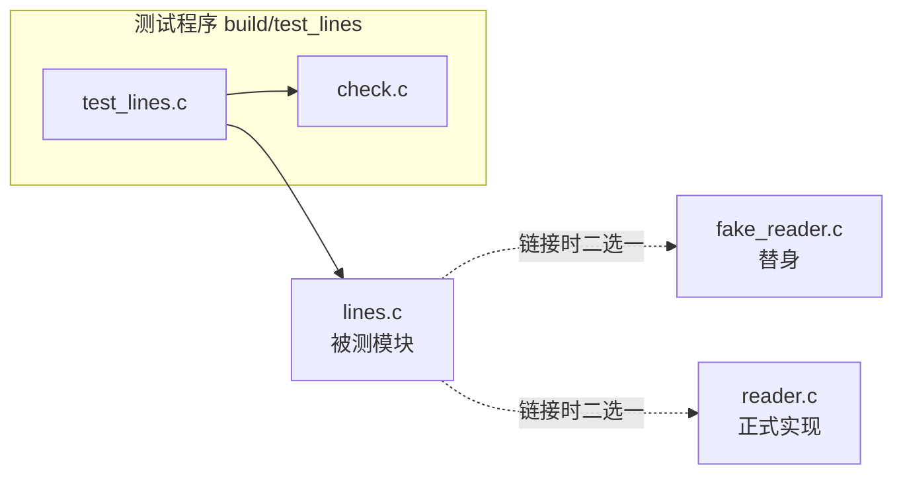

# 11. 自动化测试

wordfreq 的 `token.c` 里有一段把大写字母转成小写的循环。作者重构了这段转换，改完用 `tests/data/sample.txt` 跑了一遍程序，输出是：

::: terminal title="zsh - ./wordfreq -n 3"

```console
$ ./wordfreq -n 3 tests/data/sample.txt
      2 The
      2 on
      2 sat
```

:::

三行数字看着合理，作者提交了代码。第二天把行数放宽，问题露了出来：

::: terminal title="zsh - ./wordfreq -n 10"

```console
$ ./wordfreq -n 10 tests/data/sample.txt
      2 The
      2 on
      2 sat
      2 the
      1 cat
      1 dog
      1 log
      1 mat
```

:::

`The` 与 `the` 被分开计数，各出现两次；正确的输出应当是 `the` 出现四次。第一次运行只显示前三行，`The` 恰好是其中一行，眼睛扫过去不会觉得有问题。要发现这一点，只需要把完整输出和一份写好的期望值比一下，这正是测试程序替人做的事。

这一章给 wordfreq 加上 `tests/` 目录：一个几十行的小型测试框架，两个单元测试程序，一个端到端测试，并且把它们接进第 9 章建立的 CMake 工程，用一条命令跑完全部测试，以退出状态报告结果。后半部分讲测试替身和几条写测试的规则，它们决定一套测试能不能长期用下去。

## 1. 测试是一个检查行为的程序

测试就是一个普通的 C 程序，它调用被测代码、比较结果，最后用退出状态报告结论。第 2 章已经讲过，退出状态 0 表示成功，非 0 表示失败；shell 的 `&&`、`make`、`ctest` 都靠这个值决定下一步做什么。一个最小的测试程序只有十几行：

```c
#include <stdio.h>
#include <string.h>

#include "wf/token.h"

int main(void) {
    const char *text = "The";
    wf_tokenizer tz;
    wf_tokenizer_init(&tz, text, strlen(text));
    char word[WF_WORD_MAX];

    wf_tokenizer_next(&tz, word, sizeof word);
    if (strcmp(word, "the") != 0) {
        fprintf(stderr, "word is \"%s\", expected \"the\"\n", word);
        return 1;
    }
    return 0;
}
```

在 `wordfreq/` 目录下编译并运行，第一次链接正确的 `token.c`，第二次换成第 5 节要用的缺陷版本：

::: terminal title="zsh - 编译并运行最小测试"

```console
$ gcc -std=c17 -Wall -Wextra -Iinclude -o build/mini_test mini_test.c src/token.c
$ ./build/mini_test
$ echo $?
0
$ gcc -std=c17 -Wall -Wextra -Iinclude -o build/mini_bug mini_test.c ../bugs/token_lowercase_starts_at_1.c
$ ./build/mini_bug
word is "The", expected "the"
$ echo $?
1
```

:::

这个程序已经具备了测试的全部要素：它明确知道正确的结果是什么，自己判断，失败时给出人能读懂的信息，并用退出状态告诉调用者。`if (strcmp(...) != 0)` 这种写法的问题在于每多查一件事就多一个 `if`，失败信息各写各的，漏写一个 `return 1` 就静默通过。测试框架把这几件事固定下来。

测试程序与被测代码链接同一个库。第 7 章把分词、计数、输出拆成三个模块，第 8 章把它们打包成静态库 `libwf`；测试程序像 `app/main.c` 一样链接这个库，改一处实现，程序和测试同时更新。测试程序也包含 `wf/token.h`，它看到的接口与程序看到的一模一样，因此不会误测到模块内部的 `static` 函数。

按被测对象的范围，测试分成三类，本章三种都会写：

| 名称 | 被测对象 | wordfreq 中的例子 |
| --- | --- | --- |
| 单元测试 (unit test) | 一个模块的公开接口 | 给 `wf_tokenizer_next` 一段文本，检查取出的每个单词 |
| 端到端测试 (end-to-end test) | 整个程序，从命令行到输出 | 运行 `wordfreq -n 3 tests/data/sample.txt`，比对完整输出 |
| 回归测试 (regression test) | 一次已经修好的缺陷 | 第 5 节把大写转换的错误重新注入，确认测试能抓住它 |

单元测试跑得快、失败信息指向具体函数，是日常开发中数量最多的一类。端到端测试慢一些，但能覆盖参数解析、文件打开、输出格式这些单元测试碰不到的部分。回归测试不是另写一套代码，它的特别之处在来历：每一个修好的缺陷都应当留下一个能重现它的测试，这样同一个错误第二次出现时，不必等用户报告。

::: concept test-failure-exit-status title="测试失败必须让进程以非 0 状态退出"

测试程序失败时 `main` 必须返回非 0 值。构建工具、CI 和 shell 都只检查退出状态，程序打印了多少错误信息、返回 0 都等于宣告成功。测试框架的汇总函数要把失败计数换算成退出状态，不能只打印。

:::

## 2. 为什么不直接用 assert

`<assert.h>` 的 `assert` 是最省事的检查手段，[14.1 `<assert.h>`](/教程/正文/语法和标准库/14_文本转换_错误与程序生命周期/14_1_assert) 讲过它的用法和 `NDEBUG` 的作用。把上一节的最小测试改用 `assert` 写，主体只有三行：

```c
wf_tokenizer_next(&tz, word, sizeof word);
assert(strcmp(word, "the") == 0);
wf_tokenizer_next(&tz, word, sizeof word);
assert(strcmp(word, "the") == 0);
```

用 `assert` 写测试有三处不合适，前两处在实际运行中会立刻遇到。下面的对照用同一段输入 `"The THE tHe"` 和缺陷版的 `token.c`，两边都检查三个单词：

::: compare vertical left-title="用 assert" right-title="用测试框架的宏"

```c
#include <assert.h>
#include <string.h>

#include "wf/token.h"

int main(void) {
    const char *text = "The THE tHe";
    wf_tokenizer tz;
    wf_tokenizer_init(&tz, text, strlen(text));
    char word[WF_WORD_MAX];

    wf_tokenizer_next(&tz, word, sizeof word);
    assert(strcmp(word, "the") == 0);
    wf_tokenizer_next(&tz, word, sizeof word);
    assert(strcmp(word, "the") == 0);
    wf_tokenizer_next(&tz, word, sizeof word);
    assert(strcmp(word, "the") == 0);
    return 0;
}
```

---

```c
#include <string.h>

#include "check.h"
#include "wf/token.h"

int main(void) {
    const char *text = "The THE tHe";
    wf_tokenizer tz;
    wf_tokenizer_init(&tz, text, strlen(text));
    char word[WF_WORD_MAX];

    wf_tokenizer_next(&tz, word, sizeof word);
    CHECK_STR_EQ(word, "the");
    wf_tokenizer_next(&tz, word, sizeof word);
    CHECK_STR_EQ(word, "the");
    wf_tokenizer_next(&tz, word, sizeof word);
    CHECK_STR_EQ(word, "the");
    return check_report("test_token");
}
```

:::

两段程序分别编译运行（Linux，GCC 14.2，缺陷版的 `token.c`）：

::: terminal title="zsh - 两种写法的失败输出"

```text
$ ./assert_token
assert_token: assert_token.c:13: main: Assertion `strcmp(word, "the") == 0' failed.
Aborted
$ echo $?
134
$ ./check_token
check_token.c:13: word is "The", expected "the"
check_token.c:15: word is "The", expected "the"
test_token: 3 checks, 2 failed
$ echo $?
1
```

:::

`assert` 在第一次失败处就 `abort()`，三个单词里后两个的检查根本没有执行，改完第一处、重跑、再发现第二处，来回三轮。退出状态 134 来自 `abort()`，它说明程序异常终止，看不出是哪个测试失败了多少项。失败信息里的 `strcmp(word, "the") == 0` 是条件原文，想知道的「实际值是什么」还得自己再查。

第二个问题是 `NDEBUG`。发布构建常定义 `NDEBUG` 去掉断言，`assert` 随之消失。一个小程序演示这个差别：

```c
#include <assert.h>
#include <stdio.h>

int main(void) {
    int n = 0;
    assert(n > 0);
    printf("continue with n = %d\n", n);
    return 0;
}
```

::: terminal title="zsh - NDEBUG 删除断言"

```console
$ gcc -std=c17 -Wall -Wextra -o ndebug ndebug.c
$ ./ndebug
ndebug: ndebug.c:6: main: Assertion `n > 0' failed.
Aborted
$ gcc -std=c17 -Wall -Wextra -DNDEBUG -o ndebug_nd ndebug.c
$ ./ndebug_nd
continue with n = 0
$ echo $?
0
```

:::

同一份源码，加了 `-DNDEBUG` 之后检查完全消失，程序继续往下跑。测试程序的价值在于每次都执行同样的检查，把检查编译掉等于这批测试不存在。测试程序因此不定义 `NDEBUG`，断言库也不使用 `assert`。

第三处不合适与 `assert` 的定位有关。`assert` 表达的是「这里不可能出错，出错说明程序有缺陷，立刻停机」，它不打算收集结果、也不打算给出期望值。测试要的恰好是收集和报告。这决定了下一个问题：这些工作写在哪里。

::: tip 本机编译时加 `-D__USE_MINGW_ANSI_STDIO=1`

Windows 上的 MinGW-w64 GCC 13.2 对 `%zu` 报格式错误警告，而运行结果是对的；第 3 章第 7 节的 tip 解释过原因。手工编译本章的测试程序时加上这个定义，警告就消失了。`wordfreq/CMakeLists.txt` 已经在 `if(MINGW)` 分支里为整个工程加上它。

:::

## 3. 一个小型测试框架

`check.h` 与 `check.c` 一共八十多行，提供三样东西：记录一次检查的宏、打印失败信息的函数、在末尾汇总并给出退出状态的函数。头文件全文：

::: code-group

```c [tests/check.h]
/*
 * 一个很小的测试框架：CHECK 系列宏记录一次检查的结果，
 * check_report 在 main 末尾打印汇总并给出退出状态。
 */
#ifndef CHECK_H
#define CHECK_H

#include <stddef.h>
#include <string.h>

void check_pass(void);
void check_fail(const char *file, int line, const char *fmt, ...);

/* 打印「<suite>: <总数> checks, <失败数> failed」；有失败返回 1，否则返回 0 */
int check_report(const char *suite);

/* 失败信息为「文件:行: 条件原文」 */
#define CHECK(cond)                                                            \
    do {                                                                       \
        if (cond) {                                                            \
            check_pass();                                                      \
        } else {                                                               \
            check_fail(__FILE__, __LINE__, "%s", #cond);                       \
        }                                                                      \
    } while (0)

/* 比较两个 size_t；失败信息为「表达式 is 实际值, expected 期望值」 */
#define CHECK_EQ_SIZE(actual, expected)                                        \
    do {                                                                       \
        size_t check_actual_ = (actual);                                       \
        size_t check_expected_ = (expected);                                   \
        if (check_actual_ == check_expected_) {                                \
            check_pass();                                                      \
        } else {                                                               \
            check_fail(__FILE__, __LINE__, "%s is %zu, expected %zu",          \
                       #actual, check_actual_, check_expected_);               \
        }                                                                      \
    } while (0)

/* 比较两个字符串；失败信息形如 word is "The", expected "the" */
#define CHECK_STR_EQ(actual, expected)                                         \
    do {                                                                       \
        const char *check_actual_ = (actual);                                  \
        const char *check_expected_ = (expected);                              \
        if (check_actual_ != NULL && check_expected_ != NULL &&                \
            strcmp(check_actual_, check_expected_) == 0) {                     \
            check_pass();                                                      \
        } else {                                                               \
            check_fail(__FILE__, __LINE__, "%s is \"%s\", expected \"%s\"",    \
                       #actual, check_actual_ != NULL ? check_actual_ : "(null)", \
                       check_expected_ != NULL ? check_expected_ : "(null)");  \
        }                                                                      \
    } while (0)

#endif
```

```c [tests/check.c]
#include "check.h"

#include <stdarg.h>
#include <stdio.h>
#include <string.h>

/* 计数只在本文件里，头文件不定义对象 */
static int total_checks = 0;
static int failed_checks = 0;

void check_pass(void) { total_checks++; }

void check_fail(const char *file, int line, const char *fmt, ...) {
    total_checks++;
    failed_checks++;

    fprintf(stderr, "%s:%d: ", file, line);
    va_list ap;
    va_start(ap, fmt);
    vfprintf(stderr, fmt, ap);
    va_end(ap);
    fputc('\n', stderr);
}

int check_report(const char *suite) {
    printf("%s: %d checks, %d failed\n", suite, total_checks, failed_checks);
    return failed_checks == 0 ? 0 : 1;
}
```

:::

失败信息写成「文件:行: 说明」，与编译器的诊断格式一致，编辑器和 IDE 都能把它解析成可跳转的链接。第 5 节的缺陷版 `token.c` 换进来之后，手工编译一个测试程序并运行：

::: terminal title="zsh - 一个失败的测试"

```text
$ gcc -std=c17 -Wall -Wextra -Iinclude -Itests \
      -o build/test_token_bug tests/test_token.c tests/check.c ../bugs/token_lowercase_starts_at_1.c
$ ./build/test_token_bug
tests/test_token.c:44: word is "The", expected "the"
tests/test_token.c:46: word is "The", expected "the"
test_token: 27 checks, 2 failed
$ echo $?
1
```

:::

两行失败信息分别指向 `test_token.c` 的第 44 行和第 46 行，正是 `CHECK_STR_EQ` 出现的位置；汇总行把「跑了多少、错了几处」放在一起，`main` 把它的返回值直接交出去，进程退出状态就成了 1。

计数器定义在 `check.c` 而不是头文件里，原因第 6 章讲过：头文件里定义对象，每个包含它的源文件都会得到一份副本，链接时冲突或者各改各的。这里 `total_checks`、`failed_checks` 是 `static`，只在 `check.c` 内部可见；测试程序通过 `check_pass`、`check_fail` 两个函数修改它们。`check_fail` 单独写成函数而不是宏，还带来一个方便：调试时可以只在这一个函数上设断点，任何检查的失败都会停在这里，调用栈上一层就是出错的测试函数（第 12 章会这样做）。

三个宏都包在 `do { ... } while (0)` 里，这是第 17.2 节讲的写法。下面是没包的情况，宏体展开成两条语句，写在 `if` 后面时 `else` 会挂错位置：

::: compare vertical left-title="宏体没有包起来" right-title="用 do { } while (0)"

```c
#define CHECK_BAD(cond)                                                        \
    if (cond) {                                                                \
    } else {                                                                   \
        check_fail(__FILE__, __LINE__, "%s", #cond);                           \
    }

if (verbose)
    CHECK_BAD(value > 0);
else
    printf("quiet\n");
```

---

```c
#define CHECK(cond)                                                            \
    do {                                                                       \
        if (cond) {                                                            \
            check_pass();                                                      \
        } else {                                                               \
            check_fail(__FILE__, __LINE__, "%s", #cond);                       \
        }                                                                      \
    } while (0)

if (verbose)
    CHECK(value > 0);
else
    printf("quiet\n");
```

:::

左栏展开后 `if (verbose) if (value > 0) {} else { ... } else` 多出一个 `else`，GCC 报 `error: 'else' without a previous 'if'`，并附一条 `suggest explicit braces to avoid ambiguous 'else'` 警告；右栏的 `do { } while (0)` 加末尾分号整体是一条语句，`else` 仍属于外面的 `if`。

宏的实参只求值一次是另一条要求。如果 `CHECK_EQ_SIZE` 直接展开成 `if ((actual) == (expected))`，`actual` 在比较里出现一次就够，可它在失败信息里还要再出现一次，写成 `CHECK_EQ_SIZE(i++, 0)` 时 `i` 就会被加两次。头文件里的版本先把实参存进 `check_actual_`、`check_expected_` 两个局部对象，比较和打印都用这两个对象。下面的程序验证这一点：

```c
#include <stddef.h>

#include "check.h"

int main(void) {
    size_t i = 0;
    CHECK_EQ_SIZE(i++, 0);
    CHECK_EQ_SIZE(i, 1);
    return check_report("test_once");
}
```

两项检查都通过，说明 `i++` 只执行了一次：

::: terminal title="zsh - 实参只求值一次"

```console
$ ./once
test_once: 2 checks, 0 failed
```

:::

宏里还有两个细节。`sizeof` 的结果是 `size_t`，`CHECK_EQ_SIZE` 的两个实参都存成 `size_t`，避免有符号与无符号混比；`CHECK_STR_EQ` 先判断空指针再 `strcmp`，失败信息里把空指针打印成 `(null)`，否则 `%s` 接空指针在某些 C 库上会直接崩溃，测试程序在报告失败的路上先死掉。

`do { ... } while (0)` 让宏调用保持一条语句的形式；`#cond` 把条件原样变成字符串，失败信息里看到的就是源码里写的那一行。两者都是预处理器的惯用写法，第 17.2 节讲过原理。

::: concept test-macro-single-evaluation title="测试宏的实参只能求值一次"

测试宏会多次使用实参（比较一次、打印一次），必须先把每个实参存进局部对象再使用。否则 `CHECK(i++)` 这类写法会有副作用地执行两次，测试自己引入错误。宏体包在 `do { } while (0)` 里，调用处才不会破坏 `if`/`else` 的结构。

:::

<Quiz
  type="single"
  :options="[
    { label: '因为 assert 打印的信息不够详细', value: 'A' },
    { label: '因为定义 NDEBUG 后 assert 会被编译掉，测试在发布构建里不再执行', value: 'B' },
    { label: '因为 assert 只能在 C++ 里使用', value: 'C' },
    { label: '因为 assert 不能检查字符串', value: 'D' }
  ]"
  answer="B"
>

测试程序为什么不能建立在 `assert` 之上？

正确答案是 **B**。`assert` 的开关是编译期的宏 `NDEBUG`，一旦发布构建定义了它，所有检查从可执行文件里消失，测试静默通过。A 是次要原因，`assert` 的失败信息确实只有条件原文，但补足信息并不难；C、D 与事实不符。

</Quiz>

## 4. 为模块写单元测试

测试文件按模块分开：`tests/test_token.c` 检查分词，`tests/test_counter.c` 检查计数。每个测试是一个 `static` 函数，名字说明它检查的行为，函数体按「准备—执行—检查」三段写；`main` 依次调用它们，最后 `return check_report(...)`。分词测试全文（`tests/test_token.c`）：

```c
#include "check.h"

#include <string.h>

#include "wf/token.h"

static void test_plain_words(void) {
    const char *text = "cat dog";
    wf_tokenizer tz;
    wf_tokenizer_init(&tz, text, strlen(text));
    char word[WF_WORD_MAX];

    CHECK_EQ_SIZE(wf_tokenizer_next(&tz, word, sizeof word), 3);
    CHECK_STR_EQ(word, "cat");
    CHECK_EQ_SIZE(wf_tokenizer_next(&tz, word, sizeof word), 3);
    CHECK_STR_EQ(word, "dog");
    CHECK_EQ_SIZE(wf_tokenizer_next(&tz, word, sizeof word), 0);
}

static void test_punctuation_and_digits(void) {
    const char *text = "hello, world! 123 foo_bar";
    wf_tokenizer tz;
    wf_tokenizer_init(&tz, text, strlen(text));
    char word[WF_WORD_MAX];

    CHECK_EQ_SIZE(wf_tokenizer_next(&tz, word, sizeof word), 5);
    CHECK_STR_EQ(word, "hello");
    CHECK_EQ_SIZE(wf_tokenizer_next(&tz, word, sizeof word), 5);
    CHECK_STR_EQ(word, "world");
    CHECK_EQ_SIZE(wf_tokenizer_next(&tz, word, sizeof word), 3);
    CHECK_STR_EQ(word, "foo");
    CHECK_EQ_SIZE(wf_tokenizer_next(&tz, word, sizeof word), 3);
    CHECK_STR_EQ(word, "bar");
    CHECK_EQ_SIZE(wf_tokenizer_next(&tz, word, sizeof word), 0);
}

static void test_lowercase_folding(void) {
    const char *text = "The THE tHe";
    wf_tokenizer tz;
    wf_tokenizer_init(&tz, text, strlen(text));
    char word[WF_WORD_MAX];

    CHECK_EQ_SIZE(wf_tokenizer_next(&tz, word, sizeof word), 3);
    CHECK_STR_EQ(word, "the");
    CHECK_EQ_SIZE(wf_tokenizer_next(&tz, word, sizeof word), 3);
    CHECK_STR_EQ(word, "the");
    CHECK_EQ_SIZE(wf_tokenizer_next(&tz, word, sizeof word), 3);
    CHECK_STR_EQ(word, "the");
    CHECK_EQ_SIZE(wf_tokenizer_next(&tz, word, sizeof word), 0);
}

static void test_no_words(void) {
    const char *text = "12345 !@#$%";
    wf_tokenizer tz;
    wf_tokenizer_init(&tz, text, strlen(text));
    char word[WF_WORD_MAX];

    CHECK_EQ_SIZE(wf_tokenizer_next(&tz, word, sizeof word), 0);
}

static void test_truncation(void) {
    const char *text = "abcdef next";
    wf_tokenizer tz;
    wf_tokenizer_init(&tz, text, strlen(text));
    char word[4];

    CHECK_EQ_SIZE(wf_tokenizer_next(&tz, word, sizeof word), 3);
    CHECK_STR_EQ(word, "abc");
    CHECK_EQ_SIZE(wf_tokenizer_next(&tz, word, sizeof word), 3);
    CHECK_STR_EQ(word, "nex");
    CHECK_EQ_SIZE(wf_tokenizer_next(&tz, word, sizeof word), 0);
}

int main(void) {
    test_plain_words();
    test_punctuation_and_digits();
    test_lowercase_folding();
    test_no_words();
    test_truncation();
    return check_report("test_token");
}
```

五个函数各查一件事：普通单词的切分与结束、标点数字下划线的分隔、大写折叠、无单词的输入、缓冲区不够时的截断。每个输入都很短，读者一眼能看出期望值从哪来。`test_truncation` 用 `char word[4]`，按 `wf_tokenizer_next` 的规格至多写 3 个字母，`abcdef` 取成 `abc`，剩下三个字母丢弃，下一个单词是 `next` 取成 `nex`；这条检查顺带确认了「放不下的字母读过就丢弃」。

一个函数里堆二十个检查不如拆成五个函数。`test_token.c` 打开就能看到这一页测了哪五件事，失败汇总里的数量也能对上。函数名不用 `test1`、`test2` 这类编号：`test_lowercase_folding` 在失败报告里出现时，读者已经知道错在哪里。

计数测试的结构相同，重点在排序规则（`tests/test_counter.c`）：

```c
#include "check.h"

#include "wf/counter.h"

static void test_add_and_get(void) {
    wf_counter *c = wf_counter_create();
    CHECK(c != NULL);

    CHECK_EQ_SIZE(wf_counter_size(c), 0);
    CHECK_EQ_SIZE(wf_counter_get(c, "the"), 0);

    CHECK(wf_counter_add(c, "the") == 0);
    CHECK(wf_counter_add(c, "cat") == 0);
    CHECK(wf_counter_add(c, "the") == 0);

    CHECK_EQ_SIZE(wf_counter_size(c), 2);
    CHECK_EQ_SIZE(wf_counter_get(c, "the"), 2);
    CHECK_EQ_SIZE(wf_counter_get(c, "cat"), 1);
    CHECK_EQ_SIZE(wf_counter_get(c, "dog"), 0);

    wf_counter_destroy(c);
}

static void test_top_sorting(void) {
    wf_counter *c = wf_counter_create();
    CHECK(c != NULL);

    const char *words[] = {"the", "cat", "sat", "on", "the", "mat",
                           "the", "dog", "sat", "on", "the", "log"};
    for (size_t i = 0; i < sizeof words / sizeof words[0]; i++) {
        CHECK(wf_counter_add(c, words[i]) == 0);
    }

    wf_entry top[3];
    size_t n = wf_counter_top(c, top, 3);
    CHECK_EQ_SIZE(n, 3);
    CHECK_STR_EQ(top[0].word, "the");
    CHECK_EQ_SIZE(top[0].count, 4);
    CHECK_STR_EQ(top[1].word, "on");
    CHECK_EQ_SIZE(top[1].count, 2);
    CHECK_STR_EQ(top[2].word, "sat");
    CHECK_EQ_SIZE(top[2].count, 2);

    wf_counter_destroy(c);
}

static void test_top_more_than_size(void) {
    wf_counter *c = wf_counter_create();
    CHECK(c != NULL);

    CHECK(wf_counter_add(c, "a") == 0);
    CHECK(wf_counter_add(c, "b") == 0);

    wf_entry top[10];
    size_t n = wf_counter_top(c, top, 10);
    CHECK_EQ_SIZE(n, 2);
    CHECK_STR_EQ(top[0].word, "a");
    CHECK_STR_EQ(top[1].word, "b");

    wf_counter_destroy(c);
}

int main(void) {
    test_add_and_get();
    test_top_sorting();
    test_top_more_than_size();
    return check_report("test_counter");
}
```

`test_top_sorting` 是样例文本的词频表：`the` 四次，`on` 与 `sat` 各两次。次数相同的单词按 `strcmp` 升序，`on` 排在 `sat` 前面，这条检查把规格里的排序规则固定下来，也正好覆盖上一节的故事：`The` 没有被折叠时，这张表里会多出一项 `The`，`the` 的计数从 4 掉到 2。

`test_top_more_than_size` 检查请求的项数超过不同单词数时返回实际项数，`test_add_and_get` 检查没出现过的单词计 0、重复添加只增计数不加新项。三个函数覆盖了 `add`、`get`、`size`、`top` 的公开行为，没有一条断言去追究内部数组的顺序。内部结构属于实现，第 15 章会把它从线性查找换成有序数组，那时这三个测试一个字都不用改；如果测试里写了「第 0 项是 `the`，因为最先加入」，换实现时就会误报失败。

手工编译并运行这两个测试程序，`tests/check.c` 要和测试一起编进来：

::: terminal title="zsh - 直接运行测试程序"

```console
$ gcc -std=c17 -Wall -Wextra -Iinclude -Itests -o build/test_token \
      tests/test_token.c tests/check.c src/token.c
$ ./build/test_token
test_token: 27 checks, 0 failed
$ echo $?
0
$ gcc -std=c17 -Wall -Wextra -Iinclude -Itests -o build/test_counter \
      tests/test_counter.c tests/check.c src/counter.c
$ ./build/test_counter
test_counter: 36 checks, 0 failed
$ echo $?
0
```

:::

27 与 36 是实际执行的检查次数，`0 failed` 表示全部通过，退出状态 0 可以直接交给构建工具。到这里还是手工一行行敲 `gcc`；第 7 节把这两个程序和端到端测试一起接进 CMake，一条 `ctest` 跑完。

<Quiz
  type="multi"
  :options="[
    { label: '测试通过时打印的信息里带上函数名和实际值', value: 'A' },
    { label: '每个测试函数只查一个行为，名字说明查的是什么', value: 'B' },
    { label: '断言计数器的内部数组顺序，保证实现不变', value: 'C' },
    { label: '只通过公开头文件里的接口调用被测模块', value: 'D' }
  ]"
  :answer="['B', 'D']"
>

关于本章的单元测试，下列哪些做法是正确的？

正确答案是 **B、D**。一个测试函数只查一个行为，失败时读者从名字就知道哪条规则出错；只调用公开接口，换实现时测试仍然有效。C 恰好相反：内部数组顺序是实现细节，断言它会把测试和实现绑死。A 不是测试写法，而是失败报告的格式，通过时不打印实际值。

</Quiz>

## 5. 测试抓住回归

测试真正的用处出现在缺陷再次出现的时候。本章要用的缺陷是把小写转换的循环写成从下标 1 开始，`src/token.c` 里对应的一行变成：

```c
for (size_t i = 1; i < n; i++) {
    if (word[i] >= 'A' && word[i] <= 'Z') {
        word[i] = (char)(word[i] - 'A' + 'a');
    }
}
```

下标 0 的字母保持原样，`The` 就变成了 `The`。缺陷版本放在与 `wordfreq/` 同级的 `bugs/token_lowercase_starts_at_1.c`，替换 `src/token.c` 后重跑测试：

::: terminal title="zsh - 缺陷版本的测试输出"

```text
$ cp ../bugs/token_lowercase_starts_at_1.c src/token.c
$ cmake --build build
$ ctest --test-dir build --output-on-failure
    Start 1: token
1/3 Test #1: token ............................***Failed    0.00 sec
/home/minsecrus/tutorial/work/test11/wordfreq/tests/test_token.c:44: word is "The", expected "the"
/home/minsecrus/tutorial/work/test11/wordfreq/tests/test_token.c:46: word is "The", expected "the"
test_token: 27 checks, 2 failed

    Start 2: counter
2/3 Test #2: counter ..........................   Passed    0.00 sec
    Start 3: e2e
3/3 Test #3: e2e ..............................***Failed    0.01 sec
CMake Error at /home/minsecrus/tutorial/work/test11/wordfreq/tests/run_e2e.cmake:19 (message):
  output differs

  --- actual ---

        2 The
        2 on
        2 sat

  --- expected ---

        4 the
        2 on
        2 sat

33% tests passed, 2 tests failed out of 3
```

:::

两个测试同时失败，失败信息直接指向结论。`test_token.c:44` 是 `test_lowercase_folding` 的第一条 `CHECK_STR_EQ`，它说实际值是 `"The"`、期望是 `"the"`；`ctest --output-on-failure` 把测试程序自己的输出原样转发，所以文件和行号都能看到。端到端测试则给出程序真实的输出与期望文件并排对比，`The` 与 `the` 各占一行，一眼就能看出问题出在大小写折叠。

失败信息里的路径是完整路径，因为 `ctest` 在构建目录里启动测试程序，`__FILE__` 展开成编译时给出的路径。同一台机器上的路径不影响阅读；换构建目录时这段路径会跟着变，属于正常现象。

`counter` 测试通过并不说明它没用，而是说明这个缺陷不在计数模块里。三个测试分别覆盖三块职责，失败的那个把范围缩小到分词。第 12 章会在 `check_fail` 上设断点，从调用栈找到具体是哪一次调用出了问题。

修复的办法是让转换从下标 0 开始，或者干脆在收集字母时顺手转换：

::: compare left-title="缺陷版本：从下标 1 开始" right-title="修复后：收集时转换"

```c
/* 放不下的字母读过就丢弃，不会成为下一个单词的开头 */
size_t n = 0;
while (p < tz->end && is_ascii_letter(*p)) {
    if (n + 1 < cap) {
        word[n++] = *p;
    }
    p++;
}
word[n] = '\0';

/* 缺陷：从 1 开始转换，word[0] 保持原样 */
for (size_t i = 1; i < n; i++) {
    if (word[i] >= 'A' && word[i] <= 'Z') {
        word[i] = (char)(word[i] - 'A' + 'a');
    }
}
```

---

```c
/* 放不下的字母读过就丢弃，不会成为下一个单词的开头 */
size_t n = 0;
while (p < tz->end && is_ascii_letter(*p)) {
    if (n + 1 < cap) {
        word[n++] = to_ascii_lower(*p);
    }
    p++;
}
word[n] = '\0';
```

:::

修复之后重跑，两个测试都通过：

::: terminal title="zsh - 修复后"

```console
$ ctest --test-dir build --output-on-failure
    Start 1: token
1/3 Test #1: token ............................   Passed    0.00 sec
    Start 2: counter
2/3 Test #2: counter ..........................   Passed    0.00 sec
    Start 3: e2e
3/3 Test #3: e2e ..............................   Passed    0.01 sec

100% tests passed, 0 tests failed out of 3
```

:::

修复与测试放在同一次提交里。这次没有新增测试，`test_lowercase_folding` 在本章一开始就写好了，它先失败、修好后通过，说明这条检查确实能分辨对错。新修好的缺陷如果此前没有对应的检查，就补一条：测试先失败，再改代码让它通过，提交里两者一起出现。只提交修复、不提交测试，下次改动 `token.c` 时没有任何东西提醒你这条规则。

::: tip 让 `ctest` 只说结论

不带选项的 `ctest` 只报哪些测试失败，要它转发测试程序自己打印的失败信息，加 `--output-on-failure`。配合 `-R <正则>` 按名字筛选、`-L <标签>` 按标签筛选，改一处代码时只跑相关的几个测试。`ctest -N` 列出注册了哪些测试而不运行，`ctest --rerun-failed` 只重跑上一次失败的项。

:::

## 6. 端到端测试

单元测试检查模块，端到端测试检查整个程序：参数怎么解析、文件怎么打开、输出是什么格式，这些都只有真正运行一遍才能确认。wordfreq 的样例输入和期望输出放在 `tests/data/`：

::: code-group

```text [tests/data/sample.txt]
The cat sat on the mat.
The dog sat on the log.
```

```text [tests/data/sample.expected]
      4 the
      2 on
      2 sat
```

:::

期望输出文件（golden file）是人工核对过的一份正确输出。手工运行程序得到的结果与它一致，这条测试就通过。比较的是字节，行尾、行首的空格、空行都算数；`-n 3` 只要三行，格式一旦被改动，比如把 `%7zu` 改成 `%5zu`，比较就会失败。

CMake 自带 `cmake -E compare_files`，它比较两个文件，相同返回 0，不同返回 1：

::: terminal title="zsh - cmake -E compare_files"

```console
$ ./build/wordfreq -n 3 tests/data/sample.txt > build/actual.txt
$ cmake -E compare_files build/actual.txt tests/data/sample.expected
$ echo $?
0
$ printf '      4 The\n' > build/bad.txt
$ cmake -E compare_files build/bad.txt tests/data/sample.expected
$ echo $?
1
```

:::

它只报告「相同」或「不同」，不告诉你差在哪一行。要看到差异，用 `diff -u` 把两个文件并排打出来。本章的端到端测试写成一段 CMake 脚本，由 `ctest` 调用：脚本运行程序、捕获输出、与期望文件比较，不同时把两边的全文放进错误信息（`tests/run_e2e.cmake`）：

```cmake
# 由 ctest 调用：运行 wordfreq，把输出与期望文件逐字节比较。
# 参数：WORDFREQ 可执行文件路径，DATA 存放 sample.txt 与 sample.expected 的目录。

execute_process(
    COMMAND "${WORDFREQ}" -n 3 "${DATA}/sample.txt"
    OUTPUT_VARIABLE actual
    ERROR_VARIABLE err
    RESULT_VARIABLE status
)
if(NOT status EQUAL 0)
    message(FATAL_ERROR "wordfreq exited with status ${status}: ${err}")
endif()

# Windows 上标准输出是文本模式，行尾为 CRLF；去掉回车再比较
string(REPLACE "\r" "" actual "${actual}")
file(READ "${DATA}/sample.expected" expected)

if(NOT actual STREQUAL expected)
    message(FATAL_ERROR "output differs\n--- actual ---\n${actual}--- expected ---\n${expected}")
endif()

message(STATUS "sample: ok")
```

`execute_process` 运行程序，把标准输出收进对象 `actual`、标准错误收进 `err`、退出状态收进 `status`，不必自己建临时文件。退出状态不是 0 时直接报错，因为程序都没跑成功，比较输出没有意义。比较之前先把 `\r` 去掉，因为 Windows 上标准输出是文本模式，行尾是 `\r\n`；期望文件由编辑器保存，行尾是 `\n`，不去掉回车的话三行全部对不上。

期望输出文件只在有意修改输出格式时更新。改了 `wf_report_print` 的格式、确认新格式正确之后，手工运行一次程序、把新输出存进 `sample.expected`，并在提交说明里写清楚格式变了、为什么变。顺手更新期望文件让测试通过，等于把测试改成迎合代码，它就不再能发现错误。期望文件与代码的改动放在同一次提交里，评审时一眼能看出输出格式确实变了。

<Quiz
  type="single"
  :options="[
    { label: '它只比较两份已经存在的文件，不运行程序', value: 'A' },
    { label: '它运行程序并捕获输出，但只报告相同或不同，不显示差在哪一行', value: 'B' },
    { label: '它在比较失败时自动更新期望文件', value: 'C' },
    { label: '它只在 Windows 上可用', value: 'D' }
  ]"
  answer="A"
>

`cmake -E compare_files` 做的是什么，为什么本章还要另写 `run_e2e.cmake`？

正确答案是 **A**。`compare_files` 只比较两份已经存在的文件，相同返回 0、不同返回 1；它不运行程序，失败时也不说明差异在哪里。端到端测试要把「运行、捕获、比较、报告差异」四件事串起来，`execute_process` 负责运行和捕获，`file(READ)` 读入期望文件，两边的全文才放得进错误信息。C 恰好是测试里最忌讳的做法：自动更新期望值等于让测试迎合实现。

</Quiz>

::: warning ctest 在构建目录里运行测试

`add_test` 注册的程序默认以构建目录为工作目录启动。测试程序里写 `fopen("tests/data/sample.txt", ...)` 这样的相对路径，在项目根目录手工运行时能打开，由 `ctest` 启动时就找不到文件。需要固定工作目录时，给测试加 `WORKING_DIRECTORY` 属性；更简单的做法是把路径写进命令行参数或 CMake 变量，本章的端到端测试传的是绝对路径 `${CMAKE_CURRENT_SOURCE_DIR}/tests/data`。

:::

## 7. 接入构建系统

前几节都是手工用 `gcc` 编译测试程序，测试多了行数会堆成一片。CMake 提供 `enable_testing()` 与 `add_test`，把测试登记成构建系统的一部分。`wordfreq/CMakeLists.txt` 里与测试有关的部分：

```cmake
enable_testing()

# 单元测试：每个测试程序链接同一个 libwf，通过公开接口检查行为
add_executable(test_token tests/test_token.c tests/check.c)
target_link_libraries(test_token PRIVATE wf)
target_compile_options(test_token PRIVATE -Wall -Wextra)
add_test(NAME token COMMAND test_token)
set_tests_properties(token PROPERTIES LABELS unit)

add_executable(test_counter tests/test_counter.c tests/check.c)
target_link_libraries(test_counter PRIVATE wf)
target_compile_options(test_counter PRIVATE -Wall -Wextra)
add_test(NAME counter COMMAND test_counter)
set_tests_properties(counter PROPERTIES LABELS unit)

# 端到端测试：运行程序，把输出与 tests/data/sample.expected 比较
add_test(NAME e2e
    COMMAND ${CMAKE_COMMAND}
        -DWORDFREQ=$<TARGET_FILE:wordfreq>
        -DDATA=${CMAKE_CURRENT_SOURCE_DIR}/tests/data
        -P ${CMAKE_CURRENT_SOURCE_DIR}/tests/run_e2e.cmake)
set_tests_properties(e2e PROPERTIES LABELS e2e)
```

`enable_testing()` 让 CMake 生成 CTest 需要的文件，`add_test` 把每个测试登记进这张表。`add_executable` 与 `target_link_libraries` 和构建程序完全一样，测试程序只是多了一个可执行目标，链接同一个 `wf` 静态库。`NAME` 是 `ctest` 里显示的名字，`COMMAND` 是要执行的程序或命令；`$<TARGET_FILE:wordfreq>` 是生成器表达式，展开成 `wordfreq` 可执行文件的完整路径，不受构建目录和平台影响。`LABELS` 给测试贴标签，后面按标签筛选。

配置、构建、运行三步（Linux，GCC 14.2，CMake 3.31.6；Windows 上除路径和 `.exe` 后缀外，输出格式相同）：

::: terminal title="zsh - cmake 与 ctest"

```text
$ cmake -S . -B build
$ cmake --build build
$ ctest --test-dir build --output-on-failure
Internal ctest changing into directory: /home/minsecrus/tutorial/work/test11/wordfreq/build
Test project /home/minsecrus/tutorial/work/test11/wordfreq/build
    Start 1: token
1/3 Test #1: token ............................   Passed    0.00 sec
    Start 2: counter
2/3 Test #2: counter ..........................   Passed    0.00 sec
    Start 3: e2e
3/3 Test #3: e2e ..............................   Passed    0.01 sec

100% tests passed, 0 tests failed out of 3

Label Time Summary:
e2e     =   0.01 sec*proc (1 test)
unit    =   0.00 sec*proc (2 tests)

Total Test time (real) =   0.01 sec
```

:::

末尾的 `Label Time Summary` 按标签汇总，`unit` 标签下两项、`e2e` 标签下一项。只看单元测试：

::: terminal title="zsh - ctest -L unit"

```text
$ ctest --test-dir build -L unit
Internal ctest changing into directory: /home/minsecrus/tutorial/work/test11/wordfreq/build
Test project /home/minsecrus/tutorial/work/test11/wordfreq/build
    Start 1: token
1/2 Test #1: token ............................   Passed    0.00 sec
    Start 2: counter
2/2 Test #2: counter ..........................   Passed    0.00 sec

100% tests passed, 0 tests failed out of 2

Label Time Summary:
unit    =   0.00 sec*proc (2 tests)

Total Test time (real) =   0.01 sec
```

:::

`-R` 按名字筛选，参数是正则表达式：

::: terminal title="zsh - ctest -R token"

```text
$ ctest --test-dir build -R token
Internal ctest changing into directory: /home/minsecrus/tutorial/work/test11/wordfreq/build
Test project /home/minsecrus/tutorial/work/test11/wordfreq/build
    Start 1: token
1/1 Test #1: token ............................   Passed    0.00 sec

100% tests passed, 0 tests failed out of 1

Total Test time (real) =   0.00 sec
```

:::

`ctest` 的退出状态与测试结果一致：全部通过为 0，有失败为 8。这个值可以直接交给 shell 的 `&&`、CI 或 `git bisect run`。

Make 构建下没有 `ctest` 这套登记表，`Makefile` 的 `test` 目标依次运行测试程序，任何一步的退出状态非 0 就中止：

```makefile
test: build/wordfreq $(TESTS)
	@build/test_token
	@build/test_counter
	@build/wordfreq -n 3 tests/data/sample.txt | tr -d '\r' | diff -u tests/data/sample.expected -
	@echo "sample: ok"
```

`@` 让 make 不回显这一条命令，只显示程序自己的输出。加上 `-s`（silent）连编译命令的回显也省掉，从干净目录构建时输出就只剩测试结果：

::: terminal title="zsh - make -s test"

```console
$ make -s test
test_token: 27 checks, 0 failed
test_counter: 36 checks, 0 failed
sample: ok
$ echo $?
0
```

:::

`make test` 的写法有一个局限：三条命令在同一个配方里，第一条失败后 make 立即停止，后面的测试不再执行，一次只能看到一个失败。`make -k` 也帮不上忙，它让 make 在失败后继续处理其他目标，而这三条命令属于同一个目标。要一次跑完全部、把失败集中列出来，用 `ctest`：它按登记表逐个运行，跑完再汇总。

XMake 把测试登记在目标上，`add_tests` 一句让这个目标成为一项测试，`xmake test` 依次运行所有登记过的目标。第 9 章已经给了 `xmake.lua` 的目标描述，这里只说明测试怎么挂上去：

```lua
target("test_token")
    set_kind("binary")
    add_deps("wf")
    add_files("tests/test_token.c", "tests/check.c")
    add_tests("default")
```

`add_tests` 的第二个参数可以给运行参数、期望的输出等选项，需要时查官方文档。本机没有安装 XMake，这段只作写法对照，不贴运行输出。

## 8. 隔离依赖：测试替身

被测代码调用外部资源时，测试的稳定性和速度都会受影响：读文件依赖磁盘上的文件存在，网络依赖对端，时间依赖系统时钟。测试替身（test double）用可控的替身代替这些依赖，让测试只验证自己的逻辑。

`wf_report_print` 的输出目标是 `FILE *`，参数由调用方传入。正式代码传入 `stdout`，测试可以传入 `tmpfile()` 得到的流。`tmpfile` 是标准 C 提供的临时文件，读写方式与普通文件一样，关闭时自动删除，测试结束后不在磁盘上留下文件。测试程序把结果写进去，再读回来比较（`examples/tmpfile_report.c`）：

```c
#include <stdio.h>
#include <string.h>

#include "check.h"
#include "wf/counter.h"
#include "wf/report.h"

/* 读一行并去掉行尾的换行，比较时不把换行也算进期望值；读不到时把 buf 置为空串 */
static void read_line(FILE *in, char *buf, size_t cap) {
    buf[0] = '\0';
    if (fgets(buf, (int)cap, in) == NULL) {
        return;
    }
    buf[strcspn(buf, "\n")] = '\0';
}

static void test_print_format(void) {
    wf_entry entries[2] = {{"the", 4}, {"on", 2}};
    FILE *out = tmpfile();
    CHECK(out != NULL);
    if (out == NULL) {
        return;
    }

    wf_report_print(out, entries, 2);

    rewind(out);
    char line[64];
    read_line(out, line, sizeof line);
    CHECK_STR_EQ(line, "      4 the");
    read_line(out, line, sizeof line);
    CHECK_STR_EQ(line, "      2 on");
    fclose(out);
}

int main(void) {
    test_print_format();
    return check_report("test_report");
}
```

在 `wordfreq/` 目录下编译运行：

::: terminal title="zsh - 用 tmpfile 捕获输出"

```console
$ gcc -std=c17 -Wall -Wextra -Iinclude -Itests \
      -o build/test_report ../examples/tmpfile_report.c tests/check.c src/report.c
$ ./build/test_report
test_report: 3 checks, 0 failed
```

:::

`wf_entry` 的两个成员直接写成字面量，不经过计数模块。这既是替身的效果，也是单元测试的本意：只验证 `wf_report_print` 的格式，计数是否算对由 `test_counter` 负责。读回时按行比较、去掉行尾的换行，期望值里就不必嵌入换行符，失败信息也不会跨行。

第二种替身作用在链接阶段：依赖的模块换成另一份实现，被测代码完全不知道。`wf_report_print` 接受的 `FILE *` 是接口设计时就留好的余地，并非每个依赖都能这样传。读文件的函数通常是直接调用 `fopen`，没有参数可以注入。示例放在 `code/开发与工程基础/11_自动化测试/examples/link_substitute/`：

```text:no-line-numbers
link_substitute/
├── reader.h          读文件模块的接口：reader_load
├── reader.c          正式实现：fopen、fread
├── lines.h
├── lines.c           被测模块：数单词，内部调用 reader_load
├── fake_reader.c     测试替身：不打开任何文件，固定返回一段文本
└── test_lines.c      测试程序
```

`lines.c` 包含 `reader.h`，调用 `reader_load` 读入整个文件，再按空白数单词。正式实现 `reader.c` 打开真实文件；测试替身 `fake_reader.c` 提供同名的 `reader_load`，返回写死在源码里的一段文本。测试程序链接哪一个，运行的就是哪一份：

::: terminal title="zsh - 链接时替换"

```console
$ gcc -std=c17 -Wall -Wextra -I../examples/link_substitute -Itests \
      -o build/test_lines ../examples/link_substitute/lines.c \
      ../examples/link_substitute/fake_reader.c \
      ../examples/link_substitute/test_lines.c tests/check.c
$ ./build/test_lines
test_lines: 1 checks, 0 failed
$ gcc -std=c17 -Wall -Wextra -I../examples/link_substitute -Itests \
      -o build/test_lines_real ../examples/link_substitute/lines.c \
      ../examples/link_substitute/reader.c \
      ../examples/link_substitute/test_lines.c tests/check.c
$ ./build/test_lines_real
../examples/link_substitute/test_lines.c:6: count_words_in_file("not/a/real/path") is 0, expected 6
test_lines: 1 checks, 1 failed
```

:::

测试程序只包含 `lines.h` 和 `check.h`，它对 `reader_load` 来自哪里一无所知。换成正式实现，同样的调用立刻失败，因为路径 `not/a/real/path` 并不存在；这恰好说明替身起了作用：在没有任何真实文件的情况下，测试能稳定地检查 `lines.c` 的计数逻辑。替身返回的文本 `the cat sat\non the mat\n` 有 6 个单词，测试的期望值就是 6，与文件系统无关。

两份实现不能同时链接，否则链接器报重复定义：

::: terminal title="zsh - 同时链接两份实现"

```text
$ gcc test_lines.o lines.o reader.o fake_reader.o check.o -o both
/usr/bin/ld: fake_reader.o: in function `reader_load':
fake_reader.c:(.text+0x0): multiple definition of `reader_load'; reader.o:reader.c:(.text+0x0): first defined here
collect2: error: ld returned 1 exit status
```

:::

这既是错误提示，也是这种方法的名字由来：链接器在若干份同名定义中只能挑一份，测试用哪个目标文件由构建文件决定。第 9 章的 CMake 里，测试目标只要不把 `reader.c` 列进 `add_executable`、改列 `fake_reader.c`，替换就完成了。



嵌入式工程里这种方法用得很多：固件逻辑在 PC 上编译，把读写寄存器的函数换成一份用数组模拟的替身，测的是同一份 `logic.c`。[嵌入式 3.1](/教程/正文/嵌入式/3_驱动_通信与中间件/3_1_驱动接口_CMSIS与设备头文件) 里的驱动接口就是这样组织的。

<Quiz
  type="single"
  :options="[
    { label: '把 reader.c 和 fake_reader.c 一起列进 add_executable，让链接器挑一份', value: 'A' },
    { label: '测试目标只链接 fake_reader.c，程序目标链接 reader.c', value: 'B' },
    { label: '在 reader.c 里加 #ifdef UNIT_TEST，测试时走另一条分支', value: 'C' },
    { label: '给 reader_load 加一个全局开关，测试时手工切换', value: 'D' }
  ]"
  answer="B"
>

用链接时替换隔离读文件依赖，构建文件该怎么写？

正确答案是 **B**。两份实现提供同一个 `reader_load`，测试目标和程序目标各自只链接其中一份，被测的 `lines.c` 一个字不改。A 会让链接器报重复定义；C 让产品代码和测试代码走两条不同的路径，测过的代码不等于出货的代码；D 引入全局状态，测试之间不再独立。

</Quiz>

::: tip 哪种替身先用

能改接口就改接口。像 `wf_report_print` 这样把 `FILE *` 作为参数，测试可以直接传 `tmpfile()`，不需要构建上的任何额外安排；接口设计时多留一个参数，比事后在链接阶段做替换省事得多。接口改不动、或者依赖藏在模块内部时，才用链接替换。两份实现必须提供完全一致的声明，最好共用同一个头文件，否则编译器发现不了签名不一致。

:::

## 9. 写测试的规则

测试写得对不对，看它失败时能不能指出问题、通过时是不是真的验证了规格。下面几条规则来自《Software Engineering at Google》与 Grenning 的嵌入式测试实践，本章的测试都按它们写。

测试必须是确定性的。同一个测试跑一百次，结果应当一样；依赖当前时间、随机数、文件系统里恰好存在的文件，都会让测试时灵时不灵。需要随机数时固定种子，需要时间时把时间作为参数传进去，需要文件时用 `tmpfile` 或替身。

测试之间要相互独立。一个测试改了全局状态、另一个测试依赖它，单独运行时就会失败，或者换一个顺序就失败。本章每个测试程序的 `main` 都从干净状态开始，`test_counter.c` 的每个函数自己 `wf_counter_create`、自己 `wf_counter_destroy`，不共享计数器。

测试要快。单元测试应当在一瞬间跑完，这样才能在每次改动之后都跑一遍。慢的测试（启动子进程、读写大文件、连网络）单独标成端到端测试，只在提交前或 CI 里跑。本章三个测试合计不到一秒，任何时候都可以整个跑一遍。

测试只测公开接口和规格写明的行为。断言 `wf_counter` 内部数组的顺序、断言 `wf_tokenizer` 两个成员指针的具体值，都会把测试和实现绑在一起。规格说「按次数降序、次数相同按 `strcmp` 升序」，测试就断言这个；规格没说内部用数组还是哈希表，测试就不该关心。第 15 章把线性查找换成二分查找，接口不变，本章的测试全部通过，正是这条规则的价值。

失败分支只测规格写明的那几条。`wf_counter_add` 在内存不足时返回 -1，这条规格可以用故意失败的 `malloc` 替身来测，但那需要另一套替身设施，超出了本章的范围。正常路径上每个公开函数至少有一条检查；规格里明确写出的错误码，挑一两条能稳定重现的测。测试的目的不是覆盖每一行代码，而是固定住调用方依赖的行为。覆盖率是第 14 章的话题。

测试与实现同步演进。改了规格（比如允许单词中的撇号属于单词），先改测试、看它失败，再改实现让它通过。反过来先改实现、再把测试改成符合新实现，测试就失去了作用。第 5 节的修复顺序正是前者：测试先存在、先失败，修复让它通过。

::: concept test-deterministic title="测试的结论必须可重复"

同一份代码、同一个测试，每次运行都应当得到同样的结果。依赖时间、未固定的随机数、外部文件或网络状态，会让测试时而通过、时而失败；这类测试一旦失败，读者首先要怀疑的是测试本身。不可控的依赖用参数注入或测试替身替换掉。

:::

## 10. 测试框架

本章的 `check.h` 够用，是因为测试规模小。测试文件多了、需要夹具（fixture，每个测试前后自动执行的准备与清理）、参数化、模拟对象自动生成时，换一个成熟的框架更省事。C 社区常用的三个框架各有取舍：

| 框架 | 特点 | 适用场合 |
| --- | --- | --- |
| Unity | 一份 `.c` 加两个头文件，MIT 许可，几 KB，能编到单片机上 | 嵌入式、资源受限的目标 |
| cmocka | 提供 `setUp`/`tearDown` 夹具与模拟对象支持 | 桌面与服务器端，依赖较多的模块 |
| Criterion | 每个测试在独立进程中运行，可并行，支持参数化 | 测试量大、希望隔离崩溃的工程 |

作者的建议是：几十个检查以内，自己写的 `check.h` 足够，没有额外依赖、源码全在掌握之中；测试文件上到十几个、团队里多人写测试、需要接 CI 统计时，换 Unity；依赖多、需要模拟大量外部函数时，用 cmocka 或它的配套工具 CMock。

同一段测试换成 Unity 的写法，检查部分几乎一样，运行部分换成 Unity 的宏：

```c
#include "unity.h"
#include "wf/token.h"

void setUp(void) {}
void tearDown(void) {}

static void test_lowercase_folding(void) {
    const char *text = "The THE tHe";
    wf_tokenizer tz;
    wf_tokenizer_init(&tz, text, strlen(text));
    char word[WF_WORD_MAX];

    wf_tokenizer_next(&tz, word, sizeof word);
    TEST_ASSERT_EQUAL_STRING("the", word);
    wf_tokenizer_next(&tz, word, sizeof word);
    TEST_ASSERT_EQUAL_STRING("the", word);
    wf_tokenizer_next(&tz, word, sizeof word);
    TEST_ASSERT_EQUAL_STRING("the", word);
}

int main(void) {
    UNITY_BEGIN();
    RUN_TEST(test_lowercase_folding);
    return UNITY_END();
}
```

`TEST_ASSERT_EQUAL_STRING(expected, actual)` 的实参顺序与 `CHECK_STR_EQ(actual, expected)` 相反，从一种写法换到另一种时最容易被这一点绊住。`RUN_TEST` 展开成「打印名字、调 `setUp`、调测试函数、调 `tearDown`」，`UNITY_END()` 返回失败数，`main` 直接把它交出去，退出状态与本章的框架一致。Unity 的源码没有随教程提供，本机也没有下载，这段只作对照，不贴运行输出。

Grenning 的《Test-Driven Development for Embedded C》把链接时替换、测试替身和双目标测试（同一份代码在 PC 和目标板上各编一遍）讲得最细，本章第 8 节的两种替身在他的书里都有专章。第 12 章调试失败的测试、[第 13 章](/教程/正文/开发与工程基础/13_编译器诊断与程序检查)在 Sanitizer 下跑测试、[第 14 章](/教程/正文/开发与工程基础/14_覆盖率与模糊测试)用覆盖率找出没测到的分支，都建立在本章的测试之上。

## 11. 习题

### 11.1 巩固

<Exercise id="21101" :d="1" :w="2">

下面这个测试程序用本章的 `check.h` 写成，单独编译运行：

```c
#include <stddef.h>

#include "check.h"

static void test_sizes(void) {
    CHECK_EQ_SIZE(2 + 2, 5);
    CHECK_EQ_SIZE(7, 7);
    CHECK(3 > 4);
    const char *missing = NULL;
    CHECK_STR_EQ(missing, "the");
}

int main(void) {
    test_sizes();
    return check_report("demo");
}
```

(1) 不要运行，写出每一条失败信息（包括文件名、行号与文字）、最后的汇总行，以及进程退出状态。

(2) 运行核对。四项检查里三项失败，失败信息共三行、汇总一行。其中最后一项传的是空指针，`CHECK_STR_EQ` 为什么没有在 `strcmp` 处崩溃，而是打印出了 `(null)`？指出 `check.h` 里做这件事的那一段代码。

(3) 把 `main` 里的 `return check_report("demo");` 改成 `check_report("demo"); return 0;`，重跑，说明为什么 `echo $?` 给出的值与 (2) 不同。

(4) 把同一个测试改用 `<assert.h>` 的 `assert` 写，分别在不加与加 `-DNDEBUG` 两种方式下编译运行，记录两次的退出状态，说明哪一次「测试通过」是假的。再回答：为什么测试程序不能定义 `NDEBUG`。

</Exercise>

<Exercise id="21102" :d="2" :w="2">

`code/开发与工程基础/11_自动化测试/wordfreq/tests/check.h` 里的 `CHECK_EQ_SIZE` 先把两个实参存进 `check_actual_`、`check_expected_` 再使用。把这两个局部对象删掉，让宏直接在比较和 `check_fail` 里写 `(actual)` 与 `(expected)`，得到缺陷版本。用下面这个程序分别对两个版本各跑一次：

```c
#include <stddef.h>
#include <stdio.h>

#include "check.h"

int main(void) {
    size_t i = 0;
    size_t expected = 5;
    CHECK_EQ_SIZE_BAD(i++, expected);
    printf("i = %zu\n", i);
    return check_report("test_once");
}
```

(1) 预测两个版本打印的 `i` 各是多少，再运行核对。

(2) 缺陷版本的失败信息里，「实际值」打印成了什么？解释这个数字是怎么算出来的。

(3) 把调用换成 `CHECK_EQ_SIZE_BAD(i++, i)` 重跑缺陷版本，GCC 会先给一条 `-Wsequence-point` 警告。说明这条警告在说什么。再把同一个调用放到正确版本的 `CHECK_EQ_SIZE` 上跑一遍，记录结果并解释为什么这一次没有警告、结果也是确定的。

</Exercise>

<Exercise id="21103" :d="2" :w="2">

给 `wf_tokenizer` 补一组边界检查，写成一个新的测试函数加进 `tests/test_token.c`：

1. 用一个只有大写字母的 26 个字母的单词（`"ABCDEFGHIJKLMNOPQRSTUVWXYZ"`），检查取出的小写单词是完整的 `abcdefghijklmnopqrstuvwxyz`，长度 26；同一个字符串的小写版本再检查一次；
2. `cap` 传 1 时 `wf_tokenizer_next` 返回 0，但单词的字母全部被消费掉了：对 `"abc def"` 先用 `char one[1]` 取一次，再用 `char word[WF_WORD_MAX]` 取一次，第二次拿到的是 `def` 而不是 `abc` 的剩余部分；
3. 一段含 `0xC3 0xA9`（UTF-8 的 `é`）的文本被当作分隔符切开，例如 `"caf\xc3\xa9 na\xc3\xafve"` 取到 `caf`、`na`、`ve` 三个词。

第 3 条要写清楚期望值是从 `wf/token.h` 的哪一句规格推出来的。三条都用 `CHECK_*` 宏写，最后 `check_report("test_token")`。

写完后再做一步验证：把 `src/token.c` 里 `to_ascii_lower` 的条件分别改成 `c > 'A' && c <= 'Z'` 与 `c >= 'A' && c < 'Z'`，各跑一次你新写的测试函数。两次都应当失败。如果第一次没失败，说明你的输入里缺了大写 `A`；第二次没失败，缺的是 `Z`。这两处边界正是「把整个字母表都过一遍」这种写法存在的理由。

</Exercise>

<Exercise id="21104" :d="2" :w="2">

`code/开发与工程基础/11_自动化测试/wordfreq/tests/run_e2e.cmake` 里的 `string(REPLACE "\r" "" actual "${actual}")` 按正文的说法是去掉 Windows 输出里的回车。这一题检验这个说法本身：

1. 在脚本里加一段诊断，用 `string(ASCII 13 CR)` 与 `string(FIND ...)` 分别检查 `actual` 与 `file(READ)` 读进来的 `expected` 里有没有回车字符，打印两处的位置。把 `tests/data/sample.expected` 的行尾改成 CRLF 再跑一次，比较两处的位置有没有变化；
2. 用一段最小的 CMake 脚本单独验证：`file(WRITE)` 写入一段带 `\r\n` 的文本，再用 `file(READ ... HEX)` 读出来看十六进制。再让一个 C 程序用 `fwrite` 明确写出 `\r\n`，用 `execute_process` 的 `OUTPUT_VARIABLE` 捕获后同样看十六进制。两处结果是否保留了 `0d`？
3. 依据 1、2 的观察回答：在 CMake 的这两个接口里，`\r` 是在哪一步被处理掉的？那行 `string(REPLACE ...)` 在 Windows 上实际起作用了吗？如果不起作用，为什么正文仍然建议保留它（提示：换个 CMake 版本、换个平台，或者换成把输出写进文件再 `file(READ)` 的写法时，结论是否一样）；
4. 给期望文件末尾多加一个空行，重跑，把 `--output-on-failure` 打印的 `--- actual ---` 与 `--- expected ---` 抄下来，指出差异在哪个位置——这一条不需要改代码，只观察。

</Exercise>

### 11.2 编程

<Exercise id="21105" :d="3" :w="3">

给 `wf_counter` 补一个按次数下限筛选的接口，并写测试：

```c
/* 按次数降序、次数相同按 strcmp 升序取出前 n 项，只保留次数 >= min_count 的项 */
size_t wf_counter_top_min(const wf_counter *c, wf_entry *out, size_t n,
                          size_t min_count);
```

要求：

1. 实现在 `src/counter.c`，声明加进 `include/wf/counter.h`，与 `wf_counter_top` 共用排序逻辑；
2. 返回值是实际写入的项数，`min_count` 为 0 时与 `wf_counter_top` 行为一致，`min_count` 大于最大次数时返回 0；
3. 在 `tests/test_counter.c` 增加 `test_top_min_threshold` 与 `test_top_min_zero` 两个函数，用 `the cat sat on the mat the dog sat on the log` 这段文本构造计数器；
4. 编译时对 `include/` 与 `tests/` 都加 `-Wall -Wextra`，不得出现警告；`ctest` 三个测试全部通过，且 `test_counter` 的检查数比原来多。

</Exercise>

<Exercise id="21106" :d="3" :w="3">

`tests/test_counter.c` 里的 `test_top_sorting` 检查了排序规则，但没有任何检查覆盖「两个单词前缀相同」的情况。本章第 12 章的缺陷版本（`code/开发与工程基础/12_调试器/bugs/counter_prefix_match.c`）把 `find_entry` 换成了前缀比较，而本章的三个测试仍然全部通过。要求：

1. 写一个回归测试 `test_prefix_words_are_distinct`，只用 `wf_counter` 的公开接口，让它在正确实现上通过、在 `counter_prefix_match.c` 上失败；
2. 把缺陷文件作为 `src/counter.c` 的替代编出 `test_counter` 跑一次，贴出失败信息，确认它指向你新写的那几条检查；
3. 说明为什么原有的 `test_top_sorting` 没能抓住这个缺陷——它的输入里有没有前缀关系，这一点对设计测试数据意味着什么。

</Exercise>

<Exercise id="21107" :d="3" :w="3" multi>

写一个端到端测试 `tests/run_errors.cmake`，用 `cmake -P` 驱动 wordfreq 检查三条错误路径，并用 `add_test` 登记成第 4 个测试：

(1) _[2.2]_ 传入一个不存在的文件，要求退出状态为 1、标准错误里出现该路径与 `No such file`（或系统对应的文字）。用 `execute_process` 的 `RESULT_VARIABLE`、`ERROR_VARIABLE` 判断，失败时 `message(FATAL_ERROR ...)` 把实际值打出来。

(2) _[2.2]_ 传入 `-n 0`，要求退出状态为 2、标准错误以 `usage:` 开头。说明为什么这条不能只比较退出状态。

(3) _[3.3]_ 把标准输入重定向到 `tests/data/stdin.txt`（内容为 `the cat the`），不传 FILE，要求输出与 `tests/data/stdin.expected` 一致。提示：`execute_process` 有 `INPUT_FILE` 参数。测试里用到的路径都由 `-D` 传进来，不写相对路径。

(4) 把三条合成一个脚本，任何一条不符就 `FATAL_ERROR`，全部通过时打印 `errors: ok`。故意把 (1) 的期望状态改成 0，重跑，确认 `ctest` 报出的失败信息里能直接看到实际状态。

(5) _[3.3*]_ `wordfreq/Makefile` 的 `test` 目标用 `@` 前缀把三个测试串在同一个配方里。给它加一个 `test-each` 目标，把三个测试拆成三个独立目标、由一个总目标依次依赖，使 `make -k test-each` 能在第一个测试失败后继续跑完另外两个。说明 `make -k` 为什么对原来的写法无效、对新的写法有效。

</Exercise>

<Exercise id="21108" :d="4" :w="4" multi>

本章第 8 节讲了两种测试替身。这一题把两种都用一遍，代码放在 `code/开发与工程基础/11_自动化测试/exercises/doubles/` 下。

(1) _[3.3]_ 接口注入：`examples/tmpfile_report.c` 用 `tmpfile()` 捕获 `wf_report_print` 的输出再逐行读回。把这份测试扩成四条检查：`wf_report_print(out, entries, 0)` 之后流里必须什么也没有，紧接一次正常打印，读回的第一行仍是正常的那一行；次数为 8 位数（如 `12345678`）、单词 8 个字母时整行是 16 个字符，`%7zu` 在数字变长时不被截断；单词为空串、次数为 0 时整行是 6 个空格、一个 `0`、一个空格和一个换行，共 9 个字节，用逐字节比较确认；三次打印写进同一个 `tmpfile()` 时，读回之前为什么必须 `rewind`——删掉 `rewind` 实跑一次，记录 `fgets` 返回什么。

(2) _[4.4]_ 链接时替换：写 `alloc_shim.c`，用 `-Wl,--wrap=malloc -Wl,--wrap=realloc -Wl,--wrap=free`（Linux 的 GNU ld 与 MinGW 的 ld 都支持）实现可编程失败的分配器。`ta_arm(n)` 让之后第 n 次分配返回空指针，`ta_live()` 返回当前未释放的块数，三个 `__wrap_*` 函数内部调用对应的 `__real_*`。写测试 `test_alloc.c` 覆盖三种失败点：第一次 `wf_counter_add` 就失败、容量从 16 涨到 32 时 `realloc` 失败、新增单词时 `dup_string` 的 `malloc` 失败。每种情况都要求返回 -1，且计数器的 `size` 与已有单词的次数不受影响；每次结束时 `wf_counter_destroy`，最后检查 `ta_live()` 为 0。

(3) _[3.3]_ 把命令写进 `doubles/README.md`：第一组测试链接 `tmpfile` 版本时用的 `gcc` 命令行，第二组测试链接时加的 `-Wl,--wrap=...`。说明为什么第一组不需要任何链接选项，第二组却必须改链接命令——这正是第 8 节末尾「能改接口就改接口」那条建议的由来。

(4) _[4.4*]_ 正确实现上全部检查通过之后，把 `reserve_one` 里 `realloc` 成功之后漏掉 `c->items = items` 这一句，重跑第二组测试。记录哪个测试失败、失败信息说了什么，并解释：失败路径上本来就不会执行到这一句，为什么漏掉它仍然能被测试发现。

</Exercise>

### 11.3 综合与挑战

<Exercise id="21109" :d="5" :w="4" scope="*">

把 `check.h` 扩成一个带夹具的框架，接口如下：

```c
typedef void (*check_fixture_fn)(void *ctx);

/* 注册一个测试：名字、准备函数、清理函数、测试函数、上下文 */
void check_register(const char *name, check_fixture_fn setup,
                    check_fixture_fn teardown, check_fixture_fn body, void *ctx);

/* 依次运行全部注册的测试；任一测试异常终止不影响其余测试 */
int check_run_all(void);
```

要求：

1. 每个测试执行前后分别调用 `setup` 与 `teardown`，`teardown` 在测试失败时也要执行；
2. 汇总行按测试名分组打印通过数、失败数，最后一行给出总数；
3. 用 `setjmp`/`longjmp` 实现「一个测试里的失败不终止整个程序」：`CHECK` 失败时跳到当前测试的恢复点，继续下一个测试。这里只要求失败后继续，不要求从崩溃中恢复（那需要 `fork`，属于别的机制）；
4. 用新框架重写 `tests/test_counter.c`，把 `wf_counter_create` / `wf_counter_destroy` 挪进 `setup` / `teardown`，测试函数里不再出现这两个调用；
5. 说明为什么「失败后继续」这一点在没有 `setjmp` 时做不到——`check_fail` 只能返回，而 `CHECK` 之后的代码还会继续执行。

第 3 问用到第 22 章的非局部跳转，本页只要求照接口填实现，语法细节可以查 [`22. 非局部控制与信号`](/教程/正文/语法和标准库/22_非局部控制与信号)。

</Exercise>

<Exercise id="21110" :d="6" :w="5">

给 wordfreq 的测试加一层「变异检验」工具 `tools/mutate.sh`：对 `src/token.c` 与 `src/counter.c` 逐条施加预先写好的变异，每次重新构建并跑 `ctest`，报告哪些变异被测试杀死、哪些存活。

要求：

1. 变异表写成一个文本文件，每行是 `文件|原文|替换|说明`，至少包含：大写转换循环从下标 1 开始、`>= 'A'` 改成 `> 'A'`、`<= 'Z'` 改成 `< 'Z'`、`to_ascii_lower` 整个去掉、`n + 1 < cap` 改成 `n < cap`、`find_entry` 换成 `strncmp` 前缀比较、`reserve_one` 里容量翻倍的 `* 2` 改成 `+ 1`；
2. 脚本对每条变异在一份干净的副本上操作（`git stash` 或复制目录），跑完恢复原状；任何一步失败都要打印是哪个文件、哪一行、哪条变异；
3. 汇总表按「杀死 / 存活」分组，存活项旁边写出为什么现有测试抓不到，以及要补什么检查才能抓到；
4. 实测本页的三个测试能杀死其中几条，把真实结果贴进报告。

这一题的目的是反过来审视测试：能杀死变异的测试才是有效的测试。脚本用 `bash` 写，在 Git Bash、Linux、WSL 下都能跑。

</Exercise>

## 12. 参考资料

1. CMake 文档《add_test》，`add_test` 的参数、`WORKING_DIRECTORY` 与生成器表达式：https://cmake.org/cmake/help/latest/command/add_test.html
2. CMake 文档《ctest(1)》，`--output-on-failure`、`-R`、`-L`、`--rerun-failed` 与退出状态：https://cmake.org/cmake/help/latest/manual/ctest.1.html
3. CMake 文档《set_tests_properties》，`LABELS`、`TIMEOUT`、`WORKING_DIRECTORY` 等测试属性：https://cmake.org/cmake/help/latest/command/set_tests_properties.html
4. ThrowTheSwitch 的 Unity 测试框架：https://github.com/ThrowTheSwitch/Unity
5. cmocka 单元测试框架：https://cmocka.org/
6. Criterion 测试框架：https://github.com/Snaipe/Criterion
7. Titus Winters 等《Software Engineering at Google》，第 11 章「Testing Overview」与第 12 章「Unit Testing」：https://abseil.io/resources/swe-book/html/ch11.html、https://abseil.io/resources/swe-book/html/ch12.html
8. James W. Grenning，《Test-Driven Development for Embedded C》，Pragmatic Bookshelf，2011，ISBN 978-1-934356-62-3。链接时替换与双目标测试见第 3、4 部分。
9. MIT《The Missing Semester》2026 课程《Code Quality》：https://missing.csail.mit.edu/2026/code-quality/
10. XMake 文档《Run Tests》，`add_tests` 与 `xmake test`：https://xmake.io/guide/basic-commands/run-tests.html
11. cppreference《tmpfile》，临时文件流的创建与自动删除：https://en.cppreference.com/w/c/io/tmpfile
12. 本教程：[8. 构建图与 Make](/教程/正文/开发与工程基础/8_构建图与Make) 的 `make test`、[9. CMake 与 XMake](/教程/正文/开发与工程基础/9_CMake与XMake) 的目标描述、[17.2 `#define`](/教程/正文/语法和标准库/17_预处理与翻译/17_2_define) 的宏写法、[14.1 `<assert.h>`](/教程/正文/语法和标准库/14_文本转换_错误与程序生命周期/14_1_assert)。
