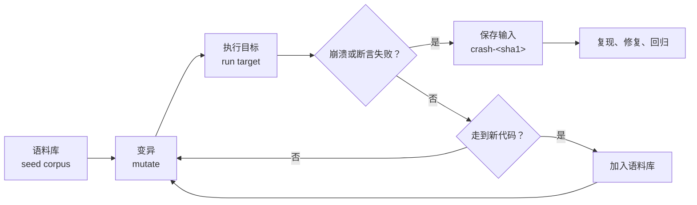

# 14. 覆盖率与模糊测试

回顾前面的开发历程，在[第 11 章](/教程/正文/开发与工程基础/11_自动化测试)中，我们为 wordfreq 项目搭建了完备的自动化测试套件并保持全绿通过；随后在[第 13 章](/教程/正文/开发与工程基础/13_编译器诊断与程序检查)中，我们进一步将测试套件接入 AddressSanitizer 等运行时插桩工具，测试反馈依然干净利落。然而，假若我们在 `src/token.c` 中故意植入一段存在边界逻辑疏漏的代码，再次执行 `test_token`，控制台依然会呈现 `27 checks, 0 failed`，`ctest` 同样全盘亮绿灯放行。

自动化测试与内存检查之所以对此毫无察觉，根本原因在于该缺陷潜伏在一段从未被任何测试用例踏足的代码分支深处：在分词函数 `wf_tokenizer_next` 内部，代码针对输出缓冲区容量 `cap` 为 1 的边界情况单独开辟了一条“优化捷径”，但在将字符拷贝写入目标缓冲区时却完全遗漏了长度截断检查。当借助代码覆盖率分析工具 gcov 审视该文件时，这整块逻辑前均醒目标记着 `#####`，表明在现有的测试执行路径中它们从未被实际运转过。而若换用基于覆盖率引导的模糊测试引擎 libFuzzer，短短运行数秒，工具便自主推导出由二十余字节缩减至仅 2 字节的触发用例，AddressSanitizer 当场捕获了针对单字节缓冲区的非法越界写入。

这一现象揭示了工程测试中一个深刻的事实：测试套件全部通过并不等同于代码逻辑绝对无懈可击，测试所能验证的永远只是它所触达的部分。本章的核心正是围绕这一核心命题展开两条互相支撑的探索路径：首先借助 gcov 与覆盖率分析工具系统性测绘既有测试遗留的执行盲区；进而引入模糊测试（Fuzzing），利用自动化的变异输入主动探索未知的分支路径。

相关的命令行操作与终端输出日志分别采集自 Windows 11 环境下的 MinGW-w64 GCC 13.2 与 Debian 13 / GCC 14.2 实验机；模糊测试部分则基于 Visual Studio 配套的 Clang 工具链展开。文中对关键日志均标注了测试来源，若在不同编译环境下数值略有浮动，以本地实际环境为准。

## 1. 覆盖率衡量什么

代码覆盖率（Code Coverage）是衡量测试套件触达深度的一组量化指标，它用于动态统计测试在运行期间实际激活了目标源码中的哪些执行轨迹。在日常工程中最常参考的通常有如下三类维度：

- **行覆盖率（Line Coverage）**：源文件中声明的可执行语句行，是否在测试期间至少被指令计数器执行过一次。
- **分支覆盖率（Branch Coverage）**：源码中每一个条件判定与控制流分叉（如 `if`、`switch`、三元表达式等），是否将其所有可能的真假出口或跳转分支都经历过一次。
- **函数覆盖率（Function Coverage）**：项目中定义的每个函数，是否在整个测试生命周期中被外部或内部至少调用过一次。

在这三类指标中，最容易让初学者产生盲目安全感的是行覆盖率。在 C 语言中，一行看似简洁的代码内部往往包含着多个子表达式或复合布尔运算；即便整行代码在物理上确实被执行到了，也绝不意味着该行内部的所有分支组合与边界状态都被完整检验过。

```c
/* 两个参数里有一个是正数就返回 1 */
int has_positive(int a, int b) {
    if (a > 0 || b > 0) {
        return 1;
    }
    return 0;
}
```

如果仅编写一个测试调用 `has_positive(2, -3)`，`if` 所在的代码行确实被成功执行并触发了返回 1，但由于 C 语言逻辑或操作符 `||` 固有的短路求值特性，左侧操作数 `a > 0` 判定为真后，右侧操作数 `b > 0` 在底层根本没有参与运算。通过 gcov 观察其实际覆盖情况：

::: terminal title="zsh - gcov has_positive.c"

```text
$ gcc -std=c17 -Wall -Wextra --coverage -O0 has_positive.c -o has_positive
$ ./has_positive
1
$ gcov -b -c has_positive.c
File 'has_positive.c'
Lines executed:85.71% of 7
Branches executed:50.00% of 4
Taken at least once:25.00% of 4
Calls executed:100.00% of 2
Creating 'has_positive.c.gcov'
```

:::

展开 gcov 生成的逐行标注文件，可以清晰看到 `if` 语句对应的底层 4 条分支中，实际仅有两条被触及：

::: terminal title="zsh - has_positive.c.gcov（节选）"

```text
function has_positive called 1 returned 100% blocks executed 60%
        1:    4:int has_positive(int a, int b) {
       1*:    5:    if (a > 0 || b > 0) {
branch  0 taken 0 (fallthrough)
branch  1 taken 1
branch  2 never executed (fallthrough)
branch  3 never executed
        1:    6:        return 1;
        -:    7:    }
    #####:    8:        return 0;
        -:    9:}
```

:::

在上述分析报告中，`branch 0` 与 `branch 1` 分别对应外层条件 `a > 0` 判定为真与为假时的控制流分支，而 `branch 2` 与 `branch 3` 则对应右侧子表达式 `b > 0` 的流向。由于该逻辑函数在语义上存在两条出口路径（返回 1 与返回 0），而单次调用仅覆盖了返回 1 的分支，因此呈现出行覆盖率为 85.71%、分支覆盖率为 50% 的断层。接下来，我们在测试中补充一个返回 0 的测试用例 `has_positive(-1, 0)`：

```c
int main(void) {
    printf("%d %d\n", has_positive(2, -3), has_positive(-1, 0));
    return 0;
}
```

::: terminal title="zsh - gcov（补测后）"

```text
1 0
File 'has_positive.c'
Lines executed:100.00% of 7
Branches executed:100.00% of 4
Taken at least once:75.00% of 4
Calls executed:100.00% of 3
Creating 'has_positive.c.gcov'
```

:::

此时行覆盖率与分支覆盖率均已达到 100%，但末尾的 `Taken at least once`（分支至少执行一次比例）依然停留在 75%。这依然是由短路求值引起的：`branch 2` 代表 `b > 0` 得到求值的路径，在首次调用 `has_positive(2, -3)` 时被跳过，仅在第二次调用 `has_positive(-1, 0)` 中由于左侧为假才经历了一次计算。如果进一步补充第三个用例 `has_positive(-5, 4)`，即让左侧为假的同时右侧为真，`Taken at least once` 才会真正达到完整的 100%：

::: terminal title="zsh - gcov（三次调用）"

```text
1 0 1
File 'has_positive.c'
Lines executed:100.00% of 7
Branches executed:100.00% of 4
Taken at least once:100.00% of 4
Calls executed:100.00% of 4
Creating 'has_positive.c.gcov'
```

:::

只有当上述各项覆盖指标均齐聚 100% 时，才表明该判定表达式内的所有布尔子组合均在运行期得到过实际求值。这正是单纯依赖行覆盖率所无法察觉的盲区。

::: concept cov-meaning title="覆盖率只说明哪里没测"

覆盖率只回答一个问题：哪些代码没有被测试执行过。它不说明已经执行过的代码是否正确，也不说明测试的断言够不够。100% 覆盖的测试套件可以一行断言都没有。

:::

由此可见，代码覆盖率在工程实践中是一种“减法工具”：它的核心价值不在于证明已覆盖代码绝对可靠，而在于精准圈出那些从未被测试用例触碰过的空白防区。面对覆盖率数字，更有意义的做法是顺着报告定位那些未经检验的逻辑分支，评估其潜在风险，并有针对性地构思边界用例进行查漏补缺。

<Quiz
  :options="[
    { label: '行覆盖 100%，所以每个判断的每种结果都测过了', value: 'A' },
    { label: '行覆盖 100%，但短路求值可能让某个子表达式从未求值', value: 'B' },
    { label: '行覆盖 100%，所以代码没有缺陷', value: 'C' },
    { label: '分支覆盖不可能达到 100%，所以不用管', value: 'D' }
  ]"
  answer="B"
>

<template #question>

一个函数的行覆盖率显示 100%。下面哪个说法成立？

</template>

正确答案是 **B**。`a || b`、`a && b` 这类表达式里，右侧子表达式可能因为短路求值而从未执行，行却已经「执行过」了。A、C 都把覆盖率当成了正确性证明；D 与事实相反，`has_positive` 补两个用例之后分支覆盖就到了 100%。

</Quiz>

## 2. 用 gcov 测覆盖率

gcov 是 GCC 自带的权威覆盖率统计工具。在工作机制上，它依赖两类关键数据资产的协同：一类是在编译阶段经由编译器插桩生成的结构元数据（记录每个函数内部包含哪些控制流基本块与分支），另一类则是目标程序在实际运转结束后落地输出的动态执行计数。GCC 提供的 `--coverage` 复合选项能够一体化地完成这两项配置：

```sh
gcc -std=c17 -Wall -Wextra --coverage -O0 -Iinclude -c src/token.c -o token.o
```

在底层机制上，`--coverage` 实际上是 `-fprofile-arcs -ftest-coverage` 的简写封装：

- `-ftest-coverage` 负责在编译产物同级目录下生成同名的 `.gcno`（gcov note）拓扑文件，严密记录源文件的行号映射、基本块划分与函数控制流图；
- `-fprofile-arcs` 则在每个基本块与跳转边中插入轻量级计数器代码。当可执行程序执行结束（例如在 `exit` 或 `main` 返回退出时），这些累积的计数数据会自动序列化写入对应的 `.gcda`（gcov data）数据文件中。
- 随后，独立调用 `gcov` 工具读取这对 `.gcno` 与 `.gcda` 数据，并与原始 C 源码交叉比对，即可生成附带详细执行热度标注的 `.gcov` 文本报告。

在采集覆盖率时，强烈建议始终搭配 `-O0`（关闭优化）使用。若在 `-O2` 或更高优化级别下开启覆盖率插桩，编译器的指令重排、函数内联（Inlining）、基本块合并乃至死代码消除等优化动作，会导致底层执行计数器与原始源文件中的代码行号产生严重偏离，生成的覆盖率报告容易产生阅读误导。

在 wordfreq 项目的工程化落地中，我们无需在命令行中手工拼装长串参数，而是借助 CMake 统一抽象出布尔构建选项 `WF_COVERAGE`：

```cmake
option(WF_COVERAGE "Build with gcov instrumentation" OFF)

if(WF_COVERAGE)
    set(wf_coverage_targets wf wordfreq test_token test_counter)
    if(WF_FUZZ)
        list(APPEND wf_coverage_targets replay_token)
    endif()
    foreach(target ${wf_coverage_targets})
        target_compile_options(${target} PRIVATE --coverage -O0)
        target_link_options(${target} PRIVATE --coverage)
    endforeach()
endif()
```

（`option()` 与 `if()` 之间省略了另一项用于构建模糊测试支持的 `WF_FUZZ` 开关，我们将在后文第 7 节中展开。）

在 CMake 配置中，有一个关键细节需要遵循：`target_compile_options` 与 `target_link_options` 均须同步追加 `--coverage` 选项。这是因为插桩代码在运行时需要调用 `__gcov_init`、`__gcov_exit` 等特定的运行时支撑函数，链接阶段必须依赖 `--coverage` 指示驱动程序自动引入 GCC 的 `libgcov` 支持库，否则链接器会因找不到符号而直接报错退出。

随后配置独立的构建目录、编译、执行测试套件，并触发 gcov 生成报告：

::: terminal title="zsh - wordfreq 的覆盖率"

```text
$ cmake -S . -B build-cov -DWF_COVERAGE=ON
$ cmake --build build-cov
$ ctest --test-dir build-cov
1/3 Test #1: token ............................   Passed    0.00 sec
2/3 Test #2: counter ..........................   Passed    0.00 sec
3/3 Test #3: e2e ..............................   Passed    0.01 sec

100% tests passed, 0 tests failed out of 3

$ cd build-cov && gcov -b -c -o CMakeFiles/wf.dir/src CMakeFiles/wf.dir/src/token.c.gcno
File '/home/minsecrus/tutorial/work/ch14/clean/wordfreq/src/token.c'
Lines executed:95.83% of 24
Branches executed:100.00% of 24
Taken at least once:87.50% of 24
Calls executed:100.00% of 3
Creating 'token.c.gcov'
```

:::

观察 gcov 的调用细节：参数 `-o CMakeFiles/wf.dir/src` 指示工具深入 CMake 组织中间产物的对应对象目录去定位匹配的 `.gcno` 与 `.gcda` 文件；`-b` 选项开启精细的分支流向分析；而 `-c` 选项则将分支比例展示切换为具体的调用执行计数（若不传 `-c`，分支将仅以百分比显示，加上 `-c` 即可展示类似 `taken 1 (fallthrough)` 的绝对次数）。

若需进行更深入的逐行分析，可直接阅读生成的 `.gcov` 标注文件：

::: terminal title="zsh - token.c.gcov（节选）"

```text
function wf_tokenizer_next called 29 returned 100% blocks executed 94%
       29:   20:size_t wf_tokenizer_next(wf_tokenizer *tz, char *word, size_t cap) {
       29:   21:    if (cap == 0) {
branch  0 taken 0 (fallthrough)
branch  1 taken 29
    #####:   22:        return 0;
        -:   23:    }
        -:   24:
       29:   25:    const char *p = tz->cur;
       67:   26:    while (p < tz->end && !is_ascii_letter(*p)) {
branch  0 taken 61 (fallthrough)
branch  1 taken 6
call    2 returned 61
branch  3 taken 38
branch  4 taken 23 (fallthrough)
       38:   27:        p++;
        -:   28:    }
```

:::

解读该文件的标注规范：

- 行首的数字（如 `29`）代表对应源码行在整个测试生命周期中被累计执行了 29 次；
- 标记为 `#####` 的代码行代表该处从未被任何用例执行过；
- 标记为 `-` 的行表示不包含可执行机器指令的非代码行（如纯注释、空行、大括号等）；
- `branch 0 taken 61 (fallthrough)` 表明该分支条件满足并顺序流向后续逻辑共发生了 61 次，而 `taken 0` 则代表该分支流向在测试中从未发生；
- `call 2 returned 61` 记录了函数调用成功返回的次数，若出现 `call 1 never executed` 则说明该调用点未曾被触发。

在上述日志截选中，`src/token.c` 全文共计 24 行可执行代码，实际激活了 23 行（达到 95.83%）。唯一未被覆盖的代码行正是第 22 行的 `return 0;`。仔细审视源码即可发现，这是针对 `cap == 0` 的边界保护退出分支；当前现存的单元测试用例在调用 `wf_tokenizer_next` 时，传入的容量参数均大于 0。

明确了这一测试盲区后，我们只需在 `tests/test_token.c` 中针对性补充一个测试用例：

```c
static void test_cap_zero(void) {
    const char *text = "abc";
    wf_tokenizer tz;
    wf_tokenizer_init(&tz, text, strlen(text));
    char word[1];

    CHECK_EQ_SIZE(wf_tokenizer_next(&tz, word, 0), 0);
}
```

::: terminal title="zsh - gcov（补上 cap 为 0 的用例后）"

```text
test_token: 28 checks, 0 failed
File 'src/token.c'
Lines executed:100.00% of 24
Branches executed:100.00% of 24
Taken at least once:91.67% of 24
Calls executed:100.00% of 3
```

:::

补充该测试后再次生成覆盖率，行覆盖率顺利攀升至 100%，而分支覆盖率中的 `Taken at least once` 指标也随之提升至 91.67%。剩余两个未走满的分支属于分词器状态机的内部特定边界，这再次印证了核心规律：行覆盖率哪怕达到 100%，也并不意味着测试已经完全穷尽了所有可能的分支组合。

除了 gcov 生成的纯文本 `.gcov` 标注，现代工程常借助前端工具将其渲染为更具表现力的可视化报表。例如开源工具 `gcovr` 与 `lcov` 能够自动递归汇总多文件数据，生成带有目录树导航、文件占比排名以及高亮着色的 HTML 网页；而在 Clang/LLVM 生态中，则有其独立的一套体系：通过 `-fprofile-instr-generate -fcoverage-mapping` 编译插桩，配合 `llvm-profdata` 与 `llvm-cov` 命令，按源代码物理区域（Regions）进行更为精准的粒度统计：

::: terminal title="zsh - llvm-cov report"

```text
$ clang -fprofile-instr-generate -fcoverage-mapping ...   # 编译与链接
$ LLVM_PROFILE_FILE=tt.profraw ./tt
$ llvm-profdata merge -sparse tt.profraw -o tt.profdata
$ llvm-cov report ./tt -instr-profile=tt.profdata src/token.c
Filename                    Regions  Missed Regions  Cover  Functions  ...  Lines  Missed Lines  Cover  ...
src/token.c                      28                1  96.43%          4  ...     32             2  93.75%  ...
```

:::

不同工具由于统计口径（基于基本块、AST 区域或行号插桩）的微小差异，百分比数值可能略有起伏。在持续集成实践中，建议团队选定一种与构建系统融合度最高的工具链并长期锚定，避免在不同工具的指标波动中消耗精力。

## 3. 用覆盖率找没测到的行为

在覆盖率分析报告中，最具工程诊断价值的并非那些数字漂亮的百分比，而是那些明确被打上 `#####` 标记的代码行。每一处 `#####` 都在无声地提示：这段逻辑自编写完成以来，在当前的测试集中从未被真正激活执行过，其背后所承诺的软件行为实际上处于未经验证的真空状态。

我们通过在 `src/token.c` 中故意保留一段缺陷代码来体会这一过程。在这个特意制作的缺陷版本中，开发者为处理极小缓冲区（`cap` 为 1）单独增设了一条特判捷径：

```c
/* 缺陷：cap 为 1 时不做截断检查，单词有几个字母就写几个字节 */
if (cap == 1) {
    size_t n = 0;
    while (p < tz->end && is_ascii_letter(*p)) {
        word[n++] = to_ascii_lower(*p);
        p++;
    }
    word[n] = '\0';
    tz->cur = p;
    return n;
}
```

此时运行原有的全部自动化测试，测试套件依然显示 100% 全绿通过。原因在于 `test_token.c` 中原本编写的五个测试场景，使用的输出缓冲区容量均相对充裕（例如传入 64 或更长），从未触发过 `cap` 为 1 的边界条件。然而，一旦拉出 gcov 覆盖率报告，盲区立刻暴露无遗：

::: terminal title="zsh - 缺陷版本的覆盖率"

```text
$ cp bugs/token_cap1_overflow.c src/token.c
$ cmake --build build-cov && ctest --test-dir build-cov
1/3 Test #1: token ............................   Passed    0.00 sec
2/3 Test #2: counter ..........................   Passed    0.00 sec
3/3 Test #3: e2e ..............................   Passed    0.01 sec

100% tests passed, 0 tests failed out of 3

$ cd build-cov && gcov -b -c -o CMakeFiles/wf.dir/src CMakeFiles/wf.dir/src/token.c.gcno
File '/home/minsecrus/tutorial/work/ch14/one/wordfreq/src/token.c'
Lines executed:75.00% of 32
Branches executed:86.67% of 30
Taken at least once:73.33% of 30
Calls executed:60.00% of 5
Creating 'token.c.gcov'
```

:::

由于注入的代码增加了行数，总可执行行基数变为了 32 行，行覆盖率骤降至 75.00%。打开生成的标注文件，`if (cap == 1)` 内部所包含的整个处理块整齐地挂着 `#####`。原本隐藏在代码库深处的逻辑隐患，正潜伏在这一片从未被测试涉足的盲区之中。

借助覆盖率捕获空白区域后，后续的修复与补测动作应当严格遵从**“回归规格本身”**的工程原则。查阅分词器模块的接口规格定义：当 `cap >= 1` 时，输出缓冲区至多容纳 `cap - 1` 个字母并保留 1 字节写入终止空字符 `'\0'`；函数返回实际提取的单词长度。依据这一规范，若调用方传入的容量 `cap` 仅为 1，则缓冲区内根本无法容纳任何有效字母，此时函数应当返回长度 0，并在 `word[0]` 处安全写入空字符。

依据严格的接口规格，我们在测试中补充一个针对极端边界的测试用例：

```c
static void test_cap_one(void) {
    const char *text = "abc";
    wf_tokenizer tz;
    wf_tokenizer_init(&tz, text, strlen(text));
    char word[1];

    CHECK_EQ_SIZE(wf_tokenizer_next(&tz, word, 1), 0);
    CHECK_STR_EQ(word, "");
}
```

将该用例加入测试集后重新编译运行，缺陷版本立即现出原形：

::: terminal title="zsh - 缺陷版本上跑 test_cap_one"

```text
$ ./test_token
tests/test_token.c:80: wf_tokenizer_next(&tz, word, 1) is 3, expected 0
tests/test_token.c:81: word is "at<乱码>", expected ""
test_token: 29 checks, 2 failed
```

:::

断言宏 `CHECK_EQ_SIZE` 抓到了实际返回的 3 与预期值 0 之间的严重冲突；而紧接着的 `CHECK_STR_EQ` 在打印 `word` 内容时输出了乱码——这是因为包含 3 个字母与 1 个空字符的数据强行写入了仅有 1 字节的缓冲区外部，后续读取到的已经是栈帧相邻区域被污染的数据。若在 AddressSanitizer 下运行该测试，系统会立即抛出栈缓冲区溢出拦截：

::: terminal title="zsh - 缺陷版本上跑 test_cap_one（ASan）"

```text
$ clang -g -O0 -fsanitize=address,undefined -fno-omit-frame-pointer \
      -Iinclude src/*.c tests/check.c tests/test_token.c -o test_token_asan
$ ./test_token_asan
==14900==ERROR: AddressSanitizer: stack-buffer-overflow on address 0x0096858ff721
WRITE of size 1 at 0x0096858ff721 thread T0
    #0 0x7ff731183082 in wf_tokenizer_next src/token.c:42
    #1 0x7ff731188520 in test_cap_one tests/test_token.c:80
    #2 0x7ff731186776 in main tests/test_token.c:90
```

:::

在完成底层代码重构修复后，再次执行该测试用例，29 项断言全部顺利通过。

这便是基于覆盖率驱动测试补全的闭环路径：覆盖率负责扫描出逻辑死角，接口规格负责确立该处应当呈现的标准行为，而新编织的测试用例则将这一正确行为固化进自动化回归防线。在实际软件工程中，形如 `if (cap == 1)` 这种自以为简单不易出错的特判逻辑随处可见，而覆盖率工具正是戳破这种主观盲目自信最客观的利器。

## 4. 模糊测试是什么

手工构造测试用例高度依赖开发者的经验与直觉。但在真实的系统环境中，软件面对的输入空间近乎无限广阔：可能是在第 37 字节处意外截断的文件流、可能是缓冲区容量恰好比单词长度多 1 字节的特殊组合、也可能是缺失了闭合引号的畸形文本配置。人类思维很难穷尽所有刁钻奇诡的排列组合。

模糊测试（Fuzz Testing，简称 Fuzzing）的核心思想是将这一探索过程移交给计算机程序：通过自动化生成海量伪随机与变异输入，源源不断地投喂给被测目标，实时监控目标进程是否发生崩溃、内存违规或触发异常断言。



现代高效的模糊测试引擎通常围绕三大核心支柱协同运作：

1. **输入生成与智能变异（Mutator）**：模糊器通常以少量合法的真实输入作为“种子语料”（Seed Corpus），在此基础上执行位翻转（Bit Flip）、随机字节插入或删除、块拼接以及关键边界数值替换等微调操作。libFuzzer 与 AFL++ 在底层的变异策略与启发式算法上各有特色，但核心逻辑高度一致。
2. **覆盖率反馈引导（Coverage-Guided）**：这是现代模糊测试与早期低效“盲目随机灌数据”的本质分野。借助编译期插入的轻量探针，模糊引擎能够在每次测试执行完毕后，精确感知该输入是否触达了此前从未执行过的新分支或新基本块。一旦发现新的代码路径，该输入便会被作为具备探索价值的新种子纳入语料库，后续的变异策略将以此为基点向未知深处拓展。这种由代码覆盖率驱动的正反馈机制，确保了算力被集中用于开拓未涉足的逻辑盲区，而不是在早已饱和的路径上无意义地空转。例如在 libFuzzer 启动日志 `#2 INITED cov: 16 ft: 16` 中，`cov` 代表当前已被激活的控制流边计数，而 `ft` 则是分支执行特征（Feature）与边的综合统计，模糊引擎正是依托这些动态指标决定是否保留当前测试用例。
3. **判定依据与故障捕获（Oracle）**：模糊测试引擎本身并不了解业务逻辑的对错，它所依托的仲裁基准极为纯粹：目标进程是否因信号异常终止（如段错误），或者是否触发了插桩注入的运行时防护告警。正因如此，现代模糊测试几乎总是与 AddressSanitizer、UndefinedBehaviorSanitizer 深度绑定使用；此外，开发者在测试目标中编写的防御性校验断言（如条件违背时主动调用 `abort()`）同样构成坚固的判定防线。断言覆盖的深度，直接决定了模糊器所能挖掘出的问题上限。

模糊测试天然适用于任何以原始字节流（Byte Stream）作为输入的底层功能模块，诸如词法分词器、报文反序列化器、音视频解码器、网络通信协议栈以及结构化文件解析器等。wordfreq 项目中的 `wf_tokenizer_next` 函数正是极具代表性的目标——为其传入一段无序的字节序列与一个缓冲区大小参数，该接口所展现的行为完全应当由这两个输入参数严格决定且绝对不应产生内存破坏。

::: concept fuzz-verdict title="模糊器只认崩溃"

模糊测试没有「通过」这个概念。跑了很久没崩，只说明这段时间没找到，不说明代码没有缺陷。模糊器找到的每个崩溃都是真实的缺陷；找不到不代表没有。

:::

<Quiz
  :options="[
    { label: '把随机字节直接传给被测函数，看它会不会崩', value: 'A' },
    { label: '只生成符合格式的输入，避免无效数据', value: 'B' },
    { label: '保留了走到新代码的输入继续变异，逐步扩大覆盖', value: 'C' },
    { label: '把程序的输出和期望输出逐字节比较', value: 'D' }
  ]"
  answer="C"
>

<template #question>

模糊测试里「覆盖率引导」指的是什么？

</template>

正确答案是 **C**。A 只描述了最早的随机测试，没有引导；B 恰恰相反，模糊测试的价值就在于生成人想不到的畸形输入；D 是期望输出文件的比较，属于端到端测试。

</Quiz>

## 5. 写一个模糊测试目标

在 libFuzzer 规范中，模糊测试的业务适配层被称为“模糊测试目标”（Fuzz Target）。它本质上是一个拥有标准 C 签名的入口适配函数：

```c
int LLVMFuzzerTestOneInput(const uint8_t *data, size_t size);
```

引擎生成任意长度的一串随机字节缓冲区（`const uint8_t *data`）及其尺寸（`size_t size`），开发者则负责在这段函数体内，将无结构的裸字节安全映射转换为被测业务模块所需的结构化参数，并驱动核心逻辑运行。wordfreq 项目中针对分词器的模糊测试目标保存在 `fuzz/fuzz_token.c`：

```c
int LLVMFuzzerTestOneInput(const uint8_t *data, size_t size) {
    if (size < 2) {
        return 0;
    }

    size_t cap = (size_t)(data[0] % WF_WORD_MAX) + 1;
    const char *text = (const char *)data + 1;
    size_t len = size - 1;

    char *word = malloc(cap);
    if (word == NULL) {
        return 0;
    }

    wf_tokenizer tz;
    wf_tokenizer_init(&tz, text, len);
    size_t n = wf_tokenizer_next(&tz, word, cap);
    if (n >= cap) {
        abort();
    }
    for (size_t i = 0; i < n; i++) {
        if (word[i] < 'a' || word[i] > 'z') {
            abort();
        }
    }
    if (word[n] != '\0') {
        abort();
    }

    free(word);
    return 0;
}
```

在编写高质量模糊测试目标时，有几处关键的工程设计考量：

1. **参数解构与空间投影**：模糊引擎天然仅提供一维的连续字节流，而 `wf_tokenizer_next` 接口需要同时接收源文本字符串与输出缓冲区上限 `cap` 两个入参。在此处，我们提取输入切片的首个字节 `data[0]`，通过 `(data[0] % WF_WORD_MAX) + 1` 将其紧凑映射到区间 `[1, WF_WORD_MAX]` 作为缓冲区容量；剩余的字节切片则直接视作待分词的原始文本。这种利用输入前缀解耦多参数的方法，使得单一目标函数即可同步探索不同的容量约束与文本内容的组合。
2. **依托堆分配精确贴合边界**：代码中通过 `malloc(cap)` 动态申请物理内存，而不是在栈上简单声明一块固定超大的静态数组（如 `char word[WF_WORD_MAX]`）。这一设计的核心意图是为了让 AddressSanitizer 能够敏锐捕获任何微小的单字节越界：堆分配器会紧随这 `cap` 字节之后精确铺设红区（Redzone），只要指针多写 1 字节就会立刻暴毙；而若在栈上预分配过大的固定缓冲区，即便底层逻辑产生了越界污染，多写的字符往往也只是落入合法数组内部的剩余填充垫片中，导致破坏行为被静默吞没。这是构造模糊测试目标的一条重要铁律。
3. **基于不变式（Invariants）建立验证断言**：真正的模糊测试不止于等待内存段错误。我们在调用后施加了三重严格断言：返回的长度 `n` 必须严格小于容量上限 `cap`；写出的每个字符必须严格在小写字母 `'a'`～`'z'` 之间；末尾 `word[n]` 必须精准对齐终止空字符 `'\0'`。这些约束均直接映射自模块头文件所承诺的法定行为规范。校验逻辑与业务规格锚定得越紧密，模糊引擎识别逻辑偏差的精度就越高。
4. **零污染与无状态保证**：libFuzzer 采用极高吞吐的进程内常驻循环（In-Process Loop），每秒可能在同一进程内连续触发上万次函数调用。因此，目标函数内严禁调用 `exit()` 等硬性退出接口，同时每次调用涉及的对象均需严格自治、彻底释放，绝不能依赖跨调用的全局状态或静态对象，否则前次调用的残留副作用会彻底破坏后续测试的独立性。

::: warning 结果必须被使用，否则目标会被整体删掉

`wf_tokenizer_next(&tz, word, cap);` 这一行如果结果没人用、缓冲区也没人读，编译器在 `-O1` 以上会认定这次调用没有可观察的副作用，把它连同整个循环一起删掉。模糊器看到的目标里只剩一个空的 `LLVMFuzzerTestOneInput`，输出里 `cov` 停在 1，什么也找不到，而且不报错。

:::

这件事值得亲眼看一下。下面是一个「结果没人用」的目标和它的修正版：

::: compare left-title="结果被忽略，目标被删空" right-title="结果进入判断，目标完整"

```c
#include <stdint.h>
#include <stddef.h>

/* 数一数一个字节里有几个 1 */
static int count_bits(uint8_t b) {
    int n = 0;
    for (int i = 0; i < 8; i++) {
        if ((b >> i) & 1) {
            n++;
        }
    }
    return n;
}

int LLVMFuzzerTestOneInput(const uint8_t *data, size_t size) {
    if (size < 1) {
        return 0;
    }
    count_bits(data[0]);
    return 0;
}
```

---

```c
#include <stdint.h>
#include <stddef.h>
#include <stdlib.h>

static int count_bits(uint8_t b) {
    int n = 0;
    for (int i = 0; i < 8; i++) {
        if ((b >> i) & 1) {
            n++;
        }
    }
    return n;
}

int LLVMFuzzerTestOneInput(const uint8_t *data, size_t size) {
    if (size < 1) {
        return 0;
    }
    if (count_bits(data[0]) > 8) {
        abort();
    }
    return 0;
}
```

:::

用同一台机器、同样的 `clang -g -O1 -fsanitize=fuzzer,address`，各跑 1000 次：

::: terminal title="zsh - 两个目标的初始化行"

```text
$ ./unused -runs=1000 -max_len=4
INFO: Loaded 1 modules   (1 inline 8-bit counters): 1 [00007FF7FE4FE5C8, 00007FF7FE4FE5C9),
#2	INITED cov: 1 ft: 1 corp: 1/1b exec/s: 0 rss: 35Mb
#1000	DONE   cov: 1 ft: 1 corp: 1/1b lim: 4 exec/s: 0 rss: 36Mb
$ ./used -runs=1000 -max_len=4
INFO: Loaded 1 modules   (7 inline 8-bit counters): 7 [00007FF7F598E5C8, 00007FF7F598E5CF),
#2	INITED cov: 5 ft: 5 corp: 1/1b exec/s: 0 rss: 35Mb
#1000	DONE   cov: 5 ft: 13 corp: 9/9b lim: 4 exec/s: 0 rss: 36Mb
```

:::

左边那个目标只有 **1** 个计数器，`cov: 1` 从头到尾没变——`count_bits` 被整个内联后又被删除，模糊器在测试一个空函数。右边有 7 个计数器，`ft` 从 5 涨到 13，语料库增长到 9 个文件，说明它真的在执行和探索。看到 `cov: 1` 或者 `cov` 长时间不动，第一件事就是检查目标里有没有「算完就扔」的调用。

`fuzz_token.c` 里的三条检查都用到了结果：`n` 进比较，`word[i]` 参与判断，`word[n]` 与 `'\0'` 比较。所以它不会被删。

## 6. 运行 libFuzzer

与独立的进程级工具不同，libFuzzer 原生嵌入在 LLVM/Clang 工具链中。在 Windows 操作系统中，若使用 Visual Studio 随附的 Clang 编译套件，需确保将 `clang` 命令行程序所在路径以及存放 ASan 动态运行时库的 `lib\clang\<版本>\lib\windows` 目录一并追加至环境查找路径中：

```sh
export PATH="/d/Software/VS/1/VC/Tools/Llvm/x64/bin:/d/Software/VS/1/VC/Tools/Llvm/x64/lib/clang/22/lib/windows:$PATH"
```

若使用 GCC 工具链，则通常接入功能等价的 AFL++ 框架（我们将在第 8 节中补充其使用方法）。

构建支持 libFuzzer 的目标可执行文件仅需一条紧凑的编译命令：

```sh
clang -g -O1 -fsanitize=fuzzer,address -Iinclude fuzz/fuzz_token.c src/token.c -o fuzz_token
```

在编译参数中，`-fsanitize=fuzzer` 负责引入 libFuzzer 的内建驱动引擎并自动接管 `main` 入口函数；而 `-fsanitize=address` 则同步挂载 AddressSanitizer。这两者必须结伴同行：若缺少 ASan，堆内存越界写入往往只是静默踩踏内存而不会引起进程即时崩溃，从而导致模糊引擎丧失感知错误的核心裁判依据。`-g` 确保异常报告能够准确映射至源文件的真实行号。在优化级别上，`-O1` 能够在保障吞吐性能的同时完成必要的基础内联，但在深度排查故障瞬间时，若发现因寄存器复用导致报错行号轻微漂移至函数外层花括号，可临时回退至 `-O0` 进行最为严谨的单行定格。

为了加速模糊测试向深层逻辑推进，我们准备一份小巧的种子语料：将工程现存的 `tests/data/sample.txt` 拷贝至工作目录下的 `corpus/` 中。相比从纯粹的零字节无序盲测起步，合法的基准文本能够让模糊器立即跨越浅层的语法合法性检查，直奔复杂的分词分支：

::: terminal title="zsh - fuzz_token（缺陷版本，本机 clang 22）"

```text
$ ./fuzz_token -max_total_time=60 corpus/
INFO: Running with entropic power schedule (0xFF, 100).
INFO: Seed: 4244617576
INFO: Loaded 1 modules   (34 inline 8-bit counters): 34 [00007FF7A8F4F5C8, 00007FF7A8F4F5EA),
INFO: seed corpus: files: 1 min: 48b max: 48b total: 48b rss: 35Mb
#2	INITED cov: 16 ft: 16 corp: 1/48b exec/s: 0 rss: 36Mb
#4	NEW    cov: 17 ft: 28 corp: 2/96b lim: 48 exec/s: 0 rss: 37Mb L: 48/48 MS: 2 ChangeBit-ChangeBinInt-
#9	REDUCE cov: 17 ft: 28 corp: 2/84b lim: 48 exec/s: 0 rss: 37Mb L: 36/48 MS: 5 ChangeByte-ChangeBit-ChangeBinInt-ChangeBit-EraseBytes-
#38	REDUCE cov: 20 ft: 44 corp: 5/212b lim: 48 exec/s: 0 rss: 37Mb L: 41/48 MS: 1 InsertRepeatedBytes-
#291	NEW    cov: 22 ft: 70 corp: 18/469b lim: 48 exec/s: 0 rss: 37Mb L: 44/48 MS: 2 ChangeByte-InsertRepeatedBytes-
=================================================================
==7448==ERROR: AddressSanitizer: heap-buffer-overflow on address 0x1193d35a6371
WRITE of size 1 at 0x1193d35a6371 thread T0
    #0 0x7ff7a8e138cf in wf_tokenizer_next src/token.c:42
    #1 0x7ff7a8e1307a in LLVMFuzzerTestOneInput fuzz/fuzz_token.c:37
    #2 0x7ff7a8deb7fe in fuzzer::Fuzzer::ExecuteCallback ...
SUMMARY: AddressSanitizer: heap-buffer-overflow src/token.c:42 in wf_tokenizer_next

0x1193d35a6371 is located 0 bytes after 1-byte region [0x1193d35a6370,0x1193d35a6371)
allocated by thread T0 here:
    #1 0x7ff7a8e12913 in malloc
    #2 0x7ff7a8e12ff7 in LLVMFuzzerTestOneInput fuzz/fuzz_token.c:30

artifact_prefix='./'; Test unit written to ./crash-7b9cd30885fd8c2efd02604d491ad36d0072e40d
Base64: AAAAAAAAAJea35Ke35KeIGRvaCca
```

:::

令人惊叹的是，整个执行过程仅经历了不到 300 次微小变异迭代，耗时不足 1 秒，ASan 便精准地触发了堆缓冲区溢出崩溃拦截！审阅控制台日志，各项运行时指标条理清晰：

- `INITED cov: 16 ft: 16 corp: 1/48b`：表示种子语料初始化加载完毕，激活了 16 条控制流边与 16 个状态特征，初始语料库包含 1 个 48 字节的文件；
- `NEW` 标记表明某次变异输入成功踩到了前所未见的代码路径，因而被正式固化加入语料库；`REDUCE` 则表明引擎推导出了在更短字节长度下达到完全相同路径覆盖的高效替代输入；
- `L: 44/48` 与 `lim: 48` 反映了当前测试输入的实际字节数与当前轮次允许的最大探索长度上限；
- `MS:`（Mutation Strategy）按时间轴列举了触发当前探索所应用的变异算子序列（如单比特微调 `ChangeBit`、字节擦除 `EraseBytes` 等）。

一旦捕获到崩溃，libFuzzer 会自动在本地工作目录生成一个名为 `crash-<sha1>` 的二进制文件，其中的哈希值唯一标识了本次致命输入的特征。任何时候想要在调试器中复现现场，只需将该文件作为参数直接传递给被测程序即可重放崩溃：

::: terminal title="zsh - 复现与最小化"

```text
$ ./fuzz_token crash-7b9cd30885fd8c2efd02604d491ad36d0072e40d
INFO: Seed: 667446501
INFO: Running 1 inputs 1 time(s) each.
Running: crash-7b9cd30885fd8c2efd02604d491ad36d0072e40d
==13460==ERROR: AddressSanitizer: heap-buffer-overflow on address 0x1151279a03b1
WRITE of size 1 at 0x1151279a03b1 thread T0
    #0 0x7ff69f2638cf in wf_tokenizer_next src/token.c:42
SUMMARY: AddressSanitizer: heap-buffer-overflow src/token.c:42 in wf_tokenizer_next
$ ./fuzz_token -minimize_crash=1 -runs=10000 crash-7b9cd30885fd8c2efd02604d491ad36d0072e40d
...
CRASH_MIN: failed to minimize beyond ./minimized-from-cd42054274fad3ddb993aef0774d8e6c85135353 (2 bytes), exiting
$ xxd minimized-from-cd42054274fad3ddb993aef0774d8e6c85135353
00000000: 0064                                     .d
```

:::

原始触发崩溃的输入文件长达 21 字节，包含许多从初始语料中继承而来的冗余字符。借助 libFuzzer 自带的崩溃最小化能力（追加 `-minimize_crash=1`），引擎会自动对该输入展开二分修剪与字节试探，最终将其提炼为仅有 2 个字节的终极最小复现用例（Minimal Reproducer）：`00 64`。

用十六进制工具检视这极简的两个字节，问题的本质一目了然：首字节 `0x00` 经由取模映射推导为 `cap = 1`；而次字节 `0x64`（ASCII 字符 `'d'`）则构成待提取的字母。由于输出缓冲区仅有 1 字节物理空间，但在提取并追加空字符时，代码强行尝试写入 `word[1]`，从而引发了毫无争议的 1 字节堆缓冲区溢出。

::: tip 最小化时让可执行文件带上 `.exe`

Windows 上 `-minimize_crash=1` 会按启动时的名字重新调用自己。可执行文件叫 `fuzz_token.exe`，而命令行只写了 `fuzz_token`，最小化会失败并报 `No such directory`。用带扩展名的名字调用，或者写完整路径。

:::

## 7. 修复与回归

在理清崩溃路径后，修复策略的抉择往往体现出架构设计的品味。这一缺陷的根源在于特设的 `cap == 1` 捷径：为了处理极端小缓冲区，代码单独开辟了一条快速路径，却因疏忽完全漏掉了截断保护。面对这类问题，更整洁的做法不是在特判分支内修修补补再写一套长度判定，而是直接**彻底剔除这条捷径**。因为原函数的主循环本就具备高度严密的截断防护机制：判定条件 `n + 1 < cap` 确保写入的字母计数绝不会超过 `cap - 1`，末尾的空终止符 `word[n] = '\0'` 刚好安放在预留的最后 1 字节位置上。让所有容量规格回归同一套核心状态机，不仅消除了冗余逻辑，也从根本上杜绝了分支分叉带来的逻辑分歧。

::: compare left-title="缺陷：捷径漏掉长度检查" right-title="修复：删掉捷径，走同一条主循环"

```c
/* cap 为 1 时缓冲区很小，单独走一条捷径 */
if (cap == 1) {
    size_t n = 0;
    while (p < tz->end && is_ascii_letter(*p)) {
        word[n++] = to_ascii_lower(*p);
        p++;
    }
    word[n] = '\0';
    tz->cur = p;
    return n;
}
```

---

```c
/* 放不下的字母读过就丢弃，不会成为下一个单词的开头 */
size_t n = 0;
while (p < tz->end && is_ascii_letter(*p)) {
    if (n + 1 < cap) {
        word[n++] = to_ascii_lower(*p);
    }
    p++;
}
word[n] = '\0';
```

:::

修复缺陷仅仅走完了排障的上半程。在严谨的工业级流程中，**绝不能在修复后将引发崩溃的测试样本草率删除**。模糊测试引擎所发掘出的每一个崩溃文件（Crash Input），都是极具价值的未知边界测试资产。必须将其固化沉淀至版本库中的回归测试集（如 `tests/regress/`），作为守卫代码库的自动化回归哨兵，确保未来任何一次重构或优化都不会让同一类缺陷死灰复燃。

在当前工程的回归套件中，我们精选并保留了两个具备典型代表意义的二进制样本：

- `token_cap1_overflow.bin`：由 3 字节构成（`00 00 62`）。首字节 `0x00` 映射产生 `cap = 1`，随后的字符 `'b'` 触发单字节写越界。这是经由引擎最小化提炼后的紧凑证据；
- `token_cap1_long_word.bin`：首字节为 `0x00`，随后紧跟 64 个连续的字母 `'a'`。同样是针对 `cap = 1` 的边界挑战，但试图写出的数据体量远超缓冲区数十倍。

为什么针对同一逻辑分支需要并存两份样本？这源于两者在触发崩溃时的敏感度差异：单字节越界在缺乏 ASan 保护的普通构建环境下，往往取决于堆分配器的物理对齐填充，有时可能表现为静默污染而侥幸不崩；而一次性大跨度越界 64 字节，则足以冲垮绝大多数操作系统的内存保护边界，在任何运行时下都会触发确定性的致命异常。回归测试集应当兼备“最小化根因样本”与“高概率确定性破坏样本”，以确保在多样化的编译环境下都能可靠报警。

重放测试的解耦设计：运行完整的模糊测试引擎虽然强依赖 Clang 与特定的 Sanitizer 支持，但**对既有样本进行单次离线重放则完全是一项轻量级的普通测试**。我们在 `fuzz/replay_main.c` 中编写了一个极简的命令行启动驱动：

```c
int main(int argc, char *argv[]) {
    if (argc < 2) {
        fprintf(stderr, "usage: %s FILE...\n", argv[0]);
        return 2;
    }
    for (int i = 1; i < argc; i++) {
        int status = replay_file(argv[i]);
        if (status != 0) {
            return status;
        }
    }
    return 0;
}
```

驱动程序按顺序读入指定的崩溃文件，原封不动地将其二进制字节缓冲区直接喂入先前编写的 `LLVMFuzzerTestOneInput` 目标函数。这一设计的精妙之处在于：模糊测试目标逻辑得到了 100% 的原样复用，开发团队无需为离线回归测试维护第二套冗余代码。

在 CMakeLists.txt 中，我们借助 `file(GLOB)` 将 `tests/regress/` 目录下的所有用例自动收集并注册为 ctest 套件的一部分：

```cmake
if(WF_FUZZ)
    add_executable(replay_token fuzz/replay_main.c fuzz/fuzz_token.c)
    target_link_libraries(replay_token PRIVATE wf)
    target_compile_options(replay_token PRIVATE ${WF_WARNINGS})
    file(GLOB WF_REGRESS_INPUTS ${CMAKE_CURRENT_SOURCE_DIR}/tests/regress/*)
    if(WF_REGRESS_INPUTS)
        add_test(NAME replay COMMAND replay_token ${WF_REGRESS_INPUTS})
        set_tests_properties(replay PROPERTIES LABELS e2e)
    endif()
endif()
```

（注意：CMake 的 `file(GLOB)` 属于配置期静态展开，若后续在版本库中新增了测试样本，需重新执行一次 `cmake -S . -B build` 更新构建图谱，或在 CMake 中配合 `CONFIGURE_DEPENDS` 属性保证变更探测。）

::: terminal title="zsh - 用 gcc 构建并重放"

```text
$ cmake -S . -B build -DWF_FUZZ=ON
$ cmake --build build
$ ctest --test-dir build -R replay --output-on-failure
1/1 Test #4: replay ...........................   Passed    0.06 sec

100% tests passed, 0 tests failed out of 1
```

:::

在修复后的分支上，无论使用 GCC 还是 Clang，测试均在几十毫秒内秒级通过；而若将存在缺陷的历史代码换回，该测试会立即被操作系统强杀并抛出异常退出状态码（在 Windows 下体现为栈保护触发的 `0xC0000409`，在 Linux 下则体现为 `SIGABRT` 异常终止信号），ctest 准确拦截并判定该回归测试失败：

::: terminal title="zsh - 缺陷版本的重放"

```text
$ ctest --test-dir build -R replay --output-on-failure
1/1 Test #4: replay ...........................Exit code 0xc0000409
***Exception:   0.22 sec

0% tests passed, 1 tests failed out of 1

The following tests FAILED:
	  4 - replay (Exit code 0xc0000409)
```

:::

这表明：即便持续集成流水线中某些编译节点未安装复杂的模糊测试框架，凭借普通的构建工具链同样可以稳定运行这套回归防护网。

完成重构与回归机制搭建后，我们重新对干净的代码库生成一次代码覆盖率：

::: terminal title="zsh - 修复后的覆盖率"

```text
$ cmake -S . -B build-cov -DWF_COVERAGE=ON
$ cmake --build build-cov && ctest --test-dir build-cov
100% tests passed, 0 tests failed out of 3

$ cd build-cov && gcov -b -c -o CMakeFiles/wf.dir/src CMakeFiles/wf.dir/src/token.c.gcno
File '/home/minsecrus/tutorial/work/ch14/clean/wordfreq/src/token.c'
Lines executed:95.83% of 24
Branches executed:100.00% of 24
Taken at least once:87.50% of 24
Calls executed:100.00% of 3
```

:::

此时观察 `token.c` 的表现：行覆盖率已从 75.00% 稳步恢复至 95.83%，若配合第 2 节补充的 `cap == 0` 用例，行覆盖率即可顺利达到 100%。值得体会的是，这一回升并不是依靠盲目堆砌海量用例，而是通过**删除冗余的分支、让主流程充分承担职责**达成的。精简低劣逻辑本就是提升代码可测性与覆盖率的有效途径。

另外需要审慎对待的是测试覆盖率统计的边界隔离：虽然可以通过配置将模糊测试的语料重放也纳入 gcov 统计，但工程实践中更推荐将“单元测试覆盖率”与“模糊测试探索”分开评估。因为模糊测试的本质是无死角搜寻破坏性崩溃，它在运行中碰巧踏足的路径并不等同于经过了严格语义校验的单元断言，盲目混合两者往往会虚高覆盖率数值，掩盖深层次的语义验证缺失。

## 8. 模糊测试放在什么时候跑

模糊测试与传统单元测试在资源消耗模型上截然不同：单元测试的运行时间固定且短暂，追求秒级反馈；而模糊测试在理论上可以无限期地持续运行，运行时间越充裕，算法探索出的极端输入组合就越深。因此在实际工程协作中，必须根据防护层级合理划分其触发节奏：

1. **本地开发即时自测（分钟级）**：当涉及协议解析、文本切分、字符转义或解包等处理原始字节的模块变更时，开发者在本地提交前主动运行 2 至 3 分钟的快速模糊测试（例如设置 `-max_total_time=120`）。这几分钟的算力投入往往能以极低的成本排查出绝大多数粗心导致的边界越界。
2. **持续集成即时流水线（秒级）**：在每次 Git 提交触发的常规 CI 门禁中，**坚决不建议执行长时间的生成式模糊测试**，否则过长的等待延迟会严重削弱开发者的提交体验。在流水线中，应当仅运行 `replay` 程序对固化的回归样本集与精简种子语料进行离线快速重放（通常耗时在数十毫秒至几秒之间），以确保代码未发生功能倒退。我们在[第 18 章](/教程/正文/开发与工程基础/18_持续集成)搭建自动化交付流水线时便会采用这一分层策略。
3. **定时夜间巡检任务（小时级）**：在团队的专用构建机器或夜间空闲时段，配置定时调度任务（如每晚或周末）展开数小时的深度模糊探索，并将期间捕获的新崩溃用例自动归档为版本产物（Artifacts），交由安全工程师或模块维护者次日分析修复并收纳进回归测试集。
4. **开源生态与持续托管（全天候）**：对于具备公共影响力的关键开源基础库，可申请接入由 Google 维护的开源持续模糊测试平台 OSS-Fuzz。该平台为合格的开源项目免费提供云端算力，实现 24 小时全天候无间断模糊测试，一旦捕获到漏洞会自动生成沙盒复现包并通知维护者。现代基础软件的众多重大 CVE 漏洞正是通过该机制防患于未然。

在工具链选型上，libFuzzer 与 AFL++ 构成了当前工业界的两大核心支柱：

- **libFuzzer**：深度集成于 LLVM/Clang，采用轻量敏捷的进程内运行模式，执行吞吐极高（单核通常可达上万次/秒），尤其擅长对核心库函数或特定接口进行精细的单元级模糊测试；
- **AFL++**：作为老牌 AFL 框架的现代演进版，生态极其强大。它支持通过 GCC 插件模式进行插桩，兼容多进程、共享内存与跨语言运行时，同时提供更丰富的自定义字典与变异调度策略，更适合对完整的 CLI 程序或大型服务展开系统级模糊测试。

值得欣慰的是，社区在接口标准上保持了高度统一。前文依据 libFuzzer 规范编写的 `LLVMFuzzerTestOneInput` 目标，无需修改任何 C 源码，借助 AFL++ 的驱动包装器同样可以直接驱动运行：

```sh
afl-gcc-fast -g -O1 -Iinclude fuzz/fuzz_token.c src/token.c -o fuzz_token_afl
mkdir -p corpus && cp tests/data/sample.txt corpus/
afl-fuzz -i corpus -o findings -- ./fuzz_token_afl @@
```

参数中的 `@@` 会被 AFL++ 自动替换为每次变异生成的具体临时文件路径。利用 `afl-gcc-fast` 包装器注入覆盖率探针，便能以一致的代码资产畅通无阻地在不同的模糊测试引擎间切换。

## 9. 习题

### 9.1 巩固

<Exercise id="21401" :d="1" :w="1">

下面的程序把分数转成等级，用 `gcc -std=c17 --coverage -O0` 编译并只运行一次：

```c
#include <stdio.h>

/* 分数对应的等级：<60 为 F，60～79 为 C，80～89 为 B，其余为 A */
char grade(int score) {
    if (score < 0) {
        return '?';
    }
    if (score < 60) {
        return 'F';
    }
    if (score < 80) {
        return 'C';
    }
    if (score < 90) {
        return 'B';
    }
    return 'A';
}

int main(void) {
    printf("%c %c\n", grade(95), grade(59));
    return 0;
}
```

`gcov -b -c grade.c` 的标注文件节选：

```text
function grade called 2 returned 100% blocks executed 70%
        2:    4:char grade(int score) {
        2:    5:    if (score < 0) {
branch  0 taken 0 (fallthrough)
branch  1 taken 2
    #####:    6:        return '?';
        -:    7:    }
        2:    8:    if (score < 60) {
branch  0 taken 1 (fallthrough)
branch  1 taken 1
        1:    9:        return 'F';
        -:   10:    }
        1:   11:    if (score < 80) {
branch  0 taken 0 (fallthrough)
branch  1 taken 1
    #####:   12:        return 'C';
        -:   13:    }
        1:   14:    if (score < 90) {
branch  0 taken 0 (fallthrough)
branch  1 taken 1
    #####:   15:        return 'B';
        -:   16:    }
        1:   17:    return 'A';
        -:   18:}
```

(1) 报告的三个百分比分别是 `Lines executed:76.92% of 13`、`Branches executed:100.00% of 8`、`Taken at least once:62.50% of 8`。写出每个百分比的分子和分母，并说明为什么「分支执行过」是 100%，而「至少走过一次」只有 62.5%。

(2) 三处 `#####` 分别对应哪一段分数区间没有测到。

(3) 写出最少的调用集合，让三个百分比都变成 100%，在自己的机器上运行确认。这条集合里有几个调用？为什么不能只补 `grade(-1)` 一个。

</Exercise>

<Exercise id="21402" :d="2" :w="2">

下面两个函数都只做一次判断，但短路求值让「分支至少走过一次」比想象中难做到：

```c
int both_positive(int a, int b) {
    if (a > 0 && b > 0) {
        return 1;
    }
    return 0;
}

int either_positive(int a, int b) {
    if (a > 0 || b > 0) {
        return 1;
    }
    return 0;
}
```

(1) 只给 `both_positive` 用 `(2, 3)` 与 `(2, -3)` 两次调用，`Taken at least once` 是多少？还差哪一条出路？

(2) 分别写出两个函数各自的最少调用集合，使分支覆盖的三个数字全部到 100%。两个函数各需要几次调用？`&&` 与 `||` 需要的次数为什么相同。

(3) 把两个函数放进同一个 `.c` 文件、同一个 `main` 里验证，贴出 `gcov -b -c` 的五行汇总。

</Exercise>

<Exercise id="21403" :d="2" :w="2">

`--coverage` 同时做两件事：编译时插计数器并生成 `.gcno`，链接时把 `libgcov` 接进来。用下面这个只有一行的程序分别做三组实验：

```c
#include <stdio.h>

int main(void) {
    printf("hi\n");
    return 0;
}
```

1. 只在编译时加 `--coverage`，链接时不加；
2. 只在链接时加 `--coverage`，编译时不加；
3. 两端都加。

记录三组实验的命令、构建结果、运行后目录里出现的文件（`.gcno`、`.gcda`、`.gcov`），并回答：

(1) 第一组链接时报了哪几个未定义的符号？它们由谁提供？

(2) 第二组能构建、能运行，但 `gcov` 什么也分析不出来。为什么缺的是编译端而不是链接端？

(3) 用一句话概括 `--coverage` 在编译端和链接端各自的作用。

</Exercise>

### 9.2 编程

<Exercise id="21404" :d="3" :w="3">

用 `code/开发与工程基础/14_覆盖率与模糊测试/wordfreq/` 的工程，打开 `WF_COVERAGE` 完成一次多文件覆盖率检查。

(1) 构建 `build-cov` 后，分别在三种条件下调用 `gcov`，记录三个源文件的行覆盖与分支覆盖：

- 只运行 `test_token`；
- 运行全部 `ctest`；
- 只运行端到端测试 `e2e`。

每次换条件之前先删掉构建目录里的 `.gcda`。它们会被后续运行累加：同一个测试跑两遍，某个函数的 `called` 计数会翻倍，覆盖率却不是两次并集。先亲手验证这一点（连跑两次同一个测试，看 `called` 数字），再开始记录。

(2) 为什么 `report.c` 在第一种条件下是 0%，而在第二、三种条件下是 100%？这说明「覆盖率」统计的是谁走过的路径？

(3) 给 `tests/test_token.c` 补上 `cap` 为 0 的用例，重新构建并运行，确认 `token.c` 的行覆盖从 95.83% 到 100%。补完后 `Taken at least once` 是多少？还剩几条出路没走过，分别落在哪个函数里？

(4) 写一条命令，一次分析 `token.c`、`counter.c`、`report.c` 三个文件。

</Exercise>

<Exercise id="21405" :d="3" :w="3">

在 `wordfreq` 上只跑 `test_counter` 时，`counter.c` 的行覆盖是 89.61%，有八行标着 `#####`。

(1) 打开标注文件，列出这八行分别属于哪些函数，判断哪些是内存不足时的返回路径、哪些是正常路径漏测。再观察 `dup_string` 里的 `if (copy != NULL)`：它下面那条 `memcpy` 执行过，`branch 1`（`copy` 为空的那条）却是 0 次。这两件事为什么可以同时成立？

(2) 给 `test_counter.c` 加两个用例：`wf_counter_top(c, out, 0)` 应当返回 0，`wf_counter_destroy(NULL)` 应当什么都不做。重新测，记录行覆盖与 `Taken at least once` 的新数字，并说明这两个用例各覆盖了哪个判断的哪一条出路。

(3) 剩下的 `#####` 里，哪一行在当前测试框架下根本无法用普通调用触发？说明原因。

(4) 覆盖率补到多少才算够？结合这一页第 1 节的结论，用三五句话写出你的判断标准，并举一个「覆盖率更高但测试更差」的例子。

</Exercise>

<Exercise id="21406" :d="3" :w="2">

模糊测试目标最容易被编译器整体删掉。取下面这个目标，用 `clang -g -O1 -fsanitize=fuzzer,address` 构建，记录启动时的 `INITED` 行；再用 `-O0` 构建同一个文件，记录同一条输出。

```c
#include <stdint.h>
#include <stddef.h>

static int count_bits(uint8_t b) {
    int n = 0;
    for (int i = 0; i < 8; i++) {
        if ((b >> i) & 1) {
            n++;
        }
    }
    return n;
}

int LLVMFuzzerTestOneInput(const uint8_t *data, size_t size) {
    if (size < 1) {
        return 0;
    }
    count_bits(data[0]);
    return 0;
}
```

(1) 两次构建的 `cov` 各是多少？哪个优化级别下目标被删空？

(2) 把检查改成 `if (count_bits(data[0]) > 8) { abort(); }`，重新构建，`cov` 变成多少。解释为什么这一改就保住了代码。

(3) 另写一个目标：只调用 `assert(count_bits(data[0]) <= 8)`，分别用带 `-DNDEBUG` 与不带 `-DNDEBUG` 的 `-O1` 构建。两次的 `cov` 各是多少？把结论写成一句话：模糊测试目标为什么不能用 `assert` 做唯一的判定。

(4) 用自己的话说明：为什么「结果没人用」在 `-O0` 下不报错、也不明显影响覆盖率，却是最危险的一类目标缺陷。

</Exercise>

<Exercise id="21407" :d="4" :w="3">

给计数模块写一个模糊测试目标 `fuzz/fuzz_counter.c`，用第一个字节决定一次操作，后续字节决定单词。要求：

- 每次调用都新建一个 `wf_counter`，结束时销毁；
- 调用 `wf_counter_add`、`wf_counter_get`、`wf_counter_size`、`wf_counter_top`；
- 检查规格里的性质：`get` 返回的次数与自维护的计数一致，`size` 等于不同单词数，`top` 返回的项数正确、次数降序、同次数按 `strcmp` 升序；
- 任何一条不满足就 `abort()`。

验收：

1. 在当前（修复后）的 `counter.c` 上运行 30 秒，不崩溃；
2. 把 `code/开发与工程基础/13_编译器诊断与程序检查/bugs/counter_dup_off_by_one.c` 换到 `src/counter.c`，用同一份目标运行，几秒内报告 `heap-buffer-overflow`，并指出出错在 `dup_string`；
3. 再把同次数排序的那一行删掉（`compare_entries` 直接返回 0），确认目标能在几十秒内用一个只含两三个不同字母的输入触发 `abort()`。

第 3 条说明了什么：只查「有没有崩」和查「行为对不对」，目标的判定依据差在哪里？

</Exercise>

<Exercise id="21408" :d="4" :w="3">

这一题做的是崩溃之后的流程。取 `tests/regress/` 里的 `token_cap1_overflow.bin`（三个字节 `00 00 62`）与 `token_cap1_long_word.bin`。

(1) 用 `code/开发与工程基础/14_覆盖率与模糊测试/bugs/token_cap1_overflow.c` 覆盖 `src/token.c`，用 `WF_FUZZ=ON` 构建，运行 `ctest -R replay --output-on-failure`，记录 Windows 上的退出码与 ctest 的报错行。再把修复后的 `token.c` 换回去，确认同一条命令通过。

(2) 两个回归输入都针对 `cap` 为 1，为什么正文要留两个而不是一个？用 `tools/` 之外的办法（例如直接看字节、或写一个小程序把文件读进来）说明两者在写入长度上的差别。

(3) 自己造一个新的回归输入：让 `wf_tokenizer_next` 的 `cap` 为 2 而单词长 10 个字母，写出字节序列和生成它的命令。先预测它在缺陷版本与修复版本上的结果，再实测。如果两版结果相同，说明这个输入没能对准缺陷的生效条件；把第一个字节改成 0 让它落进 `cap == 1`，再跑一次。归纳一条写回归输入的规则。

(4) `file(GLOB WF_REGRESS_INPUTS ...)` 有一个已知的坑：往 `tests/regress/` 里加了文件却不重新配置，新文件不会进入测试命令。请设计一条验证方法，并说明为什么用 `CONFIGURE_DEPENDS` 能缓解。

</Exercise>

### 9.3 综合与挑战

<Exercise id="21409" :d="5" :w="4">

`gcov --json-format` 生成的是机器可读的数据，可以把覆盖率接进脚本。要求写一个 `tools/cov_gate.sh`：

- 参数：构建目录、`gcno` 路径、最低行覆盖百分比；
- 调用 `gcov --json-format`，解压 `.gcov.json.gz`，列出所有 `count` 为 0 且 `unexecuted_block` 为真的行号；
- 计算行覆盖，低于阈值时以非 0 状态退出，并打印未覆盖行；
- 不依赖 `jq`，用 `python3 -c` 或 `cmake -P` 皆可，在脚本里写清依赖。

验收：

1. 在 `wordfreq` 的 `build-cov` 上运行，阈值设成 100 时失败并列出 `#####` 的行号；把 `test_cap_zero` 补上后通过；
2. 用 `ctest` 全部测试跑一遍，确认 `report.c` 的未覆盖行是空的；
3. 把阈值设成 95 时，未补测试的版本也能通过，说明门禁阈值应当怎么定。

最后回答：为什么这个脚本要在 CI 里对「单元测试」跑，而不是对「单元测试加模糊测试重放」跑？结合正文第 3 节与第 7 节的两段结论说明。

</Exercise>

<Exercise id="21410" :d="6" :w="5">

把下面这个缺陷版本的 `wf_tokenizer_next` 换进 `src/token.c`（只改了第一处循环条件）：

```c
while (p <= tz->end && !is_ascii_letter(*p)) {
    p++;
}
```

`p <= tz->end` 越过末尾之后再解引用，读到的是缓冲区之后的一个字节。

(1) 用普通 `gcc -O0` 跑现有单元测试，记录结果。为什么测试全过？

(2) 用 `clang -g -O0 -fsanitize=address,undefined` 编译同一个测试程序，在测试里传入一个长度刚好、没有终止空字符、内容全是非字母的缓冲区（例如三个字节的 `!!!`）。记录 ASan 的报告：是读还是写，落在哪一行。再把缓冲区换成 `abc` 并只调用一次 `wf_tokenizer_next`，看还报不报；改成调用两次呢。用两次调用的差别解释这个缺陷为什么依赖调用次数。

(3) 只用前面写的 `fuzz_token.c` 目标，不额外写测试，运行 libFuzzer 与 ASan。记录从启动到崩溃用了多少时间、触发输入的长度。

(4) 为这个缺陷写一个能长期保留的回归输入，放进 `tests/regress/`，并说明它为什么必须在普通构建（无 ASan）下也失败，或者为什么做不到。

(5) 比较 (2) 与 (3) 两条路：手工构造测试要想到「全非字母且正好到末尾」这个组合，模糊器不用想。把这层差别写成一句话，并据此说明为什么单元测试和模糊测试不能互相替代。

</Exercise>

## 10. 参考资料

- GCC 手册，[Gcov](https://gcc.gnu.org/onlinedocs/gcc/Gcov.html)：`--coverage`、`.gcno`/`.gcda`、`gcov` 的各个选项与标注文件格式。
- [gcovr](https://gcovr.com/) 与 [lcov](https://github.com/linux-test-project/lcov)：把 gcov 数据转成 HTML 报告。
- Clang 文档，[Source-based Code Coverage](https://clang.llvm.org/docs/SourceBasedCodeCoverage.html)：`-fprofile-instr-generate -fcoverage-mapping`、`llvm-profdata`、`llvm-cov`。
- LLVM 文档，[libFuzzer](https://llvm.org/docs/LibFuzzer.html)：目标函数的签名、语料库、`-max_total_time`、`-minimize_crash`、`-merge` 等选项。
- Google fuzzing 项目，[libFuzzer Tutorial](https://github.com/google/fuzzing/blob/master/tutorial/libFuzzerTutorial.md)：从零写第一个目标的完整流程。
- AFL++ 文档，[Fuzzing in Depth](https://aflplus.plus/docs/fuzzing_in_depth/)：GCC 插件模式、持久化模式、字典。
- [OSS-Fuzz](https://google.github.io/oss-fuzz/)：持续模糊测试服务的项目接入方式。
- *The Fuzzing Book*，<https://www.fuzzingbook.org/>：模糊测试的原理与各类变异策略。
- Microsoft Learn，[/fsanitize (AddressSanitizer)](https://learn.microsoft.com/en-us/cpp/build/reference/fsanitize)：MSVC 与 clang-cl 下的 Sanitizer 选项。
- John Regehr，["How to Fuzz an ADT Implementation"](https://blog.regehr.org/archives/896)：模糊测试目标应当检查什么性质。
