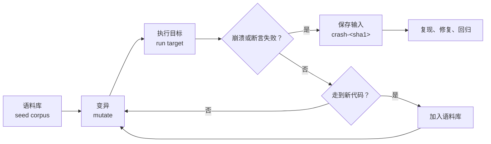

# 14. 覆盖率与模糊测试

[第 11 章](/教程/正文/开发与工程基础/11_自动化测试)给 wordfreq 写的测试一直全过，[第 13 章](/教程/正文/开发与工程基础/13_编译器诊断与程序检查)又在 AddressSanitizer 下跑了一遍，同样干净。可是把这一章的 `src/token.c` 换成一个有缺陷的版本，`test_token` 依然是 `27 checks, 0 failed`，`ctest` 也全绿。

缺陷藏在一个没有测试走到的分支里：`wf_tokenizer_next` 为 `cap` 为 1 的调用加了一条捷径，把单词原样复制进缓冲区，却没有检查长度。用 gcov 看覆盖率，这一整块代码标着 `#####`，意思是从来没被执行过。用 libFuzzer 跑几秒，它自己生成出二十来个字节的输入，最小化之后只剩两个字节，AddressSanitizer 立刻报出写到缓冲区之外的那一个字节。

本章做两件事：用 gcov 找出测试没走到的地方，再用模糊测试自动生成输入去撞这些地方。两件事连起来看的是同一个问题：测试全过不等于代码正确，得有人告诉你还有哪里没试过。

命令与输出取自 Windows 11 上的 MinGW-w64 GCC 13.2 和 SignalX 上的 Debian 13 / GCC 14.2；模糊测试只在本机用 Visual Studio 自带的 clang 22 运行。两份输出都注明来源，数字有差异时以各自的机器为准。

## 1. 覆盖率衡量什么

覆盖率（coverage）统计测试运行期间哪些代码被执行过。常用三种：

- 行覆盖（line coverage）：源文件的每一行是否至少执行过一次。
- 分支覆盖（branch coverage）：每个判断的每条出路是否都走过。
- 函数覆盖（function coverage）：每个函数是否至少被调用过一次。

三种里最容易误读的是行覆盖。一行里可能有多个判断，全部执行过这一行，不代表每个判断的每种结果都试过。

```c
/* 两个参数里有一个是正数就返回 1 */
int has_positive(int a, int b) {
    if (a > 0 || b > 0) {
        return 1;
    }
    return 0;
}
```

只用一个 `has_positive(2, -3)` 测试，`if` 这一行执行了，逻辑或的右边却因为左边已经为真而没有求值。用 gcov 看：

::: terminal title="zsh - gcov has_positive.c"

```text
$ gcc -std=c17 -Wall -Wextra --coverage -O0 has_positive.c -o has_positive
$ ./has_positive
1
$ gcov -b -c has_positive.c
File 'has_positive.c'
Lines executed:85.71% of 7
Branches executed:50.00% of 4
Taken at least once:25.00% of 4
Calls executed:100.00% of 2
Creating 'has_positive.c.gcov'
```

:::

展开标注文件，`if` 下面四行 `branch` 只有两条被走到：

::: terminal title="zsh - has_positive.c.gcov（节选）"

```text
function has_positive called 1 returned 100% blocks executed 60%
        1:    4:int has_positive(int a, int b) {
       1*:    5:    if (a > 0 || b > 0) {
branch  0 taken 0 (fallthrough)
branch  1 taken 1
branch  2 never executed (fallthrough)
branch  3 never executed
        1:    6:        return 1;
        -:    7:    }
    #####:    8:    return 0;
        -:    9:}
```

:::

`branch 0` 是 `a > 0` 为真时的走向，`branch 1` 是假时的走向，以此类推。这段代码有两条出路（返回 1、返回 0），只测了返回 1，所以行覆盖 85.71%、分支覆盖 50%。补一个 `has_positive(-1, 0)`，两个数字都变成 100%：

```c
int main(void) {
    printf("%d %d\n", has_positive(2, -3), has_positive(-1, 0));
    return 0;
}
```

::: terminal title="zsh - gcov（补测后）"

```text
1 0
File 'has_positive.c'
Lines executed:100.00% of 7
Branches executed:100.00% of 4
Taken at least once:75.00% of 4
Calls executed:100.00% of 3
Creating 'has_positive.c.gcov'
```

:::

注意最后两个数还不一样：行和分支都到 100%，`Taken at least once` 只有 75%。这是 `||` 的短路求值留下的——`branch 2` 是 `b > 0` 被求值的那条路，`has_positive(2, -3)` 里左边为真，右边根本没算过；`has_positive(-1, 0)` 里左边为假，右边算了一次。再加一个 `has_positive(-5, 4)`，`Taken at least once` 也到 100%：

::: terminal title="zsh - gcov（三次调用）"

```text
1 0 1
File 'has_positive.c'
Lines executed:100.00% of 7
Branches executed:100.00% of 4
Taken at least once:100.00% of 4
Calls executed:100.00% of 4
Creating 'has_positive.c.gcov'
```

:::

三个数只有全部到 100% 才说明每种组合都试过。这就是只看行覆盖会漏掉的东西。

::: concept cov-meaning title="覆盖率只说明哪里没测"

覆盖率只回答一个问题：哪些代码没有被测试执行过。它不说明已经执行过的代码是否正确，也不说明测试的断言够不够。100% 覆盖的测试套件可以一行断言都没有。

:::

所以覆盖率的用法是减法：先看哪里是空白，再想办法补上。数字本身不是目标，把没测到的行为列出来、决定哪些值得测，才是。

<Quiz
  :options="[
    { label: '行覆盖 100%，所以每个判断的每种结果都测过了', value: 'A' },
    { label: '行覆盖 100%，但短路求值可能让某个子表达式从未求值', value: 'B' },
    { label: '行覆盖 100%，所以代码没有缺陷', value: 'C' },
    { label: '分支覆盖不可能达到 100%，所以不用管', value: 'D' }
  ]"
  answer="B"
>

<template #question>

一个函数的行覆盖率显示 100%。下面哪个说法成立？

</template>

正确答案是 **B**。`a || b`、`a && b` 这类表达式里，右侧子表达式可能因为短路求值而从未执行，行却已经「执行过」了。A、C 都把覆盖率当成了正确性证明；D 与事实相反，`has_positive` 补两个用例之后分支覆盖就到了 100%。

</Quiz>

## 2. 用 gcov 测覆盖率

gcov 是 GCC 自带的覆盖率工具。它要两样东西：插桩编译出的目标文件（记录哪些分支存在）和运行时产生的计数文件。`--coverage` 一个选项同时打开这两件事：

```sh
gcc -std=c17 -Wall -Wextra --coverage -O0 -Iinclude -c src/token.c -o token.o
```

`--coverage` 等价于 `-fprofile-arcs -ftest-coverage`。前者在每段代码里插入计数器，后者生成 `.gcno` 文件，记录源文件的行号、分支和函数位置。程序运行结束后，计数器写到 `.gcda` 文件。`gcov` 拿这两个文件与源码对照，生成加了注释的副本。

`-O0` 不是必须的，但优化会移动、合并甚至删除代码，覆盖率报告和源码对不上，读起来费劲。测覆盖率时用 `-O0`。

wordfreq 已经用 CMake 管起来了，加一个选项比记一长串命令行方便。快照里的 `CMakeLists.txt` 有 `WF_COVERAGE`：

```cmake
option(WF_COVERAGE "Build with gcov instrumentation" OFF)

if(WF_COVERAGE)
    set(wf_coverage_targets wf wordfreq test_token test_counter)
    if(WF_FUZZ)
        list(APPEND wf_coverage_targets replay_token)
    endif()
    foreach(target ${wf_coverage_targets})
        target_compile_options(${target} PRIVATE --coverage -O0)
        target_link_options(${target} PRIVATE --coverage)
    endforeach()
endif()
```

（`option()` 与 `if()` 之间省略了另一个选项 `WF_FUZZ`，第 7 节会用到。）

编译和链接都要加 `--coverage`：插进去的计数器会引用 `__gcov_init`、`__gcov_exit` 这些符号，它们在 `libgcov` 里，链接时漏掉选项就报 `undefined reference`。

构建、跑测试、再调用 gcov：

::: terminal title="zsh - wordfreq 的覆盖率"

```text
$ cmake -S . -B build-cov -DWF_COVERAGE=ON
$ cmake --build build-cov
$ ctest --test-dir build-cov
1/3 Test #1: token ............................   Passed    0.00 sec
2/3 Test #2: counter ..........................   Passed    0.00 sec
3/3 Test #3: e2e ..............................   Passed    0.01 sec

100% tests passed, 0 tests failed out of 3

$ cd build-cov && gcov -b -c -o CMakeFiles/wf.dir/src CMakeFiles/wf.dir/src/token.c.gcno
File '/home/minsecrus/tutorial/work/ch14/clean/wordfreq/src/token.c'
Lines executed:95.83% of 24
Branches executed:100.00% of 24
Taken at least once:87.50% of 24
Calls executed:100.00% of 3
Creating 'token.c.gcov'
```

:::

`-o CMakeFiles/wf.dir/src` 告诉 gcov 去哪里找 `.gcno` 和 `.gcda`。CMake 把每个源文件的目标文件放在对应目录下，所以要从构建目录里调用，路径写成相对构建目录的形式。

`-b` 让报告里出现分支信息，`-c` 把分支的百分比换成实际计数——不加 `-c` 时 `branch 0` 显示 `taken 50%`，加了 `-c` 才显示 `taken 1 (fallthrough)`。想对照次数就用 `-c`，只想知道比例可以省略。想要逐行的视图，就打开生成的 `.gcov` 文件：

::: terminal title="zsh - token.c.gcov（节选）"

```text
function wf_tokenizer_next called 29 returned 100% blocks executed 94%
       29:   20:size_t wf_tokenizer_next(wf_tokenizer *tz, char *word, size_t cap) {
       29:   21:    if (cap == 0) {
branch  0 taken 0 (fallthrough)
branch  1 taken 29
    #####:   22:        return 0;
        -:   23:    }
        -:   24:
       29:   25:    const char *p = tz->cur;
       67:   26:    while (p < tz->end && !is_ascii_letter(*p)) {
branch  0 taken 61 (fallthrough)
branch  1 taken 6
call    2 returned 61
branch  3 taken 38
branch  4 taken 23 (fallthrough)
       38:   27:        p++;
        -:   28:    }
```

:::

读法：行首的 `29` 是这一行被执行了 29 次，`#####` 是一次都没有，`-` 是不含可执行代码的行（注释、空行、括号）。`branch 0 taken 61 (fallthrough)` 表示这条分支走了 61 次，`taken 0` 表示一次也没走。`call 2 returned 61` 是函数调用返回了 61 次，后面还可以有 `call 1 never executed`，说明这次调用根本没发生。

上面的报告里有 24 行可执行代码，执行了 23 行（95.83%），唯一没执行的是第 22 行的 `return 0;`——`cap == 0` 的提前返回，现有测试没有用 `cap` 为 0 调用过 `wf_tokenizer_next`。补上这个测试，行覆盖就到 100%：

```c
static void test_cap_zero(void) {
    const char *text = "abc";
    wf_tokenizer tz;
    wf_tokenizer_init(&tz, text, strlen(text));
    char word[1];

    CHECK_EQ_SIZE(wf_tokenizer_next(&tz, word, 0), 0);
}
```

::: terminal title="zsh - gcov（补上 cap 为 0 的用例后）"

```text
test_token: 28 checks, 0 failed
File 'src/token.c'
Lines executed:100.00% of 24
Branches executed:100.00% of 24
Taken at least once:91.67% of 24
Calls executed:100.00% of 3
```

:::

行覆盖到 100% 了，分支还有两个没走满。剩下的分支不影响这一章的结论，知道有这么回事就行：覆盖率到顶不代表测试到了顶。

报告不止终端这一种。gcovr 和 lcov 把 `.gcov` 数据转成带目录树和逐行着色的 HTML 页面，几十个文件的工程用这二者之一比自己翻 `.gcov` 现实得多；这两种工具本机没有安装，命令写在各自的文档里。Clang 有一条独立的路子，`-fprofile-instr-generate -fcoverage-mapping` 配合 `llvm-profdata` 和 `llvm-cov`，报告按源码区域统计，也能直接给出 Human 可读的汇总。同一次单元测试用本机 clang 22 跑出来是：

::: terminal title="zsh - llvm-cov report"

```text
$ clang -fprofile-instr-generate -fcoverage-mapping ...   # 编译与链接
$ LLVM_PROFILE_FILE=tt.profraw ./tt
$ llvm-profdata merge -sparse tt.profraw -o tt.profdata
$ llvm-cov report ./tt -instr-profile=tt.profdata src/token.c
Filename                    Regions  Missed Regions  Cover  Functions  ...  Lines  Missed Lines  Cover  ...
src/token.c                      28                1  96.43%          4  ...     32             2  93.75%  ...
```

:::

两种工具的百分比不完全相同，因为统计单位和插桩方式不同。选一种能融进现有构建的，长期看同一个数字，比两套混用更好。

## 3. 用覆盖率找没测到的行为

覆盖率报告最有用的地方不是那个百分数，是标着 `#####` 的行。那几行代表从没执行过的代码，也代表从没验证过的行为。

这一章的 `src/token.c` 拿掉一行就是一个例子。缺陷版本给 `cap` 为 1 的调用加了一条捷径：

```c
/* 缺陷：cap 为 1 时不做截断检查，单词有几个字母就写几个字节 */
if (cap == 1) {
    size_t n = 0;
    while (p < tz->end && is_ascii_letter(*p)) {
        word[n++] = to_ascii_lower(*p);
        p++;
    }
    word[n] = '\0';
    tz->cur = p;
    return n;
}
```

单元测试全部通过，因为 `test_token.c` 的五个测试里没有哪个用 `cap` 为 1 调用 `wf_tokenizer_next`。覆盖率一看就明白了：

::: terminal title="zsh - 缺陷版本的覆盖率"

```text
$ cp bugs/token_cap1_overflow.c src/token.c
$ cmake --build build-cov && ctest --test-dir build-cov
1/3 Test #1: token ............................   Passed    0.00 sec
2/3 Test #2: counter ..........................   Passed    0.00 sec
3/3 Test #3: e2e ..............................   Passed    0.01 sec

100% tests passed, 0 tests failed out of 3

$ cd build-cov && gcov -b -c -o CMakeFiles/wf.dir/src CMakeFiles/wf.dir/src/token.c.gcno
File '/home/minsecrus/tutorial/work/ch14/one/wordfreq/src/token.c'
Lines executed:75.00% of 32
Branches executed:86.67% of 30
Taken at least once:73.33% of 30
Calls executed:60.00% of 5
Creating 'token.c.gcov'
```

:::

行覆盖从 95.83% 掉到 75.00%，单位换成了新文件的 32 行可执行代码。`if (cap == 1)` 下面的整块都是 `#####`。缺陷恰好躲在测试没走到的地方——不是测试写错了，是测试根本不知道还有这么一条路。

找到没测到的行之后，下一步是**先想规格**，再决定怎么测。规格说：`cap >= 1` 时至多写入 `cap - 1` 个字母，返回写入的长度，0 表示没有更多单词。`cap` 为 1 时一个字母也放不下，应该返回 0，写入的只有终止空字符。按规格写测试，就能写出一个让缺陷版本失败的用例：

```c
static void test_cap_one(void) {
    const char *text = "abc";
    wf_tokenizer tz;
    wf_tokenizer_init(&tz, text, strlen(text));
    char word[1];

    CHECK_EQ_SIZE(wf_tokenizer_next(&tz, word, 1), 0);
    CHECK_STR_EQ(word, "");
}
```

缺陷版本上，这个用例直接失败：

::: terminal title="zsh - 缺陷版本上跑 test_cap_one"

```text
$ ./test_token
tests/test_token.c:80: wf_tokenizer_next(&tz, word, 1) is 3, expected 0
tests/test_token.c:81: word is "at<乱码>", expected ""
test_token: 29 checks, 2 failed
```

:::

`CHECK_EQ_SIZE` 打出实际返回的 3 与期望的 0；下一行的 `CHECK_STR_EQ` 打印缓冲区内容，里面的乱码是因为三个字母和终止空字符都写到了 `word` 之外，读出来的已经是别的栈上数据。用 ASan 构建同一个测试，报告更直接：

::: terminal title="zsh - 缺陷版本上跑 test_cap_one（ASan）"

```text
$ clang -g -O0 -fsanitize=address,undefined -fno-omit-frame-pointer \
      -Iinclude src/*.c tests/check.c tests/test_token.c -o test_token_asan
$ ./test_token_asan
==14900==ERROR: AddressSanitizer: stack-buffer-overflow on address 0x0096858ff721
WRITE of size 1 at 0x0096858ff721 thread T0
    #0 0x7ff731183082 in wf_tokenizer_next src/token.c:42
    #1 0x7ff731188520 in test_cap_one tests/test_token.c:80
    #2 0x7ff731186776 in main tests/test_token.c:90
```

:::

修复后的代码上，同一份测试 29 项全部通过。

这就是补测试的完整过程：覆盖率指出空白，规格决定那里应该是什么行为，测试把行为固定下来。

`if (cap == 1)` 这样的捷径在真实代码里很常见，写它的人往往觉得「这个分支太简单，不会错」。覆盖率的价值就在于它不认这种自信。

## 4. 模糊测试是什么

补测试靠人想得到用例。有些输入人想不出来：截断到第 37 个字节的文件、`cap` 恰好等于单词长度加一的调用、少了一个引号的配置。这类输入太多了，靠人一个一个想不现实。

模糊测试（fuzzing）把这件事交给程序：自动生成大量输入，逐个喂给被测代码，看会不会崩溃、报错或违反断言。



三个部件各司其职。

**输入生成与变异**。从一小份种子输入出发，随机翻转字节、插入、删除、拼接、替换成整数值。libFuzzer 用一套变异策略，AFL++ 用另一套，原理相同。

**覆盖率引导（coverage-guided）**。这是现代模糊测试和「随机灌数据」的分水岭。每次执行完，工具记录这次输入走到了哪些代码；如果它走到了以前没到过的代码，这个输入就被加进语料库，后续的变异以它为起点。这样变异会朝着还没探索过的地方走，而不是把时间浪费在已经跑烂的路径上。libFuzzer 启动时那行 `#2 INITED cov: 16 ft: 16` 里的 `cov` 是已覆盖的边数（计数器），`ft` 是特征数与边数的合并计数，语料库按这两个数判断要不要留下一个输入。

**判定依据**。模糊器本身不知道什么是错误，它只看两件事：进程崩溃了没有，Sanitizer 报错了没有。所以模糊测试几乎总是和 AddressSanitizer、UndefinedBehaviorSanitizer 一起用；也可以在代码里写断言，条件不满足就调用 `abort()`。断言写得好不好，直接决定了模糊器能发现什么。

模糊测试适合任何「输入是字节串」的代码：分词器、解析器、解码器、协议处理、文件格式读取。wordfreq 的 `wf_tokenizer_next` 正好是这一类——给它一段字节和一个缓冲区大小，它的行为应当完全由这两个参数决定。

::: concept fuzz-verdict title="模糊器只认崩溃"

模糊测试没有「通过」这个概念。跑了很久没崩，只说明这段时间没找到，不说明代码没有缺陷。模糊器找到的每个崩溃都是真实的缺陷；找不到不代表没有。

:::

<Quiz
  :options="[
    { label: '把随机字节直接传给被测函数，看它会不会崩', value: 'A' },
    { label: '只生成符合格式的输入，避免无效数据', value: 'B' },
    { label: '保留了走到新代码的输入继续变异，逐步扩大覆盖', value: 'C' },
    { label: '把程序的输出和期望输出逐字节比较', value: 'D' }
  ]"
  answer="C"
>

<template #question>

模糊测试里「覆盖率引导」指的是什么？

</template>

正确答案是 **C**。A 只描述了最早的随机测试，没有引导；B 恰恰相反，模糊测试的价值就在于生成人想不到的畸形输入；D 是期望输出文件的比较，属于端到端测试。

</Quiz>

## 5. 写一个模糊测试目标

模糊测试目标（fuzz target）是一个固定签名的函数：

```c
int LLVMFuzzerTestOneInput(const uint8_t *data, size_t size);
```

libFuzzer 生成一段字节，连长度一起传进来，你把它翻译成对被测函数的调用。wordfreq 的目标在 `fuzz/fuzz_token.c`：

```c
int LLVMFuzzerTestOneInput(const uint8_t *data, size_t size) {
    if (size < 2) {
        return 0;
    }

    size_t cap = (size_t)(data[0] % WF_WORD_MAX) + 1;
    const char *text = (const char *)data + 1;
    size_t len = size - 1;

    char *word = malloc(cap);
    if (word == NULL) {
        return 0;
    }

    wf_tokenizer tz;
    wf_tokenizer_init(&tz, text, len);
    size_t n = wf_tokenizer_next(&tz, word, cap);
    if (n >= cap) {
        abort();
    }
    for (size_t i = 0; i < n; i++) {
        if (word[i] < 'a' || word[i] > 'z') {
            abort();
        }
    }
    if (word[n] != '\0') {
        abort();
    }

    free(word);
    return 0;
}
```

几处设计值得说明。

**第一个字节决定 `cap`，其余字节是文本**。一个模糊器输入同时控制两个参数，比写两个目标省事。`data[0] % WF_WORD_MAX + 1` 把第一个字节映射到 1～64，正好覆盖 `cap` 的全部合法范围。

**缓冲区按 `cap` 精确分配**。用 `malloc(cap)` 而不是 `char word[WF_WORD_MAX]`，是因为要 ASan 看见越界。栈上的大数组能吞下多写的字节，堆上的精确分配不行，踩到一个字节之外就报。这是写模糊测试目标的一条硬规则。

**检查的性质来自规格**。返回长度必须小于 `cap`，单词只含小写字母，终止空字符在 `word[n]`。这三条都是 `token.h` 里写明的行为，不是为模糊测试现编的。性质写得越贴近规格，模糊器发现的问题越有意义。

**不能调用 `exit`，不能有全局状态**。libFuzzer 在同一个进程里反复调用这个函数，中途退出就没有后面的测试了；每次调用都应当从干净的初始状态出发，否则前一个输入的影响会污染后一个。

::: warning 结果必须被使用，否则目标会被整体删掉

`wf_tokenizer_next(&tz, word, cap);` 这一行如果结果没人用、缓冲区也没人读，编译器在 `-O1` 以上会认定这次调用没有可观察的副作用，把它连同整个循环一起删掉。模糊器看到的目标里只剩一个空的 `LLVMFuzzerTestOneInput`，输出里 `cov` 停在 1，什么也找不到，而且不报错。

:::

这件事值得亲眼看一下。下面是一个「结果没人用」的目标和它的修正版：

::: compare left-title="结果被忽略，目标被删空" right-title="结果进入判断，目标完整"

```c
#include <stdint.h>
#include <stddef.h>

/* 数一数一个字节里有几个 1 */
static int count_bits(uint8_t b) {
    int n = 0;
    for (int i = 0; i < 8; i++) {
        if ((b >> i) & 1) {
            n++;
        }
    }
    return n;
}

int LLVMFuzzerTestOneInput(const uint8_t *data, size_t size) {
    if (size < 1) {
        return 0;
    }
    count_bits(data[0]);
    return 0;
}
```

---

```c
#include <stdint.h>
#include <stddef.h>
#include <stdlib.h>

static int count_bits(uint8_t b) {
    int n = 0;
    for (int i = 0; i < 8; i++) {
        if ((b >> i) & 1) {
            n++;
        }
    }
    return n;
}

int LLVMFuzzerTestOneInput(const uint8_t *data, size_t size) {
    if (size < 1) {
        return 0;
    }
    if (count_bits(data[0]) > 8) {
        abort();
    }
    return 0;
}
```

:::

用同一台机器、同样的 `clang -g -O1 -fsanitize=fuzzer,address`，各跑 1000 次：

::: terminal title="zsh - 两个目标的初始化行"

```text
$ ./unused -runs=1000 -max_len=4
INFO: Loaded 1 modules   (1 inline 8-bit counters): 1 [00007FF7FE4FE5C8, 00007FF7FE4FE5C9),
#2	INITED cov: 1 ft: 1 corp: 1/1b exec/s: 0 rss: 35Mb
#1000	DONE   cov: 1 ft: 1 corp: 1/1b lim: 4 exec/s: 0 rss: 36Mb
$ ./used -runs=1000 -max_len=4
INFO: Loaded 1 modules   (7 inline 8-bit counters): 7 [00007FF7F598E5C8, 00007FF7F598E5CF),
#2	INITED cov: 5 ft: 5 corp: 1/1b exec/s: 0 rss: 35Mb
#1000	DONE   cov: 5 ft: 13 corp: 9/9b lim: 4 exec/s: 0 rss: 36Mb
```

:::

左边那个目标只有 **1** 个计数器，`cov: 1` 从头到尾没变——`count_bits` 被整个内联后又被删除，模糊器在测试一个空函数。右边有 7 个计数器，`ft` 从 5 涨到 13，语料库增长到 9 个文件，说明它真的在执行和探索。看到 `cov: 1` 或者 `cov` 长时间不动，第一件事就是检查目标里有没有「算完就扔」的调用。

`fuzz_token.c` 里的三条检查都用到了结果：`n` 进比较，`word[i]` 参与判断，`word[n]` 与 `'\0'` 比较。所以它不会被删。

## 6. 运行 libFuzzer

libFuzzer 随 clang 提供，GCC 没有。Windows 上用 Visual Studio 自带的 clang，编译前把它加进 `PATH`；ASan 的运行时是动态库，运行时也得能找到它，所以 `clang` 目录和 `lib\clang\<版本>\lib\windows` 两个目录都要加：

```sh
export PATH="/d/Software/VS/1/VC/Tools/Llvm/x64/bin:/d/Software/VS/1/VC/Tools/Llvm/x64/lib/clang/22/lib/windows:$PATH"
```

GCC 用户走另一条路：AFL++ 提供 GCC 插件模式，见第 8 节。

编译目标只需要一行：

```sh
clang -g -O1 -fsanitize=fuzzer,address -Iinclude fuzz/fuzz_token.c src/token.c -o fuzz_token
```

`-fsanitize=fuzzer` 把 libFuzzer 的运行库和 `main` 链接进来，`address` 打开 AddressSanitizer。两个要一起给，只给 `fuzzer` 的话越界写不会被发现——缓冲区踩坏了但进程没有立刻崩溃，模糊器的判定依据就没了。`-g` 给报告提供行号。`-O1` 跑得快，但循环被优化之后行号映射会漂移：同一个越界，`-O0` 的报告指向 `word[n++] = ...` 那一行，`-O1` 有时指向函数末尾的 `}`。`-O0` 慢一些，行号逐条对得上，第一次复现崩溃时用它更方便。下面这次运行用的是 `-O0`。

准备一份种子语料：把 `tests/data/sample.txt` 复制到 `corpus/` 目录，里面有几行正常文本，比从零开始更快走到有意思的代码。然后启动：

::: terminal title="zsh - fuzz_token（缺陷版本，本机 clang 22）"

```text
$ ./fuzz_token -max_total_time=60 corpus/
INFO: Running with entropic power schedule (0xFF, 100).
INFO: Seed: 4244617576
INFO: Loaded 1 modules   (34 inline 8-bit counters): 34 [00007FF7A8F4F5C8, 00007FF7A8F4F5EA),
INFO: seed corpus: files: 1 min: 48b max: 48b total: 48b rss: 35Mb
#2	INITED cov: 16 ft: 16 corp: 1/48b exec/s: 0 rss: 36Mb
#4	NEW    cov: 17 ft: 28 corp: 2/96b lim: 48 exec/s: 0 rss: 37Mb L: 48/48 MS: 2 ChangeBit-ChangeBinInt-
#9	REDUCE cov: 17 ft: 28 corp: 2/84b lim: 48 exec/s: 0 rss: 37Mb L: 36/48 MS: 5 ChangeByte-ChangeBit-ChangeBinInt-ChangeBit-EraseBytes-
#38	REDUCE cov: 20 ft: 44 corp: 5/212b lim: 48 exec/s: 0 rss: 37Mb L: 41/48 MS: 1 InsertRepeatedBytes-
#291	NEW    cov: 22 ft: 70 corp: 18/469b lim: 48 exec/s: 0 rss: 37Mb L: 44/48 MS: 2 ChangeByte-InsertRepeatedBytes-
=================================================================
==7448==ERROR: AddressSanitizer: heap-buffer-overflow on address 0x1193d35a6371
WRITE of size 1 at 0x1193d35a6371 thread T0
    #0 0x7ff7a8e138cf in wf_tokenizer_next src/token.c:42
    #1 0x7ff7a8e1307a in LLVMFuzzerTestOneInput fuzz/fuzz_token.c:37
    #2 0x7ff7a8deb7fe in fuzzer::Fuzzer::ExecuteCallback ...
SUMMARY: AddressSanitizer: heap-buffer-overflow src/token.c:42 in wf_tokenizer_next

0x1193d35a6371 is located 0 bytes after 1-byte region [0x1193d35a6370,0x1193d35a6371)
allocated by thread T0 here:
    #1 0x7ff7a8e12913 in malloc
    #2 0x7ff7a8e12ff7 in LLVMFuzzerTestOneInput fuzz/fuzz_token.c:30

artifact_prefix='./'; Test unit written to ./crash-7b9cd30885fd8c2efd02604d491ad36d0072e40d
Base64: AAAAAAAAAJea35Ke35KeIGRvaCca
```

:::

不到三百次执行就找到了。这段输出里每个字段都有用处：

- `INITED cov: 16 ft: 16 corp: 1/48b`：种子语料跑了一遍，覆盖 16 条边、16 个特征，语料库 1 个文件共 48 字节。
- `NEW` 表示这次输入走到了新的代码，被加进语料库；`REDUCE` 表示它用更短的输入达到了同样的覆盖。`corp: 18/469b` 是语料库现有的文件数与总字节数。
- `L: 44/48` 是当前输入长度、本轮最大长度，`lim: 48` 是当前允许的最大输入长度，会随执行次数逐步放宽。
- `MS:` 列出这次用的变异操作，`DE:` 是触发比较的字典条目。

崩溃之后 libFuzzer 把触发的输入存成 `crash-<sha1>` 文件，`sha1` 是输入内容的哈希。复现只要把文件单独喂回去：

::: terminal title="zsh - 复现与最小化"

```text
$ ./fuzz_token crash-7b9cd30885fd8c2efd02604d491ad36d0072e40d
INFO: Seed: 667446501
INFO: Running 1 inputs 1 time(s) each.
Running: crash-7b9cd30885fd8c2efd02604d491ad36d0072e40d
==13460==ERROR: AddressSanitizer: heap-buffer-overflow on address 0x1151279a03b1
WRITE of size 1 at 0x1151279a03b1 thread T0
    #0 0x7ff69f2638cf in wf_tokenizer_next src/token.c:42
SUMMARY: AddressSanitizer: heap-buffer-overflow src/token.c:42 in wf_tokenizer_next
$ ./fuzz_token -minimize_crash=1 -runs=10000 crash-7b9cd30885fd8c2efd02604d491ad36d0072e40d
...
CRASH_MIN: failed to minimize beyond ./minimized-from-cd42054274fad3ddb993aef0774d8e6c85135353 (2 bytes), exiting
$ xxd minimized-from-cd42054274fad3ddb993aef0774d8e6c85135353
00000000: 0064                                     .d
```

:::

原来的崩溃输入有 21 个字节，最小化后只剩两个：`00 64`，第一个字节 0 让 `cap = 1`，第二个字节是一个字母。两个字节就足以说明问题——`word` 只分配了 1 个字节，`word[n]` 在 `n = 1` 时写到 `[1]`，正好越界一个字节。

::: tip 最小化时让可执行文件带上 `.exe`

Windows 上 `-minimize_crash=1` 会按启动时的名字重新调用自己。可执行文件叫 `fuzz_token.exe`，而命令行只写了 `fuzz_token`，最小化会失败并报 `No such directory`。用带扩展名的名字调用，或者写完整路径。

:::

## 7. 修复与回归

崩溃的原因在 `cap == 1` 那条捷径上：它复制单词时没有检查长度。修复不是给这条捷径补一个检查，而是删掉它——主循环里已经有正确的逻辑，`n + 1 < cap` 保证写入的字母数不超过 `cap - 1`，`word[n] = '\0'` 落在 `word[cap - 1]`。快照里的 `src/token.c` 就是修复后的样子。

::: compare left-title="缺陷：捷径漏掉长度检查" right-title="修复：删掉捷径，走同一条主循环"

```c
/* cap 为 1 时缓冲区很小，单独走一条捷径 */
if (cap == 1) {
    size_t n = 0;
    while (p < tz->end && is_ascii_letter(*p)) {
        word[n++] = to_ascii_lower(*p);
        p++;
    }
    word[n] = '\0';
    tz->cur = p;
    return n;
}
```

---

```c
/* 放不下的字母读过就丢弃，不会成为下一个单词的开头 */
size_t n = 0;
while (p < tz->end && is_ascii_letter(*p)) {
    if (n + 1 < cap) {
        word[n++] = to_ascii_lower(*p);
    }
    p++;
}
word[n] = '\0';
```

:::

修复之后不能只把崩溃文件删掉。模糊器找到的输入是**回归测试**：写进 `tests/regress/`，每次构建都重放一遍，确保同一个缺陷不会回来。快照里放了两个：

- `token_cap1_overflow.bin`：`00 00 62`，三个字节。第一个字节 0 使 `cap = 1`，后面的 `b` 触发越界。这是最小化结果（最小化停在 `00 65`，换成 `00 00 62` 同样必触发，而且能看出「cap 为 1 加一个字母」的原理）。
- `token_cap1_long_word.bin`：`00` 加 64 个 `a`。同样是 `cap = 1`，但单词长得多。

两个都在普通构建（没有 ASan）里失败，本机和 SignalX 上实测都是进程异常终止。放两个的理由是它们测的力度不同：三字节的那个只多写一个字节，是否被运行时发现取决于分配器怎么摆放内存；65 字节的那个一次写出 64 个字节，任何分配器都会踩到不该碰的地方。回归输入宁可多留一个确定会失败的，也不要只留一个「通常」会失败的。

重放由一个普通的 `main` 完成，不需要 clang：

```c
int main(int argc, char *argv[]) {
    if (argc < 2) {
        fprintf(stderr, "usage: %s FILE...\n", argv[0]);
        return 2;
    }
    for (int i = 1; i < argc; i++) {
        int status = replay_file(argv[i]);
        if (status != 0) {
            return status;
        }
    }
    return 0;
}
```

`replay_main.c` 把每个文件读进内存，交给同一个 `LLVMFuzzerTestOneInput`。这样模糊测试目标和重放程序共享一份目标代码，不用维护两套。

CMake 里把它注册成 ctest 测试，`file(GLOB)` 收集 `tests/regress/` 下的全部文件：

```cmake
if(WF_FUZZ)
    add_executable(replay_token fuzz/replay_main.c fuzz/fuzz_token.c)
    target_link_libraries(replay_token PRIVATE wf)
    target_compile_options(replay_token PRIVATE ${WF_WARNINGS})
    file(GLOB WF_REGRESS_INPUTS ${CMAKE_CURRENT_SOURCE_DIR}/tests/regress/*)
    if(WF_REGRESS_INPUTS)
        add_test(NAME replay COMMAND replay_token ${WF_REGRESS_INPUTS})
        set_tests_properties(replay PROPERTIES LABELS e2e)
    endif()
endif()
```

`file(GLOB)` 只在配置阶段展开。往 `tests/regress/` 里加文件之后要重新跑一次 `cmake -S . -B build`，否则新文件不会出现在测试命令里。

::: terminal title="zsh - 用 gcc 构建并重放"

```text
$ cmake -S . -B build -DWF_FUZZ=ON
$ cmake --build build
$ ctest --test-dir build -R replay --output-on-failure
1/1 Test #4: replay ...........................   Passed    0.06 sec

100% tests passed, 0 tests failed out of 1
```

:::

把缺陷版本换回去，同一个测试就失败：

::: terminal title="zsh - 缺陷版本的重放"

```text
$ ctest --test-dir build -R replay --output-on-failure
1/1 Test #4: replay ...........................Exit code 0xc0000409
***Exception:   0.22 sec

0% tests passed, 1 tests failed out of 1

The following tests FAILED:
	  4 - replay (Exit code 0xc0000409)
```

:::

`0xC0000409` 是 Windows 上进程异常中止的状态码（`STATUS_STACK_BUFFER_OVERRUN`，运行库在检出内存损坏后也用它）。Linux 上同样的输入以 SIGABRT 结束，ctest 报的是 `Subprocess aborted`。两种都是失败，ctest 只看退出状态。

这一步的意义在于：模糊测试本身要 clang，但重放不需要。CI 里没有 clang 的机器照样能跑 `replay`，把每个崩溃输入当作回归测试保护起来。

修复之后重新测覆盖率。`if (cap == 1)` 那一块已经不在了，之前整片 `#####` 的地方变成了有计数的主循环：

::: terminal title="zsh - 修复后的覆盖率"

```text
$ cmake -S . -B build-cov -DWF_COVERAGE=ON
$ cmake --build build-cov && ctest --test-dir build-cov
100% tests passed, 0 tests failed out of 3

$ cd build-cov && gcov -b -c -o CMakeFiles/wf.dir/src CMakeFiles/wf.dir/src/token.c.gcno
File '/home/minsecrus/tutorial/work/ch14/clean/wordfreq/src/token.c'
Lines executed:95.83% of 24
Branches executed:100.00% of 24
Taken at least once:87.50% of 24
Calls executed:100.00% of 3
```

:::

行覆盖从 75.00% 回到 95.83%，剩下那一行还是 `cap == 0` 的提前返回。补上第 2 节的 `test_cap_zero`，行覆盖到 100%。要注意，覆盖率回升不是修复的功劳——修复只是让多出来的那段代码消失了；真正让覆盖率变好的是测试，而这一次测试并没有变，变的只是代码。换句话说，如果缺陷没有删掉、只是给捷径补一个长度检查，覆盖率会和现在一样低，测试仍然碰不到它。

把模糊测试的语料也计入覆盖率，可以在 `WF_COVERAGE` 打开的同时打开 `WF_FUZZ`，`replay_token` 会加进目标列表并跟随重放。覆盖率统计的是「测试跑到了哪里」，把模糊测试和单元测试的数字合并看，容易高估测试的严密程度——模糊器只是为了找崩溃，它走过的路径不构成对行为的检查。

## 8. 模糊测试放在什么时候跑

模糊测试很吃时间，跑多久都能继续跑。放在哪里跑，取决于它要防什么。

**改了解析、分词、解码这类代码之后，本地跑几分钟。** 一两个分钟的模糊测试常常就能发现明显的越界和断言失败，成本低到没有理由跳过。`-max_total_time=120` 是个合理的默认值。

**CI 里每次提交只重放语料和回归输入。** 第 18 章的流水线里跑 `replay` 和一小份语料（几十个输入、几秒钟），不做长时间模糊。每次提交都花十分钟模糊，等待时间会让人想办法绕过它。

**定时任务做长时间模糊。** 每晚或每周跑几小时，把新找到的崩溃保存成制品。这类崩溃不阻塞当次提交，但会被记录、分派、修复，修完再进 `tests/regress/`。

**开源项目可以交给 OSS-Fuzz。** Google 维护的持续模糊测试服务，为开源项目免费提供机器，按项目配置持续运行。配置好后它会长期替你跑，找到的问题通过 Issue 跟踪；不少大型开源项目的内存安全缺陷是这么发现的。

工具选择上，libFuzzer 和 AFL++ 是两个主流。libFuzzer 跟 clang 绑定、进程内运行、速度快，适合单元级别的目标；AFL++ 支持 GCC 插件和多种语言、可以做跨进程和持久化模式，适合整程序的模糊测试，持续开发也更活跃。前面写的 `LLVMFuzzerTestOneInput` 目标 AFL++ 也能直接用：

```sh
afl-gcc-fast -g -O1 -Iinclude fuzz/fuzz_token.c src/token.c -o fuzz_token_afl
mkdir -p corpus && cp tests/data/sample.txt corpus/
afl-fuzz -i corpus -o findings -- ./fuzz_token_afl @@
```

`@@` 会被替换成输入文件的路径。AFL++ 要用它的编译器包装器重新编译（`afl-gcc-fast` 走 GCC 插件），否则拿不到覆盖率信息。这条命令只是写法示范，本机没有安装 AFL++，没有实测输出。

## 9. 习题

### 9.1 巩固

<Exercise id="21401" :d="1" :w="1">

下面的程序把分数转成等级，用 `gcc -std=c17 --coverage -O0` 编译并只运行一次：

```c
#include <stdio.h>

/* 分数对应的等级：<60 为 F，60～79 为 C，80～89 为 B，其余为 A */
char grade(int score) {
    if (score < 0) {
        return '?';
    }
    if (score < 60) {
        return 'F';
    }
    if (score < 80) {
        return 'C';
    }
    if (score < 90) {
        return 'B';
    }
    return 'A';
}

int main(void) {
    printf("%c %c\n", grade(95), grade(59));
    return 0;
}
```

`gcov -b -c grade.c` 的标注文件节选：

```text
function grade called 2 returned 100% blocks executed 70%
        2:    4:char grade(int score) {
        2:    5:    if (score < 0) {
branch  0 taken 0 (fallthrough)
branch  1 taken 2
    #####:    6:        return '?';
        -:    7:    }
        2:    8:    if (score < 60) {
branch  0 taken 1 (fallthrough)
branch  1 taken 1
        1:    9:        return 'F';
        -:   10:    }
        1:   11:    if (score < 80) {
branch  0 taken 0 (fallthrough)
branch  1 taken 1
    #####:   12:        return 'C';
        -:   13:    }
        1:   14:    if (score < 90) {
branch  0 taken 0 (fallthrough)
branch  1 taken 1
    #####:   15:        return 'B';
        -:   16:    }
        1:   17:    return 'A';
        -:   18:}
```

(1) 报告的三个百分比分别是 `Lines executed:76.92% of 13`、`Branches executed:100.00% of 8`、`Taken at least once:62.50% of 8`。写出每个百分比的分子和分母，并说明为什么「分支执行过」是 100%，而「至少走过一次」只有 62.5%。

(2) 三处 `#####` 分别对应哪一段分数区间没有测到。

(3) 写出最少的调用集合，让三个百分比都变成 100%，在自己的机器上运行确认。这条集合里有几个调用？为什么不能只补 `grade(-1)` 一个。

</Exercise>

<Exercise id="21402" :d="2" :w="2">

下面两个函数都只做一次判断，但短路求值让「分支至少走过一次」比想象中难做到：

```c
int both_positive(int a, int b) {
    if (a > 0 && b > 0) {
        return 1;
    }
    return 0;
}

int either_positive(int a, int b) {
    if (a > 0 || b > 0) {
        return 1;
    }
    return 0;
}
```

(1) 只给 `both_positive` 用 `(2, 3)` 与 `(2, -3)` 两次调用，`Taken at least once` 是多少？还差哪一条出路？

(2) 分别写出两个函数各自的最少调用集合，使分支覆盖的三个数字全部到 100%。两个函数各需要几次调用？`&&` 与 `||` 需要的次数为什么相同。

(3) 把两个函数放进同一个 `.c` 文件、同一个 `main` 里验证，贴出 `gcov -b -c` 的五行汇总。

</Exercise>

<Exercise id="21403" :d="2" :w="2">

`--coverage` 同时做两件事：编译时插计数器并生成 `.gcno`，链接时把 `libgcov` 接进来。用下面这个只有一行的程序分别做三组实验：

```c
#include <stdio.h>

int main(void) {
    printf("hi\n");
    return 0;
}
```

1. 只在编译时加 `--coverage`，链接时不加；
2. 只在链接时加 `--coverage`，编译时不加；
3. 两端都加。

记录三组实验的命令、构建结果、运行后目录里出现的文件（`.gcno`、`.gcda`、`.gcov`），并回答：

(1) 第一组链接时报了哪几个未定义的符号？它们由谁提供？

(2) 第二组能构建、能运行，但 `gcov` 什么也分析不出来。为什么缺的是编译端而不是链接端？

(3) 用一句话概括 `--coverage` 在编译端和链接端各自的作用。

</Exercise>

### 9.2 编程

<Exercise id="21404" :d="3" :w="3">

用 `code/开发与工程基础/14_覆盖率与模糊测试/wordfreq/` 的工程，打开 `WF_COVERAGE` 完成一次多文件覆盖率检查。

(1) 构建 `build-cov` 后，分别在三种条件下调用 `gcov`，记录三个源文件的行覆盖与分支覆盖：

- 只运行 `test_token`；
- 运行全部 `ctest`；
- 只运行端到端测试 `e2e`。

每次换条件之前先删掉构建目录里的 `.gcda`。它们会被后续运行累加：同一个测试跑两遍，某个函数的 `called` 计数会翻倍，覆盖率却不是两次并集。先亲手验证这一点（连跑两次同一个测试，看 `called` 数字），再开始记录。

(2) 为什么 `report.c` 在第一种条件下是 0%，而在第二、三种条件下是 100%？这说明「覆盖率」统计的是谁走过的路径？

(3) 给 `tests/test_token.c` 补上 `cap` 为 0 的用例，重新构建并运行，确认 `token.c` 的行覆盖从 95.83% 到 100%。补完后 `Taken at least once` 是多少？还剩几条出路没走过，分别落在哪个函数里？

(4) 写一条命令，一次分析 `token.c`、`counter.c`、`report.c` 三个文件。

</Exercise>

<Exercise id="21405" :d="3" :w="3">

在 `wordfreq` 上只跑 `test_counter` 时，`counter.c` 的行覆盖是 89.61%，有八行标着 `#####`。

(1) 打开标注文件，列出这八行分别属于哪些函数，判断哪些是内存不足时的返回路径、哪些是正常路径漏测。再观察 `dup_string` 里的 `if (copy != NULL)`：它下面那条 `memcpy` 执行过，`branch 1`（`copy` 为空的那条）却是 0 次。这两件事为什么可以同时成立？

(2) 给 `test_counter.c` 加两个用例：`wf_counter_top(c, out, 0)` 应当返回 0，`wf_counter_destroy(NULL)` 应当什么都不做。重新测，记录行覆盖与 `Taken at least once` 的新数字，并说明这两个用例各覆盖了哪个判断的哪一条出路。

(3) 剩下的 `#####` 里，哪一行在当前测试框架下根本无法用普通调用触发？说明原因。

(4) 覆盖率补到多少才算够？结合这一页第 1 节的结论，用三五句话写出你的判断标准，并举一个「覆盖率更高但测试更差」的例子。

</Exercise>

<Exercise id="21406" :d="3" :w="2">

模糊测试目标最容易被编译器整体删掉。取下面这个目标，用 `clang -g -O1 -fsanitize=fuzzer,address` 构建，记录启动时的 `INITED` 行；再用 `-O0` 构建同一个文件，记录同一条输出。

```c
#include <stdint.h>
#include <stddef.h>

static int count_bits(uint8_t b) {
    int n = 0;
    for (int i = 0; i < 8; i++) {
        if ((b >> i) & 1) {
            n++;
        }
    }
    return n;
}

int LLVMFuzzerTestOneInput(const uint8_t *data, size_t size) {
    if (size < 1) {
        return 0;
    }
    count_bits(data[0]);
    return 0;
}
```

(1) 两次构建的 `cov` 各是多少？哪个优化级别下目标被删空？

(2) 把检查改成 `if (count_bits(data[0]) > 8) { abort(); }`，重新构建，`cov` 变成多少。解释为什么这一改就保住了代码。

(3) 另写一个目标：只调用 `assert(count_bits(data[0]) <= 8)`，分别用带 `-DNDEBUG` 与不带 `-DNDEBUG` 的 `-O1` 构建。两次的 `cov` 各是多少？把结论写成一句话：模糊测试目标为什么不能用 `assert` 做唯一的判定。

(4) 用自己的话说明：为什么「结果没人用」在 `-O0` 下不报错、也不明显影响覆盖率，却是最危险的一类目标缺陷。

</Exercise>

<Exercise id="21407" :d="4" :w="3">

给计数模块写一个模糊测试目标 `fuzz/fuzz_counter.c`，用第一个字节决定一次操作，后续字节决定单词。要求：

- 每次调用都新建一个 `wf_counter`，结束时销毁；
- 调用 `wf_counter_add`、`wf_counter_get`、`wf_counter_size`、`wf_counter_top`；
- 检查规格里的性质：`get` 返回的次数与自维护的计数一致，`size` 等于不同单词数，`top` 返回的项数正确、次数降序、同次数按 `strcmp` 升序；
- 任何一条不满足就 `abort()`。

验收：

1. 在当前（修复后）的 `counter.c` 上运行 30 秒，不崩溃；
2. 把 `code/开发与工程基础/13_编译器诊断与程序检查/bugs/counter_dup_off_by_one.c` 换到 `src/counter.c`，用同一份目标运行，几秒内报告 `heap-buffer-overflow`，并指出出错在 `dup_string`；
3. 再把同次数排序的那一行删掉（`compare_entries` 直接返回 0），确认目标能在几十秒内用一个只含两三个不同字母的输入触发 `abort()`。

第 3 条说明了什么：只查「有没有崩」和查「行为对不对」，目标的判定依据差在哪里？

</Exercise>

<Exercise id="21408" :d="4" :w="3">

这一题做的是崩溃之后的流程。取 `tests/regress/` 里的 `token_cap1_overflow.bin`（三个字节 `00 00 62`）与 `token_cap1_long_word.bin`。

(1) 用 `code/开发与工程基础/14_覆盖率与模糊测试/bugs/token_cap1_overflow.c` 覆盖 `src/token.c`，用 `WF_FUZZ=ON` 构建，运行 `ctest -R replay --output-on-failure`，记录 Windows 上的退出码与 ctest 的报错行。再把修复后的 `token.c` 换回去，确认同一条命令通过。

(2) 两个回归输入都针对 `cap` 为 1，为什么正文要留两个而不是一个？用 `tools/` 之外的办法（例如直接看字节、或写一个小程序把文件读进来）说明两者在写入长度上的差别。

(3) 自己造一个新的回归输入：让 `wf_tokenizer_next` 的 `cap` 为 2 而单词长 10 个字母，写出字节序列和生成它的命令。先预测它在缺陷版本与修复版本上的结果，再实测。如果两版结果相同，说明这个输入没能对准缺陷的生效条件；把第一个字节改成 0 让它落进 `cap == 1`，再跑一次。归纳一条写回归输入的规则。

(4) `file(GLOB WF_REGRESS_INPUTS ...)` 有一个已知的坑：往 `tests/regress/` 里加了文件却不重新配置，新文件不会进入测试命令。请设计一条验证方法，并说明为什么用 `CONFIGURE_DEPENDS` 能缓解。

</Exercise>

### 9.3 综合与挑战

<Exercise id="21409" :d="5" :w="4">

`gcov --json-format` 生成的是机器可读的数据，可以把覆盖率接进脚本。要求写一个 `tools/cov_gate.sh`：

- 参数：构建目录、`gcno` 路径、最低行覆盖百分比；
- 调用 `gcov --json-format`，解压 `.gcov.json.gz`，列出所有 `count` 为 0 且 `unexecuted_block` 为真的行号；
- 计算行覆盖，低于阈值时以非 0 状态退出，并打印未覆盖行；
- 不依赖 `jq`，用 `python3 -c` 或 `cmake -P` 皆可，在脚本里写清依赖。

验收：

1. 在 `wordfreq` 的 `build-cov` 上运行，阈值设成 100 时失败并列出 `#####` 的行号；把 `test_cap_zero` 补上后通过；
2. 用 `ctest` 全部测试跑一遍，确认 `report.c` 的未覆盖行是空的；
3. 把阈值设成 95 时，未补测试的版本也能通过，说明门禁阈值应当怎么定。

最后回答：为什么这个脚本要在 CI 里对「单元测试」跑，而不是对「单元测试加模糊测试重放」跑？结合正文第 3 节与第 7 节的两段结论说明。

</Exercise>

<Exercise id="21410" :d="6" :w="5">

把下面这个缺陷版本的 `wf_tokenizer_next` 换进 `src/token.c`（只改了第一处循环条件）：

```c
while (p <= tz->end && !is_ascii_letter(*p)) {
    p++;
}
```

`p <= tz->end` 越过末尾之后再解引用，读到的是缓冲区之后的一个字节。

(1) 用普通 `gcc -O0` 跑现有单元测试，记录结果。为什么测试全过？

(2) 用 `clang -g -O0 -fsanitize=address,undefined` 编译同一个测试程序，在测试里传入一个长度刚好、没有终止空字符、内容全是非字母的缓冲区（例如三个字节的 `!!!`）。记录 ASan 的报告：是读还是写，落在哪一行。再把缓冲区换成 `abc` 并只调用一次 `wf_tokenizer_next`，看还报不报；改成调用两次呢。用两次调用的差别解释这个缺陷为什么依赖调用次数。

(3) 只用前面写的 `fuzz_token.c` 目标，不额外写测试，运行 libFuzzer 与 ASan。记录从启动到崩溃用了多少时间、触发输入的长度。

(4) 为这个缺陷写一个能长期保留的回归输入，放进 `tests/regress/`，并说明它为什么必须在普通构建（无 ASan）下也失败，或者为什么做不到。

(5) 比较 (2) 与 (3) 两条路：手工构造测试要想到「全非字母且正好到末尾」这个组合，模糊器不用想。把这层差别写成一句话，并据此说明为什么单元测试和模糊测试不能互相替代。

</Exercise>

## 10. 参考资料

- GCC 手册，[Gcov](https://gcc.gnu.org/onlinedocs/gcc/Gcov.html)：`--coverage`、`.gcno`/`.gcda`、`gcov` 的各个选项与标注文件格式。
- [gcovr](https://gcovr.com/) 与 [lcov](https://github.com/linux-test-project/lcov)：把 gcov 数据转成 HTML 报告。
- Clang 文档，[Source-based Code Coverage](https://clang.llvm.org/docs/SourceBasedCodeCoverage.html)：`-fprofile-instr-generate -fcoverage-mapping`、`llvm-profdata`、`llvm-cov`。
- LLVM 文档，[libFuzzer](https://llvm.org/docs/LibFuzzer.html)：目标函数的签名、语料库、`-max_total_time`、`-minimize_crash`、`-merge` 等选项。
- Google fuzzing 项目，[libFuzzer Tutorial](https://github.com/google/fuzzing/blob/master/tutorial/libFuzzerTutorial.md)：从零写第一个目标的完整流程。
- AFL++ 文档，[Fuzzing in Depth](https://aflplus.plus/docs/fuzzing_in_depth/)：GCC 插件模式、持久化模式、字典。
- [OSS-Fuzz](https://google.github.io/oss-fuzz/)：持续模糊测试服务的项目接入方式。
- *The Fuzzing Book*，<https://www.fuzzingbook.org/>：模糊测试的原理与各类变异策略。
- Microsoft Learn，[/fsanitize (AddressSanitizer)](https://learn.microsoft.com/en-us/cpp/build/reference/fsanitize)：MSVC 与 clang-cl 下的 Sanitizer 选项。
- John Regehr，["How to Fuzz an ADT Implementation"](https://blog.regehr.org/archives/896)：模糊测试目标应当检查什么性质。
