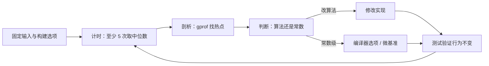

# 15. 测量、分析与优化

wordfreq 处理教材里的 `sample.txt` 只要一瞬，换成一百万词的文本就要一秒多。这一秒花在哪里，凭直觉猜往往猜错：有人会先把手写的小写转换改成查表，或者把 `fprintf` 换掉，改完却发现时间几乎没变。本章先测量、再剖析 (profiling)，找出真正的热点 (hotspot)，然后改算法，最后才谈编译器选项和微基准 (microbenchmark) 的写法。

Knuth 在 1974 年那篇讨论 `goto` 的文章里写道，程序员浪费了大量时间在程序的非关键部分上琢磨速度，这些努力在考虑调试与维护之后往往得不偿失；大约 97% 的场合应当忘掉那些小的效率，「过早优化是万恶之源」。同一段话里他也补了一句：不该放过那关键的 3% 机会。这两句话并不矛盾，合起来正是本章的次序：先测量，确认热点在哪里，再对那 3% 认真优化。

读完本章，读者能为一个 C 程序搭出可重复的测量：固定输入、固定构建选项、多次运行取中位数；能用 `time` 和程序内的单调时钟分别量出墙钟时间与计算时间；能用 gprof 找到最耗时的函数；能用复杂度分析判断该不该换算法；能看懂优化级别对时间和大小的取舍；能识别微基准里最常见的几类错误。

文中所有计时数字都来自同一台机器：Windows 11（10.0.26300），Intel Core Ultra X7 358H，MinGW-w64 GCC 13.2.0（UCRT），bash 5.3.9。不同机器上的绝对数字会差很多，相对关系和判断方法不变。本章代码在 `code/开发与工程基础/15_测量_分析与优化/wordfreq/`，v0.1 取自第 14 章快照，v0.2 是本章的最终版本。

## 1. 先定目标和条件

「快」和「慢」离开了具体条件没有意义。同一个 wordfreq，处理一万词和一百万词得到的是两个完全不同的结论；同一份输入，`-O0` 和 `-O2` 构建出来的程序也能差出三成。所以测量之前先把条件写下来。

要测的指标有三种，用途不同。

| 指标 | 含义 | 怎么取 |
| --- | --- | --- |
| 墙钟时间 (wall-clock time) | 从进程启动到退出实际过去的时间 | bash 的 `time`、`Measure-Command`、程序内的单调时钟 |
| CPU 时间 (CPU time) | 进程真正占用处理器的时间 | bash 的 `time` 的 user 与 sys 两列、`clock()` |
| 内存占用 | 峰值或总量 | 任务管理器、`/usr/bin/time -v` 之类的外部工具 |

初学阶段看墙钟时间就够了：用户等的是程序什么时候结束，不是它在处理器上待了多久。只是在结果偏离预期时，才需要看 CPU 时间是 wall 的多少。

构建条件要固定成发布配置，即带优化、保留调试信息：

```sh
gcc -std=c17 -O2 -g -Iinclude src/token.c src/counter.c src/report.c app/main.c -o build/wordfreq
```

`-O2` 让代码接近用户实际拿到的版本；`-g` 让剖析器的报告里带函数名和行号，对运行速度几乎没有影响。用 `-O0` 测出来的数字没有参考价值，后面第 6 节会看到两者的差距。

输出要重定向到 `/dev/null`，否则结果打印到终端的那部分时间会把测量搅乱。输入文件、编译器版本、优化选项、机器的 CPU 型号，每一样都要记下来，否则下个月的自己和别人都没法复现。

## 2. 可重复的输入

测量最怕输入每次都变。下载一部小说或者一份语料库看似真实，实际有两个问题：规模改不了，内容不可复现，别人拿到你的代码也拿不到同一份输入。

这里自己造输入：从 M 个人工单词中按偏斜分布抽取 N 个，写成一行。固定种子之后，同样的参数每次得到逐字节相同的文件。生成器是 `tools/gen_words.c`：

```c
#define MAX_WORDS 100000
#define MIN_WORD_LEN 4
#define MAX_WORD_LEN 11

static uint32_t rng_state;

/* 线性同余生成器：参数取 Numerical Recipes 的一组常数 */
static uint32_t next_random(void) {
    rng_state = rng_state * 1664525u + 1013904223u;
    return rng_state;
}

static size_t bounded(size_t bound) {
    if (bound == 0) {
        return 0;
    }
    return (size_t)(next_random() % (uint32_t)bound);
}
```

造词时，第 i 个单词的内容只由种子和下标决定，与 N 无关。因此 `gen_words 1000 10000 42` 生成的 80053 字节里，前 80051 字节（也就是去掉最后那个换行后的全部内容）正好是 `gen_words 1000 100000 42` 的前缀。抽词用另一套状态，取两个随机数中较小的那个作为下标，让靠前的单词更容易被选中，接近自然语言里高频词占多数的分布。N 为一百万时，998 个不同单词里最高频的出现 2088 次。

```sh
gcc -std=c17 -O2 -Iinclude tools/gen_words.c -o build/gen_words
build/gen_words 1000 10000 42 > build/words-10000.txt
build/gen_words 1000 100000 42 > build/words-100000.txt
build/gen_words 1000 1000000 42 > build/words-1000000.txt
```

可复现是可以验证的：

::: terminal title="zsh - 同一组参数生成两次"

```console
$ build/gen_words 50 30 42 > a.txt
$ build/gen_words 50 30 42 > b.txt
$ cmp a.txt b.txt && echo identical
identical
$ build/gen_words 50 30 43 > c.txt
$ cmp a.txt c.txt
a.txt c.txt differ: char 1, line 1
```

:::

三个文件分别 80053 字节、800385 字节、8004233 字节，大约每词 8 字节。用参数 `50 30 42` 看一眼生成的内容：

::: terminal title="zsh - build/gen_words 50 30 42"

```text
crqvani kbyngdm klerijapqtw ufwjk ufwjk qtevuhc efgdirs efgdirs klerijapqtw klerijapqtw sdonatm sdonatm ibqvqza ufwjk ufwjk ktwpeng ktwpeng spsrilk shsfczy spuxapk spuxapk slydepk shsfczy shsfczy ahmzkle ahmzkle sdonatm sdonatm qhadane slcxgzm
```

:::

生成器跑得比被测程序还快：一百万词约 0.4 秒，只在准备阶段跑一次，不影响计时。

## 3. 计时

### 3.1 外部计时

bash 的 `time` 是最省事的办法，它报告三项：

::: terminal title="zsh - time build/wordfreq"

```console
$ time build/wordfreq -n 10 build/words-1000000.txt > /dev/null

real    0m0.088s
user    0m0.000s
sys     0m0.015s
```

:::

`real` 是墙钟时间，`user` 是进程在用户态花的时间，`sys` 是内核代它做的工作（读文件、分配内存）花的时间。对计算密集的程序，`real` 应当接近 `user + sys`；相差太多说明程序在等待，比如等磁盘或等用户输入。

::: warning Git Bash 的 `time` 测不准原生 Windows 程序

在 Git Bash 里跑 MinGW 编译出的 `.exe`，`user` 和 `sys` 常常显示 0，`real` 也偏大，因为计时的是 bash 这个 POSIX 兼容层而不是程序本身。看趋势可以只看 `real`，需要准确数字时改用程序内计时（下一小节）或在 PowerShell 里跑。

:::

PowerShell 的 `Measure-Command` 只给总时间：

::: terminal title="PowerShell - Measure-Command"

```powershell
PS> (Measure-Command { .\build\wordfreq.exe -n 10 build\words-1000000.txt > $null }).TotalSeconds
0.0864399
```

:::

外部计时有个固定成本：进程启动、动态库加载、shell 建立子进程。这份成本不随输入变化。用一个空文件量一下：

::: terminal title="zsh - 空文件的耗时"

```console
$ : > build/empty.txt
$ time build/wordfreq -n 10 build/empty.txt > /dev/null

real    0m0.022s
```

:::

也就是说，上面对一百万词的 0.088 秒里约 0.022 秒是固定开销，真正用于计算的大约 0.066 秒。输入越大，这份固定成本占比越小；在 10^4 词这种规模上，它比计算本身还长，用外部计时比较两个版本几乎看不出差别。这正是 `tools/bench.sh` 会先量基线再相减的原因。

### 3.2 程序内计时

想看程序内部的时间，用单调时钟 (monotonic clock)：

```c
#define _POSIX_C_SOURCE 200809L
#include <time.h>

static double now_seconds(void) {
    struct timespec ts;
    clock_gettime(CLOCK_MONOTONIC, &ts);
    return (double)ts.tv_sec + (double)ts.tv_nsec / 1e9;
}
```

`CLOCK_MONOTONIC` 只会向前走，不受系统时间被调整、时区变化、夏令时的影响，正是测时间差该用的时钟。第一部分第 20 章讲的 `clock()` 量的是 CPU 时间，适合判断一段计算本身占了多少处理器时间；`timespec_get` 取的是日历时间，会被对时改动，不适合测间隔。MinGW 的 UCRT 也提供 `clock_gettime`，`_POSIX_C_SOURCE` 这行在 Windows 上同样可以留着。

把 `now_seconds()` 插到 `main` 的开头和结尾，在 `stderr` 上打印差值，就得到程序自己认为的耗时。对一百万词的输入，v0.2 连跑五次：

::: terminal title="zsh - 带程序内计时的 wordfreq"

```console
$ for i in 1 2 3 4 5; do build/wordfreq-timed -n 10 build/words-1000000.txt > /dev/null; done
elapsed 0.0707 s
elapsed 0.0702 s
elapsed 0.0694 s
elapsed 0.0696 s
elapsed 0.0678 s
```

:::

五个数挤在 0.0678 到 0.0707 之间，中位数 0.0696，比外部计时的 0.088 少掉的就是进程启动那部分。外部计时的波动大得多：同一份输入连测五次，`real` 是 0.088、0.095、0.088、0.089、0.088 秒，多出来的那次差了 7 毫秒，而程序内计时同一次的差别不到 1 毫秒。

<Quiz
  :options="[
    { label: 'real 0.088s，user 0.000s，sys 0.015s：程序在用户态几乎没花时间', value: 'A' },
    { label: 'real 远大于 user + sys，说明程序大部分时间在等待', value: 'B' },
    { label: '应把三项相加作为程序的总耗时', value: 'C' },
    { label: 'user 为 0 是 Git Bash 的 time 对原生 Windows 程序测不准，实际计算时间要看程序内计时', value: 'D' }
  ]"
  answer="D"
>

<template #question>

在 Git Bash 里对 MinGW 编译的 `wordfreq` 运行 `time`，得到 `real 0m0.088s`、`user 0m0.000s`、`sys 0m0.015s`。下列说法正确的是：

</template>

正确答案是 **D**。`user` 为 0 是 Git Bash 的 `time` 测不准原生 Windows 程序的结果，不代表程序没做计算；同一份输入用程序内计时测得 0.0696 秒。A 把假象当成事实。B 的推理在 POSIX 系统上一般成立，在这里却是测量工具失真造成的。C 错：`real` 已经包含 `user` 和 `sys`，相加会重复计算。

</Quiz>

### 3.3 多次运行取中位数

一次测量不是结果。

::: concept perf-measure-many-runs

单次运行的数字混杂了调度延迟、其他进程的干扰、磁盘缓存是否命中。至少运行 5 次，报告**中位数**，同时记下最小值和最大值；最大值离中位数很远，说明这次测量受到了干扰，应当在安静的机器上重测，而不是把最大值也平均进去。

:::

用中位数而不是平均值，是因为偶尔一次被拖慢的运行会把平均值拉高，中位数不受影响。下面的脚本把三件事固定下来：同一组输入、同一组构建选项、每次跑 5 次取中位数。

```sh [tools/bench.sh]
#!/bin/sh
# wordfreq 的基准脚本：固定输入、固定选项，对三种规模各跑 5 次，取 real 时间的中位数。
#
#   sh tools/bench.sh
#
# 外部计时包含进程启动与 shell 开销，先用一个空文件量出这份固定成本，
# 读数时从各规模的耗时里减去，才能看出真正用于计算的时间。
set -eu

cd "$(dirname "$0")/.."

BUILD=build-bench
CC=${CC:-gcc}
CFLAGS="-std=c17 -O2 -g -Iinclude"

mkdir -p "$BUILD"
$CC $CFLAGS tools/gen_words.c -o "$BUILD/gen_words"
$CC $CFLAGS src/token.c src/counter.c src/report.c app/main.c -o "$BUILD/wordfreq"

for n in 10000 100000 1000000; do
    "$BUILD/gen_words" 1000 "$n" 42 > "$BUILD/words-$n.txt"
done
: > "$BUILD/empty.txt"

# 运行 5 次，打印 real 时间的中位数（毫秒）
median_ms() {
    times=""
    for i in 1 2 3 4 5; do
        start=$(date +%s%N)
        "$@" > /dev/null
        end=$(date +%s%N)
        times="$times $(( (end - start) / 1000000 ))"
    done
    printf '%s\n' $times | sort -n | sed -n 3p
}

baseline=$(median_ms "$BUILD/wordfreq" "$BUILD/empty.txt")

echo "build:    $CFLAGS"
echo "baseline: ${baseline} ms  (empty input: process startup, shell and timer overhead)"
printf '%-9s %9s %9s\n' words total net
for n in 10000 100000 1000000; do
    total=$(median_ms "$BUILD/wordfreq" -n 10 "$BUILD/words-$n.txt")
    printf '%-9s %7s ms %5s ms\n' "$n" "$total" "$((total - baseline))"
done
```

脚本先量空文件的耗时作为基线，再逐项打印总时间与扣掉基线后的净时间。在一台负载正常的机器上连续跑两次：

::: terminal title="zsh - sh tools/bench.sh"

```text
build:    -std=c17 -O2 -g -Iinclude
baseline: 34 ms  (empty input: process startup, shell and timer overhead)
words         total       net
10000          35 ms     1 ms
100000         43 ms     9 ms
1000000       114 ms    80 ms
```

```text
build:    -std=c17 -O2 -g -Iinclude
baseline: 33 ms  (empty input: process startup, shell and timer overhead)
words         total       net
10000          35 ms     2 ms
100000         43 ms     9 ms
1000000       100 ms    67 ms
```

:::

同一个程序、同一组输入，一百万词那一行两次差了 14 毫秒，比程序本身的计算时间（0.0696 秒）的十分之一还多。原因有两层：外部计时把 shell 启动子进程的时间也算进去了，这部分每次都不太一样；`date` 命令本身也有几毫秒的调用开销。测小输入时连基线都量不准（第一次的净时间是 1 毫秒，第二次是 2 毫秒，真实差别在这台机器上分辨不出来）。在需要精确比较的场合，程序内计时更可靠；外部计时适合快速看趋势。

## 4. 找热点

知道程序慢，不等于知道它慢在哪里。gprof 是 GNU 工具链自带的剖析器 (profiler)，用法分三步：带 `-pg` 编译，正常运行程序，读它生成的 `gmon.out`。

::: terminal title="zsh - 带 -pg 构建并运行 v0.1"

```console
$ gcc -std=c17 -O2 -g -pg -no-pie -Iinclude src/*.c app/main.c -o build/wordfreq_pg
$ build/wordfreq_pg -n 10 build/words-1000000.txt > /dev/null
$ ls gmon.out
gmon.out
$ gprof -b build/wordfreq_pg gmon.out
```

:::

::: warning MinGW 上不加 `-no-pie` 会得到空报告

Windows 上的 GCC 默认生成位置无关可执行文件 (PIE)。这种可执行文件加载到随机地址，gprof 采样时算出的地址对不上符号表，报告里只有表头。加上 `-no-pie` 关掉它，才有数据。Linux 上的 GCC 通常不需要这个选项。

:::

`-b` 只打印平面剖析和调用图，省掉手册里那一大段说明。v0.1 在 5×10^6 个单词上的平面剖析 (flat profile)：

::: terminal title="zsh - gprof 平面剖析"

```text
Flat profile:

Each sample counts as 0.01 seconds.
  %   cumulative   self              self     total
 time   seconds   seconds    calls  ns/call  ns/call  name
 56.76      0.63     0.63  5000000   126.00   126.00  wf_counter_add
 33.33      1.00     0.37                             strcmp
  5.41      1.06     0.06                             _mcount_private
  3.60      1.10     0.04  5000002     8.00     8.00  wf_tokenizer_next
  0.90      1.11     0.01                             __fentry__
  0.00      1.11     0.00        2     0.00     0.00  wf_report_print
  0.00      1.11     0.00        1     0.00     0.00  wf_counter_create
  0.00      1.11     0.00        1     0.00     0.00  wf_counter_destroy
  0.00      1.11     0.00        1     0.00     0.00  wf_counter_top
  0.00      1.11     0.00        1     0.00     0.00  wf_tokenizer_init
```

:::

每一列的含义：

| 列 | 含义 |
| --- | --- |
| `% time` | 这一项占总采样时间的比例 |
| `self seconds` | 这个函数自己的代码花掉的秒数，不含它调用的函数 |
| `calls` | 被调用次数；不显示数字的是没被插桩的函数（如库函数） |
| `self ns/call` | 单次调用平均耗时 |

`wf_counter_add` 占了 56.76% 的时间，被调用 500 万次，每次约 126 纳秒。这个函数在 v0.1 里做的是从头到尾的线性查找，每加一个单词就把已经见过的单词全部比一遍。`strcmp` 排在第二，占 33.33%，它的 `calls` 是空的，因为它是从 UCRT 动态库里调用的，没有被 `-pg` 插桩。分词 `wf_tokenizer_next` 只占 3.6%。`_mcount_private` 和 `__fentry__` 是 `-pg` 塞进来的记账代码本身，测真实版本时它们不存在。

调用图 (call graph) 给出调用关系：

::: details 同一次运行的调用图

```text
			Call graph

granularity: each sample hit covers 4 byte(s) for 0.90% of 1.11 seconds

index % time    self  children    called     name
                                                 <spontaneous>
[1]     60.4    0.00    0.67                 count_stream [1]
                0.63    0.00 5000000/5000000     wf_counter_add [2]
                0.04    0.00 5000001/5000002     wf_tokenizer_next [5]
                0.00    0.00       1/1           wf_tokenizer_init [12]
-----------------------------------------------
                0.63    0.00 5000000/5000000     count_stream [1]
[2]     56.8    0.63    0.00 5000000         wf_counter_add [2]
-----------------------------------------------
                                                 <spontaneous>
[3]     33.3    0.37    0.00                 strcmp [3]
-----------------------------------------------
                0.00    0.00       1/5000002     main [7]
                0.04    0.00 5000001/5000002     count_stream [1]
[5]      3.6    0.04    0.00 5000002         wf_tokenizer_next [5]
-----------------------------------------------
                                                 <spontaneous>
[7]      0.0    0.00    0.00                 main [7]
                0.00    0.00       1/5000002     wf_tokenizer_next [5]
                0.00    0.00       1/1           wf_counter_create [8]
                0.00    0.00       1/1           wf_counter_top [10]
                0.00    0.00       1/1           wf_report_print [11]
                0.00    0.00       1/1           wf_counter_destroy [9]
```

:::

`count_stream` 那一行显示，它下面总共 0.67 秒里，0.63 秒来自 `wf_counter_add`，0.04 秒来自分词。`<spontaneous>` 表示采样器没有捕捉到调用者：gprof 靠函数入口的插桩记录调用关系，`strcmp` 这类从动态库进来的代码没有入口插桩，只能作为孤立项出现。

gprof 的结论很明确：热点在计数模块的线性查找，不在分词，也不在输出。这和凭直觉猜的位置未必一致，这就是先剖析的价值。

gprof 有两个局限，用之前要知道。

**它只能统计被插桩的代码。** 如果时间花在没有 `-pg` 编译的第三方库里，那部分会凭空消失。`code/开发与工程基础/15_测量_分析与优化/gprof_dll/loop.c` 把全部计算放在一个 400 万次的 `sprintf` 循环里：

::: terminal title="zsh - 时间全在动态库里"

```console
$ gcc -std=c17 -O2 -pg -no-pie loop.c -o loop
$ time ./loop > /dev/null

real    0m0.211s
$ gprof -b loop gmon.out
Flat profile:

Each sample counts as 0.01 seconds.
 no time accumulated
```

:::

墙钟 0.211 秒，gprof 报告「no time accumulated」。`sprintf` 在 UCRT 动态库里，那一段没有被插桩。连跑十次，八次是这个结果；另外两次各采到一两个样本，把它们算在 `sprintf`、`__stdio_common_vsprintf` 或 `main` 头上，样本总共 0.02 秒，不到真实耗时的十分之一。

wordfreq 的 `strcmp` 之所以还能出现在报告里，是因为 MinGW 在可执行文件里给 `strcmp` 造了一个跳板（`jmp *__imp_strcmp`），采样地址能对上这个名字，时间就记在了它头上。没有这种跳板的库，时间会完全消失，其余函数在报告里的比例因此被高估。判断报告里有没有漏掉的时间，拿 gprof 的累计时间跟 `time` 的 `real` 一对比就知道；两者差得远，说明有相当一部分时间没有被算进去。

**它的采样精度很粗。** 报告里「Each sample counts as 0.01 seconds」是换算用的标称值，实际采到多少样本要看剖析器能多频繁地拿到控制权，以及采样时程序是否正好停在有符号的代码上。本机对同一份一百万词输入连做六次，墙钟时间都在 1.13 到 1.19 秒之间，而报告累计的采样时间在 0.11 到 0.20 秒之间，`strcmp` 的占比在 18% 到 50% 之间跳动。这个精度足以判断「谁是大头」，不足以比较两个函数谁快 10%。想看得更细，把输入加大、把程序跑长，或者在 Linux 上用 `perf`。

`perf`、Windows Performance Analyzer、macOS 的 Instruments 都是采样剖析器 (sampling profiler)，原理相同：按固定频率中断程序、记下当时的调用栈。作者的建议是，Linux 上优先用 `perf record` 和 `perf report`，需要看调用关系时再画火焰图 (flame graph)：

`perf`、Windows Performance Analyzer、macOS 的 Instruments 都是采样剖析器 (sampling profiler)，原理相同：按固定频率中断程序、记下当时的调用栈。作者的建议是，Linux 上优先用 `perf record` 和 `perf report`，需要看调用关系时再画火焰图 (flame graph)：

```console
$ perf record -F 99 -g ./build/wordfreq -n 10 build/words-1000000.txt
$ perf report --stdio
$ perf script | stackcollapse-perf.pl | flamegraph.pl > profile.svg
```

这台机器上没有 `perf`，命令与选项以 Brendan Gregg 的文章和 `perf` 手册为准，本书不贴它的输出。

这几步的先后关系画成一张图：



先有一个能重复的测量，才有资格谈快慢；先有热点，才知道该改哪里；改完先过测试，再回到测量看有没有真的变快。跳过任何一步，优化都容易变成凭感觉改代码。

## 5. 先改算法

热点找到了，接下来做什么？很多人第一反应是把 `strcmp` 换成手写的内联比较，或者打开 `-O3`。这两件事都在改变常数因子，而 v0.1 的问题在复杂度。

::: concept perf-algorithm-before-constant

优化的顺序由收益大小决定：把 O(N·M) 换成 O(N·log M) 能带来随规模增长的收益，常数因子优化最多把同一段代码加快几倍。规模越大，两者的差距越大。因此在改常数之前，先用复杂度分析确认算法的量级。

:::

v0.1 每加入一个单词，要把已有条目从头扫一遍。设有 N 个单词、M 个不同单词，总比较次数约 N·M/2。自然语言里不同单词的数量随文本长度增长得很慢，但词表一大，这个乘积就很难看。用同一份 10^5 词的输入、只改词表大小：词表 995 时约 5×10^7 次比较，词表 46058 时约 2.3×10^9 次，理论上是 46 倍；实测时间从 0.113 秒涨到 6.097 秒，涨了 54 倍（见本节末尾的表）。这不是换一种比较方式能补回来的。

正确的做法是换数据结构。v0.2 保持数组按单词升序，查找和插入位置都用二分查找，新单词用 `memmove` 把后面的元素整体后移：

```c
/* 在有序数组中找 word 应当插入的位置：第一个不小于 word 的元素下标 */
static size_t lower_bound(const wf_counter *c, const char *word) {
    size_t lo = 0;
    size_t hi = c->size;
    while (lo < hi) {
        size_t mid = lo + (hi - lo) / 2;
        if (strcmp(c->items[mid].word, word) < 0) {
            lo = mid + 1;
        } else {
            hi = mid;
        }
    }
    return lo;
}

int wf_counter_add(wf_counter *c, const char *word) {
    size_t pos = lower_bound(c, word);
    if (pos < c->size && strcmp(c->items[pos].word, word) == 0) {
        c->items[pos].count++;
        return 0;
    }
    /* ……扩容、复制单词，然后用 memmove 腾出位置 */
}
```

总比较次数从 N·M/2 降到 N·log2(M)。一百万词的输入只有 998 个不同单词，log2(998) 约等于 10，总比较次数从 5×10^8 降到 10^7 量级；词表越大，差距越大。插入时的 `memmove` 还要搬动元素，但条目少，代价小得多。

::: compare left-title="v0.1 线性查找" right-title="v0.2 二分查找"

```c
static struct item *find_entry(const wf_counter *c, const char *word) {
    for (size_t i = 0; i < c->size; i++) {
        struct item *e = &c->items[i];
        if (strcmp(word, e->word) == 0) {
            return e;
        }
    }
    return NULL;
}
```

---

```c
static size_t lower_bound(const wf_counter *c, const char *word) {
    size_t lo = 0;
    size_t hi = c->size;
    while (lo < hi) {
        size_t mid = lo + (hi - lo) / 2;
        if (strcmp(c->items[mid].word, word) < 0) {
            lo = mid + 1;
        } else {
            hi = mid;
        }
    }
    return lo;
}
```

:::

接口一个字没改。第 7 章把 `wf_counter` 定义成不透明类型，`struct wf_counter` 只在 `counter.c` 里可见，所以数组从无序变有序、多一个 `lower_bound` 函数，调用方都感觉不到。这也解释了为什么 `app/main.c`、`report.c` 在 v0.1 和 v0.2 之间逐字节相同。第 11 章写的三个测试原样运行，全过：

::: terminal title="zsh - ctest --test-dir build"

```text
Test project .../build
    Start 1: token
1/3 Test #1: token ............................   Passed    0.04 sec
    Start 2: counter
2/3 Test #2: counter ..........................   Passed    0.03 sec
    Start 3: e2e
3/3 Test #3: e2e ..............................   Passed    0.06 sec

100% tests passed, 0 tests failed out of 3
```

:::

改算法之前先有测试，改完立刻用它验证行为没变，这是优化能放心做的前提。

两个版本在同一台机器、同一组输入上的程序内计时（各 5 次取中位数，单位秒）：

| 单词数 | v0.1 | v0.2 | 加速比 |
| --- | --- | --- | --- |
| 10000 | 0.0108 | 0.0011 | 9.8 |
| 100000 | 0.1103 | 0.0078 | 14.1 |
| 1000000 | 1.1286 | 0.0696 | 16.2 |

结果与复杂度吻合：v0.1 的耗时基本随 N 线性增长（每十倍输入约十倍时间），v0.2 也是线性，但常数小了一个多数量级，而且加速比随规模上升，因为二分查找省下的是与 M 有关的部分。

再看一组固定 N、改变 M 的数字，可见两者的差别来自哪里。这里用的是同样 10^5 个单词、词表大小不同的三份输入：

| 不同单词数 | v0.1（秒） | v0.2（秒） | 加速比 |
| --- | --- | --- | --- |
| 995 | 0.1128 | 0.0080 | 14.1 |
| 9455 | 1.0516 | 0.0169 | 62.2 |
| 46058 | 6.0974 | 0.1322 | 46.1 |

词表越大，v0.1 越慢得厉害（从 995 到 46058，时间涨了 54 倍，与 N·M/2 预估的 46 倍基本吻合），v0.2 只涨了约 17 倍。二分查找的比较次数只随 log2(M) 增长（log2(46058)/log2(995) 约 1.56），多出来的部分是插入时 `memmove` 搬动内存和缓存未命中的代价。这组数字比上一组更能说明问题在算法：同一个程序，输入规模没变，只是词表变大，v0.1 就慢了五十多倍。

<Quiz
  :options="[
    { label: '把 strcmp 换成手写的循环比较，省掉函数调用开销', value: 'A' },
    { label: '用 -O3 重新编译，让编译器向量化查找过程', value: 'B' },
    { label: '把线性查找换成二分查找，把每次查找的比较次数从 M/2 降到 log2(M)', value: 'C' },
    { label: '把 wf_entry 里的 count 从 size_t 改成 unsigned int，让数组更紧凑', value: 'D' }
  ]"
  answer="C"
>

<template #question>

gprof 显示 v0.1 有一半时间花在 `wf_counter_add` 的线性查找上，输入越大、词表越大越明显。首要的优化方向是：

</template>

正确答案是 **C**。耗时随词表增大而急剧上升，这是复杂度的特征，只有换算法能解决。A、B、D 都是常数级改动，在词表 46058 时最多把单次比较的常数压小一点，无法改变 N·M/2 这个量级。上面那张表里，同一个 v0.1 换到更大的词表就从 0.113 秒涨到 6.097 秒，任何常数级优化都补不回这个差距。

</Quiz>

剩下来的时间花在哪里？`tools/gen_words` 生成的一百万词输入里，v0.2 的程序内耗时约 0.0696 秒。单独测过，读入 8 MB 文件约 0.004 秒，分词约 0.0043 秒，两项合计不到 0.01 秒。这时继续做常数级优化才有意义，而该优化什么，又要回到 gprof 去看新的热点。对同一份一百万词输入做剖析，报告只有这些：

::: terminal title="zsh - v0.2 在 10^6 词上的平面剖析"

```text
Flat profile:

Each sample counts as 0.01 seconds.
  %   cumulative   self              self     total
 time   seconds   seconds    calls  ns/call  ns/call  name
 50.00      0.01     0.01  1000000    10.00    10.00  wf_counter_add
 50.00      0.02     0.01                             __fentry__
  0.00      0.02     0.00  1000002     0.00     0.00  wf_tokenizer_next
  0.00      0.02     0.00        1     0.00     0.00  wf_counter_create
  0.00      0.02     0.00        1     0.00     0.00  wf_counter_destroy
  0.00      0.02     0.00        1     0.00     0.00  wf_counter_top
  0.00      0.02     0.00        1     0.00     0.00  wf_report_print
```

:::

程序快了，采样点也跟着少了：整次运行只采到两个样，一个落在 `wf_counter_add`，一个落在 `__fentry__`（`-pg` 的记账代码）。这个报告说明不了什么。把输入扩大到 2×10^7 个单词，跑一次 1.53 秒，报告才有足够的分辨率：

::: terminal title="zsh - v0.2 在 2×10^7 词上的平面剖析"

```text
Flat profile:

Each sample counts as 0.01 seconds.
  %   cumulative   self              self     total
 time   seconds   seconds    calls  ns/call  ns/call  name
 50.79      0.32     0.32 20000000    16.00    16.00  wf_counter_add
 34.92      0.54     0.22                             _mcount_private
  6.35      0.58     0.04                             __fentry__
  3.17      0.60     0.02 20000002     1.00     1.00  wf_tokenizer_next
  3.17      0.62     0.02                             strcmp
  1.59      0.63     0.01                             count_stream
  0.00      0.63     0.00        1     0.00     0.00  wf_counter_create
  0.00      0.63     0.00        1     0.00     0.00  wf_counter_destroy
  0.00      0.63     0.00        1     0.00     0.00  wf_counter_top
  0.00      0.63     0.00        1     0.00     0.00  wf_report_print
  0.00      0.63     0.00        1     0.00     0.00  wf_tokenizer_init
```

:::

`wf_counter_add` 仍占一半左右，`strcmp` 掉到 3%，分词约 3%。`_mcount_private` 加 `__fentry__` 占了四成，这两项是 `-pg` 自己在每个函数入口记一笔的代价，真实构建里不存在。2×10^7 次计数意味着同样多次 `-pg` 记账，条目越多、函数调用越密，这部分账越重。把它们去掉后，`wf_counter_add` 在真实版本里占的比例比 50.79% 还要高。

也就是说，v0.2 的二分查找虽然把比较次数降到了 log2(M)，每次调用仍要维护动态数组：复制新单词、按需扩容、用 `memmove` 腾出插入位置，剩下的开销都在这里。要继续优化得换数据结构：散列表或前缀树把每次查找从 log2(M) 次比较降到常数次，但它们要处理哈希冲突或指针追逐，属于数据结构与算法部分的内容，本章不展开。

二分查找和 `qsort` 的正式讨论在[查找与选择](/教程/正文/数据结构与算法/算法/4_查找与选择)。

## 6. 编译器优化

算法定下来之后，轮到编译器选项。同一份 v0.2 源码，用五个优化级别构建，在 10^6 个单词上的程序内耗时与可执行文件的大小：

| 选项 | 中位数（秒） | text 段（字节） | 说明 |
| --- | --- | --- | --- |
| `-O0` | 0.0952 | 18828 | 不优化，便于调试 |
| `-O1` | 0.0684 | 17176 | 基本优化 |
| `-O2` | 0.0698 | 17472 | 发布构建的常用起点 |
| `-O3` | 0.0707 | 17464 | 更激进的向量化与内联 |
| `-Os` | 0.0720 | 16960 | 优先减小体积 |

在这个程序上，`-O1` 已经拿到全部收益，`-O1`、`-O2`、`-O3` 之间的差别都在测量噪声范围内（另一次同条件测量中三者的中位数是 0.0685、0.0679、0.0689，排序又不同了）。`-O3` 没有更快，是因为它的主要武器是循环向量化，而 wordfreq 的热点（二分查找、字符串比较、插入）都是带分支和间接访问的代码，没有可以向量化的连续内存访问。`-Os` 比 `-O2` 慢 3%，换来小 3% 的 text 段；对桌面程序这点体积不值得，对固件则可能值得。

从汇编里能直接看到优化做了什么。一个求和函数在 `-O0` 下逐条搬运内存：

```text
sum_positive:
    pushq   %rbp
    ...
    movq    -16(%rbp), %rax
    leaq    0(,%rax,4), %rdx
    movq    16(%rbp), %rax
    addq    %rdx, %rax
    movl    (%rax), %eax
    testl   %eax, %eax
    jle     .L3
```

在 `-O2` 下，循环的控制对象和累加值都待在寄存器里，分支被改写成条件传送：

```text
sum_positive:
    .seh_endprologue
    testq   %rdx, %rdx
    je      .L5
    leaq    (%rcx,%rdx,4), %r9
    xorl    %eax, %eax
.L4:
    movl    (%rcx), %edx
    testl   %edx, %edx
    leal    (%rax,%rdx), %r8d
    cmovg   %r8d, %eax
    addq    $4, %rcx
    cmpq    %rcx, %r9
    jne     .L4
    ret
```

`jle` 变成 `cmovg`，条件分支消失了；每次迭代的地址计算被折叠成指针自增。用 `gcc -S` 或 Compiler Explorer 看这类差别，比读文档直观得多。

两个选项常被误用。`-march=native` 让编译器针对本机 CPU 生成指令，可能用上更宽的向量寄存器；代价是产物在旧机器上直接非法指令崩溃。在本机 v0.2 上它没有任何收益（热点没有可向量化的循环），发布版本应当用明确的 `-march=x86-64-v2` 一类目标，或者干脆不加。`-flto` 做跨翻译单元的优化，能把 `counter.c` 里的函数内联进 `main.c`。它需要编译和链接都加这个选项，对本程序同样测不出差别，因为热点函数的调用发生在 `counter.c` 内部，本来就在同一个翻译单元里。

作者的判断：`-O2` 加 `-g` 是绝大多数项目的发布配置；先测出热点再考虑 `-O3`、`-march`、`-flto`，不要一开始就把它们全打开。优化级别会改变浮点运算的结合顺序、删掉空循环、把对象放进寄存器，这些都会让调试变难，第 12 章讲过 `-O2` 下 `print` 显示 `<optimized out>` 的现象。

## 7. 微基准的常见错误

微基准测的是单个函数或一小段代码。它的数字精确到纳秒，也最容易骗人。最常见的错误是：编译器把被测的代码整个删掉了。

先看一个看起来没问题的写法。下面这段循环把 `strlen` 的返回值累加进 `total`，然后打印出来：

```c
size_t total = 0;
double start = now_seconds();
for (long i = 0; i < ITERATIONS; i++) {
    total += strlen(text);
}
double end = now_seconds();
printf("plain local   %6.3f s  (total = %zu)\n", end - start, total);
```

`text` 来自命令行参数，编译器没法在编译期算出长度。但 `-O2` 发现循环体每次做的都是同一件事，于是把它折叠成一次 `strlen` 再乘上迭代次数。反汇编里 `main` 只剩一次 `call strlen`、一条 `imulq $10000000`，循环没了。运行结果（`code/开发与工程基础/15_测量_分析与优化/bench_strlen.c`）：

::: terminal title="zsh - ./bench_strlen（-O2）"

```text
plain local    0.000 s  (total = 640000000)
volatile sink  0.042 s  (sink = 640000000)
```

:::

第一行 0.000 秒不是 `strlen` 快，而是它只被调用了一次。两行的 `total` 一样，说明结果是对的，只有时间错了，这类错误很难从输出里看出来。

修正是让循环的结果必须被真正观察到。把累加对象声明成 `volatile`：

```c
volatile size_t sink = 0;
start = now_seconds();
for (long i = 0; i < ITERATIONS; i++) {
    sink += strlen(text);
}
end = now_seconds();
```

`volatile` 告诉编译器「这个对象的每次读写都真的发生」，于是循环不能被省略，每次迭代都要真的写内存。汇编里重新出现了循环：`call strlen`、`addq $rdx, %rax`、`movq %rax, 40(%rsp)`、`jne .L8`。

::: compare left-title="结果没人用" right-title="结果写进 volatile 对象"

```c
size_t total = 0;
for (long i = 0; i < ITERATIONS; i++) {
    total += strlen(text);
}
printf("%zu\n", total);
```

---

```c
volatile size_t sink = 0;
for (long i = 0; i < ITERATIONS; i++) {
    sink += strlen(text);
}
printf("%zu\n", (size_t)sink);
```

:::

除了被删掉，还有几类常见错误：

**单次调用太短。** 一次 `strlen` 只有几十纳秒，而计时器分辨率是 100 纳秒（本机实测），单次测量得到的是噪声。要循环足够多次，让总时间远大于分辨率。

**没有预热。** 第一次调用可能触发缺页、填充指令缓存，比后续调用慢。正式测量前先跑几轮，丢掉前面几个样本，或者干脆让循环足够长。

**结果取决于链接顺序和环境。** Mytkowicz 等人在 2009 年发现，同一份代码、同一个编译器，只改变可执行文件里对象的链接顺序，或者改变环境变量所占的字节数，就能让基准结果相差百分之几到百分之几十。这类偏差来自缓存与对齐，与代码本身无关。

**拿微基准的数字当整体性能。** 一个函数快了 20%，在真实程序里可能只占 1% 的总时间。微基准适合验证「这个改写是否真的更快」，不能代替端到端测量。

::: tip 用 -S 确认循环还在

跑完微基准之后，用 `gcc -O2 -S` 生成汇编，搜一下循环标签还在不在。看不到循环体，测出来的数字就不可信。

:::

## 8. 记录与防止退化

测量结果要留下来，否则下次改动时无从比较。`docs/performance.md` 是这份记录，格式固定成三部分：环境、数据表、记录方式。

```markdown [docs/performance.md（节选）]
# 性能记录

## 环境

| 项目 | 值 |
| --- | --- |
| 机器 | Windows 11（10.0.26300），Intel Core Ultra X7 358H |
| 编译器 | MinGW-w64 GCC 13.2.0（UCRT） |
| 构建选项 | `-std=c17 -O2 -g` |
| 输入 | `tools/gen_words 1000 N 42` 生成，N 为 10^4、10^5、10^6 |
| 计时 | 程序内 `clock_gettime(CLOCK_MONOTONIC)`，每种规模 5 次取中位数 |

## v0.1 与 v0.2 对照

| 单词数 | v0.1 中位数（秒） | v0.2 中位数（秒） | 加速比 |
| --- | --- | --- | --- |
| 10000 | 0.0108 | 0.0011 | 9.8 |
| 100000 | 0.1103 | 0.0078 | 14.1 |
| 1000000 | 1.1286 | 0.0696 | 16.2 |
```

:::

记录要遵守几条规则。一次测量不是结果，表里记中位数，脚注写清最小值和最大值。换机器、换编译器、换优化级别，都新起一节，不要和旧数据混在一张表里，否则读者无法判断差异来自改动还是环境。每行都写清输入是多少、怎么生成的，一年后还能重新跑出来。

防止退化靠的是把这件事接进日常流程。

每次改完计数模块，先跑测试，再跑基准。测试保证结果对，基准保证结果没变慢。两者都是自动的：第 11 章的 `ctest` 返回非 0 就说明行为变了；`tools/bench.sh` 的数字和 `docs/performance.md` 里上一次的记录一对比，就知道有没有退化。差异在 5% 以内通常落在噪声里，超过 20% 才值得追查。

不要在共享服务器上做基准测试。同一台机器上别人的进程会争抢 CPU 和内存带宽，测出来的数字既不可复现也不可比。本书在 SignalX 上只运行功能测试，所有计时都在本机完成。要在 Linux 上做认真的测量，用 `taskset` 把进程绑到一个核上，并确认机器处于空闲状态。

最后一条：优化完不要立刻删掉临时写的基准程序和数据。它们在下一次改动时还会用到，比重新搭一遍省事。

## 9. 习题

### 9.1 巩固

<Exercise id="21501" :d="1" :w="1">

`tools/bench.sh` 在一台机器上连续跑两次，输出如下：

```text
build:    -std=c17 -O2 -g -Iinclude
baseline: 34 ms  (empty input: process startup, shell and timer overhead)
words         total       net
10000          35 ms     1 ms
100000         43 ms     9 ms
1000000       114 ms    80 ms
```

```text
build:    -std=c17 -O2 -g -Iinclude
baseline: 33 ms  (empty input: process startup, shell and timer overhead)
words         total       net
10000          35 ms     2 ms
100000         43 ms     9 ms
1000000       100 ms    67 ms
```

(1) 两次运行的基线不同（34 与 33 ms）。用 `total - baseline` 核对两次的一万词与一百万词两行，写出各自的净时间。两次的一万词净时间相差 1 ms，一百万词相差 13 ms；哪一行的差异更能说明「外部计时不可靠」，依据是什么？

(2) 基线 33～34 ms 是怎么来的，为什么它既不能忽略，也不能简单地从一个「程序内计时」的数字里减掉？

(3) 一万词的真实计算时间用程序内计时量出来是 0.0011 秒。外部计时在这一行上还能分辨出两个版本 20% 的差别吗？据此说明 `bench.sh` 适合回答什么问题、不适合回答什么问题。

</Exercise>

<Exercise id="21502" :d="2" :w="2">

`tools/gen_words.c` 生成可重复的输入。用注释里的构建命令编出 `gen_words`，完成下面的实验。

(1) 用 `gen_words 50 30 42` 生成两次，`cmp` 比较；再换种子 `43` 生成一次，比较。记录 `cmp` 的输出。

(2) 生成 `gen_words 1000 10000 42`、`1000 100000 42`、`1000 1000000 42` 三个文件，记录字节数。先比较 10k 文件与 1M 文件：10k 文件去掉末尾的换行之后，是否逐字节等于 1M 文件的开头？再用 `cmp` 找出 1M 文件里偏离 100k 文件前缀的第一个字节，说明它为什么在那里不同。

(3) 用 `tr ' ' '\n' < words | sort -u | wc -l` 统计三个文件的不同单词数，再用 `sort | uniq -c | sort -rn | head -3` 找最高频的三个。三次结果分别是什么？不同单词数为什么不随 N 线性增长。若统计结果比预期少 1，检查文件末尾的字节。

(4) 固定 N 为 100000，改 M 为 1000、10000、100000 各生成一份，统计不同单词数。把这三个数和正文第 5 节表格里的 995、9455、46058 对照；差几，差在哪里。

</Exercise>

<Exercise id="21503" :d="2" :w="2">

写一个程序 `clocks.c`，在同一段代码里做三组测量：

1. 睡眠约 300 ms（Linux 用 `nanosleep`，Windows 用 `Sleep`）；
2. 忙等约 4 亿次加法（用 `volatile` 累加对象，确保循环不被删掉）。

每组前后各取一次 `clock()`、`clock_gettime(CLOCK_MONOTONIC)`、`clock_gettime(CLOCK_PROCESS_CPUTIME_ID)` 与 `timespec_get`，打印四个差值。

(1) 把两组的八个数字整理成表。睡眠那一组里，四个时钟各是多少？忙等那一组呢？

(2) 哪两个时钟在睡眠期间几乎不增长？它们分别适合回答什么问题？

(3) `timespec_get` 取的是日历时间。如果测量期间系统对时向前跳了 2 秒，用它算出的间隔会是多少？`CLOCK_MONOTONIC` 为什么不受影响？

(4) 在 MinGW 上，`clock()` 在 `Sleep` 期间可能照常增长（本机实测 0.302 秒）。若把 `clock()` 的结果当成 CPU 时间汇报，会得出什么错误结论？这一条对「测量程序必须写明构建条件与平台」有什么补充。

</Exercise>

### 9.2 编程

<Exercise id="21504" :d="3" :w="3">

用第 14 章快照 `code/开发与工程基础/14_覆盖率与模糊测试/wordfreq/`（线性查找的 v0.1）做一次剖析。

(1) 按正文的命令带 `-pg` 构建，分别加与不加 `-no-pie` 运行，各生成一份 `gprof -b` 报告。记录两种情况下平面剖析的前几行，说明 `-no-pie` 改变了什么。

(2) 在 `gmon.out` 那份有效报告里，`wf_counter_add` 与 `strcmp` 各占多少比例，`calls` 一列为何 `strcmp` 是空的。用 `self seconds` 与 `calls` 算出 `ns/call`，与报告里的数字对照。

(3) `_mcount_private` 与 `__fentry__` 是什么？它们占的比例能说明程序慢在哪里吗？测真实版本时这两项为什么不存在。

(4) 用 `time` 记录同一份输入的总耗时，与 gprof 报告累计的采样秒数相比。相差多少？报告里「Each sample counts as 0.01 seconds」这句话该怎么理解。

</Exercise>

<Exercise id="21505" :d="3" :w="3">

gprof 只统计带 `-pg` 编译的代码。取 `code/开发与工程基础/15_测量_分析与优化/gprof_dll/loop.c`：

(1) 按注释里的命令构建并运行，记录 `time` 的 `real` 与 `gprof -b` 的平面剖析。墙钟两百多毫秒，报告为什么是 `no time accumulated`？

(2) 把 `loop.c` 里的循环体原样搬进自己的 `heavy.c`，与 `main` 一起用 `-pg` 编译，再跑一次。这次报告里出现了什么？`calls` 一列有数字吗？

(3) 把 `heavy.c` 编成目标文件时故意不加 `-pg`，`main` 仍加 `-pg`，链接后运行。报告里时间还在吗？`calls` 呢？再把它编成 `libheavy.dll` 并链接（`-L. -lheavy`），重复一次。静态链接与动态库两种情形下「没有插桩」的后果有什么不同。

(4) 正文给了判断报告是否漏时间的办法：拿 gprof 的累计采样时间与 `time` 的 `real` 对比。对这三组实验各做一次对比，写出结论。本机那组静态链接的对照是：未插桩时报告 100% 记在 `heavy_sum` 上、`calls` 为空；插桩后同一函数有 `calls 1`、`110 ms/call`。

</Exercise>

<Exercise id="21506" :d="3" :w="3">

写一个测量程序 `measure.c`，对 `wordfreq` 的两种构建（`-O0` 与 `-O2`）各测五轮：

- 用 `CLOCK_MONOTONIC` 在程序内计时，输入固定为 `gen_words 1000 1000000 42` 生成的文件；
- 每轮打印一个数字，最后打印中位数、最小值、最大值；
- 计时区间只包住读文件、分词、计数、输出，`stdout` 重定向到空设备。

(1) 贴出两张表。两个版本的耗时相差多少倍？最大最小值之间的差距与中位数的比值各是多少。

(2) 写一个「单次测量」的对照版本，只跑一轮，连续运行十次。十个数里最大值与最小值相差多少？如果只取其中一次下结论，可能错到什么程度。

(3) 在程序运行时后台跑一个占满一个核的进程，再测五轮。中位数与最大值各变化多少？正文建议「最大值离中位数很远时在安静的机器上重测」，这个实验能否印证。

(4) 为什么计时区间要把输出重定向到空设备；如果输出到终端，测得的是哪一段的时间。

</Exercise>

<Exercise id="21507" :d="4" :w="3">

这一题量化复杂度。v0.1 的 `counter.c` 在 `find_entry` 里逐个 `strcmp`，v0.2 用 `lower_bound` 做二分查找。

(1) 在两个快照的 `counter.c` 里临时加一个计数器：每次调用 `strcmp` 前自增一个文件作用域的 `size_t`，程序结束前打印出来。不要用编译器优化掉的写法，确保结果真正被使用。记录 `-O0` 与 `-O2` 两种构建下的计数。

(2) 用 `gen_words 1000 100000 42`、`10000 100000 42`、`100000 100000 42` 三份输入（不同单词数约 995、9455、46058）分别跑两个版本，各填一张表：不同单词数、`strcmp` 次数、耗时、与上一行的比值。

(3) 计算 v0.1 的比较次数与 $N \cdot M / 2$、v0.2 与 $N \cdot \log_2 M$ 的相对误差。哪一版与理论更接近？v0.2 多出来的部分花在哪里？

(4) 这一组实验说明「优化先改算法」的依据是什么？用一句不超过 40 字的话概括，并指出哪一种情况下换算法没有收益。

参考数字（同一台机器，在 `counter.c` 内部自加计数，`-O0` 与 `-O2` 测得的次数相同）：词表约一千时 v0.1 做了约 4300 万次比较，词表约九千五时约 4.0 亿次。与 $N \cdot M / 2$ 和 $N \cdot \log_2 M$ 各算一遍，看哪一版更接近理论值。自己数到的词表可能比正文表格少一，原因见上一题第 (3) 问。

</Exercise>

<Exercise id="21508" :d="4" :w="4">

用同一份 v0.2 源码构建五个版本：`-O0`、`-O1`、`-O2`、`-O3`、`-Os`，都带 `-g`。

(1) 用 `size` 记录每个版本 `text` 段的字节数，用程序内计时各测五轮取中位数（输入为一千词规模的 `words-1000000.txt`），填成一张表。本机的参考值是 `text` 段 18608、17004、17256、17272、16792 字节。

(2) 哪个级别已经拿到全部收益？`-O3` 为什么没有更快？用 `gcc -fopt-info-vec` 编译 `counter.c` 与 `token.c`，看哪些循环真的被向量化了，把输出贴出来。

(3) `-Os` 用多大的时间代价换来了多少体积？什么样的项目会做这个交换，桌面程序与固件分别怎么选。

(4) 测试 `-march=native` 与 `-flto`：记录耗时与体积的变化，并解释为什么在这个程序上两者都没有收益。`-march=native` 的产物拿到旧机器上会发生什么。

</Exercise>

<Exercise id="21509" :d="5" :w="4">

微基准最容易骗人。以 `code/开发与工程基础/15_测量_分析与优化/bench_strlen.c` 为起点，写一个 `bench4.c`，对同一个 `strlen` 循环做四种写法：

```c
/* 1：累加进普通局部对象 */
size_t total = 0;

/* 2：累加进 volatile 对象 */
volatile size_t sink = 0;

/* 3：通过函数指针调用 */
size_t (*fn)(const char *) = strlen;

/* 4：通过 volatile 函数指针调用 */
static size_t (*volatile vfn)(const char *) = strlen;
```

(1) 四种写法各跑一千万次，记录耗时。本机在 `-O2` 下的参考值是 0.000、0.042、0.000、0.043 秒。每一种的数值是否可信？

(2) 对四种写法各生成一次汇编（`gcc -O2 -S`），找出循环标签还在不在、`call strlen` 出现了几次、有没有 `imul`。用汇编解释四个数字。

(3) 计时器的分辨率在本机是 100 ns。一次 `strlen("...")` 约几十纳秒，单次调用直接计时会得到什么？要循环多少次才能让总时间可靠？

(4) 正文提到「预热」与「链接顺序」两类干扰。为前者写一段可复现的实验：同一段代码先跑一轮、再跑第二轮，比较两轮的数字；后者说明为什么两个函数在同一个可执行文件里的相对快慢不能只看微基准。

(5) 用一句话写出你会给同事的微基准检查清单，至少包含三项。

</Exercise>

### 9.3 综合与挑战

<Exercise id="21510" :d="6" :w="5">

这一题走完「测量、改动、记录、防退化」的完整流程。

(1) 用 `tools/bench.sh` 或自己的测量程序，记录 v0.2 在一千词、一万词、十万词三种输入上的中位数，写进 `docs/performance.md` 的新一节，环境表按正文的格式填全（机器、编译器、构建选项、输入生成方式、计时方法）。

(2) 做一次改动：把 `counter.c` 里 `reserve_one` 的扩容策略从「容量翻倍」改成「每次加 16」，接口与行为不变。先用第 11 章的三个测试验证行为，再用同一套测量比较新旧版本。记录耗时与加速比，判断差异是否超过 20% 的追查阈值。如果测不出差别，解释为什么——分配器在什么情况下会把 `realloc` 做成原地扩展，从而让「扩容次数」这个指标变得不重要。

(3) 挑战：正文说 v0.2 的剩余开销在「复制新单词、按需扩容、`memmove` 腾出插入位置」。设计一个实验区分三者。提示：让输入的单词按字典序已排好，插入位置永远在末尾，`memmove` 搬 0 个元素。用 `gen_words 100000 100000 42` 生成一份，再用 `tr ' ' '\n' < ... | sort | tr '\n' ' '` 得到排好序的版本，各测五轮。本机实测未排序约 0.15 秒、已排序约 0.034 秒，你测到的比值是多少？

(4) 解释 (3) 的结果：为什么输入顺序会改变一个「与算法无关」的实现的时间。这个现象对「用一份随机输入代表所有负载」的做法提出了什么要求。

(5) 把 (2) 与 (3) 的结论写进 `docs/performance.md`，并给出下一次改动的判断：按现在的数据，下一步该改算法（换散列表或前缀树）还是继续做常数优化？给出数字依据。

</Exercise>

## 10. 参考资料

- MIT《The Missing Semester》2026 课程《Debugging and Profiling》，剖析器一节：https://missing.csail.mit.edu/2026/debugging-profiling/
- GNU Binutils 文档《gprof》，Flat Profile、Call Graph、Sampling Error 各节：https://sourceware.org/binutils/docs/gprof/
- Brendan Gregg，perf Examples：https://www.brendangregg.com/perf.html
- Brendan Gregg，Flame Graphs：https://www.brendangregg.com/flamegraphs.html
- Denis Bakhvalov，《Performance Analysis and Tuning on Modern CPUs》第 2 版：https://github.com/dendibakh/perf-book
- Donald E. Knuth，《Structured Programming with go to Statements》，ACM Computing Surveys，1974：https://dl.acm.org/doi/10.1145/356635.356640
- Todd Mytkowicz、Amer Diwan、Matthias Hauswirth、Peter F. Sweeney，《Producing Wrong Data Without Doing Anything Obviously Wrong!》，ASPLOS 2009：https://dl.acm.org/doi/10.1145/1508244.1508275
- Google Benchmark 用户指南，《Preventing Optimization》一节：https://github.com/google/benchmark/blob/main/docs/user_guide.md
- Compiler Explorer：https://godbolt.org/
- `clock_gettime(2)` 手册页：https://man7.org/linux/man-pages/man2/clock_gettime.2.html
- GCC 手册《Options That Control Optimization》：https://gcc.gnu.org/onlinedocs/gcc/Optimize-Options.html
