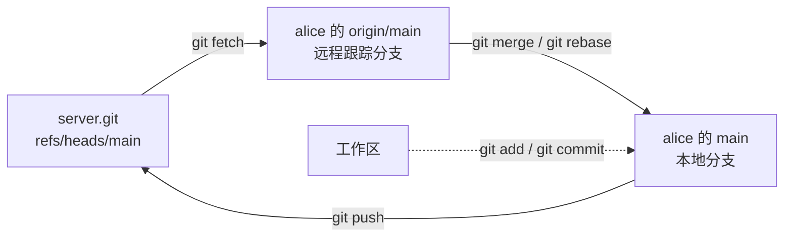

# 17. Git 协作

wordfreq 写到 v0.2 时，项目里多了一位开发者 bob。两人各自在本地提交、编译、跑测试，都没有问题；等到把改动合到一起，`src/report.c` 里同一段代码被改了两遍，期望输出文件也对不上。这类问题不会在某一个人的本地暴露，只有把两边的提交放在一起才会出现。

这一章把 wordfreq 放进团队的工作方式里：克隆远程仓库、在功能分支上提交、发起拉取请求并参与评审、解决合并与变基时的冲突、推送前整理提交、用补丁交换改动、用 `git bisect` 自动找出引入回归的提交，最后用 `.gitattributes` 统一换行符。全部演示都在本地建出的仓库里完成，不需要网络；托管平台上的操作只描述步骤。

读这一章之前，应该已经会在本地提交、查看历史、建立分支与合并，并解决过一次简单的冲突（[第 4 章](/教程/正文/开发与工程基础/4_Git本地工作流)）；项目这边要求 wordfreq 能由 Make 或 CMake 构建、能跑 CTest（[第 8 章](/教程/正文/开发与工程基础/8_构建图与Make)、[第 9 章](/教程/正文/开发与工程基础/9_CMake与XMake)、[第 11 章](/教程/正文/开发与工程基础/11_自动化测试)）。

正文的终端输出来自 Debian 13 上的 Git 2.47.3。演示仓库的作者和提交时间是固定的，提交哈希可以复现。`code/开发与工程基础/17_Git协作/setup_demo.sh` 在工作目录里建好一个裸仓库与 alice、bob 两份克隆，`bisect_demo.sh` 生成 bisect 用的提交链；两个脚本都用 `GIT_CONFIG_GLOBAL` 指到工作目录内的配置文件，不改本机的全局设置。

## 1. 远程仓库

Git 是分布式的：每个克隆都是一份完整的仓库，包含全部提交、全部分支和全部历史，不只是当前检出的那些文件。所谓「服务器」，通常只是一个没有工作区的裸仓库 (bare repository)，收到推送就更新分支指针，别的功能一概不做。本章用本地目录里的一个裸仓库代替服务器，命令与连到 GitHub、GitLab 上完全一样，区别只在 URL。

`setup_demo.sh` 先建好裸仓库，再把 wordfreq 的一份快照推上去，最后克隆出 alice 和 bob 两份：

::: terminal title="zsh - sh setup_demo.sh"

```text
$ sh setup_demo.sh demo
demo ready in demo (server.git, alice, bob)
```

:::

它做的事与手工操作等价：

::: terminal title="zsh - demo"

```text
$ git init --bare --initial-branch=main server.git
$ cd seed
$ git init
$ git add -A
$ git commit -m "wordfreq v0.2"
$ git remote add origin ../server.git
$ git push origin main
$ cd ..
$ git clone server.git alice
$ git clone server.git bob
$ git -C alice remote set-url origin ../server.git
$ git -C bob remote set-url origin ../server.git
```

:::

最后两行把记录的 URL 改成相对路径，演示目录整体挪走也能继续用；克隆时写什么 URL，`remote -v` 就显示什么。`git init --bare` 只建 `.git` 里的那些内容，不建工作区，所以裸仓库里看不到源码文件，目录结构与普通仓库的 `.git` 子目录相同：

::: terminal title="zsh - demo"

```text
$ ls server.git
branches
config
description
HEAD
hooks
info
objects
refs
$ git --git-dir=server.git log --oneline
ca8c929 wordfreq v0.2
```

:::

`--git-dir` 让 Git 对一个没有工作区的仓库执行命令。在克隆里看远程：

::: terminal title="zsh - alice"

```text
$ git remote -v
origin	../server.git (fetch)
origin	../server.git (push)
$ git branch -a
* main
  remotes/origin/HEAD -> origin/main
  remotes/origin/main
$ git log --oneline --decorate
ca8c929 (HEAD -> main, origin/main, origin/HEAD) wordfreq v0.2
```

:::

`git clone` 自动建立一个名为 `origin` 的远程 (remote)，并把克隆时的 URL 记进 `.git/config`：

::: terminal title="zsh - alice"

```text
$ git config --get remote.origin.url
../server.git
$ git config --get-regexp '^remote'
remote.origin.url ../server.git
remote.origin.fetch +refs/heads/*:refs/remotes/origin/*
```

:::

第二行是取回规则，下一节解释。`origin` 只是一个约定俗成的名字，可以改，也可以同时配置多个远程，例如把上游主仓库叫 `upstream`、自己 fork 出来的叫 `origin`。每个人手里都是完整仓库，任何一份克隆都可以在断网时照常提交、建分支、查历史；网络只用于交换提交。

::: concept git-remote-clone title="克隆与远程"

`git clone` 复制远程仓库的全部提交与分支，在本地建立一个与远程默认分支同名的分支，把它设为当前分支，并配置一个名为 `origin` 的远程。克隆之后，两份仓库各自独立演化，只通过 `fetch`、`push` 交换提交。裸仓库没有工作区，适合放在服务器上充当集散点。

:::

## 2. 远程跟踪分支

克隆时，Git 除了在本地建立 `main`，还记下了远程的 `main` 当时指向哪个提交，这个引用叫 `origin/main`，属于远程跟踪分支 (remote-tracking branch)。它不是真正的分支，不能切换过去，也不能在它上面提交；它是一份本地记录，记着「上一次和远程通信时，远程的 main 在哪里」。

两者可以分别移动。bob 改了 README 末尾并推送：

::: terminal title="zsh - bob"

```text
$ printf '\n## 退出状态\n\n参数写错时退出状态为 2，文件打不开时为 1。\n' >> README.md
$ git add README.md
$ git commit -m "docs: 说明退出状态"
[main 7339a37] docs: 说明退出状态
 1 file changed, 4 insertions(+)
$ git push
To ../server.git
   ca8c929..7339a37  main -> main
```

:::

alice 改的是 README 开头的简介，与 bob 改的末尾不冲突。她提交后推送，被拒绝了：

::: terminal title="zsh - alice"

```text
$ git commit -m "docs: 补充项目简介"
[main 5cc8073] docs: 补充项目简介
 1 file changed, 1 insertion(+), 1 deletion(-)
$ git push
To ../server.git
 ! [rejected]        main -> main (fetch first)
error: failed to push some refs to '../server.git'
hint: Updates were rejected because the remote contains work that you do not
hint: have locally. This is usually caused by another repository pushing to
hint: the same ref. If you want to integrate the remote changes, use
hint: 'git pull' before pushing again.
hint: See the 'Note about fast-forwards' in 'git push --help' for details.
```

:::

拒绝的原因是快进不成立：远程的 `main` 已经指向 bob 的提交，alice 的提交不在它的后代里，推上去会丢掉 bob 的工作。普通 `git push` 只做快进更新，不会替人决定怎么整合。此时 `git status` 仍然显示本地领先一个提交，因为它比较的是 `main` 与本地记录的 `origin/main`，而后者还没更新：

::: terminal title="zsh - alice"

```text
$ git status
On branch main
Your branch is ahead of 'origin/main' by 1 commit.
  (use "git push" to publish your local commits)

nothing to commit, working tree clean
$ git status -sb
## main...origin/main [ahead 1]
```

:::

`git fetch` 只做一件事：把远程的新提交取回本地，并移动 `origin/main`。工作区、当前分支、暂存区一个都不动：

::: terminal title="zsh - alice"

```text
$ git fetch
From ../server
   ca8c929..7339a37  main       -> origin/main
$ git status -sb
## main...origin/main [ahead 1, behind 1]
$ git log --oneline --graph --all --decorate
* 5cc8073 (HEAD -> main) docs: 补充项目简介
| * 7339a37 (origin/main, origin/HEAD) docs: 说明退出状态
|/  
* ca8c929 wordfreq v0.2
```

:::

`--all` 把 `origin/main` 也画进来，两条提交线在 `ca8c929` 处分叉。`ahead 1, behind 1` 是 `git status -sb` 对这两个数字的写法：本地有一个远程没有的提交，远程有一个本地没有的提交。README 还是本地版本，`fetch` 并没有把 bob 的改动写进工作区。

本地分支、远程跟踪分支与远程仓库三者的关系：



要把远程的改动并进本地分支，可以先 `fetch` 再 `merge`，也可以直接用 `git pull`。`pull` 就是「fetch + 整合」，整合方式由参数或配置决定。两条分支已经分叉、又没有配置默认方式时，较新的 Git 拒绝猜：

::: terminal title="zsh - alice"

```text
$ git pull
hint: You have divergent branches and need to specify how to reconcile them.
hint: You can do so by running one of the following commands sometime before
hint: your next pull:
hint:
hint:   git config pull.rebase false  # merge
hint:   git config pull.rebase true   # rebase
hint:   git config pull.ff only       # fast-forward only
hint:
hint: You can replace "git config" with "git config --global" to set a default
hint: preference for all repositories. You can also pass --rebase, --no-rebase,
hint: or --ff-only on the command line to override the configured default per
hint: invocation.
fatal: Need to specify how to reconcile divergent branches.
```

:::

`pull.rebase`、`pull.ff` 任选一个写进配置，之后 `git pull` 就按它执行；也可以每次在命令行上给出 `--no-rebase`、`--rebase`、`--ff-only`。三者的差别：`pull.ff only` 最安全，分叉时直接报错、绝不自动合并；`--no-rebase` 产生一个合并提交；`--rebase` 把本地提交挪到远程提交之后（第 6 节）。团队一般把这个选择写进仓库的说明，免得每个人各拉各的。这里先按合并处理：

::: terminal title="zsh - alice"

```text
$ git pull --no-rebase
Auto-merging README.md
Merge made by the 'ort' strategy.
 README.md | 4 ++++
 1 file changed, 4 insertions(+)
$ git log --oneline --graph --all --decorate
*   7021fc5 (HEAD -> main) Merge branch 'main' of ../server
|\  
| * 7339a37 (origin/main, origin/HEAD) docs: 说明退出状态
* | 5cc8073 docs: 补充项目简介
|/  
* ca8c929 wordfreq v0.2
$ git push
To ../server.git
   7339a37..7021fc5  main -> main
$ git status -sb
## main...origin/main
```

:::

合并提交的说明是 Git 自动生成的 `Merge branch 'main' of ../server`，其中 `../server` 来自远程的 URL。推送成功后远程的 `main` 前进到合并提交，本地记录的 `origin/main` 也跟上，两边又对齐了。

`git remote show origin` 把远程与本地分支的关系汇总起来看：

::: terminal title="zsh - alice"

```text
$ git remote show origin
* remote origin
  Fetch URL: ../server.git
  Push  URL: ../server.git
  HEAD branch: main
  Remote branch:
    main tracked
  Local branch configured for 'git pull':
    main merges with remote main
  Local ref configured for 'git push':
    main pushes to main (up to date)
```

:::

<Quiz
  type="single"
  :options="[
    { label: '把远程的新提交取回本地，并移动 origin/main', value: 'A' },
    { label: '把远程的新提交合并进当前的 main', value: 'B' },
    { label: '把本地提交推送到远程', value: 'C' },
    { label: '删除本地已经合并的分支', value: 'D' }
  ]"
  answer="A"
>

`git fetch` 做完之后，哪些东西变了？

正确答案是 **A**。`fetch` 只更新远程跟踪分支和它取回的对象，工作区与当前分支都不动；把改动并进本地分支是 `merge` 或 `rebase` 的事，`pull` 把这两步合在一起。

</Quiz>

## 3. 功能分支与拉取请求

直接在 `main` 上开发，每次推送都要和别人抢同一个分支，冲突也会落到所有人头上。团队通常让 `main` 始终保持可发布，每项改动新开一个功能分支 (feature branch)，推上去之后请人评审，通过了再合进 `main`。这是在 GitHub 上通行的工作方式，GitLab、Gitee 都支持，只是把「拉取请求」叫成「合并请求」。

alice 要给输出加表头。她从 `main` 开出分支并改代码：

::: terminal title="zsh - alice"

```text
$ git switch -c format
Switched to a new branch 'format'
$ git diff
diff --git a/src/report.c b/src/report.c
index 393e56c..7eee621 100644
--- a/src/report.c
+++ b/src/report.c
@@ -1,7 +1,8 @@
 #include "wf/report.h"
 
 void wf_report_print(FILE *out, const wf_entry *entries, size_t n) {
+    fputs("  count  word\n", out);
     for (size_t i = 0; i < n; i++) {
-        fprintf(out, "%7zu %s\n", entries[i].count, entries[i].word);
+        fprintf(out, "%7zu  %s\n", entries[i].count, entries[i].word);
     }
 }
diff --git a/tests/data/sample.expected b/tests/data/sample.expected
index cd63850..ac61676 100644
--- a/tests/data/sample.expected
+++ b/tests/data/sample.expected
@@ -1,3 +1,4 @@
-      4 the
-      2 on
-      2 sat
+  count  word
+      4  the
+      2  on
+      2  sat
```

:::

改了输出格式就得同步改期望输出文件，否则端到端测试（[第 11 章](/教程/正文/开发与工程基础/11_自动化测试)）必然失败。提交前在这份树上跑一遍 CTest：

::: terminal title="zsh - alice"

```text
$ cmake --build build
$ ctest --test-dir build
Internal ctest changing into directory: /home/minsecrus/tutorial/work/ch17/demo/alice/build
Test project /home/minsecrus/tutorial/work/ch17/demo/alice/build
    Start 1: token
1/3 Test #1: token ............................   Passed    0.00 sec
    Start 2: counter
2/3 Test #2: counter ..........................   Passed    0.00 sec
    Start 3: e2e
3/3 Test #3: e2e ..............................   Passed    0.01 sec

100% tests passed, 0 tests failed out of 3
```

:::

提交、推送：

::: terminal title="zsh - alice"

```text
$ git add src/report.c tests/data/sample.expected
$ git commit -m "feat: 输出加表头并加宽两列间距"
[format 205d966] feat: 输出加表头并加宽两列间距
 2 files changed, 6 insertions(+), 4 deletions(-)
$ git push -u origin format
To ../server.git
 * [new branch]      format -> format
branch 'format' set up to track 'origin/format'.
```

:::

第一次推送新分支时用 `git push -u`（等价于 `--set-upstream`），把本地分支和远程分支关联起来，之后直接 `git push`、`git pull` 就够了。`git branch -vv` 把每个分支的上游和领先落后数一起列出来：

::: terminal title="zsh - alice"

```text
$ git branch -vv
* format 205d966 [origin/format] feat: 输出加表头并加宽两列间距
  main   7021fc5 [origin/main] Merge branch 'main' of ../server
$ git config --get branch.format.remote
origin
$ git config --get branch.format.merge
refs/heads/format
```

:::

方括号里就是上游，`git status -sb` 的 ahead/behind 也以它为准。这个关系是 `.git/config` 里的两组键：`branch.<分支>.remote` 指定远程名，`branch.<分支>.merge` 指定远程上的哪个分支。

<Quiz
  type="single"
  :options="[
    { label: '本地分支没有设置上游，Git 不知道推到哪里', value: 'A' },
    { label: '远程仓库是裸仓库，不能接收推送', value: 'B' },
    { label: '本地分支比远程落后，需要先合并', value: 'C' },
    { label: '提交里含有二进制文件', value: 'D' }
  ]"
  answer="A"
>

在克隆出来的仓库里新开一个分支、提交之后直接执行 `git push`，Git 报 `The current branch ... has no upstream branch` 并要求 `--set-upstream`，原因是什么？

正确答案是 **A**。`git push` 不带参数时按上游决定推送到哪个远程的哪个分支，新分支还没有这个记录，`-u`（等价于 `--set-upstream`）就是把它写上。裸仓库照常接收推送；落后时给出的是另一条 non-fast-forward 提示。

</Quiz>

远程上现在有一个 `format` 分支。`git ls-remote` 可以直接列出远程的所有引用，不需要克隆：

::: terminal title="zsh - alice"

```text
$ git ls-remote
From ../server.git
7021fc5e187a25b5aeb068feea04392fe2cef2c8	HEAD
205d966d352d04abffdd7d396df8a060b5510f06	refs/heads/format
7021fc5e187a25b5aeb068feea04392fe2cef2c8	refs/heads/main
```

:::

推上去之后，在托管平台的网页上从 `format` 向 `main` 发起拉取请求 (pull request, PR)。GitLab 把它叫合并请求 (merge request, MR)，操作相同：选源分支和目标分支，写标题和描述，指定评审人。

描述是评审者最先看到的东西，值得按固定格式写。下面是一份可以直接放在仓库 `.github/pull_request_template.md` 里的模板，以及照它填好的一份：

::: code-group

```markdown [.github/pull_request_template.md]
## 问题

<!-- 这个改动解决什么问题？相关 issue 编号。 -->

## 改动

<!-- 做了什么，为什么这样做。有取舍时写清放弃了哪种方案。 -->

## 测试

<!-- 新增或修改了哪些测试；本地怎么复现。 -->

- [ ] 本地构建通过（Make 与 CMake 各一次）
- [ ] `ctest --test-dir build` 全部通过
- [ ] 新增的公开接口有测试
- [ ] 没有提交构建产物（`git status` 干净）
```

```markdown [实际填写]
## 问题

`wordfreq -n 3` 的输出没有表头，读者看不出第一列是次数。
次数与单词之间只有一列空格，两位数的次数会挤在一起。

## 改动

`wf_report_print` 在循环前输出一行表头，次数列与单词列之间加宽到两列。
`tests/data/sample.expected` 按新格式更新。

## 测试

`ctest --test-dir build` 三个测试全部通过。
手工运行 `./build/wordfreq -n 3 tests/data/sample.txt`，输出与期望文件一致。
```

:::

描述里不写「见上面」「同上」这类指代，也不写「优化了代码」这种没有信息量的话。评审者要判断的是改得对不对，描述该提供的是取舍和验证方式。

PR 是托管平台上的一个对象，本身不在 Git 仓库里。平台在 PR 上跑自动化检查（CI，[第 18 章](/教程/正文/开发与工程基础/18_持续集成)），分支更新后自动重跑；检查全绿、评审通过，由有权限的人点合并。评审者在 PR 页面逐行留言，作者在同一分支上追加提交即可，PR 自动带上新提交，不需要重开。

合并有三种方式，差别在 `main` 上留下什么形状：

| 方式 | 本地等价操作 | `main` 上得到什么 |
| --- | --- | --- |
| 创建合并提交 | `git merge --no-ff <分支>` | 一个有两个父提交的合并提交，分支上的提交原样保留 |
| 压缩合并 (squash) | `git merge --squash <分支>` 后 `git commit` | 一条普通提交，分支上的所有改动合成一个 |
| 变基合并 (rebase merge) | `git rebase main <分支>` 后 `git merge --ff-only <分支>` | 分支上的提交接到 `main` 末尾，没有合并提交 |

alice 的 `format` 分支只有一条提交，三种方式差别不大。如果分支上有两条提交，形状的差别一眼就能看出来。用一个更小的仓库演示：`feat` 分支上改两处，`main` 上另有一处改动，两边的改动不冲突。

合并提交：

::: terminal title="zsh - demo"

```text
$ git merge --no-ff -m "Merge branch 'feat'" feat
Merge made by the 'ort' strategy.
 feature.txt | 2 ++
 1 file changed, 2 insertions(+)
 create mode 100644 feature.txt
$ git log --oneline --graph --decorate
*   173c004 (HEAD -> main) Merge branch 'feat'
|\  
| * 8dcea28 (feat) feat: 第二步
| * 0ea8b95 feat: 第一步
* | 8bb628e docs: main 上的另一处改动
|/  
* bb7f988 init
```

:::

分支上的两条提交原样保留，合并提交有两个父提交（`feat` 的顶端与 `main` 原来的顶端），把它们接回 `main`。压缩合并：

::: terminal title="zsh - demo"

```text
$ git merge --squash feat
Automatic merge went well; stopped before committing as requested
Squash commit -- not updating HEAD
$ git commit -m "feat: 增加 feature.txt (#2)"
$ git log --oneline --graph --decorate
* 581ece3 (HEAD -> main) feat: 增加 feature.txt (#2)
* 8bb628e docs: main 上的另一处改动
* bb7f988 init
```

:::

`--squash` 只把改动放进暂存区，不创建提交，也不移动 `HEAD`，所以还要自己 `git commit`，说明也要自己写；平台上的「Squash and merge」把这一步自动做完。`main` 上只多了一条提交，`feat` 上那两条提交的改动合成了一条，各自的身份与说明都不再出现在 `main` 上。变基合并：

::: terminal title="zsh - demo"

```text
$ git switch feat
Switched to branch 'feat'
$ git rebase main
Rebasing (1/2)Rebasing (2/2)Successfully rebased and updated refs/heads/feat.
$ git switch main
Switched to branch 'main'
$ git merge --ff-only feat
Updating 8bb628e..079325f
Fast-forward
 feature.txt | 2 ++
 1 file changed, 2 insertions(+)
 create mode 100644 feature.txt
$ git log --oneline --graph --decorate
* 079325f (HEAD -> main, feat) feat: 第二步
* 8ad5b44 feat: 第一步
* 8bb628e docs: main 上的另一处改动
* bb7f988 init
```

:::

先在 `feat` 上执行 `git rebase main`，把它的两条提交重放到 `main` 末尾（哈希因此变了）；再切回 `main` 用 `git merge --ff-only feat` 快进过去。没有合并提交，`main` 上是一条直线，`feat` 的两条提交一条接一条排在 `main` 原有提交之后。

压缩合并把几条提交变成一条：原来那几条提交上的哈希、作者信息、逐条说明都不再出现在 `main` 上。好处是历史干净，每条提交对应一件事，`git log --oneline` 读起来就是功能清单。代价是不能按提交粒度 `revert`，也看不到开发中的中间状态。变基合并保留每条提交的内容和说明，只是哈希变了（父提交不同）。

多数项目选一种作为默认，少见三种都放开。

合并之后删除分支，本地和远程各删一次：

::: terminal title="zsh - alice"

```text
$ git switch main
$ git merge --no-ff -m "Merge branch 'format'" format
Merge made by the 'ort' strategy.
 src/report.c               | 3 ++-
 tests/data/sample.expected | 7 ++++---
 2 files changed, 6 insertions(+), 4 deletions(-)
$ git push
To ../server.git
   7021fc5..ee87b45  main -> main
$ git branch -d format
Deleted branch format (was 205d966).
$ git push origin --delete format
To ../server.git
 - [deleted]         format
$ git log --oneline --graph --all --decorate
*   ee87b45 (HEAD -> main, origin/main, origin/HEAD) Merge branch 'format'
|\  
| * 205d966 feat: 输出加表头并加宽两列间距
|/  
*   7021fc5 Merge branch 'main' of ../server
|\  
| * 7339a37 docs: 说明退出状态
* | 5cc8073 docs: 补充项目简介
|/  
* ca8c929 wordfreq v0.2
```

:::

`git branch -d` 只删已经合并的分支，没有合并时拒绝，要删得用 `-D`。`git push origin --delete` 删远程分支。留在每个人本地的 `origin/format` 不会自动消失，`git fetch --prune` 清掉这类远程已删除的跟踪分支。

不在托管平台上时，功能分支照样可以开，只是「请人评审」得换一种方式。Linux 内核、Git 本身这样的项目用邮件列表收补丁：作者用 `git format-patch` 把提交导出成带元数据的文本，接收方用 `git am` 应用。wordfreq 的 bob 把 `feat: 末尾输出总数` 导出之后长这样：

::: terminal title="zsh - bob"

```text
$ git format-patch -1 --stdout
From 248e7689f01a021aba9c251a9766974dc3c9d4a8 Mon Sep 17 00:00:00 2001
From: bob <bob@example.com>
Date: Tue, 20 Oct 2026 12:00:00 +0800
Subject: [PATCH] =?UTF-8?q?feat:=20=E6=9C=AB=E5=B0=BE=E8=BE=93=E5=87=BA?=
 =?UTF-8?q?=E6=80=BB=E6=95=B0?=
MIME-Version: 1.0
Content-Type: text/plain; charset=UTF-8
Content-Transfer-Encoding: 8bit

---
 src/report.c               | 3 +++
 tests/data/sample.expected | 1 +
 2 files changed, 4 insertions(+)

diff --git a/src/report.c b/src/report.c
index 393e56c..41ee0fb 100644
--- a/src/report.c
+++ b/src/report.c
@@ -1,7 +1,10 @@
 #include "wf/report.h"
 
 void wf_report_print(FILE *out, const wf_entry *entries, size_t n) {
+    size_t total = 0;
     for (size_t i = 0; i < n; i++) {
+        total += entries[i].count;
         fprintf(out, "%7zu %s\n", entries[i].count, entries[i].word);
```

:::

中文标题会被编码成 `=?UTF-8?q?...?=` 的形式，这是邮件头的规定，不是乱码。`-1` 只导出最近的提交，不带参数则导出当前分支相对上游的全部提交，每条一个文件，文件名带序号。接收方在对应的提交上应用：

::: terminal title="zsh - 收件人"

```text
$ git switch -c patch-test 7021fc5
$ git am < 0001-totals.patch
Applying: feat: 末尾输出总数
$ git log --format='%h %an %ad | committer %cn %cd' --date=iso -1
6734a04 bob 2026-10-20 12:00:00 +0800 | committer carol 2026-10-22 00:58:10 +0900 | feat: 末尾输出总数
$ git diff 248e768 HEAD --stat
$ echo $?
0
```

:::

补丁里带着原作者和原始日期，所以 `git am` 得到的提交作者仍是 bob、时间仍是原来的；提交者和提交时间变了（变成了应用补丁的人），哈希因此也不一样。`git diff` 为空说明改动本身一字不差。`git cherry-pick` 做的是同一件事：把某条提交的改动重放到当前分支，作者保留、提交者换成自己。两者都只搬运改动，不建立任何长期联系：补丁应用之后，后续的改动还得再发补丁或做合并。

## 4. 代码评审

评审 (code review) 是让别人在改动合入之前看一眼的过程，目的不是挑错，而是让代码合入后不需要返工。Google 的工程实践把评审者该看的东西分成几类，按重要性排列：

| 看什么 | 具体问题 |
| --- | --- |
| 设计 | 这个改动放在这里合适吗？接口该不该暴露？有没有更简单的做法？ |
| 功能 | 代码是否真的实现了作者声称的功能？异常输入处理了吗？ |
| 复杂度 | 能否用更少的代码或更直接的结构完成？有没有过度设计？ |
| 测试 | 测试是否覆盖了新逻辑？失败时能不能定位到原因？ |
| 命名 | 名字是否说明了用途？缩写对外人是否可读？ |
| 注释 | 注释解释的是为什么，还是复述代码在做什么？ |
| 风格 | 是否与仓库现有风格一致？格式问题交给 `clang-format` 检查，不在评论里争 |
| 文档 | README、接口注释是否同步更新？ |

作者这边有两条经验最有用。一是改动保持小：几百行的 PR 认真看一遍要一小时，几十行的 PR 几分钟就能看完，而且更容易发现问题。一次提交只做一件事，评审时每处改动都有清楚的上下文。二是回应意见时用新提交，不要为了「保持历史好看」去 force push 覆盖评审过程中的提交，评审者需要看到每条意见是怎么处理的；等评审通过、准备合并时再整理（第 7 节）。

讨论过程尽量落在代码里。评审里达成的约定（「这个函数不许返回负值」「这里必须加锁」）写进接口注释或提交说明，下次有人改到这里会看到；只留在 PR 评论里的结论，过半年就没人找得到。

::: tip 评审者和作者各问一个问题

评审者问：「如果这段代码明天出问题，我看得懂它在做什么吗？」作者问：「如果我明天收到评审意见，能只改这一处、不牵动别的地方吗？」两个问题都答「是」，改动就差不多可以合了。

:::

## 5. 解决冲突

冲突来自两边的改动落在同一处。bob 在 `totals` 分支上让 `wf_report_print` 在末尾多打一行总数，alice 的 `format` 分支给同一段加了表头、加宽了列间距。两边都合进 `main` 之后，bob 把 `main` 拉进自己的分支：

::: terminal title="zsh - bob"

```text
$ git pull --no-rebase origin main
From ../server
 * branch            main       -> FETCH_HEAD
Auto-merging src/report.c
CONFLICT (content): Merge conflict in src/report.c
Auto-merging tests/data/sample.expected
CONFLICT (content): Merge conflict in tests/data/sample.expected
Automatic merge failed; fix conflicts and then commit the result.
```

:::

Git 成功合了一部分（`Auto-merging`），但 `wf_report_print` 的循环体两边都改过，它无法判断该保留哪一边。冲突的文件里两个版本并排摆着，用标记隔开：

::: terminal title="zsh - bob"

```text
$ git status
On branch totals
You have unmerged paths.
  (fix conflicts and run "git commit")
  (use "git merge --abort" to abort the merge)

Unmerged paths:
  (use "git add <file>..." to mark resolution)
	both modified:   src/report.c
	both modified:   tests/data/sample.expected

no changes added to commit (use "git add" and/or "git commit -a")
$ git status --short
UU src/report.c
UU tests/data/sample.expected
```

:::

`UU` 表示两边都改过、还没解决。`git status` 提示里的几个命令各对应一种去向：改好之后 `git add` 标记解决、`git commit` 完成合并；不想合了用 `git merge --abort` 回到合并前。

冲突标记的原文：

::: terminal title="zsh - bob"

```text
$ cat -n src/report.c
     1	#include "wf/report.h"
     2	
     3	void wf_report_print(FILE *out, const wf_entry *entries, size_t n) {
     4	<<<<<<< HEAD
     5	    size_t total = 0;
     6	    for (size_t i = 0; i < n; i++) {
     7	        total += entries[i].count;
     8	        fprintf(out, "%7zu %s\n", entries[i].count, entries[i].word);
     9	    }
    10	    fprintf(out, "  total  %zu\n", total);
    11	=======
    12	    fputs("  count  word\n", out);
    13	    for (size_t i = 0; i < n; i++) {
    14	        fprintf(out, "%7zu  %s\n", entries[i].count, entries[i].word);
    15	    }
    16	>>>>>>> ee87b450acfa4af830891584c9ef1427ef1bca1b
    17	}
```

:::

`<<<<<<< HEAD` 到 `=======` 之间是当前分支（`totals`）的版本，`=======` 到 `>>>>>>>` 之间是拉进来的 `main` 的版本。`>>>>>>>` 后面这一长串在本地合并时是分支名，从远程拉取时 Git 写的是远程提交的哈希，所以这里看到的是 `ee87b45` 的全长。两边改的是同一段，Git 把整段都标出来，实际上两处改动并不矛盾：表头和加宽是格式，总数是内容，可以同时保留。

冲突状态下编译一定失败，因为编译器认得这三行标记：

::: terminal title="zsh - bob"

```text
$ cmake --build build
/home/minsecrus/tutorial/work/ch17/demo/bob/src/report.c:4:1: error: version control conflict marker in file
/home/minsecrus/tutorial/work/ch17/demo/bob/src/report.c:7:9: error: ‘total’ undeclared (first use in this function)
/home/minsecrus/tutorial/work/ch17/demo/bob/src/report.c:9:1: error: version control conflict marker in file
/home/minsecrus/tutorial/work/ch17/demo/bob/src/report.c:11:17: warning: declaration of ‘i’ shadows a previous local [-Wshadow]
/home/minsecrus/tutorial/work/ch17/demo/bob/src/report.c:13:1: error: version control conflict marker in file
/home/minsecrus/tutorial/work/ch17/demo/bob/src/report.c:16:1: error: expected declaration or statement at end of input
```

:::

带 `version control conflict marker` 的几条针对标记本身；`total undeclared` 和末尾那条 `end of input` 是标记把函数结构拆坏之后的结果。都不必逐条读，先把标记处理掉。

解决冲突靠理解两边的意图，不是选一边了事。这里的意图是「表头 + 加宽的两列 + 末尾的总数」，手写的结果：

::: compare left-title="冲突标记留着" right-title="按两边意图合并"

```c
    for (size_t i = 0; i < n; i++) {
<<<<<<< HEAD
        total += entries[i].count;
        fprintf(out, "%7zu %s\n", entries[i].count, entries[i].word);
=======
        fprintf(out, "%7zu  %s\n", entries[i].count, entries[i].word);
>>>>>>> ee87b45
    }
```

---

```c
    fputs("  count  word\n", out);
    size_t total = 0;
    for (size_t i = 0; i < n; i++) {
        total += entries[i].count;
        fprintf(out, "%7zu  %s\n", entries[i].count, entries[i].word);
    }
    fprintf(out, "  total  %zu\n", total);
```

:::

解决之后先构建、运行、跑测试，全都通过再提交：

::: terminal title="zsh - bob"

```text
$ cmake --build build
$ ./build/wordfreq -n 3 tests/data/sample.txt
  count  word
      4  the
      2  on
      2  sat
  total  8
$ ctest --test-dir build
Test project /home/minsecrus/tutorial/work/ch17/demo/bob/build
    Start 1: token
1/3 Test #1: token ............................   Passed    0.00 sec
    Start 2: counter
2/3 Test #2: counter ..........................   Passed    0.00 sec
    Start 3: e2e
3/3 Test #3: e2e ..............................   Passed    0.01 sec

100% tests passed, 0 tests failed out of 3
$ git add src/report.c tests/data/sample.expected
$ git status --short
M  src/report.c
M  tests/data/sample.expected
$ git commit
[totals a2d2c42] Merge branch 'main' of ../server into totals
```

:::

`git commit` 不带 `-m` 会用编辑器打开一段预填的合并说明，直接保存即可。提交之后 `git log --graph` 会看到两条线在这一点汇合。

`tests/data/sample.expected` 也冲突了，处理方式相同。它是一份期望输出，按合并后的程序的实际输出重写即可，不必手工拼两个版本。这也是端到端测试文件的好处：正确结果可以由程序自己生成。

::: warning 冲突解决完必须重新编译和测试

冲突标记删干净、文件看着「差不多对」，并不代表语义正确。两个改动可能各自能编译、合在一起编译不过，或者编译得过但结果错。解决冲突的最后一步永远是构建并运行测试，之后才 `git add` 与 `git commit`。

:::

## 6. 变基

合并保留了两条开发线，历史里因此多出许多来回交叉的合并提交。变基 (rebase) 换一种做法：把当前分支上的提交先摘下来，再逐个重新接到目标分支的末尾。结果是一条直线，读历史时不必在分叉之间跳。

alice 要给 wordfreq 加 `--` 选项，让 `-` 开头的文件名也能当参数：

::: terminal title="zsh - alice"

```text
$ git switch -c dashdash
Switched to a new branch 'dashdash'
$ git diff
diff --git a/app/main.c b/app/main.c
index 447d118..a28b0e8 100644
--- a/app/main.c
+++ b/app/main.c
@@ -136,6 +136,10 @@ int main(int argc, char *argv[]) {
     size_t n = DEFAULT_N;
     int argi = 1;
     while (argi < argc && argv[argi][0] == '-') {
+        if (strcmp(argv[argi], "--") == 0) {
+            argi++;
+            break;
+        }
         if (strcmp(argv[argi], "-n") == 0 && argi + 1 < argc &&
             parse_count(argv[argi + 1], &n) == 0) {
             argi += 2;
$ git add app/main.c
$ git commit -m "feat: 支持 -- 结束选项解析"
[dashdash f79b654] feat: 支持 -- 结束选项解析
 1 file changed, 4 insertions(+)
$ git push -u origin dashdash
To ../server.git
 * [new branch]      dashdash -> dashdash
branch 'dashdash' set up to track 'origin/dashdash'.
```

:::

与此同时 bob 在 `main` 上加了 `-h` 帮助，改的是 `main` 里同一段参数循环。他推上去之后，alice 执行 `git fetch` 就会看到自己与 `origin/main` 分叉了。她变基时碰到冲突：

::: terminal title="zsh - alice"

```text
$ git rebase origin/main
Rebasing (1/1)Auto-merging app/main.c
CONFLICT (content): Merge conflict in app/main.c
error: could not apply f79b654... feat: 支持 -- 结束选项解析
hint: Resolve all conflicts manually, mark them as resolved with
hint: "git add/rm <conflicted_files>", then run "git rebase --continue".
hint: You can instead skip this commit: run "git rebase --skip".
hint: To abort and get back to the state before "git rebase", run "git rebase --abort".
hint: Disable this message with "git config advice.mergeConflict false"
Could not apply f79b654... feat: 支持 -- 结束选项解析
```

:::

变基中的冲突与合并中的冲突是同一回事，处理方式也一样，只是完成动作换成 `git rebase --continue`，放弃整个变基用 `git rebase --abort`，跳过这一条提交用 `git rebase --skip`。`git status` 在变基期间会说明进行到哪一步：

::: terminal title="zsh - alice"

```text
$ git status
interactive rebase in progress; onto bd17474
Last command done (1 command done):
   pick f79b654 feat: 支持 -- 结束选项解析
No commands remaining.
You are currently rebasing branch 'dashdash' on 'bd17474'.
  (fix conflicts and then run "git rebase --continue")
  (use "git rebase --skip" to skip this patch)
  (use "git rebase --abort" to check out the original branch)

Unmerged paths:
  (use "git restore --staged <file>..." to unstage)
  (use "git add <file>..." to mark resolution)
	both modified:   app/main.c

no changes added to commit (use "git add" and/or "git commit -a")
```

:::

这里的冲突区与合并时一样带三个标记：`HEAD` 一侧是 bob 的 `-h` 判断，另一侧是 alice 的 `--` 判断，两段都要保留。想先退回去重来一次的话：

::: terminal title="zsh - alice"

```text
$ git rebase --abort
$ git status -sb
## dashdash...origin/dashdash
```

:::

分支回到变基之前，工作区干净。重新变基、改好文件之后，`git add` 并继续：

::: terminal title="zsh - alice"

```text
$ git add app/main.c
$ git rebase --continue
[detached HEAD 6533f8d] feat: 支持 -- 结束选项解析
 Author: alice <alice@example.com>
 1 file changed, 4 insertions(+)
Successfully rebased and updated refs/heads/dashdash.
```

:::

`detached HEAD` 是变基过程的中间状态：Git 先把 `HEAD` 摘到一个临时提交上逐条重放，全部完成后才把分支指针移过去。作者信息原样保留，提交哈希变了，因为父提交变了。

把同一处分叉用两种方式整合，历史的形状就分开了。让 alice 和 bob 在同一个 `bd17474` 上各改一处文档：alice 在 README 的「用法」下面加一句，bob 在「目录」下面加一句。alice 的分支 `git merge --no-ff origin/fork-main`，得到的是左边；同一个分支换成 `git rebase origin/fork-main`，得到的是右边：

::: compare left-title="合并：保留分叉" right-title="变基：一条直线"

```text
*   957f525 (HEAD -> merge-shape) Merge remote-tracking branch 'origin/fork-main' into merge-shape
|\  
| * 276966b (origin/fork-main) docs: 补充目录说明
* | 4840924 (origin/fork-base, fork-base) docs: 补充用法说明
|/  
*   bd17474 (origin/main, origin/HEAD) Merge branch 'help'
```

---

```text
* ce41292 (HEAD -> rebase-shape) docs: 补充用法说明
* 276966b (origin/fork-main) docs: 补充目录说明
*   bd17474 (origin/main, origin/HEAD) Merge branch 'help'
|\  
| * d2ff460 (origin/help) feat: 增加 -h 帮助
|/  
```

:::

合并留下一个有两个父提交的合并提交，两条文档提交各在一边；变基没有合并提交，alice 那条提交直接排在 bob 的后面，呈一条直线。两种做法得到的文件内容相同：`ce41292` 与 `4840924` 是同一处改动，只是父提交不同，哈希也就不一样。

这里有一条纪律：

::: concept git-rebase-rewrites title="变基改写提交"

变基为被移动的每条提交生成一个新提交：内容相同，父提交不同，哈希也就不同。因此变基之后的提交与变基之前是两批不同的对象。已经推送、别人可能在它上面继续工作的提交不要变基；已经合入 `main` 的提交更不要变基。只对自己独占的分支做变基。

:::

变基之后分支上的提交与远程记录的那批已经不同，普通推送会被拒绝（non-fast-forward）。如果这个分支确实只有自己用，用 `push --force-with-lease`：

::: terminal title="zsh - alice"

```text
$ git push
To ../server.git
 ! [rejected]        dashdash -> dashdash (non-fast-forward)
error: failed to push some refs to '../server.git'
hint: Updates were rejected because the tip of your current branch is behind
hint: its remote counterpart. If you want to integrate the remote changes,
hint: use 'git pull' before pushing again.
hint: See the 'Note about fast-forwards' in 'git push --help' for details.
$ git push --force-with-lease
To ../server.git
 + f79b654...6533f8d dashdash -> dashdash (forced update)
```

:::

`--force-with-lease` 比 `--force` 多一道检查：它要求远程分支仍停在自己上次看到的位置，如果别人在这期间往这个分支推了新提交，命令会被拒绝，不会把别人的工作覆盖掉。

::: warning 不要对 main 使用 force push

`--force` 与 `--force-with-lease` 都会改写远程分支，让别人的本地提交失去祖先。`main` 这类共享分支上永远不要用，托管平台通常也默认禁止。自己的 PR 分支可以用，但要在 PR 里说明「已变基到最新 main」，方便评审者重新看差异。

:::

`--force-with-lease` 的检查依据是本地记录的 `origin/<分支>`：远程还停在这个位置才允许覆盖。`git fetch` 会把这条记录更新成远程的最新状态，所以在 fetch 之后立刻 force push，检查就等于没有。

每次拉取都想自动变基时，设置 `git config pull.rebase true`。好处是 `main` 上始终是一条线；代价是本地提交的哈希会被悄悄改掉，如果本地已经把这些提交推出去过，之后推送就得 force。个人分支上顺手，团队共享的分支上容易出事故，多数人只在明确需要时用 `git pull --rebase`。

## 7. 推送前整理提交

开发过程中的提交往往零碎：「先存一下」「修个拼写」「刚才那条漏了文件」。推到 PR 之前把它们整理成几条讲得通的提交，评审者读起来轻松，日后 `git log` 也好用。

假设 alice 的 `tidy` 分支上依次提交了三节文档：

::: terminal title="zsh - alice"

```text
$ git log --oneline -4
2ea7740 docs: 增加许可一节
95a25f3 docs: 增加测试一节
2e7bd9a docs: 增加环境要求一节
bd17474 Merge branch 'help'
```

:::

她发现「环境要求」里的 CMake 版本写错了。直接再提交一次「修正」，历史里就多出一条与内容无关的提交。用 `--fixup` 告诉 Git 这条提交要并进哪一条：

::: terminal title="zsh - alice"

```text
$ git diff
diff --git a/README.md b/README.md
index 62fa096..a200388 100644
--- a/README.md
+++ b/README.md
@@ -200,7 +200,7 @@ wordfreq/
 ## 环境要求
 
 需要一个 C17 编译器，GCC 9 以上或 Clang 10 以上都可以。
-构建使用 CMake 3.20 以上。
+构建使用 CMake 3.25 以上，预设文件的版本是 6。
 在 Windows 上需要把 CMake 的 bin 目录加进 PATH。
 
 ## 测试
$ git add README.md
$ git commit --fixup=2e7bd9a
[tidy af75cbd] fixup! docs: 增加环境要求一节
 1 file changed, 1 insertion(+), 1 deletion(-)
```

:::

接着发现「测试」那节漏了 `-L unit`，同样处理：

::: terminal title="zsh - alice"

```text
$ git diff
diff --git a/README.md b/README.md
index a200388..f214b96 100644
--- a/README.md
+++ b/README.md
@@ -206,7 +206,7 @@ wordfreq/
 ## 测试
 
 单元测试与端到端测试都注册进了 CTest。
-ctest --test-dir build 运行全部测试。
+ctest --test-dir build 运行全部测试，包括两个单元测试与一个端到端测试。
 加上 --output-on-failure 可以在失败时看到程序输出。
 
 ## 许可
$ git add README.md
$ git commit --fixup=95a25f3
[tidy 15209c3] fixup! docs: 增加测试一节
 1 file changed, 1 insertion(+), 1 deletion(-)
$ git log --oneline -6
15209c3 fixup! docs: 增加测试一节
af75cbd fixup! docs: 增加环境要求一节
2ea7740 docs: 增加许可一节
95a25f3 docs: 增加测试一节
2e7bd9a docs: 增加环境要求一节
bd17474 Merge branch 'help'
```

:::

`--fixup=<提交>` 生成的提交说明固定写成 `fixup! <目标提交的说明>`，其他地方不变，Git 靠这个前缀知道它属于哪一条。`=<提交>` 里能写任何指代一个提交的写法：哈希、分支名、`HEAD~2` 这类相对位置，只要它能唯一确定目标。

整理用交互式变基，`--autosquash` 让 Git 按 `fixup!` 前缀自动排好：

::: terminal title="zsh - alice"

```text
$ git rev-parse HEAD^{tree}
7b3d36f9fe3a8394e6628125b9c1c6081ba48fdd
$ git rebase -i --autosquash origin/main
Rebasing (2/5)Rebasing (3/5)Rebasing (4/5)Rebasing (5/5)Successfully rebased and updated refs/heads/tidy.
$ git log --oneline -5
34ba2bc docs: 增加许可一节
54f9b25 docs: 增加测试一节
d453806 docs: 增加环境要求一节
bd17474 Merge branch 'help'
d2ff460 feat: 增加 -h 帮助
$ git rev-parse HEAD^{tree}
7b3d36f9fe3a8394e6628125b9c1c6081ba48fdd
```

:::

两条 fixup 各自并进了对应的提交，`fixup!` 打头的说明消失，`main` 上只剩下三条原本的功能提交，每条的内容都是整理之后的版本。这不只是把说明改整齐：`d453806` 里已经带着修正后的 CMake 版本，评审者看那一条提交时看到的就是最终代码，不需要再翻后面的修补。

整理前后最终代码必须完全相同。`HEAD^{tree}` 取当前提交的树对象；把整理前记下的哈希与它比较，`git diff` 没有输出、状态为 0，就说明文件内容一字未动：

::: terminal title="zsh - alice"

```text
$ git diff 7b3d36f9fe3a8394e6628125b9c1c6081ba48fdd HEAD^{tree}
$ echo $?
0
```

:::

大范围整理之前先记下 `git rev-parse HEAD^{tree}`，整理完再对一次。两者不一致，说明过程中动了代码，回去查是哪一步。

`--fixup` 之外还有几种相关的写法：

| 命令 | 用途 |
| --- | --- |
| `git commit --fixup=<提交>` | 把改动并进指定提交，整理时丢弃这条提交的说明 |
| `git commit --squash=<提交>` | 生成 `squash!` 提交，整理时把两条说明拼在一起让你编辑 |
| `git commit --fixup=amend:<提交>` | 并进指定提交，同时用当前提交的说明替换目标提交的说明（Git 2.32 起） |
| `git commit --fixup=reword:<提交>` | 只改目标提交的说明，不带内容改动（Git 2.32 起） |
| `git rebase -i --autosquash` | 按 `fixup!`、`squash!` 前缀自动排列 |

`git rebase -i` 不加 `--autosquash` 时按原顺序打开待办清单，手动把 `pick` 改成 `fixup` 或 `squash` 也能达到同样效果。整理完的提交内容完全一样，`--autosquash` 只是省掉手工排版。

整理提交的前提和变基一样：这条分支只有自己在用，或者还没有推送。整理之后哈希全变，推送到 PR 分支时要 force push。

## 8. 用 bisect 找回归

测试报错说 `The` 没有被转成 `the`，但上一个版本还好好的。中间隔着几十条提交，逐条切过去跑测试太慢。`git bisect` 用二分查找定位：每次判断一个提交是好是坏，每轮把范围砍掉一半。

前提有两个：能确定一个最近的好提交和一个坏提交；每个提交有一个自动化的判断方法。后者通常就是构建加测试的脚本。wordfreq 的 `tools/check.sh` 按退出状态报告结果：

```sh
#!/bin/sh
# git bisect run 用的检查脚本：构建并运行全部测试。
#
#   exit 0    这个提交是好的
#   exit 1    这个提交是坏的（测试失败）
#   exit 125  这个提交无法判定（构建失败），bisect 会跳过它
#
# 在仓库根目录执行，构建目录放在 build-bisect/ 下，不污染 build/。
set -u

BUILD=build-bisect
CC=${CC:-gcc}
# MinGW 的 -Wformat 不认识 %zu，加上这个宏避免无谓的警告噪声
CFLAGS="-std=c17 -Wall -Wextra -Iinclude -D__USE_MINGW_ANSI_STDIO=1"

rm -rf "$BUILD"
mkdir -p "$BUILD"

# 不走 CMake，直接给 config.h 一个保守的值：不定义 getline，用 fgets 路径，
# 任何平台都能编译
mkdir -p "$BUILD/include/wf"
printf '/* 由 check.sh 生成：不启用 getline */\n' > "$BUILD/include/wf/config.h"
CFLAGS="$CFLAGS -I$BUILD/include"

compile() {
    $CC $CFLAGS src/token.c src/counter.c src/report.c app/main.c -o "$BUILD/wordfreq" || exit 125
    $CC $CFLAGS tests/test_token.c tests/check.c src/token.c src/counter.c src/report.c \
        -o "$BUILD/test_token" || exit 125
    $CC $CFLAGS tests/test_counter.c tests/check.c src/token.c src/counter.c src/report.c \
        -o "$BUILD/test_counter" || exit 125
}

compile

"$BUILD/test_token" || exit 1
"$BUILD/test_counter" || exit 1
"$BUILD/wordfreq" -n 3 tests/data/sample.txt | tr -d '\r' | diff -u tests/data/sample.expected - || exit 1

exit 0
```

三个退出状态各有含义：0 表示这个提交是好的，1 表示坏的，125 表示无法判断（构建失败），bisect 遇到 125 会跳过这个提交继续找。这段就是仓库里的 `tools/check.sh` 全文。

`bisect_demo.sh` 生成的仓库有 15 个提交。第 6 个提交调用了还没定义的 `normalize_newlines`，编译不过，第 9 个提交补上实现；第 11 个提交把 `token.c` 换成了第 11 章那个小写转换从下标 1 开始的版本。其余提交只改 README。在当前的顶端跑一次检查脚本：

::: terminal title="zsh - wordfreq"

```text
$ sh tools/check.sh
tests/test_token.c:44: word is "The", expected "the"
tests/test_token.c:46: word is "The", expected "the"
test_token: 27 checks, 2 failed
$ echo $?
1
```

:::

失败信息给出了文件和行号，正是第 11 章定义的格式。开始二分：

::: terminal title="zsh - wordfreq"

```text
$ git bisect start
$ git bisect bad HEAD
$ git bisect good v0.2
Bisecting: 6 revisions left to test after this (roughly 3 steps)
[f5e3f7f7b8aafd7823bf3a6fa6603ac203e276fe] chore: tidy 6
```

:::

`start` 之后分别标出坏的提交和好的提交，Git 算出中间点并自动切换过去。`git bisect run` 把判断交给脚本，一直跑到找出第一个坏提交：

::: terminal title="zsh - wordfreq"

```text
$ git bisect run sh tools/check.sh
running 'sh' 'tools/check.sh'
app/main.c: In function ‘main’:
app/main.c:153:9: error: implicit declaration of function ‘normalize_newlines’ [-Wimplicit-function-declaration]
  153 |     if (normalize_newlines() != 0) {
      |         ^~~~~~~~~~~~~~~~~~
Bisecting: 6 revisions left to test after this (roughly 3 steps)
[33585acbe32064801687bf842bb9dd5b87319a2b] chore: tidy 3
running 'sh' 'tools/check.sh'
test_token: 27 checks, 0 failed
test_counter: 36 checks, 0 failed
Bisecting: 5 revisions left to test after this (roughly 3 steps)
[84b3ee92242bb3401ab69e1bbfa48522f7703ea3] feat: 补上换行规范化函数
running 'sh' 'tools/check.sh'
test_token: 27 checks, 0 failed
test_counter: 36 checks, 0 failed
Bisecting: 2 revisions left to test after this (roughly 2 steps)
[b8184cf862c626c0158f0ef3cff7fabfda2d686c] chore: tidy 8
running 'sh' 'tools/check.sh'
tests/test_token.c:44: word is "The", expected "the"
tests/test_token.c:46: word is "The", expected "the"
test_token: 27 checks, 2 failed
Bisecting: 0 revisions left to test after this (roughly 1 step)
[42691162cbeef44ef55d4a4de479819b1246f497] refactor: lowercase loop
running 'sh' 'tools/check.sh'
tests/test_token.c:44: word is "The", expected "the"
tests/test_token.c:46: word is "The", expected "the"
test_token: 27 checks, 2 failed
Bisecting: 0 revisions left to test after this (roughly 0 steps)
[e2986680eceebf6b8847978553048b219315d08b] chore: tidy 7
running 'sh' 'tools/check.sh'
test_token: 27 checks, 0 failed
test_counter: 36 checks, 0 failed
42691162cbeef44ef55d4a4de479819b1246f497 is the first bad commit
commit 42691162cbeef44ef55d4a4de479819b1246f497
Author: demo <demo@example.com>
Date:   Sat Oct 17 09:00:00 2026 +0800

    refactor: lowercase loop

 src/token.c | 20 ++++++++++++--------
 1 file changed, 12 insertions(+), 8 deletions(-)
bisect found first bad commit
```

:::

15 个提交里一共查了 6 个位置。编译不过的提交被 125 跳过；被跳过的提交既不算好也不算坏，只是不参与判断。最后定位到的提交 `4269116` 自身失败、它前面的 `e298668` 通过，它就是引入问题的那一条。

`git bisect reset` 回到原来的分支：

::: terminal title="zsh - wordfreq"

```text
$ git bisect reset
Previous HEAD position was e298668 chore: tidy 7
Switched to branch 'main'
```

:::

bisect 还有两个用法值得知道。`git bisect start <坏> <好>` 一行给出范围，省掉两次标注；`git bisect log` 输出整个判断过程，`git bisect replay <文件>` 在一份新克隆里重放，适合把定位过程交给别人复现。

::: tip 让每个提交都能构建，比让 bisect 跳过更快

bisect 能跳过编译不过的提交，但跳过的越多，能用来缩小范围的提交越少。更根本的做法是让每条提交都能构建、测试能通过：把工作拆成小步，每步进仓库之前跑一遍 `make test`。

:::

## 9. 换行符与 .gitattributes

Windows 上的编辑器通常把换行存成 CRLF（`\r\n`），Linux 和 macOS 用 LF（`\n`）。Git 在 Windows 上默认开着 `core.autocrlf=true`：提交时把 CRLF 转成 LF，检出时再转回 CRLF。个人用没问题，跨系统协作时就会出现同一份文件在不同机器上换行符不同、diff 里整文件飘红的情况。更糟的是脚本。

一个在 Linux 上能跑的检查脚本，被 Windows 上的开发者编辑保存之后变成 CRLF，提交、推送，另一台 Linux 机器拉下来。先看它的状态：

::: terminal title="zsh - linux"

```text
$ git ls-files --eol tools_check.sh
i/crlf  w/crlf  attr/                 	tools_check.sh
$ file tools_check.sh
tools_check.sh: POSIX shell script, Unicode text, UTF-8 text executable, with CRLF line terminators
$ bash tools_check.sh
tools_check.sh: line 3: set: -: invalid option
set: usage: set [-abefhkmnptuvxBCEHPT] [-o option-name] [--] [-] [arg ...]
tools_check.sh: line 4: cd: $'.\r': No such file or directory
/usr/bin/ld: cannot find : No such file or directory
collect2: error: ld returned 1 exit status
tools_check.sh: line 6: src/token.c: Permission denied
tools_check.sh: line 7: ./build/wordfreq_tmp: No such file or directory
$ ./tools_check.sh
./tools_check.sh: not found
```

:::

看不懂的报错其实很简单：shell 把每行末尾的 `\r` 当成命令的一部分。`set -eu` 变成 `set -eu\r`，于是 `-eu\r` 不是合法的选项；`cd "$(dirname "$0")"` 变成 `cd ".\r"`，当前目录当然找不到；`gcc ... -o build/wordfreq_tmp` 的文件名里带着 `\r`，链接器找不到它。直接用 `./tools_check.sh` 执行时，内核按第一行的 `#!/bin/sh` 去找解释器，解释器名后面也挂着 `\r`，所以只有一句 `not found`。换成 dash 执行，报错又是另一套：

::: terminal title="zsh - linux"

```text
$ sh tools_check.sh
tools_check.sh: 3: set: Illegal option -
$ echo $?
2
```

:::

不管哪个 shell，症状都一样：一个在别的机器上完全正常的脚本，在这里第一行就失败。修法是给仓库加 `.gitattributes`，让 Git 按文件类型统一换行符：

```text
# 换行符由仓库统一：文本文件在索引里用 LF，检出时按平台转换；
# 下面的 eol=lf / eol=crlf 覆盖个别类型。
* text=auto

# shell 脚本必须用 LF，Windows 上检出成 CRLF 后 bash 会报 $'\r': command not found
*.sh text eol=lf

# 批处理文件用 CRLF
*.bat text eol=crlf

# 图片按二进制处理，不做任何转换
*.png binary
*.jpg binary
```

`* text=auto` 让 Git 自己判断哪些是文本文件，文本文件的换行在索引里统一成 LF。`*.sh text eol=lf` 覆盖它：脚本无论在哪个平台检出都是 LF。`*.bat` 反过来，Windows 的 cmd 读不了 LF 的批处理文件。`binary` 是 `-text -diff` 的简写，图片这类文件不做任何转换，diff 也不显示内容。

加了属性文件并不改变仓库里已有的内容。属性只对「下一次 Git 处理这个文件时」生效：

::: terminal title="zsh - linux"

```text
$ git add .gitattributes
$ git commit -m "build: 增加 .gitattributes 统一换行符"
$ git ls-files --eol | grep -E 'tools_check|gitattributes'
i/lf    w/lf    attr/text=auto        	.gitattributes
i/crlf  w/crlf  attr/text eol=lf      	tools_check.sh
```

:::

`git ls-files --eol` 每行三段：`i/` 是索引（index，下一次提交的内容）里的换行符，`w/` 是工作区文件，`attr/` 是生效的属性。`tools_check.sh` 在索引里还是 CRLF。用 `git add --renormalize .` 把所有已跟踪文件按当前属性重新处理一遍：

::: terminal title="zsh - linux"

```text
$ git add --renormalize .
$ git status --short
M  tools_check.sh
$ git ls-files --eol | grep -E 'tools_check|gitattributes'
i/lf    w/lf    attr/text=auto        	.gitattributes
i/lf    w/crlf  attr/text eol=lf      	tools_check.sh
$ git diff --cached --stat
 tools_check.sh | 14 +++++++-------
 1 file changed, 7 insertions(+), 7 deletions(-)
```

:::

索引变成 `i/lf`，工作区还是 `w/crlf`：`git add` 只改暂存的内容，磁盘上的文件不动。工作区那份文件要到下一次检出时才按新规则重写，`w/` 随之变成 `lf`。提交之后，另找一份克隆：

::: terminal title="zsh - linux"

```text
$ git commit -m "chore: 按 .gitattributes 重新规范化换行符"
$ cd ..
$ git clone linux linux2
$ cd linux2
$ git ls-files --eol | grep tools_check
i/lf    w/lf    attr/text eol=lf      	tools_check.sh
$ ./tools_check.sh
      4 the
      2 on
      2 sat
$ echo $?
0
```

:::

换到 Windows 上克隆（本机 `core.autocrlf=true`），同一组文件的结果不同：`* text=auto` 让 `.c` 和 `.gitattributes` 随平台转成 CRLF，`*.sh` 仍是 LF，`*.bat` 仍是 CRLF：

::: terminal title="zsh - Windows 上的克隆"

```text
$ git ls-files --eol
i/lf    w/crlf  attr/text=auto        	.gitattributes
i/lf    w/crlf  attr/text=auto        	a.c
i/lf    w/crlf  attr/text eol=crlf    	go.bat
i/lf    w/lf    attr/text eol=lf      	run.sh
```

:::

索引里一律是 `i/lf`，这是 `text` 属性强制的规范化结果；工作区的换行由 `eol` 决定，没有写 `eol` 的随平台。`git ls-files --eol` 在任何平台都能查，只读本地，不碰远程。

`.gitattributes` 优先于每个人本机的 `core.autocrlf`。这是它比「让大家自己配一下」强的根本原因：规则跟着仓库走，clone 下来就生效，不需要新人做任何额外配置。仓库里放了 `.gitattributes`，就不要再依赖 `core.autocrlf` 的默认值。

`text=auto` 的判断依据是文件里有没有 NUL 字节；文件既有文本又有二进制内容时会判错，这种情况显式写 `binary`。`eol=lf` 这类写法本身就会让 Git 把这个文件当文本处理（索引里存 LF），和写不写 `text` 关系不大；写成 `text eol=lf` 只是把「按文本处理」这层意思写明白，读文件的人不必去查文档。

## 10. 习题

### 10.1 巩固

<Exercise id="21701" :d="1" :w="2">

在工作目录里运行 `code/开发与工程基础/17_Git协作/setup_demo.sh`，建出 `demo/` 下的服务器与两份克隆。照着第 2 节的过程让 bob 先推送一条 README 改动、alice 再提交一条不冲突的改动，然后完成下列各步并记录每条命令的输出：

1. 在 alice 里推送，记下拒绝信息里的 `fetch first`，用 `git status -sb` 说明 `ahead` 与 `behind` 各以哪个引用为基准。
2. 执行 `git fetch`，再用 `git status -sb` 与 `git log --oneline --graph --all --decorate` 对照，指出工作区里的 README 是否包含 bob 的改动。
3. 执行 `git pull`，说明它为什么拒绝自动选择整合方式；分别用 `--ff-only`、`--no-rebase`、`--rebase` 各试一次，每次从同一分叉状态重来，记录三种结果的分支形状。
4. 用 `git remote show origin` 指出本地 `main` 的上游是哪个远程的哪个分支。

验收：第 3 步里 `--ff-only` 以非 0 状态退出且不产生提交，另两种各产生一条历史，形状不同。

</Exercise>

<Exercise id="21702" :d="2" :w="2">

在 `demo/alice` 里不执行 `git fetch`，只用查询类的命令回答：

1. `git ls-remote ../server.git` 列出哪几行？`HEAD` 行与 `refs/heads/main` 行的哈希在什么情况下不同？
2. `git remote -v`、`git branch -r`、`git branch -a` 三者显示的信息各来自哪里；`origin/HEAD -> origin/main` 这一行说明什么。
3. 用 `git rev-parse --abbrev-ref --symbolic-full-name '@{u}'` 查出当前分支的上游；再切到一个新建、未推送的分支执行同一条命令，记录报错与退出状态。
4. 用 `git for-each-ref --format='%(refname:short) %(upstream:short)' refs/heads` 列出所有本地分支与上游；制造一个本地分叉，用 `git rev-list --left-right --count main...origin/main` 说明输出的两列各是什么。

验收：第 1 题不产生任何本地引用变化；第 3 题未设上游时命令以非 0 状态退出；第 4 题两列数字与实际提交数一致。

</Exercise>

<Exercise id="21703" :d="2" :w="2">

取一份克隆，研究取回规则：

1. 用 `git config --get remote.origin.fetch` 读出规则，解释 `+refs/heads/*:refs/remotes/origin/*` 里加号、冒号两侧各是什么。
2. 把取回规则改成只取 `main`（`git config remote.origin.fetch '+refs/heads/main:refs/remotes/origin/main'`），用 `git update-ref -d` 删掉已有的其他远程跟踪分支，执行 `git fetch`，用 `git branch -r` 验证。改回原规则后再取一次。
3. 让远程多出一条本地没有的提交，分别执行 `git fetch origin main` 与 `git fetch origin <该提交的哈希>`。前者之后 `git rev-parse origin/main` 变不变？后者之后 `origin/main`、`FETCH_HEAD`、工作区各是什么状态？
4. 说明为什么 `git fetch` 之后 `git status` 可能仍显示领先，以及 `git status -sb` 的数字在什么时候更新；再说明 `git fetch origin main` 与不带参数的 `git fetch` 在更新哪些引用上有什么不同。

验收：第 3 题给出两条命令执行前后的 `git rev-parse` 输出，指出哪一条移动了 `origin/main`、哪一条只写 `FETCH_HEAD`。

</Exercise>

<Exercise id="21704" :d="3" :w="3">

在 `demo` 里按第 5 节让 `format` 与 `totals` 两个分支都改 `src/report.c`，制造一次冲突。然后：

1. 用 `git status --short`、`git ls-files -u` 列出未合并路径，指出输出里三个 stage 编号各存的是哪一版内容。
2. 用 `git show :1:src/report.c`、`git show :2:src/report.c`、`git show :3:src/report.c` 把三份内容写到三个文件，逐段对照，说明共同祖先、当前分支、拉进来的分支各是哪一份。
3. 手工合并成「表头 + 加宽的两列 + 末尾总数」。合并期间用 `git diff --check` 检查残留标记，记录有标记与删净后的输出和退出状态。再试一次：留着标记就 `git add`，此时 `git diff --check` 与 `git diff --cached --check` 各报什么？解释两者比较的是哪两个版本。
4. 构建并运行 `ctest`，通过后再 `git add` 与 `git commit`，用 `git log --graph --oneline` 指出两条线在哪里汇合。

验收：`git diff --check` 在标记未删净时报告 `leftover conflict marker` 并以状态 2 退出，删净后退出状态为 0；`ctest` 全部通过；第 3 题能说明标记一旦进索引，只有 `--cached` 版本还能查出来。

</Exercise>

### 10.2 编程

<Exercise id="21705" :d="3" :w="3">

在 `demo` 里用同一个分叉局面比较第 3 节的三种合并方式：

1. 准备一个 `feat` 分支，上面有两条提交，`main` 另有一处不冲突的改动。分别用 `git merge --no-ff`、`git merge --squash` 后手工 `git commit`、`git rebase` 后 `git merge --ff-only` 各合并一次（每次从同一个起点复制一份仓库重来），用 `git log --oneline --graph` 记录三种形状。
2. 对每种结果执行 `git branch -d feat`，记录哪一次被拒绝，并解释判断依据。
3. 用 `git format-patch -1 --stdout` 导出一条提交，在另一个克隆里用 `git am` 应用；用 `git log --format='%an|%cn|%ad|%cd' --date=iso -1` 比较作者、提交者、作者时间、提交时间四项，指出哪两项变了。
4. 连续应用同一份补丁两次，记录第二次的报错；再说明 `git am -3` 在上下文对不上时改用三路合并，出错信息与普通 `git am` 有什么不同。

验收：第 1 题三种形状分别是「合并提交 + 两条侧支」「`main` 上一条普通提交」「`main` 上两条直线提交」；第 2 题 `--squash` 之后 `-d` 会被拒绝；第 3 题作者与作者时间不变、提交者与提交时间变为应用补丁的人。

</Exercise>

<Exercise id="21706" :d="3" :w="3">

在一条只有自己使用的分支上整理三条文档提交：

1. 用 `git commit --fixup=<目标提交>` 为其中一条补内容，记录生成的说明前缀。
2. 用 `git commit --fixup=amend:<目标提交>` 同时补内容和改写那条提交的说明；用 `git commit --fixup=reword:<目标提交>` 只改另一条的说明。两次都在编辑器里直接保存、不改说明，记录生成的说明前缀（两者相同，都是 `amend!`），再对比两条提交的 `--stat`：哪一条带文件改动，哪一条是空提交。
3. 用 `git rebase -i --autosquash` 整理，整理前后各记一次 `git rev-parse HEAD^{tree}`，比较是否相同。
4. 说明 `--fixup`、`--fixup=amend:`、`--fixup=reword:` 在整理后分别保留哪条说明，哪一种会改变目标提交的内容，哪一种只改说明、文件一个字节都不动。

验收：整理后 `git log --oneline` 只剩三条功能提交，`fixup!`、`amend!` 前缀消失；两次树哈希相同，`git diff <旧哈希> HEAD^{tree}` 无输出且退出状态为 0。

</Exercise>

<Exercise id="21707" :d="4" :w="3">

在本地裸仓库上做四次推送，记录每次的结果与原因：

1. alice 与 bob 各克隆一份。alice 推送一条提交，bob 再推送一条新提交。
2. alice 改写自己那条提交（`git commit --amend`），执行 `git push`，记下 non-fast-forward 拒绝。
3. 直接执行 `git push --force-with-lease`，记下 `stale info` 拒绝；说明它比较的是哪两个值。
4. alice 执行 `git fetch` 后再执行 `git push --force-with-lease`，观察它成功并覆盖 bob 的提交；解释为什么这一次的检查没有拦住。
5. 重新制造上面的局面，改用 `git push --force-with-lease=main:<bob 推送前的哈希>`，记录结果。

验收：第 4 步确实丢掉 bob 的提交，`git log origin/main` 里看不到它；第 5 步被拒绝。最后用一段话说清 `--force`、`--force-with-lease` 与显式指定期望值的区别。

</Exercise>

<Exercise id="21708" :d="4" :w="4">

写一个脚本 `make_bisect_lab.sh`，生成 12 条提交的仓库：第 5 条调用尚未定义的函数（编译失败），第 9 条把某函数的返回值从 1 改成 2（逻辑错误），其余提交只改一个无关文件。再写 `tools/check.sh`，按第 8 节的约定用退出状态 0、1、125 报告结果。

1. 用 `git bisect start <坏> <好>` 与 `git bisect run sh tools/check.sh` 找出第一条坏提交，记录访问了哪些提交、哪些被跳过。
2. 用 `git bisect log` 保存过程，`git bisect reset` 后用 `git bisect replay` 重放，确认结果一致。
3. 把检查脚本里构建失败时的 `exit 125` 改成 `exit 1`，重新跑一遍，记录 bisect 给出的第一条坏提交变成了哪一条，并解释原因。
4. 说明为什么「让每条提交都能构建」比依赖 125 跳过更可靠，给出两种让第 5 条提交也能构建的做法。

验收：第 1 题定位到第 9 条提交；第 3 题定位到第 5 条提交；`git bisect log` 里能看到 `# skip:` 行。

</Exercise>

### 10.3 综合与挑战

<Exercise id="21709" :d="4" :w="3">

准备一个仓库：`run.sh` 用 CRLF 换行提交，`a.c` 用 LF，另有一份 `go.bat`。完成：

1. 用 `git ls-files --eol` 与 `file run.sh` 记录当前状态；在 Linux 上执行 `sh run.sh`，记录报错。
2. 添加 `.gitattributes`：`* text=auto`、`*.sh text eol=lf`、`*.bat text eol=crlf`、`*.png binary`。用 `git check-attr text eol -- run.sh go.bat a.c` 验证每个文件生效的属性。
3. 提交属性文件后再次查看 `git ls-files --eol`，说明为什么索引里仍是 `i/crlf`；执行 `git add --renormalize .` 后再看，指出 `i/` 与 `w/` 哪一列变了、哪一列没变。
4. 用 `core.autocrlf=true` 克隆到另一个目录，记录三类文件的 `i/`、`w/`、`attr/` 组合。
5. 给 `.gitattributes` 加 `/.github export-ignore` 与 `/tests export-ignore`，用 `git archive` 导出标签，确认这两项不在包里；说明 `export-ignore` 与 `.gitignore` 的区别。

验收：第 3 步 `run.sh` 从 `i/crlf w/crlf` 变为 `i/lf w/crlf`；第 4 步 `run.sh` 仍为 `w/lf`；第 5 步 `tar tzf` 的输出里没有 `.github/` 与 `tests/`。

</Exercise>

<Exercise id="21710" :d="5" :w="4" scope="**">

给 wordfreq 加两道协作关卡，并写一份评审说明：

1. 写 `.git/hooks/pre-push`：从标准输入逐行读本地引用、本地哈希、远程引用、远程哈希，远程引用为 `refs/heads/main` 时拒绝推送并打印一句中文提示，其他分支放行。用本地裸仓库测试直接推 `main` 与推功能分支，记录退出状态。
2. 用 `git push --no-verify` 绕过一次，说明为什么钩子不能代替托管平台的分支保护（第 18 章）。
3. 为第 3 节的 `--` 选项改动写一份拉取请求描述，按「问题 / 改动 / 测试」三段填写，其中「测试」要写出实际运行的命令与结果。
4. 写一个脚本 `tools/review-checklist.sh`，在提交前检查：工作区干净、当前分支不是 `main`、`git diff --check` 没有残留标记、`ctest` 通过。四项中任何一项失败都以非 0 状态退出并指出是哪一项。

验收：第 1 步直接推 `main` 被拒绝、推功能分支成功；第 2 步绕过成功；第 4 步在四种分别破坏一项的情形下各返回非 0，正常情形返回 0。

</Exercise>

## 11. 参考资料

- Pro Git 第 2 章「Git 基础」：[远程仓库的使用](https://git-scm.com/book/en/v2/Git-Basics-Working-with-Remotes)
- Pro Git 第 3 章「Git 分支」：[远程分支](https://git-scm.com/book/en/v2/Git-Branching-Remote-Branches)、[变基](https://git-scm.com/book/en/v2/Git-Branching-Rebasing)
- Pro Git 第 5 章「分布式 Git」：[分布式工作流程](https://git-scm.com/book/en/v2/Distributed-Git-Distributed-Workflows)、[向一个项目贡献](https://git-scm.com/book/en/v2/Distributed-Git-Contributing-to-a-Project)
- Pro Git 第 7 章「Git 工具」：[使用 Git 调试](https://git-scm.com/book/en/v2/Git-Tools-Debugging-with-Git)（`git bisect`）
- git-bisect 手册：<https://git-scm.com/docs/git-bisect>
- gitattributes 手册：<https://git-scm.com/docs/gitattributes>
- git-rebase 手册：<https://git-scm.com/docs/git-rebase>
- git-format-patch 手册：<https://git-scm.com/docs/git-format-patch>
- GitHub Docs：[GitHub flow](https://docs.github.com/en/get-started/using-github/github-flow)
- Google Engineering Practices：[Code Review](https://google.github.io/eng-practices/review/)
- Winters, Manshreck, Wright 编《*Software Engineering at Google*》（O'Reilly，2020），第 9 章「Code Review」、第 16 章「Version Control and Branch Management」
