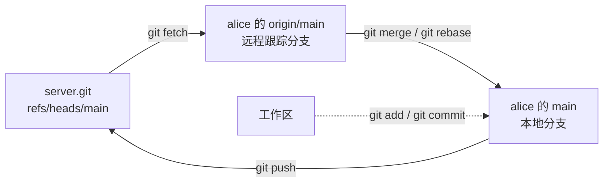

# 17. Git 协作

当 wordfreq 演进到 v0.2 版本时，项目迎来了一位新的全职开发者 bob。在此之前，项目主要依托单兵作战的工作模式；而随着团队协同的加入，工程实践面临着全新的挑战：alice 与 bob 各自在本地终端编码、提交改动并执行测试，各自的本地流水线均显示绿灯；然而一旦双方尝试将成果推送到集中分支并合为一体，问题便浮出水面——`src/report.c` 中同一段排版逻辑被两方以不同的设计理念分别改写，测试用例中的基准期望输出也产生了冲突。这类协同摩擦绝无法在任何一方的孤立本地环境中自行暴露，唯有将双方的分叉历史汇聚比对时，冲突才会实质显现。

本章以 wordfreq 的多人协作为演进背景，全面梳理软件工程中通行的版本协作实践：从远程仓库的分布式拓扑与远程跟踪分支的流转，到功能分支生命周期与拉取请求（Pull Request）的建立；从工程化代码评审规范，到经典三路合并与变基（Rebase）冲突消解；从本地交互式重整提交历史（Interactive Rebase），到利用 `git bisect` 基于二分查找自动化排查引入性能或功能回归的缺陷提交，最后借助 `.gitattributes` 固化跨操作系统的换行符规约。为了提供可离线完全复现的确定性学习环境，文中涉及的所有协作操作均在本地通过多克隆沙盒环境构建完成，提交哈希与拓扑关系均可稳定复现。

读者在阅读本章之前，应当已经熟练掌握本地 Git 的基本操作（在单分支上执行暂存、提交、查看图形历史与分支切换，参见[第 4 章 Git 本地工作流](/教程/正文/开发与工程基础/4_Git本地工作流)）；同时要求 wordfreq 项目能够通过 Make 或 CMake 完成全流程构建并运行 CTest 自动化测试套件（参见[第 8 章](/教程/正文/开发与工程基础/8_构建图与Make)、[第 9 章](/教程/正文/开发与工程基础/9_CMake与XMake)与[第 11 章](/教程/正文/开发与工程基础/11_自动化测试)）。

文中所有终端命令与执行结果均在 Debian 13 环境下的 Git 2.47.3 实测采得。伴随示例脚本 `code/开发与工程基础/17_Git协作/setup_demo.sh` 会在本地目录一键初始化一个代表服务端的裸仓库以及 alice 与 bob 两个完全隔离的克隆工作区，`bisect_demo.sh` 则负责构建回归排查用的线型提交链；脚本统一通过环境变量 `GIT_CONFIG_GLOBAL` 将配置锚定在实验沙盒内部，绝不改动宿主机全局的 Git 用户设置。

## 1. 远程仓库

在 Git 的分布式设计哲学中，不存在传统集中式版本控制系统（如 SVN）中地位悬殊的“中央数据中枢”。每一个克隆仓库在物理上都是一份自给自足、完备无缺的完整对象数据库：它完整携带着全量的历史提交、所有分支指针以及完整的标签快照，本地检出（Checkout）到工作区的文件仅仅是该庞大对象库在某个特定时间切片下的具象展开。被部署在协同服务器（如 GitHub、GitLab 或局域网主机）上的所谓“中央仓库”，通常只是一个省略了工作区文件的裸仓库（Bare Repository）——它专职于接收外部推送并更新分支指针，不参与日常编码编辑。在接下来的实验演练中，我们在本地工作区建立一个独立的裸仓库充当服务端集散点，其交互命令与连接公网托管平台完全一致，唯一的差异仅在于仓库定位的 URL 表现形式。

辅助脚本 `setup_demo.sh` 首先初始化该裸仓库，随后将 wordfreq 的初始提交推送入库，最后以此为源克隆出 alice 和 bob 两套并行的工作区：

::: terminal title="zsh - sh setup_demo.sh"

```text
$ sh setup_demo.sh demo
demo ready in demo (server.git, alice, bob)
```

:::

上述脚本执行的自动化动作与以下纯手工指令在逻辑上完全等价：

::: terminal title="zsh - demo"

```text
$ git init --bare --initial-branch=main server.git
$ cd seed
$ git init
$ git add -A
$ git commit -m "wordfreq v0.2"
$ git remote add origin ../server.git
$ git push origin main
$ cd ..
$ git clone server.git alice
$ git clone server.git bob
$ git -C alice remote set-url origin ../server.git
$ git -C bob remote set-url origin ../server.git
```

:::

末尾两行指令将记录在各工作区内的远端 URL 重写为相对路径，这样哪怕将实验沙盒整体拷贝或移动到其他目录，所有协作测试依旧能够无缝运转。`git init --bare` 指令仅负责初始化相当于常规仓库 `.git` 目录下的元数据骨架，不包含供人类检出编辑的文件系统工作树。因此在该目录下无法直接查阅源码，其物理目录拓扑结构与普通工作区的 `.git` 完全一致：

::: terminal title="zsh - demo"

```text
$ ls server.git
branches
config
description
HEAD
hooks
info
objects
refs
$ git --git-dir=server.git log --oneline
ca8c929 wordfreq v0.2
```

:::

选项 `--git-dir` 允许在不切换工作目录的前提下，直接指派 Git 读取并操作指定的元数据对象库。进入 alice 的工作区审视远端信息：

::: terminal title="zsh - alice"

```text
$ git remote -v
origin	../server.git (fetch)
origin	../server.git (push)
$ git branch -a
* main
  remotes/origin/HEAD -> origin/main
  remotes/origin/main
$ git log --oneline --decorate
ca8c929 (HEAD -> main, origin/main, origin/HEAD) wordfreq v0.2
```

:::

在执行 `git clone` 时，Git 会默认在本地注册一个名为 `origin` 的远程引用别名，并将远端定位 URL 写入工作区私有的 `.git/config` 配置文件中：

::: terminal title="zsh - alice"

```text
$ git config --get remote.origin.url
../server.git
$ git config --get-regexp '^remote'
remote.origin.url ../server.git
remote.origin.fetch +refs/heads/*:refs/remotes/origin/*
```

:::

输出中的第二行定义了极其关键的引用抓取规格（Refspec），其细节将在下一节具体展开。`origin` 仅仅是社区约定俗成的默认远程代号，开发者完全可以按需重命名或绑定多个上游地址（例如在开源社区中将主干仓库命名为 `upstream`，将个人名下的派生仓库命名为 `origin`）。由于各开发者手中持有的均是完备的数据库，即便遭遇网络中断，依然能在本地顺畅地提交、开辟新特性分支以及查阅历史回溯；网络交互仅仅在团队成员需要互相交换版本对象时才成为必需。

::: concept git-remote-clone title="克隆与远程"

`git clone` 完整拷贝远程仓库的全量版本对象与分支拓扑，在本地检出与远端默认分支同名的本地分支，将其设为当前工作区活动分支，并建立指代远端仓库的默认别名 `origin`。克隆动作完成后，各克隆副本与远程仓库各自独立演进，仅通过显式的 `fetch` 与 `push` 操作完成版本对象的双向同步。无工作区的裸仓库非常适合部署在服务器节点充当高可用集散枢纽。

:::

## 2. 远程跟踪分支

当执行克隆操作时，Git 除了在本地建立当前活动分支 `main` 之外，还在内部记录下了远端 `main` 在那一瞬间所指向的具体提交对象，这一特殊的只读引用被称为远程跟踪分支（Remote-Tracking Branch），以 `origin/main` 命名。它驻留在本地仓库内部，开发者无法通过 `git checkout` 切换上去，亦不能在其上直接发起新提交；它的唯一职责，是忠实充当本地对于“上一次与远端服务器同步握手时，远端的 main 分支指针具体停留在哪里”的本地缓存快照。

本地分支与远程跟踪分支各自拥有独立的指针移动节奏。现在假设 bob 在其工作区改写了 README 的末尾并成功将其推送到服务端：

::: terminal title="zsh - bob"

```text
$ printf '\n## 退出状态\n\n参数写错时退出状态为 2，文件打不开时为 1。\n' >> README.md
$ git add README.md
$ git commit -m "docs: 说明退出状态"
[main 7339a37] docs: 说明退出状态
 1 file changed, 4 insertions(+)
$ git push
To ../server.git
   ca8c929..7339a37  main -> main
```

:::

与此同时，alice 在不知情的情况下在本地调整了 README 顶部的项目简介，这处修改在逻辑上与 bob 针对末尾的补充并无直接文本重叠。然而当 alice 完成本地提交并尝试执行 `git push` 时，远端服务器直接给出了拒绝回应：

::: terminal title="zsh - alice"

```text
$ git commit -m "docs: 补充项目简介"
[main 5cc8073] docs: 补充项目简介
 1 file changed, 1 insertion(+), 1 deletion(-)
$ git push
To ../server.git
 ! [rejected]        main -> main (fetch first)
error: failed to push some refs to '../server.git'
hint: Updates were rejected because the remote contains work that you do not
hint: have locally. This is usually caused by another repository pushing to
hint: the same ref. If you want to integrate the remote changes, use
hint: 'git pull' before pushing again.
hint: See the 'Note about fast-forwards' in 'git push --help' for details.
```

:::

远端拒绝推送的原因在于快进更新（Fast-Forward）契约被打破：由于 bob 抢先一步完成了推送，服务器上的 `main` 分支指针已经前移到了提交 `7339a37`；而 alice 本地提交 `5cc8073` 的父提交依然是旧基线 `ca8c929`，两者处于分叉状态，alice 的提交并非远端最新指针的直接后代。若允许直接覆盖，bob 先前推入的提交将被从分支头上孤立并丢失。Git 标准的 `push` 操作严格恪守快进原则，绝不擅自代人进行非平凡的合并决策。此时在 alice 侧执行 `git status`，终端仍会提示本地“领先远端 1 个提交”，这是因为本地对比的基准仅仅是上次离线缓存的 `origin/main` 快照，alice 尚未与远端建立最新通讯：

::: terminal title="zsh - alice"

```text
$ git status
On branch main
Your branch is ahead of 'origin/main' by 1 commit.
  (use "git push" to publish your local commits)

nothing to commit, working tree clean
$ git status -sb
## main...origin/main [ahead 1]
```

:::

`git fetch` 指令的核心设计在于极高的只读安全性：它专职负责向远端拉取本地尚不存在的对象与提交记录，并推进对应的远程跟踪分支 `origin/main`；对于开发者当前的工作区文件、暂存区内容以及本地活动分支的指针位置，它保持完全的不侵入、不改动：

::: terminal title="zsh - alice"

```text
$ git fetch
From ../server
   ca8c929..7339a37  main       -> origin/main
$ git status -sb
## main...origin/main [ahead 1, behind 1]
$ git log --oneline --graph --all --decorate
* 5cc8073 (HEAD -> main) docs: 补充项目简介
| * 7339a37 (origin/main, origin/HEAD) docs: 说明退出状态
|/  
* ca8c929 wordfreq v0.2
```

:::

追加 `--all` 参数能指示 `git log` 将隐藏在后方的远程跟踪分支一同绘制到拓扑图中，直观展现两条提交链在共同祖先 `ca8c929` 处分道扬镳。状态缩写行 `## main...origin/main [ahead 1, behind 1]` 清晰指明了分叉事实：本地活动分支包含 1 个尚未上报远端的新提交，而远端跟踪分支同样包含 1 个本地尚未消化的异构提交。此时 alice 的工作区文件依然严格保留着她本地的修改版本，`fetch` 绝不会强行覆写磁盘上的文本文件。

将本地分支、远程跟踪分支与集中服务器三者之间的流转拓扑整理如下：



若需将远端的新演进并入当前活动分支，可以选择先执行 `fetch` 随后手工触发 `merge`，亦可借助复合指令 `git pull`。`pull` 操作在底层正是 `fetch` 与“分支整合”的两阶段组合，其具体的整合模式严格取决于开发者的配置项或命令行参数。当两端历史已经发生实质分叉、且当前仓库尚未配置明确的对齐倾向时，现代版本的 Git 会主动阻断执行，拒绝盲目猜测意图：

::: terminal title="zsh - alice"

```text
$ git pull
hint: You have divergent branches and need to specify how to reconcile them.
hint: You can do so by running one of the following commands sometime before
hint: your next pull:
hint:
hint:   git config pull.rebase false  # merge
hint:   git config pull.rebase true   # rebase
hint:   git config pull.ff only       # fast-forward only
hint:
hint: You can replace "git config" with "git config --global" to set a default
hint: preference for all repositories. You can also pass --rebase, --no-rebase,
hint: or --ff-only on the command line to override the configured default per
hint: invocation.
fatal: Need to specify how to reconcile divergent branches.
```

:::

Git 在此处列举的三条调节策略代表了截然不同的分支演进哲学：`pull.ff only` 最为保守与安全，一旦遭遇分叉即立刻抛出致命错误，坚决不擅自生成自动合并提交；`--no-rebase` 遵循经典的三路合并（Three-Way Merge）策略，在分叉节点处生成一个拥有两个父节点的合并提交；而 `--rebase` 则会将本地尚未推送的私有提交临时拔起，重放至远端最新提交之后（详见后续第 6 节探讨）。成熟的研发团队通常会在项目工程规范中统一固化这一策略。此处我们先显式指明 `--no-rebase` 采用标准合并模式进行处理：

::: terminal title="zsh - alice"

```text
$ git pull --no-rebase
Auto-merging README.md
Merge made by the 'ort' strategy.
 README.md | 4 ++++
 1 file changed, 4 insertions(+)
$ git log --oneline --graph --all --decorate
*   7021fc5 (HEAD -> main) Merge branch 'main' of ../server
|\  
| * 7339a37 (origin/main, origin/HEAD) docs: 说明退出状态
* | 5cc8073 docs: 补充项目简介
|/  
* ca8c929 wordfreq v0.2
$ git push
To ../server.git
   7339a37..7021fc5  main -> main
$ git status -sb
## main...origin/main
```

:::

Git 底层调动默认的 `ort` 合并算法完成了自动化文本融合，并自动生成了提交信息 `Merge branch 'main' of ../server`。由于合并提交 `7021fc5` 同时承接了 bob 的 `7339a37` 与 alice 本地的 `5cc8073`，此时再次发起 `git push` 便满足了快进原则，远端的 `main` 指针顺利推演至合并节点，本地跟踪分支 `origin/main` 也随之同步前移，两端状态重回完全一致。

通过 `git remote show origin`，可以统揽本地分支与远端各引用的绑定跟踪状态：

::: terminal title="zsh - alice"

```text
$ git remote show origin
* remote origin
  Fetch URL: ../server.git
  Push  URL: ../server.git
  HEAD branch: main
  Remote branch:
    main tracked
  Local branch configured for 'git pull':
    main merges with remote main
  Local ref configured for 'git push':
    main pushes to main (up to date)
```

:::

<Quiz
  type="single"
  :options="[
    { label: '把远程的新提交取回本地，并移动 origin/main', value: 'A' },
    { label: '把远程的新提交合并进当前的 main', value: 'B' },
    { label: '把本地提交推送到远程', value: 'C' },
    { label: '删除本地已经合并的分支', value: 'D' }
  ]"
  answer="A"
>

`git fetch` 做完之后，哪些东西变了？

正确答案是 **A**。`git fetch` 的作用域仅限于将远端新生成的对象与引用拉取至本地对象库，并同步刷新远程跟踪分支（如 `origin/main`）；当前工作区的文件状态与本地活动分支的指针均不会发生位移。将新提交融合进工作区属于 `merge` 或 `rebase` 的范畴，复合指令 `git pull` 则是一并串联了这两步动作。

</Quiz>

## 3. 功能分支与拉取请求

直接在主干分支 `main` 上开展日常编码，每次推送都不得不与全组开发者争抢同一个分支指针，更会导致尚未成熟的实验性代码过早暴露，任何未经充分验证的冲突都会直接波及全团队。在现代软件工程规约中，主干分支 `main` 应当始终维持在随时可构建、可测试、可交付的稳定基线状态。每一项具体的功能演进、缺陷修复或重构任务，均应从主干派生出一条独立的功能特性分支（Feature Branch）；开发者在特性分支上完成自测并推送到远端后，发起代码审查申请，待自动化流水线检验通过并获得同行批准后，再统一并入主干。这是 GitHub 上通行的协同工作范式（称为 Pull Request，PR）；在 GitLab 或 Gitee 生态中，该机制同样被广泛采用，通常被称为合并请求（Merge Request，MR）。

以 alice 承担的排版美化任务为例：她需要为 wordfreq 的输出结果增加对齐表头。alice 首先从最新的 `main` 分支派生出名为 `format` 的特性分支，随后着手调整代码：

::: terminal title="zsh - alice"

```text
$ git switch -c format
Switched to a new branch 'format'
$ git diff
diff --git a/src/report.c b/src/report.c
index 393e56c..7eee621 100644
--- a/src/report.c
+++ b/src/report.c
@@ -1,7 +1,8 @@
 #include "wf/report.h"
 
 void wf_report_print(FILE *out, const wf_entry *entries, size_t n) {
+    fputs("  count  word\n", out);
     for (size_t i = 0; i < n; i++) {
-        fprintf(out, "%7zu %s\n", entries[i].count, entries[i].word);
+        fprintf(out, "%7zu  %s\n", entries[i].count, entries[i].word);
     }
 }
diff --git a/tests/data/sample.expected b/tests/data/sample.expected
index cd63850..ac61676 100644
--- a/tests/data/sample.expected
+++ b/tests/data/sample.expected
@@ -1,3 +1,4 @@
-      4 the
-      2 on
-      2 sat
+  count  word
+      4  the
+      2  on
+      2  sat
```

:::

修改了输出排版布局，必须严格同步修正对应的预期基准文件，否则既有的端到端回归测试套件（参见[第 11 章](/教程/正文/开发与工程基础/11_自动化测试)）必然在字节比对时阻断。在提交代码之前，先在本地执行构建并全量回归测试：

::: terminal title="zsh - alice"

```text
$ cmake --build build
$ ctest --test-dir build
Internal ctest changing into directory: /home/minsecrus/tutorial/work/ch17/demo/alice/build
Test project /home/minsecrus/tutorial/work/ch17/demo/alice/build
    Start 1: token
1/3 Test #1: token ............................   Passed    0.00 sec
    Start 2: counter
2/3 Test #2: counter ..........................   Passed    0.00 sec
    Start 3: e2e
3/3 Test #3: e2e ..............................   Passed    0.01 sec

100% tests passed, 0 tests failed out of 3
```

:::

测试全绿后，执行暂存、提交并推送到远端：

::: terminal title="zsh - alice"

```text
$ git add src/report.c tests/data/sample.expected
$ git commit -m "feat: 输出加表头并加宽两列间距"
[format 205d966] feat: 输出加表头并加宽两列间距
 2 files changed, 6 insertions(+), 4 deletions(-)
$ git push -u origin format
To ../server.git
 * [new branch]      format -> format
branch 'format' set up to track 'origin/format'.
```

:::

当向远程仓库初次推送一个新分支时，使用参数 `-u`（即 `--set-upstream`）极为关键。该选项在远端创建新分支的同时，会在本地配置文件中将本地活动分支与远程跟踪分支建立起一对一的默认追踪绑定关系；此后在该分支上同步改动时，只需键入简短的 `git push` 或 `git pull`，Git 即可自动推导目标引用。借助 `git branch -vv` 可以细致核验本地各分支绑定的上游映射拓扑：

::: terminal title="zsh - alice"

```text
$ git branch -vv
* format 205d966 [origin/format] feat: 输出加表头并加宽两列间距
  main   7021fc5 [origin/main] Merge branch 'main' of ../server
$ git config --get branch.format.remote
origin
$ git config --get branch.format.merge
refs/heads/format
```

:::

方括号内的字符即代表当前分支绑定的上游目标，`git status -sb` 中的领先/落后差值亦是基于此基准求得。在内部实现中，这一映射由 `.git/config` 中的两组配置项固化：`branch.<分支名>.remote` 指定目标远端标识，而 `branch.<分支名>.merge` 则指定远端对应的物理引用全称。

<Quiz
  type="single"
  :options="[
    { label: '本地分支没有设置上游，Git 不知道推到哪里', value: 'A' },
    { label: '远程仓库是裸仓库，不能接收推送', value: 'B' },
    { label: '本地分支比远程落后，需要先合并', value: 'C' },
    { label: '提交里含有二进制文件', value: 'D' }
  ]"
  answer="A"
>

在克隆出来的仓库里新开一个分支、提交之后直接执行 `git push`，Git 报 `The current branch ... has no upstream branch` 并要求 `--set-upstream`，原因是什么？

正确答案是 **A**。当执行不带明确引用的裸 `git push` 时，Git 需要依赖本地配置中的上游跟踪关系判定推送目标；初建的本地新分支尚未完成该项绑定，因而抛出指引提示。参数 `-u`（`--set-upstream`）正是用于在推送的同时完成该跟踪元数据的登记写入。裸仓库完全具备接收合法推送的能力；而落后于远端时，反馈的是非快进更新的阻断提示。

</Quiz>

远端仓库现在已成功接收并登记了 `format` 分支。在无需实际检出代码的情况下，借助 `git ls-remote` 指令便能直接向远端发起轻量级握手，读取当前服务端登记的全量引用与哈希清单：

::: terminal title="zsh - alice"

```text
$ git ls-remote
From ../server.git
7021fc5e187a25b5aeb068feea04392fe2cef2c8	HEAD
205d966d352d04abffdd7d396df8a060b5510f06	refs/heads/format
7021fc5e187a25b5aeb068feea04392fe2cef2c8	refs/heads/main
```

:::

将特性分支成功推送到托管端之后，下一步是在协同平台的 Web 控制台发起 Pull Request（合并请求），申请将 `format` 分支合并回 `main` 主干。操作流程通常包括：指派源分支与目标基线、拟定清晰的标题与工程描述、并指定相关的同行评审人员（Reviewers）。

合并请求的描述文本是评审者审视改动意图的窗口。工业级项目通常依托预设的拉取请求模板来规范沟通格式。在仓库根目录建立 `.github/pull_request_template.md` 可以将这一格式固化下来：

::: code-group

```markdown [.github/pull_request_template.md]
## 问题

<!-- 这个改动解决什么问题？相关 issue 编号。 -->

## 改动

<!-- 做了什么，为什么这样做。有取舍时写清放弃了哪种方案。 -->

## 测试

<!-- 新增或修改了哪些测试；本地怎么复现。 -->

- [ ] 本地构建通过（Make 与 CMake 各一次）
- [ ] `ctest --test-dir build` 全部通过
- [ ] 新增的公开接口有测试
- [ ] 没有提交构建产物（`git status` 干净）
```

```markdown [实际填写]
## 问题

`wordfreq -n 3` 的输出没有表头，读者看不出第一列是次数。
次数与单词之间只有一列空格，两位数的次数会挤在一起。

## 改动

`wf_report_print` 在循环前输出一行表头，次数列与单词列之间加宽到两列。
`tests/data/sample.expected` 按新格式更新。

## 测试

`ctest --test-dir build` 三个测试全部通过。
手工运行 `./build/wordfreq -n 3 tests/data/sample.txt`，输出与期望文件一致。
```

:::

一份合格的工程描述应当直奔核心，客观阐明背景、取舍权衡以及验证依据，坚决避免诸如“如题”、“优化代码”等缺乏信息量的空泛辞令。

拉取请求属于代码托管平台层面的虚拟协同对象，并不直接隶属于 Git 本身的对象树。现代托管平台通常将持续集成（CI，参见[第 18 章](/教程/正文/开发与工程基础/18_持续集成)）挂载在 PR 事件上，分支每次追加新提交都会自动触发流水线复核；唯有在自动化流水线全量通过、且同行评审达成共识后，具备归档权限的维护者才会执行最终合并。评审人可以在 Web 页面针对特定代码行展开讨论与质疑；作者无需重新开辟新 PR，只需在本地对应分支上追加修订提交并正常推送，PR 视图会自动汇聚最新提交链。

在最终接受并合并特性分支时，托管平台通常提供三种典型的合并策略，它们决定了主干历史最终呈现的分支拓扑结构：

| 合并策略 | 本地等价底层操作 | 主干分支 `main` 上生成的最终拓扑结构 |
| --- | --- | --- |
| 创建合并提交 (Merge Commit) | `git merge --no-ff <分支>` | 保留特性分支上的全部原子提交，并在主干留下一个拥有双父节点的合并提交节点 |
| 压缩合并 (Squash and Merge) | `git merge --squash <分支>` 后执行 `git commit` | 将特性分支上的多次提交改动压平成一个单一的常规提交，主干历史保持线型 |
| 变基合并 (Rebase and Merge) | `git rebase main <分支>` 随后执行 `git merge --ff-only` | 将特性分支上的提交按序移植并接到主干头部，消除合并节点，维持线型历史 |

如果特性分支上仅包含单一提交，上述三种策略的拓扑形态差异并不明显。而当分支包含多次迭代记录时，策略的选择将直接重塑主干的整洁度与追溯体验。下面借助一个微型演示仓库，直观呈现不同合并策略所留下的历史印记。假设分支 `feat` 进行了两次连续改动，而 `main` 主干在此期间亦演进了一次，且两端文本互不冲突。

首先观察标准合并提交（`--no-ff`）的表现：

::: terminal title="zsh - demo"

```text
$ git merge --no-ff -m "Merge branch 'feat'" feat
Merge made by the 'ort' strategy.
 feature.txt | 2 ++
 1 file changed, 2 insertions(+)
 create mode 100644 feature.txt
$ git log --oneline --graph --decorate
*   173c004 (HEAD -> main) Merge branch 'feat'
|\  
| * 8dcea28 (feat) feat: 第二步
| * 0ea8b95 feat: 第一步
* | 8bb628e docs: main 上的另一处改动
|/  
* bb7f988 init
```

:::

在 `--no-ff` 模式下，特性分支上的所有原子提交被原汁原味地保留在历史图中；合并提交 `173c004` 具备两个父节点（分别指向 `feat` 分支顶端与合并前 `main` 的顶端），清晰记录了功能集成的历史交汇点。

接下来观察压缩合并（`--squash`）的行为特征：

::: terminal title="zsh - demo"

```text
$ git merge --squash feat
Automatic merge went well; stopped before committing as requested
Squash commit -- not updating HEAD
$ git commit -m "feat: 增加 feature.txt (#2)"
$ git log --oneline --graph --decorate
* 581ece3 (HEAD -> main) feat: 增加 feature.txt (#2)
* 8bb628e docs: main 上的另一处改动
* bb7f988 init
```

:::

参数 `--squash` 的底层行为仅仅是将特性分支上的所有代码改动整合成一个变动集放入暂存区，并不会自动生成提交对象，也不会挪动分支指针。开发者需要手动调用 `git commit` 并提炼汇总说明；托管平台上的“Squash and merge”按钮则是在服务端将这两步一并自动化完成。此时主干分支上仅增加了一条规整的新提交，`feat` 分支内部那些琐碎的中间过程（如修正拼写、局部微调）被全面压平，历史时间线呈现纯净的线型。

最后审视变基合并（Rebase and Merge）：

::: terminal title="zsh - demo"

```text
$ git switch feat
Switched to branch 'feat'
$ git rebase main
Rebasing (1/2)Rebasing (2/2)Successfully rebased and updated refs/heads/feat.
$ git switch main
Switched to branch 'main'
$ git merge --ff-only feat
Updating 8bb628e..079325f
Fast-forward
 feature.txt | 2 ++
 1 file changed, 2 insertions(+)
 create mode 100644 feature.txt
$ git log --oneline --graph --decorate
* 079325f (HEAD -> main, feat) feat: 第二步
* 8ad5b44 feat: 第一步
* 8bb628e docs: main 上的另一处改动
* bb7f988 init
```

:::

变基合并由两阶段构成：首先切入 `feat` 分支执行 `git rebase main`，将其上的提交逐一“嫁接”并重放到 `main` 的最新提交之后（提交的父节点变更，哈希值也随之重新生成）；随后切换回 `main` 主干执行快进合并 `git merge --ff-only`。主干历史同样呈现绝对的单一直线，既消除了交叉合并节点，又完整保留了特性分支内各原子提交的独立性。

压缩合并将多个提交熔解为一，好处是主干历史极度简练，`git log --oneline` 宛如一份精简的功能发布清单；代价是失去了在主干上按微观提交粒度执行 `git revert` 局部撤销的灵活性。变基合并则兼顾了线型历史与提交颗粒度，但在长周期分支中需要处理重放过程中的连续微调。成熟的工程团队通常会规定单一的合并规范作为默认选项，避免三种模式杂乱混用。

功能分支合入主干后，应当及时完成清理，在本地与远端分别销毁该分支引用：

::: terminal title="zsh - alice"

```text
$ git switch main
$ git merge --no-ff -m "Merge branch 'format'" format
Merge made by the 'ort' strategy.
 src/report.c               | 3 ++-
 tests/data/sample.expected | 7 ++++---
 2 files changed, 6 insertions(+), 4 deletions(-)
$ git push
To ../server.git
   7021fc5..ee87b45  main -> main
$ git branch -d format
Deleted branch format (was 205d966).
$ git push origin --delete format
To ../server.git
 - [deleted]         format
$ git log --oneline --graph --all --decorate
*   ee87b45 (HEAD -> main, origin/main, origin/HEAD) Merge branch 'format'
|\  
| * 205d966 feat: 输出加表头并加宽两列间距
|/  
*   7021fc5 Merge branch 'main' of ../server
|\  
| * 7339a37 docs: 说明退出状态
* | 5cc8073 docs: 补充项目简介
|/  
* ca8c929 wordfreq v0.2
```

:::

指令 `git branch -d` 是一项受安全保护的删除操作：它仅允许删除已经被上游完全合并的分支；若分支尚有未合并提交，Git 会强制拒绝，防止误删工作（强行删除需改用大写 `-D`）。执行 `git push origin --delete` 则向服务器发送删除协议。由于团队其他成员本地的远程跟踪分支 `origin/format` 不会自动自毁，定期在本地调用 `git fetch --prune` 能够集中清理此类已在服务端销毁的失效引用。

在缺乏 Web 托管平台的严苛场景（如离线网络或遵循纯 Unix 传统的开源社区，典型的如 Linux 内核与 Git 项目自身），功能分支的协同主要依托补丁邮件完成：代码作者通过 `git format-patch` 将选定的提交导出为包含完整上下文与元数据的标准纯文本邮件；审阅者核验无误后，借助 `git am`（Apply Mailbox）将补丁无损打入本地代码库。在 wordfreq 中，bob 导出一份关于统计总数改动的补丁文件形态如下：

::: terminal title="zsh - bob"

```text
$ git format-patch -1 --stdout
From 248e7689f01a021aba9c251a9766974dc3c9d4a8 Mon Sep 17 00:00:00 2001
From: bob <bob@example.com>
Date: Tue, 20 Oct 2026 12:00:00 +0800
Subject: [PATCH] =?UTF-8?q?feat:=20=E6=9C=AB=E5=B0=BE=E8=BE=93=E5=87=BA?=
 =?UTF-8?q?=E6=80=BB=E6=95=B0?=
MIME-Version: 1.0
Content-Type: text/plain; charset=UTF-8
Content-Transfer-Encoding: 8bit

---
 src/report.c               | 3 +++
 tests/data/sample.expected | 1 +
 2 files changed, 4 insertions(+)

diff --git a/src/report.c b/src/report.c
index 393e56c..41ee0fb 100644
--- a/src/report.c
+++ b/src/report.c
@@ -1,7 +1,10 @@
 #include "wf/report.h"
 
 void wf_report_print(FILE *out, const wf_entry *entries, size_t n) {
+    size_t total = 0;
     for (size_t i = 0; i < n; i++) {
+        total += entries[i].count;
         fprintf(out, "%7zu %s\n", entries[i].count, entries[i].word);
```

:::

在标题行中，中文文本被自动编码为 `=?UTF-8?q?...?=` 格式，这是标准邮件协议 RFC 2047 用于承载非 ASCII 字符的既定规约。参数 `-1` 指定仅导出最近的一条提交；若不指定范围，则默认导出当前分支相对于上游基线的所有提交，并自动为每个提交生成带有递增前缀编号的 `.patch` 文本文件。接收方在对应的基线提交上将补丁应用入库：

::: terminal title="zsh - 收件人"

```text
$ git switch -c patch-test 7021fc5
$ git am < 0001-totals.patch
Applying: feat: 末尾输出总数
$ git log --format='%h %an %ad | committer %cn %cd' --date=iso -1
6734a04 bob 2026-10-20 12:00:00 +0800 | committer carol 2026-10-22 00:58:10 +0900 | feat: 末尾输出总数
$ git diff 248e768 HEAD --stat
$ echo $?
0
```

:::

补丁元数据中忠实记录了原作者的姓名与编写时间戳，因此在应用补丁后，提交的作者信息（Author）依然是 bob；而提交者信息（Committer）与提交时间戳则刷新为当刻执行应用的协同者，新生成的提交哈希随之更迭。随后的 `git diff` 结果为空，表明代码内容获得了逐字节的精准还原。指令 `git cherry-pick` 在底层运作上与补丁重放异曲同工：它允许将仓库中任意分支上的某个特定提交无差别摘取并重放在当前活动分支之上。无论是补丁邮件还是 cherry-pick，运作机制均类似于“改动的搬运工”，并不在分支之间构建长效的双亲关联。

## 4. 代码评审

代码评审（Code Review）是现代工程研发中防范技术债务滋生的关键门禁。其核心意图并非单纯挑拣语法笔误，而是组织工程团队在改动合入主干之前展开联合技术论证，从源头扼杀日后返工的潜在隐患。在成熟的工业界实践中，评审人员通常依据以下维度审视提交：

| 评审关注维度 | 核心核验指标 |
| --- | --- |
| 架构设计 | 该项改动的模块归属是否恰当？接口抽象是否必要且充分？是否存在更轻量直接的设计路径？ |
| 功能正确性 | 代码是否严格达成了作者声称的契约行为？边界输入（空指针、溢出边界、I/O 故障）是否均有兜底防御？ |
| 复杂度控制 | 是否存在过度工程化倾向？能否用更精炼直接的控制流或数据结构予以实现？ |
| 测试完备度 | 自动化测试套件是否精准锁定了新增逻辑的分支？测试断言在失效时能否提供定位线索？ |
| 命名契约 | 标识符命名能否清晰传递对象意图与生命周期？缩写与术语是否符合领域通用心智模型？ |
| 意图注释 | 注释是否重在阐释“为何如此取舍”，而非仅仅复述代码所做的显而易见的字面行为？ |
| 格式规约 | 是否严格契合项目的格式化准则？纯缩进与空格分歧应移交 `clang-format` 自动把控，避免在评审讨论中空耗精力 |
| 外部文档 | 公共头文件契约注释、README 运行范例是否均已同步修订无遗漏？ |

在作为改动提交者时，有两条实践至关重要：其一是严格控制单次提交的粒度。一个涉及数百上千行改动的巨型 PR 往往需要评审者投入数小时心智，极易诱发审美疲劳进而放过关键缺陷；而拆分为数十行聚焦于单一职责的小型 PR，评审者数分钟即可透彻理解，代码中的缺陷与漏洞也无处遁形。其二是在响应评审意见时，应当以追加微提交（Fixup Commits）的形式渐进推送，坚决避免在评审交流尚未达成共识前粗暴地使用 `git push --force` 覆盖历史。评审者需要清晰观察到每一次建议是如何被具体落地的；至于提交历史的整洁与合并，完全可以留到最终达成共识、获准合并前夕再统一收敛（详见后续第 7 节）。

在评审沟通过程中沉淀的重大技术共识（例如“该接口在错误时绝不返回负值”、“此处的锁保护必须涵盖资源释放全流程”），必须主动反哺进代码本身的接口注释或提交说明中。仅停留在 Web PR 讨论区中的言论，随着合并归档，在数月之后便会彻底遗失在历史长河中；唯有将共识固化进代码库本身，才能形成对后继维护者真正有效的约束。

::: tip 评审者和作者各问一个问题

评审者在批准前应自问：“倘若这段代码在生产环境中突发故障，我能否仅凭代码与注释迅速看懂其底层机理？”作者在发起前应自问：“若随后收到局部微调建议，我能否从容修改这一处逻辑而不至于牵连全工程？”若两方的答案均明确为“是”，代码便具备了合入主干的成熟度。

:::

## 5. 解决冲突

代码冲突（Merge Conflict）的物理本质，源自版本管理系统中两组并行的提交对同一个文件的同一上下文区域做出了互不兼容的文本变更。在 wordfreq 的协作流中，bob 在其特性分支 `totals` 上对 `wf_report_print` 进行了扩展，意图在末尾追加打印统计总数；而与此同时，alice 的 `format` 分支已率先合入 `main` 主干，该改动在函数开头插入了表头并加宽了各列间距。当 alice 的工作入主干后，bob 尝试将最新的 `main` 基线同步拉入自己的本地开发分支：

::: terminal title="zsh - bob"

```text
$ git pull --no-rebase origin main
From ../server
 * branch            main       -> FETCH_HEAD
Auto-merging src/report.c
CONFLICT (content): Merge conflict in src/report.c
Auto-merging tests/data/sample.expected
CONFLICT (content): Merge conflict in tests/data/sample.expected
Automatic merge failed; fix conflicts and then commit the result.
```

:::

Git 底层的自动合并引擎能够自主完成无歧义区域的融合（终端标示为 `Auto-merging`）；但当遭遇 `wf_report_print` 核心循环体这种两端同时触碰的敏感代码段时，算法无法越俎代庖判定哪一方的语义具有更高优先级，于是主动将控制权交还给开发者，并将冲突文件标注在工作区中：

::: terminal title="zsh - bob"

```text
$ git status
On branch totals
You have unmerged paths.
  (fix conflicts and run "git commit")
  (use "git merge --abort" to abort the merge)

Unmerged paths:
  (use "git add <file>..." to mark resolution)
	both modified:   src/report.c
	both modified:   tests/data/sample.expected

no changes added to commit (use "git add" and/or "git commit -a")
$ git status --short
UU src/report.c
UU tests/data/sample.expected
```

:::

短状态格式中的状态码 `UU`（Unmerged, both Modified）代表该物理路径在两端分支上均发生了重叠修改、且尚未完成人工消解。终端输出清晰指引了后续的处置出口：在文本层面消解分歧后，调用 `git add` 将文件标记为已解决，随后执行 `git commit` 生成合并提交；若现场环境过于复杂、需要临时回退，则可随时执行 `git merge --abort` 彻底撤销当次合并尝试，工作区将无损还原至触发合并前的纯净状态。

深入查看冲突文件的文本排布：

::: terminal title="zsh - bob"

```text
$ cat -n src/report.c
     1	#include "wf/report.h"
     2	
     3	void wf_report_print(FILE *out, const wf_entry *entries, size_t n) {
     4	<<<<<<< HEAD
     5	    size_t total = 0;
     6	    for (size_t i = 0; i < n; i++) {
     7	        total += entries[i].count;
     8	        fprintf(out, "%7zu %s\n", entries[i].count, entries[i].word);
     9	    }
    10	    fprintf(out, "  total  %zu\n", total);
    11	=======
    12	    fputs("  count  word\n", out);
    13	    for (size_t i = 0; i < n; i++) {
    14	        fprintf(out, "%7zu  %s\n", entries[i].count, entries[i].word);
    15	    }
    16	>>>>>>> ee87b450acfa4af830891584c9ef1427ef1bca1b
    17	}
```

:::

标记区间清晰划定了分歧边界：从 `<<<<<<< HEAD` 至中线 `=======` 之间的区块，代表当前本地活动分支（bob 的 `totals`）所持有的代码形态；从中线 `=======` 至收尾标记 `>>>>>>>` 之间，则对应所拉取的外部基线（`main` 主干对应的提交 `ee87b45`）。虽然两端都在修改这几行代码，但技术诉求并不互斥：alice 关注的是视觉排版结构，bob 关注的是汇总指标统计，两者完全可以和谐共存。

在冲突标记尚未清理的状态下尝试构建，现代 C 编译器会直接给出醒目的诊断阻断：

::: terminal title="zsh - bob"

```text
$ cmake --build build
/home/minsecrus/tutorial/work/ch17/demo/bob/src/report.c:4:1: error: version control conflict marker in file
/home/minsecrus/tutorial/work/ch17/demo/bob/src/report.c:7:9: error: ‘total’ undeclared (first use in this function)
/home/minsecrus/tutorial/work/ch17/demo/bob/src/report.c:9:1: error: version control conflict marker in file
/home/minsecrus/tutorial/work/ch17/demo/bob/src/report.c:11:17: warning: declaration of ‘i’ shadows a previous local [-Wshadow]
/home/minsecrus/tutorial/work/ch17/demo/bob/src/report.c:13:1: error: version control conflict marker in file
/home/minsecrus/tutorial/work/ch17/demo/bob/src/report.c:16:1: error: expected declaration or statement at end of input
```

:::

输出中形如 `error: version control conflict marker in file` 的致命错误正是 GCC 原生对 Git 冲突标记的防御性拦截；随后的多条未声明告警则是标记字符破坏 C 语言函数作用域后引发的连带语法崩塌。此时无需深究次生错误，首要任务是抹平冲突标记。

消解冲突的正确姿态，在于深度理解双亲提交的技术意图，而非机械二选一或粗暴保留。在此处，理想的最终实现应当是“打印表头 + 加宽列间距 + 循环累加 + 末尾打印总计”的有机统一：

::: compare left-title="冲突标记留存状态" right-title="融合双亲意图的重构结果"

```c
    for (size_t i = 0; i < n; i++) {
<<<<<<< HEAD
        total += entries[i].count;
        fprintf(out, "%7zu %s\n", entries[i].count, entries[i].word);
=======
        fprintf(out, "%7zu  %s\n", entries[i].count, entries[i].word);
>>>>>>> ee87b45
    }
```

---

```c
    fputs("  count  word\n", out);
    size_t total = 0;
    for (size_t i = 0; i < n; i++) {
        total += entries[i].count;
        fprintf(out, "%7zu  %s\n", entries[i].count, entries[i].word);
    }
    fprintf(out, "  total  %zu\n", total);
```

:::

完成代码融合后，严禁立即执行提交。必须首先调用编译器完成构建、手工运行核验、并全量跑通自动化测试，确认行为完全符合预期后，方可将文件加入暂存区：

::: terminal title="zsh - bob"

```text
$ cmake --build build
$ ./build/wordfreq -n 3 tests/data/sample.txt
  count  word
      4  the
      2  on
      2  sat
  total  8
$ ctest --test-dir build
Test project /home/minsecrus/tutorial/work/ch17/demo/bob/build
    Start 1: token
1/3 Test #1: token ............................   Passed    0.00 sec
    Start 2: counter
2/3 Test #2: counter ..........................   Passed    0.00 sec
    Start 3: e2e
3/3 Test #3: e2e ..............................   Passed    0.01 sec

100% tests passed, 0 tests failed out of 3
$ git add src/report.c tests/data/sample.expected
$ git status --short
M  src/report.c
M  tests/data/sample.expected
$ git commit
[totals a2d2c42] Merge branch 'main' of ../server into totals
```

:::

调用不带 `-m` 参数的裸 `git commit` 时，Git 会唤起编辑器并自动注入包含冲突解决细节的预设合并说明，确认保存后即完成合并归档。随后执行 `git log --graph` 即可清晰查验分叉链路在节点 `a2d2c42` 处重新交融。

在此过程中，测试期望文件 `tests/data/sample.expected` 同样经历了冲突标记。对于此类测试断言载体，无需费力去逐行对比标记，而是应当在代码逻辑彻底修复之后，让重新编译生成的最新程序直接运行生成一份真实标准输出，并将其覆盖入期望文件。这也展现了端到端黑盒测试在工程重构中的自闭环优势。

::: warning 冲突消解后必须重新执行构建与全量回归

纯手工剔除冲突标记并保持文本在视觉上的“工整”，绝不能等同于语义层面的正确。两处在语法上各自合法的改动，拼接在一起可能诱发细微的重定义缺陷、内存生命周期失效或隐藏的业务逻辑倒退。在执行 `git add` 标记解决并创建合并提交之前，重新执行全流程编译构建并跑通完整测试套件是不可跨越的工程铁律。

:::

## 6. 变基

在日常协作中，常规的合并操作虽然忠实还原了两条开发线的演进全貌，但在多人高频协同的场景下，历史时间线中会充斥着密密麻麻的微型合并节点，分支拓扑图交错繁复。变基（Rebase）提供了一种截然不同的整合思路：它将当前活动分支相较于基准线新增的一组私有提交逐一“摘取”下来，随后以目标分支的最新顶端为全新基底，按序重新执行打补丁重放。其最终达成的效果是一条纯粹的单一直线历史，后续查阅版本拓扑时无需在交错的分叉中来回跳跃。

以 alice 的新特性为例：她计划为 wordfreq 扩充对双连字符 `--` 终止符的支持，使得类似 `-myfile.txt` 这样以负号开头的特殊文件名也能作为普通位置参数被正确解析：

::: terminal title="zsh - alice"

```text
$ git switch -c dashdash
Switched to a new branch 'dashdash'
$ git diff
diff --git a/app/main.c b/app/main.c
index 447d118..a28b0e8 100644
--- a/app/main.c
+++ b/app/main.c
@@ -136,6 +136,10 @@ int main(int argc, char *argv[]) {
     size_t n = DEFAULT_N;
     int argi = 1;
     while (argi < argc && argv[argi][0] == '-') {
+        if (strcmp(argv[argi], "--") == 0) {
+            argi++;
+            break;
+        }
         if (strcmp(argv[argi], "-n") == 0 && argi + 1 < argc &&
             parse_count(argv[argi + 1], &n) == 0) {
             argi += 2;
$ git add app/main.c
$ git commit -m "feat: 支持 -- 结束选项解析"
[dashdash f79b654] feat: 支持 -- 结束选项解析
 1 file changed, 4 insertions(+)
$ git push -u origin dashdash
To ../server.git
 * [new branch]      dashdash -> dashdash
branch 'dashdash' set up to track 'origin/dashdash'.
```

:::

在 alice 推进功能的同时，bob 在 `main` 主干上合并了对命令行帮助选项 `-h` 的支持，改动碰巧触碰了 `app/main.c` 内部同一段参数解析循环。当 bob 将主干推入远端后，alice 在本地调用 `git fetch` 立即察觉到自己的特性分支已经落后于主干演进基线。此时若 alice 期望拉平主干基线并保持线型历史，便可调用 `git rebase`：

::: terminal title="zsh - alice"

```text
$ git rebase origin/main
Rebasing (1/1)Auto-merging app/main.c
CONFLICT (content): Merge conflict in app/main.c
error: could not apply f79b654... feat: 支持 -- 结束选项解析
hint: Resolve all conflicts manually, mark them as resolved with
hint: "git add/rm <conflicted_files>", then run "git rebase --continue".
hint: You can instead skip this commit: run "git rebase --skip".
hint: To abort and get back to the state before "git rebase", run "git rebase --abort".
hint: Disable this message with "git config advice.mergeConflict false"
Could not apply f79b654... feat: 支持 -- 结束选项解析
```

:::

变基过程中遭遇的冲突，在物理层面上与常规合并并无实质区别，其消解准则同样要求兼顾双亲语义。唯一的差异在于生命周期的控制流指令：修复冲突后调用 `git rebase --continue` 推动下一阶段重放；若判断某个重放提交已被上游完全包含，可通过 `git rebase --skip` 略过该提交；若需要全面中断变基并恢复初始工作区，执行 `git rebase --abort` 即可安全归位。处于变基中断态时，`git status` 会输出明确的向导提示：

::: terminal title="zsh - alice"

```text
$ git status
interactive rebase in progress; onto bd17474
Last command done (1 command done):
   pick f79b654 feat: 支持 -- 结束选项解析
No commands remaining.
You are currently rebasing branch 'dashdash' on 'bd17474'.
  (fix conflicts and then run "git rebase --continue")
  (use "git rebase --skip" to skip this patch)
  (use "git rebase --abort" to check out the original branch)

Unmerged paths:
  (use "git restore --staged <file>..." to unstage)
  (use "git add <file>..." to mark resolution)
	both modified:   app/main.c

no changes added to commit (use "git add" and/or "git commit -a")
```

:::

打开 `app/main.c` 查看冲突现场，`HEAD` 标识区承载的是上游基线中 bob 新增的 `-h` 分支，另一侧则是 alice 本地提交的 `--` 逻辑。人工完成两段逻辑的合并后，执行继续重放流程：

::: terminal title="zsh - alice"

```text
$ git add app/main.c
$ git rebase --continue
[detached HEAD 6533f8d] feat: 支持 -- 结束选项解析
 Author: alice <alice@example.com>
 1 file changed, 4 insertions(+)
Successfully rebased and updated refs/heads/dashdash.
```

:::

提示信息中出现的 `detached HEAD` 揭示了变基在底层的运作机理：Git 临时将头指针置于脱离状态，定位到目标主干顶端 `bd17474`，随后在此基础上一条一条重新计算补丁并生成新提交；直到所有暂存提交成功重放，才将本地分支指针 `dashdash` 移向最终的新提交。在此过程中，作者信息与时间戳完整保留，但由于新提交的直接父节点发生了改变，提交对象的 SHA-1 哈希值已被物理重写。

通过对比直观体会两种整合策略在图形拓扑上的显著差异。假设在同一个公共基线提交 `bd17474` 上，alice 与 bob 各自在独立分支上补充了一处说明文档。左侧展示了执行标准三路合并（`git merge --no-ff`）生成的网状拓扑；右侧则呈现了执行变基（`git rebase`）后重塑的纯直线拓扑：

::: compare left-title="合并：保留分叉拓扑" right-title="变基：重塑线型历史"

```text
*   957f525 (HEAD -> merge-shape) Merge remote-tracking branch 'origin/fork-main' into merge-shape
|\  
| * 276966b (origin/fork-main) docs: 补充目录说明
* | 4840924 (origin/fork-base, fork-base) docs: 补充用法说明
|/  
*   bd17474 (origin/main, origin/HEAD) Merge branch 'help'
```

---

```text
* ce41292 (HEAD -> rebase-shape) docs: 补充用法说明
* 276966b (origin/fork-main) docs: 补充目录说明
*   bd17474 (origin/main, origin/HEAD) Merge branch 'help'
|\  
| * d2ff460 (origin/help) feat: 增加 -h 帮助
|/  
```

:::

合并模式留下了带有双亲引用的合并提交节点 `957f525`；而变基模式下，改动内容完全一致的说明提交 `ce41292` 被直接嫁接于 `276966b` 之后，全图未滋生任何多余的合并节点。两种路径生成的文件最终内容毫无二致，区别仅在于提交历史的组织形态。

然而，线型美感的背后蕴藏着严苛的技术纪律：

::: concept git-rebase-rewrites title="变基改写提交"

变基的核心机制在于“为原有改动生成一批拥有全新父节点的新提交对象”，变基前后的提交在 Git 底层归属于两批物理独立的散列对象。在工程团队中必须严格恪守“变基黄金定律”：绝不要对已经推送到公开共享分支、且其他协作者可能已经基于此展开派生工作的提交执行变基；更严禁对已合入主干 `main` 的历史执行变基。变基仅应作用于开发者个人独占、尚未进入主干的私有特性分支。

:::

当在本地对已推送过的特性分支完成变基后，本地分支的指针与远端记录的对应引用已不再满足快进约束，此时执行常规的 `git push` 必然被服务端拦截。若该分支属于个人独立把控的私有 PR 分支，应当使用受保护的强制推送参数 `--force-with-lease`：

::: terminal title="zsh - alice"

```text
$ git push
To ../server.git
 ! [rejected]        dashdash -> dashdash (non-fast-forward)
error: failed to push some refs to '../server.git'
hint: Updates were rejected because the tip of your current branch is behind
hint: its remote counterpart. If you want to integrate the remote changes,
hint: use 'git pull' before pushing again.
hint: See the 'Note about fast-forwards' in 'git push --help' for details.
$ git push --force-with-lease
To ../server.git
 + f79b654...6533f8d dashdash -> dashdash (forced update)
```

:::

选项 `--force-with-lease` 相比盲目的 `--force` 增加了一道严格的安全租约检查：它在发起覆盖前，会核实远端该分支当前实际指向的哈希是否严格等于本地上次通讯时记录的 `origin/dashdash`。倘若在变基期间，有另一位协作者也向该分支推送了新提交，强推指令会被安全拒绝，坚决防止盲目覆盖他人的工作成果。

::: warning 严禁对 main 主干实施强制推送

无论是 `--force` 还是 `--force-with-lease`，其实质均是对远端引用进行非单调跃迁改写，会迫使依赖该分支的其他协作者本地产生历史悬空与严重分叉。在团队协作中，主干分支 `main` 应当在代码托管平台上全局开启受保护分支（Protected Branch）策略，物理封死任何强制推送指令。仅在属于个人独占的 PR 特性分支上，方可谨慎使用 `--force-with-lease`，并应在 PR 讨论区主动注明“已将基线变基至最新主干”，以便同行评审人员感知差异。

:::

需要警惕的是，`--force-with-lease` 依据的本地基准正是本地缓存的 `origin/<分支>`。倘若在执行强制推送前不经意地执行了 `git fetch`，本地缓存已被刷新为远端最新值，租约检查便形同虚设。而在全局配置方面，若设置了 `git config pull.rebase true`，每次执行 pull 均会自动采用变基模式；这一配置能保持本地分支简练，但对于已推送分支需要频繁处理后续推送，通常建议仅在明确需要时以显式参数 `git pull --rebase` 按需调度。

## 7. 推送前整理提交

在真实的日常编码过程中，本地提交往往呈现出碎片化与草稿化的特征：“临时保存中间状态”、“修正标识符手误”、“补全刚才漏提的头文件”。若将这些未经雕琢的半成品直接推向远端并发起 PR，评审人员将被迫在大量细碎的修补噪点中梳理业务脉络，日后排查历史缺陷时 `git log` 也极易沦为流水账。在将特性分支推向评审或合入主干前夕，依托交互式变基将其规整为若干逻辑自洽、职责单一的原子提交，是展现专业工程素养的标准实践。

假设在 alice 的工作分支 `tidy` 上，她此前依次提交了三个章节的文档扩充：

::: terminal title="zsh - alice"

```text
$ git log --oneline -4
2ea7740 docs: 增加许可一节
95a25f3 docs: 增加测试一节
2e7bd9a docs: 增加环境要求一节
bd17474 Merge branch 'help'
```

:::

在复核时，alice 敏锐地察觉到“环境要求”章节中将 CMake 最低版本笔误写成了旧版本。倘若随手以“fix: 修正版本号”再次追加一条提交，历史时间线中便多出了一条与主体功能演进毫无关联的修补节点。Git 提供了 `--fixup` 选项，允许开发者在提交时显式声明“该笔修改在逻辑上从属于哪一条历史提交”：

::: terminal title="zsh - alice"

```text
$ git diff
diff --git a/README.md b/README.md
index 62fa096..a200388 100644
--- a/README.md
+++ b/README.md
@@ -200,7 +200,7 @@ wordfreq/
 ## 环境要求
 
 需要一个 C17 编译器，GCC 9 以上或 Clang 10 以上都可以。
-构建使用 CMake 3.20 以上。
+构建使用 CMake 3.25 以上，预设文件的版本是 6。
 在 Windows 上需要把 CMake 的 bin 目录加进 PATH。
 
 ## 测试
$ git add README.md
$ git commit --fixup=2e7bd9a
[tidy af75cbd] fixup! docs: 增加环境要求一节
 1 file changed, 1 insertion(+), 1 deletion(-)
```

:::

紧接着，alice 又注意到“测试”章节漏掉了测试分流的详细说明，同样使用该机制进行归口锚定：

::: terminal title="zsh - alice"

```text
$ git diff
diff --git a/README.md b/README.md
index a200388..f214b96 100644
--- a/README.md
+++ b/README.md
@@ -206,7 +206,7 @@ wordfreq/
 ## 测试
 
 单元测试与端到端测试都注册进了 CTest。
-ctest --test-dir build 运行全部测试。
+ctest --test-dir build 运行全部测试，包括两个单元测试与一个端到端测试。
 加上 --output-on-failure 可以在失败时看到程序输出。
 
 ## 许可
$ git add README.md
$ git commit --fixup=95a25f3
[tidy 15209c3] fixup! docs: 增加测试一节
 1 file changed, 1 insertion(+), 1 deletion(-)
$ git log --oneline -6
15209c3 fixup! docs: 增加测试一节
af75cbd fixup! docs: 增加环境要求一节
2ea7740 docs: 增加许可一节
95a25f3 docs: 增加测试一节
2e7bd9a docs: 增加环境要求一节
bd17474 Merge branch 'help'
```

:::

参数 `--fixup=<提交>` 会自动生成带有前缀 `fixup! <目标提交描述>` 的固定说明，Git 内部正是依托该前缀建立与宿主提交的从属关联。在表达式中，既可直接输入目标提交的短哈希，亦可借助 `HEAD~2` 等相对寻址符指派目标。

接下来触发交互式变基，并附加 `--autosquash` 选项。Git 会自动分析提交列表中的 `fixup!` 标记，将所有修补提交重排至其对应目标提交的下方，并预设将其动词从 `pick` 改写为 `fixup`（即无感熔合且丢弃修补说明）：

::: terminal title="zsh - alice"

```text
$ git rev-parse HEAD^{tree}
7b3d36f9fe3a8394e6628125b9c1c6081ba48fdd
$ git rebase -i --autosquash origin/main
Rebasing (2/5)Rebasing (3/5)Rebasing (4/5)Rebasing (5/5)Successfully rebased and updated refs/heads/tidy.
$ git log --oneline -5
34ba2bc docs: 增加许可一节
54f9b25 docs: 增加测试一节
d453806 docs: 增加环境要求一节
bd17474 Merge branch 'help'
d2ff460 feat: 增加 -h 帮助
$ git rev-parse HEAD^{tree}
7b3d36f9fe3a8394e6628125b9c1c6081ba48fdd
```

:::

变基执行完毕后，两条零碎的修补提交被完美吸收进对应的原始提交中，带有 `fixup!` 的过渡标记彻底隐去，分支上仅保留下三条概念完备的文档提交。后继的评审人员审阅 `d453806` 时，所见的直接就是纠正过 CMake 版本号的完工代码，无需在混乱的修改流中反复跳跃比对。

为了杜绝在整理提交时因手误造成意外的代码删改，有一项极具工程价值的等价性校验方法：利用底层对象指针 `HEAD^{tree}` 进行散列比对。该表达式精确提取当前顶端提交所对应的根目录树对象（Tree Object）的 SHA-1 散列值。只要在重整前后该树哈希完全恒定，执行 `git diff` 结果为空且返回值为 0，即可证明整个整理过程纯属历史重组，未对最终交付的代码文件造成任何微观破坏：

::: terminal title="zsh - alice"

```text
$ git diff 7b3d36f9fe3a8394e6628125b9c1c6081ba48fdd HEAD^{tree}
$ echo $?
0
```

:::

在大规模调整历史提交前，建议养成先行记录 `git rev-parse HEAD^{tree}` 的习惯。一旦重整后哈希发生漂移，即提示重构操作引入了非预期的代码异动，必须立即撤回并复核。

围绕提交规整，Git 提供了层次丰富的工具矩阵：

| 指令与参数 | 核心工程场景 |
| --- | --- |
| `git commit --fixup=<提交>` | 将变动合并进指定提交，在交互变基时丢弃本条临时提交的说明 |
| `git commit --squash=<提交>` | 生成 `squash!` 标记，变基时将两段提交信息合并呈现并唤起编辑器供人工重写 |
| `git commit --fixup=amend:<提交>` | 熔合至指定目标，并直接以当前提交说明覆盖原目标说明（Git 2.32+） |
| `git commit --fixup=reword:<提交>` | 纯粹改写目标提交的说明信息，不包含任何代码文件改动（Git 2.32+） |
| `git rebase -i --autosquash` | 自动识别分支上的 `fixup!` 与 `squash!` 标记并完成自动化排序与折叠 |

即便在调用 `git rebase -i` 时未附加 `--autosquash` 参数，开发者亦可在弹出的交互清单中手动将对应条目的 `pick` 关键字编辑为 `f`（fixup）或 `s`（squash）。提交重整的适用范畴同样受到变基纪律的严格约束：唯有当分支属于私有且尚未合入主干前，方可进行重构；重整完成后向远端 PR 分支同步时，需配合使用 `--force-with-lease` 安全更新。

## 8. 用 bisect 找回归

在持续集成的日常监控中，偶尔会突发令人困惑的自动化测试告警：测试用例指出特定单词在分词处理时未能如期转为全小写，然而在两周前的 v0.2 发行基线中该用例完全正常。在两个版本之间，团队成员累计合入了数十项提交。倘若采用人工切分支、重新编译、手工运行测试的笨办法逐个排查，效率极为低下。Git 提供了专职于回归诊断的二分查找引擎 `git bisect`，能够以对数级复杂度 $O(\log N)$ 自动将目标提交的搜索区间逐轮减半。

启用 `git bisect` 依赖两项前置条件：其一是明确圈定一个已知表现正常的历史提交（Good Commit）和一个明确复现缺陷的问题提交（Bad Commit）；其二是拥有一段能够以明确退出码汇报测试裁决的自动化脚本。wordfreq 的配套脚本 `tools/check.sh` 精确遵循了这一规范协议：

```sh
#!/bin/sh
# git bisect run 用的检查脚本：构建并运行全部测试。
#
#   exit 0    这个提交是好的
#   exit 1    这个提交是坏的（测试失败）
#   exit 125  这个提交无法判定（构建失败），bisect 会跳过它
#
# 在仓库根目录执行，构建目录放在 build-bisect/ 下，不污染 build/。
set -u

BUILD=build-bisect
CC=${CC:-gcc}
# MinGW 的 -Wformat 不认识 %zu，加上这个宏避免无谓的警告噪声
CFLAGS="-std=c17 -Wall -Wextra -Iinclude -D__USE_MINGW_ANSI_STDIO=1"

rm -rf "$BUILD"
mkdir -p "$BUILD"

# 不走 CMake，直接给 config.h 一个保守的值：不定义 getline，用 fgets 路径，
# 任何平台都能编译
mkdir -p "$BUILD/include/wf"
printf '/* 由 check.sh 生成：不启用 getline */\n' > "$BUILD/include/wf/config.h"
CFLAGS="$CFLAGS -I$BUILD/include"

compile() {
    $CC $CFLAGS src/token.c src/counter.c src/report.c app/main.c -o "$BUILD/wordfreq" || exit 125
    $CC $CFLAGS tests/test_token.c tests/check.c src/token.c src/counter.c src/report.c \
        -o "$BUILD/test_token" || exit 125
    $CC $CFLAGS tests/test_counter.c tests/check.c src/token.c src/counter.c src/report.c \
        -o "$BUILD/test_counter" || exit 125
}

compile

"$BUILD/test_token" || exit 1
"$BUILD/test_counter" || exit 1
"$BUILD/wordfreq" -n 3 tests/data/sample.txt | tr -d '\r' | diff -u tests/data/sample.expected - || exit 1

exit 0
```

脚本严格界定了三种退出状态码：退出码 0 代表当刻代码通过全部测试、判定为“好”；退出码 1 代表测试断言崩溃或输出偏离、判定为“坏”；而特殊的退出码 125 则向 Git 表明“当刻提交由于外部编译失败等偶发阻碍无法裁定”，bisect 接收到 125 时会自动跳过该节点并另寻邻近节点展开测试。

在 `bisect_demo.sh` 构建的演示沙盒中，包含一条由 15 个提交构成的线性链条：其中第 6 条提交偶发调用了尚未就绪的未定义符号 `normalize_newlines`，导致编译中断；第 9 条提交补全了该实现；而第 11 条提交在重构 `token.c` 时，因边界偏差引入了小写转换逻辑从数组下标 1 起跳的回归缺陷。首先在当前代码分支顶端直接运行探测脚本：

::: terminal title="zsh - wordfreq"

```text
$ sh tools/check.sh
tests/test_token.c:44: word is "The", expected "the"
tests/test_token.c:46: word is "The", expected "the"
test_token: 27 checks, 2 failed
$ echo $?
1
```

:::

测试断言精确指出首字母转换失效，退出码为 1。随后启动二分诊断会话，并标定两极边界：

::: terminal title="zsh - wordfreq"

```text
$ git bisect start
$ git bisect bad HEAD
$ git bisect good v0.2
Bisecting: 6 revisions left to test after this (roughly 3 steps)
[f5e3f7f7b8aafd7823bf3a6fa6603ac203e276fe] chore: tidy 6
```

:::

标定边界后，Git 迅速通过拓扑分析求出中点提交，并将工作区切换过去。紧接着调用 `git bisect run` 将仲裁全权移交自动化脚本，算法将驱动工作区自动折半迭代，直至揪出首个恶化节点：

::: terminal title="zsh - wordfreq"

```text
$ git bisect run sh tools/check.sh
running 'sh' 'tools/check.sh'
app/main.c: In function ‘main’:
app/main.c:153:9: error: implicit declaration of function ‘normalize_newlines’ [-Wimplicit-function-declaration]
  153 |     if (normalize_newlines() != 0) {
      |         ^~~~~~~~~~~~~~~~~~
Bisecting: 6 revisions left to test after this (roughly 3 steps)
[33585acbe32064801687bf842bb9dd5b87319a2b] chore: tidy 3
running 'sh' 'tools/check.sh'
test_token: 27 checks, 0 failed
test_counter: 36 checks, 0 failed
Bisecting: 5 revisions left to test after this (roughly 3 steps)
[84b3ee92242bb3401ab69e1bbfa48522f7703ea3] feat: 补上换行规范化函数
running 'sh' 'tools/check.sh'
test_token: 27 checks, 0 failed
test_counter: 36 checks, 0 failed
Bisecting: 2 revisions left to test after this (roughly 2 steps)
[b8184cf862c626c0158f0ef3cff7fabfda2d686c] chore: tidy 8
running 'sh' 'tools/check.sh'
tests/test_token.c:44: word is "The", expected "the"
tests/test_token.c:46: word is "The", expected "the"
test_token: 27 checks, 2 failed
Bisecting: 0 revisions left to test after this (roughly 1 step)
[42691162cbeef44ef55d4a4de479819b1246f497] refactor: lowercase loop
running 'sh' 'tools/check.sh'
tests/test_token.c:44: word is "The", expected "the"
tests/test_token.c:46: word is "The", expected "the"
test_token: 27 checks, 2 failed
Bisecting: 0 revisions left to test after this (roughly 0 steps)
[e2986680eceebf6b8847978553048b219315d08b] chore: tidy 7
running 'sh' 'tools/check.sh'
test_token: 27 checks, 0 failed
test_counter: 36 checks, 0 failed
42691162cbeef44ef55d4a4de479819b1246f497 is the first bad commit
commit 42691162cbeef44ef55d4a4de479819b1246f497
Author: demo <demo@example.com>
Date:   Sat Oct 17 09:00:00 2026 +0800

    refactor: lowercase loop

 src/token.c | 20 ++++++++++++--------
 1 file changed, 12 insertions(+), 8 deletions(-)
bisect found first bad commit
```

:::

在横跨 15 个提交的区间内，全自动化管线仅执行了 6 次微探测便完成了精准收敛。中途遭遇语法未定义的阶段被退出码 125 平滑略过；最终裁决指出提交 `4269116` 本身断言失败，而其直接父提交 `e298668` 完全通过，从而不可辩驳地锁定了引发回归的罪魁祸首。

排查完毕后，执行 `git bisect reset` 彻底退出诊断模式，工作区与 `HEAD` 瞬间复原至触发排查前的活动分支：

::: terminal title="zsh - wordfreq"

```text
$ git bisect reset
Previous HEAD position was e298668 chore: tidy 7
Switched to branch 'main'
```

:::

针对复杂的跨团队调试协作，`git bisect log` 能够将整个二分判断的历史轨迹完整导出为可重放脚本，而通过 `git bisect replay <日志文件>` 可以在全新克隆中逐帧复盘诊断流程，极大方便了跨时区协作者复现并确认缺陷现场。

::: tip 保持主干可构建性能够最大化 bisect 的诊断威力

虽然 `git bisect` 具备利用退出码 125 绕开编译故障提交的容错能力，但被跳过的节点过多必然导致二分查找的信息熵衰减，迫使搜索树在局部退化为低效的线性试探。保障主干上每一个合入的原子提交均处于可构建、可自测状态，是确保自动化回归诊断工具发挥极致效能的工程根基。

:::

## 9. 换行符与 .gitattributes

在跨平台团队协作中，换行符的隐式差异是极其典型却又容易被轻视的工程隐患。Windows 生态中的编辑器通常以 CRLF（回车换行，`\r\n`）作为文本行的终结符，而 Linux 与 macOS 则统一采用 LF（换行，`\n`）。Git 在 Windows 平台安装时，往往默认配置了全局的 `core.autocrlf=true`：这套自动化转换机制在提交时把工作区中的 CRLF 转为索引库中的 LF，并在检出时反向转回 CRLF。在开发者独自使用单一平台的场景下，这种转换悄无声息且相安无事；但一旦项目进入跨操作系统协作，全局配置参差不齐的隐患就会彻底暴露——同一份源码文件在不同开发者的工作区中呈现出截然不同的换行形态，版本差异比对（diff）中频繁出现整份文件被通篇染红的虚假改动，而最致命的打击往往直接落在了自动化脚本与构建工具上。

设想这样一个真实的协作场景：一个在 Linux 生产环境中运行顺畅的自动化检查脚本，被 Windows 平台上的协作者轻微编辑并保存，编辑器不经意间将其行尾全部覆写为了 CRLF。该改动随后被直接推送至远端主干，当另一位在 Linux 或 CI 容器环境中的开发者通过 Git 同步这笔改动并尝试执行时，随即遇到了匪夷所思的连锁崩溃：

::: terminal title="zsh - linux"

```text
$ git ls-files --eol tools_check.sh
i/crlf  w/crlf  attr/                 	tools_check.sh
$ file tools_check.sh
tools_check.sh: POSIX shell script, Unicode text, UTF-8 text executable, with CRLF line terminators
$ bash tools_check.sh
tools_check.sh: line 3: set: -: invalid option
set: usage: set [-abefhkmnptuvxBCEHPT] [-o option-name] [--] [-] [arg ...]
tools_check.sh: line 4: cd: $'.\r': No such file or directory
/usr/bin/ld: cannot find : No such file or directory
collect2: error: ld returned 1 exit status
tools_check.sh: line 6: src/token.c: Permission denied
tools_check.sh: line 7: ./build/wordfreq_tmp: No such file or directory
$ ./tools_check.sh
./tools_check.sh: not found
```

:::

看似凌乱且各不相干的报错日志，追溯到底层其实源于同一种机械的语法解析机制：Linux 下的各类 Shell 解释器均严格遵循 POSIX 标准，仅将单独的 `\n` 视为换行定界符，而将行尾残存的 `\r` 当作普通可见参数的一部分予以拼装传递。例如脚本中的 `set -eu` 被解释器解析为带回车符的 `set -eu\r`，导致系统判定 `-eu\r` 是非法未定义的命令行选项；`cd "$(dirname "$0")"` 被展开并拼凑成 `cd ".\r"`，文件系统自然因无法找到名为 `.\r` 的目录而抛出路径缺失异常；编译命令中 `-o build/wordfreq_tmp` 指定的输出目标路径末尾同样附带了不可见的 `\r`，导致链接器无法建立对应文件描述符。更为隐晦的是，当直接通过 `./tools_check.sh` 执行该脚本时，操作系统内核在解析脚本首行的 Shebang（`#!/bin/sh`）指令时，会把挂在解释器绝对路径末尾的 `\r` 一并当作路径处理，试图去执行 `/bin/sh\r`，最终导致内核直截了当地报告 `not found`。若更换为兼容模式的 dash 解释器执行，报错的表现形式还会进一步异化：

::: terminal title="zsh - linux"

```text
$ sh tools_check.sh
tools_check.sh: 3: set: Illegal option -
$ echo $?
2
```

:::

无论终端使用的是何种具体分支的 Shell，其根本病灶都在于换行符的语义歧义：在跨系统流转中失去约束的文本文件，在第一行指令处就足以让整个构建流程全面瘫痪。依赖开发者各自在操作系统终端中配置 `core.autocrlf` 无法提供工程确定性，因为个人环境的偏好与疏漏是无法受控的。最为规范且一劳永逸的工程解法，是在代码仓库的根目录下配置受版本控制管理的 `.gitattributes` 文件，以严格显式的属性规则约束 Git 对各类文件换行符的转换策略：

```text
# 换行符由仓库统一：文本文件在索引里用 LF，检出时按平台转换；
# 下面的 eol=lf / eol=crlf 覆盖个别类型。
* text=auto

# shell 脚本必须用 LF，Windows 上检出成 CRLF 后 bash 会报 $'\r': command not found
*.sh text eol=lf

# 批处理文件用 CRLF
*.bat text eol=crlf

# 图片按二进制处理，不做任何转换
*.png binary
*.jpg binary
```

配置文件中的首行 `* text=auto` 指示 Git 自动探测文件的 MIME 属性与内容特征，对所有被判别为纯文本的文件统一在对象数据库（索引层）中以规范的 LF 格式予以落盘。紧随其后的针对性规则则具有更高的覆盖优先级：`*.sh text eol=lf` 明确声明所有的 Shell 脚本在任何操作系统（无论是 Windows、Linux 还是 macOS）的工作区检出时，均强制以 LF 换行落地，彻底阻断 Windows 解释器向其注入回车符的可能；与之相对应，`*.bat text eol=crlf` 则强制将批处理脚本维持为 CRLF，以满足 Windows `cmd.exe` 对原生换行的严苛依赖；而 `binary` 则等价于宏指令 `-text -diff`，明确约束诸如 PNG、JPG 等媒体资源或编译生成物不执行任何行结束符转换，在差异比对时亦不打印十六进制变动。

需要特别强调的是，向代码仓库中新增 `.gitattributes` 文件并不会立即自动修正版本库中业已存在的历史文件状态。Git 的属性拦截器仅在文件发生写操作、被 Git 再次处理与暂存的生命周期节点上才会挂载生效：

::: terminal title="zsh - linux"

```text
$ git add .gitattributes
$ git commit -m "build: 增加 .gitattributes 统一换行符"
$ git ls-files --eol | grep -E 'tools_check|gitattributes'
i/lf    w/lf    attr/text=auto        	.gitattributes
i/crlf  w/crlf  attr/text eol=lf      	tools_check.sh
```

:::

诊断命令 `git ls-files --eol` 的输出结构由三列核心指标构成：`i/` 代表索引暂存区（Index，即下一次将被打包进提交对象的内容）中的换行编码状态，`w/` 反映当前工作区磁盘上实体文件的物理换行，而 `attr/` 则表明当前生效的 Git 属性匹配规则。从上述输出可以看出，即使规则已经就位，历史遗留的 `tools_check.sh` 在索引库中依旧顽固地维持着 `i/crlf` 的旧有脏数据。此时，需要借助 `git add --renormalize .` 显式指示 Git 重新扫描仓库中所有的已跟踪文件，强制按照最新的属性规则对暂存区实行一次性规整（Normalization）：

::: terminal title="zsh - linux"

```text
$ git add --renormalize .
$ git status --short
M  tools_check.sh
$ git ls-files --eol | grep -E 'tools_check|gitattributes'
i/lf    w/lf    attr/text=auto        	.gitattributes
i/lf    w/crlf  attr/text eol=lf      	tools_check.sh
$ git diff --cached --stat
 tools_check.sh | 14 +++++++-------
 1 file changed, 7 insertions(+), 7 deletions(-)
```

:::

此时再次审视状态，索引区已如期转变为干净的 `i/lf`，但工作区物理文件依旧显示为 `w/crlf`。这是因为 `git add` 仅负责将规范化后的内容更新至版本库的暂存树中，并不会主动覆写当前开发者工作区中的现有文件。本地工作区中实体的行尾重写，需等待下一次真正的检出操作或全新的克隆动作触发。将这笔规范化提交推入仓库后，我们在全新的工作区目录中完成一次拉取与克隆验证：

::: terminal title="zsh - linux"

```text
$ git commit -m "chore: 按 .gitattributes 重新规范化换行符"
$ cd ..
$ git clone linux linux2
$ cd linux2
$ git ls-files --eol | grep tools_check
i/lf    w/lf    attr/text eol=lf      	tools_check.sh
$ ./tools_check.sh
      4 the
      2 on
      2 sat
$ echo $?
0
```

:::

若在 Windows 开发机环境下重新克隆该仓库（哪怕开发机全局依旧开启着 `core.autocrlf=true`），`.gitattributes` 的约束规则将精确实现预期的跨平台解耦：基础规则 `* text=auto` 使得 C 语言源码文件与配置文件在工作区按宿主系统习惯自适应展开为 CRLF，而特定规则 `*.sh` 则不受系统全局环境干扰、坚守纯正的 LF 落地，批处理 `*.bat` 保持为原生 CRLF：

::: terminal title="zsh - Windows 上的克隆"

```text
$ git ls-files --eol
i/lf    w/crlf  attr/text=auto        	.gitattributes
i/lf    w/crlf  attr/text=auto        	a.c
i/lf    w/crlf  attr/text eol=crlf    	go.bat
i/lf    w/lf    attr/text eol=lf      	run.sh
```

:::

透视整体结构，底层对象库中全部统一为纯粹的 `i/lf`，这是 Git 现代工程协作的最佳实践；而在上层工作区中，文件具体的行结束符则由属性声明中的 `eol` 精确控制，未显式约束 `eol` 的通用文本文件则平滑迁就当前操作系统的默认范式。开发者在任何协作端均可利用 `git ls-files --eol` 进行无损诊断，该操作属于纯本地状态查询，不会向远端发起多余的网络请求。

在工程规范层面，代码仓库中固化的 `.gitattributes` 规则具备压倒本地全局 `core.autocrlf` 配置项的绝对优先权。这也是现代开源与企业级工程治理一贯倡导将属性文件纳入版本库管理的核心动因——它将跨平台一致性保障转化为项目内部的静态配置资产，使团队成员自检出源码的第一秒起便自动遵从规则，消除了因口头宣导或本地环境配置疏漏所产生的环境摩擦。在建立了属性约束的代码库中，团队应全面弃用对全局环境隐式行为的偶发性依赖。

从底层实现细节考量，`text=auto` 的判定启发算法依托于检查目标文件首部块中是否包含 NUL（`\0`）字节；对于混杂了结构化文本与原始二进制指令的特殊混合文件，该启发式算法偶有误判，此时必须显式补充 `binary` 声明以规避破坏。此外，声明 `eol=lf` 在语义上已隐含了强制按文本格式索引的规则逻辑，之所以在工程实践中普遍推荐书写完整的 `text eol=lf`，是为了建立清晰无歧义的自解释配置规范，使后续的维护者即便不详查 Git 内核文档，亦能一目了然其行为意图。

## 10. 习题

### 10.1 巩固

<Exercise id="21701" :d="1" :w="2">

在工作目录里运行 `code/开发与工程基础/17_Git协作/setup_demo.sh`，建出 `demo/` 下的服务器与两份克隆。照着第 2 节的过程让 bob 先推送一条 README 改动、alice 再提交一条不冲突的改动，然后完成下列各步并记录每条命令的输出：

1. 在 alice 里推送，记下拒绝信息里的 `fetch first`，用 `git status -sb` 说明 `ahead` 与 `behind` 各以哪个引用为基准。
2. 执行 `git fetch`，再用 `git status -sb` 与 `git log --oneline --graph --all --decorate` 对照，指出工作区里的 README 是否包含 bob 的改动。
3. 执行 `git pull`，说明它为什么拒绝自动选择整合方式；分别用 `--ff-only`、`--no-rebase`、`--rebase` 各试一次，每次从同一分叉状态重来，记录三种结果的分支形状。
4. 用 `git remote show origin` 指出本地 `main` 的上游是哪个远程的哪个分支。

验收：第 3 步里 `--ff-only` 以非 0 状态退出且不产生提交，另两种各产生一条历史，形状不同。

</Exercise>

<Exercise id="21702" :d="2" :w="2">

在 `demo/alice` 里不执行 `git fetch`，只用查询类的命令回答：

1. `git ls-remote ../server.git` 列出哪几行？`HEAD` 行与 `refs/heads/main` 行的哈希在什么情况下不同？
2. `git remote -v`、`git branch -r`、`git branch -a` 三者显示的信息各来自哪里；`origin/HEAD -> origin/main` 这一行说明什么。
3. 用 `git rev-parse --abbrev-ref --symbolic-full-name '@{u}'` 查出当前分支的上游；再切到一个新建、未推送的分支执行同一条命令，记录报错与退出状态。
4. 用 `git for-each-ref --format='%(refname:short) %(upstream:short)' refs/heads` 列出所有本地分支与上游；制造一个本地分叉，用 `git rev-list --left-right --count main...origin/main` 说明输出的两列各是什么。

验收：第 1 题不产生任何本地引用变化；第 3 题未设上游时命令以非 0 状态退出；第 4 题两列数字与实际提交数一致。

</Exercise>

<Exercise id="21703" :d="2" :w="2">

取一份克隆，研究取回规则：

1. 用 `git config --get remote.origin.fetch` 读出规则，解释 `+refs/heads/*:refs/remotes/origin/*` 里加号、冒号两侧各是什么。
2. 把取回规则改成只取 `main`（`git config remote.origin.fetch '+refs/heads/main:refs/remotes/origin/main'`），用 `git update-ref -d` 删掉已有的其他远程跟踪分支，执行 `git fetch`，用 `git branch -r` 验证。改回原规则后再取一次。
3. 让远程多出一条本地没有的提交，分别执行 `git fetch origin main` 与 `git fetch origin <该提交的哈希>`。前者之后 `git rev-parse origin/main` 变不变？后者之后 `origin/main`、`FETCH_HEAD`、工作区各是什么状态？
4. 说明为什么 `git fetch` 之后 `git status` 可能仍显示领先，以及 `git status -sb` 的数字在什么时候更新；再说明 `git fetch origin main` 与不带参数的 `git fetch` 在更新哪些引用上有什么不同。

验收：第 3 题给出两条命令执行前后的 `git rev-parse` 输出，指出哪一条移动了 `origin/main`、哪一条只写 `FETCH_HEAD`。

</Exercise>

<Exercise id="21704" :d="3" :w="3">

在 `demo` 里按第 5 节让 `format` 与 `totals` 两个分支都改 `src/report.c`，制造一次冲突。然后：

1. 用 `git status --short`、`git ls-files -u` 列出未合并路径，指出输出里三个 stage 编号各存的是哪一版内容。
2. 用 `git show :1:src/report.c`、`git show :2:src/report.c`、`git show :3:src/report.c` 把三份内容写到三个文件，逐段对照，说明共同祖先、当前分支、拉进来的分支各是哪一份。
3. 手工合并成「表头 + 加宽的两列 + 末尾总数」。合并期间用 `git diff --check` 检查残留标记，记录有标记与删净后的输出和退出状态。再试一次：留着标记就 `git add`，此时 `git diff --check` 与 `git diff --cached --check` 各报什么？解释两者比较的是哪两个版本。
4. 构建并运行 `ctest`，通过后再 `git add` 与 `git commit`，用 `git log --graph --oneline` 指出两条线在哪里汇合。

验收：`git diff --check` 在标记未删净时报告 `leftover conflict marker` 并以状态 2 退出，删净后退出状态为 0；`ctest` 全部通过；第 3 题能说明标记一旦进索引，只有 `--cached` 版本还能查出来。

</Exercise>

### 10.2 编程

<Exercise id="21705" :d="3" :w="3">

在 `demo` 里用同一个分叉局面比较第 3 节的三种合并方式：

1. 准备一个 `feat` 分支，上面有两条提交，`main` 另有一处不冲突的改动。分别用 `git merge --no-ff`、`git merge --squash` 后手工 `git commit`、`git rebase` 后 `git merge --ff-only` 各合并一次（每次从同一个起点复制一份仓库重来），用 `git log --oneline --graph` 记录三种形状。
2. 对每种结果执行 `git branch -d feat`，记录哪一次被拒绝，并解释判断依据。
3. 用 `git format-patch -1 --stdout` 导出一条提交，在另一个克隆里用 `git am` 应用；用 `git log --format='%an|%cn|%ad|%cd' --date=iso -1` 比较作者、提交者、作者时间、提交时间四项，指出哪两项变了。
4. 连续应用同一份补丁两次，记录第二次的报错；再说明 `git am -3` 在上下文对不上时改用三路合并，出错信息与普通 `git am` 有什么不同。

验收：第 1 题三种形状分别是「合并提交 + 两条侧支」「`main` 上一条普通提交」「`main` 上两条直线提交」；第 2 题 `--squash` 之后 `-d` 会被拒绝；第 3 题作者与作者时间不变、提交者与提交时间变为应用补丁的人。

</Exercise>

<Exercise id="21706" :d="3" :w="3">

在一条只有自己使用的分支上整理三条文档提交：

1. 用 `git commit --fixup=<目标提交>` 为其中一条补内容，记录生成的说明前缀。
2. 用 `git commit --fixup=amend:<目标提交>` 同时补内容和改写那条提交的说明；用 `git commit --fixup=reword:<目标提交>` 只改另一条的说明。两次都在编辑器里直接保存、不改说明，记录生成的说明前缀（两者相同，都是 `amend!`），再对比两条提交的 `--stat`：哪一条带文件改动，哪一条是空提交。
3. 用 `git rebase -i --autosquash` 整理，整理前后各记一次 `git rev-parse HEAD^{tree}`，比较是否相同。
4. 说明 `--fixup`、`--fixup=amend:`、`--fixup=reword:` 在整理后分别保留哪条说明，哪一种会改变目标提交的内容，哪一种只改说明、文件一个字节都不动。

验收：整理后 `git log --oneline` 只剩三条功能提交，`fixup!`、`amend!` 前缀消失；两次树哈希相同，`git diff <旧哈希> HEAD^{tree}` 无输出且退出状态为 0。

</Exercise>

<Exercise id="21707" :d="4" :w="3">

在本地裸仓库上做四次推送，记录每次的结果与原因：

1. alice 与 bob 各克隆一份。alice 推送一条提交，bob 再推送一条新提交。
2. alice 改写自己那条提交（`git commit --amend`），执行 `git push`，记下 non-fast-forward 拒绝。
3. 直接执行 `git push --force-with-lease`，记下 `stale info` 拒绝；说明它比较的是哪两个值。
4. alice 执行 `git fetch` 后再执行 `git push --force-with-lease`，观察它成功并覆盖 bob 的提交；解释为什么这一次的检查没有拦住。
5. 重新制造上面的局面，改用 `git push --force-with-lease=main:<bob 推送前的哈希>`，记录结果。

验收：第 4 步确实丢掉 bob 的提交，`git log origin/main` 里看不到它；第 5 步被拒绝。最后用一段话说清 `--force`、`--force-with-lease` 与显式指定期望值的区别。

</Exercise>

<Exercise id="21708" :d="4" :w="4">

写一个脚本 `make_bisect_lab.sh`，生成 12 条提交的仓库：第 5 条调用尚未定义的函数（编译失败），第 9 条把某函数的返回值从 1 改成 2（逻辑错误），其余提交只改一个无关文件。再写 `tools/check.sh`，按第 8 节的约定用退出状态 0、1、125 报告结果。

1. 用 `git bisect start <坏> <好>` 与 `git bisect run sh tools/check.sh` 找出第一条坏提交，记录访问了哪些提交、哪些被跳过。
2. 用 `git bisect log` 保存过程，`git bisect reset` 后用 `git bisect replay` 重放，确认结果一致。
3. 把检查脚本里构建失败时的 `exit 125` 改成 `exit 1`，重新跑一遍，记录 bisect 给出的第一条坏提交变成了哪一条，并解释原因。
4. 说明为什么「让每条提交都能构建」比依赖 125 跳过更可靠，给出两种让第 5 条提交也能构建的做法。

验收：第 1 题定位到第 9 条提交；第 3 题定位到第 5 条提交；`git bisect log` 里能看到 `# skip:` 行。

</Exercise>

### 10.3 综合与挑战

<Exercise id="21709" :d="4" :w="3">

准备一个仓库：`run.sh` 用 CRLF 换行提交，`a.c` 用 LF，另有一份 `go.bat`。完成：

1. 用 `git ls-files --eol` 与 `file run.sh` 记录当前状态；在 Linux 上执行 `sh run.sh`，记录报错。
2. 添加 `.gitattributes`：`* text=auto`、`*.sh text eol=lf`、`*.bat text eol=crlf`、`*.png binary`。用 `git check-attr text eol -- run.sh go.bat a.c` 验证每个文件生效的属性。
3. 提交属性文件后再次查看 `git ls-files --eol`，说明为什么索引里仍是 `i/crlf`；执行 `git add --renormalize .` 后再看，指出 `i/` 与 `w/` 哪一列变了、哪一列没变。
4. 用 `core.autocrlf=true` 克隆到另一个目录，记录三类文件的 `i/`、`w/`、`attr/` 组合。
5. 给 `.gitattributes` 加 `/.github export-ignore` 与 `/tests export-ignore`，用 `git archive` 导出标签，确认这两项不在包里；说明 `export-ignore` 与 `.gitignore` 的区别。

验收：第 3 步 `run.sh` 从 `i/crlf w/crlf` 变为 `i/lf w/crlf`；第 4 步 `run.sh` 仍为 `w/lf`；第 5 步 `tar tzf` 的输出里没有 `.github/` 与 `tests/`。

</Exercise>

<Exercise id="21710" :d="5" :w="4" scope="**">

给 wordfreq 加两道协作关卡，并写一份评审说明：

1. 写 `.git/hooks/pre-push`：从标准输入逐行读本地引用、本地哈希、远程引用、远程哈希，远程引用为 `refs/heads/main` 时拒绝推送并打印一句中文提示，其他分支放行。用本地裸仓库测试直接推 `main` 与推功能分支，记录退出状态。
2. 用 `git push --no-verify` 绕过一次，说明为什么钩子不能代替托管平台的分支保护（第 18 章）。
3. 为第 3 节的 `--` 选项改动写一份拉取请求描述，按「问题 / 改动 / 测试」三段填写，其中「测试」要写出实际运行的命令与结果。
4. 写一个脚本 `tools/review-checklist.sh`，在提交前检查：工作区干净、当前分支不是 `main`、`git diff --check` 没有残留标记、`ctest` 通过。四项中任何一项失败都以非 0 状态退出并指出是哪一项。

验收：第 1 步直接推 `main` 被拒绝、推功能分支成功；第 2 步绕过成功；第 4 步在四种分别破坏一项的情形下各返回非 0，正常情形返回 0。

</Exercise>

## 11. 参考资料

- Pro Git 第 2 章「Git 基础」：[远程仓库的使用](https://git-scm.com/book/en/v2/Git-Basics-Working-with-Remotes)
- Pro Git 第 3 章「Git 分支」：[远程分支](https://git-scm.com/book/en/v2/Git-Branching-Remote-Branches)、[变基](https://git-scm.com/book/en/v2/Git-Branching-Rebasing)
- Pro Git 第 5 章「分布式 Git」：[分布式工作流程](https://git-scm.com/book/en/v2/Distributed-Git-Distributed-Workflows)、[向一个项目贡献](https://git-scm.com/book/en/v2/Distributed-Git-Contributing-to-a-Project)
- Pro Git 第 7 章「Git 工具」：[使用 Git 调试](https://git-scm.com/book/en/v2/Git-Tools-Debugging-with-Git)（`git bisect`）
- git-bisect 手册：<https://git-scm.com/docs/git-bisect>
- gitattributes 手册：<https://git-scm.com/docs/gitattributes>
- git-rebase 手册：<https://git-scm.com/docs/git-rebase>
- git-format-patch 手册：<https://git-scm.com/docs/git-format-patch>
- GitHub Docs：[GitHub flow](https://docs.github.com/en/get-started/using-github/github-flow)
- Google Engineering Practices：[Code Review](https://google.github.io/eng-practices/review/)
- Winters, Manshreck, Wright 编《*Software Engineering at Google*》（O'Reilly，2020），第 9 章「Code Review」、第 16 章「Version Control and Branch Management」
