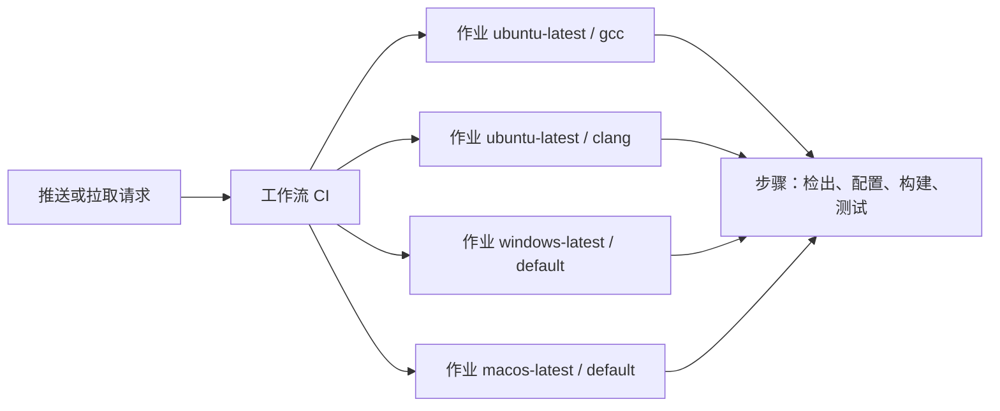
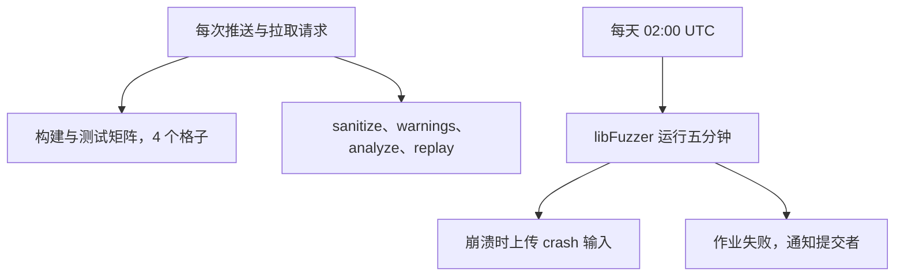

# 18. 持续集成

回顾第 16 章中遇到的那个典型事故：一位协作者在重构 `counter.c` 时，顺手将内部自写的 `dup_string` 替换成了标准库看似通用的 `strdup`。在他本地的 Windows 开发机上，无论是重新生成构建树、执行编译，还是运行现存的三个单元测试，整个流程均顺畅通过、毫无警报，改动随即被推入主干分支 `main`。然而，当另一位开发者在 Debian 环境下拉取同一份主干代码尝试构建时，流程在第一行就戛然而止：

::: terminal title="zsh - cmake --build build-strdup"

```text
/home/minsecrus/tutorial/work/p060/wordfreq/src/counter.c: In function 'wf_counter_add':
/home/minsecrus/tutorial/work/p060/wordfreq/src/counter.c:87:18: error: implicit declaration of function 'strdup'; did you mean 'strcmp'? [-Wimplicit-function-declaration]
   87 |     char *copy = strdup(word);
      |                  ^~~~~~
      |                  strcmp
/home/minsecrus/tutorial/work/p060/wordfreq/src/counter.c:87:18: error: initialization of 'char *' from 'int' makes pointer from integer without a cast [-Wint-conversion]
```

:::

造成该故障的根因在可移植性章节中已有详尽剖析：`strdup` 虽在 POSIX 规范中早已存在，但直到 C23 标准才正式纳入 ISO C 规范。在 Linux 常见的 glibc 运行库中，一旦编译器启用了 `-std=c17` 这类严苛的标准符合模式，头文件就会收紧默认的扩展暴露，不再声明 `strdup`；而 Windows 的通用 C 运行时库（UCRT）在默认配置下则一贯保持宽容。这段代码在语法和语义逻辑上并没有发生严重的逻辑偏差，开发者也完全遵循了日常的开发流程。这起事故的诱因在于工程协作的盲区——在代码合入主干基线之前，它仅仅在一台具有特定平台特性的机器上获得过验证。

倘若代码仓库的主干前设置了一座前置守卫，每当有新的提交推送到远端或发起拉取请求时，系统便会自动调度 Linux、Windows 以及 macOS 的纯净虚拟环境并发执行构建与全量测试，这笔改动便会在合入主干前夕被精准拦截。审查界面上即刻亮起的红色错误警报，能将缺陷暴露的时间点提前整整一天，更彻底避免了未经跨系统验证的改动污染全组协同基线。

本章以 wordfreq 工程为蓝本，搭建一套完备的自动化持续集成（Continuous Integration，CI）流水线：首先编写一套平台无关的本地驱动脚本，将配置、构建与测试序列标准化；随后借助 GitHub Actions 将其拓展至跨操作系统与跨编译器的多维构建矩阵；在此基础上，将第 13 章的内存 Sanitizer、深度静态分析以及第 14 章的模糊测试语料重放机制无缝嵌入自动化作业；最后梳理流水线执行效率、测试稳定性与分支保护门禁规则，确保系统既敏捷又稳健。

## 1. 持续集成是什么

持续集成（Continuous Integration，CI）是一种工程研发文化与协作纪律：团队中的成员频繁地将各自的工作成果合并至共享的主干分支，且每一次提交与合并的触发点上，均强制依托包含全量测试在内的自动化构建系统予以独立检验。正如软件工程学者 Martin Fowler 在其经典论述中所界定：每位开发者至少每天向主干集成一次，团队全天发生多次集成；每一次集成动作均通过无人工干预的自动化构建与测试链条进行端到端验证，从而在第一时间暴露并化解隐匿的集成阻抗。

持续集成首先是一种开发团队的共识与习惯。GitHub Actions、GitLab CI、Jenkins 抑或 Gitee Go，都只是承载这套工程纪律的技术脚手架；即使脱离这些现成的托管平台，在一台内网物理机上配置定时拉取代码、编译并回传告警的简单脚本，同样是在践行持续集成。反之，倘若团队即便采购了昂贵的 CI 集群，却对主干分支上频繁亮起的构建红灯熟视无睹、任由破坏性提交长期搁置，持续集成的保护网便形同虚设。

在 C 语言工程中，建立持续集成比在高级受管语言项目中更为迫切。C 语言直接与底层软硬件环境紧密咬合，而现实开发生态中存在着复杂的多维异构性：

- **编译器实现的差异**：GCC、Clang 与 MSVC 在警告诊断的颗粒度、专有语法扩展的容忍度、以及对 ISO C 严苛标准的遵循程度上均存在微妙偏差。
- **C 运行时库的差异**：glibc、musl 与 MSVC UCRT 对系统 API 的暴露规则与宏开关（如 Feature Test Macro）各行其道，`strdup` 的跨平台陷阱仅仅是冰山一角。
- **宿主操作系统的差异**：路径分隔符与大小写敏感性、文本行结束符的编码范式、动态链接库与可执行文件的装载机制，都会让在某一台开发机上完美运行的程序在另一处轰然崩溃。

任何单一一台实体开发机，其编译器、运行时库与操作系统的交集都只是庞大生态中的孤立象限。持续集成的工程价值，正在于打破“在我本地明明能编过”的局部幻象，将可用性证明扩展至更广阔的平台矩阵之中。

在 Fowler 总结的经典集成实践原则中，与 C 语言工程联系最为紧密的核心要素可以凝练为以下五条：

1. **构建流程完全自动化**：工程的预配置、编译与链接链路均由统一的脚本或命令行参数编排完成，绝不依赖集成开发环境（IDE）界面的手工点击。
2. **构建内嵌自测试**：测试执行是构建闭环不可分割的终局节点，构建成功的前提必须包含自动化测试集的无瑕疵通过。
3. **提交与推送即时触发**：一切检验流程均由代码仓库的事件钩子自动调度，无需依赖开发者的记忆力或人工提醒。
4. **主干破损即刻修复**：主干分支的构建红灯被全团队视为最高级别的紧急故障，在基线恢复前暂停推进任何非修复性合入。
5. **保障验证的高效敏捷**：单次流水线的反馈耗时控制在数分钟之内，防止漫长的等待瓦解开发人员查阅结果的耐心。

至于单一源码基线管理与自动化制品部署等宏观议题，则与版本控制及发布工程紧密交织，将在本教程第 17 章与第 19 章分别深入拆解。

从持续集成的运转规律中，可以自然引申出一项极其重要的工程原则：持续集成要求改动必须小步快跑。倘若一次提交包揽了十几个源文件、数千行散乱重构，自动化流水线即便捕获了编译或测试崩溃，排查故障代码也如同大海捞针；反之，若每一次合入都精准收敛于单一逻辑、频繁融入主干，几分钟内亮起的红灯便能将怀疑焦点精确锁定在刚刚触碰的几行语句之上。

<Quiz
  type="single"
  :options="[
    { label: '把测试放到云端运行，省下本机的编译时间', value: 'A' },
    { label: '每人频繁合入主线，每次合入由包含测试的自动构建验证', value: 'B' },
    { label: '用一台专用服务器代替代码评审', value: 'C' },
    { label: '在发布前集中运行一次完整的测试', value: 'D' }
  ]"
  answer="B"
>

<template #question>

下面哪一句最接近持续集成的本意？

</template>

正确答案是 **B**。CI 的要点是「频繁合入」和「每次合入都被自动验证」，云端的服务只是实现手段。A 只说了在哪里跑；C 把自动检查当成了评审；D 把频率降到了发布前一次，问题仍然会在合并后才暴露。

</Quiz>

## 2. 先写本地脚本

在着手编写任何云端 CI 配置文件之前，树立一个清晰的工程优先律至关重要：必须保证整套配置、构建与测试指令已在本地物理机或容器环境中能够独立且顺畅地执行完毕，随后再由 CI 流水线去声明式地调用它们。许多工程新手容易陷入相反的误区——将错综复杂的构建参数与环境变量直接拼凑在云端平台的 YAML 描述文件中，一旦流水线意外变红，开发者既无法在本地终端原样复现，只能被迫在网页端笨拙地翻阅海量日志、盲目猜测远端环境差异，陷入“改一次配置、推一次提交、苦等数分钟看结果”的低效泥潭。

在 wordfreq 项目中，我们将其统一封装为项目根目录下的驱动脚本 `tools/ci.sh`，其完整实现如下：

```sh
#!/bin/sh
# 本地与 CI 共用的检查脚本：配置、构建、运行全部测试。
#
#   sh tools/ci.sh [preset]
#
# preset 省略时用 dev-gcc（Ninja）。没有 Ninja 的环境用 dev-gcc-make
# （Unix Makefiles），两条路径执行的是同一张构建图。
# CI 的每个作业都调用这个脚本或同样的预设命令，不在 YAML 里另外堆一套构建命令。
set -eu

PRESET=${1:-dev-gcc}

cd "$(dirname "$0")/.."

echo "== configure ($PRESET)"
cmake --preset "$PRESET"

echo "== build ($PRESET)"
cmake --build --preset "$PRESET"

echo "== test ($PRESET)"
ctest --preset "$PRESET"
```

Shell 脚本首部的 `set -eu` 构成了严格的错误防线：`-e`（errexit）确保整条指令链条中一旦有任何一步返回非 0 状态码，解释器将立即中断后续执行，并将当前失败状态作为脚本整体的退出码向外传递；`-u`（nounset）则杜绝了对任何未声明环境变量的隐式引用，避免其被静默展开为空字符串而引发意想不到的灾难性路径拼接。由于该驱动脚本在尾部收敛于自动化测试命令 `ctest`，因此整个脚本最终返回的进程退出状态码，便是决定测试集全绿（状态码 0）或破损（非 0）的根本判据，而这正是云端 CI 运行器赖以识别作业成功与否的唯一核心信号。此外，首部的 `cd "$(dirname "$0")/.."` 保证了无论开发者或 CI 调度器在系统文件树的哪一个深层子目录下触发该脚本，当前工作区都会被无条件校准至代码仓库的根目录，从而使后续所有的相对路径引用保持严格稳定。

脚本内部调度的预设参数直接承接自第 16 章建立的 `CMakePresets.json` 规则资产：默认预设 `dev-gcc` 依托现代轻量的高性能生成器 Ninja，而派生预设 `dev-gcc-make` 则完全继承其编译选项，仅将底层生成器降级替换为传统的 Unix Makefiles，并将构建树隔离放置于 `build-make` 目录下。

为了直观展现同一套驱动脚本在不同物理机器上的鲁棒表现，我们首先在一台搭载 Windows 11、MinGW-w64 GCC 13.2 与 CMake 3.29 的工作站上执行无参调用：

::: terminal title="zsh - sh tools/ci.sh（Windows 11，MinGW GCC 13.2，Ninja）"

```console
$ sh tools/ci.sh
== configure (dev-gcc)
-- The C compiler identification is GNU 13.2.0
-- Check for working C compiler: D:/Software/Strawberry/c/bin/gcc.exe - skipped
-- Looking for getline
-- Looking for getline - not found
-- Configuring done (1.1s)
-- Generating done (0.0s)
-- Build files have been written to: C:/work/p060wf/build
== build (dev-gcc)
[1/12] Building C object CMakeFiles/wf.dir/src/token.c.obj
[2/12] Building C object CMakeFiles/wf.dir/src/counter.c.obj
[3/12] Building C object CMakeFiles/wf.dir/src/report.c.obj
[4/12] Building C object CMakeFiles/test_token.dir/tests/test_token.c.obj
[5/12] Building C object CMakeFiles/test_counter.dir/tests/check.c.obj
[6/12] Building C object CMakeFiles/test_token.dir/tests/check.c.obj
[7/12] Building C object CMakeFiles/test_counter.dir/tests/test_counter.c.obj
[8/12] Building C object CMakeFiles/wordfreq.dir/app/main.c.obj
[9/12] Linking C static library libwf.a
[10/12] Linking C executable test_counter.exe
[11/12] Linking C executable test_token.exe
[12/12] Linking C executable wordfreq.exe
== test (dev-gcc)
Test project C:/work/p060wf/build
    Start 1: token
1/3 Test #1: token ............................   Passed    0.05 sec
    Start 2: counter
2/3 Test #2: counter ..........................   Passed    0.05 sec
    Start 3: e2e
3/3 Test #3: e2e ..............................   Passed    0.08 sec

100% tests passed, 0 tests failed out of 3

Label Time Summary:
e2e     =   0.08 sec*proc (1 test)
unit    =   0.10 sec*proc (2 tests)

Total Test time (real) =   0.18 sec
```

:::

接着，我们换到另一台未安装 Ninja 工具链的全新 Linux 测试机（Debian 13，GCC 14.2，CMake 3.31）中运行该脚本。在默认参数下，脚本在探测阶段即被精准拦截：

::: terminal title="zsh - sh tools/ci.sh（Debian 13，GCC 14.2）"

```console
$ sh tools/ci.sh
== configure (dev-gcc)
CMake Error: CMake was unable to find a build program corresponding to "Ninja".  CMAKE_MAKE_PROGRAM is not set.  You probably need to select a different build tool.Preset CMake variables:

  CMAKE_BUILD_TYPE="Debug"


CMake Error: CMAKE_C_COMPILER not set, after EnableLanguage
-- Configuring incomplete, errors occurred!
$ echo $?
1
$ sh tools/ci.sh dev-gcc-make
== configure (dev-gcc-make)
-- The C compiler identification is GNU 14.2.0
-- Check for working C compiler: /usr/bin/cc - skipped
-- Looking for getline
-- Looking for getline - found
-- Configuring done (0.4s)
-- Generating done (0.0s)
-- Build files have been written to: …/build-make
== build (dev-gcc-make)
[  8%] Building C object CMakeFiles/wf.dir/src/token.c.o
[ 16%] Building C object CMakeFiles/wf.dir/src/counter.c.o
[ 25%] Building C object CMakeFiles/wf.dir/src/report.c.o
[ 33%] Linking C static library libwf.a
[ 33%] Built target wf
[ 41%] Building C object CMakeFiles/wordfreq.dir/app/main.c.o
[ 50%] Linking C executable wordfreq
[ 50%] Built target wordfreq
[ 58%] Building C object CMakeFiles/test_token.dir/tests/test_token.c.o
[ 66%] Building C object CMakeFiles/test_token.dir/tests/check.c.o
[ 75%] Linking C executable test_token
[ 75%] Built target test_token
[ 83%] Building C object CMakeFiles/test_counter.dir/tests/test_counter.c.o
[ 91%] Building C object CMakeFiles/test_counter.dir/tests/check.c.o
[100%] Linking C executable test_counter
[100%] Built target test_counter
== test (dev-gcc-make)
Test project …/build-make
    Start 1: token
1/3 Test #1: token ............................   Passed    0.00 sec
    Start 2: counter
2/3 Test #2: counter ..........................   Passed    0.00 sec
    Start 3: e2e
3/3 Test #3: e2e ..............................   Passed    0.01 sec

100% tests passed, 0 tests failed out of 3

Label Time Summary:
e2e     =   0.01 sec*proc (1 test)
unit    =   0.00 sec*proc (2 tests)

Total Test time (real) =   0.01 sec
```

:::

将两台异构机器上的运行日志横向比对，便能深切体会标准化预设的工程威力：完全相同的测试套件与源码，在 Windows/MinGW/Ninja 与 Linux/Debian/glibc/Make 两套截然不同的宿主上下文中，终局的 `Passed` 断言行与判定结果完全对齐；配置阶段呈现出的细微差异，仅体现为针对 POSIX `getline` 函数的特性探测——第 16 章生成的 `config.h` 正是据此在底层平滑完成按行读取与分块读入分支的自适应切换。脚本通过命令行参数接收预设标识符，当面临不同构建环境时只需传入不同的预设名称，驱动脚本本身的代码无需做任何修改；一旦传入的预设不存在，`-e` 机制便会强制其在首条配置命令处终止并输出状态码 1，CI 系统能够在第一时间内感知到配置异常。

至此，云端持续集成流水线的职责被严格收敛至三项基本操作：拉取代码并准备运行时依赖环境、无脑调用上述标准化驱动指令、收集测试日志与报告制品。至于编译标志的排列、生成器的裁决与用例的过滤等具体细节，均被严密封装在本地脚本与 CMake 描述文件之中，实现了配置抽象与执行基础设施的彻底解耦。

::: concept dev-ci-same-command title="CI 里的构建命令必须与本地逐字一致"

持续集成流水线不应另起炉灶编写第二套私有的构建逻辑。作业应当要么直接调用仓库中固化的驱动脚本，要么在步骤中严格复用与本地预设逐字一致的命令行；YAML 配置文件的职责边界，严格限定在不同操作系统平台间的环境抹平（安装依赖包、注入交叉编译环境变量）与结果制品的归档收集。一旦构建逻辑只存在于 YAML 之中，本地环境将彻底失去对失败用例的快速复现能力，团队亦无法辨析故障究竟源于业务代码的内在缺陷，还是 CI 运行器的配置偏差。

:::

## 3. GitHub Actions 基础

在 GitHub 生态体系中，自动化工作流均以声明式的 YAML 规范组织在代码仓库的 `.github/workflows/` 目录之下。一个独立的 `.yml` 文件即代表一条自动化工作流（Workflow）。在概念层次上，工作流由特定的仓库事件（Event，如分支推送、发起 PR 或定时时钟）触发激活；每个工作流可编排一个或多个作业（Job）；每个作业被调度至独立的虚拟运行器（Runner）环境中以隔离的容器或虚拟机形态执行；作业内部则由按严格时序推进的步骤（Step）构成，具体步骤既可以直接执行原生的 Shell 终端指令，也可以挂载开源社区封装好的标准动作（Action）。

一个最简且完备的 C 语言自动化工作流仅需十余行声明，存放于 `.github/workflows/ci.yml`：

```yaml
name: CI

on:
  push:
  pull_request:

jobs:
  build:
    runs-on: ubuntu-latest
    steps:
      - uses: actions/checkout@v7
      - name: Configure
        run: cmake -S . -B build -DCMAKE_BUILD_TYPE=Debug
      - name: Build
        run: cmake --build build
      - name: Test
        run: ctest --test-dir build --output-on-failure
```

顶层的 `on` 字段显式声明了工作流的触发时机：`push:` 在缺省过滤条件时代表监听仓库中任何分支的新提交推送，`pull_request:` 则涵盖了任何针对目标分支的新建请求与后续追加更新。属性 `runs-on` 用于裁决宿主运行器的操作系统镜像，`ubuntu-latest` 指示 GitHub 调度其官方维护的最新长期支持版 Ubuntu 纯净运行环境。进入作业体内部，`steps` 列表中的每个阶段严格串行推进；依据 POSIX Shell 的失败截断机制，任何一个步骤一旦返回非 0 退出状态码，系统将判定该作业破损并即刻短路终止，后续步骤不再调度。

步骤 `uses: actions/checkout@v7` 是绝大多数构建作业的第一道工序，其职责是将触发事件对应的版本库快照拉取至运行器的工作目录。由于云端运行器在每次冷启动分配时工作区完全置空，缺少该检出步骤，后续执行的 `cmake -S .` 便会因缺失 `CMakeLists.txt` 而直接抛出致命路径异常。符号 `@` 之后标注的是动作依赖的发行基线，`v7` 锚定其大版本语义；当上游维护者在 7.x 序列中推送安全加固补丁时，流水线能够自动享受到维护升级；而在对供应链安全有极高审查要求的企业级环境中，亦可将其直接固化为特定提交的 40 位 SHA-1 哈希值。

声明 `run` 会在运行器沙箱中拉起一个独立的 Subshell 进程执行指令。需要特别留意的是，每一个步骤所派生的 Shell 进程在生命周期上彼此隔离，前序步骤中所导出的普通局部环境变量无法直接跨步骤渗透；若有需要在后续阶段继承的环境参数或状态，必须显式写入 GitHub 提供的环境变量文件（如 `$GITHUB_ENV`）。

当此配置文件并入仓库后，GitHub Web 界面的“Actions”看板将以提交历史为轴线实时展示流水线的推进全貌。在作业执行视图中，左侧呈现实时步骤拓扑，右侧滚屏同步输出原汁原味的终端标准输出与错误流；一旦遭遇步骤失败，该节点将高亮显示红色警示标记，展开后即可直观查阅编译器的报错上下文，其信息丰富度与本地调试终端毫无二致。在拉取请求（PR）的详情页底部，该工作流亦会自动挂载为合并前置检查项，以直观的绿色对勾或红色十字呈现同行评审所必须的自动化体检报告。

::: info 这一页不贴 CI 页面的截图和运行日志

本教程涉及的所有本地构建与测试命令行均在实体机器（Windows 11 与 Debian 13）上完整验证并采集标准输出；而 GitHub Actions 的云端作业强依赖云端基础设施的调度机制，无法作为离线文件随代码仓库一同封装着盘，因此本章对工作流语法的剖析均严格基于 GitHub 官方标准文档进行字段语义校对与工程原语推导，不额外堆砌冗余的 Web 界面截图与网页日志排版。

:::

一个推送从进入仓库到出结果，经过的层次是固定的：



## 4. 构建矩阵

在主流的三大操作系统环境（Linux、Windows、macOS）中各自拉起基线检验，是 C 语言项目建立持续集成时最核心的底线需求。若要为每个操作系统和编译器的搭配都手写一套独立的 Job 描述，工作流文件势必迅速膨胀且极难维护。持续集成系统提供了“构建矩阵”（Build Matrix）这一优雅机制：通过在多维坐标轴上声明离散取值，系统能够自动计算笛卡尔积，派生出一组相互平行的独立作业。我们在 `os` 轴上定义三个目标系统，在 `cc` 轴上定义三个编译器标识符；理论上的 9 组组合中，只有 4 组契合实际工业环境，其余非主流搭配通过 `exclude` 规则精准剔除。当前 GitHub 官方镜像池中，`ubuntu-latest`、`windows-latest`、`macos-latest` 分别对齐至 Ubuntu 24.04、Windows Server 2025 与 macOS 26。

我们将第 3 节的最简工作流扩展为工业级结构，融入定时调度触发器与矩阵策略：

```yaml
name: CI

# 每次推送 main 与每个拉取请求都跑四个平台格子与五个检查作业；
# 定时任务只跑模糊测试，结果不阻塞日常提交。
on:
  push:
    branches: [main]
  pull_request:
  schedule:
    # 每天 02:00 UTC 跑一次模糊测试
    - cron: "0 2 * * *"

jobs:
  build-and-test:
    name: ${{ matrix.os }} / ${{ matrix.cc }}
    runs-on: ${{ matrix.os }}
    strategy:
      # 一个格子失败不取消其余格子，一次就能看到哪些平台有问题
      fail-fast: false
      matrix:
        os: [ubuntu-latest, windows-latest, macos-latest]
        cc: [gcc, clang, default]
        exclude:
          # Windows 与 macOS 不装 GCC 和 Clang，只跑平台默认的编译器
          - os: windows-latest
            cc: gcc
          - os: windows-latest
            cc: clang
          - os: macos-latest
            cc: gcc
          - os: macos-latest
            cc: clang
          # Ubuntu 上不用默认编译器，两个格子都明确指定
          - os: ubuntu-latest
            cc: default
    steps:
      - uses: actions/checkout@v7
      - name: Configure
        # 不指定生成器：Linux 与 macOS 用 Unix Makefiles，Windows 用 Visual Studio
        shell: bash
        run: |
          if [ "${{ matrix.cc }}" != "default" ]; then
            export CC="${{ matrix.cc }}"
          fi
          cmake -S . -B build -DCMAKE_BUILD_TYPE=Debug
      - name: Build
        # 多配置生成器（Windows 的 Visual Studio）要 --config，单配置生成器忽略它
        run: cmake --build build --config Debug
      - name: Test
        run: ctest --test-dir build -C Debug --output-on-failure
```

在理论上的 9 组笛卡尔积中，扣除 5 项由 `exclude` 明确声明的无效路径，流水线最终收敛为 4 个清晰的并行作业：`ubuntu-latest / gcc`、`ubuntu-latest / clang`、`windows-latest / default` 以及 `macos-latest / default`。

标识符 `default` 并非一个具象的编译器程序，而是一个语义占位符，代表完全遵从 CMake 生成器的宿主默认选择。在 Windows 与 macOS 环境下，系统原生且完备的工具链分别是 MSVC 与 Apple Clang，因此使用 `default` 无需额外安装或注入配置；而在 Linux 生态中，主流开源项目通常需要对 GCC 与 Clang 两大分支均保持平等的支持，因而明确拆分出两组独立的验证格子。

在作业配置细节中，有几项关键参数奠定了流水线的健壮性：
- 动态属性 `name: ${{ matrix.os }} / ${{ matrix.cc }}` 利用当前矩阵项的参数动态插值生成易读的标签名，在看板中能够一目了然区分各个环境，避免了系统自动生成类似 `build-and-test (2)` 这种缺乏语义的机械编号。
- 策略声明 `fail-fast: false` 显式关闭了 GitHub Actions 默认的激进短路机制。在默认配置下，只要任何一个矩阵格子执行失败，系统便会自动取消其余正在并发运行的作业；而对于跨平台诊断而言，开发者往往急需在单次提交中全景式掌握全部平台的成败分布（例如快速判断是所有系统通通报错，还是仅仅特定系统遭遇了头文件缺失）。
- 生成器命令的兼容性：在 Windows 运行器中，CMake 默认调度多配置（Multi-Configuration）的 Visual Studio 生成器，因此在构建与测试指令中必须显式传入 `--config Debug` 与 `-C Debug` 标志；而在 Linux 与 macOS 运行器中，默认调度的单配置 Unix Makefiles 生成器会自动忽略上述标志。这一兼容设计使得同一组声明能够优雅无感地跨越三套迥异的系统，无需在脚本层面引入多余的分支判断。
- 环境变量注入的平滑处理：在配置阶段，内联 Shell 通过 `if [ "${{ matrix.cc }}" != "default" ];` 规避向系统注入非法的 `CC=default` 变量。由于步骤中指定了 `shell: bash`，即便是 Windows 运行器也会通过预装的 Git Bash 环境来解析这段逻辑，从而避免了跨平台不得不维护两套 PowerShell 语法的碎片化负担。

在梳理矩阵规则时，`exclude` 与 `include` 的语义分野格外分明：`exclude` 是从乘积集合中执行精确剪枝，`include` 则是向集合中追加全新的单项配置或为已有格子覆盖定制化参数。当异构环境维度较多时，先通过全局轴声明基线、再用 `exclude` 剥离无效组合、最后用 `include` 补充特殊作业，是结构最清晰、可读性最好的声明范式。

设想前文所述的 `strdup` 破坏性提交被推入这套矩阵流水线，4 个作业的判决结果将呈现出截然不同的工程图景：

| 作业 | 结果 | 原因 |
| --- | --- | --- |
| ubuntu-latest / gcc | 构建失败 | glibc 在 `-std=c17` 下不声明 `strdup`，GCC 14 把未声明的函数当错误 |
| ubuntu-latest / clang | 构建失败 | 同一个头文件门控，clang 拒绝隐式函数声明 |
| windows-latest / default | 通过 | UCRT 的 `string.h` 声明了 `strdup`；本机用 MSVC 编译同一份源码，三个测试全部通过 |
| macos-latest / default | 未实测，推断也会失败 | Apple 的头文件同样用功能测试宏控制 POSIX 声明，`-std=c17` 定义 `__STRICT_ANSI__` 之后多半不声明 `strdup`；本章没有 macOS 环境，这一格只能推断 |

上述诊断矩阵直观呈现了现实协作中那句“在我的机器上明明能编过”背后的盲区所在：贡献者身处 Windows 环境，MSVC 与 UCRT 在宽松模式下为 `strdup` 提供了兜底声明，使得他本地的所有编译与测试均亮起绿灯；而在严格遵循 ISO C17 标准且未显式开启 POSIX 宏特性的 Linux 环境中，GCC 与 Clang 均在第一线拉响警报。

针对此类平台断层，第 16 章总结过三种典型的工程化方案：在文件首部定义标准测试宏 `_POSIX_C_SOURCE 200809L`、保留精悍且无外部依赖的自写实现 `dup_string`、抑或在 CMake 配置阶段通过探针探测符号并自适应分流。无论团队最终选定何种方案，持续集成矩阵都将在提交推送后的数分钟内给出客观结论，彻底阻断了隐患在主干潜伏的可能性。

## 5. 检查作业

构建矩阵的核心使命在于回答一个基础而关键的命题：代码在异构操作系统与编译器环境下能否成功完成配置与构建，核心功能用例的行为是否符合预期。然而，即便矩阵中的所有测试格子均呈现绿色，依然无法证明程序内部不存在内存越界、资源泄漏、未定义行为或潜在的诊断异味。为此，我们在主构建矩阵之外，平行搭建一组专门的“深度质量检查作业”（Quality Gate Jobs），并统一将它们部署在生态工具链最为成熟的 Ubuntu 运行器之上：其中 AddressSanitizer、UndefinedBehaviorSanitizer 与深度过程间静态分析的技术方案承接自第 13 章，而模糊测试与已发现历史缺陷的语料重放体系则承接自第 14 章。

在架构设计上，之所以坚持将专项检查拆分为独立的顶层作业，而非直接叠加进矩阵内部的每一个格子里，主要基于两重考量：
其一是关注点隔离与诊断聚焦。矩阵回答的是“跨平台可移植性”，Sanitizer 诊断的是“运行时执行轨迹的内存安全性”，而静态分析则是“编译器语义推理层面的全路径缺陷扫描”。若将所有检测标志无脑混杂进单一构建环节，一旦触发报错，开发者必须在冗长的复合日志中费力甄别究竟是逻辑行为不一致、内存破坏还是警告误报。将它们拆解为并行作业，看板上亮起的每一个红灯都具有直观且单一的故障语义。
其二是工程成本与平台支持度的现实约束。在诸如 wordfreq 这种小型工程中，从纯净构建到测试完毕仅需数百毫秒，将专项分析复制到所有平台或许感知不明显；但在数十万行的大型工程中，全量静态分析与插桩构建往往需要耗费数倍的计算资源。此外，像 AddressSanitizer 等底层技术在跨平台实现上具有明显的碎片化——GCC 在 MinGW 端口下缺乏完备的 ASan 运行时库支持，而 MSVC 则依托自己专有的 `/fsanitize=address` 编译期开关。如果强行把全套专项分析塞入矩阵，就必须为 Windows 与 macOS 针对性维护繁杂的平台特化配置。鉴于绝大多数内存破坏与算法未定义行为属于逻辑层面的固有缺陷，它们在 Linux 单一平台上就能以极高的概率被捕获，因此将专项检查收敛在环境标准的 Ubuntu 上是收益最大、维护成本最低的工程策略。

紧随矩阵之后，我们在 `jobs` 下平级追加五个专项检查作业：

```yaml
  sanitize:
    name: sanitize (ubuntu, ASan + UBSan)
    runs-on: ubuntu-latest
    steps:
      - uses: actions/checkout@v7
      - name: Configure
        run: cmake -S . -B build-asan -DWF_SANITIZE=ON
      - name: Build
        run: cmake --build build-asan
      - name: Test
        run: ctest --test-dir build-asan --output-on-failure

  warnings:
    name: warnings as errors (ubuntu)
    runs-on: ubuntu-latest
    steps:
      - uses: actions/checkout@v7
      - name: Configure
        run: cmake -S . -B build-werror -DWF_WERROR=ON
      - name: Build
        run: cmake --build build-werror

  analyze:
    name: static analysis (ubuntu)
    runs-on: ubuntu-latest
    steps:
      - uses: actions/checkout@v7
      - name: Configure with -fanalyzer
        run: >
          cmake -S . -B build-analyzer
          -DCMAKE_C_FLAGS="-fanalyzer -Werror=analyzer-file-leak -Werror=analyzer-malloc-leak"
      - name: Build
        run: cmake --build build-analyzer

  replay:
    name: fuzz corpus replay (ubuntu)
    runs-on: ubuntu-latest
    steps:
      - uses: actions/checkout@v7
      - name: Configure
        run: cmake -S . -B build-fuzz -DWF_FUZZ=ON
      - name: Build
        run: cmake --build build-fuzz
      - name: Replay corpus and regression inputs
        run: ctest --test-dir build-fuzz -R replay --output-on-failure

  fuzz:
    name: libFuzzer (ubuntu, nightly)
    # 只在定时任务里跑，不在每次推送时跑
    if: github.event_name == 'schedule'
    runs-on: ubuntu-latest
    timeout-minutes: 15
    steps:
      - uses: actions/checkout@v7
      - name: Build with clang
        run: |
          clang -g -O1 -fsanitize=fuzzer,address -Iinclude \
            fuzz/fuzz_token.c src/token.c -o fuzz_token
      - name: Fuzz for five minutes
        run: |
          mkdir -p corpus
          cp tests/data/sample.txt corpus/
          ./fuzz_token -max_total_time=300 corpus/
      - name: Upload crash inputs
        # 作业因崩溃失败时，把 libFuzzer 写出的 crash-<sha1> 文件保存为制品
        if: failure()
        uses: actions/upload-artifact@v7
        with:
          name: crash-inputs
          path: crash-*
          if-no-files-found: ignore
```

细致审视这五个作业的配置构型，可以清晰看出它们是如何将此前章节沉淀的技术资产转化为 CI 护城河的：
- 作业 `sanitize` 激活了第 13 章定义的 CMake 选项 `WF_SANITIZE`，在编译与链接全程注入 AddressSanitizer 与 UndefinedBehaviorSanitizer 运行时插桩，随后以最高严格度调度现存测试。由于 Sanitizer 聚焦的是指针越界、悬空访问与未定义行为，其捕捉到的故障与平台特征弱相关，依托纯净的 Ubuntu 容器便足以筑牢内存防线。
- 作业 `warnings` 开启了 `WF_WERROR` 宏，强制将编译器发出的全部警告视同阻断性错误。之所以将其与主干构建解耦，是为了提供渐进式质量治理的弹性——在大型遗留代码库中，主构建矩阵可以暂时容忍旧有的良性警告以保证日常交付，而独立的 `warnings` 作业则作为专门的质量卡口，确保新提交的代码中绝不带入任何未经处理的诊断异味。
- 作业 `analyze` 依托 `CMAKE_C_FLAGS` 向 GCC 注入深度分析选项 `-fanalyzer`，并通过 `-Werror=analyzer-file-leak` 与 `-Werror=analyzer-malloc-leak` 两个细粒度控制开关，将关键的文件描述符悬挂与动态内存泄漏严格升格为阻断性编译故障，其余启发式推导报告则保持为非阻断提示，从而使静态分析成为一道自动化的低噪声安全滤网。
- 作业 `replay` 激活第 14 章建立的 `WF_FUZZ` 开关，编译出轻量回归回放器 `replay_token`，并利用 `ctest -R replay` 驱动其在毫秒级时间内重放 `tests/regress/` 目录下的所有历史崩溃语料，确保第 14 章中修复过的严重边界溢出缺陷绝不会随后续重构死灰复燃。
- 作业 `fuzz` 则代表了持续进阶的自动化健壮性探索：通过 `if: github.event_name == 'schedule'` 约束，该作业仅在每日凌晨 02:00（UTC）的定时事件触发时在后台异步启动，绝不阻塞开发团队白天的日常交互式推送与 PR 合并。该作业调度 Clang 工具链编译带有 libFuzzer 引导的变异测试程序，开展为期 5 分钟的深度探索。一旦在探索周期内突发边界崩溃，libFuzzer 会自动在根目录下落盘 `crash-<sha1>` 最小复现语料；此时挂载的后续步骤 `if: failure()` 会被触发，借由官方动作 `actions/upload-artifact@v7` 将崩溃现场文件封存为可下载的归档制品（Artifact），供工程师次日上班后直接下载并本地复现。

这五个专项作业与前述的多维构建矩阵相互协同，形成了多层次的质量防御纵深：

| 作业 | 运行次数 | 做什么 | 能发现什么 |
| --- | --- | --- | --- |
| build-and-test | 每次推送，4 个格子 | 配置、构建、运行三个测试 | 平台差异、编译错误、行为不一致 |
| sanitize | 每次推送 | ASan + UBSan 下运行测试 | 越界、泄漏、未定义行为 |
| warnings | 每次推送 | `-Werror` 构建 | 新混进来的警告 |
| analyze | 每次推送 | `-fanalyzer` 构建 | 直线错误路径上的泄漏 |
| replay | 每次推送 | 重放 `tests/regress/` | 已修缺陷复发 |
| fuzz | 每天一次 | libFuzzer 运行五分钟 | 新输入触发的崩溃 |

整套工程检查体系在时序与频次上呈现出清晰的“双层分水岭”架构：



轻量、迅速且具备确定性结论的检查（多平台构建矩阵、Sanitizer 动态插桩、静态全路径分析与已知回归语料回放）全部绑定在每次推送与 PR 触发的前沿阵地，将同行审查前的等待周期死死压制在 1 至 2 分钟之内；而耗时漫长、具有随机变异探索性质的无序模糊测试则交由夜间定时任务异步消化。当夜间探测捕获异常时，自动保留在制品仓库中的崩溃语料包，便成了次日快速修补技术漏洞最宝贵的第一手现场证据。

<Quiz
  type="single"
  :options="[
    { label: '只在定时事件触发时运行这个作业', value: 'A' },
    { label: '给作业设置十五分钟的上限', value: 'B' },
    { label: '作业失败后调用 upload-artifact 保存 crash 文件', value: 'C' },
    { label: '把模糊测试的总时长限制在三百秒', value: 'D' }
  ]"
  answer="C"
>

<template #question>

定时模糊测试作业里，哪一处保证崩溃发生时输入被保留下来？

</template>

正确答案是 **C**。A 决定这个作业什么时候跑，B 防止卡死的作业占着运行器，D 控制跑多久，只有 C 在失败时把文件留下来。没有它，日志里只能看到输入内容的十六进制转储，重新构造要花很多时间。

</Quiz>

## 6. 让 CI 快而稳

在持续集成的日常运转中，流水线的吞吐速度与执行稳定性直接决定了研发团队的敏捷体验与信任度。若流水线动辄卡顿半小时以上，或是偶发性地因为非代码因素随机报错，开发者很快便会丧失等待反馈的耐心，甚至将其视作拖累交付的官僚包袱。要构建一套高吞吐且坚韧的 CI 体系，需要建立清晰的工程意识：

首先是**最大化并发调度**。GitHub Actions 等现代 CI 系统对顶层作业默认采用纯并行调度模型。在 wordfreq 的配置中，矩阵的 4 个平台格子以及后续的 `sanitize`、`warnings`、`analyze`、`replay` 之间完全不存在数据或制品的依赖闭环，它们在触发后由运行器池各自认领并同时起跑。在没有前序产物传递需求的场景下，绝不要随意为作业注入 `needs` 限制以人为制造串行等待链条。

其次是**基于时延瓶颈做精细优化**。在评估流水线耗时时，首先要看清时间的物理流向。以 wordfreq 为例，从云端调度器分配虚拟机、初始化镜像、拉取依赖到检出工作树，通常需要消耗数十秒乃至 1 分钟；而本地纯净编译 7 个源文件并运行完 3 个单元测试，实际耗时仅仅数百毫秒。在这种微小型工程中，将精力花在剪裁测试用例或试图挤压编译耗时上毫无意义。只有当工程规模膨胀至数万行、一次全量编译耗时达数分钟时，引入 `ccache` 编译器缓存或利用 `actions/cache` 缓存庞大的第三方静态库才具有正向价值；过早在微小工程中引入复杂的缓存机制，往往会因为网络同步缓存包的开销而得不偿失，还额外增加了缓存脏失效的维护心智。

第三是**配置防御性超时阈值**。依靠 `timeout-minutes` 为存在长耗时风险的作业设定安全熔断红线。一旦并发测试遭遇死锁等待、或者模糊测试发生意外挂起，进程不会主动退场，往往会无休止地耗尽云端平台的默认配额（通常长达数小时）并冻结团队的并发配额池。在我们的模糊测试作业中，实际测试探索设定为 5 分钟，而作业级别的 `timeout-minutes: 15` 则为编译、初始化及工件上传预留了充足的弹性缓冲。

第四是**严格锁定动作依赖基线**。在引用社区 Action 时，应遵循明确的生命周期策略。引用类似 `actions/checkout@v7` 或 `actions/upload-artifact@v7` 的大版本标签，既能平滑吸收上游框架内部的安全更新与漏洞修复，又能隔离破坏性的 API 重构；而在金融级或高合规性项目中，更推荐直接钉死至具体的 Commit SHA。切忌在生产流水线中指向 `@main` 分支，否则每次触发都在盲目执行一份随时可能被外部改动篡改的代码。

第五是**坚决根治不稳定测试（Flaky Tests）**。如果某个测试在代码未作任何修改的情况下，呈现出“偶尔变红、点击重试又偶尔变绿”的摇摆状态，团队必须将其视为严重的质量隐患即刻排查，而绝不能养成“多点几次重跑试一试”的妥协习惯。测试的偶发性失败通常源于隐式的外部耦合：对物理时钟的偶发性竞争、跨用例共享临时目录引起的脏数据残留、网络连接抖动、或是哈希表无序遍历在不同运行器上的不确定顺序。通过点击重试获得绿灯，只是将隐患暂时掩盖起来，它迟早会在关键版本的合并时刻再次爆发。第 11 章总结的确定性准则——剥离系统时钟依赖、使用隔离目录、固化随机数种子——是保障 CI 测试确定性的根本途径。

第六是**故障现场的确定性保留**。在测试执行步骤中，务必为 `ctest` 附加 `--output-on-failure` 选项，确保当断言溃败时，运行器能直接将该用例的标准输出与标准错误流倾倒至控制台日志中，使排查人员无需额外申请调试凭证便能一眼洞悉断言失败时的上下文。而对于内存越界转储、静态分析拓扑或模糊测试捕获的异常输入，则应当配置 `if: failure()` 挂载制品上传，为本地离线复现提供逐字节精确的真实文件。

第七是**将性能基准测试坚决移出公共 CI**。云端托管的多租户虚拟化运行器（如 GitHub 托管环境）与众多外部作业共享宿主物理机的 CPU、内存总线与 I/O 调度，同一段测试的耗时在不同时刻往往会产生数倍的波动。正如第 15 章强调的测量准则，性能指标的采集必须建立在固定的物理环境与低干扰的受控基准之上，公共 CI 环境绝不适合作为微基准测试的判决依据。

## 7. 让检查生效

如果持续集成流水线跑得再勤奋、矩阵覆盖得再周全，但代码托管平台上的合并按钮在检测到红灯时依然允许任何人随意点击，整套 CI 系统便只是一场缺乏约束力的展示。只有当自动化检查与分支保护策略（Branch Protection Rules）强行绑定时，流水线才具备守护代码库基线的实际效力。

在 GitHub 仓库的“Settings” -> “Branches”管理面板中，团队应为主干分支 `main` 添加严苛的保护规约，核心策略包括：
- 勾选 **Require status checks to pass before merging**（合并前必须通过状态检查）：在下方候选列表中，显式检索并勾选必须阻断合并的作业名称（例如 `ubuntu-latest / gcc`、`sanitize`、`analyze` 等）。规则激活后，凡是列表中的作业存在失败或尚未运行完毕的拉取请求，界面的合并按钮将被物理锁定。
- 审慎评估 **Require branches to be up to date before merging**（合并前必须同步最新基线）：该选项强制要求 PR 分支在合入前必须先变基或合并最新的 `main` 代码。这能杜绝“两个各自通过测试的 PR 在合并后因隐式语义冲突导致主干破损”的幽灵问题，但代价是每次主干演进，所有并行的待合 PR 都必须全量重跑一遍 CI 流程。

在此需要特别注意作业名称（Job Name）的引用一致性：分支保护规则绑定的正是 YAML 中作业声明的 `name` 字符串。一旦未来重构了 `.github/workflows/ci.yml` 并修改了某项作业的命名，保护规则仍会守株待兔般等待那个已经不存在的旧名字，导致拉取请求永远处于等待检测的假死状态。修改作业标签的同时，必须第一时间在仓库设置中重置绑定的检查项。

倘若因为偶发的疏漏或紧急通道绕行，导致破坏性提交不幸溜进了主干基线、使得 `main` 分支在看板上全线亮起红灯，工程团队必须严格遵循应急处置原则：

::: concept dev-ci-red-main title="main 的构建失败必须立即修复或撤销"

主干分支上的任何构建破损或测试红灯，属于全团队最高优先级的紧急故障。它向所有人传递了明确的错误信号——“基线已经失控，测试不再具有可信度”。此时团队仅有两种正规的选择路径：要么由责任人在数分钟内迅速推入高优先级的微修复提交，要么立刻使用 `git revert` 生成反向提交撤销该改动的合入。严禁在主干处于红灯破损状态下，继续往上叠加任何非相关的业务代码提交。

:::

在主干破损期间继续堆砌代码，会让原本清晰的故障追溯树在复杂的历史交错中变得模糊不清，并迫使所有正在基于该主干推进派生特性的协作者陷入分支污染的被动局面。

为了提升代码库的透明度与信任度，在开源工程的 `README.md` 顶部，通常会挂载一行动态状态徽章（Status Badge）：

```markdown

```

徽章会实时拉取 `main` 分支最新构建状态的矢量图形；每当外部协作者或内部审查人员打开仓库首页，便能对当前代码库基线的健康状况建立直观认知。

## 8. 其他平台

在现实的企业级研发和不同的开源社区中，GitHub Actions 并非唯一的选择；根据代码托管生态与内网合规要求的不同，团队可能会面对多样化的持续集成基础设施。虽然各家系统的语法外壳与关键字千差万别，但其底层所依赖的工程模型高度趋同。

在 GitLab 生态中，持续集成完全依托于 GitLab CI/CD，其配置文件为存放在仓库根目录下的 `.gitlab-ci.yml`。它的组织语法在层级上与 GitHub Actions 颇为神似，但在名词术语与容器拉起细节上有所差异：

```yaml
stages: [test]

before_script:
  # gcc 官方镜像带编译器与 make，没有 CMake，每个作业开工前装一次
  - apt-get update -qq && apt-get install -y -qq cmake

build-and-test:
  stage: test
  image: gcc:14
  script:
    - cmake -S . -B build -DCMAKE_BUILD_TYPE=Debug
    - cmake --build build
    - ctest --test-dir build --output-on-failure

sanitize:
  stage: test
  image: gcc:14
  script:
    - cmake -S . -B build-asan -DWF_SANITIZE=ON
    - cmake --build build-asan
    - ctest --test-dir build-asan --output-on-failure
```

在 GitLab CI 的逻辑中，`stages` 声明了流水线推进的宏观阶段序列；同一阶段内的多个作业并发调度，而后序阶段则严格等待前置阶段的所有作业全部通过后才会启动。上例中的两个作业同处于 `test` 阶段，因此它们在被调度时并发执行。字段 `image` 声明了运行器直接加载的 Docker 容器镜像，而 `before_script` 钩子则在每个作业主体的 `script` 脚本执行前自动触发。

细心的读者会发现，由于 Docker Hub 官方发布的纯净 `gcc:14` 镜像仅预装了编译器与 Make，未包含 CMake 构建程序，因此通过 `before_script` 在开工前临时使用 `apt-get` 联网安装包是容易想到的过渡手段。然而在生产实践中，每一次流水线触发都临时联网拉取系统包，既会白白消耗数分钟的等待时间，又容易遭遇外部镜像源连接抖动的影响。这也是容器化持续集成倡导预构建专用基础镜像（或通过 `cache` 挂载缓存层）的初衷所在；与之相对，GitHub Actions 的官方运行器在宿主机器中预装了丰富的工具集，开箱即用，但在环境纯净度与私有化定制上灵活性稍逊。

在国产开源托管平台 Gitee 上，内置的 Gitee Go 同样遵循流水线、阶段与插件步骤的编排范式；而在传统私有数据中心或高度安全受限的离线内网环境中，自建 Jenkins 集群依然占据一席之地：通过存放在代码库中的声明式 `Jenkinsfile`，利用 `agent` 指定构建节点，借由 `stage` 划分阶段拓扑，以流水线代码管理软件生命周期。

主流持续集成系统在核心概念上的横向映射关系如下：

| 概念 | GitHub Actions | GitLab CI | Jenkins |
| --- | --- | --- | --- |
| 一条流水线 | 工作流 | 流水线 | Pipeline |
| 触发条件 | `on` | `rules`、`only` | 触发器与轮询 |
| 一个作业 | job | job | stage |
| 执行环境 | runner | runner | agent、node |
| 一条命令 | step 的 `run` | `script` 的一项 | `steps` 里的一步 |
| 产物 | artifact | artifacts | archiveArtifacts |

在实际的工程技术选型中，并不存在绝对优劣之分，最稳健的架构原则是**平台就近绑定**：代码托管在 GitHub 便采用 GitHub Actions，托管在 GitLab 便直接选用 GitLab CI，在自建内网且需要深度对接硬件测试机架时则选用 Jenkins。切忌为了追求所谓的“平台无关性”，在同一个代码仓库中费力维护多套并行的云端流水线，那只会带来沉重的配置漂移与双倍的维护负担。只要团队严格恪守第 2 节确立的黄金法则——将核心的配置、编译与测试逻辑完整封装在代码库内部的本地脚本（如 `tools/ci.sh`）与 CMake 预设之中，那么即便日后发生跨平台迁移，所需要替换的仅仅是外层的几行 YAML 触发器与运行器声明，底层构建的逻辑资产自始至终无需改动。

## 9. 习题

### 9.1 巩固

<Exercise id="21801" :d="1" :w="2">

读第 3 节的最小工作流，回答并改写：

1. `on` 下面写 `push:` 与写 `push: { branches: [main] }` 有什么区别？把最小工作流改成「只在推 `main` 和所有拉取请求时触发」。
2. 删掉 `uses: actions/checkout@v7` 这一行，后面的 `cmake -S . -B build` 会在哪一步、以什么方式失败？
3. 在 Configure 步骤里 `export CC=gcc`，Build 步骤里还能读到 `CC` 吗？说明原因；要让后面的步骤用上，应该写到哪里。
4. 给 Test 步骤加上失败时输出程序日志的参数，并说明这个参数在测试通过时会不会改变输出。

验收：改后的 YAML 与第 4 节 `ci.yml` 的触发段一致；第 2、3 题各用一句话说清机制。

</Exercise>

<Exercise id="21802" :d="2" :w="2">

用第 2 节的两台机器视角，在本机把同一套命令跑三遍：

1. `sh tools/ci.sh` 与 `sh tools/ci.sh dev-gcc-make` 各跑一次，记录配置、构建、测试三段的输出差异与退出状态。本机没有 Ninja 时第一条会失败，记下 `CMake Error` 的原文。
2. 用 `cmake --workflow --preset ci` 跑一次，说明它按 `CMakePresets.json` 里的哪几步执行，与第 1 步的脚本相比少了哪一层。
3. 故意把 `tests/data/sample.expected` 改错一行，再跑第 1、2 步，记录三条路径的退出状态；恢复文件后确认重新变绿。
4. 执行 `ctest --preset dev-gcc -R nosuchtest`，观察它的退出状态；再加上 `--no-tests=error` 重跑，比较两次的退出状态并解释差别。

验收：第 3 步三条路径都以非 0 状态退出；第 4 步后者以非 0 退出。

</Exercise>

<Exercise id="21803" :d="2" :w="2">

失败时留下证据这一条要落到命令上：

1. 把 `tests/test_counter.c` 里第一条 `CHECK_EQ_SIZE(wf_counter_size(c), 0);` 的期望值改成 7，重新构建，让 `counter` 测试失败。分别用 `ctest --test-dir build` 与 `ctest --test-dir build --output-on-failure` 运行，比较屏幕上能否看到失败程序的输出。
2. 用 `ctest --test-dir build --rerun-failed` 只重跑失败项，记下它跑了哪几个测试；到 `build/Testing/Temporary/` 下找出记录「上一次失败的是哪些」的文件，说明它的格式与作用。
3. 到同一个目录下找到记录完整输出的文件，说明它与屏幕输出的关系。
4. 把测试改回正确后重新构建并运行到全绿，再执行一次 `--rerun-failed`：失败日志已被清空或删除时，它是只重跑那一个，还是重跑全部？给出退出状态与测试个数。

验收：第 1 步两次输出的差异要贴出来（不带参数时看不到 `wf_counter_size(c) is 0, expected 7` 这样的断言信息）；第 2 题指出日志文件名；第 4 题给出「全绿之后 `--rerun-failed` 重跑全部测试且退出 0」的结论与依据。

</Exercise>

### 9.2 编程

<Exercise id="21804" :d="3" :w="3">

写 `tools/matrix.sh`，在本地展开工作流的矩阵，供提交前核对组合数：

1. 用 POSIX `sh`，从三个列表 `os: [ubuntu-latest, windows-latest, macos-latest]`、`cc: [gcc, clang, default]` 生成全部组合，按第 4 节的五条 `exclude` 规则删掉无效格子。
2. 每个有效组合打印一行 `os/cc`，顺序稳定：先按 `os` 列表顺序，同一 `os` 内按 `cc` 列表顺序。
3. 支持 `--count` 只打印组合数。组合总数为 0 时以非 0 状态退出并说明。
4. 用第 4 节的数据验收：输出应为四行 `ubuntu-latest/gcc`、`ubuntu-latest/clang`、`windows-latest/default`、`macos-latest/default`；`--count` 输出 `4`。

再加一条 `include` 规则：为 `macos-latest` 补一个 `cc: gcc` 的格子，说明它在输出里的位置，以及它属于「新增」还是「覆盖已有组合」。

</Exercise>

<Exercise id="21805" :d="3" :w="3">

给 wordfreq 写 `tools/smoke.sh`，作为 CI 里一个独立的快速作业：

1. 构建当前树（走 `cmake --preset dev-gcc`），失败则以 125 退出。
2. 逐项检查并在失败时打印是哪一项：`--version` 的输出形如 `wordfreq <数字>.<数字>.<数字>`；`-n 3 tests/data/sample.txt` 的输出与 `tests/data/sample.expected` 逐字相同（Windows 上先去掉回车）；`-x` 的退出状态为 2；不存在的文件退出状态为 1 且标准错误以 `wordfreq: ` 开头。
3. 每项检查用一条清晰的 `ok` 或 `FAIL` 行报告，全部通过时退出 0。
4. 验收：正常树退出 0；把 `code/开发与工程基础/11_自动化测试/bugs/token_lowercase_starts_at_1.c` 复制成 `src/token.c` 后，脚本退出非 0 并指出是输出比较那一项；恢复后再跑一次确认变绿。

说明为什么构建失败用 125 而不是 1（对照第 17 章 `tools/check.sh` 的约定）。

</Exercise>

<Exercise id="21806" :d="4" :w="3">

复现并修好「不稳定的测试」：

1. 在同一个 CMake 工程里注册两个测试。程序 `a` 先忙等约 200 毫秒（用 `clock()` 循环，不依赖 POSIX 的 `nanosleep`），再往当前目录写 `shared.tmp`；程序 `b` 读 `shared.tmp`，读不到就返回 1。
2. 用 `ctest -j2` 连跑 10 次，记录失败次数；再用不带 `-j` 的 `ctest` 连跑 10 次，记录失败次数。说明为什么串行能过、并行不能。
3. 用两种办法各修一次：给 `b` 设 `DEPENDS a`，让 ctest 先跑完 `a`；或者改写 `b`，让它自己创建再读自己的文件，彻底不依赖 `a`。两种都修好之后用 `ctest -j2 --repeat until-fail:20` 验证。只给两个测试设不同的 `WORKING_DIRECTORY` 不算修复，说明这样改之后 `b` 会变成怎样。
4. 说明第 3 步两种修法各消除的是哪一类不确定性，以及为什么 CI 上更希望测试彼此独立而不是靠 `DEPENDS` 排队。

验收：第 2 步并行失败次数应接近 10；两种修法后 `--repeat until-fail:20` 全部通过；第 3 题能说明只改工作目录会让 `b` 稳定地失败。

</Exercise>

<Exercise id="21807" :d="4" :w="4">

把第 5 节的三个检查作业在本地各做一遍，记录命令、退出状态与关键报错：

1. `sanitize`：用 `cmake --preset dev-gcc -DWF_SANITIZE=ON` 配置并构建。本机是 MinGW 时会在链接阶段报找不到 `-lasan`、`-lubsan`，记下原文，并说明为什么作业把它放在 Ubuntu 上。
2. `warnings`：在 `app/main.c` 的 `main` 里加一个「赋值后从未使用」的局部对象，用 `-DWF_WERROR=ON` 构建，记录 `-Werror=unused-variable` 的报错；去掉它后确认构建恢复。
3. `analyze`：写一个函数 `f`，`malloc` 之后不释放，用 `-fanalyzer -Werror=analyzer-malloc-leak` 编译，记录 `-Werror=analyzer-malloc-leak` 的报错。再把同一组选项用于一个空指针解引用，说明为什么后者的 `-Wanalyzer-null-dereference` 仍然只是警告。
4. 说明 `-Werror=analyzer-malloc-leak` 与 `-Werror` 的区别：前者管哪些报告，后者管哪些。

验收：第 2、3 步各贴出报错原文与退出状态；第 3 步能指出两个警告类别名。

</Exercise>

### 9.3 综合与挑战

<Exercise id="21808" :d="5" :w="4">

写一个本地 CI 驱动脚本 `tools/run_jobs.sh`，把「作业并行、结果汇总」这件事在自己的机器上做出来：

1. 接口：`sh tools/run_jobs.sh [--keep-going] 作业名:命令 ...`。每个作业的命令在后台运行，标准输出与标准错误写到 `logs/<作业名>.log`。
2. 默认行为是快速失败：第一个作业失败后不再等待其余作业，整体以非 0 退出。`--keep-going` 时等全部作业结束，逐个打印 `ok` 或 `FAIL (状态)`，有任何失败则整体非 0。
3. 汇总表按作业名的字典序或给定顺序打印，列对齐；没有作业或作业名为空时以非 0 退出并给出用法。
4. 验收：三个作业分别为 `exit 0`、`exit 8`、`exit 0` 时，默认模式返回非 0 且至少有一个作业的日志非空；`--keep-going` 打印三行且失败一项被标出；全部成功时返回 0。

最后说明它与 GitHub Actions 的对应关系：脚本里的每个「作业」对应工作流里的什么，`logs/` 对应页面上的什么。

</Exercise>

<Exercise id="21809" :d="5" :w="4" scope="*">

为 wordfreq 加一个「推标签时发布」的作业，并在本地把它的命令全部跑通：

1. 在工作流里增加作业 `release`，条件为 `if: startsWith(github.ref, 'refs/tags/v')`，运行器 `ubuntu-latest`，步骤依次为检出、`cmake --preset dev-gcc`、构建、`ctest`、`git archive` 导出源码包、`cpack` 打包、`sha256sum` 生成校验值、用 `actions/upload-artifact` 上传。
2. 在工作流顶部把 `permissions` 收窄到 `contents: read`，说明为什么发布作业不需要 `write`（不创建 Release 页面，只上传制品）。
3. 在本地同一个提交上照抄这几条命令，生成同名的两个包与一份 `SHA256SUMS`；用 `git archive` 连续导出两次比较哈希，用 `cpack` 连续打包两次比较哈希，解释两者为什么不同。
4. 说明为什么这个作业不能挂在每次推送的矩阵里：产物名、校验值、标签三者的对应关系会怎样被破坏。

验收：本地两个包都能解压并重建；两次 `git archive` 的 SHA-256 相同，两次 ZIP 的不同；文件清单与第 19 章的发布流程一致。

</Exercise>

<Exercise id="21810" :d="5" :w="4" scope="**">

把第 8 节的 GitHub 工作流迁移到 GitLab CI，只做静态核对（没有 GitLab 运行器时不要求真跑）：

1. 写 `.gitlab-ci.yml`：`stages` 分 `build`、`test`、`analyze`，`build-and-test` 用 `gcc:14` 镜像，`sanitize` 用 `-DWF_SANITIZE=ON`，`analyze` 用 `-DCMAKE_C_FLAGS="-fanalyzer -Werror=analyzer-file-leak -Werror=analyzer-malloc-leak"` 挡住泄漏。
2. 为 `analyze` 作业配置 `artifacts: when: on_failure`，把构建日志保存下来，说明它对应 GitHub Actions 的哪一步。
3. 用 `before_script` 安装一次 `cmake` 时，说明为什么每次运行都要联网、缓存该缓什么；写出 `cache:` 的最小配置。
4. 逐个对照第 8 节的表，指出 `rules` 里怎么写「只在推 main 与合并请求时运行」，并说明 `only`、`except` 与 `rules` 的取舍。

验收：YAML 结构完整，每个作业都有 `stage`、`image`、`script`；对照表里六个概念一一对应；能说清 `artifacts` 与 GitHub 的制品在生命周期上的差别。

</Exercise>

## 10. 参考资料

1. Martin Fowler，「Continuous Integration」，2006 年：https://martinfowler.com/articles/continuousIntegration.html
2. GitHub 文档《Workflow syntax for GitHub Actions》：https://docs.github.com/en/actions/reference/workflows-and-actions/workflow-syntax
3. GitHub 文档《Running variations of jobs in a workflow》：https://docs.github.com/en/actions/how-tos/write-workflows/choose-what-workflows-do/run-job-variations
4. GitHub 文档《Events that trigger workflows》，`schedule` 与 cron 语法：https://docs.github.com/en/actions/reference/workflows-and-actions/events-that-trigger-workflows
5. actions/checkout：https://github.com/actions/checkout
6. actions/upload-artifact：https://github.com/actions/upload-artifact
7. GitHub 托管运行器的镜像与预装软件：https://github.com/actions/runner-images
8. Titus Winters 等《Software Engineering at Google》第 23 章「Continuous Integration」：https://abseil.io/resources/swe-book/html/ch23.html
9. MIT《The Missing Semester》2026 课程《Code Quality》：https://missing.csail.mit.edu/2026/code-quality/
10. GitLab CI/CD 文档：https://docs.gitlab.com/ci/
11. 本教程：[11. 自动化测试](/教程/正文/开发与工程基础/11_自动化测试) 的测试与确定性规则、[13. 编译器诊断与程序检查](/教程/正文/开发与工程基础/13_编译器诊断与程序检查) 的 Sanitizer 与 `-fanalyzer`、[14. 覆盖率与模糊测试](/教程/正文/开发与工程基础/14_覆盖率与模糊测试) 的模糊测试目标与回归输入、[16. 可移植构建](/教程/正文/开发与工程基础/16_可移植构建) 的预设与 `strdup` 事件、[17. Git 协作](/教程/正文/开发与工程基础/17_Git协作) 的拉取请求。
