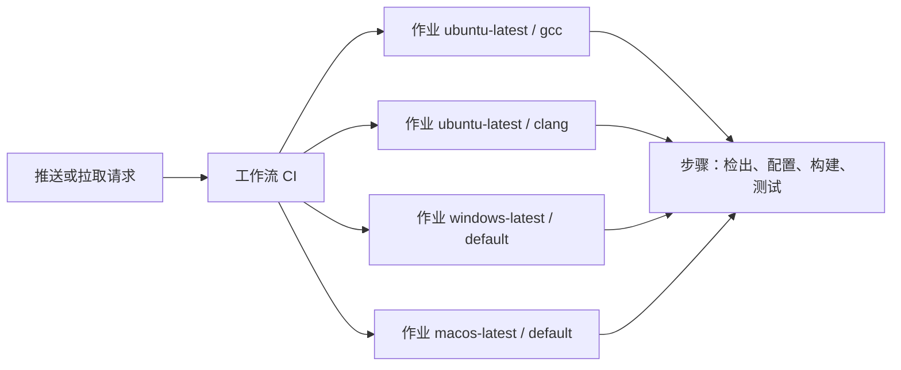
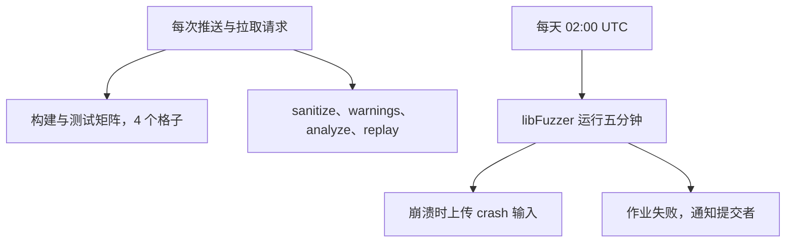

# 18. 持续集成

第 16 章的事件值得重讲一遍。一位贡献者把 `counter.c` 里的 `dup_string` 换成了 `strdup`，在自己的 Windows 上编译通过，三个测试全绿，提交合进了 main。同一份源码换到 Debian 上构建，第一行就停下了：

::: terminal title="zsh - cmake --build build-strdup"

```text
/home/minsecrus/tutorial/work/p060/wordfreq/src/counter.c: In function 'wf_counter_add':
/home/minsecrus/tutorial/work/p060/wordfreq/src/counter.c:87:18: error: implicit declaration of function 'strdup'; did you mean 'strcmp'? [-Wimplicit-function-declaration]
   87 |     char *copy = strdup(word);
      |                  ^~~~~~
      |                  strcmp
/home/minsecrus/tutorial/work/p060/wordfreq/src/counter.c:87:18: error: initialization of 'char *' from 'int' makes pointer from integer without a cast [-Wint-conversion]
```

:::

原因在那一章已经讲过：`strdup` 属于 POSIX，C23 起才进入标准库，glibc 在 `-std=c17` 严格模式下不声明它，而 Windows 的 C 库照常声明。代码本身没有错，贡献者也没有做错什么，问题在于合并之前只有一台机器看过这份代码。

如果 main 上有一台 Linux 机器，每次推送和拉取请求都自动构建、运行测试，这个提交在合并前就会变红。拉取请求页面上那个红叉比第二天别人的构建失败早了一天，也早于任何一次合并。

这一章给 wordfreq 配这样一套持续集成：先写一个本地脚本，把配置、构建、测试固定下来；再用 GitHub Actions 让它在三个系统的四种编译器组合上自动跑；然后把 Sanitizer、静态分析和模糊测试的回归输入排进作业；最后处理速度、稳定性与分支保护。读完应当能为自己的 C 项目写出同样的配置，也能看懂别人项目里的 CI 为什么那样写。

## 1. 持续集成是什么

持续集成（continuous integration，CI）是一种开发做法：每个人频繁地把自己的工作合入主线，每次合入都由一次包含测试的自动构建来验证。Martin Fowler 在 2006 年的文章里把它写成「每人至少每天合入一次，因而一天里会有多次合入；每次合入都用自动构建（包括测试）验证，以便尽快发现集成错误」。

CI 是一套习惯，不是某个产品。GitHub Actions、GitLab CI、Jenkins 都只是执行这套习惯的工具；没有这些服务，一台定时拉代码、编译、跑测试的机器也能做 CI。反过来说，装了服务却允许红色构建留在 main 上，等于没有 CI。

C 项目比多数语言更需要它。第 16 章列过不可移植性的来源，落到日常开发上是三类差别：

- 编译器：GCC、Clang、MSVC 接受的扩展、发出的警告、对严格模式的理解都不同。
- C 库：glibc 与 UCRT 对同一个 POSIX 函数的声明不同，`strdup` 只是其中一个例子。
- 操作系统：路径大小写、换行符、动态库的文件格式，都会让同一份代码在其中一处失败。

一台开发机只代表其中一个组合。CI 的价值在于把「在我的机器上能编译」变成「在这几个组合上都能编译」。

Fowler 的清单里有九条做法，本章取与 C 项目最相关的五条：

1. 自动构建：配置、编译、链接由命令完成，不依赖 IDE 里的按钮。
2. 构建自测试：构建的最后一步是运行测试，构建成功意味着测试通过。
3. 每次推送都触发：不靠人记得去点运行。
4. 失败的构建立即修复：main 变红是全员最高优先级的事。
5. 保持构建快速：几分钟内出结果，否则没人愿意等它。

单一源码库、自动化部署这些条目属于版本控制与发布的题目，第 4、17、19 章各有覆盖。

一条容易忽略的推论：CI 要求每次合入都小。一次合入改动十几个文件、跨越几百行，构建变红之后可疑范围也大得没法查；改动小、频率高，每次红色都能在几分钟内定位到几行代码。

<Quiz
  type="single"
  :options="[
    { label: '把测试放到云端运行，省下本机的编译时间', value: 'A' },
    { label: '每人频繁合入主线，每次合入由包含测试的自动构建验证', value: 'B' },
    { label: '用一台专用服务器代替代码评审', value: 'C' },
    { label: '在发布前集中运行一次完整的测试', value: 'D' }
  ]"
  answer="B"
>

<template #question>

下面哪一句最接近持续集成的本意？

</template>

正确答案是 **B**。CI 的要点是「频繁合入」和「每次合入都被自动验证」，云端的服务只是实现手段。A 只说了在哪里跑；C 把自动检查当成了评审；D 把频率降到了发布前一次，问题仍然会在合并后才暴露。

</Quiz>

## 2. 先写本地脚本

顺序很重要：先让同一组命令在本地跑通，再让 CI 调用它们。反过来做，命令就只存在于 YAML 里，CI 变红时你得在浏览器里读日志、猜环境，改一次推一次。

wordfreq 的本地脚本是 `tools/ci.sh`，全文如下：

```sh
#!/bin/sh
# 本地与 CI 共用的检查脚本：配置、构建、运行全部测试。
#
#   sh tools/ci.sh [preset]
#
# preset 省略时用 dev-gcc（Ninja）。没有 Ninja 的环境用 dev-gcc-make
# （Unix Makefiles），两条路径执行的是同一张构建图。
# CI 的每个作业都调用这个脚本或同样的预设命令，不在 YAML 里另外堆一套构建命令。
set -eu

PRESET=${1:-dev-gcc}

cd "$(dirname "$0")/.."

echo "== configure ($PRESET)"
cmake --preset "$PRESET"

echo "== build ($PRESET)"
cmake --build --preset "$PRESET"

echo "== test ($PRESET)"
ctest --preset "$PRESET"
```

`set -eu` 让脚本在第一条失败的命令处停下，并以那条命令的状态退出；`-u` 让引用了未定义的环境变量时立即报错，而不是展开成空串。脚本最后一条命令是 `ctest`，所以整个脚本的退出状态就是测试的结果，这正是 CI 需要的信号。`cd "$(dirname "$0")/.."` 把工作目录切到仓库根目录：不管从哪个目录调用脚本，后面的相对路径都成立。

预设来自第 16 章的 `CMakePresets.json`。`dev-gcc` 用 Ninja，`dev-gcc-make` 继承它，只把生成器换成 Unix Makefiles、构建目录换成 `build-make`。同一份脚本在两台机器上运行，本机是 Windows 11 加 MinGW-w64 GCC 13.2 与 CMake 3.29：

::: terminal title="zsh - sh tools/ci.sh（Windows 11，MinGW GCC 13.2，Ninja）"

```console
$ sh tools/ci.sh
== configure (dev-gcc)
-- The C compiler identification is GNU 13.2.0
-- Check for working C compiler: D:/Software/Strawberry/c/bin/gcc.exe - skipped
-- Looking for getline
-- Looking for getline - not found
-- Configuring done (1.1s)
-- Generating done (0.0s)
-- Build files have been written to: C:/work/p060wf/build
== build (dev-gcc)
[1/12] Building C object CMakeFiles/wf.dir/src/token.c.obj
[2/12] Building C object CMakeFiles/wf.dir/src/counter.c.obj
[3/12] Building C object CMakeFiles/wf.dir/src/report.c.obj
[4/12] Building C object CMakeFiles/test_token.dir/tests/test_token.c.obj
[5/12] Building C object CMakeFiles/test_counter.dir/tests/check.c.obj
[6/12] Building C object CMakeFiles/test_token.dir/tests/check.c.obj
[7/12] Building C object CMakeFiles/test_counter.dir/tests/test_counter.c.obj
[8/12] Building C object CMakeFiles/wordfreq.dir/app/main.c.obj
[9/12] Linking C static library libwf.a
[10/12] Linking C executable test_counter.exe
[11/12] Linking C executable test_token.exe
[12/12] Linking C executable wordfreq.exe
== test (dev-gcc)
Test project C:/work/p060wf/build
    Start 1: token
1/3 Test #1: token ............................   Passed    0.05 sec
    Start 2: counter
2/3 Test #2: counter ..........................   Passed    0.05 sec
    Start 3: e2e
3/3 Test #3: e2e ..............................   Passed    0.08 sec

100% tests passed, 0 tests failed out of 3

Label Time Summary:
e2e     =   0.08 sec*proc (1 test)
unit    =   0.10 sec*proc (2 tests)

Total Test time (real) =   0.18 sec
```

:::

Linux 机器上是 Debian 13、GCC 14.2、CMake 3.31，没有 Ninja。直接运行同一份脚本，第一条命令就不通过：

::: terminal title="zsh - sh tools/ci.sh（Debian 13，GCC 14.2）"

```console
$ sh tools/ci.sh
== configure (dev-gcc)
CMake Error: CMake was unable to find a build program corresponding to "Ninja".  CMAKE_MAKE_PROGRAM is not set.  You probably need to select a different build tool.Preset CMake variables:

  CMAKE_BUILD_TYPE="Debug"


CMake Error: CMAKE_C_COMPILER not set, after EnableLanguage
-- Configuring incomplete, errors occurred!
$ echo $?
1
$ sh tools/ci.sh dev-gcc-make
== configure (dev-gcc-make)
-- The C compiler identification is GNU 14.2.0
-- Check for working C compiler: /usr/bin/cc - skipped
-- Looking for getline
-- Looking for getline - found
-- Configuring done (0.4s)
-- Generating done (0.0s)
-- Build files have been written to: …/build-make
== build (dev-gcc-make)
[  8%] Building C object CMakeFiles/wf.dir/src/token.c.o
[ 16%] Building C object CMakeFiles/wf.dir/src/counter.c.o
[ 25%] Building C object CMakeFiles/wf.dir/src/report.c.o
[ 33%] Linking C static library libwf.a
[ 33%] Built target wf
[ 41%] Building C object CMakeFiles/wordfreq.dir/app/main.c.o
[ 50%] Linking C executable wordfreq
[ 50%] Built target wordfreq
[ 58%] Building C object CMakeFiles/test_token.dir/tests/test_token.c.o
[ 66%] Building C object CMakeFiles/test_token.dir/tests/check.c.o
[ 75%] Linking C executable test_token
[ 75%] Built target test_token
[ 83%] Building C object CMakeFiles/test_counter.dir/tests/test_counter.c.o
[ 91%] Building C object CMakeFiles/test_counter.dir/tests/check.c.o
[100%] Linking C executable test_counter
[100%] Built target test_counter
== test (dev-gcc-make)
Test project …/build-make
    Start 1: token
1/3 Test #1: token ............................   Passed    0.00 sec
    Start 2: counter
2/3 Test #2: counter ..........................   Passed    0.00 sec
    Start 3: e2e
3/3 Test #3: e2e ..............................   Passed    0.01 sec

100% tests passed, 0 tests failed out of 3

Label Time Summary:
e2e     =   0.01 sec*proc (1 test)
unit    =   0.00 sec*proc (2 tests)

Total Test time (real) =   0.01 sec
```

:::

两台机器的结果值得对照着看。同一组测试、同一份源码，一边是 Ninja 与 MinGW，一边是 Make 与 glibc，三行 `Passed` 完全一样；配置阶段唯一的差别是 `getline` 的检测结果，第 16 章的 `config.h` 据此在按行读入和分块读入之间选择。脚本用参数接受预设名，换机器时换的是参数，不是脚本内容；预设不存在时，`set -e` 让脚本在第一条命令就停下并返回 1，CI 立刻看到红色。

CI 里的工作流只负责三件事：准备环境、调用这些命令、上传结果。配置、编译、测试的具体写法留在脚本和 CMake 里。

::: concept dev-ci-same-command title="CI 里的构建命令必须与本地逐字一致"

工作流不另写一套构建逻辑。作业里要么直接调用仓库里的脚本，要么使用与脚本里完全相同的预设或命令行；YAML 承担的只是平台之间的差异（编译器、生成器、安装步骤）和结果上传。命令只存在于 YAML 时，本地无法复现同一个失败，也分不清问题出在代码还是 CI 环境。

:::

## 3. GitHub Actions 基础

GitHub Actions 把配置写在仓库的 `.github/workflows/` 目录下，一个 YAML 文件是一个工作流（workflow）。工作流由事件（event）触发，包含一个或多个作业（job），每个作业在一个运行器（runner）上执行，作业内部按顺序执行步骤（step），步骤可以运行 shell 命令，也可以调用现成的动作（action）。

最小的可用工作流只有十几行，放在 `.github/workflows/ci.yml`：

```yaml
name: CI

on:
  push:
  pull_request:

jobs:
  build:
    runs-on: ubuntu-latest
    steps:
      - uses: actions/checkout@v7
      - name: Configure
        run: cmake -S . -B build -DCMAKE_BUILD_TYPE=Debug
      - name: Build
        run: cmake --build build
      - name: Test
        run: ctest --test-dir build --output-on-failure
```

`on` 列出触发事件。`push:` 后面不写条件表示所有分支的推送，`pull_request:` 表示任何拉取请求的创建与更新。`runs-on` 选运行器，`ubuntu-latest` 是 GitHub 托管的最新 Ubuntu 镜像。`steps` 里的每一步顺序执行，任何一步返回非 0，整个作业就失败，后面的步骤不再执行。

`uses: actions/checkout@v7` 把仓库检出到运行器的工作目录。运行器启动时目录是空的，没有这一步，后面的 `cmake -S .` 找不到任何源码。`@` 后面是版本，`v7` 是主版本标签；动作的作者在 7.x 里发新版本，工作流会自动用上，感到不安就写完整的提交哈希。

`run` 执行一段 shell 命令。每一步单独启动一个 shell，上一步设置的 shell 变量不会留到下一步，持久的东西要写进文件。

提交这个文件之后，GitHub 的 Actions 页面会按提交列出运行记录，每条记录里能看到各作业的状态。点进一个作业，左侧是步骤列表，右侧是日志；失败的步骤标红，展开就能看到命令与实际输出，和本地终端里看到的一样。拉取请求页面底部列出这次提交触发的检查，全绿是一个勾，失败是一个叉，点 Details 跳到对应日志。

::: info 这一页不贴 CI 页面的截图和运行日志

本章的每条命令都在两台机器上实际运行过，输出照实引用；GitHub Actions 的工作流无法在本地执行，这一页也没有可用的托管仓库运行记录，所以工作流部分只按 GitHub 文档逐项核对字段，不附运行日志与截图。

:::

一个推送从进入仓库到出结果，经过的层次是固定的：



## 4. 构建矩阵

三个系统各跑一遍，是 CI 对 C 项目最基本的要求。矩阵（matrix）把这件事写成一张表：每个轴的取值组合生成一个独立的作业，作业之间并行。`os` 轴放三个系统，`cc` 轴放三个编译器名字，九个组合里只有四个有意义，其余用 `exclude` 去掉。`ubuntu-latest`、`windows-latest`、`macos-latest` 目前分别对应 Ubuntu 24.04、Windows Server 2025、macOS 26。

wordfreq 的 `ci.yml` 从第 3 节的最小版本出发，补上定时事件和矩阵。文件开头是触发与矩阵作业：

```yaml
name: CI

# 每次推送 main 与每个拉取请求都跑四个平台格子与五个检查作业；
# 定时任务只跑模糊测试，结果不阻塞日常提交。
on:
  push:
    branches: [main]
  pull_request:
  schedule:
    # 每天 02:00 UTC 跑一次模糊测试
    - cron: "0 2 * * *"

jobs:
  build-and-test:
    name: ${{ matrix.os }} / ${{ matrix.cc }}
    runs-on: ${{ matrix.os }}
    strategy:
      # 一个格子失败不取消其余格子，一次就能看到哪些平台有问题
      fail-fast: false
      matrix:
        os: [ubuntu-latest, windows-latest, macos-latest]
        cc: [gcc, clang, default]
        exclude:
          # Windows 与 macOS 不装 GCC 和 Clang，只跑平台默认的编译器
          - os: windows-latest
            cc: gcc
          - os: windows-latest
            cc: clang
          - os: macos-latest
            cc: gcc
          - os: macos-latest
            cc: clang
          # Ubuntu 上不用默认编译器，两个格子都明确指定
          - os: ubuntu-latest
            cc: default
    steps:
      - uses: actions/checkout@v7
      - name: Configure
        # 不指定生成器：Linux 与 macOS 用 Unix Makefiles，Windows 用 Visual Studio
        shell: bash
        run: |
          if [ "${{ matrix.cc }}" != "default" ]; then
            export CC="${{ matrix.cc }}"
          fi
          cmake -S . -B build -DCMAKE_BUILD_TYPE=Debug
      - name: Build
        # 多配置生成器（Windows 的 Visual Studio）要 --config，单配置生成器忽略它
        run: cmake --build build --config Debug
      - name: Test
        run: ctest --test-dir build -C Debug --output-on-failure
```

九个组合减去五条 `exclude`，剩下四个作业：`ubuntu-latest / gcc`、`ubuntu-latest / clang`、`windows-latest / default`、`macos-latest / default`。

`default` 是占位符，表示不指定编译器，用生成器的默认选择。它只在 Windows 与 macOS 上保留，因为那两个系统上的默认编译器就是 MSVC 和 Apple clang，Linux 上则明确指定 gcc 与 clang，两个都测。

`name` 用矩阵值拼出作业名，页面和日志里看到的就是「ubuntu-latest / gcc」这样的名字，比 `build-and-test (2)` 好认。

`fail-fast: false` 关掉快速失败。默认行为是一个格子失败后取消其余格子，那样一次推送只能看到一个平台的问题；关掉之后，四个格子的结果都会出来。

Windows 运行器上 CMake 默认选择 Visual Studio 生成器，它是多配置的：构建时要指定 `--config Debug`，测试时要给 ctest 指定 `-C Debug`。Linux 与 macOS 默认是 Unix Makefiles，单配置，`--config` 与 `-C` 会被忽略。所以同一份 YAML 能原样跑在三种系统上，选择的只是默认生成器，不需要按平台分支。

配置步骤里的 `if` 决定要不要设置 `CC`：`default` 不是合法的编译器名，直接导出会让 CMake 找不到编译器。这一步用 `shell: bash` 执行：Windows 运行器上也有 bash（Git Bash），三个系统就用同一份脚本，不必再写一套 PowerShell。

`exclude` 和 `include` 的区别值得记住：`exclude` 从生成好的组合里删，`include` 往组合里加。两者都能改单个格子的其他字段，但 `include` 加出来的条目如果与已有组合重复，会覆盖而不是新增。组合一多，先用 `exclude` 把无效格子删干净，再用 `include` 补特殊格子，读起来最清楚。

第 16 章那个 `strdup` 改动如果进到这个矩阵，四个格子各有结论。能确定的两个来自实测：Ubuntu 上的 gcc 就是开头那段报错；Windows 上同一份源码用 MSVC 编译，三个测试全部通过，因为 UCRT 的 `string.h` 声明了 `strdup`。clang 的报错文字在本机的 clang 22 上核对过，对未声明的函数它报的是 `ISO C99 and later do not support implicit function declarations`。

| 作业 | 结果 | 原因 |
| --- | --- | --- |
| ubuntu-latest / gcc | 构建失败 | glibc 在 `-std=c17` 下不声明 `strdup`，GCC 14 把未声明的函数当错误 |
| ubuntu-latest / clang | 构建失败 | 同一个头文件门控，clang 拒绝隐式函数声明 |
| windows-latest / default | 通过 | UCRT 的 `string.h` 声明了 `strdup`；本机用 MSVC 编译同一份源码，三个测试全部通过 |
| macos-latest / default | 未实测，推断也会失败 | Apple 的头文件同样用功能测试宏控制 POSIX 声明，`-std=c17` 定义 `__STRICT_ANSI__` 之后多半不声明 `strdup`；本章没有 macOS 环境，这一格只能推断 |

只有前两行是本章实测的，第三行来自本机的 MSVC 构建，第四行是推断。这正是矩阵的意义：macOS 上到底怎样，读头文件只能得到「按道理」，让机器跑一遍才得到结论；换一台 Mac、换一个 Xcode 版本，条件编译走的分支也可能不同。

Ubuntu 上两个格子红、Windows 绿，这个形状恰好说明了「在我的机器上能编译」是怎么骗过贡献者的：他的机器是 Windows，他能在本地复现的所有结果都是绿的。

修复方式第 16 章讲过三条：在文件首行定义 `_POSIX_C_SOURCE 200809L`、保留自写的三行 `dup_string`、在配置时检测函数是否存在。不管选哪条，CI 在下一次推送就会给出结论，而不必等另一台机器上的人先踩到。

## 5. 检查作业

矩阵保证代码在每个平台上能编译、测试能通过，它不检查内存越界、泄漏、未定义行为和新出现的警告。这些检查各自用单独的作业完成，都在 Ubuntu 上运行：Sanitizer 与静态分析的方法在第 13 章，模糊测试与回归输入在第 14 章，按需打开的警告选项在第 13 章第 2 节。

把检查拆成独立作业而不是塞进矩阵，有两个理由。第一是它们回答的问题不同：矩阵回答「这份代码在每个平台上能不能编、行为对不对」，Sanitizer 回答「测试走到的地方有没有越界和未定义行为」，静态分析回答「编译器通读源码能看出什么」。混在同一个作业里，失败信息里还得先分辨是哪一类。第二是失败的含义不同：某个平台的测试失败意味着行为不一致，Sanitizer 报错意味着代码有缺陷。分开之后，红色格子对应的结论是明确的。

代价也要算清楚，不过在 wordfreq 这个规模上算不出差别：SignalX 上从配置到编完，普通构建用了 0.41 秒，Sanitizer 构建 0.38 秒，带 `-fanalyzer` 的构建 0.45 秒，三者都在半秒以内。项目大到一次全量构建要几分钟时，把最慢的步骤复制四个格子才显出浪费；到那时候再决定哪些检查值得单独作业，比现在凭猜测安排更可靠。另一个理由更实际：Sanitizer 在 MinGW 的 GCC 上没有运行库，在 MSVC 上又是另一套选项，塞进矩阵等于给每个格子各写一份配置。

接着是五个检查作业，从 `sanitize` 到 `fuzz`，都放在同一个 `jobs` 下面：

```yaml
  sanitize:
    name: sanitize (ubuntu, ASan + UBSan)
    runs-on: ubuntu-latest
    steps:
      - uses: actions/checkout@v7
      - name: Configure
        run: cmake -S . -B build-asan -DWF_SANITIZE=ON
      - name: Build
        run: cmake --build build-asan
      - name: Test
        run: ctest --test-dir build-asan --output-on-failure

  warnings:
    name: warnings as errors (ubuntu)
    runs-on: ubuntu-latest
    steps:
      - uses: actions/checkout@v7
      - name: Configure
        run: cmake -S . -B build-werror -DWF_WERROR=ON
      - name: Build
        run: cmake --build build-werror

  analyze:
    name: static analysis (ubuntu)
    runs-on: ubuntu-latest
    steps:
      - uses: actions/checkout@v7
      - name: Configure with -fanalyzer
        run: >
          cmake -S . -B build-analyzer
          -DCMAKE_C_FLAGS="-fanalyzer -Werror=analyzer-file-leak -Werror=analyzer-malloc-leak"
      - name: Build
        run: cmake --build build-analyzer

  replay:
    name: fuzz corpus replay (ubuntu)
    runs-on: ubuntu-latest
    steps:
      - uses: actions/checkout@v7
      - name: Configure
        run: cmake -S . -B build-fuzz -DWF_FUZZ=ON
      - name: Build
        run: cmake --build build-fuzz
      - name: Replay corpus and regression inputs
        run: ctest --test-dir build-fuzz -R replay --output-on-failure

  fuzz:
    name: libFuzzer (ubuntu, nightly)
    # 只在定时任务里跑，不在每次推送时跑
    if: github.event_name == 'schedule'
    runs-on: ubuntu-latest
    timeout-minutes: 15
    steps:
      - uses: actions/checkout@v7
      - name: Build with clang
        run: |
          clang -g -O1 -fsanitize=fuzzer,address -Iinclude \
            fuzz/fuzz_token.c src/token.c -o fuzz_token
      - name: Fuzz for five minutes
        run: |
          mkdir -p corpus
          cp tests/data/sample.txt corpus/
          ./fuzz_token -max_total_time=300 corpus/
      - name: Upload crash inputs
        # 作业因崩溃失败时，把 libFuzzer 写出的 crash-<sha1> 文件保存为制品
        if: failure()
        uses: actions/upload-artifact@v7
        with:
          name: crash-inputs
          path: crash-*
          if-no-files-found: ignore
```

`sanitize` 打开第 13 章的 `WF_SANITIZE`，编译与链接都加上 AddressSanitizer 与 UndefinedBehaviorSanitizer，然后照常运行三个测试。它只放在 Ubuntu 上，因为 MinGW 的 GCC 没有这两个运行库，而 Windows 上的 MSVC 又走另一套 `/fsanitize=address`，配置的写法不同。一个平台跑到就够了，Sanitizer 找的是代码里的错误，不是平台差异。

`warnings` 打开 `WF_WERROR`，把警告当成错误。它和普通的构建分开，是为了让主构建在清理旧警告期间仍然可用；一旦这个作业绿了，新警告就再也进不来。它也只在 Linux 上开：MSVC 的 `/W4` 会对 `strerror` 报 C4996、对非 UTF-8 代码页的源文件报 C4819，这两个问题第 16 章各有处理办法，现在打开 `/WX` 只会引入与代码质量无关的失败。

`analyze` 通过 `CMAKE_C_FLAGS` 把 `-fanalyzer` 传给 GCC，再用两个 `-Werror=` 把文件泄漏和内存泄漏的报告升级为错误，仓库里其他类别的分析报告仍然只作提示。分析器跟着编译过程走，不需要单独的配置文件。

`replay` 打开第 14 章的 `WF_FUZZ`，构建 `replay_token`，并把它连同 `tests/regress/` 下的全部文件注册为 ctest 测试 `replay`。`ctest -R replay` 只运行名字里带 replay 的测试，时间是毫秒级。每次推送都重放这些输入，第 14 章修好的那个崩溃就不会悄悄回来。

`fuzz` 只在定时事件里执行：`on.schedule` 里的 cron 表达式 `0 2 * * *` 让 GitHub 每天 02:00 UTC 触发一次。`if: github.event_name == 'schedule'` 让这个作业在推送和拉取请求时不启动。它用 clang 的 `-fsanitize=fuzzer,address` 构建目标，跑五分钟，崩溃时 libFuzzer 把输入写成 `crash-<sha1>` 文件；上一步失败后，`if: failure()` 的步骤把 `crash-*` 上传为制品（artifact），在 Actions 页面的运行记录里可以下载，下载后拿回本地复现和最小化。

五个作业与矩阵一起，构成下面这张分工表：

| 作业 | 运行次数 | 做什么 | 能发现什么 |
| --- | --- | --- | --- |
| build-and-test | 每次推送，4 个格子 | 配置、构建、运行三个测试 | 平台差异、编译错误、行为不一致 |
| sanitize | 每次推送 | ASan + UBSan 下运行测试 | 越界、泄漏、未定义行为 |
| warnings | 每次推送 | `-Werror` 构建 | 新混进来的警告 |
| analyze | 每次推送 | `-fanalyzer` 构建 | 直线错误路径上的泄漏 |
| replay | 每次推送 | 重放 `tests/regress/` | 已修缺陷复发 |
| fuzz | 每天一次 | libFuzzer 运行五分钟 | 新输入触发的崩溃 |

检查按频率分成两层，这也是第 14 章结尾提过的安排：



快的检查留在每次推送里，慢的、结果不确定的放到定时任务。定时任务变红不影响当天的合并，但第二天一早会看到，输入文件也已经保存在制品里。

<Quiz
  type="single"
  :options="[
    { label: '只在定时事件触发时运行这个作业', value: 'A' },
    { label: '给作业设置十五分钟的上限', value: 'B' },
    { label: '作业失败后调用 upload-artifact 保存 crash 文件', value: 'C' },
    { label: '把模糊测试的总时长限制在三百秒', value: 'D' }
  ]"
  answer="C"
>

<template #question>

定时模糊测试作业里，哪一处保证崩溃发生时输入被保留下来？

</template>

正确答案是 **C**。A 决定这个作业什么时候跑，B 防止卡死的作业占着运行器，D 控制跑多久，只有 C 在失败时把文件留下来。没有它，日志里只能看到输入内容的十六进制转储，重新构造要花很多时间。

</Quiz>

## 6. 让 CI 快而稳

作业默认并行。矩阵的四个格子互相不等待，`sanitize`、`warnings`、`analyze`、`replay` 之间也没有先后依赖，它们同时开始。要做的不是把作业串成一条链，而是**不要**在没有依赖的地方加 `needs`。

先看时间花在哪里。CI 上从启动运行器到结束通常要一两分钟，wordfreq 的编译与测试加起来不到一秒，绝大部分花在启动和检出仓库上。看到这个比例，就不会去打测试的主意；想缩短时间，先看日志里哪一步最长。

`timeout-minutes` 给可能跑久的作业设上限。卡在等待输入或死循环里的作业不会自己退出，会一直占着运行器，直到平台的默认上限（通常是几小时）。模糊测试作业设了 15 分钟，而它自己只跑五分钟，余量留给编译和启动。

缓存只在有东西可缓存时才有用。`actions/cache` 适合缓存第三方依赖的下载，wordfreq 没有任何外部依赖，不需要。ccache 缓存编译结果，项目大了、一次全量编译要几分钟时值得配置；这个工程一共七个源文件，几秒钟就编完，配了反而多一层要维护的东西。

动作版本写到主版本标签，例如 `actions/checkout@v7`、`actions/upload-artifact@v7`。主版本内的更新会自动生效，遇到安全修复不用逐个仓库改；要完全固定供应链，就写完整的提交哈希。不要引用 `@main`，那意味着每次运行都可能执行一份没审过的代码。

不稳定的测试要修好，不要重跑。一个测试第一次红、第二次绿，说明它依赖了不确定的东西：当前时间、临时目录的残留、测试之间的执行顺序、哈希表的遍历顺序。重跑到绿只是把不确定藏起来，下一次它会在别人的拉取请求里出现，而且那时候更贵。第 11 章的确定性规则是根治办法：固定输入、各自用临时目录、不依赖当前时间。

失败时留下证据。`ctest --output-on-failure` 会把失败测试的标准输出和标准错误打出来，多数问题看这个就够；需要整个文件时再上传制品，例如模糊测试的 crash 输入、Sanitizer 的完整报告。

不在 CI 里做基准测试。GitHub 托管的运行器与其他用户共享，同一份程序的耗时能差出几倍，第 15 章已经说明测量要在固定条件下进行。

## 7. 让检查生效

工作流跑得再勤，只要合并按钮在红色时不拦，检查就只是装饰。GitHub 的分支保护（branch protection）负责把检查变成合并的前置条件：仓库的 Settings 里找到 Branches，为 main 添加一条规则，勾选 Require status checks to pass before merging，再在列表里选中要拦的作业名（例如 `ubuntu-latest / gcc`、`sanitize`）。规则保存后，检查没通过的拉取请求不能合并。

列表里的名字就是作业的 `name`。改了作业名，规则里仍然留着旧名字，那个检查永远不会出现，合并按钮也就永远等不到它。改名的同时要回来重选一次。可选的做法还有 Require branches to be up to date before merging，它要求分支先与 main 同步再合并，代价是每次同步都要重跑一遍全部作业。

main 变红之后的处理只有两个选择：修复，或者撤销。撤销用 `git revert` 生成一个反向提交，比在下一个提交里修好更安全，因为 main 上的每个提交都可能已经被别人拉走。不要在红色上继续叠新提交，那会让「哪一次提交坏的」变得难以回答，也让其他人无法判断自己的分支是不是干净的。

README 顶部可以放一行状态徽章，指向工作流的状态接口：``。它显示 main 最近一次运行的结果，别人打开仓库第一眼就能看到。

::: concept dev-ci-red-main title="main 的构建失败必须立即修复或撤销"

红色构建留在 main 上，等于告诉所有人「测试通过不代表代码能用」。团队要么立刻修复，要么用 `git revert` 撤销那个提交；两种情况都不允许在红色状态上继续合并新改动。

:::

## 8. 其他平台

GitHub Actions 不是唯一的选择，也不总是合适的选择。GitLab 的项目用 GitLab CI，配置文件是仓库根目录的 `.gitlab-ci.yml`，结构与 GitHub Actions 相近，名字不同：

```yaml
stages: [test]

before_script:
  # gcc 官方镜像带编译器与 make，没有 CMake，每个作业开工前装一次
  - apt-get update -qq && apt-get install -y -qq cmake

build-and-test:
  stage: test
  image: gcc:14
  script:
    - cmake -S . -B build -DCMAKE_BUILD_TYPE=Debug
    - cmake --build build
    - ctest --test-dir build --output-on-failure

sanitize:
  stage: test
  image: gcc:14
  script:
    - cmake -S . -B build-asan -DWF_SANITIZE=ON
    - cmake --build build-asan
    - ctest --test-dir build-asan --output-on-failure
```

`stages` 列出阶段，同一阶段的作业并行，后一阶段等前一阶段全部完成。这里的两个作业都在 `test` 阶段，因此同时开始。`image` 指定作业运行的容器镜像，`before_script` 在每个作业的 `script` 之前执行。每个作业从一份干净的克隆开始，需要跨作业传递的文件用 `artifacts`。

`before_script` 里那一步每次运行都要联网装包，几分钟就没了，这正是 CI 缓存要解决的问题；GitHub Actions 上不需要这一步，因为 `ubuntu-latest` 镜像里预装了 CMake。模糊测试作业需要 clang，镜像要换成带 clang 的，或者把安装命令加进 `before_script`。

Gitee 上的项目用 Gitee Go，配置的写法与上面两家的都不同，触发、作业、运行器、制品的概念一样。自建的 Jenkins 用 `Jenkinsfile` 描述流水线，`agent` 选节点、`stage` 分阶段、`steps` 写命令，插件、主节点和备份都要自己维护。

| 概念 | GitHub Actions | GitLab CI | Jenkins |
| --- | --- | --- | --- |
| 一条流水线 | 工作流 | 流水线 | Pipeline |
| 触发条件 | `on` | `rules`、`only` | 触发器与轮询 |
| 一个作业 | job | job | stage |
| 执行环境 | runner | runner | agent、node |
| 一条命令 | step 的 `run` | `script` 的一项 | `steps` 里的一步 |
| 产物 | artifact | artifacts | archiveArtifacts |

选哪个不用纠结：用代码所在平台自带的那个。代码在 GitHub 就用 Actions，在 GitLab 就用 GitLab CI，为同一份代码维护两套流水线只会让两边慢慢不一致。要迁移也不难，因为命令都留在脚本里，换的只是触发与运行器的写法，`tools/ci.sh` 一行不动。

## 9. 习题

### 9.1 巩固

<Exercise id="21801" :d="1" :w="2">

读第 3 节的最小工作流，回答并改写：

1. `on` 下面写 `push:` 与写 `push: { branches: [main] }` 有什么区别？把最小工作流改成「只在推 `main` 和所有拉取请求时触发」。
2. 删掉 `uses: actions/checkout@v7` 这一行，后面的 `cmake -S . -B build` 会在哪一步、以什么方式失败？
3. 在 Configure 步骤里 `export CC=gcc`，Build 步骤里还能读到 `CC` 吗？说明原因；要让后面的步骤用上，应该写到哪里。
4. 给 Test 步骤加上失败时输出程序日志的参数，并说明这个参数在测试通过时会不会改变输出。

验收：改后的 YAML 与第 4 节 `ci.yml` 的触发段一致；第 2、3 题各用一句话说清机制。

</Exercise>

<Exercise id="21802" :d="2" :w="2">

用第 2 节的两台机器视角，在本机把同一套命令跑三遍：

1. `sh tools/ci.sh` 与 `sh tools/ci.sh dev-gcc-make` 各跑一次，记录配置、构建、测试三段的输出差异与退出状态。本机没有 Ninja 时第一条会失败，记下 `CMake Error` 的原文。
2. 用 `cmake --workflow --preset ci` 跑一次，说明它按 `CMakePresets.json` 里的哪几步执行，与第 1 步的脚本相比少了哪一层。
3. 故意把 `tests/data/sample.expected` 改错一行，再跑第 1、2 步，记录三条路径的退出状态；恢复文件后确认重新变绿。
4. 执行 `ctest --preset dev-gcc -R nosuchtest`，观察它的退出状态；再加上 `--no-tests=error` 重跑，比较两次的退出状态并解释差别。

验收：第 3 步三条路径都以非 0 状态退出；第 4 步后者以非 0 退出。

</Exercise>

<Exercise id="21803" :d="2" :w="2">

失败时留下证据这一条要落到命令上：

1. 把 `tests/test_counter.c` 里第一条 `CHECK_EQ_SIZE(wf_counter_size(c), 0);` 的期望值改成 7，重新构建，让 `counter` 测试失败。分别用 `ctest --test-dir build` 与 `ctest --test-dir build --output-on-failure` 运行，比较屏幕上能否看到失败程序的输出。
2. 用 `ctest --test-dir build --rerun-failed` 只重跑失败项，记下它跑了哪几个测试；到 `build/Testing/Temporary/` 下找出记录「上一次失败的是哪些」的文件，说明它的格式与作用。
3. 到同一个目录下找到记录完整输出的文件，说明它与屏幕输出的关系。
4. 把测试改回正确后重新构建并运行到全绿，再执行一次 `--rerun-failed`：失败日志已被清空或删除时，它是只重跑那一个，还是重跑全部？给出退出状态与测试个数。

验收：第 1 步两次输出的差异要贴出来（不带参数时看不到 `wf_counter_size(c) is 0, expected 7` 这样的断言信息）；第 2 题指出日志文件名；第 4 题给出「全绿之后 `--rerun-failed` 重跑全部测试且退出 0」的结论与依据。

</Exercise>

### 9.2 编程

<Exercise id="21804" :d="3" :w="3">

写 `tools/matrix.sh`，在本地展开工作流的矩阵，供提交前核对组合数：

1. 用 POSIX `sh`，从三个列表 `os: [ubuntu-latest, windows-latest, macos-latest]`、`cc: [gcc, clang, default]` 生成全部组合，按第 4 节的五条 `exclude` 规则删掉无效格子。
2. 每个有效组合打印一行 `os/cc`，顺序稳定：先按 `os` 列表顺序，同一 `os` 内按 `cc` 列表顺序。
3. 支持 `--count` 只打印组合数。组合总数为 0 时以非 0 状态退出并说明。
4. 用第 4 节的数据验收：输出应为四行 `ubuntu-latest/gcc`、`ubuntu-latest/clang`、`windows-latest/default`、`macos-latest/default`；`--count` 输出 `4`。

再加一条 `include` 规则：为 `macos-latest` 补一个 `cc: gcc` 的格子，说明它在输出里的位置，以及它属于「新增」还是「覆盖已有组合」。

</Exercise>

<Exercise id="21805" :d="3" :w="3">

给 wordfreq 写 `tools/smoke.sh`，作为 CI 里一个独立的快速作业：

1. 构建当前树（走 `cmake --preset dev-gcc`），失败则以 125 退出。
2. 逐项检查并在失败时打印是哪一项：`--version` 的输出形如 `wordfreq <数字>.<数字>.<数字>`；`-n 3 tests/data/sample.txt` 的输出与 `tests/data/sample.expected` 逐字相同（Windows 上先去掉回车）；`-x` 的退出状态为 2；不存在的文件退出状态为 1 且标准错误以 `wordfreq: ` 开头。
3. 每项检查用一条清晰的 `ok` 或 `FAIL` 行报告，全部通过时退出 0。
4. 验收：正常树退出 0；把 `code/开发与工程基础/11_自动化测试/bugs/token_lowercase_starts_at_1.c` 复制成 `src/token.c` 后，脚本退出非 0 并指出是输出比较那一项；恢复后再跑一次确认变绿。

说明为什么构建失败用 125 而不是 1（对照第 17 章 `tools/check.sh` 的约定）。

</Exercise>

<Exercise id="21806" :d="4" :w="3">

复现并修好「不稳定的测试」：

1. 在同一个 CMake 工程里注册两个测试。程序 `a` 先忙等约 200 毫秒（用 `clock()` 循环，不依赖 POSIX 的 `nanosleep`），再往当前目录写 `shared.tmp`；程序 `b` 读 `shared.tmp`，读不到就返回 1。
2. 用 `ctest -j2` 连跑 10 次，记录失败次数；再用不带 `-j` 的 `ctest` 连跑 10 次，记录失败次数。说明为什么串行能过、并行不能。
3. 用两种办法各修一次：给 `b` 设 `DEPENDS a`，让 ctest 先跑完 `a`；或者改写 `b`，让它自己创建再读自己的文件，彻底不依赖 `a`。两种都修好之后用 `ctest -j2 --repeat until-fail:20` 验证。只给两个测试设不同的 `WORKING_DIRECTORY` 不算修复，说明这样改之后 `b` 会变成怎样。
4. 说明第 3 步两种修法各消除的是哪一类不确定性，以及为什么 CI 上更希望测试彼此独立而不是靠 `DEPENDS` 排队。

验收：第 2 步并行失败次数应接近 10；两种修法后 `--repeat until-fail:20` 全部通过；第 3 题能说明只改工作目录会让 `b` 稳定地失败。

</Exercise>

<Exercise id="21807" :d="4" :w="4">

把第 5 节的三个检查作业在本地各做一遍，记录命令、退出状态与关键报错：

1. `sanitize`：用 `cmake --preset dev-gcc -DWF_SANITIZE=ON` 配置并构建。本机是 MinGW 时会在链接阶段报找不到 `-lasan`、`-lubsan`，记下原文，并说明为什么作业把它放在 Ubuntu 上。
2. `warnings`：在 `app/main.c` 的 `main` 里加一个「赋值后从未使用」的局部对象，用 `-DWF_WERROR=ON` 构建，记录 `-Werror=unused-variable` 的报错；去掉它后确认构建恢复。
3. `analyze`：写一个函数 `f`，`malloc` 之后不释放，用 `-fanalyzer -Werror=analyzer-malloc-leak` 编译，记录 `-Werror=analyzer-malloc-leak` 的报错。再把同一组选项用于一个空指针解引用，说明为什么后者的 `-Wanalyzer-null-dereference` 仍然只是警告。
4. 说明 `-Werror=analyzer-malloc-leak` 与 `-Werror` 的区别：前者管哪些报告，后者管哪些。

验收：第 2、3 步各贴出报错原文与退出状态；第 3 步能指出两个警告类别名。

</Exercise>

### 9.3 综合与挑战

<Exercise id="21808" :d="5" :w="4">

写一个本地 CI 驱动脚本 `tools/run_jobs.sh`，把「作业并行、结果汇总」这件事在自己的机器上做出来：

1. 接口：`sh tools/run_jobs.sh [--keep-going] 作业名:命令 ...`。每个作业的命令在后台运行，标准输出与标准错误写到 `logs/<作业名>.log`。
2. 默认行为是快速失败：第一个作业失败后不再等待其余作业，整体以非 0 退出。`--keep-going` 时等全部作业结束，逐个打印 `ok` 或 `FAIL (状态)`，有任何失败则整体非 0。
3. 汇总表按作业名的字典序或给定顺序打印，列对齐；没有作业或作业名为空时以非 0 退出并给出用法。
4. 验收：三个作业分别为 `exit 0`、`exit 8`、`exit 0` 时，默认模式返回非 0 且至少有一个作业的日志非空；`--keep-going` 打印三行且失败一项被标出；全部成功时返回 0。

最后说明它与 GitHub Actions 的对应关系：脚本里的每个「作业」对应工作流里的什么，`logs/` 对应页面上的什么。

</Exercise>

<Exercise id="21809" :d="5" :w="4" scope="*">

为 wordfreq 加一个「推标签时发布」的作业，并在本地把它的命令全部跑通：

1. 在工作流里增加作业 `release`，条件为 `if: startsWith(github.ref, 'refs/tags/v')`，运行器 `ubuntu-latest`，步骤依次为检出、`cmake --preset dev-gcc`、构建、`ctest`、`git archive` 导出源码包、`cpack` 打包、`sha256sum` 生成校验值、用 `actions/upload-artifact` 上传。
2. 在工作流顶部把 `permissions` 收窄到 `contents: read`，说明为什么发布作业不需要 `write`（不创建 Release 页面，只上传制品）。
3. 在本地同一个提交上照抄这几条命令，生成同名的两个包与一份 `SHA256SUMS`；用 `git archive` 连续导出两次比较哈希，用 `cpack` 连续打包两次比较哈希，解释两者为什么不同。
4. 说明为什么这个作业不能挂在每次推送的矩阵里：产物名、校验值、标签三者的对应关系会怎样被破坏。

验收：本地两个包都能解压并重建；两次 `git archive` 的 SHA-256 相同，两次 ZIP 的不同；文件清单与第 19 章的发布流程一致。

</Exercise>

<Exercise id="21810" :d="5" :w="4" scope="**">

把第 8 节的 GitHub 工作流迁移到 GitLab CI，只做静态核对（没有 GitLab 运行器时不要求真跑）：

1. 写 `.gitlab-ci.yml`：`stages` 分 `build`、`test`、`analyze`，`build-and-test` 用 `gcc:14` 镜像，`sanitize` 用 `-DWF_SANITIZE=ON`，`analyze` 用 `-DCMAKE_C_FLAGS="-fanalyzer -Werror=analyzer-file-leak -Werror=analyzer-malloc-leak"` 挡住泄漏。
2. 为 `analyze` 作业配置 `artifacts: when: on_failure`，把构建日志保存下来，说明它对应 GitHub Actions 的哪一步。
3. 用 `before_script` 安装一次 `cmake` 时，说明为什么每次运行都要联网、缓存该缓什么；写出 `cache:` 的最小配置。
4. 逐个对照第 8 节的表，指出 `rules` 里怎么写「只在推 main 与合并请求时运行」，并说明 `only`、`except` 与 `rules` 的取舍。

验收：YAML 结构完整，每个作业都有 `stage`、`image`、`script`；对照表里六个概念一一对应；能说清 `artifacts` 与 GitHub 的制品在生命周期上的差别。

</Exercise>

## 10. 参考资料

1. Martin Fowler，「Continuous Integration」，2006 年：https://martinfowler.com/articles/continuousIntegration.html
2. GitHub 文档《Workflow syntax for GitHub Actions》：https://docs.github.com/en/actions/reference/workflows-and-actions/workflow-syntax
3. GitHub 文档《Running variations of jobs in a workflow》：https://docs.github.com/en/actions/how-tos/write-workflows/choose-what-workflows-do/run-job-variations
4. GitHub 文档《Events that trigger workflows》，`schedule` 与 cron 语法：https://docs.github.com/en/actions/reference/workflows-and-actions/events-that-trigger-workflows
5. actions/checkout：https://github.com/actions/checkout
6. actions/upload-artifact：https://github.com/actions/upload-artifact
7. GitHub 托管运行器的镜像与预装软件：https://github.com/actions/runner-images
8. Titus Winters 等《Software Engineering at Google》第 23 章「Continuous Integration」：https://abseil.io/resources/swe-book/html/ch23.html
9. MIT《The Missing Semester》2026 课程《Code Quality》：https://missing.csail.mit.edu/2026/code-quality/
10. GitLab CI/CD 文档：https://docs.gitlab.com/ci/
11. 本教程：[11. 自动化测试](/教程/正文/开发与工程基础/11_自动化测试) 的测试与确定性规则、[13. 编译器诊断与程序检查](/教程/正文/开发与工程基础/13_编译器诊断与程序检查) 的 Sanitizer 与 `-fanalyzer`、[14. 覆盖率与模糊测试](/教程/正文/开发与工程基础/14_覆盖率与模糊测试) 的模糊测试目标与回归输入、[16. 可移植构建](/教程/正文/开发与工程基础/16_可移植构建) 的预设与 `strdup` 事件、[17. Git 协作](/教程/正文/开发与工程基础/17_Git协作) 的拉取请求。
