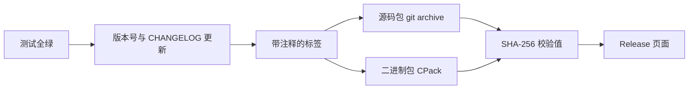

# 19. 文档、版本与发布

在之前的开发阶段里，`wordfreq` 一直只有作者自己在用，平时改了什么地方、该怎么编译，忘了只需要翻一下终端的历史记录。可一旦同事想要拿它去统计一批线上日志，直接把整个仓库发过去就会遇到一连串麻烦：对方首先得搞清楚这个程序到底是做什么的、命令行参数怎么传、输出里的那几列数字代表什么含义，接着还要在自己的机器上装好 CMake 和编译器把它编译出来。等好不容易跑出了结果，往往又会追问“我手里这个是哪个版本”、“从 0.2.0 到 1.0.0 中间到底改了什么”，或者怀疑“我下载的这个压缩包是不是在传输途中损坏了”。

为了把 `wordfreq` 从仅供自用的 0.2.0 推进到可以正式交付给别人的 1.0.0，我们需要补齐四样基础设施：一份让外部读者看得懂的说明文档、一套能够准确表达兼容性承诺的版本号规则、一份记录演进历史的更新日志，以及一套可复现的打包与发布流程。

## 1. 文档给谁看

面对同一个项目，不同身份的读者关心的重点往往截然不同：

| 读者 | 读什么 | 要回答的问题 |
| --- | --- | --- |
| 使用程序的人 | README | 这个程序做什么，参数怎么给，输出怎么读，怎么装 |
| 调用库的程序员 | 头文件里的注释、Doxygen 生成的参考文档 | 每个函数收什么、返回什么、返回的指针归谁、能用到什么时候 |
| 维护者（包括半年后的作者） | 更新日志、设计说明、构建与测试说明 | 每个版本改了什么，为什么这么改，怎么跑起来 |

在这三类文档中，README 是整个项目的第一道入口，只要写清楚一句话简介并附上几条可以直接复制执行的命令，使用程序的人就能顺着往下走；头文件注释则是对外接口的说明书，因为调用静态库或动态库的程序员通常只会安装头文件而不会去翻 `src/` 目录下的实现，只有把契约写在头文件里对方才看得到；而更新日志负责记录版本之间的行为差异，维护者需要靠它来排查某个特性或行为变化究竟是在哪一版引入的。

这三份文档应当与源码放在同一个仓库里，并在同一次提交中同步更新。如果修改了程序行为却忘了改 README，读者照着旧命令操作就会碰壁；如果修改了函数签名却没更新头文件注释，Doxygen 生成出来的参考文档就会与实际代码自相矛盾。因此在第 17 章介绍的代码评审流程中，评审者除了检查 `src/` 目录下的代码改动，也会一并核对同一次提交里的 `README.md`、头文件注释和 `CHANGELOG.md` 是否同步更新到位。

文档过时带来的代价往往非常具体。比如第 7 章留下的手工构建脚本 `build_by_hand.sh` 在 v1.0.0 上就已经跑不通了：现在的 `main.c` 需要包含由 CMake 在配置阶段生成的 `wf/config.h`，而手工脚本里的 `-Iinclude` 根本找不到这个生成文件，编译会在 `app/main.c:21` 处直接停下并报错 `fatal error: wf/config.h: No such file or directory`。把脚本文件本身留在仓库里作为第 7、8 章的历史对照并没有问题，但 README 里绝不能再写着“运行 `sh build_by_hand.sh` 即可完成构建”。

## 2. README

`wordfreq` 的 README 按照读者接触项目的先后顺序划分成了几个小节，每一节只专注回答一个具体问题：

| 节 | 内容 |
| --- | --- |
| 一句话说明 | 统计文本中出现次数最多的单词 |
| 用法 | 命令行格式、参数含义、输出格式、退出状态 |
| 示例输出 | 用仓库里的样例跑出来的真实结果 |
| 构建 | 依赖的工具与最低版本、三条可复制的命令 |
| 测试 | 怎么跑测试，测试分几类 |
| 文档 | 怎么生成接口文档 |
| 安装与打包 | `install` 与 CPack 的用法 |
| 许可证 | 一句话加文件名 |
| 目录 | 每个目录放什么 |

仓库根目录下的 `README.md` 就是顺着这个脉络写成的，全文一共一百行出头：

::: details README.md 全文

````markdown
# wordfreq

统计文本中出现次数最多的单词。

## 用法

```text
usage: wordfreq [-n N] [FILE...]
       wordfreq --version
```

1. 输出出现次数最多的 N 个单词，N 默认为 10，可取 1 到 1000000。
2. 没有 FILE 时读标准输入；给出多个 FILE 时把它们合并统计。
3. 单词是连续的 ASCII 字母（A–Z、a–z），统计时转成小写；其他字节（数字、标点、空白、
   0x80 以上的字节）都是分隔符。超过 63 个字母的单词只保留前 63 个。
4. 按次数从多到少输出，次数相同的按 `strcmp` 升序排列。每行先是右对齐、占 7 列的次数，
   再是一个空格和单词。
5. 退出状态：0 表示成功；1 表示文件无法打开或读取（标准错误输出
   `wordfreq: <路径>: <错误说明>`），或内存不足；2 表示用法错误。

```text
$ wordfreq -n 3 tests/data/sample.txt
      4 the
      2 on
      2 sat
```

```text
$ wordfreq --version
wordfreq 1.0.0
```

## 构建

需要 CMake 3.20 或更新版本、支持 C17 的编译器，以及 Ninja 或 GNU Make。
在 bash 类 shell（Windows 上为 MSYS2 UCRT64 或 Git Bash）中：

```sh
cmake --preset dev-gcc
cmake --build --preset dev-gcc
ctest --preset dev-gcc
```

没有 Ninja 时用 `dev-gcc-make`（Unix Makefiles）。`tools/ci.sh` 把这三步合成一条命令，
CI 与本地跑的是同一套预设：

```sh
sh tools/ci.sh dev-gcc
```

可用的 CMake 选项：`WF_SANITIZE`（ASan + UBSan）、`WF_COVERAGE`（gcov）、`WF_FUZZ`
（libFuzzer 重放程序）、`WF_WERROR`（警告当错误）、`WF_HAVE_GETLINE`（读文件路径）、
`WF_BUILD_DOCS`（Doxygen 文档）。

## 测试

```sh
ctest --preset dev-gcc
```

`test_token` 与 `test_counter` 是单元测试，`e2e` 比较样例输出，`replay` 重放模糊测试的
语料与回归输入（需要 `-DWF_FUZZ=ON`）。

## 文档

公开头文件用 Doxygen 注释写接口文档。配置时打开 `WF_BUILD_DOCS` 后构建 `docs` 目标，
或者直接用仓库里的 `Doxyfile`：

```sh
doxygen Doxyfile
```

生成结果在 `docs/html/`。

## 安装与打包

```sh
cmake --install build --prefix /path/to/prefix
cpack --config build/CPackConfig.cmake -G ZIP
```

`install` 规则安装库、程序、公开头文件（含生成的 `config.h` 与 `version.h`）以及
README、CHANGELOG、LICENSE；CPack 生成 `wordfreq-1.0.0-<平台>.zip`。

## 许可证

MIT，见 `LICENSE`。源文件头部使用 SPDX 标识：`/* SPDX-License-Identifier: MIT */`。

## 目录

```text
wordfreq/
├── include/wf/       token.h、counter.h、report.h、export.h、version.h.in
├── src/              token.c、counter.c、report.c、version.c；config.h.in
├── app/main.c        命令行程序
├── tests/            单元测试、端到端测试与回归输入
├── fuzz/             模糊测试目标与重放程序
├── tools/            输入生成器、基准脚本、CI 脚本、bisect 检查脚本
├── Doxyfile          Doxygen 配置
├── CHANGELOG.md      更新日志（Keep a Changelog）
├── LICENSE           MIT 许可证
├── CMakePresets.json 配置、构建、测试与工作流预设
├── CMakeLists.txt    目标、测试、安装与打包
└── Makefile          第 8 章的构建文件
```
````

:::

用法一节除了命令行选项，也把退出状态明确写了出来，因为编写自动化脚本调用它的人需要靠退出状态来判断执行成功还是失败。我们在第 2 章讨论过进程的退出状态，而 README 正是程序第一次对外公开承诺这套约定的地方：返回 0 表示成功，返回 1 表示文件无法读取或内存不足，返回 2 表示命令行参数有误。在代码实现里，`usage()` 函数返回 2、`out_of_memory()` 函数返回 1，正好与 README 里的描述一一对应：

```c
static int usage(void) {
    fputs("usage: wordfreq [-n N] [FILE...]\n", stderr);
    return 2;
}
```

README 里的用法说明必须与这段代码打印的字符串完全一致。如果两边对不上，读者按照 README 里的格式去敲命令，程序报错时却吐出一句不一样的用法提示，就会让人无所适从。这种一致性没有自动化工具能替我们维护，只能靠每次修改 `usage()` 的提交里顺手把 README 一并改掉。

同样地，README 里的示例输出也必须是用真实程序跑出来的结果，不能靠手敲编造。在 `wordfreq/` 目录下直接调用刚刚构建好的程序跑一遍样例文件，得到的输出就是 README 里贴出的那三行：

::: terminal title="zsh - 按 README 的示例跑一遍"

```console
$ ./build/wordfreq -n 3 tests/data/sample.txt
      4 the
      2 on
      2 sat
$ ./build/wordfreq --version
wordfreq 1.0.0
```

:::

你可能会注意到，README 里把命令直接写成了 `wordfreq`，那是把程序安装到 `PATH` 目录之后的调用方式；而刚在源码仓库里完成构建的读者则需要加上 `./build/` 前缀。由于先看“用法”一节的读者通常已经装好了程序，这两种写法在不同场景下各有道理，最关键的是命令下方的输出结果必须与真实运行结果逐字一致。

接下来的“构建”一节列出了所需工具的最低版本和三条构建命令，其中 CMake 的最低版本要求与 `CMakeLists.txt` 第一行的 `cmake_minimum_required(VERSION 3.20)` 保持严格对应：

```sh
cmake --preset dev-gcc
cmake --build --preset dev-gcc
ctest --preset dev-gcc
```

如果读者的机器上没有安装 Ninja，可以改用 `dev-gcc-make`（对应 Unix Makefiles 生成器），在 README 里用一句话点明即可。这三条命令与第 18 章编写的 `tools/ci.sh` 脚本调用的是同一套预设，这样就能保证读者在本地执行的构建步骤与 CI 服务器上跑的完全一致。

::: compare left-title="README 自己攒一套旧命令" right-title="README 与 CI 走同一条路径"

```sh
gcc -std=c17 -Wall -Wextra -Iinclude src/*.c app/main.c -o build/wordfreq
```

---

```sh
sh tools/ci.sh dev-gcc
```

:::

对比栏左边的那条手工编译命令在第 7 章还能正常工作，但到了现在已经行不通了：CMake 生成的 `wf/config.h` 和 `wf/version.h` 都放在 `build/include/` 目录下，单靠 `-Iinclude` 根本找不到它们，编译会直接报错失败。而右边的脚本依次执行配置、构建和测试，遇到任何一步失败就会立即停下（脚本开头设置了 `set -eu`）。在 README 里交代清楚“CI 调用的就是这个脚本”，读者遇到构建问题时就能照着 CI 的步骤在本地复现，维护者排查问题时也能顺着同一条路径去定位。

此外，这份 README 还会随着二进制安装包一起分发出去。CMake 的安装规则里专门写了一行 `install(FILES README.md CHANGELOG.md LICENSE DESTINATION ${CMAKE_INSTALL_DOCDIR})`，安装完成后在 `share/doc/wordfreq/` 目录下就能看到这三份文档。毕竟直接下载二进制压缩包的用户不一定会回头去翻代码仓库，把用法完整地写进 README 里才能让安装包自给自足。

## 3. 头文件里的接口文档

调用 C 库的程序员拿到手的往往只有 `include/wf/` 目录下的公开头文件，并不会去读 `src/` 目录下的源码实现。因此，每个函数的参数含义、返回值约定、返回指针的归属权以及有效生命周期，都只能写在头文件的注释里。

### 3.1 注释写什么

一条合格的接口注释需要向调用方交代清楚四件事：函数做什么、每个参数代表什么、返回值是什么含义，以及调用方还需要遵守哪些额外约定。`wordfreq` 的 `counter.h` 采用 Doxygen 格式为每个函数编写注释：

::: compare left-title="只重复函数名" right-title="写清做什么、返回什么、谁负责释放"

```c
/* 创建计数器 */
wf_counter *wf_counter_create(void);
```

---

```c
/**
 * @brief 创建空计数器。
 * @return 新计数器；内存不足时返回 NULL
 */
WF_API wf_counter *wf_counter_create(void);
```

:::

左边那句注释没有提供任何新信息，`wf_counter_create` 这个函数名本身就已经表达了“创建计数器”的意思。右边的注释写明了新建计数器的初始状态为空，也交代了内存分配失败时会返回 `NULL`，调用方看到这句话，才知道必须在代码里检查返回值。

在 `counter.h` 中，注释写得最详细的函数是 `wf_counter_top`，因为它同时涉及输出缓冲区大小、实际写入项数以及返回指针的有效期：

```c
/**
 * @brief 按次数降序、次数相同按 strcmp 升序取出前 n 项。
 * @param c 计数器
 * @param[out] out 接收结果的数组，至少能放 n 项
 * @param n 请求的项数
 * @return 写入的项数 min(n, wf_counter_size(c))；内存不足时返回 0
 * @note 结果中的 word 指针在下次 wf_counter_add 之前有效
 */
WF_API size_t wf_counter_top(const wf_counter *c, wf_entry *out, size_t n);
```

这里的 `@param[out]` 明确标示出 `out` 是用来接收函数写入结果的输出参数，从而与只读传入的 `@param c` 区分开来。而 `@note` 记录的则是 C 语言类型系统无法直接表达的契约：`wf_entry.word` 直接指向计数器内部的存储空间，调用方既不能对它调用 `free`，也不能在下一次调用 `wf_counter_add` 或销毁计数器之后继续使用它。我们在第 7 章讨论模块边界时曾经强调过这条生命周期约束，而头文件的接口文档正是这条约束唯一可靠的落脚点。

同样地，函数对参数的前置条件也需要写进注释里，比如 `wf_tokenizer_next` 要求传入的缓冲区容量 `cap` 必须大于 0。如果不把这一条写明，调用方一旦传了 0 进来，会发生什么就全看内部实现的运气了。

除了函数声明，`counter.h` 的文件头部和公开类型定义也配有相应的文档注释：顶部的 `@file` 用一句话概括整个模块的职责，而公开结构体 `wf_entry` 的每个成员也都单独写了说明。完整文件位于 `code/开发与工程基础/19_文档_版本与发布/wordfreq/include/wf/counter.h`：

```c
/* SPDX-License-Identifier: MIT */
/**
 * @file counter.h
 * @brief 统计每个单词出现的次数，并按次数取出前若干项。
 *
 * 计数器是一个不透明类型：结构定义在 src/counter.c 中，调用方只能通过
 * 下面的函数使用它。create 与 destroy 成对调用。
 */
#ifndef WF_COUNTER_H
#define WF_COUNTER_H

#include <stddef.h>

#include "wf/export.h"

/** @brief 计数器；定义在实现文件中，调用方不直接读写成员 */
typedef struct wf_counter wf_counter;

/** @brief 一项计数结果 */
typedef struct {
    /** 指向计数器内部存储，在下一次 wf_counter_add 或
        wf_counter_destroy 之前有效；调用方不要 free */
    const char *word;
    /** 该单词出现的次数 */
    size_t count;
} wf_entry;

/**
 * @brief 创建空计数器。
 * @return 新计数器；内存不足时返回 NULL
 */
WF_API wf_counter *wf_counter_create(void);

/**
 * @brief 释放计数器以及它保存的全部单词。
 * @param c 计数器，可以为 NULL
 */
WF_API void wf_counter_destroy(wf_counter *c);

/**
 * @brief 把 word 的次数加 1，第一次出现时保存一份副本。
 * @param c 计数器
 * @param word 以空字符结尾的单词，函数内部复制，调用后调用方可以释放
 * @return 0 成功，-1 内存不足
 */
WF_API int wf_counter_add(wf_counter *c, const char *word);

/**
 * @brief 返回 word 出现的次数。
 * @param c 计数器
 * @param word 要查询的单词
 * @return 次数；没有出现过时返回 0
 */
WF_API size_t wf_counter_get(const wf_counter *c, const char *word);

/**
 * @brief 返回不同单词的个数。
 * @param c 计数器
 * @return 不同单词的个数
 */
WF_API size_t wf_counter_size(const wf_counter *c);
```

`wf_counter_top` 的注释与声明紧接在这段代码后面，内容就是 3.1 节开头展示的那一条，这里就不再重复贴出了。

同样的注释规范也应用在 `token.h` 与 `report.h` 上。不过有一个细节需要注意：`version.h.in` 里的注释默认不会进入生成的参考文档，因为 `Doxyfile` 的 `INPUT` 填的是 `include/wf`，默认匹配的文件模式只收录 `*.h` 等头文件，不包含 `.in` 模板文件，而配置阶段生成的 `version.h` 又落在了 `build/` 目录下。如果想让 `wf_version` 也出现在生成的文档里，把 `build/include/wf` 一并加入 `INPUT` 即可。此外，模板文件顶部的 `@file` 写的是生成后的文件名 `version.h`——Doxygen 会拿 `@file` 后面的名字与实际读取的输入文件名作比对，要是写成了模板名 `version.h.in`，反而会多报出一条“不是输入文件”的警告。

另外，接口注释应当统一写在头文件的函数声明处，而不要写在 `counter.c` 的函数定义处。一方面，Doxygen 只把 `include/wf/` 作为输入目录，`src/` 下的实现文件根本不参与文档生成；另一方面，外部调用方安装到系统里的也只有头文件。如果在声明和定义两处都写一遍，后续维护时很容易演变成两份相互矛盾的说明，所以始终以头文件里的那一份为准。

### 3.2 Doxyfile 与警告

Doxygen 的配置文件可以通过 `doxygen -g` 命令自动生成，生成的完整模板长达几百行，其中绝大多数选项保持默认即可。`wordfreq` 的仓库里只保留了修改过的核心配置项，其余选项在后续有需要时再对照官方文档补充：

```text
# Doxyfile：Doxygen 1.10 的配置，关键项如下。
# 完整配置用 `doxygen -g` 生成后对照修改。
PROJECT_NAME           = wordfreq
PROJECT_BRIEF          = "Word frequency counter"
OUTPUT_DIRECTORY       = docs
INPUT                  = include/wf
RECURSIVE              = YES
OPTIMIZE_OUTPUT_FOR_C  = YES
EXTRACT_ALL            = NO
WARN_IF_UNDOCUMENTED   = YES
WARN_IF_INCOMPLETE_DOC = YES
WARN_NO_PARAMDOC       = YES
GENERATE_LATEX         = NO
QUIET                  = NO
```

其中，`EXTRACT_ALL = NO` 要求未编写注释的函数不得混入生成的文档中，从而避免页面里静默出现一堆空白条目。紧随其后的三个 `WARN_` 选项则分别负责拦截三种不同程度的文档缺失，它们在 Doxygen 1.10 中的默认值也各有不同：

| 选项 | 报什么 | 1.10 的默认值 |
| --- | --- | --- |
| `WARN_IF_UNDOCUMENTED` | 函数、类型完全没有注释 | YES |
| `WARN_IF_INCOMPLETE_DOC` | 注释写了，但函数参数只写了一半 | YES |
| `WARN_NO_PARAMDOC` | 注释写了，但参数和返回值一个都没写 | NO |

由于第三项 `WARN_NO_PARAMDOC` 默认处于关闭状态，我们必须在配置文件里显式将它打开；前两项虽然默认已经开启，但把它们一并写进 `Doxyfile` 里可以让其他维护者一眼看出项目的文档检查标准。至于 `OPTIMIZE_OUTPUT_FOR_C = YES`，则是为了让生成的页面索引和标题贴合 C 语言的习惯，避免在网页上冒出“类（Class）”这类 C++ 术语。

为了直观地看到警告的效果，我们可以先故意删掉 `wf_counter_top` 注释里的 `@param n` 那一行，然后运行 `doxygen`：

::: terminal title="zsh - 漏写一个参数的注释"

```console
$ doxygen Doxyfile
D:/work/wordfreq/include/wf/counter.h:65: warning: The following parameter of wf_counter_top(const wf_counter *c, wf_entry *out, size_t n) is not documented:
  parameter 'n'
Doxygen version used: 1.10.0 (GIT-NOTFOUND)
Notice: Output directory 'docs' does not exist. I have created it for you.
```

:::

可以看到，Doxygen 的警告信息准确指出了漏写注释的文件名、行号以及参数名（输出中的绝对路径取决于当前机器的工作目录）。把 `@param n` 补回去之后再跑一次，终端不再有任何警告，同时输出目录下会生成 `docs/html/index.html`。

如果把文档生成接入 CI 流水线，我们显然不希望 Doxygen 在报出一堆警告之后还返回成功状态。只要在 `Doxyfile` 里加上一行 `WARN_AS_ERROR = FAIL_ON_WARNINGS`，遇到同样的参数漏写时，`doxygen` 就会把提示从 `warning:` 升级为 `error:` 并以退出状态 1 终止运行。我们在第 18 章编写的 `ci.yml` 目前只跑了编译、测试与静态检查，还没有单独配置 Doxygen 作业；有需要时可以按照第 18 章添加作业的方式补上一个文档检查作业，把文档缺失当作与测试失败同等级别的错误来拦截。由于并非每台运行机都预装了 Doxygen，在 CI 作业里记得先执行安装步骤再运行检查。

另外，生成的 HTML 网页属于构建产物，不应提交到 Git 仓库里。`.gitignore` 文件中已经列出了 `docs/`，与 `Doxyfile` 中的 `OUTPUT_DIRECTORY = docs` 刚好对应；如果日后修改了文档输出目录，记得把这两处一并改掉。

### 3.3 接进 CMake

在本地手动敲 `doxygen Doxyfile` 很适合随手查看文档效果，但在工程化构建中，更常见的做法是把文档生成集成到构建系统里作为一个独立的目标。CMake 自 3.9 版本起就在内置的 `FindDoxygen` 模块里提供了 `doxygen_add_docs` 命令，`wordfreq` 在 `CMakeLists.txt` 末尾加上了下面这段配置：

```cmake
option(WF_BUILD_DOCS "Generate API reference with Doxygen" OFF)
if(WF_BUILD_DOCS)
    find_package(Doxygen REQUIRED)
    doxygen_add_docs(docs
        include/wf
        COMMENT "Generate API reference"
    )
endif()
```

因为不能假设所有构建者的机器上都装了 Doxygen，所以 `WF_BUILD_DOCS` 选项默认设为 `OFF`。当我们在命令行上显式打开这个开关并完成配置后，就可以直接构建 `docs` 目标了：

::: terminal title="zsh - 生成文档目标"

```console
$ cmake --preset dev-gcc -DWF_BUILD_DOCS=ON
$ cmake --build --preset dev-gcc --target docs
$ ls build/html/index.html
build/html/index.html
```

:::

这里需要特别留意 `doxygen_add_docs` 的工作方式：它并不会去读取仓库根目录下的那份 `Doxyfile`，而是在构建目录下根据当前的 CMake 配置项动态生成一份 `build/Doxyfile.docs`，再把生成的 HTML 页面放到 `build/html/` 下。因此，哪怕你把仓库根目录下的 `Doxyfile` 改名或者修改了里面的开关，`docs` 构建目标的行为也不会发生任何变化。要想调整 `docs` 目标的 Doxygen 配置，需要在执行 `cmake` 配置时传入带有 `DOXYGEN_` 前缀的缓存项：

::: terminal title="zsh - 给 docs 目标打开警告当错误"

```console
$ cmake --preset dev-gcc -DWF_BUILD_DOCS=ON -DDOXYGEN_WARN_AS_ERROR=FAIL_ON_WARNINGS
$ cmake --build --preset dev-gcc --target docs
...
D:/work/wordfreq/include/wf/counter.h:65: error: The following parameter of wf_counter_top(const wf_counter *c, wf_entry *out, size_t n) is not documented:
  parameter 'n'
Doxygen version used: 1.10.0 (GIT-NOTFOUND)
...
Exiting...
ninja: build stopped: subcommand failed.
```

:::

像 `DOXYGEN_WARN_NO_PARAMDOC=YES`、`DOXYGEN_WARN_IF_INCOMPLETE_DOC=NO` 的用法也是完全一样的，配置项的名字就是把 `Doxyfile` 里的原生选项名加上 `DOXYGEN_` 前缀。当仓库根目录的 `Doxyfile` 与 CMake 的 `docs` 目标这两套入口并存时，它们各自读取各自的配置；如果想让本地构建与 CI 的检查标准保持一致，最好把这些 `DOXYGEN_` 配置项直接写进 `CMakePresets.json` 的预设里，而不要每次只在命令行上临时传参。

## 4. 语义化版本

语义化版本号由三段数字组成：`MAJOR.MINOR.PATCH`，依次代表主版本号、次版本号和修订号。决定何时递增哪一段的规则只有三条，核心判断依据就是“项目的公开接口有没有变化、发生了怎样的变化”：

::: concept dev-docs-semver title="语义化版本 (Semantic Versioning, SemVer) 的升级规则"

公开接口发生不兼容改动时递增 MAJOR；在保持向下兼容的前提下新增功能时递增 MINOR；仅修复缺陷而不改变公开接口时递增 PATCH。每当 MAJOR 递增时，MINOR 与 PATCH 归零；每当 MINOR 递增时，PATCH 归零。主版本号为 0（`0.y.z`）代表项目仍处于初始开发阶段，公开接口随时可能变动；`1.0.0` 则是对外承诺稳定性的第一个正式版本。

:::

对于一个 C 语言库来说，所谓的“公开接口”指的就是安装到外部系统里的头文件集合——在 `wordfreq` 里就是 `include/wf/` 目录下的三个头文件加上构建阶段生成的 `version.h`。只要这些头文件里的声明以及注释承诺的行为没有发生变化，`src/` 目录下把实现代码改得再彻底也不算破坏接口。

### 4.1 API 与 ABI

不过在维护 C 语言共享库时，兼容性其实分为两层，如果把这两层混为一谈，就很容易定错版本号：

第一层是 API（Application Programming Interface，应用编程接口），它是源码层面的契约，涵盖了函数名、参数类型、返回类型、公开结构体的成员名字，以及接口文档里写明的行为约定。一旦破坏了 API 兼容性，调用方拿着新头文件重新编译源码时就会报错失败，或者编译出来的程序行为发生改变。

第二层则是 ABI（Application Binary Interface，应用二进制接口），它是编译后二进制层面的契约，涵盖了结构体在内存中的字节大小与成员偏移、枚举常量的整数值、函数调用时的参数传递规则以及导出符号的名称。一旦破坏了 ABI 兼容性，那些早先已经编译好的可执行程序在不重新编译的情况下直接替换加载新版动态库，就会在运行期出错——而且这类错误在链接加载时往往没有任何报错提示，要么算出来的结果悄无声息地变错，要么直接在运行途中崩溃。

当 `wordfreq` 同时发布共享库时，API 和 ABI 都属于对外公开的承诺，只要破坏了其中任何一个都必须递增主版本号 MAJOR。我们可以用下面这张对照表来逐项衡量常见的改动：

| 改动 | API（重新编译后） | ABI（已编译的程序） | 版本号 |
| --- | --- | --- | --- |
| 修复一个输出错误的缺陷，接口不变 | 不变 | 不变 | PATCH |
| 新增 `wf_counter_clear` | 兼容 | 兼容，只是多一个导出符号 | MINOR |
| 新增命令行选项 `-s` | 兼容 | 不涉及库 | MINOR |
| 删除、改名一个公开函数 | 不兼容 | 不兼容 | MAJOR |
| 改变参数或返回值的含义 | 不兼容 | 不兼容 | MAJOR |
| 给公开结构 `wf_entry` 增加成员 | 重新编译后兼容 | 不兼容 | MAJOR |
| 改变公开枚举的成员值 | 源码不用改 | 不兼容 | MAJOR |
| 改不透明类型 `wf_counter` 的内部成员 | 不变 | 不变 | PATCH 或 MINOR |

在这张表里，最容易被开发者疏忽的就是“修改公开结构体的内存布局”。`code/开发与工程基础/19_文档_版本与发布/examples/abi_struct/` 目录下准备了一组最小复现实验：同一个库先后发布了 1.0.0 与 1.1.0 两版头文件，唯一的改动就是在公开结构体 `wf_entry` 的末尾多加了一个 `rank` 成员：

::: code-group

```c [v10/wf/counter.h]
#ifndef WF_COUNTER_H
#define WF_COUNTER_H

#include <stddef.h>

typedef struct wf_counter wf_counter;

typedef struct {
    const char *word;
    size_t count;
} wf_entry;

wf_counter *wf_counter_create(void);
void wf_counter_destroy(wf_counter *c);
size_t wf_counter_top(const wf_counter *c, wf_entry *out, size_t n);

#endif
```

```c [v11/wf/counter.h]
#ifndef WF_COUNTER_H
#define WF_COUNTER_H

#include <stddef.h>

typedef struct wf_counter wf_counter;

typedef struct {
    const char *word;
    size_t count;
    size_t rank;
} wf_entry;

wf_counter *wf_counter_create(void);
void wf_counter_destroy(wf_counter *c);
size_t wf_counter_top(const wf_counter *c, wf_entry *out, size_t n);

#endif
```

```c [wf.c]
#include "wf/counter.h"

#include <stdlib.h>

struct wf_counter {
    int unused;
};

wf_counter *wf_counter_create(void) {
    return calloc(1, sizeof(wf_counter));
}

void wf_counter_destroy(wf_counter *c) { free(c); }

size_t wf_counter_top(const wf_counter *c, wf_entry *out, size_t n) {
    static const char *words[] = {"the", "on", "sat"};
    static const size_t counts[] = {4, 2, 2};
    size_t written = n < 3 ? n : 3;
    for (size_t i = 0; i < written; i++) {
        out[i].word = words[i];
        out[i].count = counts[i];
        out[i].rank = i + 1;
    }
    (void)c;
    return written;
}
```

```c [app.c]
#include "wf/counter.h"

#include <stdio.h>

int main(void) {
    wf_counter *counter = wf_counter_create();
    wf_entry entries[3];
    size_t n = wf_counter_top(counter, entries, 3);
    for (size_t i = 0; i < n; i++) {
        printf("%7lu %s\n", (unsigned long)entries[i].count, entries[i].word);
    }
    wf_counter_destroy(counter);
    return 0;
}
```

:::

在 64 位平台上，旧版结构体 `sizeof(wf_entry)` 的大小是 16 字节，而加上 `rank` 之后的新版结构体变成了 24 字节。当 `app.c` 拿着旧版头文件 `v10` 编译时，它只在栈上给三元数组 `entries[3]` 分配了 48 字节的空间；然而新版库里的 `wf_counter_top` 却是按照每项 24 字节的新布局往数组里写数据的，写到第三项时就已经越过了栈数组的末尾。我们先把按旧版头文件编译好的 `app.o` 与按新版头文件编译的 `wf.o` 链接在一起运行看看：

::: terminal title="zsh - 旧程序链接新库"

```console
$ gcc -std=c17 -Wall -Wextra -Iv11 -c wf.c -o wf.o
$ gcc -std=c17 -Wall -Wextra -Iv10 -c app.c -o app.o
$ gcc app.o wf.o -o app
$ ./app
Segmentation fault
$ echo $?
139
```

:::

无论是在本地环境还是在 Debian 13（GCC 14.2）上运行，程序都会直接触发段错误崩溃，退出状态为 139。而只要用新版头文件 `v11` 把 `app.c` 重新编译并链接一次，输出就立刻恢复了正常：

::: terminal title="zsh - 重新编译之后"

```console
$ gcc -std=c17 -Wall -Wextra -Iv11 -c app.c -o app.o
$ gcc app.o wf.o -o app
$ ./app
      4 the
      2 on
      2 sat
```

:::

在整个过程中，编译器和链接器都没有报出哪怕一条警告。因为链接器只负责按符号名找到 `wf_counter_top` 的地址并完成重定位，它根本无从知晓调用方和实现方脑子里对 `wf_entry` 的字节大小有着截然不同的理解。这正是 ABI 破坏比 API 破坏更难排查的原因：只要重新编译一遍源码就万事大吉，但那些早已分发到用户机器上的旧版可执行程序，却仍在按 16 字节的旧步长去读取新库按 24 字节写入的数据。

相比之下，修改枚举常量取值带来的破坏甚至还要更加隐蔽。同一目录下的 `examples/abi_enum/` 展示了另一组对照实验：1.0.0 的枚举类型只有两个成员，到了 1.1.0 有人在枚举开头新插了一项，导致后面两项对应的整数值全都顺延加了 1：

::: code-group

```c [v10/wf/mode.h]
#ifndef WF_MODE_H
#define WF_MODE_H

/* 1.0.0：两项 */
enum wf_mode { WF_MODE_FAST = 0, WF_MODE_EXACT = 1 };

int wf_passes(enum wf_mode mode);

#endif
```

```c [v11/wf/mode.h]
#ifndef WF_MODE_H
#define WF_MODE_H

/* 1.1.0：在开头插入一项，后面两项的值都变了 */
enum wf_mode { WF_MODE_COMPACT = 0, WF_MODE_FAST = 1, WF_MODE_EXACT = 2 };

int wf_passes(enum wf_mode mode);

#endif
```

```c [mode.c]
#include "wf/mode.h"

#include <stdio.h>

int wf_passes(enum wf_mode mode) {
    switch (mode) {
    case WF_MODE_COMPACT:
        puts("compact: 3 passes");
        return 3;
    case WF_MODE_FAST:
        puts("fast: 1 pass");
        return 1;
    case WF_MODE_EXACT:
        puts("exact: check every byte");
        return 2;
    }
    return -1;
}
```

```c [app.c]
#include "wf/mode.h"

#include <stdio.h>

int main(void) {
    printf("wf_passes(WF_MODE_EXACT) = %d\n", wf_passes(WF_MODE_EXACT));
    return 0;
}
```

:::

由于用旧版头文件编译的 `app.o` 早在编译期就把 `WF_MODE_EXACT` 展开成了整数常量 `1` 传给库函数，而新版库里的 `wf_passes` 却把传入的 `1` 当成了 `WF_MODE_FAST`：

::: terminal title="zsh - 旧程序调用新库"

```console
$ gcc -std=c17 -Wall -Wextra -Iv11 -c mode.c -o mode.o
$ gcc -std=c17 -Wall -Wextra -Iv10 -c app.c -o app.o
$ gcc app.o mode.o -o app
$ ./app
fast: 1 pass
wf_passes(WF_MODE_EXACT) = 1
```

:::

明明 `app.c` 源码里写的是 `WF_MODE_EXACT`，实际跑出来的却是 `FAST` 分支，返回值也悄无声息地从 `2` 变成了 `1`。这种既不崩溃也不报错、只是算错了结果的故障，往往比直接段错误更难察觉。因此，在维护公开枚举类型时，只在末尾追加新成员是安全的，而在开头或中间插入、调换顺序、删除已有成员都会改变后续枚举项的整数值，从而破坏 ABI。

我们在第 7 章引入“不透明类型（Opaque Type）”正是为了从根源上隔离这类 ABI 风险：`wf_counter` 在公开头文件里只有一行前向声明 `typedef struct wf_counter wf_counter;`，具体的结构体成员全部藏在 `counter.c` 内部。正因如此，第 15 章把计数模块内部的数据结构从线性数组彻底替换成有序数组加二分查找时，即便内部成员换了个遍，`counter.h` 以及所有已编译的外部调用方也丝毫不受影响。把类型设计成不透明指针，相当于把内部内存布局从 ABI 契约里彻底摘除了出去。

::: concept dev-docs-abi-break title="公开结构是 ABI 的一部分"

只要结构体的完整定义出现在安装给外部的公开头文件里，它的内存大小和成员偏移就成了 ABI 契约的一部分。给这种公开结构体新增、删除或重排成员，都会破坏二进制兼容性，必须递增主版本号 MAJOR。因此，只有调用方确实需要直接读写的字段才放进公开结构体；如果调用方只需要拿着句柄指针在函数之间传递，就应当一律设计成不透明类型。

:::

### 4.2 0.y.z 与第一个稳定版本

按照语义化版本规范，以 `0` 开头的主版本号（`0.y.z`）代表项目仍处于早期探索阶段，维护者还不做严格的兼容性承诺，从 `0.1.0` 升级到 `0.2.0` 时可以根据需要调整接口。`wordfreq` 在 `0.1.0` 到 `0.2.0` 之间重写了计数模块的内部实现，因为公开接口没动，所以只递增了次版本号 MINOR；接着又修复了一处超长单词截断缺陷、补齐了文档并加上了 `--version` 选项，等这套公开接口完全稳定下来之后，才正式发布 `1.0.0`。

一旦跨过了 `1.0.0` 这条分水岭，4.1 节列出的那张兼容性对照表就成了硬性约束：向下兼容的新功能只能进 MINOR，任何破坏 API 或 ABI 兼容性的改动都必须进 MAJOR，两者之间不再有含糊通融的余地。

<Quiz
  type="single"
  :options="[
    { label: '修复超长单词截断时多写一个字节的缺陷', value: 'A' },
    { label: '新增命令行选项 --version', value: 'B' },
    { label: '给公开结构 wf_entry 末尾增加一个成员', value: 'C' },
    { label: '把 wf_counter 的内部数组换成哈希表', value: 'D' }
  ]"
  answer="C"
>

<template #question>

下面哪一项必须升 MAJOR？项目发布共享库，1.0.0 之后的版本号按语义化版本定。

</template>

正确答案是 **C**。`wf_entry` 是公开结构，布局属于 ABI，末尾加成员会让已编译的程序按旧大小读写，必须升 MAJOR。A 是缺陷修复，升 PATCH；B 是向下兼容的新功能，升 MINOR；D 改的是不透明类型的内部表示，头文件不变，ABI 不变，升 PATCH 或 MINOR 即可。

</Quiz>

## 5. 版本号只定义一处

在一个完整的项目里，版本号往往会出现在许多不同的角落：程序的 `--version` 输出、头文件里的版本宏、动态库的文件名后缀、打包生成的压缩包文件名，以及 `CHANGELOG.md` 的章节标题。如果每一处都靠人工手写一遍，升级版本时总有一两处会被漏掉。为了杜绝这种不一致，`wordfreq` 遵循“单一事实来源”原则，只在 `CMakeLists.txt` 开头写一次版本号：

```cmake
project(wordfreq VERSION 1.0.0 LANGUAGES C)
```

项目中其余所有需要用到代码版本号的地方，全部从这一行自动派生出来。

### 5.1 从 project(VERSION) 生成头文件

为此，我们在 `include/wf/version.h.in` 中编写了一份带有 `@...@` 占位符的头文件模板，交由 CMake 在配置阶段自动替换生成最终的 `version.h`：

::: code-group

```c [include/wf/version.h.in]
/* SPDX-License-Identifier: MIT */
/**
 * @file version.h
 * @brief 版本号的唯一来源：由 CMake 的 configure_file 从 project(VERSION) 生成。
 */
#ifndef WF_VERSION_H
#define WF_VERSION_H

#include "wf/export.h"

/** @brief 主版本号 */
#define WF_VERSION_MAJOR @PROJECT_VERSION_MAJOR@
/** @brief 次版本号 */
#define WF_VERSION_MINOR @PROJECT_VERSION_MINOR@
/** @brief 修订号 */
#define WF_VERSION_PATCH @PROJECT_VERSION_PATCH@

/** @brief 版本号字符串，形如 1.0.0 */
#define WF_VERSION_STRING "@PROJECT_VERSION@"

#ifdef __cplusplus
extern "C" {
#endif

/**
 * @brief 返回版本号字符串，与命令行 --version 输出的相同。
 * @return 静态存储的版本号字符串，调用方不要 free
 */
WF_API const char *wf_version(void);

#ifdef __cplusplus
}
#endif

#endif
```

```c [build/include/wf/version.h（生成结果）]
/* SPDX-License-Identifier: MIT */
/**
 * @file version.h
 * @brief 版本号的唯一来源：由 CMake 的 configure_file 从 project(VERSION) 生成。
 */
#ifndef WF_VERSION_H
#define WF_VERSION_H

#include "wf/export.h"

/** @brief 主版本号 */
#define WF_VERSION_MAJOR 1
/** @brief 次版本号 */
#define WF_VERSION_MINOR 0
/** @brief 修订号 */
#define WF_VERSION_PATCH 0

/** @brief 版本号字符串，形如 1.0.0 */
#define WF_VERSION_STRING "1.0.0"

#ifdef __cplusplus
extern "C" {
#endif

/**
 * @brief 返回版本号字符串，与命令行 --version 输出的相同。
 * @return 静态存储的版本号字符串，调用方不要 free
 */
WF_API const char *wf_version(void);

#ifdef __cplusplus
}
#endif

#endif
```

:::

模板替换发生在 CMake 的配置阶段，对应 `CMakeLists.txt` 里的这两行指令：

```cmake
configure_file(src/config.h.in ${PROJECT_BINARY_DIR}/include/wf/config.h)
configure_file(include/wf/version.h.in ${PROJECT_BINARY_DIR}/include/wf/version.h)
```

生成的头文件被放置在构建目录下的 `build/include/wf/` 中，目录层级与源码树的 `include/wf/` 完全同构。因为 `target_include_directories` 同时把源码树的 `include` 和构建目录的 `${PROJECT_BINARY_DIR}/include` 加进了头文件搜索路径，代码里的 `#include "wf/version.h"` 能够无缝找到生成后的文件，同时又保证了源码树里不会混入任何构建产物。

与之配套的 `src/version.c` 只有两行实质代码：

```c
/* SPDX-License-Identifier: MIT */
#include "wf/version.h"

const char *wf_version(void) { return WF_VERSION_STRING; }
```

而 `main.c` 则在命令行参数解析阶段识别 `--version` 选项，打印版本号字符串后直接返回 `0`：

```c
if (strcmp(argv[argi], "--version") == 0) {
    printf("wordfreq %s\n", wf_version());
    return 0;
}
```

### 5.2 改一处，全项目跟着变

有了这套机制，当我们需要把版本号升级到 `1.1.0` 时，只需要把 `CMakeLists.txt` 里的 `project(wordfreq VERSION 1.0.0 ...)` 改成 `1.1.0`，根本不需要碰任何其他源文件。直接执行构建命令时，CMake 检测到 `CMakeLists.txt` 发生了变动，会自动先重新跑一遍配置步骤，把生成的 `version.h` 更新到新版本：

::: terminal title="zsh - 只改 project(VERSION)"

```console
$ cmake --build --preset dev-gcc
[0/1] Re-running CMake...
-- Configuring done (0.1s)
-- Generating done (0.0s)
-- Build files have been written to: D:/work/wordfreq/build
[1/14] Building C object CMakeFiles/wf.dir/src/token.c.obj
[2/14] Building C object CMakeFiles/wf.dir/src/version.c.obj
[3/14] Building C object CMakeFiles/wf.dir/src/report.c.obj
[4/14] Building C object CMakeFiles/wf.dir/test_token.dir/tests/test_token.c.obj
[5/14] Building C object CMakeFiles/wf.dir/src/counter.c.obj
[6/14] Building C object CMakeFiles/wf.dir/test_counter.dir/tests/test_counter.c.obj
[7/14] Building C object CMakeFiles/wf.dir/test_token.dir/tests/check.c.obj
[8/14] Building C object CMakeFiles/wf.dir/wordfreq.dir/app/main.c.obj
[9/14] Building C object CMakeFiles/wf.dir/test_counter.dir/tests/check.c.obj
[10/14] Linking C static library libwf.a
[11/14] Linking C executable wordfreq.exe
[12/14] Linking C executable test_token.exe
[13/14] Linking C executable test_counter.exe
$ ./build/wordfreq --version
wordfreq 1.1.0
```

:::

此时打开生成的 `build/include/wf/version.h`，可以看到里面的三个宏定义已经同步变成了 `1`、`1`、`0`。如果在整个源码树里搜索 `1.0.0`，除了 `CMakeLists.txt` 里的 `project(VERSION)` 那一行和一句注释，以及 `version.h.in` 注释里的格式举例之外，没有任何第二个需要手工修改的宏或字符串常量（至于 `README.md` 里的 `--version` 演示输出和 `CHANGELOG.md` 的版本记录，前者在正式发布新版本时顺手更新，后者本来就是要保留各历史版本的条目）。

别忘了仓库里还保留着第 8 章编写的 `Makefile` 作为第二条构建路径，它同样应当从同一个位置提取版本号。因此，快照里的 `Makefile` 规则直接用 `sed` 从 `CMakeLists.txt` 中解析出版本号：

```makefile
PROJECT_VERSION := $(shell sed -n 's/^project(wordfreq VERSION \([0-9][0-9.]*\) LANGUAGES C)/\1/p' CMakeLists.txt)
VERSION_PARTS := $(subst ., ,$(PROJECT_VERSION))

build/include/wf/version.h: include/wf/version.h.in CMakeLists.txt | build
	mkdir -p build/include/wf
	sed -e 's/@PROJECT_VERSION_MAJOR@/$(word 1,$(VERSION_PARTS))/' \
	    -e 's/@PROJECT_VERSION_MINOR@/$(word 2,$(VERSION_PARTS))/' \
	    -e 's/@PROJECT_VERSION_PATCH@/$(word 3,$(VERSION_PARTS))/' \
	    -e 's/@PROJECT_VERSION@/$(PROJECT_VERSION)/' $< > $@
```

注意这条规则特意把 `CMakeLists.txt` 也写进了先决条件列表里：只有这样，每当修改了 `CMakeLists.txt` 中的版本号时，`make` 才会察觉到目标文件已过期并重新生成 `version.h`；要是漏了这一项先决条件，Make 会误以为现有的头文件依然是最新的，`--version` 打印出来的就会一直停留在旧版本号。

现在把版本号改成 `1.1.0` 后直接执行 `make`，`build/include/wf/version.h` 会自动重新生成，运行 `./build/wordfreq --version` 同样输出 `1.1.0`。两条构建路径共用同一个版本来源，升级版本时永远只需要改一行。

此外，在构建动态库时，共享库文件的版本后缀同样是从这个项目版本号自动派生出来的：

```cmake
if(BUILD_SHARED_LIBS)
    set_target_properties(wf PROPERTIES
        VERSION ${PROJECT_VERSION}
        SOVERSION ${PROJECT_VERSION_MAJOR}
    )
endif()
```

在 Linux 下开启共享库构建后，构建目录里会生成三个名字：

::: terminal title="zsh - 共享库的版本与 ABI 版本（Debian 13，GCC 14.2）"

```console
$ ls -l build-shared/libwf.so*
lrwxrwxrwx 1 minsecrus minsecrus    10 Oct 22 02:02 libwf.so -> libwf.so.1
lrwxrwxrwx 1 minsecrus minsecrus    14 Oct 22 02:02 libwf.so.1 -> libwf.so.1.0.0
-rwxrwxr-x 1 minsecrus minsecrus 16472 Oct 22 02:02 libwf.so.1.0.0
```

:::

其中，`libwf.so` 是供链接器在编译链接阶段查找的名字，`libwf.so.1` 是可执行程序在 ELF 动态段里记录的运行时依赖名（即 `SONAME`），而 `libwf.so.1.0.0` 则是磁盘上实际存放代码的二进制文件。由于 `SOVERSION` 取的是主版本号 `PROJECT_VERSION_MAJOR`，当版本从 `1.0.0` 升级到 `1.1.0` 或 `1.2.3` 时，SONAME 始终保持为 `libwf.so.1`，早已编译好的外部程序无需重新编译就能直接加载新版动态库；直到将来升级到破坏兼容性的 `2.0.0` 时，SONAME 才会变成 `libwf.so.2`，允许新旧两代动态库在同一台机器上和平并存。因为 `SOVERSION` 与语义化版本的 MAJOR 由同一处配置决定，所以绝不会出现“库文件名写着 1、头文件宏却写着 2”的错位情况。

::: tip 开发构建用 `git describe`

正式发布版本的版本号由 `project(VERSION)` 决定，而日常开发过程中的临时构建则可以借助 `git describe --tags --dirty` 来标记“当前工作区距离上一个发布标签有多远”。当工作区恰好停在 `v1.0.0` 标签对应的提交上时，它输出 `v1.0.0`；如果标签之后又往前走了一次提交，输出会变成 `v1.0.0-1-gccc89de`（中间的 `1` 代表提交步数，`g` 后面的七位字符是当前提交的缩写哈希）；如果工作区里还有未提交的本地修改，末尾还会自动追加 `-dirty`，变成 `v1.0.0-1-gccc89de-dirty`。这种格式非常适合放在调试日志或内部构建信息里定位问题，但不宜直接当作正式发布版本号写进安装包中。

:::

## 6. 更新日志

更新日志（Changelog）专门用来向项目的外部使用者交代每个版本发生了哪些可感知的变化。`wordfreq` 的 `CHANGELOG.md` 遵循 Keep a Changelog 规范编写，文件开头先声明格式约定与版本号规则，随后按时间倒序为每个版本单列一节：

```markdown
# Changelog

本文件记录 wordfreq 的每个版本对用户可见的变化，格式参照
[Keep a Changelog](https://keepachangelog.com/zh-CN/1.1.0/)，
版本号遵循[语义化版本](https://semver.org/lang/zh-CN/)。

## [Unreleased]

## [1.0.0] - 2026-10-21

### Added

- `wordfreq --version` 输出程序版本号。
- 公开头文件的接口文档，可用 Doxygen 生成参考文档。
- `include/wf/export.h`，共享库构建时导出公开函数。
- CMake 的安装规则与 CPack 打包。

### Changed

- 计数模块改为有序数组加二分查找，接口与输出不变；处理 10^6 词的输入比 0.2.0 快约十倍。

### Fixed

- 超长单词截断时多写一个字节的问题（0.2.0 引入）。

## [0.2.0] - 2026-10-20

### Changed

- 计数模块从线性查找改成有序数组加二分查找（`wf_counter` 的内部表示，接口不变）。
- 新增 `tools/gen_words.c` 与 `tools/bench.sh`，用于生成可重复的输入和记录测量结果。

## [0.1.0] - 2026-10-18

### Added

- `wordfreq [-n N] [FILE...]` 的首次发布：分词、计数、输出三个模块，手工构建脚本、
  Makefile、CMake 与 XMake 构建文件，单元测试与端到端测试。
```

位于最顶部的 `Unreleased` 小节用来日常攒下尚未正式发布的改动；等到准备发版时，把这一节的标题改成新版本号与发版日期，再在上方补回一个空的 `Unreleased` 小节即可。小节内部的变更分类固定为 `Added`、`Changed`、`Deprecated`、`Removed`、`Fixed`、`Security` 六种，当前版本没有涉及的分类直接省略不写。发布日期统一采用 ISO 8601 格式（如 `2026-10-21`），既不带时区也不写成中文的“10 月 21 日”，方便按字典序排序或交由脚本解析。

在撰写具体条目时，需要牢记更新日志记录的是“使用者能够察觉的变化”。对于同样一处代码改动，Git 提交说明（Commit Message）与更新日志的侧重点截然不同：

::: code-group

```text [提交说明：写给看代码的人]
counter: use binary search in find_entry

replace linear scan with lower_bound; add memmove insert
```

```markdown [更新日志：写给用程序的人]
- 计数模块改为有序数组加二分查找，接口与输出不变；处理 10^6 词的输入比 0.2.0 快约十倍。
```

:::

Git 提交说明是写给评审代码和排查实现的维护者看的，所以会直奔内部函数名 `find_entry`、`lower_bound` 和 `memmove`；而更新日志是写给使用程序或调用库的人看的，读者只关心两件事：对外接口和输出格式有没有变、运行速度有没有提升。因此在开发一个版本期间陆陆续续留下的十几次提交，汇总到更新日志里往往只会浓缩成简明扼要的一两条记录。

注意在那条 `Changed` 记录里，我们特意写明了“接口与输出不变”这几个字。外部使用者在看到 `Changed` 分类时，本能地会担心升级后既有行为发生改变；只有作者明确承诺接口与输出保持原样，对方才敢放心地直接替换升级。反过来，如果修复某个缺陷会导致特定输入下的输出结果发生变化，也必须在条目里把受影响的输入特征点破——比如 `1.0.0` 的 `Fixed` 小节明确写出了“修复超长单词截断时多写一个字节的问题（0.2.0 引入）”，用过 `0.2.0` 的用户一眼就能判断自己的历史统计结果是否受到了这个缺陷的影响。

## 7. 发布

所谓发布（Release），就是把仓库历史上的某一次特定提交固定下来，打包成外部用户可以下载、校验并独立重现的交付物。整个发布流程可以固定为五个标准步骤：



### 7.1 发布前检查

正式发出去的包一旦被用户下载就很难再撤回重来，因此在打标签之前，需要先逐项核对三件事：

1. 全套自动化测试全部通过，构建与测试日志里没有任何失败项。
2. `CMakeLists.txt` 里的 `project(VERSION)` 与 `CHANGELOG.md` 顶部的版本号、发版日期均已同步更新，`Unreleased` 小节下没有遗留未归档的条目。
3. Doxygen 参考文档生成过程没有任何警告，即便打开 `WARN_AS_ERROR` 也能顺利通过。

其中第一项检查可以直接调用我们在第 18 章编写的 `tools/ci.sh` 脚本跑一遍：

::: terminal title="zsh - 发布前的完整检查"

```console
$ sh tools/ci.sh dev-gcc
== configure (dev-gcc)
...
== build (dev-gcc)
[13/13] Linking C executable test_counter.exe
== test (dev-gcc)
Test project D:/work/wordfreq/build
    Start 1: token
1/3 Test #1: token ............................   Passed    0.06 sec
    Start 2: counter
2/3 Test #2: counter ..........................   Passed    0.06 sec
    Start 3: e2e
3/3 Test #3: e2e ..............................   Passed    0.08 sec

100% tests passed, 0 tests failed out of 3
```

:::

确认脚本的退出状态为 `0` 之后再往下走。正如第 18 章所强调的，单看终端末尾打印的 `100% tests passed` 还不够，自动化流水线最终依据的是进程的退出状态。

### 7.2 打标签

Git 标签（Tag）用来给某次特定的提交绑上一个恒定不变的名字。我们在第 4 章介绍 Git 对象模型时曾经提过它，而在正式发布版本时，应当使用 `-a` 选项创建带附注的标签（Annotated Tag）：

::: terminal title="zsh - 打一个带注释的标签"

```console
$ git tag -a v1.0.0 -m "wordfreq 1.0.0"
$ git show --no-patch v1.0.0
tag v1.0.0
Tagger: Mdr <mdr@example.com>
Date:   Thu Oct 22 01:04:14 2026 +0800

wordfreq 1.0.0

commit e9f24bdb2685a7fb365224114606e3c6d6afe089
Author: Mdr <mdr@example.com>
Date:   Thu Oct 22 01:04:14 2026 +0800

    wordfreq 1.0.0
```

:::

加上 `-a` 选项会在 Git 对象库里创建一个完整的标签对象，里面独立记录了打标签的人（`Tagger`）、时间戳以及附注说明，运行 `git show` 时就能一目了然地看到是谁在什么时候发布了这个版本。如果不加 `-a`，创建出来的只是轻量标签（Lightweight Tag），它仅仅是一个指向提交哈希的引用名字，不包含打标签者的身份与时间信息，因此不适合用来标记正式发布。

打好标签后，可以用 `git tag -n1` 列出所有标签及其第一行说明，再通过 `git push origin v1.0.0` 把这个标签推送到远程仓库（注意普通的 `git push` 默认只推送分支而不推送标签，必须显式指定标签名；由于我们的本地演示仓库没有配置远程地址，这一步在演示中略过）。

在命名习惯上，Git 标签名通常统一加上字母 `v` 前缀（如 `v1.0.0`），与 `project(VERSION)` 里纯数字的 `1.0.0` 刚好相差一个首字母。前面提到的 `git describe` 输出之所以自带 `v` 前缀，就是直接取自这里的标签名；如果打包脚本需要纯数字版本号，可以用 `sed` 或 CMake 字符串操作把开头的 `v` 剥掉。

### 7.3 源码包

有了标签之后，源码发布包直接通过 `git archive` 从该标签导出，这样打出来的包天然不包含庞大的 `.git` 历史目录，也不会混入工作区里未提交的临时文件：

::: terminal title="zsh - 导出源码包"

```console
$ git archive --format=tar.gz --prefix=wordfreq-1.0.0/ -o wordfreq-1.0.0.tar.gz v1.0.0
$ tar tzf wordfreq-1.0.0.tar.gz | head -8
wordfreq-1.0.0/
wordfreq-1.0.0/.gitattributes
wordfreq-1.0.0/.github/
wordfreq-1.0.0/.github/workflows/
wordfreq-1.0.0/.github/workflows/ci.yml
wordfreq-1.0.0/.gitignore
wordfreq-1.0.0/CHANGELOG.md
wordfreq-1.0.0/CMakeLists.txt
```

:::

命令中的 `--prefix=wordfreq-1.0.0/` 会给压缩包内的所有文件路径统一套上一层顶层目录，避免用户在当前目录下直接解压时把几十个文件散落得满地都是。数一下包内的文件清单，一共有 51 个条目，其中包含了 `.github/` 和 `.gitattributes` 等受版本控制的配置文件，但绝不会出现 `build/` 或 `docs/`——因为 `git archive` 只导出被 Git 跟踪的文件，而构建目录和生成的网页早已被排除在版本控制之外。

更重要的是，只要针对同一个标签导出，`git archive` 生成的 `.tar.gz` 字节流就是完全确定的：在机器上连续执行两次导出命令，算出来的两个文件 SHA-256 校验值全都是 `d810d2455161eef9334518fc6f57df2360b25d97868c67ed872a1ec34f71e895`。这一特性对可复现发布非常有价值，任何外部审计者都可以拉取仓库的 `v1.0.0` 标签自己跑一遍 `git archive`，核对你挂在发布页面上的源码包有没有被夹带私货。

### 7.4 二进制包

相比源码包，预编译的二进制包则是通过 CMake 的 `install` 安装规则配合 CPack 打包工具生成的。其中，`CMakeLists.txt` 里的安装规则决定了压缩包里究竟包含哪些文件：

```cmake
include(GNUInstallDirs)
install(TARGETS wf wordfreq
    RUNTIME DESTINATION ${CMAKE_INSTALL_BINDIR}
    LIBRARY DESTINATION ${CMAKE_INSTALL_LIBDIR}
    ARCHIVE DESTINATION ${CMAKE_INSTALL_LIBDIR}
)
install(DIRECTORY include/ DESTINATION ${CMAKE_INSTALL_INCLUDEDIR}
    FILES_MATCHING PATTERN "*.h")
install(FILES ${PROJECT_BINARY_DIR}/include/wf/config.h
              ${PROJECT_BINARY_DIR}/include/wf/version.h
    DESTINATION ${CMAKE_INSTALL_INCLUDEDIR}/wf)
install(FILES README.md CHANGELOG.md LICENSE DESTINATION ${CMAKE_INSTALL_DOCDIR})
include(CPack)
```

这段配置借助 `GNUInstallDirs` 提供的标准目录名，把编译出来的库文件和可执行程序分别安装到 `lib/` 和 `bin/` 下，把源码树 `include/wf/` 下的公开头文件安装到 `include/wf/` 下；至于配置阶段动态生成的 `config.h` 和 `version.h`，因为它们位于构建目录而非源码树中，所以用一条单独的 `install(FILES ...)` 规则一并装进 `include/wf/`。最后，再把 `README.md`、`CHANGELOG.md` 和 `LICENSE` 装入 `share/doc/wordfreq/`。

在正式调用 CPack 之前，我们可以先用 `cmake --install` 把它们安装到一个本地临时目录 `prefix` 下，直观地检查一下安装树的结构：

::: terminal title="zsh - cmake --install"

```console
$ cmake -S . -B build -G Ninja -DCMAKE_BUILD_TYPE=Release
...
$ cmake --build build
...
$ cmake --install build --prefix D:/work/wordfreq/prefix
-- Install configuration: "Release"
-- Installing: D:/work/wordfreq/prefix/lib/libwf.a
-- Installing: D:/work/wordfreq/prefix/bin/wordfreq.exe
-- Installing: D:/work/wordfreq/prefix/include
-- Installing: D:/work/wordfreq/prefix/include/wf
-- Installing: D:/work/wordfreq/prefix/include/wf/counter.h
-- Installing: D:/work/wordfreq/prefix/include/wf/export.h
-- Installing: D:/work/wordfreq/prefix/include/wf/report.h
-- Installing: D:/work/wordfreq/prefix/include/wf/token.h
-- Installing: D:/work/wordfreq/prefix/include/wf/config.h
-- Installing: D:/work/wordfreq/prefix/include/wf/version.h
-- Installing: D:/work/wordfreq/prefix/share/doc/wordfreq/README.md
-- Installing: D:/work/wordfreq/prefix/share/doc/wordfreq/CHANGELOG.md
-- Installing: D:/work/wordfreq/prefix/share/doc/wordfreq/LICENSE
```

:::

确认目录结构无误后，调用 `cpack` 即可将这套安装树直接打成 ZIP 压缩包：

::: terminal title="zsh - cpack"

```console
$ cpack --config build/CPackConfig.cmake -G ZIP
CPack: Create package using ZIP
CPack: Install projects
CPack: - Install project: wordfreq []
CPack: Create package
CPack: - package: D:/work/wordfreq/wordfreq-1.0.0-win64.zip generated.
```

:::

生成的压缩包文件名里的版本号直接取自 `${PROJECT_VERSION}`，而平台标识则由 CPack 根据当前目标环境自动判定（在 64 位 Windows 上为 `win64`；如果在 Linux 上改用 `-G TGZ` 生成器，则会得到 `wordfreq-1.0.0-Linux.tar.gz`）。压缩包内部同样自带一层 `wordfreq-1.0.0-<平台>/` 顶层目录，解压后可以看到 `bin/`、`include/`、`lib/`、`share/` 四个子目录井然有序，共计 18 个条目。

### 7.5 校验值与干净重建

在发布页面上挂载源码包和二进制包时，还应当一并公布它们的 SHA-256 校验值。用户在下载完压缩包后，只需要在本地算一次哈希并与发布页公布的字符串比对，就能确认文件在网络传输途中有没有损坏，或者有没有在镜像站被恶意篡改。

在 Linux 环境下可以使用 `sha256sum` 命令计算校验值：

::: terminal title="zsh - sha256sum（Debian 13）"

```console
$ sha256sum wordfreq-1.0.0-Linux.tar.gz
b222274929adbc3b660f3ea3f1473bbd9bf543e04c1aa64aa7abbae8320a3a81  wordfreq-1.0.0-Linux.tar.gz
```

:::

而在 Windows 的 PowerShell 中，则可以使用内置的 `Get-FileHash` 命令：

::: terminal title="PowerShell - Get-FileHash"

```console
PS> Get-FileHash -Algorithm SHA256 .\wordfreq-1.0.0-win64.zip

Algorithm : SHA256
Hash      : 66AC228F9D324F38362F3225CE841036CB9B73FC30255E16CCC344A813BB4272
Path      : D:\work\wordfreq\wordfreq-1.0.0-win64.zip
```

:::

这里有一个很值得留意的现象：前面用 `git archive` 导出的源码包是逐字节可复现的，但用 CPack 打出来的 ZIP 二进制包却做不到这一点。哪怕在同一个构建目录下紧接着连续执行两次 `cpack -G ZIP`，第一次算出的 SHA-256 是 `be3695d8ab9fc5130a76a18fa71f8849ae6f06c22eeae3202cd5b76d0708ecdb`，第二次却变成了 `66ac228f9d324f38362f3225ce841036cb9b73fc30255e16ccc344a813bb4272`——原因在于 ZIP 格式会为归档时的每一个条目记录打包当下的时间戳。因此，二进制包的 SHA-256 校验值的作用是让下载者核对“我手里的文件与作者上传的那份是不是同一个文件”，而不能直接用来证明“两次独立构建的产物完全一致”。如果想验证两个压缩包内部的文件内容是否一致，应当把它们各自解压出来之后再逐个文件比对内容。

在正式把压缩包上传到发布页面之前，还有最后一道必不可少的检验工序：新建一个完全空白的临时目录，脱离原来的开发仓库，纯粹只靠刚刚打出来的发布包把构建与测试流程完整走一遍。我们先拿源码包来试：

::: terminal title="zsh - 从一个空目录重建"

```console
$ mkdir clean && tar xzf wordfreq-1.0.0.tar.gz -C clean
$ cd clean/wordfreq-1.0.0
$ cmake -S . -B build -G Ninja
$ cmake --build build
$ ctest --test-dir build
Internal ctest changing into directory: D:/work/wordfreq/clean/wordfreq-1.0.0/build
Test project D:/work/wordfreq/clean/wordfreq-1.0.0/build
    Start 1: token
1/3 Test #1: token ............................   Passed    0.06 sec
    Start 2: counter
2/3 Test #2: counter ..........................   Passed    0.06 sec
    Start 3: e2e
3/3 Test #3: e2e ..............................   Passed    0.09 sec

100% tests passed, 0 tests failed out of 3
$ ./build/wordfreq --version
wordfreq 1.0.0
```

:::

这步“干净目录重建”专门用来揪出两类在原开发仓库里根本无法察觉的隐患：第一类是源码包漏掉了文件（比如某个新写的头文件忘了 `git add`，在原仓库的工作区里明明存在，但 `git archive` 导出的源码包里却没有）；第二类是构建过程暗中依赖了原仓库里残留在 `.gitignore` 中的旧产物。这两种缺陷只有在彻底脱离原仓库的空白目录里才会原形毕露。同理，对于二进制包，我们也应当把它解压到另一个独立目录中，直接运行包里的 `bin/wordfreq -n 3 tests/data/sample.txt`，核对输出结果是否与预期一致，确保它不会暗中依赖开发构建目录里的任何临时文件。

全部验证通过后，就可以在代码托管平台上创建 Release 页面，把源码包、各平台二进制包以及对应的 SHA-256 校验值一并挂载上去了。在实际工程中，我们还可以给第 18 章的 GitHub Actions 工作流再加一个仅在推送 `v*` 标签时触发的发布作业，让 CI 服务器自动执行这里的 `git archive` 与 `cpack` 并将生成的压缩包作为发布制品上传。

<Quiz
  type="single"
  :options="[
    { label: '压缩包在传输中损坏了', value: 'A' },
    { label: '两次的构建选项不同', value: 'B' },
    { label: 'CPack 把打包时刻写进了 ZIP，哈希自然会变', value: 'C' },
    { label: 'SHA-256 算法对同一文件只能算出同一个值，说明计算错了', value: 'D' }
  ]"
  answer="C"
>

<template #question>

同一个提交、同一台机器上连续执行两次 `cpack -G ZIP`，两个包的 SHA-256 不同。最可能的原因是：

</template>

正确答案是 **C**。ZIP 为每个条目记录修改时间，两次打包的时间不同，压缩后的字节就不同。判断两个包内容是否一致，应当解开后逐文件比较，或者比较解压后的目录，不要比较压缩包的哈希。同一份源码用 `git archive` 两次导出，哈希则是相同的。

</Quiz>

## 8. 许可证

当外部用户或企业拿到你的源码包与二进制包时，他们需要明确知道自己被允许拿这份软件做什么、有哪些法律义务需要遵守。因此，项目根目录下应当放置一份 `LICENSE` 文件，完整写入开源许可证的条文。`wordfreq` 采用的是简明宽松的 MIT 许可证：

```text
MIT License

Copyright (c) 2026 wordfreq contributors

Permission is hereby granted, free of charge, to any person obtaining a copy
of this software and associated documentation files (the "Software"), to deal
in the Software without restriction, including without limitation the rights
to use, copy, modify, merge, publish, distribute, sublicense, and/or sell
copies of the Software, and to permit persons to whom the Software is
furnished to do so, subject to the following conditions:

The above copyright notice and this permission notice shall be included in all
copies or substantial portions of the Software.
```

（标准文本末尾还有一段全大写的免责声明，此处略去。）放入仓库的许可证正文应当除了年份和版权人署名之外一字不改地照搬官方标准文本，切勿自行增删或改写里面的法律措辞。

至于具体项目应当选用哪种开源许可证，取决于作者对代码使用方式的预期，工程中常见的有 MIT、Apache-2.0 以及 GPL 系列等。网站 `choosealicense.com` 按照“你希望别人如何使用你的代码”提供了直观的对比表格，逐条列出了每种许可证授予的权利与附加的条件，比直接啃法律条文要清晰得多。由于许可证的选择属于项目所有者的商业与法律决策，本教程只讨论工程上“如何把许可证文件放对位置、如何保持声明一致”，不构成任何法律建议。

### 8.1 SPDX 标识

根目录下的 `LICENSE` 文件管辖整个代码仓库，但在工程实践中，单个源文件有时会被别人单独复制到其他项目里。为此，我们在每个源文件的第一行再放上一条机器可读的 SPDX 许可证标识：

```c
/* SPDX-License-Identifier: MIT */
#include "wf/version.h"

const char *wf_version(void) { return WF_VERSION_STRING; }
```

SPDX（Software Package Data Exchange）标识符采用 SPDX 许可证列表规定的标准短名，例如 `MIT`、`Apache-2.0`、`GPL-3.0-or-later` 等。有了这一行简短的注释，合规扫描工具只需要读取文件首行就能准确识别该文件的许可证归属，无需再去用自然语言处理算法解析大段的版权声明头。在 `wordfreq` 中，每一个 `.c`、`.h` 和 `.in` 文件的第一行都写有这句标识，后续新增源文件时也照此办理。

### 8.2 随发布物带上许可证

写好了 `LICENSE` 文件，还必须确保它会随着源码包和二进制包一起到达用户手中。在源码包里，由于 `LICENSE` 受 Git 跟踪，`git archive` 会自动将它打包进去；而在二进制包里，则依靠我们在 7.4 节写下的那条 `install(FILES README.md CHANGELOG.md LICENSE DESTINATION ${CMAKE_INSTALL_DOCDIR})` 规则将它安装到 `share/doc/wordfreq/` 目录下。除此之外，`CMakeLists.txt` 的 CPack 配置部分还多加了一行：

```cmake
set(CPACK_RESOURCE_FILE_LICENSE ${CMAKE_CURRENT_SOURCE_DIR}/LICENSE)
```

这行配置告诉 CPack 把 `LICENSE` 作为安装包的许可证元数据关联起来，当使用图形化安装器生成器（如 NSIS、WIX 或 macOS PackageMaker）时，安装向导界面就会自动弹出这份许可证供用户阅读。如果漏写了这一行，虽然打出来的 ZIP 包里依然有 `share/doc/wordfreq/LICENSE` 文件，但某些平台的图形化安装器就不会主动展示许可证步骤了。

最后，如果项目里引入了第三方开源代码或依赖库，别忘了把上游项目的许可证文件也一并带上。我们在第 10 章评估第三方库 `c_exception` 时曾经讲过，遇到仓库与头文件许可证声明不一致的代码，采用前必须先向上游作者确认清楚；确认合规并引入项目后，应当把上游的许可证文本保存在对应的子目录下（如 `third_party/c_exception/LICENSE`），并在安装规则里将它一并装入二进制发布包中。在分发预编译二进制程序时，只附带自己项目的 `LICENSE` 而漏掉第三方依赖的许可证，是常见的合规疏漏。

## 9. 习题

### 9.1 巩固

<Exercise id="21901" :d="1" :w="1">

对照 `code/开发与工程基础/19_文档_版本与发布/wordfreq/` 下的 README 与 `app/main.c`，完成下面几步：

1. 数一数 `usage()` 的用法字符串和 README 用法块里一共出现了几次 `[-n N] [FILE...]`，并说明这两处为什么必须保持一致。
2. 修改 `usage()` 的文案，把 `FILE...` 改成 `FILE ...`（多一个空格），重新构建后运行 `./build/wordfreq -x`，记录输出与 README 之间的差异。
3. 按照 README 里写明的退出状态，用三条命令分别验证 0、1、2：一次正常运行、一次打开不存在的文件、一次传入非法参数，每次都用 `echo $?` 记下结果。
4. 在快照目录里执行 `sh build_by_hand.sh`，记录它停在 `app/main.c` 的哪一行、报的是什么错误；再说明这个脚本本身该不该删，以及 README 里哪一句话必须跟着改。
5. 解释 README 里为什么写 `wordfreq`，而终端演示里写的是 `./build/wordfreq`；再说明示例输出为什么必须由程序实际跑出来。

验收：第 3 题的三个退出状态恰好是 0、1、2；第 2 题能指出 README 里需要改的那一行；第 4 题得到 `wf/config.h: No such file or directory`，并能说出 README 与 CI 应当共用哪条构建路径。

</Exercise>

<Exercise id="21902" :d="2" :w="2">

阅读 `code/开发与工程基础/19_文档_版本与发布/wordfreq/include/wf/` 下的四个头文件，回答问题并动手修改：

1. 在 `counter.h` 的 `wf_counter_top` 注释里，`@param[out]` 和 `@param` 分别标注了哪个参数？`@note` 又给调用方定下了什么约束？
2. `token.h` 中 `wf_tokenizer_next` 的注释写了哪条前置条件？把这条注释里的 `@return` 一行删掉后重新生成文档，记录警告原文，并说明在 `WARN_NO_PARAMDOC` 的检查里 `@return` 算不算「参数」。
3. 在 `counter.h` 末尾声明一个不带注释的公开函数（例如 `WF_API void wf_counter_clear(wf_counter *c);`），重新生成文档。这个函数名出现在页面的什么位置，有没有详细说明？触发那条警告的是哪一项设置？再把 `EXTRACT_ALL` 改成 `YES` 生成一次：警告还在不在？这样生成的文档对调用方是更有用还是更糟？
4. 把 `report.h` 里 `wf_report_print` 的 `@note` 改写得更具体，写明调用方能不能 `free` 数组里的 `word`；再给 `wf_counter_add` 补一条 `@note`，说清它为什么要在内部复制一份 `word`。

验收：第 1、2 题引用注释原文作答；第 3 题给出警告原文，指出它属于 `WARN_IF_UNDOCUMENTED` 还是 `WARN_NO_PARAMDOC`，并解释 `EXTRACT_ALL = YES` 之后警告消失的原因。

</Exercise>

<Exercise id="21903" :d="2" :w="2">

围绕 `Doxyfile` 里的三项 `WARN_` 设置做一组实验：

1. 先用 `doxygen Doxyfile` 生成一次，确认没有任何警告，并且 `docs/html/index.html` 已经生成。
2. 删掉 `wf_counter_top` 注释里的 `@param n` 一行，重新生成，记录警告给出的文件、行号和参数名。
3. 接着把同一条注释里的 `@param` 与 `@return` 全部删掉，比较 `WARN_IF_INCOMPLETE_DOC` 和 `WARN_NO_PARAMDOC` 各自报了什么。然后把 `WARN_NO_PARAMDOC` 改成 `NO` 再跑一次，看看对应的那条报告是否消失。
4. 在 `Doxyfile` 末尾加上 `WARN_AS_ERROR = FAIL_ON_WARNINGS`，保留同样的漏写再跑一次，记录输出中的 `error:` 字样和 `doxygen` 的退出状态。

验收：第 2 题的警告指向 `counter.h` 中的具体行；第 4 题 `doxygen` 以状态 1 退出，提示字样从 `warning:` 变成 `error:`。

</Exercise>

### 9.2 编程

<Exercise id="21904" :d="3" :w="3">

把文档生成接进 CMake，并让它在出现警告时构建失败：

1. 按照第 3.3 节，在 `CMakeLists.txt` 中加入 `WF_BUILD_DOCS` 选项和 `doxygen_add_docs`，确认配置时传入 `-DWF_BUILD_DOCS=ON` 后，`--target docs` 能生成 `build/html/index.html`。
2. 配置时加上 `-DDOXYGEN_WARN_AS_ERROR=FAIL_ON_WARNINGS`，再故意删掉一条 `@param`，记录构建输出和退出状态；说明这个配置项的名字与 `Doxyfile` 里的选项名是什么关系。
3. 打开 `build/Doxyfile.docs`，核对三项 `WARN_` 的实际取值，说明 `docs` 目标读的究竟是哪一份配置；然后把仓库里的 `Doxyfile` 改名，验证 `docs` 目标的行为没有变化。
4. 说明 `WF_BUILD_DOCS` 为什么默认关闭，以及在 CI 作业里打开它时需要额外做哪一步。

验收：第 2 步构建以非 0 状态退出，输出中出现 `error:`；第 3 步改名之后 `docs` 目标照样能生成文档。

</Exercise>

<Exercise id="21905" :d="3" :w="3">

用 `examples/abi_struct/` 验证「公开结构是 ABI 的一部分」：

1. 分别用 `v10` 和 `v11` 的头文件编译一个小程序，打印 `sizeof(wf_entry)` 以及两个成员的偏移，记下两个版本的数值。
2. 按第 4.1 节的做法，`wf.c` 用 `v11` 头文件编译、`app.c` 用 `v10` 头文件编译，链接后运行，记录退出状态。
3. 把 `app.c` 里的 `entries` 改成 `wf_entry entries[5]`（仍用旧头文件编译），这时数组的空间已经够大。运行并记录结果，解释崩溃为什么依然存在。
4. 给出两种无需升 MAJOR 也能新增字段的做法，各用一句话描述，并说明它们分别付出了什么代价。

验收：第 1 题两个 `sizeof` 分别为 16 和 24；第 2、3 题的退出状态都是 139；第 3 题能说清旧程序按旧偏移读取第二项时读到的是什么，以及「多留空间」为什么救不了已经发出去的程序。

</Exercise>

<Exercise id="21906" :d="3" :w="3">

用 `examples/abi_enum/` 复现枚举值改动造成的破坏，并把这项检查接进版本判断：

1. 按第 4.1 节编译并运行，记录 `wf_passes(WF_MODE_EXACT)` 的实际返回值和屏幕输出。
2. 把 `mode.c` 里三个分支的 `puts` 文案各改一句，只重新链接旧程序，确认它仍然按新库的分支执行。
3. 编写脚本 `abi_check.sh`：分别用 `v10`、`v11` 头文件编译同一个「打印每个枚举值」的小程序，输出两份 `枚举名=数值` 列表并逐行比较，发现差异时以非 0 状态退出。
4. 说明为什么「在末尾追加成员」是安全的，而「在开头插入」不安全；这条结论放到公开结构体上是否同样成立？

验收：第 1 题输出为 `fast: 1 pass` 和 `wf_passes(WF_MODE_EXACT) = 1`；第 3 题的脚本在比较 v10 与 v11 时返回非 0。

</Exercise>

<Exercise id="21907" :d="4" :w="3">

验证「版本号只定义一处」在两条构建路径上都成立：

1. 把 `project(wordfreq VERSION 1.0.0 ...)` 改成 `1.2.3`，用 `cmake --build --preset dev-gcc` 重新构建，记录它最先打印的 `Re-running CMake...`，再运行 `--version`。
2. 检查生成的 `build/include/wf/version.h`，确认三个宏和版本字符串都已更新；再用 `grep -rn "1\.0\.0" --include='*.c' --include='*.h' --include='*.in' .` 列出剩余的命中，判断它属于可执行的宏、模板占位符还是注释里的举例，并说明为什么这一行不需要（也不应该）跟着改。
3. 用 `mingw32-make`（或 `make`）走第二条构建路径，验证 `--version` 同步变化。注意修改版本号和执行 `make` 之间要隔开一两秒，否则 `CMakeLists.txt` 与 `version.h` 的时间戳落在同一秒内，Make 会认为头文件仍是最新的。随后把 `Makefile` 中 `version.h` 规则里的 `CMakeLists.txt` 先决条件删掉，再改一次版本号，记录版本号停在了哪个值，并解释原因。
4. 说明 `README.md` 里 `--version` 的示例输出和 `CHANGELOG.md` 中的历史记录，为什么都不算「第二处版本号」。

验收：第 1、3 步的 `--version` 输出均为 `wordfreq 1.2.3`；删掉先决条件后版本号停在旧值，并能讲清 Make 比较时间戳的过程。

</Exercise>

### 9.3 综合与挑战

<Exercise id="21908" :d="4" :w="3">

为 wordfreq 1.1.0 判定版本号并撰写更新日志：

1. 假设这一版包含四项改动：新增 `wf_counter_clear`、新增命令行选项 `-s`、修复一个统计错误（输出会变）、把 `wf_counter` 的内部数组换成哈希表。按语义化版本判断应该升哪一段，并逐条写出理由。
2. 按 Keep a Changelog 的六种分类把这四项归位，写成 `## [1.1.0] - <日期>` 一节，日期使用 ISO 格式，同时清空 `Unreleased`。
3. 练习把提交说明改写成更新日志条目：针对一条 `counter: switch to hash table` 的提交，写出对应的 Changed 条目，并点明接口与输出是否发生变化。
4. 检查 `CHANGELOG.md` 末尾的链接定义：新增 `[1.1.0]` 之后，`[Unreleased]` 的 compare 链接起点应该从哪个标签改成哪个标签？

验收：第 1 题结论为 MINOR；第 2 题四个条目分类正确，且没有空分类；第 4 题中 `Unreleased` 的链接从 `v1.0.0...main` 改为 `v1.1.0...main`。

</Exercise>

<Exercise id="21909" :d="5" :w="4">

完整走一遍发布流程，并在干净目录中验证。`code/开发与工程基础/19_文档_版本与发布/wordfreq/` 只是文件快照，没有 Git 历史，开始前先复制一份，执行 `git init` 并做一次初始提交：

1. 把 `project(VERSION)` 改成 1.1.0，在 `CHANGELOG.md` 中补上 `## [1.1.0] - <今天>`，然后逐项完成第 7.1 节的三项检查：`sh tools/ci.sh dev-gcc` 以 0 退出；`project(VERSION)` 与 `CHANGELOG.md` 顶部的版本、日期一致，且 `Unreleased` 为空；`doxygen Doxyfile` 没有警告。
2. 提交这些改动后打上带注释的标签 `v1.1.0`，用 `git show --no-patch` 确认 Tagger、日期和说明；再说明轻量标签缺少哪几项信息。
3. 用 `git archive --format=tar.gz --prefix=wordfreq-1.1.0/ -o wordfreq-1.1.0.tar.gz v1.1.0` 导出两次，比较两个文件的 SHA-256；配置并构建一次之后，用 `cpack -G ZIP` 连续打两次包，比较两个 ZIP 的 SHA-256，并解释差异从何而来。
4. 把源码包解压到一个空目录，完全不碰原仓库，从零开始配置、构建、运行 `ctest` 和 `--version`（输出应为 `wordfreq 1.1.0`，同时确认 README 中 `--version` 的示例输出也已同步更新）。再用 `cmake --install` 安装到临时前缀，检查 `share/doc/wordfreq/` 下的三份文档，以及 `include/wf/` 下生成的 `config.h`、`version.h`。
5. 在解压出来的源码里故意删掉 `include/wf/report.h` 再构建，记录报错，说明这一步能发现哪一类发布缺陷。
6. 检查许可证是否随发布物到位：两个包里都能找到 `LICENSE`；源码树中每个 `.c`、`.h`、`.in` 文件的第一行都是 `/* SPDX-License-Identifier: MIT */`；`CMakeLists.txt` 中设置了 `CPACK_RESOURCE_FILE_LICENSE`。说明这三处各自负责什么，缺了任何一处会在什么场合出问题。

验收：第 3 题源码包两次哈希相同、ZIP 两次哈希不同；第 4 题的干净重建全部通过；第 5 题报 `wf/report.h: No such file or directory`；第 6 题三处齐全，并能说清「仓库根目录的 LICENSE」和「每个文件的 SPDX 行」分别是给谁看的。

</Exercise>

<Exercise id="21910" :d="5" :w="4" scope="*">

编写发布前自检脚本 `tools/release_check.sh`，把第 7.1 节以及第 5、6 节的要求变成可以自动执行的检查（在上一题建好的仓库里完成）：

1. 检查 `CMakeLists.txt` 中 `project(wordfreq VERSION x.y.z ...)` 的版本号与 `CHANGELOG.md` 最新版本节的标题是否一致；不一致时打印两边的版本号，并以非 0 状态退出。
2. 检查本版本发布时 `CHANGELOG.md` 的 `Unreleased` 节是否为空；不为空时列出遗留的条目。
3. 检查 `git status --short` 是否干净，以及 `git rev-parse HEAD` 是否与标签指向的提交一致（标签不存在时给出提示）。
4. 运行构建和 `ctest`，以它们的退出状态作为脚本的退出状态；最后打印一行汇总，例如 `version=1.1.0 tag=v1.1.0 tests=pass`。
5. 分别制造三种破坏来验收脚本：版本号与 CHANGELOG 不一致、`Unreleased` 有残留条目、工作区存在未提交的改动。

验收：三种破坏下脚本都以非 0 状态退出，并指出具体是哪一项出了问题；在正常仓库上以 0 退出，汇总行内容正确。

</Exercise>

## 10. 参考资料

1. Doxygen 手册《Documenting the code》，`@brief`、`@param`、`@return`、`@note` 的写法与注释块格式：https://www.doxygen.nl/manual/docblocks.html
2. Doxygen 手册《Configuration》，`WARN_IF_UNDOCUMENTED`、`WARN_NO_PARAMDOC`、`WARN_AS_ERROR` 等配置项：https://www.doxygen.nl/manual/config.html
3. Semantic Versioning 2.0.0（中文版），三条升级规则与 0.y.z 的含义：https://semver.org/lang/zh-CN/
4. Keep a Changelog 1.1.0（中文版），分类、日期与链接的写法：https://keepachangelog.com/zh-CN/1.1.0/
5. Pro Git 第 2.6 节《Git 基础 - 打标签》，带注释标签与轻量标签的区别：https://git-scm.com/book/en/v2/Git-Basics-Tagging
6. Git 文档《git-archive》，`--format`、`--prefix` 与导出的文件范围：https://git-scm.com/docs/git-archive
7. Git 文档《git-describe》，`--tags`、`--dirty` 与输出格式：https://git-scm.com/docs/git-describe
8. CMake 文档《install》，`TARGETS`、`FILES`、`DIRECTORY` 与 `GNUInstallDirs` 的安装目录：https://cmake.org/cmake/help/latest/command/install.html
9. CMake 文档《CPack》，`CPACK_PACKAGE_VERSION`、`CPACK_RESOURCE_FILE_LICENSE` 与生成器：https://cmake.org/cmake/help/latest/module/CPack.html
10. CMake 文档《FindDoxygen》，`doxygen_add_docs` 的用法：https://cmake.org/cmake/help/latest/module/FindDoxygen.html
11. CMake 文档《SOVERSION》，共享库的 `VERSION` 与 `SOVERSION` 属性：https://cmake.org/cmake/help/latest/prop_tgt/SOVERSION.html
12. choosealicense.com，按用途对照常见开源许可证：https://choosealicense.com/
13. SPDX 许可证列表，`MIT`、`Apache-2.0` 等标识符的规范写法：https://spdx.org/licenses/
14. MIT《The Missing Semester》2026 课程《Packaging and Shipping Code》：https://missing.csail.mit.edu/2026/shipping-code/
15. Titus Winters 等《Software Engineering at Google》第 10 章《Documentation》，文档的读者、更新时机与评审：https://abseil.io/resources/swe-book/html/ch10.html
16. 本教程：[4. Git 本地工作流](/教程/正文/开发与工程基础/4_Git本地工作流) 的标签与对象模型、[7. 项目目录与模块划分](/教程/正文/开发与工程基础/7_项目目录与模块划分) 的不透明类型、[9. CMake 与 XMake](/教程/正文/开发与工程基础/9_CMake与XMake) 的目标与安装、[10. 库与第三方依赖](/教程/正文/开发与工程基础/10_库与第三方依赖) 的许可证核对、[18. 持续集成](/教程/正文/开发与工程基础/18_持续集成) 的 `tools/ci.sh` 与工作流。
