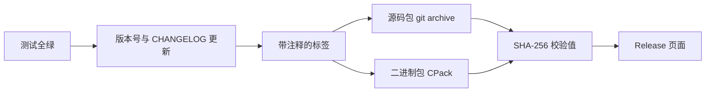

# 19. 文档、版本与发布

wordfreq 一直只有作者自己在用，改了什么地方、怎么编译，忘了就翻一下 shell 历史。同事要拿它统计一批日志，发过去的是一整个仓库：对方先要知道这个程序做什么、参数怎么给、输出里那几列是什么意思，再要装上 CMake 和编译器把它编出来。等对方终于跑出结果，又会问「这是哪个版本」「0.2.0 到 1.0.0 改了什么」「我下的压缩包是不是传坏了」。

这一章把 wordfreq 从 0.2.0 推到 1.0.0，补上这四样东西：别人读得懂的文档、一套说得清哪个版本包含什么的版本号、一份更新日志，以及一次可以复现的发布。做完之后，读者应当能为自己的 C 项目写 README 和头文件注释、用 Doxygen 生成参考文档、按语义化版本定版本号、打标签并打出源码包与二进制包。

## 1. 文档给谁看

同一份项目，三类人要看的东西不一样。

| 读者 | 读什么 | 要回答的问题 |
| --- | --- | --- |
| 使用程序的人 | README | 这个程序做什么，参数怎么给，输出怎么读，怎么装 |
| 调用库的程序员 | 头文件里的注释、Doxygen 生成的参考文档 | 每个函数收什么、返回什么、返回的指针归谁、能用到什么时候 |
| 维护者（包括半年后的作者） | 更新日志、设计说明、构建与测试说明 | 每个版本改了什么，为什么这么改，怎么跑起来 |

README 是入口，写完一句话说明和一段能直接复制的命令，使用者就能自己往下走。头文件注释是接口的说明书，调用方通常只装头文件、不读 `src/`，注释写在头文件里才看得到。更新日志记录版本之间的差异，维护者靠它判断某个行为是哪一版改的。

这三样东西和代码放在同一个仓库、在同一次提交里更新。行为改了而 README 没改，读者照着旧命令做会失败；函数签名改了而注释没改，Doxygen 生成出来的文档会自相矛盾。第 17 章的代码评审里，评审者看的不只是 `src/` 的改动，也包括同一个提交里 `README.md`、头文件注释和 `CHANGELOG.md` 是否跟着改了。

文档过时的代价很具体。第 7 章留下的 `build_by_hand.sh` 在 v1.0.0 上已经跑不通：`main.c` 现在要包含 CMake 生成的 `wf/config.h`，脚本里的 `-Iinclude` 找不到它，编译在 `app/main.c:21` 处停下，报 `fatal error: wf/config.h: No such file or directory`。脚本本身留着作第 7、8 章的对照没问题，但 README 里绝不能还写着「运行 `sh build_by_hand.sh` 即可构建」。

## 2. README

wordfreq 的 README 按使用顺序分成几节，每节只回答一个问题：

| 节 | 内容 |
| --- | --- |
| 一句话说明 | 统计文本中出现次数最多的单词 |
| 用法 | 命令行格式、参数含义、输出格式、退出状态 |
| 示例输出 | 用仓库里的样例跑出来的真实结果 |
| 构建 | 依赖的工具与最低版本、三条可复制的命令 |
| 测试 | 怎么跑测试，测试分几类 |
| 文档 | 怎么生成接口文档 |
| 安装与打包 | `install` 与 CPack 的用法 |
| 许可证 | 一句话加文件名 |
| 目录 | 每个目录放什么 |

仓库里的 `README.md` 按这个顺序写成，全文一百行出头：

::: details README.md 全文

````markdown
# wordfreq

统计文本中出现次数最多的单词。

## 用法

```text
usage: wordfreq [-n N] [FILE...]
       wordfreq --version
```

1. 输出出现次数最多的 N 个单词，N 默认为 10，可取 1 到 1000000。
2. 没有 FILE 时读标准输入；给出多个 FILE 时把它们合并统计。
3. 单词是连续的 ASCII 字母（A–Z、a–z），统计时转成小写；其他字节（数字、标点、空白、
   0x80 以上的字节）都是分隔符。超过 63 个字母的单词只保留前 63 个。
4. 按次数从多到少输出，次数相同的按 `strcmp` 升序排列。每行先是右对齐、占 7 列的次数，
   再是一个空格和单词。
5. 退出状态：0 表示成功；1 表示文件无法打开或读取（标准错误输出
   `wordfreq: <路径>: <错误说明>`），或内存不足；2 表示用法错误。

```text
$ wordfreq -n 3 tests/data/sample.txt
      4 the
      2 on
      2 sat
```

```text
$ wordfreq --version
wordfreq 1.0.0
```

## 构建

需要 CMake 3.20 或更新版本、支持 C17 的编译器，以及 Ninja 或 GNU Make。
在 bash 类 shell（Windows 上为 MSYS2 UCRT64 或 Git Bash）中：

```sh
cmake --preset dev-gcc
cmake --build --preset dev-gcc
ctest --preset dev-gcc
```

没有 Ninja 时用 `dev-gcc-make`（Unix Makefiles）。`tools/ci.sh` 把这三步合成一条命令，
CI 与本地跑的是同一套预设：

```sh
sh tools/ci.sh dev-gcc
```

可用的 CMake 选项：`WF_SANITIZE`（ASan + UBSan）、`WF_COVERAGE`（gcov）、`WF_FUZZ`
（libFuzzer 重放程序）、`WF_WERROR`（警告当错误）、`WF_HAVE_GETLINE`（读文件路径）、
`WF_BUILD_DOCS`（Doxygen 文档）。

## 测试

```sh
ctest --preset dev-gcc
```

`test_token` 与 `test_counter` 是单元测试，`e2e` 比较样例输出，`replay` 重放模糊测试的
语料与回归输入（需要 `-DWF_FUZZ=ON`）。

## 文档

公开头文件用 Doxygen 注释写接口文档。配置时打开 `WF_BUILD_DOCS` 后构建 `docs` 目标，
或者直接用仓库里的 `Doxyfile`：

```sh
doxygen Doxyfile
```

生成结果在 `docs/html/`。

## 安装与打包

```sh
cmake --install build --prefix /path/to/prefix
cpack --config build/CPackConfig.cmake -G ZIP
```

`install` 规则安装库、程序、公开头文件（含生成的 `config.h` 与 `version.h`）以及
README、CHANGELOG、LICENSE；CPack 生成 `wordfreq-1.0.0-<平台>.zip`。

## 许可证

MIT，见 `LICENSE`。源文件头部使用 SPDX 标识：`/* SPDX-License-Identifier: MIT */`。

## 目录

```text
wordfreq/
├── include/wf/       token.h、counter.h、report.h、export.h、version.h.in
├── src/              token.c、counter.c、report.c、version.c；config.h.in
├── app/main.c        命令行程序
├── tests/            单元测试、端到端测试与回归输入
├── fuzz/             模糊测试目标与重放程序
├── tools/            输入生成器、基准脚本、CI 脚本、bisect 检查脚本
├── Doxyfile          Doxygen 配置
├── CHANGELOG.md      更新日志（Keep a Changelog）
├── LICENSE           MIT 许可证
├── CMakePresets.json 配置、构建、测试与工作流预设
├── CMakeLists.txt    目标、测试、安装与打包
└── Makefile          第 8 章的构建文件
```
````

:::

用法一节把退出状态也写进来，调用脚本的人要靠它判断成功失败。第 2 章讲过退出状态，README 是它第一次对外承诺的地方：0 表示成功，1 表示文件读不了或内存不足，2 表示参数写错。程序里 `usage()` 返回 2、`out_of_memory()` 返回 1，与 README 一一对应：

```c
static int usage(void) {
    fputs("usage: wordfreq [-n N] [FILE...]\n", stderr);
    return 2;
}
```

README 的用法块与这段字符串必须一致。两者不一致时，读者以 README 为准去敲命令，程序却回一句别的用法说明。改 `usage()` 的提交里顺手改 README，这件事没有工具能替你做。

示例输出必须是跑出来的。在 `wordfreq/` 目录下用构建目录里的程序跑一遍，得到的正是 README 里贴的那三行：

::: terminal title="zsh - 按 README 的示例跑一遍"

```console
$ ./build/wordfreq -n 3 tests/data/sample.txt
      4 the
      2 on
      2 sat
$ ./build/wordfreq --version
wordfreq 1.0.0
```

:::

README 里把命令写成 `wordfreq`，那是安装到 `PATH` 上之后的用法；在仓库里刚构建完的读者要加 `./build/`。先看用法的人通常已经装好了程序，两种写法都说得通，关键是输出要和这里逐字一致。

构建一节列出依赖和三条命令。依赖写清楚最低版本，与 `CMakeLists.txt` 第一行 `cmake_minimum_required(VERSION 3.20)` 对得上：

```sh
cmake --preset dev-gcc
cmake --build --preset dev-gcc
ctest --preset dev-gcc
```

没有 Ninja 的机器用 `dev-gcc-make`（Unix Makefiles 生成器），README 里用一句话说明即可。这三条命令与第 18 章的 `tools/ci.sh` 执行的是同一套预设，CI 和读者在本地跑的东西因此一致。

::: compare left-title="README 自己攒一套旧命令" right-title="README 与 CI 走同一条路径"

```sh
gcc -std=c17 -Wall -Wextra -Iinclude src/*.c app/main.c -o build/wordfreq
```

---

```sh
sh tools/ci.sh dev-gcc
```

:::

左边的命令在第 7 章成立，现在不行了：生成的 `wf/config.h` 和 `wf/version.h` 在 `build/include/` 下，`-Iinclude` 找不到，编译直接失败。右边的脚本先配置、再构建、最后跑测试，任何一步失败就停下（脚本里 `set -eu`）。README 里写清「CI 调用的就是这个脚本」，读者遇到问题时照 CI 的步骤复现，作者排查也照同一条路径走。

README 会随二进制包一起安装。CMake 的安装规则里有一行 `install(FILES README.md CHANGELOG.md LICENSE DESTINATION ${CMAKE_INSTALL_DOCDIR})`，装完在 `share/doc/wordfreq/` 下能看到这三份文件。下载了二进制包的人不一定会回仓库翻 README，所以 README 里也要写清用法。

## 3. 头文件里的接口文档

调用库的程序员拿到的是 `include/wf/` 下的头文件，不是 `src/` 下的实现。函数的参数含义、返回值、指针归谁、有效期多长，这些只能写在头文件里。

### 3.1 注释写什么

一条接口注释要回答四件事：函数做什么、每个参数是什么、返回什么、调用方还要遵守什么。wordfreq 的 `counter.h` 按 Doxygen 的格式写，一个函数一条：

::: compare left-title="只重复函数名" right-title="写清做什么、返回什么、谁负责释放"

```c
/* 创建计数器 */
wf_counter *wf_counter_create(void);
```

---

```c
/**
 * @brief 创建空计数器。
 * @return 新计数器；内存不足时返回 NULL
 */
WF_API wf_counter *wf_counter_create(void);
```

:::

左边那句注释没有增加任何信息，`wf_counter_create` 这个名字已经说明了它创建计数器。右边写明了初始状态是空的，以及失败时的返回值，调用方据此决定要不要检查 `NULL`。

`counter.h` 里最长的一条注释是 `wf_counter_top`，它同时涉及输出缓冲区、返回值和指针有效期：

```c
/**
 * @brief 按次数降序、次数相同按 strcmp 升序取出前 n 项。
 * @param c 计数器
 * @param[out] out 接收结果的数组，至少能放 n 项
 * @param n 请求的项数
 * @return 写入的项数 min(n, wf_counter_size(c))；内存不足时返回 0
 * @note 结果中的 word 指针在下次 wf_counter_add 之前有效
 */
WF_API size_t wf_counter_top(const wf_counter *c, wf_entry *out, size_t n);
```

`@param[out]` 标明这个参数是函数写入结果的地方，与只读的 `@param c` 区分开。`@note` 写的是类型系统表达不了的东西：`wf_entry.word` 指向计数器内部存储，调用方不能 `free`，也不能在下一次 `wf_counter_add` 之后继续用。第 7 章讲过这条约束，接口文档是它唯一可靠的落点。

参数的前置条件也写在注释里，比如 `wf_tokenizer_next` 的 `cap` 必须大于 0。不写这一条，调用方传 0 进来得到什么全看实现。

整个 `counter.h` 的头部和类型定义同样有注释，`@file` 一句说明模块职责，公开结构 `wf_entry` 的每个成员单独一行。文件在 `code/开发与工程基础/19_文档_版本与发布/wordfreq/include/wf/counter.h`：

```c
/* SPDX-License-Identifier: MIT */
/**
 * @file counter.h
 * @brief 统计每个单词出现的次数，并按次数取出前若干项。
 *
 * 计数器是一个不透明类型：结构定义在 src/counter.c 中，调用方只能通过
 * 下面的函数使用它。create 与 destroy 成对调用。
 */
#ifndef WF_COUNTER_H
#define WF_COUNTER_H

#include <stddef.h>

#include "wf/export.h"

/** @brief 计数器；定义在实现文件中，调用方不直接读写成员 */
typedef struct wf_counter wf_counter;

/** @brief 一项计数结果 */
typedef struct {
    /** 指向计数器内部存储，在下一次 wf_counter_add 或
        wf_counter_destroy 之前有效；调用方不要 free */
    const char *word;
    /** 该单词出现的次数 */
    size_t count;
} wf_entry;

/**
 * @brief 创建空计数器。
 * @return 新计数器；内存不足时返回 NULL
 */
WF_API wf_counter *wf_counter_create(void);

/**
 * @brief 释放计数器以及它保存的全部单词。
 * @param c 计数器，可以为 NULL
 */
WF_API void wf_counter_destroy(wf_counter *c);

/**
 * @brief 把 word 的次数加 1，第一次出现时保存一份副本。
 * @param c 计数器
 * @param word 以空字符结尾的单词，函数内部复制，调用后调用方可以释放
 * @return 0 成功，-1 内存不足
 */
WF_API int wf_counter_add(wf_counter *c, const char *word);

/**
 * @brief 返回 word 出现的次数。
 * @param c 计数器
 * @param word 要查询的单词
 * @return 次数；没有出现过时返回 0
 */
WF_API size_t wf_counter_get(const wf_counter *c, const char *word);

/**
 * @brief 返回不同单词的个数。
 * @param c 计数器
 * @return 不同单词的个数
 */
WF_API size_t wf_counter_size(const wf_counter *c);
```

`wf_counter_top` 的注释与声明接在后面，末尾就是 3.1 节开头展示的那一条，这里不再重复。

同样的格式用在 `token.h` 与 `report.h` 上。`version.h.in` 里的注释不会进生成的参考文档：`Doxyfile` 的 `INPUT` 是 `include/wf`，默认的文件模式只收 `*.h` 一类，`.in` 模板不在其中；生成的 `version.h` 又落在 `build/` 下。想让 `wf_version` 出现在文档里，把 `build/include/wf` 加进 `INPUT` 即可。模板里 `@file` 写的是生成文件的名字 `version.h` 而不是 `version.h.in`，Doxygen 拿它和输入文件名比对，写成模板名会多出一条「不是输入文件」的警告。

注释写在声明处，不写在 `counter.c` 的定义处。Doxygen 把 `include/wf/` 作为输入，实现文件不参与；调用方安装的也只有头文件。两处都写会得到两份可能不一致的说明，以头文件那份为准。

### 3.2 Doxyfile 与警告

Doxygen 的配置由 `doxygen -g` 生成，完整文件几百行，绝大多数保持默认。wordfreq 的仓库里只保留改动过的关键项，其余在需要时再对照官方文档补：

```text
# Doxyfile：Doxygen 1.10 的配置，关键项如下。
# 完整配置用 `doxygen -g` 生成后对照修改。
PROJECT_NAME           = wordfreq
PROJECT_BRIEF          = "Word frequency counter"
OUTPUT_DIRECTORY       = docs
INPUT                  = include/wf
RECURSIVE              = YES
OPTIMIZE_OUTPUT_FOR_C  = YES
EXTRACT_ALL            = NO
WARN_IF_UNDOCUMENTED   = YES
WARN_IF_INCOMPLETE_DOC = YES
WARN_NO_PARAMDOC       = YES
GENERATE_LATEX         = NO
QUIET                  = NO
```

`EXTRACT_ALL = NO` 让没有注释的函数不出现在文档里，而不是悄悄生成一条空条目。三个 `WARN_` 选项管的是三种不同的缺失，1.10 的默认值也不一样：

| 选项 | 报什么 | 1.10 的默认值 |
| --- | --- | --- |
| `WARN_IF_UNDOCUMENTED` | 函数、类型完全没有注释 | YES |
| `WARN_IF_INCOMPLETE_DOC` | 注释写了，但函数参数只写了一半 | YES |
| `WARN_NO_PARAMDOC` | 注释写了，但参数和返回值一个都没写 | NO |

第三个默认关闭，所以要显式打开；前两个默认已开，写进 Doxyfile 是为了别人一看就知道项目要求它们开着。`OPTIMIZE_OUTPUT_FOR_C` 把索引和标题按 C 的习惯调整，生成的页面里不会出现「类」这种 C++ 术语。

先故意删掉 `wf_counter_top` 注释里的 `@param n` 一行，再运行：

::: terminal title="zsh - 漏写一个参数的注释"

```console
$ doxygen Doxyfile
D:/work/wordfreq/include/wf/counter.h:65: warning: The following parameter of wf_counter_top(const wf_counter *c, wf_entry *out, size_t n) is not documented:
  parameter 'n'
Doxygen version used: 1.10.0 (GIT-NOTFOUND)
Notice: Output directory 'docs' does not exist. I have created it for you.
```

:::

警告指出了文件名、行号和参数名，补回注释后再跑一次，没有警告，输出目录里出现 `docs/html/index.html`。路径是 Doxygen 打印的绝对路径，换一台机器前面的部分会不同。

CI 里的 Doxygen 不该「有警告也继续」。在 Doxyfile 里加一行 `WARN_AS_ERROR = FAIL_ON_WARNINGS`，同样的漏写会让 doxygen 以状态 1 退出，警告字样也变成 `error:`。第 18 章的 `ci.yml` 目前只跑构建、测试与静态检查，没有 Doxygen 作业；需要时照第 18 章添加作业的办法补一个，把这一项与测试失败同等对待。Doxygen 不是每台机器都装，所以作业里要先安装再运行，不能像本地那样默认存在。

生成结果不提交到仓库。`.gitignore` 里有 `docs/`，Doxyfile 的 `OUTPUT_DIRECTORY` 也指向 `docs`，两处一致即可；换输出目录时两边都要改。

### 3.3 接进 CMake

手动执行 `doxygen Doxyfile` 适合本地看一眼，工程里更常见的是把它做成一个构建目标。CMake 自带的 `FindDoxygen` 模块（3.9 起）提供 `doxygen_add_docs`，wordfreq 在 `CMakeLists.txt` 末尾加了这一段：

```cmake
option(WF_BUILD_DOCS "Generate API reference with Doxygen" OFF)
if(WF_BUILD_DOCS)
    find_package(Doxygen REQUIRED)
    doxygen_add_docs(docs
        include/wf
        COMMENT "Generate API reference"
    )
endif()
```

默认关闭，因为不是每台构建机都装了 Doxygen。打开后配置：

::: terminal title="zsh - 生成文档目标"

```console
$ cmake --preset dev-gcc -DWF_BUILD_DOCS=ON
$ cmake --build --preset dev-gcc --target docs
$ ls build/html/index.html
build/html/index.html
```

:::

`doxygen_add_docs` 自己调用 `doxygen`，输入是 `include/wf`，输出放在构建目录的 `build/html/`。它不读仓库里的 `Doxyfile`，而是在构建目录里按 CMake 变量现生成一份 `build/Doxyfile.docs`：把仓库的 `Doxyfile` 改名或者改开关，`docs` 目标的行为都不变。要改它的设置，配置时传带 `DOXYGEN_` 前缀的缓存变量：

::: terminal title="zsh - 给 docs 目标打开警告当错误"

```console
$ cmake --preset dev-gcc -DWF_BUILD_DOCS=ON -DDOXYGEN_WARN_AS_ERROR=FAIL_ON_WARNINGS
$ cmake --build --preset dev-gcc --target docs
...
D:/work/wordfreq/include/wf/counter.h:65: error: The following parameter of wf_counter_top(const wf_counter *c, wf_entry *out, size_t n) is not documented:
  parameter 'n'
Doxygen version used: 1.10.0 (GIT-NOTFOUND)
...
Exiting...
ninja: build stopped: subcommand failed.
```

:::

`DOXYGEN_WARN_NO_PARAMDOC=YES`、`DOXYGEN_WARN_IF_INCOMPLETE_DOC=NO` 用法相同，变量名就是把 Doxyfile 里的选项名加前缀。两套入口并存时，各自用自己的配置；想让本地与 CI 的要求一致，就把这些 `DOXYGEN_` 变量写进 CMake 预设，别只在命令行上传一次。

## 4. 语义化版本

版本号写成三段：`MAJOR.MINOR.PATCH`，依次称主版本号、次版本号、修订号。升级规则只有三条，判断依据是「公开接口有没有变、怎么变」。

::: concept dev-docs-semver title="语义化版本 (Semantic Versioning, SemVer) 的升级规则"

公开接口不兼容时升 MAJOR；向下兼容地增加功能时升 MINOR；只修缺陷、不改变接口时升 PATCH。升了 MAJOR 的版本，MINOR 与 PATCH 归零；升了 MINOR，PATCH 归零。主版本号为 0 表示开发中，接口随时可能变，1.0.0 是第一个稳定版本。

:::

对 C 库来说，「公开接口」就是安装出去的头文件：`include/wf/` 下的三个头文件加生成的 `version.h`。`src/` 里改了什么都不算接口变化，只要头文件里的声明和它承诺的行为没变。

### 4.1 API 与 ABI

C 库有两层兼容性，混在一起谈会把版本号定错。

API (application programming interface，应用编程接口) 是源码层的约定：函数名、参数类型、返回类型、结构体的成员，以及文档里写明的行为。API 不兼容，调用方重新编译会失败或行为改变。

ABI (application binary interface，应用二进制接口) 是二进制层的约定：结构体在内存里的布局、枚举值、函数调用时参数放在哪个寄存器、导出符号的名字。ABI 不兼容，已经编译好的程序不用重新编译就出错，而这种错误往往不报错，只是结果不对，或者直接崩溃。

wordfreq 发布共享库时，两者都算公开承诺，破坏哪一个都要升 MAJOR。下面这张表按这个标准判断：

| 改动 | API（重新编译后） | ABI（已编译的程序） | 版本号 |
| --- | --- | --- | --- |
| 修复一个输出错误的缺陷，接口不变 | 不变 | 不变 | PATCH |
| 新增 `wf_counter_clear` | 兼容 | 兼容，只是多一个导出符号 | MINOR |
| 新增命令行选项 `-s` | 兼容 | 不涉及库 | MINOR |
| 删除、改名一个公开函数 | 不兼容 | 不兼容 | MAJOR |
| 改变参数或返回值的含义 | 不兼容 | 不兼容 | MAJOR |
| 给公开结构 `wf_entry` 增加成员 | 重新编译后兼容 | 不兼容 | MAJOR |
| 改变公开枚举的成员值 | 源码不用改 | 不兼容 | MAJOR |
| 改不透明类型 `wf_counter` 的内部成员 | 不变 | 不变 | PATCH 或 MINOR |

公开结构的布局是最容易被忽略的一条。`code/开发与工程基础/19_文档_版本与发布/examples/abi_struct/` 下放了一组最小实验：同一份库，1.0.0 与 1.1.0 两版头文件，唯一的差别是 `wf_entry` 末尾多了一个 `rank`。

::: code-group

```c [v10/wf/counter.h]
#ifndef WF_COUNTER_H
#define WF_COUNTER_H

#include <stddef.h>

typedef struct wf_counter wf_counter;

typedef struct {
    const char *word;
    size_t count;
} wf_entry;

wf_counter *wf_counter_create(void);
void wf_counter_destroy(wf_counter *c);
size_t wf_counter_top(const wf_counter *c, wf_entry *out, size_t n);

#endif
```

```c [v11/wf/counter.h]
#ifndef WF_COUNTER_H
#define WF_COUNTER_H

#include <stddef.h>

typedef struct wf_counter wf_counter;

typedef struct {
    const char *word;
    size_t count;
    size_t rank;
} wf_entry;

wf_counter *wf_counter_create(void);
void wf_counter_destroy(wf_counter *c);
size_t wf_counter_top(const wf_counter *c, wf_entry *out, size_t n);

#endif
```

```c [wf.c]
#include "wf/counter.h"

#include <stdlib.h>

struct wf_counter {
    int unused;
};

wf_counter *wf_counter_create(void) {
    return calloc(1, sizeof(wf_counter));
}

void wf_counter_destroy(wf_counter *c) { free(c); }

size_t wf_counter_top(const wf_counter *c, wf_entry *out, size_t n) {
    static const char *words[] = {"the", "on", "sat"};
    static const size_t counts[] = {4, 2, 2};
    size_t written = n < 3 ? n : 3;
    for (size_t i = 0; i < written; i++) {
        out[i].word = words[i];
        out[i].count = counts[i];
        out[i].rank = i + 1;
    }
    (void)c;
    return written;
}
```

```c [app.c]
#include "wf/counter.h"

#include <stdio.h>

int main(void) {
    wf_counter *counter = wf_counter_create();
    wf_entry entries[3];
    size_t n = wf_counter_top(counter, entries, 3);
    for (size_t i = 0; i < n; i++) {
        printf("%7lu %s\n", (unsigned long)entries[i].count, entries[i].word);
    }
    wf_counter_destroy(counter);
    return 0;
}
```

:::

在 64 位机器上，旧结构的 `sizeof(wf_entry)` 是 16，新结构是 24。`app.c` 用旧头文件编译，只给数组留了 48 字节；`wf_counter_top` 按新布局每项写 24 字节，写到第三项时已经越过了数组末尾。先按旧头文件把程序编译好，再换上新库：

::: terminal title="zsh - 旧程序链接新库"

```console
$ gcc -std=c17 -Wall -Wextra -Iv11 -c wf.c -o wf.o
$ gcc -std=c17 -Wall -Wextra -Iv10 -c app.c -o app.o
$ gcc app.o wf.o -o app
$ ./app
Segmentation fault
$ echo $?
139
```

:::

同一组文件在 Debian 13、GCC 14.2 上也是崩溃，退出状态 139。把 `app.c` 用新头文件重新编译、重新链接，输出恢复正常：

::: terminal title="zsh - 重新编译之后"

```console
$ gcc -std=c17 -Wall -Wextra -Iv11 -c app.c -o app.o
$ gcc app.o wf.o -o app
$ ./app
      4 the
      2 on
      2 sat
```

:::

编译器、链接器全程没有报错。链接器按符号名找 `wf_counter_top`，找到了就用，它不知道调用方和实现方对 `wf_entry` 的大小有不同理解。这正是 ABI 破坏比 API 破坏更难查的原因：源码改一改重新编译就没事，已经发出去的程序却会按旧的大小去读新库写的数据。

枚举值的改动更隐蔽。同一目录下的 `examples/abi_enum/` 是另一组实验：1.0.0 的枚举只有两项，1.1.0 在开头插入一项，后面两个的值都变了：

::: code-group

```c [v10/wf/mode.h]
#ifndef WF_MODE_H
#define WF_MODE_H

/* 1.0.0：两项 */
enum wf_mode { WF_MODE_FAST = 0, WF_MODE_EXACT = 1 };

int wf_passes(enum wf_mode mode);

#endif
```

```c [v11/wf/mode.h]
#ifndef WF_MODE_H
#define WF_MODE_H

/* 1.1.0：在开头插入一项，后面两项的值都变了 */
enum wf_mode { WF_MODE_COMPACT = 0, WF_MODE_FAST = 1, WF_MODE_EXACT = 2 };

int wf_passes(enum wf_mode mode);

#endif
```

```c [mode.c]
#include "wf/mode.h"

#include <stdio.h>

int wf_passes(enum wf_mode mode) {
    switch (mode) {
    case WF_MODE_COMPACT:
        puts("compact: 3 passes");
        return 3;
    case WF_MODE_FAST:
        puts("fast: 1 pass");
        return 1;
    case WF_MODE_EXACT:
        puts("exact: check every byte");
        return 2;
    }
    return -1;
}
```

```c [app.c]
#include "wf/mode.h"

#include <stdio.h>

int main(void) {
    printf("wf_passes(WF_MODE_EXACT) = %d\n", wf_passes(WF_MODE_EXACT));
    return 0;
}
```

:::

旧程序把 `WF_MODE_EXACT` 展开成整数 1 传给库函数，新库把 1 解释成 `WF_MODE_FAST`：

::: terminal title="zsh - 旧程序调用新库"

```console
$ gcc -std=c17 -Wall -Wextra -Iv11 -c mode.c -o mode.o
$ gcc -std=c17 -Wall -Wextra -Iv10 -c app.c -o app.o
$ gcc app.o mode.o -o app
$ ./app
fast: 1 pass
wf_passes(WF_MODE_EXACT) = 1
```

:::

`app.c` 里写的是 `WF_MODE_EXACT`，结果却是 FAST 分支，返回值也从 2 变成 1。程序不崩溃、不报错，只是答案错了，这比崩溃更难发现。给枚举追加成员是安全的，中间插入、调换顺序、删掉成员都会改掉已有成员的值。

不透明类型正是为了避免这类问题。`wf_counter` 在头文件里只有 `typedef struct wf_counter wf_counter;`，成员定义在 `counter.c` 里。第 15 章把内部的线性查找换成有序数组加二分查找，结构成员全换了一遍，`counter.h` 和所有已编译的调用方都不受影响。把类型做成不透明，等于把内部布局从 ABI 里拿掉。

::: concept dev-docs-abi-break title="公开结构是 ABI 的一部分"

只要结构定义出现在安装出去的头文件里，它的布局就是 ABI 的一部分。给这种结构增加、删除、调整成员，都必须升 MAJOR。调用方需要读的成员就公开；只需要拿着指针传来传去的，做成不透明类型。

:::

### 4.2 0.y.z 与第一个稳定版本

0 开头的版本号表示开发中，作者不承诺兼容：0.1.0 到 0.2.0 可以随意改接口。wordfreq 在 0.1.0 到 0.2.0 之间把计数模块的内部表示整个换掉，接口没动，所以只升了 MINOR；接下来修一个截断缺陷、补文档、加 `--version`，接口稳定下来，才发 1.0.0。

1.0.0 之后，上面那张表就是约束。新增功能只能进 MINOR，破坏兼容的改动只能进 MAJOR，两者之间没有「差不多」的余地。

<Quiz
  type="single"
  :options="[
    { label: '修复超长单词截断时多写一个字节的缺陷', value: 'A' },
    { label: '新增命令行选项 --version', value: 'B' },
    { label: '给公开结构 wf_entry 末尾增加一个成员', value: 'C' },
    { label: '把 wf_counter 的内部数组换成哈希表', value: 'D' }
  ]"
  answer="C"
>

<template #question>

下面哪一项必须升 MAJOR？项目发布共享库，1.0.0 之后的版本号按语义化版本定。

</template>

正确答案是 **C**。`wf_entry` 是公开结构，布局属于 ABI，末尾加成员会让已编译的程序按旧大小读写，必须升 MAJOR。A 是缺陷修复，升 PATCH；B 是向下兼容的新功能，升 MINOR；D 改的是不透明类型的内部表示，头文件不变，ABI 不变，升 PATCH 或 MINOR 即可。

</Quiz>

## 5. 版本号只定义一处

版本号出现在很多地方：程序输出、头文件里的宏、共享库的文件名、安装包的名称、CHANGELOG 的标题。如果每一处都手写一遍，总有一处会忘。wordfreq 的做法是只在 `CMakeLists.txt` 里写一次：

```cmake
project(wordfreq VERSION 1.0.0 LANGUAGES C)
```

其余地方都从这一行派生。

### 5.1 从 project(VERSION) 生成头文件

`include/wf/version.h.in` 是模板，占位符由 CMake 在配置阶段替换：

::: code-group

```c [include/wf/version.h.in]
/* SPDX-License-Identifier: MIT */
/**
 * @file version.h
 * @brief 版本号的唯一来源：由 CMake 的 configure_file 从 project(VERSION) 生成。
 */
#ifndef WF_VERSION_H
#define WF_VERSION_H

#include "wf/export.h"

/** @brief 主版本号 */
#define WF_VERSION_MAJOR @PROJECT_VERSION_MAJOR@
/** @brief 次版本号 */
#define WF_VERSION_MINOR @PROJECT_VERSION_MINOR@
/** @brief 修订号 */
#define WF_VERSION_PATCH @PROJECT_VERSION_PATCH@

/** @brief 版本号字符串，形如 1.0.0 */
#define WF_VERSION_STRING "@PROJECT_VERSION@"

#ifdef __cplusplus
extern "C" {
#endif

/**
 * @brief 返回版本号字符串，与命令行 --version 输出的相同。
 * @return 静态存储的版本号字符串，调用方不要 free
 */
WF_API const char *wf_version(void);

#ifdef __cplusplus
}
#endif

#endif
```

```c [build/include/wf/version.h（生成结果）]
/* SPDX-License-Identifier: MIT */
/**
 * @file version.h
 * @brief 版本号的唯一来源：由 CMake 的 configure_file 从 project(VERSION) 生成。
 */
#ifndef WF_VERSION_H
#define WF_VERSION_H

#include "wf/export.h"

/** @brief 主版本号 */
#define WF_VERSION_MAJOR 1
/** @brief 次版本号 */
#define WF_VERSION_MINOR 0
/** @brief 修订号 */
#define WF_VERSION_PATCH 0

/** @brief 版本号字符串，形如 1.0.0 */
#define WF_VERSION_STRING "1.0.0"

#ifdef __cplusplus
extern "C" {
#endif

/**
 * @brief 返回版本号字符串，与命令行 --version 输出的相同。
 * @return 静态存储的版本号字符串，调用方不要 free
 */
WF_API const char *wf_version(void);

#ifdef __cplusplus
}
#endif

#endif
```

:::

生成发生在配置阶段，`CMakeLists.txt` 里对应两行：

```cmake
configure_file(src/config.h.in ${PROJECT_BINARY_DIR}/include/wf/config.h)
configure_file(include/wf/version.h.in ${PROJECT_BINARY_DIR}/include/wf/version.h)
```

生成的头文件放在 `build/include/wf/`，与源码树同构。`target_include_directories` 同时列出 `include` 和 `${PROJECT_BINARY_DIR}/include`，所以 `#include "wf/version.h"` 在两处都找得到，源码树里不会出现构建产物。

`src/version.c` 只有两行实质代码：

```c
/* SPDX-License-Identifier: MIT */
#include "wf/version.h"

const char *wf_version(void) { return WF_VERSION_STRING; }
```

`main.c` 在参数解析里处理 `--version`，打印后直接返回 0：

```c
if (strcmp(argv[argi], "--version") == 0) {
    printf("wordfreq %s\n", wf_version());
    return 0;
}
```

### 5.2 改一处，全项目跟着变

把 `project(wordfreq VERSION 1.0.0 ...)` 改成 `1.1.0`，不需要动别的文件。直接构建，CMake 发现 `CMakeLists.txt` 变了会先重新配置，`version.h` 随之更新：

::: terminal title="zsh - 只改 project(VERSION)"

```console
$ cmake --build --preset dev-gcc
[0/1] Re-running CMake...
-- Configuring done (0.1s)
-- Generating done (0.0s)
-- Build files have been written to: D:/work/wordfreq/build
[1/14] Building C object CMakeFiles/wf.dir/src/token.c.obj
[2/14] Building C object CMakeFiles/wf.dir/src/version.c.obj
[3/14] Building C object CMakeFiles/wf.dir/src/report.c.obj
[4/14] Building C object CMakeFiles/wf.dir/test_token.dir/tests/test_token.c.obj
[5/14] Building C object CMakeFiles/wf.dir/src/counter.c.obj
[6/14] Building C object CMakeFiles/wf.dir/test_counter.dir/tests/test_counter.c.obj
[7/14] Building C object CMakeFiles/wf.dir/test_token.dir/tests/check.c.obj
[8/14] Building C object CMakeFiles/wf.dir/wordfreq.dir/app/main.c.obj
[9/14] Building C object CMakeFiles/wf.dir/test_counter.dir/tests/check.c.obj
[10/14] Linking C static library libwf.a
[11/14] Linking C executable wordfreq.exe
[12/14] Linking C executable test_token.exe
[13/14] Linking C executable test_counter.exe
$ ./build/wordfreq --version
wordfreq 1.1.0
```

:::

生成的头文件里三个数字同步变成 1、1、0。在源码里搜 `1.0.0`，`CMakeLists.txt` 里只剩 `project(VERSION)` 那一行和一句注释，`version.h.in` 里只剩注释举例，没有第二个需要改的宏或字符串。`README.md` 里的 `--version` 示例输出和 `CHANGELOG.md` 的历史记录不算在内，前者发布时要跟着更新，后者本来就该保留旧版本号。

第 8 章的 `Makefile` 是第二条构建路径，它也要从同一处取版本。快照里的规则改成读 `CMakeLists.txt`：

```makefile
PROJECT_VERSION := $(shell sed -n 's/^project(wordfreq VERSION \([0-9][0-9.]*\) LANGUAGES C)/\1/p' CMakeLists.txt)
VERSION_PARTS := $(subst ., ,$(PROJECT_VERSION))

build/include/wf/version.h: include/wf/version.h.in CMakeLists.txt | build
	mkdir -p build/include/wf
	sed -e 's/@PROJECT_VERSION_MAJOR@/$(word 1,$(VERSION_PARTS))/' \
	    -e 's/@PROJECT_VERSION_MINOR@/$(word 2,$(VERSION_PARTS))/' \
	    -e 's/@PROJECT_VERSION_PATCH@/$(word 3,$(VERSION_PARTS))/' \
	    -e 's/@PROJECT_VERSION@/$(PROJECT_VERSION)/' $< > $@
```

`CMakeLists.txt` 也写进先决条件，改了版本号，`make` 才会重新生成 `version.h`；少了这一项，Make 认为头文件还是新的，`--version` 会停在旧值。

把版本改成 1.1.0 后执行 `make`，`build/include/wf/version.h` 跟着生成，`./build/wordfreq --version` 同样输出 1.1.0。两条构建路径共用一个来源，改版本只改一行。

共享库的文件名也从同一个项目版本派生：

```cmake
if(BUILD_SHARED_LIBS)
    set_target_properties(wf PROPERTIES
        VERSION ${PROJECT_VERSION}
        SOVERSION ${PROJECT_VERSION_MAJOR}
    )
endif()
```

在 Linux 上构建后得到三个名字：

::: terminal title="zsh - 共享库的版本与 ABI 版本（Debian 13，GCC 14.2）"

```console
$ ls -l build-shared/libwf.so*
lrwxrwxrwx 1 minsecrus minsecrus    10 Oct 22 02:02 libwf.so -> libwf.so.1
lrwxrwxrwx 1 minsecrus minsecrus    14 Oct 22 02:02 libwf.so.1 -> libwf.so.1.0.0
-rwxrwxr-x 1 minsecrus minsecrus 16472 Oct 22 02:02 libwf.so.1.0.0
```

:::

`libwf.so` 是链接时用的名字，`libwf.so.1` 是程序运行时记下的名字，`libwf.so.1.0.0` 才是真正的文件。`SOVERSION` 取主版本号，意味着 1.0.0 换成 1.1.0、1.2.3 都还是 `libwf.so.1`，已编译的程序直接加载新文件即可；到 2.0.0 才变成 `libwf.so.2`，新旧两代可以并存。`SOVERSION` 与语义化版本的 MAJOR 由同一行决定，不会出现库文件名说 1、头文件说 2 的情况。

::: tip 开发构建用 `git describe`

发布版本由 `project(VERSION)` 决定，开发中的构建可以用 `git describe --tags --dirty` 得到「离上一个标签多远」。在 `v1.0.0` 上它是 `v1.0.0`；标签之后又有一次提交时是 `v1.0.0-1-gccc89de`；工作区还有未提交改动时末尾加 `-dirty`，变成 `v1.0.0-1-gccc89de-dirty`。中间的 `1` 是提交数，`g` 后面的七位是提交哈希。它适合 `--version` 之外的调试输出，不适合当作发布版本号写进安装包。

:::

## 6. 更新日志

更新日志 (changelog) 记录每个版本对使用者可见的变化。wordfreq 的 `CHANGELOG.md` 按 Keep a Changelog 的格式写，开头声明格式与版本号规则，之后每个版本一节：

```markdown
# Changelog

本文件记录 wordfreq 的每个版本对用户可见的变化，格式参照
[Keep a Changelog](https://keepachangelog.com/zh-CN/1.1.0/)，
版本号遵循[语义化版本](https://semver.org/lang/zh-CN/)。

## [Unreleased]

## [1.0.0] - 2026-10-21

### Added

- `wordfreq --version` 输出程序版本号。
- 公开头文件的接口文档，可用 Doxygen 生成参考文档。
- `include/wf/export.h`，共享库构建时导出公开函数。
- CMake 的安装规则与 CPack 打包。

### Changed

- 计数模块改为有序数组加二分查找，接口与输出不变；处理 10^6 词的输入比 0.2.0 快约十倍。

### Fixed

- 超长单词截断时多写一个字节的问题（0.2.0 引入）。

## [0.2.0] - 2026-10-20

### Changed

- 计数模块从线性查找改成有序数组加二分查找（`wf_counter` 的内部表示，接口不变）。
- 新增 `tools/gen_words.c` 与 `tools/bench.sh`，用于生成可重复的输入和记录测量结果。

## [0.1.0] - 2026-10-18

### Added

- `wordfreq [-n N] [FILE...]` 的首次发布：分词、计数、输出三个模块，手工构建脚本、
  Makefile、CMake 与 XMake 构建文件，单元测试与端到端测试。
```

`Unreleased` 一节积累还没发布的改动，发布时把它改成新版本号和日期，再补一个空的 `Unreleased`。分类固定为 Added、Changed、Deprecated、Removed、Fixed、Security 六种，没有内容的分类不写。日期用 ISO 格式 `2026-10-21`，不带时区、不写「10 月 21 日」，这样排序和脚本处理都简单。

每一条写的是使用者感受到的变化，不是提交记录的搬运。同一个改动，提交说明和更新日志的写法不一样：

::: code-group

```text [提交说明：写给看代码的人]
counter: use binary search in find_entry

replace linear scan with lower_bound; add memmove insert
```

```markdown [更新日志：写给用程序的人]
- 计数模块改为有序数组加二分查找，接口与输出不变；处理 10^6 词的输入比 0.2.0 快约十倍。
```

:::

提交说明关心函数名和插入方式，读者是评审代码的同事；更新日志关心两件事：接口有没有变、速度有没有提高。同一版本的十几次提交，在更新日志里可能只合成一条。

「接口与输出不变」这几个字值得点明。使用者看到 Changed 一节会担心行为变了，作者明确写出接口没变，对方才敢直接替换。反之，修了缺陷但输出结果会变，也要写清哪类输入的结果不同，比如 1.0.0 的 Fixed 一条写明了「超长单词截断时多写一个字节」，用过 0.2.0 的人一看就知道自己可能踩过。

## 7. 发布

发布是把某个提交固定下来，做成别人可以下载、校验、重现的东西。流程固定为五步：



### 7.1 发布前检查

发出去的东西收不回来，所以先确认三件事：

1. 全部测试通过，构建日志里没有失败项。
2. `project(VERSION)`、`CHANGELOG.md` 顶部的版本与日期都已经更新，`Unreleased` 里没有遗留条目。
3. Doxygen 生成没有警告，`WARN_AS_ERROR` 打开时也能通过。

第一条用第 18 章的脚本跑一遍即可：

::: terminal title="zsh - 发布前的完整检查"

```console
$ sh tools/ci.sh dev-gcc
== configure (dev-gcc)
...
== build (dev-gcc)
[13/13] Linking C executable test_counter.exe
== test (dev-gcc)
Test project D:/work/wordfreq/build
    Start 1: token
1/3 Test #1: token ............................   Passed    0.06 sec
    Start 2: counter
2/3 Test #2: counter ..........................   Passed    0.06 sec
    Start 3: e2e
3/3 Test #3: e2e ..............................   Passed    0.08 sec

100% tests passed, 0 tests failed out of 3
```

:::

脚本退出状态为 0 才继续。只看输出末尾的 `100% tests passed` 不够，CI 里判断的是退出状态，第 18 章已经讲过这一点。

### 7.2 打标签

标签 (tag) 给某个提交起一个固定的名字，第 4 章只提了一句，这里用上。发布用带注释的标签：

::: terminal title="zsh - 打一个带注释的标签"

```console
$ git tag -a v1.0.0 -m "wordfreq 1.0.0"
$ git show --no-patch v1.0.0
tag v1.0.0
Tagger: Mdr <mdr@example.com>
Date:   Thu Oct 22 01:04:14 2026 +0800

wordfreq 1.0.0

commit e9f24bdb2685a7fb365224114606e3c6d6afe089
Author: Mdr <mdr@example.com>
Date:   Thu Oct 22 01:04:14 2026 +0800

    wordfreq 1.0.0
```

:::

`-a` 创建的是标签对象，它有自己的作者、日期和说明，`git show` 能看出打标签的人和时间。不加 `-a` 的是轻量标签，只是一个指向提交的名字，没有这些信息，不适合标记发布。

`git tag -n1` 列出标签和说明的第一行，`git push origin v1.0.0` 把标签推到远程。推送标签单独进行，`git push` 默认不推标签，这一点与分支不同；演示仓库没有远程，这一步没有实际执行。

标签名统一带 `v` 前缀，如 `v1.0.0`，与 `project(VERSION)` 的 `1.0.0` 差一个字母。`git describe` 的输出会把前缀带出来，打包时用 `sed` 或 CMake 去掉。

### 7.3 源码包

源码包从标签导出，不带 `.git` 目录和未提交的改动：

::: terminal title="zsh - 导出源码包"

```console
$ git archive --format=tar.gz --prefix=wordfreq-1.0.0/ -o wordfreq-1.0.0.tar.gz v1.0.0
$ tar tzf wordfreq-1.0.0.tar.gz | head -8
wordfreq-1.0.0/
wordfreq-1.0.0/.gitattributes
wordfreq-1.0.0/.github/
wordfreq-1.0.0/.github/workflows/
wordfreq-1.0.0/.github/workflows/ci.yml
wordfreq-1.0.0/.gitignore
wordfreq-1.0.0/CHANGELOG.md
wordfreq-1.0.0/CMakeLists.txt
```

:::

`--prefix` 给包内所有路径加一层目录，解压后不会把文件散在当前目录里。包里有 51 个条目，包括 `.github/` 和 `.gitattributes`，但没有 `build/`：`git archive` 只导出被 Git 跟踪的文件，构建产物和 `docs/` 本来就写在 `.gitignore` 里。

`git archive` 的输出是确定的：同一个标签连续导出两次，两个文件的 SHA-256 都是 `d810d2455161eef9334518fc6f57df2360b25d97868c67ed872a1ec34f71e895`。这一点对可复现发布很有用，别人可以拿你的包和标签自己导出一份对比。

### 7.4 二进制包

二进制包由 CMake 的安装规则加 CPack 生成。安装规则决定包里有什么：

```cmake
include(GNUInstallDirs)
install(TARGETS wf wordfreq
    RUNTIME DESTINATION ${CMAKE_INSTALL_BINDIR}
    LIBRARY DESTINATION ${CMAKE_INSTALL_LIBDIR}
    ARCHIVE DESTINATION ${CMAKE_INSTALL_LIBDIR}
)
install(DIRECTORY include/ DESTINATION ${CMAKE_INSTALL_INCLUDEDIR}
    FILES_MATCHING PATTERN "*.h")
install(FILES ${PROJECT_BINARY_DIR}/include/wf/config.h
              ${PROJECT_BINARY_DIR}/include/wf/version.h
    DESTINATION ${CMAKE_INSTALL_INCLUDEDIR}/wf)
install(FILES README.md CHANGELOG.md LICENSE DESTINATION ${CMAKE_INSTALL_DOCDIR})
include(CPack)
```

库和程序分到 `lib/`、`bin/`，公开头文件装到 `include/wf/`，两份生成的头文件单独列出来，因为它们在构建目录里、不在源码树的 `include/` 下。README、CHANGELOG、LICENSE 一起装进 `share/doc/wordfreq/`。

先装到一个临时前缀看内容：

::: terminal title="zsh - cmake --install"

```console
$ cmake -S . -B build -G Ninja -DCMAKE_BUILD_TYPE=Release
...
$ cmake --build build
...
$ cmake --install build --prefix D:/work/wordfreq/prefix
-- Install configuration: "Release"
-- Installing: D:/work/wordfreq/prefix/lib/libwf.a
-- Installing: D:/work/wordfreq/prefix/bin/wordfreq.exe
-- Installing: D:/work/wordfreq/prefix/include
-- Installing: D:/work/wordfreq/prefix/include/wf
-- Installing: D:/work/wordfreq/prefix/include/wf/counter.h
-- Installing: D:/work/wordfreq/prefix/include/wf/export.h
-- Installing: D:/work/wordfreq/prefix/include/wf/report.h
-- Installing: D:/work/wordfreq/prefix/include/wf/token.h
-- Installing: D:/work/wordfreq/prefix/include/wf/config.h
-- Installing: D:/work/wordfreq/prefix/include/wf/version.h
-- Installing: D:/work/wordfreq/prefix/share/doc/wordfreq/README.md
-- Installing: D:/work/wordfreq/prefix/share/doc/wordfreq/CHANGELOG.md
-- Installing: D:/work/wordfreq/prefix/share/doc/wordfreq/LICENSE
```

:::

再用 CPack 打成 ZIP：

::: terminal title="zsh - cpack"

```console
$ cpack --config build/CPackConfig.cmake -G ZIP
CPack: Create package using ZIP
CPack: Install projects
CPack: - Install project: wordfreq []
CPack: Create package
CPack: - package: D:/work/wordfreq/wordfreq-1.0.0-win64.zip generated.
```

:::

包名里的版本号来自 `${PROJECT_VERSION}`，平台名由 CPack 自己判断，Windows 上是 `win64`。Linux 上换 `-G TGZ`，得到的文件是 `wordfreq-1.0.0-Linux.tar.gz`。包内顶层目录同样是 `wordfreq-1.0.0-<平台>/`，解开后 `bin/`、`include/`、`lib/`、`share/` 一目了然，共 18 个条目。

### 7.5 校验值与干净重建

发布页面上除了两个包，还要有校验值。下载的人算一遍、与公布的值对比，就能判断文件在传输中是否损坏，或者是否被人替换。

Linux 上用 `sha256sum`：

::: terminal title="zsh - sha256sum（Debian 13）"

```console
$ sha256sum wordfreq-1.0.0-Linux.tar.gz
b222274929adbc3b660f3ea3f1473bbd9bf543e04c1aa64aa7abbae8320a3a81  wordfreq-1.0.0-Linux.tar.gz
```

:::

Windows 的 PowerShell 用 `Get-FileHash`：

::: terminal title="PowerShell - Get-FileHash"

```console
PS> Get-FileHash -Algorithm SHA256 .\wordfreq-1.0.0-win64.zip

Algorithm : SHA256
Hash      : 66AC228F9D324F38362F3225CE841036CB9B73FC30255E16CCC344A813BB4272
Path      : D:\work\wordfreq\wordfreq-1.0.0-win64.zip
```

:::

两个值只对各自那一次打包成立。`git archive` 的源码包是逐字节可复现的，CPack 的 ZIP 不是：在同一个目录连续打两次，第一次是 `be3695d8ab9fc5130a76a18fa71f8849ae6f06c22eeae3202cd5b76d0708ecdb`，第二次是 `66ac228f9d324f38362f3225ce841036cb9b73fc30255e16ccc344a813bb4272`，因为 ZIP 给每个文件记下了打包时刻的时间戳。校验值用来核对「你下载的和发布的是同一个文件」，不是用来证明「两次构建完全一样」。想知道包里的东西是否一致，解开后比内容或者比文件清单，而不是比压缩包的哈希。

发布前的最后一件事，是在一个空目录里只用发布物把流程走一遍。解压源码包，不碰原来的仓库：

::: terminal title="zsh - 从一个空目录重建"

```console
$ mkdir clean && tar xzf wordfreq-1.0.0.tar.gz -C clean
$ cd clean/wordfreq-1.0.0
$ cmake -S . -B build -G Ninja
$ cmake --build build
$ ctest --test-dir build
Internal ctest changing into directory: D:/work/wordfreq/clean/wordfreq-1.0.0/build
Test project D:/work/wordfreq/clean/wordfreq-1.0.0/build
    Start 1: token
1/3 Test #1: token ............................   Passed    0.06 sec
    Start 2: counter
2/3 Test #2: counter ..........................   Passed    0.06 sec
    Start 3: e2e
3/3 Test #3: e2e ..............................   Passed    0.09 sec

100% tests passed, 0 tests failed out of 3
$ ./build/wordfreq --version
wordfreq 1.0.0
```

:::

这一步能发现两类问题：源码包漏了文件（例如某个头文件没被 Git 跟踪），或者构建依赖了仓库里被忽略的产物。两者都只有在空目录里才会暴露，在原仓库里重新构建是发现不了的。二进制包同样解压到别处，运行包里的 `bin/wordfreq -n 3 tests/data/sample.txt`，输出与样例一致，确认它不依赖构建目录里的任何东西。

最后的 Release 页面把源码包、二进制包和校验值一起挂上去。第 18 章的 GitHub Actions 工作流可以加一个在推送 `v*` 标签时触发的作业，重复这里的 `cpack` 与 `git archive`，把产物作为制品上传；本地演示没有远程仓库，这一步没有实际运行。

<Quiz
  type="single"
  :options="[
    { label: '压缩包在传输中损坏了', value: 'A' },
    { label: '两次的构建选项不同', value: 'B' },
    { label: 'CPack 把打包时刻写进了 ZIP，哈希自然会变', value: 'C' },
    { label: 'SHA-256 算法对同一文件只能算出同一个值，说明计算错了', value: 'D' }
  ]"
  answer="C"
>

<template #question>

同一个提交、同一台机器上连续执行两次 `cpack -G ZIP`，两个包的 SHA-256 不同。最可能的原因是：

</template>

正确答案是 **C**。ZIP 为每个条目记录修改时间，两次打包的时间不同，压缩后的字节就不同。判断两个包内容是否一致，应当解开后逐文件比较，或者比较解压后的目录，而不是比较压缩包的哈希。同一份源码用 `git archive` 两次导出，哈希则是相同的。

</Quiz>

## 8. 许可证

别人拿到源码和二进制包，需要知道能拿它做什么。根目录放一份 `LICENSE`，写明许可证全文；wordfreq 用 MIT：

```text
MIT License

Copyright (c) 2026 wordfreq contributors

Permission is hereby granted, free of charge, to any person obtaining a copy
of this software and associated documentation files (the "Software"), to deal
in the Software without restriction, including without limitation the rights
to use, copy, modify, merge, publish, distribute, sublicense, and/or sell
copies of the Software, and to permit persons to whom the Software is
furnished to do so, subject to the following conditions:

The above copyright notice and this permission notice shall be included in all
copies or substantial portions of the Software.
```

全文还有最后一段免责声明，这里省略。许可证文本一字不改地复制，不要自己改写句子。

选择哪种许可证看项目的用途，常见的有 MIT、Apache-2.0、GPL 系列。choosealicense.com 按「希望别人怎么用你的代码」给出对照，逐条列出每种许可证允许和要求的条件，比读法律文本快得多。这一步是项目所有者的决定，不是技术决定；本教程只到「文件放对位置、声明一致」为止，不构成法律意见。

### 8.1 SPDX 标识

`LICENSE` 管整个仓库，单个源文件头部再放一行机器可读的标识：

```c
/* SPDX-License-Identifier: MIT */
#include "wf/version.h"

const char *wf_version(void) { return WF_VERSION_STRING; }
```

SPDX (Software Package Data Exchange) 标识由 SPDX 许可证列表里的短名组成，`MIT`、`Apache-2.0`、`GPL-3.0-or-later` 都是标准写法。许可证扫描工具读这一行就能判断文件用的是什么许可证，不必解析整段注释。wordfreq 的每个 `.c`、`.h` 和 `.in` 文件第一行都有这一句，新增文件时照抄。

### 8.2 随发布物带上许可证

`LICENSE` 必须进两个包。源码包里它随 Git 跟踪的文件一起导出；二进制包里靠 CMake 的安装规则，`install(FILES README.md CHANGELOG.md LICENSE DESTINATION ${CMAKE_INSTALL_DOCDIR})` 把它装到 `share/doc/wordfreq/`。CPack 里另有一行：

```cmake
set(CPACK_RESOURCE_FILE_LICENSE ${CMAKE_CURRENT_SOURCE_DIR}/LICENSE)
```

它让 CPack 在生成安装包时把许可证作为包的元数据，生成的安装器会显示它。少了这一行，ZIP 里仍然有文件，但有些平台的安装器不会主动展示许可证。

项目里用了第三方的源码或库，对方的许可证要一起带上。第 10 章评估 `c_exception` 时讲过，许可证声明不一致的代码在采用前要先向上游确认；确认可以使用之后，把对方的许可证文本放进仓库（例如 `third_party/c_exception/LICENSE`），同样装进发布物。分发二进制时只带自己的 `LICENSE` 是不够的。

## 9. 习题

### 9.1 巩固

<Exercise id="21901" :d="1" :w="2">

对照 `code/开发与工程基础/19_文档_版本与发布/wordfreq/` 的 README 与 `app/main.c`：

1. 找出 `usage()` 里的用法字符串与 README 用法块中一共出现几次 `[-n N] [FILE...]`，说明两处为什么必须一致。
2. 改 `usage()` 里的文案，把 `FILE...` 改成 `FILE ...`（多一个空格），构建后运行 `./build/wordfreq -x`，记录输出与 README 的差异。
3. 按 README 的退出状态表，用三条命令分别验证 0、1、2 三种状态：正常运行、打开不存在的文件、给一个非法参数。记录 `echo $?`。
4. 在快照里执行 `sh build_by_hand.sh`，记录它在 `app/main.c` 哪一行停下、报什么错误；说明脚本本身该不该删，以及 README 里哪一句话必须跟着改。
5. 说明 README 里为什么写 `wordfreq` 而终端演示里写 `./build/wordfreq`，以及示例输出为什么必须由程序跑出来。

验收：第 3 题三个退出状态恰为 0、1、2；第 2 题能指出 README 该改哪一行；第 4 题报 `wf/config.h: No such file or directory`，并能说出 README 与 CI 应当共用哪条构建路径。

</Exercise>

<Exercise id="21902" :d="2" :w="2">

读 `code/开发与工程基础/19_文档_版本与发布/wordfreq/include/wf/` 下的四个头文件：

1. `counter.h` 的 `wf_counter_top` 注释里，`@param[out]` 与 `@param` 分别标了哪个参数，`@note` 写了什么调用方约束。
2. `token.h` 的 `wf_tokenizer_next` 写了哪条前置条件？把这条注释里的 `@return` 一行删掉重新生成文档，记录警告原文；说明 `@return` 在 `WARN_NO_PARAMDOC` 的检查里算不算「参数」。
3. 在 `counter.h` 末尾声明一个没有注释的公开函数（例如 `WF_API void wf_counter_clear(wf_counter *c);`），重新生成。它的名字在页面里出现在哪里、有没有详细说明？是哪一项设置决定了那条警告？把 `EXTRACT_ALL` 改成 `YES` 再生成一次，这条警告还在吗，这样的文档对调用方更有用还是更糟？
4. 把 `report.h` 里 `wf_report_print` 的 `@note` 改写成一句更具体的话，要求写明调用方能不能 `free` 数组里的 `word`；再给 `wf_counter_add` 补一条 `@note`，写清它为什么内部要复制一份 `word`。

验收：第 1、2 题引用注释原文；第 3 题给出警告原文，指出它属于 `WARN_IF_UNDOCUMENTED` 还是 `WARN_NO_PARAMDOC`，并说明 `EXTRACT_ALL = YES` 之后警告消失的原因。

</Exercise>

<Exercise id="21903" :d="2" :w="2">

按 `Doxyfile` 的三项 `WARN_` 设置做实验：

1. 用 `doxygen Doxyfile` 生成一次，确认没有警告、`docs/html/index.html` 存在。
2. 删掉 `wf_counter_top` 的 `@param n` 一行，重新生成，记录警告的文件、行号与参数名。
3. 再删掉同一条注释里全部 `@param` 与 `@return`，比较 `WARN_IF_INCOMPLETE_DOC` 与 `WARN_NO_PARAMDOC` 分别报什么。把 `WARN_NO_PARAMDOC` 改成 `NO` 再跑一次，观察这条报告是否消失。
4. 在 `Doxyfile` 末尾加 `WARN_AS_ERROR = FAIL_ON_WARNINGS`，用同样的漏写再跑一次，记录输出里的 `error:` 字样与退出状态。

验收：第 2 题警告指向 `counter.h` 的具体行；第 4 题 `doxygen` 退出状态为 1，且字样由 `warning:` 变为 `error:`。

</Exercise>

### 9.2 编程

<Exercise id="21904" :d="3" :w="3">

把文档目标接进 CMake 并让它在有警告时失败：

1. 按第 3.3 节给 `CMakeLists.txt` 加 `WF_BUILD_DOCS` 选项与 `doxygen_add_docs`，确认 `-DWF_BUILD_DOCS=ON` 时 `--target docs` 生成 `build/html/index.html`。
2. 打开 `-DDOXYGEN_WARN_AS_ERROR=FAIL_ON_WARNINGS`，故意删掉一条 `@param`，记录构建的输出与退出状态；说明这个变量名与 `Doxyfile` 里的选项名是什么关系。
3. 到 `build/Doxyfile.docs` 里核对三项 `WARN_` 的实际取值，说明 `docs` 目标到底读的是哪份配置；把仓库里的 `Doxyfile` 改名，验证 `docs` 目标行为不变。
4. 说明为什么 `WF_BUILD_DOCS` 默认关闭，以及 CI 作业里要额外做哪一步。

验收：第 2 步构建以非 0 退出并出现 `error:`；第 3 步改名实验后 `docs` 目标仍能生成。

</Exercise>

<Exercise id="21905" :d="3" :w="3">

用 `examples/abi_struct/` 验证「公开结构是 ABI 的一部分」：

1. 在 `v10` 与 `v11` 下各编译一个程序，打印 `sizeof(wf_entry)` 与两个成员的偏移，记录两个数。
2. 按第 4.1 节把 `wf.c` 用 `v11` 头文件编译、`app.c` 用 `v10` 头文件编译，链接运行，记录退出状态。
3. 把 `app.c` 里的 `entries` 改成 `wf_entry entries[5]`（仍用旧头文件编译），数组已经足够大。运行并记录结果，说明崩溃为什么没有消失。
4. 给出两种不升 MAJOR 也能新增字段的做法，各写一句话；说明它们分别牺牲了什么。

验收：第 1 题两个 `sizeof` 分别是 16 与 24；第 2、3 题都是退出状态 139；第 3 题能说清旧程序按旧偏移读第二项时读到的是什么，以及「多留空间」为什么救不了已经发出去的程序。

</Exercise>

<Exercise id="21906" :d="3" :w="3">

用 `examples/abi_enum/` 复现枚举值的破坏，并把它接进版本判断：

1. 按第 4.1 节编译运行，记录 `wf_passes(WF_MODE_EXACT)` 的实际结果与屏幕输出。
2. 把 `mode.c` 里三个分支的 `puts` 各改一句，重新链接旧程序，确认程序仍然按新库的分支执行。
3. 写一个脚本 `abi_check.sh`：分别用 `v10`、`v11` 头文件编译同一份「打印每个枚举值」的小程序，输出两份 `枚举名=数值` 列表并比较；有差异时以非 0 退出。
4. 说明为什么「在末尾追加成员」安全而「在开头插入」不安全，以及这条结论对公开结构体是否同样成立。

验收：第 1 题输出为 `fast: 1 pass` 与 `wf_passes(WF_MODE_EXACT) = 1`；第 3 题在 v10 与 v11 之间返回非 0。

</Exercise>

<Exercise id="21907" :d="4" :w="3">

版本号只定义一处的两条构建路径都要验证：

1. 把 `project(wordfreq VERSION 1.0.0 ...)` 改成 `1.2.3`，用 `cmake --build --preset dev-gcc` 重新构建，记录它先打印的 `Re-running CMake...`，再运行 `--version`。
2. 检查生成的 `build/include/wf/version.h`，确认三个宏与字符串都变了；用 `grep -rn "1\.0\.0" --include='*.c' --include='*.h' --include='*.in' .` 列出剩下的命中，指出它是可执行宏、模板占位符还是注释里的举例，说明为什么这一行不需要（也不应该）跟着改。
3. 用 `mingw32-make`（或 `make`）走第二条路径，验证 `--version` 同步变化。注意改成新版本号与执行 `make` 之间要隔开一两秒，否则 `CMakeLists.txt` 与 `version.h` 的时间戳落在同一秒，Make 会认为头文件仍然是最新的。再把 `Makefile` 里 `version.h` 规则中的 `CMakeLists.txt` 先决条件删掉，重新改一次版本号，记录版本号停在哪一个值，并解释原因。
4. 说明 `README.md` 里 `--version` 的示例输出与 `CHANGELOG.md` 的历史记录为什么不算「第二处版本号」。

验收：第 1、3 步的 `--version` 均为 `wordfreq 1.2.3`；删掉先决条件后仍停在旧值，并能说明时间戳比较的过程。

</Exercise>

### 9.3 综合与挑战

<Exercise id="21908" :d="4" :w="3">

给 wordfreq 写一轮 1.1.0 的更新日志与版本判断：

1. 假设这一版新增 `wf_counter_clear`、新增命令行选项 `-s`、修复一个统计错误（输出会变）、把 `wf_counter` 内部数组换成哈希表。按语义化版本判定该升哪一段，逐条写出理由。
2. 按 Keep a Changelog 的六种分类把上面四项归位，写成 `## [1.1.0] - <日期>` 一节；日期用 ISO 格式。同时把 `Unreleased` 清空。
3. 把提交说明改写成更新日志条目：给一条 `counter: switch to hash table` 的提交，写出对应的 Changed 一行，要求点明接口与输出是否变化。
4. 检查 `CHANGELOG.md` 末尾的链接定义：新增 `[1.1.0]` 后，`[Unreleased]` 的 compare 链接起点应当从哪个标签改成哪个标签。

验收：第 1 题得出 MINOR；第 2 题四个条目分类正确且没有空分类；第 4 题 `Unreleased` 的链接从 `v1.0.0...main` 变成 `v1.1.0...main`。

</Exercise>

<Exercise id="21909" :d="5" :w="4">

完整走一次发布，并用干净目录验证。`code/开发与工程基础/19_文档_版本与发布/wordfreq/` 是文件快照、不是 Git 仓库，先复制一份、`git init` 并做一次提交：

1. 先把 `project(VERSION)` 改成 1.1.0、在 `CHANGELOG.md` 里补上 `## [1.1.0] - <今天>`，再确认第 7.1 节的三项检查：`sh tools/ci.sh dev-gcc` 退出 0；`project(VERSION)`、`CHANGELOG.md` 顶部版本与日期一致且 `Unreleased` 为空；`doxygen Doxyfile` 无警告。
2. 提交这次改动后打带注释标签 `v1.1.0`，用 `git show --no-patch` 确认 Tagger、日期与说明；说明轻量标签缺哪几项信息。
3. 用 `git archive --format=tar.gz --prefix=wordfreq-1.1.0/ -o wordfreq-1.1.0.tar.gz v1.1.0` 导出两次，比较两个文件的 SHA-256；配置并构建一次后用 `cpack -G ZIP` 连续打两次包，比较两个 ZIP 的 SHA-256，解释差异来源。
4. 解压源码包到空目录，不碰原仓库，从零配置、构建、跑 `ctest`、运行 `--version`（应为 `wordfreq 1.1.0`，同时确认 README 里 `--version` 的示例输出已同步改过）。再用 `cmake --install` 装到临时前缀，检查 `share/doc/wordfreq/` 下三份文档与 `include/wf/` 下生成的 `config.h`、`version.h`。
5. 从源码包里故意删掉 `include/wf/report.h` 再构建，记录报错，说明这一步能发现哪一类发布缺陷。
6. 检查许可证随发布物到位：两个包里各能看到 `LICENSE`；源码树里每个 `.c`、`.h`、`.in` 文件第一行都有 `/* SPDX-License-Identifier: MIT */`；`CMakeLists.txt` 里有 `CPACK_RESOURCE_FILE_LICENSE`。说明这三处各自管什么，缺了哪一处会在什么场合出问题。

验收：第 3 题源码包两次哈希相同、ZIP 两次不同；第 4 题干净重建全部通过；第 5 题报 `wf/report.h: No such file or directory`；第 6 题三处齐全，且能说清「仓库根目录的 LICENSE」与「每个文件的 SPDX 行」分别给谁看。

</Exercise>

<Exercise id="21910" :d="5" :w="4" scope="*">

写一个发布前自检脚本 `tools/release_check.sh`，把第 7.1 节与第 5、6 节的要求变成可执行的检查（在上一题建好的仓库里做）：

1. 检查 `CMakeLists.txt` 里的 `project(wordfreq VERSION x.y.z ...)` 与 `CHANGELOG.md` 里最新版本节的标题一致；不一致时打印两边的版本并以非 0 退出。
2. 检查 `CHANGELOG.md` 的 `Unreleased` 节在本版本发布时为空；若非空，列出遗留条目。
3. 检查 `git status --short` 干净、`git rev-parse HEAD` 与标签指向的提交一致（标签不存在时给出提示）。
4. 运行构建与 `ctest`，把退出状态作为脚本状态；最后打印一行汇总，例如 `version=1.1.0 tag=v1.1.0 tests=pass`。
5. 用三种破坏各验收一次：版本号与 CHANGELOG 不一致、`Unreleased` 有残留、工作区有未提交改动。

验收：三种破坏下脚本都以非 0 退出并指出具体是哪一项；正常仓库上退出 0 且汇总行正确。

</Exercise>

## 10. 参考资料

1. Doxygen 手册《Documenting the code》，`@brief`、`@param`、`@return`、`@note` 的写法与注释块格式：https://www.doxygen.nl/manual/docblocks.html
2. Doxygen 手册《Configuration》，`WARN_IF_UNDOCUMENTED`、`WARN_NO_PARAMDOC`、`WARN_AS_ERROR` 等配置项：https://www.doxygen.nl/manual/config.html
3. Semantic Versioning 2.0.0（中文版），三条升级规则与 0.y.z 的含义：https://semver.org/lang/zh-CN/
4. Keep a Changelog 1.1.0（中文版），分类、日期与链接的写法：https://keepachangelog.com/zh-CN/1.1.0/
5. Pro Git 第 2.6 节《Git 基础 - 打标签》，带注释标签与轻量标签的区别：https://git-scm.com/book/en/v2/Git-Basics-Tagging
6. Git 文档《git-archive》，`--format`、`--prefix` 与导出的文件范围：https://git-scm.com/docs/git-archive
7. Git 文档《git-describe》，`--tags`、`--dirty` 与输出格式：https://git-scm.com/docs/git-describe
8. CMake 文档《install》，`TARGETS`、`FILES`、`DIRECTORY` 与 `GNUInstallDirs` 的安装目录：https://cmake.org/cmake/help/latest/command/install.html
9. CMake 文档《CPack》，`CPACK_PACKAGE_VERSION`、`CPACK_RESOURCE_FILE_LICENSE` 与生成器：https://cmake.org/cmake/help/latest/module/CPack.html
10. CMake 文档《FindDoxygen》，`doxygen_add_docs` 的用法：https://cmake.org/cmake/help/latest/module/FindDoxygen.html
11. CMake 文档《SOVERSION》，共享库的 `VERSION` 与 `SOVERSION` 属性：https://cmake.org/cmake/help/latest/prop_tgt/SOVERSION.html
12. choosealicense.com，按用途对照常见开源许可证：https://choosealicense.com/
13. SPDX 许可证列表，`MIT`、`Apache-2.0` 等标识符的规范写法：https://spdx.org/licenses/
14. MIT《The Missing Semester》2026 课程《Packaging and Shipping Code》：https://missing.csail.mit.edu/2026/shipping-code/
15. Titus Winters 等《Software Engineering at Google》第 10 章《Documentation》，文档的读者、更新时机与评审：https://abseil.io/resources/swe-book/html/ch10.html
16. 本教程：[4. Git 本地工作流](/教程/正文/开发与工程基础/4_Git本地工作流) 的标签与对象模型、[7. 项目目录与模块划分](/教程/正文/开发与工程基础/7_项目目录与模块划分) 的不透明类型、[9. CMake 与 XMake](/教程/正文/开发与工程基础/9_CMake与XMake) 的目标与安装、[10. 库与第三方依赖](/教程/正文/开发与工程基础/10_库与第三方依赖) 的许可证核对、[18. 持续集成](/教程/正文/开发与工程基础/18_持续集成) 的 `tools/ci.sh` 与工作流。
