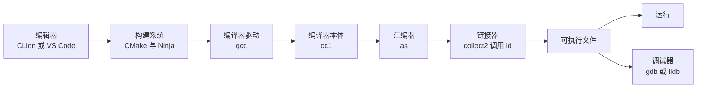

# 1. 开发环境与工具角色

在 CLion 里新建一个 C 可执行文件项目，写下 `puts("Hello, C!");`，点一下绿色三角，下面的窗口就出现了输出。第一部分一直是这样运行的：编辑器、构建、运行、调试都由一个界面代劳。

从这一部分开始，这些步骤要自己在终端里一条条发出。这一章先不写新程序，而是把工具装好，弄清每个工具负责哪一段工作，知道 IDE（Integrated Development Environment，集成开发环境）的按钮背后依次执行了哪些命令，并且能确认终端里真正生效的是哪一个 `gcc`。装错版本、PATH 里排着旧编译器、编辑器存成了带 BOM 的文件，这几类问题会在此后每一章反复出现，先把它们一次处理干净。

## 1. 「运行」按钮背后

以 CLion 新建的 C 可执行文件项目为例，构建文件只有这么几行：

```cmake
cmake_minimum_required(VERSION 3.20)
project(hello_ide C)

set(CMAKE_C_STANDARD 17)

add_executable(hello_ide main.c)
```

```c
#include <stdio.h>

int main(void) {
    int a = 2;
    int b = 3;
    printf("sum = %d\n", a + b);
    return 0;
}
```

两份文件放在同一个目录。点「运行」之前，CLion 先让 CMake 读这份 `CMakeLists.txt`，在项目下生成一个构建目录（CLion 默认叫 `cmake-build-debug`），把编译器、生成器和选项记进去；然后调用构建工具，由它按依赖关系调用 `gcc` 编译、链接；最后运行生成的可执行文件。这些步骤都可以在终端里重复：

::: terminal title="zsh - cmake"

```console
$ cmake -S . -B build -G Ninja -DCMAKE_BUILD_TYPE=Debug
-- The C compiler identification is GNU 13.2.0
-- Detecting C compiler ABI info
-- Detecting C compiler ABI info - done
-- Check for working C compiler: D:/Software/Strawberry/c/bin/gcc.exe - skipped
-- Detecting C compile features
-- Detecting C compile features - done
-- Configuring done (1.8s)
-- Generating done (0.0s)
-- Build files have been written to: C:/work/hello_ide/build
$ cmake --build build
[1/2] Building C object CMakeFiles/hello_ide.dir/main.c.obj
[2/2] Linking C executable hello_ide.exe
$ ./build/hello_ide.exe
sum = 5
```

:::

配置阶段的输出里已经写明了实际使用的编译器：`D:/Software/Strawberry/c/bin/gcc.exe`。构建阶段的 `[1/2]` 和 `[2/2]` 分别是编译和链接两步。加 `--verbose` 可以看到构建工具真正执行的命令行：

:::: details 完整的 `--verbose` 输出

::: terminal title="zsh - cmake --build build --verbose"

```text
Change Dir: 'C:/work/hello_ide/build'

Run Build Command(s): D:/Software/Strawberry/c/bin/ninja.exe -v
[1/2] D:\Software\Strawberry\c\bin\gcc.exe   -g -std=gnu17 -MD -MT CMakeFiles/hello_ide.dir/main.c.obj -MF CMakeFiles\hello_ide.dir\main.c.obj.d -o CMakeFiles\hello_ide.dir\main.c.obj -c C:/work/hello_ide/main.c
[2/2] C:\Windows\system32\cmd.exe /C "cd . && D:\Software\Strawberry\c\bin\gcc.exe -g  CMakeFiles/hello_ide.dir\main.c.obj -o hello_ide.exe -Wl,--out-implib,libhello_ide.dll.a -Wl,--major-image-version,0,--minor-image-version,0  -lkernel32 -luser32 -lgdi32 -lwinspool -lshell32 -lole32 -loleaut32 -luuid -lcomdlg32 -ladvapi32 && cd ."
```

:::

::::

这里出现的 `ninja.exe` 是构建工具 Ninja，`gcc.exe -g -std=gnu17 ... -c main.c` 是编译命令，第二条是链接命令。`-g` 表示生成调试信息，`-std=gnu17` 是 CMake 依据 `CMAKE_C_STANDARD 17` 选出的标准模式。CMake、Ninja、编译选项都会在第 8、9 章展开，这里只需要看清调用关系。

「调试」按钮换成另一种启动方式：它让调试器 (debugger) 加载带调试信息的可执行文件，在指定位置停下来。下例在 `printf` 那一行设断点，程序停下后打印 `a + b` 的值：

::: terminal title="zsh - gdb hello_ide"

```text
$ gdb -q -batch -ex 'break main.c:6' -ex run -ex 'print a + b' -ex continue ./build/hello_ide.exe
Breakpoint 1 at 0x1400016eb: file C:/work/hello_ide/main.c, line 6.
[New Thread 9432.0x47d0]

Thread 1 hit Breakpoint 1, main () at C:/work/hello_ide/main.c:6
6	    printf("sum = %d\n", a + b);
$1 = 5
sum = 5
[Thread 9432.0x47d0 exited with code 0]
[Inferior 1 (process 9432) exited normally]
```

:::

整个过程可以画成一条调用链：



IDE 把这些命令行工具组织在同一个界面里，并提供编辑、补全、跳转和图形化的调试视图。在线 IDE Lightly 的执行过程相同，只是这些程序运行在它的服务器上。CLion 安装目录里自带一套 CMake、Ninja 和 GDB，所以装好 IDE 就能直接构建和调试；终端里使用的是 PATH 上的另一套程序。两者可能不是同一个版本，认识这一点，后面排查「IDE 里能运行、终端里报错」时能省很多时间。

## 2. 工具链里的角色

上图中的每个程序各管一段。C 的这套工具合称工具链 (toolchain)：

| 角色 | 代表工具 | 输入 → 输出 | 在哪里深入 |
| --- | --- | --- | --- |
| 编辑器 | VS Code、Vim、CLion 内置编辑器 | 按键 → 源文件 | 本章第 5 节 |
| 编译器驱动 | gcc、clang、cl | 源文件与选项 → 依次调用下面的程序 | 第 3 章 |
| 编译器本体 | cc1 (GCC)、clang 的内部前端 | 预处理后的记号 → 汇编代码 | 第 3 章 |
| 汇编器 | as | 汇编代码 → 目标文件 (object file) | 第 3 章 |
| 链接器 | ld（经 collect2 调用）、lld、link.exe | 目标文件、启动代码、C 库 → 可执行文件 | 第 3、5 章 |
| C 标准库与启动代码 | glibc、UCRT、macOS 的 libSystem | 提供 `printf` 等实现和程序入口 | 第 3、10 章 |
| 二进制工具 | nm、objdump、ar、size | 目标文件或库 → 符号表、反汇编、归档文件 | 第 3、8 章 |
| 调试器 | gdb、lldb | 带调试信息的可执行文件 → 受控执行 | 第 12 章 |
| 构建系统 | Make、CMake、XMake、Ninja | 依赖描述 → 调用编译器驱动 | 第 8、9 章 |
| 版本控制 | Git | 工作区 → 提交历史 | 第 4、17 章 |
| 检查工具 | Sanitizer、静态分析器 | 源码或运行中的程序 → 问题报告 | 第 13、14 章 |

::: concept dev-toolchain-gcc-driver title="gcc 是编译器驱动"

`gcc` 本身不完成预处理、编译、汇编和链接，它的工作是根据选项决定调用哪些程序、按什么顺序传哪些参数。`gcc hello.c -o hello` 会依次运行编译器本体 `cc1`、汇编器 `as`，最后由 `collect2` 调用链接器 `ld`。用 `gcc -v` 可以看到这些命令行，用 `gcc -###` 只打印而不执行。

:::

在 Windows 的 MinGW-w64 GCC 13.2 上，`gcc -v hello.c -o hello` 输出中出现的三个程序是（截去各自的参数）：

::: terminal title="zsh - gcc -v 中的三个程序（Windows）"

```text
D:/Software/Strawberry/c/bin/../libexec/gcc/x86_64-w64-mingw32/13.2.0/cc1.exe
D:/Software/Strawberry/c/bin/../lib/gcc/x86_64-w64-mingw32/13.2.0/../../../../x86_64-w64-mingw32/bin/as.exe
D:/Software/Strawberry/c/bin/../libexec/gcc/x86_64-w64-mingw32/13.2.0/collect2.exe
```

:::

在 Debian 13 的 GCC 14.2 上，同样三行是：

::: terminal title="zsh - gcc -v 中的三个程序（Linux）"

```text
/usr/libexec/gcc/x86_64-linux-gnu/14/cc1
as
/usr/libexec/gcc/x86_64-linux-gnu/14/collect2
```

:::

Linux 上 `as` 只显示程序名而没有路径，说明驱动是按 PATH 找到它的；另外两个程序由 GCC 按安装布局定位。完整的 `gcc -v` 输出在 `::: details` 里可以看到，第 3 章会逐段解释。

:::: details 完整的 gcc -v 输出（Windows）

::: terminal title="zsh - gcc -v hello.c -o hello"

```text
Using built-in specs.
COLLECT_GCC=D:\Software\Strawberry\c\bin\gcc.exe
COLLECT_LTO_WRAPPER=D:/Software/Strawberry/c/bin/../libexec/gcc/x86_64-w64-mingw32/13.2.0/lto-wrapper.exe
OFFLOAD_TARGET_NAMES=nvptx-none
Target: x86_64-w64-mingw32
Configured with: ../configure --prefix=/R/winlibs64ucrt_stage/inst_gcc-13.2.0/share/gcc --build=x86_64-w64-mingw32 --host=x86_64-w64-mingw32 --enable-offload-targets=nvptx-none --with-pkgversion='MinGW-W64 x86_64-ucrt-posix-seh, built by Brecht Sanders, r8' --with-tune=generic --enable-checking=release --enable-threads=posix --disable-sjlj-exceptions --disable-libunwind-exceptions --disable-serial-configure --disable-bootstrap --enable-host-shared --enable-plugin --disable-default-ssp --disable-rpath --disable-libstdcxx-debug --disable-version-specific-runtime-libs --with-stabs --disable-symvers --enable-languages=c,c++,fortran,lto,objc,obj-c++ --disable-gold --disable-nls --disable-stage1-checking --disable-win32-registry --disable-multilib --enable-ld --enable-libquadmath --enable-libada --enable-libssp --enable-libstdcxx --enable-lto --enable-fully-dynamic-string --enable-libgomp --enable-graphite --enable-mingw-wildcard --enable-libstdcxx-time --enable-libstdcxx-pch --with-mpc=/d/Prog/winlibs64ucrt_stage/custombuilt --with-mpfr=/d/Prog/winlibs64ucrt_stage/custombuilt --with-gmp=/d/Prog/winlibs64ucrt_stage/custombuilt --with-isl=/d/Prog/winlibs64ucrt_stage/custombuilt --disable-libstdcxx-backtrace --enable-install-libiberty --enable-__cxa_atexit --without-included-gettext --with-diagnostics-color=auto --enable-clocale=generic --with-libiconv --with-system-zlib --with-build-sysroot=/R/winlibs64ucrt_stage/gcc-13.2.0/build_mingw/mingw-w64 CFLAGS='-I/d/Prog/winlibs64ucrt_stage/custombuilt/include/libdl-win32   -march=nocona -msahf -mtune=generic -O2' CXXFLAGS='-Wno-int-conversion  -march=nocona -msahf -mtune=generic -O2' LDFLAGS='-pthread -Wl,--no-insert-timestamp -Wl,--dynamicbase -Wl,--high-entropy-va -Wl,--nxcompat -Wl,--tsaware' LD=/d/Prog/winlibs64ucrt_stage/custombuilt/share/binutils/bin/ld.exe
Thread model: posix
Supported LTO compression algorithms: zlib zstd
gcc version 13.2.0 (MinGW-W64 x86_64-ucrt-posix-seh, built by Brecht Sanders, r8) 
COLLECT_GCC_OPTIONS='-v' '-o' 'hello.exe' '-mtune=generic' '-march=x86-64'
 D:/Software/Strawberry/c/bin/../libexec/gcc/x86_64-w64-mingw32/13.2.0/cc1.exe -quiet -v -iprefix D:/Software/Strawberry/c/bin/../lib/gcc/x86_64-w64-mingw32/13.2.0/ -D_REENTRANT hello.c -quiet -dumpbase hello.c -dumpbase-ext .c -mtune=generic -march=x86-64 -version -o C:\Users\29728\AppData\Local\Temp\ccgGtDir.s
GNU C17 (MinGW-W64 x86_64-ucrt-posix-seh, built by Brecht Sanders, r8) version 13.2.0 (x86_64-w64-mingw32)
	compiled by GNU C version 13.2.0, GMP version 6.3.0, MPFR version 4.2.1, MPC version 1.3.1, isl version isl-0.26-GMP

GGC heuristics: --param ggc-min-expand=100 --param ggc-min-heapsize=131072
ignoring duplicate directory "D:/Software/Strawberry/c/lib/gcc/../../lib/gcc/x86_64-w64-mingw32/13.2.0/include"
ignoring nonexistent directory "R:/winlibs64ucrt_stage/inst_gcc-13.2.0/share/gcc/include"
ignoring nonexistent directory "/R/winlibs64ucrt_stage/inst_gcc-13.2.0/share/gcc/include"
ignoring duplicate directory "D:/Software/Strawberry/c/lib/gcc/../../lib/gcc/x86_64-w64-mingw32/13.2.0/include-fixed"
ignoring duplicate directory "D:/Software/Strawberry/c/lib/gcc/../../lib/gcc/x86_64-w64-mingw32/13.2.0/../../../../x86_64-w64-mingw32/include"
ignoring nonexistent directory "/mingw/include"
#include "..." search starts here:
#include <...> search starts here:
 D:/Software/Strawberry/c/bin/../lib/gcc/x86_64-w64-mingw32/13.2.0/include
 D:/Software/Strawberry/c/bin/../lib/gcc/x86_64-w64-mingw32/13.2.0/../../../../include
 D:/Software/Strawberry/c/bin/../lib/gcc/x86_64-w64-mingw32/13.2.0/include-fixed
 D:/Software/Strawberry/c/bin/../lib/gcc/x86_64-w64-mingw32/13.2.0/../../../../x86_64-w64-mingw32/include
End of search list.
Compiler executable checksum: 71996911801439ebea1892f3f3ba3826
COLLECT_GCC_OPTIONS='-v' '-o' 'hello.exe' '-mtune=generic' '-march=x86-64'
 D:/Software/Strawberry/c/bin/../lib/gcc/x86_64-w64-mingw32/13.2.0/../../../../x86_64-w64-mingw32/bin/as.exe -v -o C:\Users\29728\AppData\Local\Temp\cccNs9SK.o C:\Users\29728\AppData\Local\Temp\ccgGtDir.s
GNU assembler version 2.42 (x86_64-w64-mingw32) using BFD version (Binutils for MinGW-W64 x86_64, built by Brecht Sanders, r8) 2.42
COMPILER_PATH=D:/Software/Strawberry/c/bin/../libexec/gcc/x86_64-w64-mingw32/13.2.0/;D:/Software/Strawberry/c/bin/../libexec/gcc/;D:/Software/Strawberry/c/bin/../lib/gcc/x86_64-w64-mingw32/13.2.0/../../../../x86_64-w64-mingw32/bin/
LIBRARY_PATH=D:/Software/Strawberry/c/bin/../lib/gcc/x86_64-w64-mingw32/13.2.0/;D:/Software/Strawberry/c/bin/../lib/gcc/;D:/Software/Strawberry/c/bin/../lib/gcc/x86_64-w64-mingw32/13.2.0/../../../../x86_64-w64-mingw32/lib/../lib/;D:/Software/Strawberry/c/bin/../lib/gcc/x86_64-w64-mingw32/13.2.0/../../../../lib/;D:/Software/Strawberry/c/bin/../lib/gcc/x86_64-w64-mingw32/13.2.0/../../../../x86_64-w64-mingw32/lib/;D:/Software/Strawberry/c/bin/../lib/gcc/x86_64-w64-mingw32/13.2.0/../../../
COLLECT_GCC_OPTIONS='-v' '-o' 'hello.exe' '-mtune=generic' '-march=x86-64' '-dumpdir' 'hello.'
 D:/Software/Strawberry/c/bin/../libexec/gcc/x86_64-w64-mingw32/13.2.0/collect2.exe -plugin D:/Software/Strawberry/c/bin/../libexec/gcc/x86_64-w64-mingw32/13.2.0/liblto_plugin.dll -plugin-opt=D:/Software/Strawberry/c/bin/../libexec/gcc/x86_64-w64-mingw32/13.2.0/lto-wrapper.exe -plugin-opt=-fresolution=C:\Users\29728\AppData\Local\Temp\ccGrk7N7.res -plugin-opt=-pass-through=-lmingw32 -plugin-opt=-pass-through=-lgcc -plugin-opt=-pass-through=-lgcc_eh -plugin-opt=-pass-through=-lmoldname -plugin-opt=-pass-through=-lmingwex -plugin-opt=-pass-through=-lmsvcrt -plugin-opt=-pass-through=-lkernel32 -plugin-opt=-pass-through=-lpthread -plugin-opt=-pass-through=-ladvapi32 -plugin-opt=-pass-through=-lshell32 -plugin-opt=-pass-through=-luser32 -plugin-opt=-pass-through=-lkernel32 -plugin-opt=-pass-through=-lmingw32 -plugin-opt=-pass-through=-lgcc -plugin-opt=-pass-through=-lgcc_eh -plugin-opt=-pass-through=-lmoldname -plugin-opt=-pass-through=-lmingwex -plugin-opt=-pass-through=-lmsvcrt -plugin-opt=-pass-through=-lkernel32 -m i386pep -Bdynamic -o hello.exe D:/Software/Strawberry/c/bin/../lib/gcc/x86_64-w64-mingw32/13.2.0/../../../../x86_64-w64-mingw32/lib/../lib/crt2.o D:/Software/Strawberry/c/bin/../lib/gcc/x86_64-w64-mingw32/13.2.0/crtbegin.o -LD:/Software/Strawberry/c/bin/../lib/gcc/x86_64-w64-mingw32/13.2.0 -LD:/Software/Strawberry/c/bin/../lib/gcc -LD:/Software/Strawberry/c/bin/../lib/gcc/x86_64-w64-mingw32/13.2.0/../../../../x86_64-w64-mingw32/lib/../lib -LD:/Software/Strawberry/c/bin/../lib/gcc/x86_64-w64-mingw32/13.2.0/../../../../lib -LD:/Software/Strawberry/c/bin/../lib/gcc/x86_64-w64-mingw32/13.2.0/../../../../x86_64-w64-mingw32/lib -LD:/Software/Strawberry/c/bin/../lib/gcc/x86_64-w64-mingw32/13.2.0/../../.. C:\Users\29728\AppData\Local\Temp\cccNs9SK.o -lmingw32 -lgcc -lgcc_eh -lmoldname -lmingwex -lmsvcrt -lkernel32 -lpthread -ladvapi32 -lshell32 -luser32 -lkernel32 -lmingw32 -lgcc -lgcc_eh -lmoldname -lmingwex -lmsvcrt -lkernel32 D:/Software/Strawberry/c/bin/../lib/gcc/x86_64-w64-mingw32/13.2.0/crtend.o
COLLECT_GCC_OPTIONS='-v' '-o' 'hello.exe' '-mtune=generic' '-march=x86-64' '-dumpdir' 'hello.'
```

:::

::::

装编辑器不等于装了工具链。VS Code 本身只负责编辑文本，要编译 C 还得另装编译器并让扩展找到它；CLion 自带了工具链，但那是它自己的一份。第 0 部分已经提醒过这一点，这里的表格给出的是完整的角色划分。

<Quiz
  type="single"
  :options="[
    { label: 'gcc 自己完成了全部的预处理、编译和汇编，只在最后调用一次链接器。', value: 'A' },
    { label: 'gcc 依次调用编译器本体、汇编器和链接器，自己负责组织这些调用。', value: 'B' },
    { label: 'gcc 只做预处理，剩下的工作由 IDE 完成。', value: 'C' },
    { label: 'gcc 是编辑器的一部分，只负责语法高亮。', value: 'D' }
  ]"
  answer="B"
>

正确答案是 **B**。

`gcc` 的身份是编译器驱动 (compiler driver)。它按命令行选项决定调用 `cc1`、`as`，再由 `collect2` 调用 `ld`；`gcc -v` 打印的正是这些被调用的程序与参数。A 错在把驱动当成了编译器本体，C、D 与事实不符。

</Quiz>

## 3. 选一套工具链

三套系统各有一个省事的入口。共同的要求是：编译器、调试器、Make、CMake、Git 都能在终端里直接运行，而不是只在某个 IDE 的菜单里可用。

### 3.1 Windows

推荐 MSYS2 的 UCRT64 环境。MSYS2 官方文档的说法是「拿不准就选 UCRT64」；旧的 MINGW64 环境自 2026 年 3 月起已列入弃用，新装的系统不必再选它。安装 MSYS2 后打开「MSYS2 UCRT64」终端，执行：

```bash
pacman -S --needed base-devel mingw-w64-ucrt-x86_64-toolchain mingw-w64-ucrt-x86_64-cmake mingw-w64-ucrt-x86_64-ninja
```

`base-devel` 是 MSYS2 自己的开发工具组，包含 `make`、`patch` 等；`mingw-w64-ucrt-x86_64-toolchain` 是一个包组，包含 GCC、GDB、binutils 和运行时库；CMake 与 Ninja 不在这个组里，要单独写出来。安装时 pacman 会列出包组里的成员并要求确认，直接回车接受默认值即可。

UCRT64 的 `mingw-w64-ucrt-x86_64-make` 装出来的是 `mingw32-make`，而 `base-devel` 里的 `make` 在 MSYS2 自己的 `/usr/bin` 下，两者都能用。两者执行的是同一套 GNU Make 语法，正文统一写 `make`；如果你的环境里只有前者，把命令换成 `mingw32-make` 即可。要让其他终端或 IDE 也能用这套工具，把 `C:\msys64\ucrt64\bin` 加入用户 PATH；PATH 的工作方式在第 2 章讲。

Git 用 Git for Windows 或 MSYS2 里的 git 都行，选一个并保持 PATH 里只有它。另一条路线是 WSL：在管理员 PowerShell 中执行 `wsl --install`，得到完整的 Linux 环境，第四部分系统编程会用到它。

不要用 Dev-C++ 这类老 IDE 自带的 GCC，也不要同时装多套 MinGW。前者版本太旧，后者会让「到底用了哪一个编译器」变成每天都要排查的问题，下面第 4 节就会看到这种麻烦。

### 3.2 Linux

Debian 和 Ubuntu：

```bash
sudo apt install build-essential gdb cmake ninja-build git
```

`build-essential` 依赖 `gcc`、`g++`、`make` 和 C 库的开发文件，装它等于把编译所需的基础部分一次装齐。Fedora：

```bash
sudo dnf install gcc gdb make cmake ninja-build git
```

两家发行版里 Ninja 的包名都是 `ninja-build`，命令仍然是 `ninja`。想用 Clang 和 clang-format，再装 `clang` 与 `clang-format` 即可；本书以 GCC 为主。

### 3.3 macOS

在终端执行：

```bash
xcode-select --install
```

系统会弹出对话框安装命令行开发者工具 (command line tools)，其中包含 Clang 编译器、LLDB 调试器、Make 和 Git。装完在终端输入 `gcc --version`，显示的是 `Apple clang version ...`，因为 macOS 上的 `gcc` 命令指向 Apple Clang，并不是 GNU GCC。Clang 官方文档称它是 `gcc` 命令的替代品，命令行选项大体兼容，本书的 GCC 命令在它上面基本能直接使用。CMake 和 Ninja 用 Homebrew 安装：

```bash
brew install cmake ninja
```

MSVC 不属于本章的主工具链。它的命令行选项与 GCC 差别较大，本教程在第 16 章处理可移植构建时再一并讨论。

## 4. 检查安装结果

装完先确认版本。下面两组输出来自两台不同的机器，路径和版本号都照原样保留。

Windows 11，WinLibs 构建的 MinGW-w64 GCC 13.2（不是 MSYS2 的输出，读者按 3.1 节装好 MSYS2 后版本号会不同）：

::: terminal title="zsh - 版本检查（Windows）"

```console
$ gcc --version | head -n 1
gcc.exe (MinGW-W64 x86_64-ucrt-posix-seh, built by Brecht Sanders, r8) 13.2.0
$ gdb --version | head -n 1
GNU gdb (GDB for MinGW-W64 x86_64, built by Brecht Sanders, r8) 14.2
$ mingw32-make --version | head -n 1
GNU Make 4.4.1
$ cmake --version | head -n 1
cmake version 3.29.2
$ ninja --version
1.12.0
$ git --version
git version 2.54.0.windows.1
```

:::

Debian 13：

::: terminal title="zsh - 版本检查（Linux）"

```console
$ gcc --version | head -n 1
gcc (Debian 14.2.0-19) 14.2.0
$ make --version | head -n 1
GNU Make 4.4.1
$ cmake --version | head -n 1
cmake version 3.31.6
$ git --version
git version 2.47.3
```

:::

这台 Linux 机器上没有装 GDB 和 Ninja，`gdb --version` 报的是 `command not found`。缺什么补装什么即可。

版本号对了，还要确认终端找到的是哪个文件。`command -v` 打印命令对应的路径，`type -a` 把 PATH 上所有同名的都列出来，排在前面的那个生效：

::: terminal title="zsh - command -v 与 type -a"

```console
$ command -v gcc
/usr/bin/gcc
$ type -a gcc
gcc is /usr/bin/gcc
gcc is /bin/gcc
$ readlink -f /bin
/usr/bin
```

:::

`type -a` 列出了两条，其实 `bin` 是指向 `usr/bin` 的符号链接，两次指向同一个文件。在 Windows 的 Git Bash 里同样的命令输出的是 MSYS 风格路径：

::: terminal title="zsh - command -v（Windows）"

```console
$ command -v gcc
/d/Software/Strawberry/c/bin/gcc
$ type -a gcc
gcc is /d/Software/Strawberry/c/bin/gcc
```

:::

PowerShell 里用 `Get-Command`：

::: terminal title="PowerShell - Get-Command gcc"

```text
PS C:\work> Get-Command gcc

CommandType     Name                                               Version    Source
-----------     ----                                               -------    ------
Application     gcc.exe                                            0.0.0.0    D:\Software\Strawberry\c\bin\gcc.exe
```

:::

`Get-Command gcc -All` 会列出所有同名命令，顺序就是 PATH 的搜索顺序。

最后做一次冒烟测试：写一个 `hello.c`，编译并运行。

```c
#include <stdio.h>

int main(void) {
    puts("Hello, C!");
    return 0;
}
```

::: terminal title="zsh - gcc hello.c -o hello"

```console
$ gcc -std=c17 -Wall -Wextra hello.c -o hello
$ ./hello
Hello, C!
```

:::

两台机器上结果相同。`-std=c17` 指定标准模式，`-Wall -Wextra` 打开常用的警告，这一部分默认都带这两个选项，第 13 章再解释它们各自包含什么。

装错了会看到两类现象。第一类是命令根本不存在：

::: terminal title="bash - 找不到 gcc"

```console
$ gcc hello.c -o hello
bash: gcc: command not found
$ echo $?
127
```

:::

消息开头的 `bash:` 是报告错误的 shell 名字，换一个 shell 显示的就是那个 shell 的名字。原因通常是 PATH 里没有工具链目录，或者装了但没开新终端。PowerShell 里对应的是 `Get-Command : The term 'gcc' is not recognized ...` 或中文系统的同类文字，含义相同。

第二类是命令存在，但版本不对。下面故意把一套旧的 MinGW（GCC 11.5）放到 PATH 前面：

::: terminal title="zsh - PATH 中旧编译器排在前面"

```console
$ export PATH="/d/Software/RedPanda/mingw64/bin:$PATH"
$ gcc --version | head -n 1
gcc.exe (x86_64-posix-seh-rev0, Built by MinGW-W64 project) 11.5.0
$ type -a gcc
gcc is /d/Software/RedPanda/mingw64/bin/gcc
gcc is /d/Software/Strawberry/c/bin/gcc
```

:::

`gcc` 仍然能编译，只是换成了旧的那一份。这类问题在 Windows 上尤其常见，因为安装多个带 MinGW 的软件（IDE、Git 工具、某些 SDK）都会往 PATH 里加目录。排查方法就是 `type -a gcc` 加 `gcc -v`：前者告诉你用了哪个文件，后者告诉你这个文件又去找了哪些程序。

构建系统会记住第一次配置时选中的编译器。已经配置过的构建目录，即使 PATH 变了也仍然用缓存里的那个。下面只保留编译那一行：

::: terminal title="zsh - CMake 缓存中的编译器"

```console
$ PATH="/d/Software/RedPanda/mingw64/bin:$PATH" cmake --build build --verbose
[1/2] D:\Software\Strawberry\c\bin\gcc.exe   -g -std=gnu17 -MD -MT CMakeFiles/hello_ide.dir/main.c.obj -MF CMakeFiles\hello_ide.dir\main.c.obj.d -o CMakeFiles\hello_ide.dir/main.c.obj -c C:/work/hello_ide/main.c
```

:::

`CMakeCache.txt` 里记着 `CMAKE_C_COMPILER` 的完整路径，换 PATH 不影响它。确实要换编译器时，删掉构建目录重新配置，或者用 `-DCMAKE_C_COMPILER=...` 指定。CMake 的细节在第 9 章。

再补两个查身份的命令：`gcc -dumpmachine` 打印目标平台三元组（Windows 上是 `x86_64-w64-mingw32`，这台 Debian 上是 `x86_64-linux-gnu`），`gcc -dumpversion` 只打印版本号。写脚本判断环境时比解析 `--version` 的整段文字方便。

<Quiz
  type="single"
  :options="[
    { label: '说明这台机器装了两个 GCC，需要卸载一个。', value: 'A' },
    { label: '说明 gcc 命令指向 Apple Clang，系统里没有 GNU GCC。', value: 'B' },
    { label: '说明编译器安装损坏，需要重新安装。', value: 'C' },
    { label: '说明终端用了错误的 shell。', value: 'D' }
  ]"
  answer="B"
>

正确答案是 **B**。

macOS 自带的是 Apple Clang，`/usr/bin/gcc` 只是指向它的入口，所以 `gcc --version` 显示 `Apple clang version ...`。要使用 GNU GCC，需要另行安装（例如 Homebrew 的 `gcc`，可执行文件带版本号，如 `gcc-16`）。看到版本字符串与预期不符时，先用 `type -a` 和 `-v` 查清楚实际执行的是哪个程序，再决定怎么处理。

</Quiz>

## 5. 编辑器的基本设置

编译器和构建系统对源文件的格式有几条朴素的要求：UTF-8 编码、不带 BOM、四个空格缩进、文件以换行结尾。前两条影响编译器能否正确读入，后两条影响 diff 和代码评审是否好读。

BOM 是 UTF-8 文件开头可能出现的三个字节 `EF BB BF`。GCC 会忽略文件最开头的 BOM，所以带 BOM 的源文件也能编译；但 BOM 只要出现在别的位置就是实打实的错误，例如第二行开头多了一个：

```text
b.c:2:1: error: unknown type name '\U0000feffint'
```

用 `file` 命令能看出文件的编码：

::: terminal title="zsh - file"

```console
$ file bom.c
bom.c:   C source, Unicode text, UTF-8 (with BOM) text
$ file hello.c
hello.c: C source, ASCII text
```

:::

编辑器里把默认编码设为 UTF-8（有的编辑器写作「UTF-8 无 BOM」），不要选「UTF-8 with BOM」。仓库里个别历史文件开头残留 BOM，编辑时顺手去掉即可。

文件末尾缺换行时，编译器不会报错，但 `diff` 会给出提示：

::: terminal title="zsh - diff 与末尾换行"

```console
$ diff -u with-newline.c without-newline.c
--- with-newline.c
+++ without-newline.c
@@ -1,3 +1,3 @@
 int main(void) {
     return 0;
-}
+}
\ No newline at end of file
```

:::

`\ No newline at end of file` 指向的文件少一个结尾换行。它不影响编译，但会让 diff 多出一行噪音，有些工具处理起来也不方便。

这些要求可以写进 `.editorconfig`，多数编辑器和 IDE 都支持：

```ini
root = true

[*.{c,h}]
charset = utf-8
end_of_line = lf
insert_final_newline = true
indent_style = space
indent_size = 4
```

`root = true` 表示不再向上层目录查找 `.editorconfig`；`[*.{c,h}]` 是花括号展开，同时匹配 `.c` 和 `.h` 文件；`end_of_line = lf` 统一用 LF 换行，避免 Windows 上保存成 CRLF。EditorConfig 只是约定，执行与否取决于编辑器：Vim 和 CLion 直接支持，VS Code 需要安装 EditorConfig 扩展。

缩进和空格的位置交给格式化工具。仓库根目录的 `.clang-format` 只有两行：

```yaml
BasedOnStyle: LLVM
IndentWidth: 4
```

把同样的文件放进自己的工程，运行一次 `clang-format -i`（`-i` 表示就地修改文件）：

::: terminal title="zsh - clang-format -i"

```console
$ clang-format -i messy.c
$ diff -u messy-before.c messy.c
--- messy-before.c
+++ messy.c
@@ -1,14 +1,14 @@
 #include <stdio.h>
-int sum(const int *a,int n){
-int s=0;
-  for(int i=0;i<n;i++)
-  {
-        s+=a[i];
-  }
-return s;}
-int main(void)
-{
-    int v[]={3,1,4,1,5};
-    if (sum(v,5)>10) printf("big\n");
+int sum(const int *a, int n) {
+    int s = 0;
+    for (int i = 0; i < n; i++) {
+        s += a[i];
+    }
+    return s;
+}
+int main(void) {
+    int v[] = {3, 1, 4, 1, 5};
+    if (sum(v, 5) > 10)
+        printf("big\n");
     return 0;
 }
```

:::

缩进、逗号后的空格、花括号位置都按 LLVM 风格排好了。注意最后那个 `if`：花括号是 LLVM 风格的写法，但 clang-format 默认不替单条语句补花括号。本教程要求控制语句一律使用复合语句，可以在 `.clang-format` 里加一行：

```yaml
InsertBraces: true
```

这个选项从 clang-format 15 起提供，对 C 代码同样有效。加上之后，同一段代码的 `if` 会变成：

```c
if (sum(v, 5) > 10) {
    printf("big\n");
}
```

整段重排比手工调空格可靠，也省掉了代码评审里关于缩进的争论。

编辑器里的补全和跳转靠语言服务器 (language server)，C 常用 clangd 或 VS Code 的 C/C++ 扩展。它要知道每个源文件的包含路径和编译选项，最省事的办法是让 CMake 生成 `compile_commands.json`：

```json
[
{
  "directory": "C:/work/hello_ide/build",
  "command": "D:\\Software\\Strawberry\\c\\bin\\gcc.exe -g -std=gnu17 -o CMakeFiles\\hello_ide.dir\\main.c.obj -c C:\\work\\hello_ide\\main.c",
  "file": "C:\\work\\hello_ide\\main.c",
  "output": "CMakeFiles\\hello_ide.dir\\main.c.obj"
}
]
```

配置时加 `-DCMAKE_EXPORT_COMPILE_COMMANDS=ON` 就会生成这个文件，第 9 章细讲。VS Code 的逐项配置在[番外：VS Code 与 GCC](/教程/番外/3_VSCode+GCC)里。

::: tip 工程目录不要带空格

Make 把空格当作文件名分隔符。目录或文件名里有空格时，构建会在第一个空格处断开：

```text
make: *** No rule to make target 'my', needed by 'app'.  Stop.
```

这是在一个名为 `my app.c` 的文件上实测到的。工程路径用 `hello_world`、`word_freq` 这类名字，能省掉一整类问题。

:::

## 6. 本部分的环境约定

这一部分的命令都在 bash 一类的 shell 中执行。Windows 读者按 3.1 节装好 MSYS2 后，在「MSYS2 UCRT64」终端里操作；Linux 和 macOS 用系统终端。正文里不区分 `zsh` 和 `bash` 的细微差别，两者的写法在这里通用。

默认编译器是 GCC，默认选项是 `-std=c17 -Wall -Wextra`。需要 POSIX 接口的文件在开头定义 `_POSIX_C_SOURCE 200809L`，这一条在系统编程部分会经常出现。

正文中的输出都标明来源。Windows 的输出来自 Windows 11 上的 MinGW-w64 GCC 13.2（WinLibs 构建），Linux 的输出来自 Debian 13 上的 GCC 14.2；平台差异只在影响操作时说明。终端标题里的 `zsh` 只是沿用全站写法，命令本身与 shell 无关。

## 7. 习题

<Exercise id="20101" :d="1" :w="2">

按第 3 节在自己的系统上装好工具链，把 gcc、gdb、make（Windows 上是 `mingw32-make`）、cmake、git 的版本号和 `command -v` 给出的完整路径记到 `toolchain.txt` 里；如果 `type -a gcc` 列出不止一个，指出生效的是哪一个，以及它为什么排在前面。

</Exercise>

<Exercise id="20102" :d="1" :w="2">

新建一个空目录，放入 `code/开发与工程基础/1_开发环境与工具角色/format/` 下的 `.editorconfig`、`.clang-format` 和 `messy.c`。运行 `clang-format -i messy.c`，用 `diff -u` 对比格式化前后的差异，逐条说明每处改动对应哪条规则。再加上 `InsertBraces: true` 重新运行，观察 `if` 的变化，并确认格式化后的程序仍能编译运行。

</Exercise>

<Exercise id="20103" :d="2" :w="3">

写一个 `report.sh`，依次打印 gcc、gdb、make、cmake、git 的路径（找不到时打印 `none` 而不是中断），然后用 `gcc -std=c17 -Wall -Wextra hello.c -o hello` 编译并运行 `hello.c`。要求脚本用 `set -eu`，在 PATH 缺少 gcc 时以非 0 状态退出并说明缺少什么。分别在正常 PATH 和临时去掉工具链目录的 PATH 下运行，记录两次输出。

</Exercise>

<Exercise id="20104" :d="2" :w="2">

打开一个 IDE 项目（CLion 的项目，或第 1 节那个 `hello_ide`），找到它的构建输出，或者运行 `cmake --build <构建目录> --verbose`。写出实际调用的构建工具、编译器、每一条编译和链接命令，并逐个说明 `-g`、`-std=gnu17`、`-c`、`-o` 的作用。不认识的选项先标出来，学完第 3 章再补。

</Exercise>

<Exercise id="20105" :d="2" :w="2">

用 `code/开发与工程基础/1_开发环境与工具角色/compiler_id.c` 打印编译器名称、`__STDC_VERSION__`、平台和指针宽度。分别用 `-std=c99` 和 `-std=c17` 编译，再用另一种编译器（Clang 或另一版 GCC）以 `-std=c17` 编译一次，把三次输出列成表，说明哪一项随编译器变、哪一项随标准模式变。

</Exercise>

<Exercise id="20106" :d="3" :w="3">

运行 `gcc -v hello.c -o hello`，从输出中找出 `cc1`、`as`、`collect2` 三个程序的路径和调用顺序，画成流程图。再用 `gcc -save-temps` 编译一次，列出多出来的文件，把每个文件对应到调用链的一步。如果你能同时使用 Windows 和 Linux，把两边的路径和文件后缀差异也记下来。

</Exercise>

<Exercise id="20107" :d="3" :w="3">

在一台装了两套 MinGW（或两版 GCC）的机器上，把旧的一套加到 PATH 前面，用 `type -a gcc`、`gcc -v`、`gcc -dumpversion` 说明当前生效的是哪一套。然后写一个包装脚本或 shell 函数，让 `gcc` 固定指向新版本，并验证编译输出与直接调用新版本一致。最后说明已配置过的 CMake 构建目录为什么不受 PATH 变化影响，以及怎样让它改用新编译器。

</Exercise>

## 8. 参考资料

- MSYS2 文档《Environments》，UCRT64 的选择建议与 MINGW64 的弃用说明：https://www.msys2.org/docs/environments/
- MSYS2 文档《Terminals》，各终端与环境的启动方式：https://www.msys2.org/docs/terminals/
- MSYS2 包索引，`mingw-w64-ucrt-x86_64-toolchain` 包组与 `cmake`、`ninja`、`make` 包的文件清单：https://packages.msys2.org/
- Visual Studio Code 文档《Using GCC with MinGW》，MSYS2 安装与 PATH 设置：https://code.visualstudio.com/docs/cpp/config-mingw
- GCC 手册《Overall Options》，`-v`、`-###` 等驱动选项：https://gcc.gnu.org/onlinedocs/gcc/Overall-Options.html
- Clang 文档《Toolchain》，驱动与各阶段工具的职责：https://clang.llvm.org/docs/Toolchain.html
- Clang 文档《Getting Started》，Clang 作为 gcc 命令替代品的定位：https://clang.llvm.org/get_started.html
- MIT《The Missing Semester》2026 课程《Development Environment and Tools》：https://missing.csail.mit.edu/2026/development-environment/
- EditorConfig 官网与规范，`charset`、`insert_final_newline`、花括号展开：https://editorconfig.org/、https://spec.editorconfig.org/
- ClangFormat 文档，`-i` 与样式选项：https://clang.llvm.org/docs/ClangFormat.html、https://clang.llvm.org/docs/ClangFormatStyleOptions.html
- Debian 软件包页面，`build-essential` 与 `ninja-build`：https://packages.debian.org/trixie/build-essential、https://packages.debian.org/stable/ninja-build
- Fedora 软件包页面，`ninja-build`：https://packages.fedoraproject.org/pkgs/ninja-build/ninja-build/
- Microsoft Learn《Install WSL》：https://learn.microsoft.com/en-us/windows/wsl/install
- JetBrains CLion 文档《CMake profiles》，CMake 配置、生成器与构建目录：https://www.jetbrains.com/help/clion/cmake-profile.html
- Apple `xcode-select(1)` 手册页：https://keith.github.io/xcode-man-pages/xcode-select.1.html
