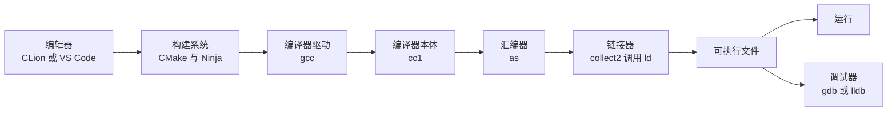

# 1. 开发环境与工具角色

在集成开发环境（例如 CLion 或配备相应插件的 VS Code）中新建一个 C 语言项目，输入最基础的输出语句，轻点界面上的运行图标，下方的终端窗口就会立即打出执行结果。在学习语法的初级阶段，这种集成体验非常省心：代码编辑、工程组织、编译链接、运行乃至断点调试，全部由一套统一的图形界面在幕后协调妥当。

当我们跨入系统与工程开发的大门时，就必须剥离图形界面的这层封装，亲自在控制台终端里调度各项具体的构建与调试工具。在这一章里，我们暂且不急于撰写复杂的业务逻辑，而是将精力聚焦于开发环境与工具链的组装。我们要梳理清楚每个独立工具在流水线中所承载的具体任务，弄清集成开发环境在按下各类快捷按钮时背后具体派发了哪些指令，并且学会辨识终端环境下当前响应命令的究竟是哪一个编译器实体。诸如安装版本不匹配、系统环境变量 PATH 中排在前面的旧工具链造成干扰、抑或是文本编辑器保存时夹带了 UTF-8 BOM 头，这些基础环境隐患若未能提前摸清，往往会在后续的每一处工程实践中反复带来排查困扰。把它们在起点处梳理干净，能为后续的工程构建扫清绝大多数暗礁。

## 1. 「运行」按钮背后

以集成环境新建的标准 C 项目为例，其构建配置文件通常只包含寥寥数行：

```cmake
cmake_minimum_required(VERSION 3.20)
project(hello_ide C)

set(CMAKE_C_STANDARD 17)

add_executable(hello_ide main.c)
```

```c
#include <stdio.h>

int main(void) {
    int a = 2;
    int b = 3;
    printf("sum = %d\n", a + b);
    return 0;
}
```

这两份文件通常保存在同一个项目根目录下。在图形界面中触发「运行」操作时，集成环境实际上并不会直接把 C 源文件瞬间转换成二进制，而是先指派 CMake 读取 `CMakeLists.txt`，在项目下生成专门存放中间产物的构建目录（例如 CLion 默认命名为 `cmake-build-debug`）。在这个生成过程中，CMake 会检测系统环境，把探测到的编译器实体路径、目标生成器类型以及各种编译参数牢牢记录下来；接下来，环境再调用底层构建工具，由构建工具依据依赖拓扑先后调度 `gcc` 执行源文件的编译与目标文件的链接；所有步骤无误后，再最终启动生成的可执行程序。这整套被封装在按钮背后的流程，完全可以在日常终端中按部就班地手动复现：

::: terminal title="zsh - cmake"

```console
$ cmake -S . -B build -G Ninja -DCMAKE_BUILD_TYPE=Debug
-- The C compiler identification is GNU 13.2.0
-- Detecting C compiler ABI info
-- Detecting C compiler ABI info - done
-- Check for working C compiler: D:/Software/Strawberry/c/bin/gcc.exe - skipped
-- Detecting C compile features
-- Detecting C compile features - done
-- Configuring done (1.8s)
-- Generating done (0.0s)
-- Build files have been written to: C:/work/hello_ide/build
$ cmake --build build
[1/2] Building C object CMakeFiles/hello_ide.dir/main.c.obj
[2/2] Linking C executable hello_ide.exe
$ ./build/hello_ide.exe
sum = 5
```

:::

在 CMake 的配置输出中，已经明确展示了探测到的编译器路径：`D:/Software/Strawberry/c/bin/gcc.exe`。随后的构建阶段里，终端打印出的 `[1/2]` 与 `[2/2]` 分别对应独立的编译与链接两步处理。若在构建命令后追加 `--verbose` 选项，我们便能看清底层构建工具向操作系统派发的完整底层命令行：

:::: details 完整的 `--verbose` 输出

::: terminal title="zsh - cmake --build build --verbose"

```text
Change Dir: 'C:/work/hello_ide/build'

Run Build Command(s): D:/Software/Strawberry/c/bin/ninja.exe -v
[1/2] D:\Software\Strawberry\c\bin\gcc.exe   -g -std=gnu17 -MD -MT CMakeFiles/hello_ide.dir/main.c.obj -MF CMakeFiles\hello_ide.dir\main.c.obj.d -o CMakeFiles\hello_ide.dir\main.c.obj -c C:/work/hello_ide/main.c
[2/2] C:\Windows\system32\cmd.exe /C "cd . && D:\Software\Strawberry\c\bin\gcc.exe -g  CMakeFiles/hello_ide.dir\main.c.obj -o hello_ide.exe -Wl,--out-implib,libhello_ide.dll.a -Wl,--major-image-version,0,--minor-image-version,0  -lkernel32 -luser32 -lgdi32 -lwinspool -lshell32 -lole32 -loleaut32 -luuid -lcomdlg32 -ladvapi32 && cd ."
```

:::

::::

在上述详细输出中，`ninja.exe` 是专注于高效执行构建图的轻量级工具 Ninja；随后调用的 `gcc.exe -g -std=gnu17 ... -c main.c` 负责将 C 源文件编译为目标文件；紧随其后的第二条长命令则把目标文件与平台运行时库拼接为最终的二进制可执行文件。其中，`-g` 参数指示编译器嵌入调试符号信息，而 `-std=gnu17` 则是 CMake 根据脚本中的 `CMAKE_C_STANDARD 17` 设置所挑选出的编译器方言标准。关于 CMake、Ninja 的协同逻辑以及编译选项的细节，我们在第 8 章与第 9 章会有系统剖析，此处的核心在于直观建立起层层调用的链条概念。

界面上的「调试」按钮则切换到了另一条协作路径：它启动调试器（debugger），将带有调试符号的可执行程序载入内存，并按照预设的断点在指定代码位置暂停执行，以便开发者检查上下文状态。下方的命令行演示了在终端中使用 GDB 在 `printf` 处设置断点，并在程序暂停时计算并打印 `a + b` 的即时求值过程：

::: terminal title="zsh - gdb hello_ide"

```text
$ gdb -q -batch -ex 'break main.c:6' -ex run -ex 'print a + b' -ex continue ./build/hello_ide.exe
Breakpoint 1 at 0x1400016eb: file C:/work/hello_ide/main.c, line 6.
[New Thread 9432.0x47d0]

Thread 1 hit Breakpoint 1, main () at C:/work/hello_ide/main.c:6
6	    printf("sum = %d\n", a + b);
$1 = 5
sum = 5
[Thread 9432.0x47d0 exited with code 0]
[Inferior 1 (process 9432) exited normally]
```

:::

整个过程可以画成一条调用链：



集成开发环境的价值，在于把上述分散在各处的命令行组件整合到了统一的交互视窗内，同时附加上语法高亮、代码补全、符号跳转以及直观的变量监视面板。诸如各类云端在线编辑器，其幕后运行逻辑同样如此，只不过工具链驻留在远端服务器上。很多桌面 IDE（例如 CLion）在安装包内往往内嵌了一整套专属的 CMake、Ninja 和 GDB，这也是为什么新安装的 IDE 常常可以直接完成项目的构建与调试；而在系统终端命令行中执行命令时，操作系统寻找的则是配置在系统 PATH 环境变量中的另一批程序。两者未必属于相同的安装源或版本分支。及早辨析这种割裂，能够帮助我们迅速定位日常开发中「为何 IDE 内运行平稳，终端手动构建却报错连连」的困惑。

## 2. 工具链里的角色

在上述全景图中，每一个独立程序都恪守明确的职责范围，像流水线上的工位一样环环相扣。C 语言体系中这一系列相互配合的工具群，统称为**工具链 (toolchain)**：

| 角色 | 代表工具 | 输入 → 输出 | 在哪里深入 |
| --- | --- | --- | --- |
| 编辑器 | VS Code、Vim、CLion 内置编辑器 | 按键 → 源文件 | 本章第 5 节 |
| 编译器驱动 | gcc、clang、cl | 源文件与选项 → 依次调用下面的程序 | 第 3 章 |
| 编译器本体 | cc1 (GCC)、clang 的内部前端 | 预处理后的记号 → 汇编代码 | 第 3 章 |
| 汇编器 | as | 汇编代码 → 目标文件 (object file) | 第 3 章 |
| 链接器 | ld（经 collect2 调用）、lld、link.exe | 目标文件、启动代码、C 库 → 可执行文件 | 第 3、5 章 |
| C 标准库与启动代码 | glibc、UCRT、macOS 的 libSystem | 提供 `printf` 等实现和程序入口 | 第 3、10 章 |
| 二进制工具 | nm、objdump、ar、size | 目标文件或库 → 符号表、反汇编、归档文件 | 第 3、8 章 |
| 调试器 | gdb、lldb | 带调试信息的可执行文件 → 受控执行 | 第 12 章 |
| 构建系统 | Make、CMake、XMake、Ninja | 依赖描述 → 调用编译器驱动 | 第 8、9 章 |
| 版本控制 | Git | 工作区 → 提交历史 | 第 4、17 章 |
| 检查工具 | Sanitizer、静态分析器 | 源码或运行中的程序 → 问题报告 | 第 13、14 章 |

::: concept dev-toolchain-gcc-driver title="gcc 是编译器驱动"

日常频繁调用的 `gcc` 自身并不直接承载预处理、代码解析、汇编或链接的内核逻辑。它的真正角色是一个**编译器驱动 (compiler driver)**，职责在于依据用户给出的命令行参数，调度各阶段的核心工具，并为其合理安排参数与调用时序。执行 `gcc hello.c -o hello` 时，它会顺次调遣编译器本体 `cc1`、汇编器 `as`，并在最后由辅助程序 `collect2` 触发链接器 `ld`。通过传递 `-v` 选项，我们可以观测到驱动所发出的所有底层调用细节；而若使用 `-###` 选项，驱动更会在仅打印调用链命令而不真正执行的情况下退出。

:::

在 Windows 的 MinGW-w64 GCC 13.2 上，`gcc -v hello.c -o hello` 输出中出现的三个程序是（截去各自的参数）：

::: terminal title="zsh - gcc -v 中的三个程序（Windows）"

```text
D:/Software/Strawberry/c/bin/../libexec/gcc/x86_64-w64-mingw32/13.2.0/cc1.exe
D:/Software/Strawberry/c/bin/../lib/gcc/x86_64-w64-mingw32/13.2.0/../../../../x86_64-w64-mingw32/bin/as.exe
D:/Software/Strawberry/c/bin/../libexec/gcc/x86_64-w64-mingw32/13.2.0/collect2.exe
```

:::

在 Debian 13 的 GCC 14.2 上，同样三行是：

::: terminal title="zsh - gcc -v 中的三个程序（Linux）"

```text
/usr/libexec/gcc/x86_64-linux-gnu/14/cc1
as
/usr/libexec/gcc/x86_64-linux-gnu/14/collect2
```

:::

Linux 上 `as` 只显示程序名而没有路径，说明驱动是按 PATH 找到它的；另外两个程序由 GCC 按安装布局定位。完整的 `gcc -v` 输出在 `::: details` 里可以看到，第 3 章会逐段解释。

:::: details 完整的 gcc -v 输出（Windows）

::: terminal title="zsh - gcc -v hello.c -o hello"

```text
Using built-in specs.
COLLECT_GCC=D:\Software\Strawberry\c\bin\gcc.exe
COLLECT_LTO_WRAPPER=D:/Software/Strawberry/c/bin/../libexec/gcc/x86_64-w64-mingw32/13.2.0/lto-wrapper.exe
OFFLOAD_TARGET_NAMES=nvptx-none
Target: x86_64-w64-mingw32
Configured with: ../configure --prefix=/R/winlibs64ucrt_stage/inst_gcc-13.2.0/share/gcc --build=x86_64-w64-mingw32 --host=x86_64-w64-mingw32 --enable-offload-targets=nvptx-none --with-pkgversion='MinGW-W64 x86_64-ucrt-posix-seh, built by Brecht Sanders, r8' --with-tune=generic --enable-checking=release --enable-threads=posix --disable-sjlj-exceptions --disable-libunwind-exceptions --disable-serial-configure --disable-bootstrap --enable-host-shared --enable-plugin --disable-default-ssp --disable-rpath --disable-libstdcxx-debug --disable-version-specific-runtime-libs --with-stabs --disable-symvers --enable-languages=c,c++,fortran,lto,objc,obj-c++ --disable-gold --disable-nls --disable-stage1-checking --disable-win32-registry --disable-multilib --enable-ld --enable-libquadmath --enable-libada --enable-libssp --enable-libstdcxx --enable-lto --enable-fully-dynamic-string --enable-libgomp --enable-graphite --enable-mingw-wildcard --enable-libstdcxx-time --enable-libstdcxx-pch --with-mpc=/d/Prog/winlibs64ucrt_stage/custombuilt --with-mpfr=/d/Prog/winlibs64ucrt_stage/custombuilt --with-gmp=/d/Prog/winlibs64ucrt_stage/custombuilt --with-isl=/d/Prog/winlibs64ucrt_stage/custombuilt --disable-libstdcxx-backtrace --enable-install-libiberty --enable-__cxa_atexit --without-included-gettext --with-diagnostics-color=auto --enable-clocale=generic --with-libiconv --with-system-zlib --with-build-sysroot=/R/winlibs64ucrt_stage/gcc-13.2.0/build_mingw/mingw-w64 CFLAGS='-I/d/Prog/winlibs64ucrt_stage/custombuilt/include/libdl-win32   -march=nocona -msahf -mtune=generic -O2' CXXFLAGS='-Wno-int-conversion  -march=nocona -msahf -mtune=generic -O2' LDFLAGS='-pthread -Wl,--no-insert-timestamp -Wl,--dynamicbase -Wl,--high-entropy-va -Wl,--nxcompat -Wl,--tsaware' LD=/d/Prog/winlibs64ucrt_stage/custombuilt/share/binutils/bin/ld.exe
Thread model: posix
Supported LTO compression algorithms: zlib zstd
gcc version 13.2.0 (MinGW-W64 x86_64-ucrt-posix-seh, built by Brecht Sanders, r8) 
COLLECT_GCC_OPTIONS='-v' '-o' 'hello.exe' '-mtune=generic' '-march=x86-64'
 D:/Software/Strawberry/c/bin/../libexec/gcc/x86_64-w64-mingw32/13.2.0/cc1.exe -quiet -v -iprefix D:/Software/Strawberry/c/bin/../lib/gcc/x86_64-w64-mingw32/13.2.0/ -D_REENTRANT hello.c -quiet -dumpbase hello.c -dumpbase-ext .c -mtune=generic -march=x86-64 -version -o C:\Users\29728\AppData\Local\Temp\ccgGtDir.s
GNU C17 (MinGW-W64 x86_64-ucrt-posix-seh, built by Brecht Sanders, r8) version 13.2.0 (x86_64-w64-mingw32)
	compiled by GNU C version 13.2.0, GMP version 6.3.0, MPFR version 4.2.1, MPC version 1.3.1, isl version isl-0.26-GMP

GGC heuristics: --param ggc-min-expand=100 --param ggc-min-heapsize=131072
ignoring duplicate directory "D:/Software/Strawberry/c/lib/gcc/../../lib/gcc/x86_64-w64-mingw32/13.2.0/include"
ignoring nonexistent directory "R:/winlibs64ucrt_stage/inst_gcc-13.2.0/share/gcc/include"
ignoring nonexistent directory "/R/winlibs64ucrt_stage/inst_gcc-13.2.0/share/gcc/include"
ignoring duplicate directory "D:/Software/Strawberry/c/lib/gcc/../../lib/gcc/x86_64-w64-mingw32/13.2.0/include-fixed"
ignoring duplicate directory "D:/Software/Strawberry/c/lib/gcc/../../lib/gcc/x86_64-w64-mingw32/13.2.0/../../../../x86_64-w64-mingw32/include"
ignoring nonexistent directory "/mingw/include"
#include "..." search starts here:
#include <...> search starts here:
 D:/Software/Strawberry/c/bin/../lib/gcc/x86_64-w64-mingw32/13.2.0/include
 D:/Software/Strawberry/c/bin/../lib/gcc/x86_64-w64-mingw32/13.2.0/../../../../include
 D:/Software/Strawberry/c/bin/../lib/gcc/x86_64-w64-mingw32/13.2.0/include-fixed
 D:/Software/Strawberry/c/bin/../lib/gcc/x86_64-w64-mingw32/13.2.0/../../../../x86_64-w64-mingw32/include
End of search list.
Compiler executable checksum: 71996911801439ebea1892f3f3ba3826
COLLECT_GCC_OPTIONS='-v' '-o' 'hello.exe' '-mtune=generic' '-march=x86-64'
 D:/Software/Strawberry/c/bin/../lib/gcc/x86_64-w64-mingw32/13.2.0/../../../../x86_64-w64-mingw32/bin/as.exe -v -o C:\Users\29728\AppData\Local\Temp\cccNs9SK.o C:\Users\29728\AppData\Local\Temp\ccgGtDir.s
GNU assembler version 2.42 (x86_64-w64-mingw32) using BFD version (Binutils for MinGW-W64 x86_64, built by Brecht Sanders, r8) 2.42
COMPILER_PATH=D:/Software/Strawberry/c/bin/../libexec/gcc/x86_64-w64-mingw32/13.2.0/;D:/Software/Strawberry/c/bin/../libexec/gcc/;D:/Software/Strawberry/c/bin/../lib/gcc/x86_64-w64-mingw32/13.2.0/../../../../x86_64-w64-mingw32/bin/
LIBRARY_PATH=D:/Software/Strawberry/c/bin/../lib/gcc/x86_64-w64-mingw32/13.2.0/;D:/Software/Strawberry/c/bin/../lib/gcc/;D:/Software/Strawberry/c/bin/../lib/gcc/x86_64-w64-mingw32/13.2.0/../../../../x86_64-w64-mingw32/lib/../lib/;D:/Software/Strawberry/c/bin/../lib/gcc/x86_64-w64-mingw32/13.2.0/../../../../lib/;D:/Software/Strawberry/c/bin/../lib/gcc/x86_64-w64-mingw32/13.2.0/../../../../x86_64-w64-mingw32/lib/;D:/Software/Strawberry/c/bin/../lib/gcc/x86_64-w64-mingw32/13.2.0/../../../
COLLECT_GCC_OPTIONS='-v' '-o' 'hello.exe' '-mtune=generic' '-march=x86-64' '-dumpdir' 'hello.'
 D:/Software/Strawberry/c/bin/../libexec/gcc/x86_64-w64-mingw32/13.2.0/collect2.exe -plugin D:/Software/Strawberry/c/bin/../libexec/gcc/x86_64-w64-mingw32/13.2.0/liblto_plugin.dll -plugin-opt=D:/Software/Strawberry/c/bin/../libexec/gcc/x86_64-w64-mingw32/13.2.0/lto-wrapper.exe -plugin-opt=-fresolution=C:\Users\29728\AppData\Local\Temp\ccGrk7N7.res -plugin-opt=-pass-through=-lmingw32 -plugin-opt=-pass-through=-lgcc -plugin-opt=-pass-through=-lgcc_eh -plugin-opt=-pass-through=-lmoldname -plugin-opt=-pass-through=-lmingwex -plugin-opt=-pass-through=-lmsvcrt -plugin-opt=-pass-through=-lkernel32 -plugin-opt=-pass-through=-lpthread -plugin-opt=-pass-through=-ladvapi32 -plugin-opt=-pass-through=-lshell32 -plugin-opt=-pass-through=-luser32 -plugin-opt=-pass-through=-lkernel32 -plugin-opt=-pass-through=-lmingw32 -plugin-opt=-pass-through=-lgcc -plugin-opt=-pass-through=-lgcc_eh -plugin-opt=-pass-through=-lmoldname -plugin-opt=-pass-through=-lmingwex -plugin-opt=-pass-through=-lmsvcrt -plugin-opt=-pass-through=-lkernel32 -m i386pep -Bdynamic -o hello.exe D:/Software/Strawberry/c/bin/../lib/gcc/x86_64-w64-mingw32/13.2.0/../../../../x86_64-w64-mingw32/lib/../lib/crt2.o D:/Software/Strawberry/c/bin/../lib/gcc/x86_64-w64-mingw32/13.2.0/crtbegin.o -LD:/Software/Strawberry/c/bin/../lib/gcc/x86_64-w64-mingw32/13.2.0 -LD:/Software/Strawberry/c/bin/../lib/gcc -LD:/Software/Strawberry/c/bin/../lib/gcc/x86_64-w64-mingw32/13.2.0/../../../../x86_64-w64-mingw32/lib/../lib -LD:/Software/Strawberry/c/bin/../lib/gcc/x86_64-w64-mingw32/13.2.0/../../../../lib -LD:/Software/Strawberry/c/bin/../lib/gcc/x86_64-w64-mingw32/13.2.0/../../../../x86_64-w64-mingw32/lib -LD:/Software/Strawberry/c/bin/../lib/gcc/x86_64-w64-mingw32/13.2.0/../../.. C:\Users\29728\AppData\Local\Temp\cccNs9SK.o -lmingw32 -lgcc -lgcc_eh -lmoldname -lmingwex -lmsvcrt -lkernel32 -lpthread -ladvapi32 -lshell32 -luser32 -lkernel32 -lmingw32 -lgcc -lgcc_eh -lmoldname -lmingwex -lmsvcrt -lkernel32 D:/Software/Strawberry/c/bin/../lib/gcc/x86_64-w64-mingw32/13.2.0/crtend.o
COLLECT_GCC_OPTIONS='-v' '-o' 'hello.exe' '-mtune=generic' '-march=x86-64' '-dumpdir' 'hello.'
```

:::

::::

装配了编辑器，绝不等于配齐了整个编译工具链。像 VS Code 这种通用编辑器，核心任务是提供舒适高效的文本编辑体验，自身完全不具备将 C 代码翻译为机器码的能力。要在其中编译运行 C 程序，必须在操作系统层面另外安装编译器工具链，并通过配置使编辑器插件准确定位到可执行文件的路径。即使是诸如 CLion 这种开箱即用的集成开发环境，其内部自带的工具链也属于独立的私有版本。理解这种层次分离，是摆脱环境黑盒的第一步。上面表格所梳理的，正是从源文本流转为可执行程序的完整分工体系。

<Quiz
  type="single"
  :options="[
    { label: 'gcc 自己完成了全部的预处理、编译和汇编，只在最后调用一次链接器。', value: 'A' },
    { label: 'gcc 依次调用编译器本体、汇编器和链接器，自己负责组织这些调用。', value: 'B' },
    { label: 'gcc 只做预处理，剩下的工作由 IDE 完成。', value: 'C' },
    { label: 'gcc 是编辑器的一部分，只负责语法高亮。', value: 'D' }
  ]"
  answer="B"
>

正确答案是 **B**。

`gcc` 的真实角色是编译器驱动（compiler driver）。它自身并不负责深入解析代码或产出机器指令，而是根据输入的参数与开关，规划好调用阶段，先后调动编译器本体 `cc1`、汇编器 `as`，并在末尾经由 `collect2` 启动链接器 `ld`。通过执行带有 `-v` 参数的编译命令，可以观察到这一串被依次调用的底层程序名及其附带参数。选项 A 把驱动的统筹角色与编译器本体相混淆；选项 C 和 D 则完全曲解了编译流水线的分工。

</Quiz>

## 3. 选一套工具链

三大主流操作系统都有成熟且清晰的工具链装配途径。无论在何种操作系统下工作，我们对工程基础环境的要求始终如一：编译器、调试器、Make、CMake 以及 Git 这些核心工具，都能够在终端命令行中随调随用，不受制于任何特定 IDE 的图形入口。

### 3.1 Windows

在 Windows 平台上，首选方案是基于 MSYS2 的 UCRT64 环境。MSYS2 官方文档明确建议新环境统一采用 UCRT64 架构；旧有的 MINGW64 环境自 2026 年 3 月起已正式被列入弃用周期，新建系统无需再考虑它。下载并安装好 MSYS2 之后，从开始菜单启动「MSYS2 UCRT64」终端，输入如下指令安装所需的开发组件：

```bash
pacman -S --needed base-devel mingw-w64-ucrt-x86_64-toolchain mingw-w64-ucrt-x86_64-cmake mingw-w64-ucrt-x86_64-ninja
```

在这条命令中，`base-devel` 涵盖了 MSYS2 平台本身的基础构建工具集（包括 `make` 与 `patch` 等）；`mingw-w64-ucrt-x86_64-toolchain` 是核心的工具链元包，囊括了 GCC 编译器、GDB 调试器、binutils 二进制实用工具集以及 UCRT 运行时库；由于 CMake 与 Ninja 不包含在默认工具链包组里，因此需要一并在包列表中显式列出。在包管理器提示确认待安装列表时，直接回车使用默认全部选中的配置即可。

在 UCRT64 环境中，`mingw-w64-ucrt-x86_64-make` 提供的可执行文件名为 `mingw32-make`，而 `base-devel` 组里的 `make` 则位于 MSYS2 本地运行时的 `/usr/bin` 路径下。这两个工具在日常使用中功能基本一致，都遵循标准的 GNU Make 语法规则。为了行文简洁，正文后续的所有命令均以 `make` 记录；若读者本地终端中只注册了前一个可执行文件，将命令替换为 `mingw32-make` 即可。若希望在系统自带的 PowerShell 或其他编辑器终端中直接调用这套工具，只需将 `C:\msys64\ucrt64\bin` 添加至用户的环境变量 PATH 中，其寻址原理在第 2 章会有详细说明。

版本控制工具 Git 可以直接使用独立的 Git for Windows，也可以使用 MSYS2 软件仓库里的 git，关键在于选定一种并在系统 PATH 中保持其唯一性，避免多套不同行为的 Git 产生混淆。对于习惯 Linux 生态的读者，WSL（Windows Subsystem for Linux）同样是一条极具价值的技术路线：在管理员权限的 PowerShell 中执行 `wsl --install`，即可在 Windows 内部无缝拥有一套原生的 Linux 环境，在后续涉及 POSIX 系统编程的篇章中它将发挥巨大作用。

需要提醒的是，应当尽量避开诸如陈旧集成环境（如 Dev-C++）内置打包的远古 GCC 版本，同时也切忌在同一台电脑上混乱共存多套来源不明的 MinGW 分支。旧版本缺乏对现代 C 语言标准特性的支持，而盲目并存多套安装则往往会导致「命令行当前敲下的命令到底对应哪一个磁盘文件」成为无休无止的排错负担，下一节我们就会直观感受到这种混乱带来的困境。

### 3.2 Linux

在主流的 Debian 与 Ubuntu 系统中，获取工具链非常直观：

```bash
sudo apt install build-essential gdb cmake ninja-build git
```

这里的元包 `build-essential` 自动包含了 `gcc`、`g++`、`make` 以及核心 C 运行库的头文件与开发依赖，安装它便相当于一次性夯实了编译所必需的基石。在 Fedora 系统中，对应的安装命令为：

```bash
sudo dnf install gcc gdb make cmake ninja-build git
```

在这两大家族的包管理仓库中，Ninja 工具的包名均被命名为 `ninja-build`，不过安装到系统路径后的可执行命令依然统称为 `ninja`。若工程开发中需要引入 Clang 编译器或代码格式化工具，只需在包管理中额外追加 `clang` 与 `clang-format` 即可；本教程在基础篇中以 GCC 为主干展开。

### 3.3 macOS

在 macOS 终端中，只需要运行如下命令：

```bash
xcode-select --install
```

操作系统会自动拉起图形安装提示，下载并部署「命令行开发者工具」(Command Line Tools)。其中完整配备了 Clang 编译器、LLDB 调试器、Make 以及 Git。安装完毕后，在终端敲击 `gcc --version`，往往会看到形如 `Apple clang version ...` 的提示信息。这是因为 macOS 默认将 `/usr/bin/gcc` 作为指向 Apple Clang 的符号别名，而非原生的 GNU GCC。由于 Clang 在命令行参数与标准兼容层面上对 GCC 做了非常细致的兼容适配，本书正文中列出的绝大多数 GCC 命令均可平滑应用。至于构建系统 CMake 与 Ninja，通过 Homebrew 安装最为便捷：

```bash
brew install cmake ninja
```

另外，微软的 MSVC 编译器有着截然不同的参数体系与调用约定，它不属于本章通用工具链的讨论范围，我们将在第 16 章探讨多平台可移植构建时专门对其进行展开。

## 4. 检查安装结果

装完先确认版本。下面两组输出来自两台不同的机器，路径和版本号都照原样保留。

Windows 11，WinLibs 构建的 MinGW-w64 GCC 13.2（不是 MSYS2 的输出，读者按 3.1 节装好 MSYS2 后版本号会不同）：

::: terminal title="zsh - 版本检查（Windows）"

```console
$ gcc --version | head -n 1
gcc.exe (MinGW-W64 x86_64-ucrt-posix-seh, built by Brecht Sanders, r8) 13.2.0
$ gdb --version | head -n 1
GNU gdb (GDB for MinGW-W64 x86_64, built by Brecht Sanders, r8) 14.2
$ mingw32-make --version | head -n 1
GNU Make 4.4.1
$ cmake --version | head -n 1
cmake version 3.29.2
$ ninja --version
1.12.0
$ git --version
git version 2.54.0.windows.1
```

:::

Debian 13：

::: terminal title="zsh - 版本检查（Linux）"

```console
$ gcc --version | head -n 1
gcc (Debian 14.2.0-19) 14.2.0
$ make --version | head -n 1
GNU Make 4.4.1
$ cmake --version | head -n 1
cmake version 3.31.6
$ git --version
git version 2.47.3
```

:::

在上述 Linux 终端的示例中，由于当前环境尚未安装 GDB 调试器与 Ninja 构建器，执行 `gdb --version` 便会触发 `command not found` 的错误提示。遇到此类缺失提示，利用包管理器对症补充安装即可。

确认完软件版本号之后，更关键的一步是核验终端实际调用的可执行文件位于磁盘的哪一处路径。在 Bash/Zsh 中，`command -v` 能够解析出命令最终映射的具体绝对路径；而 `type -a` 则会顺着环境变量 PATH 中定义的所有目录依次搜寻，列出所有同名可执行文件。在多条候选路径并存时，排在最前面的一项才是最终被系统执行的有效项：

::: terminal title="zsh - command -v 与 type -a"

```console
$ command -v gcc
/usr/bin/gcc
$ type -a gcc
gcc is /usr/bin/gcc
gcc is /bin/gcc
$ readlink -f /bin
/usr/bin
```

:::

在上面的 Linux 输出中，`type -a` 看似汇报了两个不同的路径，但现代 Linux 发行版普遍将 `/bin` 软链接到了 `/usr/bin`，因此两条结果实际上指向同一个底层文件。而在 Windows 环境下的 Git Bash 或 MSYS2 终端中，相同的命令则会以 Unix 风格的虚拟盘符形式输出映射路径：

::: terminal title="zsh - command -v（Windows）"

```console
$ command -v gcc
/d/Software/Strawberry/c/bin/gcc
$ type -a gcc
gcc is /d/Software/Strawberry/c/bin/gcc
```

:::

PowerShell 里用 `Get-Command`：

::: terminal title="PowerShell - Get-Command gcc"

```text
PS C:\work> Get-Command gcc

CommandType     Name                                               Version    Source
-----------     ----                                               -------    ------
Application     gcc.exe                                            0.0.0.0    D:\Software\Strawberry\c\bin\gcc.exe
```

:::

`Get-Command gcc -All` 会把 PATH 列表中搜寻到的所有同名实体尽数展开，排列顺序即为环境变量中的检索优先级。

环境配置妥当后，最稳健的做法是立即进行一次端到端的冒烟测试（smoke test）：创建一个最为精简的 `hello.c` 源码，在终端里亲自驱动编译器完成从代码到执行的全过程。

```c
#include <stdio.h>

int main(void) {
    puts("Hello, C!");
    return 0;
}
```

::: terminal title="zsh - gcc hello.c -o hello"

```console
$ gcc -std=c17 -Wall -Wextra hello.c -o hello
$ ./hello
Hello, C!
```

:::

无论在 Windows 还是 Linux 平台，上述命令都能顺利产出预期的输出。命令中的 `-std=c17` 显式锁定了 C17 语言规范，`-Wall -Wextra` 则启用了编译器绝大多数严谨的代码诊断警告；我们在后续章节的编译演练中都会保持带上这两组警告开关，而关于各项警告的具体含义与细分控制，第 13 章将展开专门分析。

如果环境部署或 PATH 变量配置存在疏漏，终端通常会反馈两类典型异常。第一类是命令根本无法被操作系统定位：

::: terminal title="bash - 找不到 gcc"

```console
$ gcc hello.c -o hello
bash: gcc: command not found
$ echo $?
127
```

:::

终端返回的 `bash: gcc: command not found` 提示中，开头的 `bash:` 标明了当前汇报错误的 Shell 解释器名称。这通常表明编译器所在目录尚未写入 PATH 环境变量，或者是由于刚刚修改了环境变量后尚未重启终端使之生效。在 Windows 自带的 PowerShell 下，对应的报错则是 `Get-Command : The term 'gcc' is not recognized ...`（或类似「无法将“gcc”项识别为 cmdlet、函数、脚本文件或可运行程序的名称」），其排查思路完全一致。

第二类情况更为隐蔽：命令能够被终端正常唤起，但调用的却并非预期的版本分支。下面我们在终端中故意把一套旧版本 MinGW（内置 GCC 11.5）提升到 PATH 列表的最前端：

::: terminal title="zsh - PATH 中旧编译器排在前面"

```console
$ export PATH="/d/Software/RedPanda/mingw64/bin:$PATH"
$ gcc --version | head -n 1
gcc.exe (x86_64-posix-seh-rev0, Built by MinGW-W64 project) 11.5.0
$ type -a gcc
gcc is /d/Software/RedPanda/mingw64/bin/gcc
gcc is /d/Software/Strawberry/c/bin/gcc
```

:::

此时输入 `gcc` 依然可以完成源码编译，但幕后工作的程序已经悄悄换成了旧版本编译器。这种现象在 Windows 生态下尤为普遍，因为安装某些集成 IDE、特定版本的 Git 客户端或嵌入式 SDK 时，安装程序往往会默认为系统全局 PATH 追加自己的工具目录。遇到编译行为异常时，排查的黄金组合就是连用 `type -a gcc` 与 `gcc -v`：前者揭示了系统首选调用的二进制路径，后者则进一步把该可执行文件在深层调用中锁定的子工具与库路径全部摊开在眼前。

此外需要格外注意，构建系统在初次执行配置阶段时，通常会持久化记录当前选中的编译器绝对路径。对于已经完成配置的工程构建目录，即使随后修改了终端的 PATH 环境变量，后续构建依然会固执地继续调用其构建缓存中登记的那套工具链。如下所示，即便临时改动了终端 PATH：

::: terminal title="zsh - CMake 缓存中的编译器"

```console
$ PATH="/d/Software/RedPanda/mingw64/bin:$PATH" cmake --build build --verbose
[1/2] D:\Software\Strawberry\c\bin\gcc.exe   -g -std=gnu17 -MD -MT CMakeFiles/hello_ide.dir/main.c.obj -MF CMakeFiles\hello_ide.dir\main.c.obj.d -o CMakeFiles\hello_ide.dir/main.c.obj -c C:/work/hello_ide/main.c
```

:::

构建输出清晰显示，系统依然沿用了初次配置时写入 `CMakeCache.txt` 的 `CMAKE_C_COMPILER` 路径。若确实需要更替编译器，最彻底的方法是清空或删除旧的构建目录重新运行配置，或者在命令行中通过 `-DCMAKE_C_COMPILER=...` 显式覆写配置变量。关于 CMake 缓存机制的更深层工作原理，我们在第 9 章会有全面阐述。

这里再补充两个在环境诊断与编写自动化脚本时十分高效的命令：`gcc -dumpmachine` 能够直接打印目标体系结构三元组（在 64 位 Windows 下通常对应 `x86_64-w64-mingw32`，在本实验的 Debian 上则对应 `x86_64-linux-gnu`）；而 `gcc -dumpversion` 则仅提取当前编译器的简明主版本号。在编写条件构建脚本时，读取这类结构化输出远比手工解析 `--version` 吐出的整段文本更加可靠。

<Quiz
  type="single"
  :options="[
    { label: '说明这台机器装了两个 GCC，需要卸载一个。', value: 'A' },
    { label: '说明 gcc 命令指向 Apple Clang，系统里没有 GNU GCC。', value: 'B' },
    { label: '说明编译器安装损坏，需要重新安装。', value: 'C' },
    { label: '说明终端用了错误的 shell。', value: 'D' }
  ]"
  answer="B"
>

正确答案是 **B**。

macOS 平台默认集成的工具链核心是 Apple Clang，系统目录中的 `/usr/bin/gcc` 仅是一个面向兼容性的别名符号，因此执行 `gcc --version` 会直接输出包含 `Apple clang version ...` 的版本字符串。若在 macOS 上确需使用纯粹的 GNU GCC，必须通过第三方包管理器（例如 Homebrew）独立安装专有包（其生成的命令通常带有后缀，如 `gcc-14` 或 `gcc-16`）。在任何开发环境下，一旦发现版本回显与心理预期不一致，最稳妥的排错习惯都是先用 `type -a` 与 `-v` 追根溯源，锁定系统实际调用的文件实体。

</Quiz>

## 5. 编辑器的基本设置

在工程实践中，编译器与版本管理系统对源文件有几条朴素且至关重要的格式约定：统一使用 UTF-8 编码、不带字节顺序标记（BOM）、保持一致的代码缩进、且每个文本文件均以独立换行符结尾。前两项规则直接决定了编译器能否顺畅解析字符流，后两项规则则深切影响着版本对比（diff）、代码评审以及团队协作的沟通成本。

所谓 BOM（Byte Order Mark），是指部分 Windows 编辑器在保存 UTF-8 文本时倾向于在文件最前端写入的三个特殊字节 `EF BB BF`。GCC 等现代编译器对位于文件绝对起始处的 BOM 做了静默容错处理，因此带 BOM 的文件有时也能碰巧通过编译；然而，一旦这些不可见字节在拼接文件或编辑时落入其他行首，就会立刻破坏语法解析，诱发晦涩难懂的编译错误，例如在类型名前夹带了不可见标识符：

```text
b.c:2:1: error: unknown type name '\U0000feffint'
```

在类 Unix 终端中，利用 `file` 命令可以快速透视一个文件的真实编码与标记状态：

::: terminal title="zsh - file"

```console
$ file bom.c
bom.c:   C source, Unicode text, UTF-8 (with BOM) text
$ file hello.c
hello.c: C source, ASCII text
```

:::

因此，日常使用任何编辑器时，建议将默认字符编码严格锁定为「UTF-8（无 BOM）」模式，彻底避开带 BOM 格式。若在检出工程历史代码时偶见遗留的 BOM 头，顺手将其清除是良好的工程习惯。

除了字符编码，文件的末行换行同样容易被忽视。当文件末尾缺少标准换行符时，编译器虽然能够宽容处理，但在执行代码版本对比时，`diff` 工具往往会显式抛出警示：

::: terminal title="zsh - diff 与末尾换行"

```console
$ diff -u with-newline.c without-newline.c
--- with-newline.c
+++ without-newline.c
@@ -1,3 +1,3 @@
 int main(void) {
     return 0;
-}
+}
\ No newline at end of file
```

:::

提示中的 `\ No newline at end of file` 标明被对比的文件遗失了结尾的换行符。这不仅会污染版本提交中的补丁（patch）记录，在特定 POSIX 工具链或拼接脚本对文件进行流式处理时，甚至可能引发非预期的行合并行为。

为了摆脱对开发者个人习惯的零散依赖，现代工程界普遍采用 `.editorconfig` 规范在项目根目录统一固化这些约定。几乎所有主流编辑器与 IDE 都已提供原生支持或插件生态：

```ini
root = true

[*.{c,h}]
charset = utf-8
end_of_line = lf
insert_final_newline = true
indent_style = space
indent_size = 4
```

在这份配置中，`root = true` 声明当前文件为规则根节点，阻止编辑器继续向上级父目录递归检索；`[*.{c,h}]` 利用通配模式同时覆盖所有的 C 源文件与头文件；`end_of_line = lf` 强制统一换行符为 Unix 风格的 LF，从而根除 Windows 下误存为 CRLF 导致的版本管理跨平台换行抖动；`insert_final_newline = true` 则确保每次存盘时自动追加文件结尾换行。需要指出的是，EditorConfig 属于声明式规范，具体约束力依赖编辑器自身的遵从机制：Vim、CLion 等直接内置支持，而 VS Code 则只需在扩展商店中安装 EditorConfig 官方插件即可生效。

缩进和空格的位置交给格式化工具。仓库根目录的 `.clang-format` 只有两行：

```yaml
BasedOnStyle: LLVM
IndentWidth: 4
```

把同样的文件放进自己的工程，运行一次 `clang-format -i`（`-i` 表示就地修改文件）：

::: terminal title="zsh - clang-format -i"

```console
$ clang-format -i messy.c
$ diff -u messy-before.c messy.c
--- messy-before.c
+++ messy.c
@@ -1,14 +1,14 @@
 #include <stdio.h>
-int sum(const int *a,int n){
-int s=0;
-  for(int i=0;i<n;i++)
-  {
-        s+=a[i];
-  }
-return s;}
-int main(void)
-{
-    int v[]={3,1,4,1,5};
-    if (sum(v,5)>10) printf("big\n");
+int sum(const int *a, int n) {
+    int s = 0;
+    for (int i = 0; i < n; i++) {
+        s += a[i];
+    }
+    return s;
+}
+int main(void) {
+    int v[] = {3, 1, 4, 1, 5};
+    if (sum(v, 5) > 10)
+        printf("big\n");
     return 0;
 }
```

:::

执行完毕后，混乱代码中的缩进阶梯、逗号后空格以及花括号位置均被统一规整到了标准的 LLVM 风格。请注意代码末尾的 `if` 语句：在原始 LLVM 规范中，单条子语句允许省略花括号，clang-format 默认不会强行为其补充外层大括号。而在严谨的系统级 C 语言工程中，为了杜绝悬空逻辑与维护疏漏，通常强制所有控制流语句一律包裹为复合语句（即花括号块）。此时可以在项目根目录的 `.clang-format` 中追加如下配置项：

```yaml
InsertBraces: true
```

该配置自 clang-format 15 起正式引入，对 C 源码同样有效。配置生效后，原本裸露的单行条件分支便会自动补齐完备的复合语句括号：

```c
if (sum(v, 5) > 10) {
    printf("big\n");
}
```

通过配置驱动的自动化格式化，不仅彻底排除了开发者手工排版的不确定性，更能在团队协作中免去所有关于空格与换行风格的无谓争论。

除了排版与换行，现代编辑器中的代码智能感知——包括符号精准补全、定义跳转以及调用层级导航——主要依赖于语言服务器协议（Language Server Protocol, LSP）。在 C 语言生态中，工业界最主流的后端是基于 LLVM 的 `clangd`，以及微软官方的 C/C++ 插件服务。语言服务器要实现精准的语义解析，前提是必须确切知晓每个源文件在编译时所采用的头文件检索路径（`-I` 参数）以及宏定义开关（`-D` 参数）。在复杂的工程环境中，最规范且省力的做法是让 CMake 在生成构建图的同时导出编译命令数据库 `compile_commands.json`：

```json
[
{
  "directory": "C:/work/hello_ide/build",
  "command": "D:\\Software\\Strawberry\\c\\bin\\gcc.exe -g -std=gnu17 -o CMakeFiles\\hello_ide.dir\\main.c.obj -c C:\\work\\hello_ide\\main.c",
  "file": "C:\\work\\hello_ide\\main.c",
  "output": "CMakeFiles\\hello_ide.dir\\main.c.obj"
}
]
```

在调用 CMake 进行项目配置时，附带 `-DCMAKE_EXPORT_COMPILE_COMMANDS=ON` 开关即可自动生成该文件；关于此机制与现代语言服务器的对接原理，第 9 章会有更加深入的展开。针对 VS Code 的各项详细设置，也可以参考[番外：VS Code 与 GCC](/教程/番外/3_VSCode+GCC)。

::: tip 避免在工程目录与文件名中包含空格

在经典的 Unix 构建体系中，Make 会将空格视为命令行解析与依赖项列表的分隔符。当项目路径或源文件名中混入空格时，Make 在解析目标与先决条件时往往会在第一个空格处将路径截断：

```text
make: *** No rule to make target 'my', needed by 'app'.  Stop.
```

上述错误正是在构建名为 `my app.c` 的源码时所捕获的真实报错。养成使用下划线（如 `hello_world`、`word_freq`）或短横线命名工程目录与源文件的习惯，能在底层工具链与自动化脚本中规避大量难以捉摸的解析故障。

:::

## 6. 本部分的环境约定

本篇后续的所有终端操作与实验指令，均以符合 POSIX 规范的类 Unix Shell（如 Bash 或 Zsh）作为基准环境。Windows 平台读者在依照 3.1 节部署完 MSYS2 后，请在专用的「MSYS2 UCRT64」终端中运行各项指令；Linux 与 macOS 读者则可直接使用系统自带的默认终端。本教程正文中的命令行语法兼顾了各类主流 Shell，两者在绝大多数操作中完全通用。

正文中编译命令默认以 GCC 驱动为主，并统一启用 `-std=c17 -Wall -Wextra` 组合，以保持高标准的语言合规性与严格的代码质量检查。在涉及 POSIX 系统调用的场景中，源文件头部通常会显式定义功能测试宏 `_POSIX_C_SOURCE 200809L`，这在后续系统编程篇章中会成为标准范式。

正文给出的所有终端交互回显均标明了测试环境的具体来源。Windows 平台回显来自 64 位 Windows 11 系统下的 MinGW-w64 GCC 13.2（WinLibs 构建环境），Linux 平台回显则来自 Debian 13 上的 GCC 14.2。对于平台间的行为分歧，正文只在确实影响构建步骤或运行结果的关键节点处予以明确对比提示。各类终端代码块标题中的 `zsh` 沿用了全站统一标签规范，其中包含的指令本身均属于跨 Shell 的标准命令。

## 7. 习题

<Exercise id="20101" :d="1" :w="2">

按第 3 节在自己的系统上装好工具链，把 gcc、gdb、make（Windows 上是 `mingw32-make`）、cmake、git 的版本号和 `command -v` 给出的完整路径记到 `toolchain.txt` 里；如果 `type -a gcc` 列出不止一个，指出生效的是哪一个，以及它为什么排在前面。

</Exercise>

<Exercise id="20102" :d="1" :w="2">

新建一个空目录，放入 `code/开发与工程基础/1_开发环境与工具角色/format/` 下的 `.editorconfig`、`.clang-format` 和 `messy.c`。运行 `clang-format -i messy.c`，用 `diff -u` 对比格式化前后的差异，逐条说明每处改动对应哪条规则。再加上 `InsertBraces: true` 重新运行，观察 `if` 的变化，并确认格式化后的程序仍能编译运行。

</Exercise>

<Exercise id="20103" :d="2" :w="3">

写一个 `report.sh`，依次打印 gcc、gdb、make、cmake、git 的路径（找不到时打印 `none` 而不是中断），然后用 `gcc -std=c17 -Wall -Wextra hello.c -o hello` 编译并运行 `hello.c`。要求脚本用 `set -eu`，在 PATH 缺少 gcc 时以非 0 状态退出并说明缺少什么。分别在正常 PATH 和临时去掉工具链目录的 PATH 下运行，记录两次输出。

</Exercise>

<Exercise id="20104" :d="2" :w="2">

打开一个 IDE 项目（CLion 的项目，或第 1 节那个 `hello_ide`），找到它的构建输出，或者运行 `cmake --build <构建目录> --verbose`。写出实际调用的构建工具、编译器、每一条编译和链接命令，并逐个说明 `-g`、`-std=gnu17`、`-c`、`-o` 的作用。不认识的选项先标出来，学完第 3 章再补。

</Exercise>

<Exercise id="20105" :d="2" :w="2">

用 `code/开发与工程基础/1_开发环境与工具角色/compiler_id.c` 打印编译器名称、`__STDC_VERSION__`、平台和指针宽度。分别用 `-std=c99` 和 `-std=c17` 编译，再用另一种编译器（Clang 或另一版 GCC）以 `-std=c17` 编译一次，把三次输出列成表，说明哪一项随编译器变、哪一项随标准模式变。

</Exercise>

<Exercise id="20106" :d="3" :w="3">

运行 `gcc -v hello.c -o hello`，从输出中找出 `cc1`、`as`、`collect2` 三个程序的路径和调用顺序，画成流程图。再用 `gcc -save-temps` 编译一次，列出多出来的文件，把每个文件对应到调用链的一步。如果你能同时使用 Windows 和 Linux，把两边的路径和文件后缀差异也记下来。

</Exercise>

<Exercise id="20107" :d="3" :w="3">

在一台装了两套 MinGW（或两版 GCC）的机器上，把旧的一套加到 PATH 前面，用 `type -a gcc`、`gcc -v`、`gcc -dumpversion` 说明当前生效的是哪一套。然后写一个包装脚本或 shell 函数，让 `gcc` 固定指向新版本，并验证编译输出与直接调用新版本一致。最后说明已配置过的 CMake 构建目录为什么不受 PATH 变化影响，以及怎样让它改用新编译器。

</Exercise>

## 8. 参考资料

- MSYS2 文档《Environments》，UCRT64 的选择建议与 MINGW64 的弃用说明：https://www.msys2.org/docs/environments/
- MSYS2 文档《Terminals》，各终端与环境的启动方式：https://www.msys2.org/docs/terminals/
- MSYS2 包索引，`mingw-w64-ucrt-x86_64-toolchain` 包组与 `cmake`、`ninja`、`make` 包的文件清单：https://packages.msys2.org/
- Visual Studio Code 文档《Using GCC with MinGW》，MSYS2 安装与 PATH 设置：https://code.visualstudio.com/docs/cpp/config-mingw
- GCC 手册《Overall Options》，`-v`、`-###` 等驱动选项：https://gcc.gnu.org/onlinedocs/gcc/Overall-Options.html
- Clang 文档《Toolchain》，驱动与各阶段工具的职责：https://clang.llvm.org/docs/Toolchain.html
- Clang 文档《Getting Started》，Clang 作为 gcc 命令替代品的定位：https://clang.llvm.org/get_started.html
- MIT《The Missing Semester》2026 课程《Development Environment and Tools》：https://missing.csail.mit.edu/2026/development-environment/
- EditorConfig 官网与规范，`charset`、`insert_final_newline`、花括号展开：https://editorconfig.org/、https://spec.editorconfig.org/
- ClangFormat 文档，`-i` 与样式选项：https://clang.llvm.org/docs/ClangFormat.html、https://clang.llvm.org/docs/ClangFormatStyleOptions.html
- Debian 软件包页面，`build-essential` 与 `ninja-build`：https://packages.debian.org/trixie/build-essential、https://packages.debian.org/stable/ninja-build
- Fedora 软件包页面，`ninja-build`：https://packages.fedoraproject.org/pkgs/ninja-build/ninja-build/
- Microsoft Learn《Install WSL》：https://learn.microsoft.com/en-us/windows/wsl/install
- JetBrains CLion 文档《CMake profiles》，CMake 配置、生成器与构建目录：https://www.jetbrains.com/help/clion/cmake-profile.html
- Apple `xcode-select(1)` 手册页：https://keith.github.io/xcode-man-pages/xcode-select.1.html
