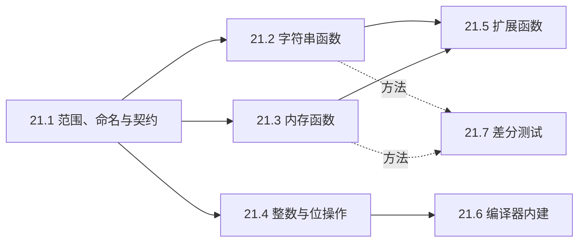

# 21. 库接口实现练习

在前面的基础篇中，我们接触过一些手写标准库基础函数的习题，比如自己实现 `strlen`、`strcmp`、`memset`、`memcpy` 或者 `popcount`。在最初的练习里，通常是一个源文件对应一个单独的函数，写完后在 `main` 函数里打印几组数据，肉眼确认输出没有明显异常就算通过了。

到了现在的阶段，我们希望把这些零散的练习重新整合起来，组织成一个规整且具备工程形态的代码库：包含独立的工程结构、清晰的公开头文件、按功能模块拆分的实现源码，以及一套基于 CTest 自动注册与执行的测试套件。在这个库里，每个接口都严格按照标准库的规格行为来实现；为了避免与宿主环境中的保留标识符冲突，也为了防止编译器直接把标准函数名替换为内置实现，我们为库中所有导出的外部符号统一加上了 `mdr_` 前缀。

关于实现范围的界定，我们可以用三条清晰的边界来衡量：首先，功能本身能够纯粹依靠标准 C 语言语法表达出来；其次，实现过程不依赖操作系统底层提供的系统调用或服务；最后，不强依赖特定的平台 ABI，也不依赖缺乏普通 C 回退方案的专用编译器扩展。

按照这三条准则，像 `strcpy`、`memmove` 以及 `strlcpy` 这样的纯粹内存与文本操作接口都在收录范围之内；而诸如向内核申请内存的 `malloc`、涉及终端 I/O 与格式化流的 `printf`、或者依赖底层跳转机制的 `setjmp`，则不在本章的讨论范畴中。与第 20 章完整的 JSON 解析器相比，本章的视角落回到最基础的函数接口层面。至于更高级的字符串搜索算法或二分查找背后的数据结构，后续篇章会专门展开；在当前的实践中，我们的首要目标是确保每一个底层接口的行为、边界处理与契约承诺都完全准确。

## 1. 本章内容

七个小节按照工程搭建、接口实现、扩展扩充与测试验证的节奏展开：

1. [21.1 范围、命名与契约](/教程/正文/开发与工程基础/21_库接口实现练习/21_1_范围_命名与契约)：详细探讨上述三条筛选标准的由来，解释为什么自定义实现不能直接占用标准库函数名，并介绍如何把自然语言写就的接口规格拆解为严谨的前置条件与后置条件，最后从零搭建起整套模块共用的 CMake 工程骨架。
2. [21.2 字符串函数](/教程/正文/开发与工程基础/21_库接口实现练习/21_2_字符串函数)：覆盖经典的以空字符结尾的字节字符串操作，包括 `strcpy`、`strncpy`、`strcat`、`strncat`、`strncmp`、`strchr`、`strrchr`、`strspn`、`strcspn`、`strpbrk`、`strstr` 与 `strtok`，并深入分析 `strncpy` 的末尾补零机制以及 `strtok` 维护内部静态状态等历史设计缺陷。
3. [21.3 内存函数](/教程/正文/开发与工程基础/21_库接口实现练习/21_3_内存函数)：实现以原生字节缓冲区为目标的内存操作，重点分析 `memmove`、`memcmp`、`memchr`、`memccpy` 与 C11/C23 引入的安全擦除函数 `memset_explicit`，剖析重叠内存区域的拷贝方向判断、无符号字符逐字节比对，以及现代优化编译器面对敏感数据擦除时的死代码消除问题。
4. [21.4 整数与位操作辅助函数](/教程/正文/开发与工程基础/21_库接口实现练习/21_4_整数与位操作辅助函数)：实现前导零与尾随零计数、有效位宽计算、向上取整到 2 的整数次幂（`bit_ceil`）、循环移位、大小端字节序转换，以及带有溢出检查的加法与乘法运算，并全面对照 C23 引入的 `<stdbit.h>` 与 `<stdckdint.h>` 标准头文件。
5. [21.5 易于移植的扩展函数](/教程/正文/开发与工程基础/21_库接口实现练习/21_5_易于移植的扩展函数)：实现 `strlcpy`、`strlcat`、`stpcpy`、`memmem`、`strtok_r` 与 `strsep` 等在各操作系统平台间可用性不一、命名分散的高频实用函数，并探讨工程项目中如何优雅地对外提供这部分跨平台垫片。
6. [21.6 可回退的编译器内建功能](/教程/正文/开发与工程基础/21_库接口实现练习/21_6_可回退的编译器内建功能)：利用宏检测与特性探测机制，将 GCC 与 Clang 的 `__builtin_popcount`、`__builtin_clz` 等高效内建指令封装在统一的可移植接口之下；在支持内建指令的环境下启用硬件加速，而在不支持的环境下无缝回退到 21.4 节实现的纯 C 算法。
7. [21.7 差分测试与边界验证](/教程/正文/开发与工程基础/21_库接口实现练习/21_7_差分测试与边界验证)：介绍差分测试的基本思想，将海量伪随机测试用例同时输入给我们手写的 `mdr_` 函数与平台自带的标准库实现，校验两者行为的一致性；同时借助哨兵保护缓冲区检测越界读写，利用十六进制转储辅助排查定位，并演示如何最小化失败输入用例。

在内容关联上，21.2 到 21.4 节构成了函数实现的主体核心，它们分别面向字符串、内存缓冲区和整数位运算，彼此保持独立。21.5 节的扩展函数会复用前几节的基础内存与字符串接口，而 21.6 节的编译器优化则直接以 21.4 节的纯 C 算法作为兜底回退实现。最后一节 21.7 提供的测试验证方法则贯穿始终，从实现第一个字符串函数起，就可以随时引入这套方法进行严密验证。

## 2. 本章代码

本章配套的全部代码存放在 `code/开发与工程基础/21_库接口实现练习/` 目录中。整体包含一个静态库目标以及配套的单元测试程序；在 21.6 节中会进一步增加专门测试回退路径的独立库目标，21.7 节则会补充对应的差分测试套件：

```text:no-line-numbers
21_库接口实现练习/
├── CMakeLists.txt
├── include/
│   ├── mdr_compiler.h     # MDR_ASSERT，21.6 加内建检测宏
│   ├── mdr_string.h       # 21.2
│   ├── mdr_memory.h       # 21.3
│   ├── mdr_bits.h         # 21.4
│   └── mdr_ext.h          # 21.5
├── src/
│   ├── mdr_string.c
│   ├── mdr_memory.c
│   ├── mdr_bits.c
│   └── mdr_ext.c
├── tests/
│   ├── check.h            # 第 11 章的测试框架
│   ├── check.c
│   ├── test_string.c
│   ├── test_memory.c
│   ├── test_bits.c
│   ├── test_ext.c
│   └── diff_util.c 等     # 21.7 加入
└── exercises/             # 各页习题的起始文件
```

在测试辅助模块 `tests/check.h` 中，延续了第 11 章所采用的轻量断言风格，仅提供 `CHECK`、`CHECK_EQ_SIZE` 与 `CHECK_STR_EQ` 三个核心宏以及一个汇总结果的 `check_report` 函数，内部不包含任何与特定业务相关的杂质代码。

构建系统方面，根目录下的 `CMakeLists.txt` 利用 `file(GLOB ... CONFIGURE_DEPENDS)` 自动收集 `src/*.c` 与 `tests/test_*.c`。在后续各小节的练习中，每当向源码或测试目录新增源文件时，均无需手动修改构建配置；CMake 在重新生成时会自动识别并为每个测试源码注册对应的 CTest 测试用例。对于 21.7 节涉及的差分测试源码 `tests/diff_*.c`，配置脚本还会额外链接 `tests/diff_util.c` 工具模块。

在工程目录下构建并运行测试：

::: terminal title="zsh - mdr"

```console
$ cmake -S . -B build
$ cmake --build build
$ ctest --test-dir build
```

:::

全部通过时 `ctest` 最后一行是 `100% tests passed, 0 tests failed out of N`，N 随新增的测试文件增加。测试失败时用 `--output-on-failure` 把失败的那一行打印出来，格式是「文件:行: 实际值与期望值」，第 11 章已经演示过。

工程提供了两个编译选项开关：
- `-DMDR_SANITIZE=ON`：开启 AddressSanitizer 与 UndefinedBehaviorSanitizer，用法见[编译器诊断与程序检查](/教程/正文/开发与工程基础/13_编译器诊断与程序检查)。某些 MinGW 环境可能缺少配套的运行时库，链接时会报 `cannot find -lasan`，遇到这种情况可以在 Linux 或 macOS 环境下完成构建。
- `-DMDR_NO_BUILTINS=ON`：让 21.6 节的代码完全走普通 C 回退分支，其余各节不需要显式开启它。在默认配置下，工程也会自动构建一个 `mdr_fallback` 库目标，供 21.6 节对比两条路径的执行表现。

## 3. 学习顺序

### 3.1 从哪一节开始

先读 21.1 节。它给出的三条标准、命名规则和规格模板是后面每一节都要用到的，代码骨架也在该节搭建完备；若跳过它直接阅读 21.2 节，面对头文件中注明「调用方保证」的前置条件注释时，可能会难以理解其来龙去脉。

随后的 21.2、21.3 与 21.4 三节在知识组织上互不依赖，可以根据当前的兴趣或学习重点挑一节展开。三节中都设计了需要亲自动手编写的接口函数，建议在阅读时跟随正文分析把实现补齐，再继续深入后续内容。如果只停留在浏览代码层面，诸如 `strncpy` 的补零行为或者 `memmove` 的重叠方向判断，很容易在短时间内遗忘。

21.5 节会用到 21.2 节的 `mdr_strnlen`、`mdr_memcpy` 与 21.3 节的 `mdr_memchr`：其中 `mdr_strlcpy` 依赖前者计算截断长度，`mdr_memmem` 则借助后两者完成快速检索。21.6 节将 21.4 节实现的 `mdr_popcount_u32` 和 `mdr_clz_u32` 作为回退路径，缺乏这些纯 C 实现，就无法构建起具备自洽兜底能力的加速接口。

21.7 节讲解的是通用的差分测试方法，并不强制要求写完所有函数后才能使用。在工程实践中，更推荐每完成一组函数就顺手补充对应的差分测试用例：把完全相同的随机输入同时传递给自定义的 `mdr_` 版本与宿主标准库，比对两者的返回值与副作用。这样即便后续对基础模块进行重构，前期编写好的函数依然能保持严密的自动化质量护航。



### 3.2 手边要有的东西

一台配置了现代 GCC 或 Clang 编译器的环境，CMake 3.20 或更高版本。在 21.3 节探究编译器对内存操作的优化机制时，使用 `gcc -S` 输出汇编指令即可观察，第 3 章已介绍过汇编文件的基本阅读方式。在 21.7 节进行差分测试时，需要对照工业级标准库，Linux 环境下的 glibc 与 Windows 环境下的 UCRT 都是非常标准且实用的参照；如果在两套环境下都运行一遍测试，往往能观察到诸如 `strcmp` 返回值具体数值差异这类细微的平台特性。

::: concept mdr-scope-criteria title="本章选材的三条标准"

纳入本章的接口必须同时满足：只用普通 C 能写出来，不依赖编译器扩展或内建函数；不需要操作系统提供服务，例如取得存储、读写文件、查询区域设置；不依赖 ABI 或无法用普通 C 替代的编译器机制，例如遍历可变参数、保存寄存器。按这三条，`strtok`、`memmove`、`strlcpy` 纳入，`malloc`、`printf`、`setjmp`、`va_arg`、原子操作排除在外。

:::

<Quiz
  type="single"
  :options="[
    { label: 'strspn', value: 'A' },
    { label: 'memmove', value: 'B' },
    { label: 'malloc', value: 'C' },
    { label: 'strlcpy', value: 'D' }
  ]"
  answer="C"
>

下列哪个接口不在本章的范围内？

</Quiz>

正确答案是 **C**。`malloc` 的存储要从操作系统取得，纯 C 无法凭空造出一块内存。`strspn`、`memmove` 是标准库函数，`strlcpy` 是扩展函数，三者都能用普通 C 写出来。

<Quiz
  type="single"
  :options="[
    { label: 'mdr_ 前缀让名字更短，输入更快', value: 'A' },
    { label: '标准库中的外部名字是保留的，同名定义属于未定义行为', value: 'B' },
    { label: '链接器要求每个项目的函数都带前缀', value: 'C' },
    { label: '只有带前缀的函数才能被 CTest 测试', value: 'D' }
  ]"
  answer="B"
>

本章的函数为什么都加 `mdr_` 前缀？

</Quiz>

正确答案是 **B**。标准库提供的外部标识符在宿主实现中是保留的，重新定义同名函数属于未定义行为；编译器还常把这些名字当作内建函数，`strlen("abc")` 这种调用在编译期就被折叠掉，自定义的版本根本轮不到执行。加前缀同时避开了这两件事。

## 4. 习题

<Exercise id="22117" :d="2" :w="2">

在 `code/开发与工程基础/21_库接口实现练习/` 下用两个构建目录各配置一次：

```sh
cmake -S . -B build
cmake -S . -B build-fallback -DMDR_NO_BUILTINS=ON
cmake --build build
cmake --build build-fallback
ctest --test-dir build
ctest --test-dir build-fallback
```

记录两次 `ctest` 汇总行里的测试总数，解释两个数为什么不同：默认构建比回退构建多出哪些测试目标，回退构建里同一批测试又覆盖了哪条代码路径。再把 `tests/test_string.c` 里的某个 `CHECK` 换成一个错误的期望值，用 `--output-on-failure` 运行一次，记录失败行的格式，指出这一行给出的四样信息。

验收：两份 ctest 汇总行、一段不超过五句的解释、失败行的原文。

</Exercise>

<Exercise id="22118" :d="3" :w="3">

给库增加一个函数：

```c
void *mdr_memrchr(const void *ptr, int ch, size_t count);
```

它在前 `count` 个字节里从后向前查找 `(unsigned char)ch`，返回最后一次出现的地址，没有出现返回 `NULL`，`count` 为 0 时也返回 `NULL`。完成五件事：

1. 按 21.1 的模板在 `include/mdr_memory.h` 写规格注释：一句话功能、调用方保证、返回值，并注明按 `unsigned char` 比较。
2. 实现在 `src/mdr_memory.c`，使用普通的逐字节循环。
3. 在 `tests/test_memory.c` 加至少五个检查，覆盖目标在首字节、目标在末字节、字节值为 `0x80`、`count` 为 0、没有目标这几种输入。
4. 在 `tests/diff_memory.c` 加差分测试：用现成的 `fill_random` 生成缓冲区，把 `mdr_memrchr` 的结果换算成相对起点的偏移，与一个从末尾向前扫描的参照函数比较。不要拿 glibc 的 `memrchr` 当参照，它要求 `_GNU_SOURCE`，UCRT 上也没有这个函数。
5. 在 `tests/diff_memory.c` 里用 `diff_guard` 做一次越界检查（这个目标链接了 `diff_util.c`，`test_memory` 没有链接，所以放在这里）：分配恰好 `count` 个字节、前后各带 16 个 `0xA5`，调用后确认哨字节没被动过。再把实现里的循环起点改成 `count` 而不是 `count - 1`，运行一次，记录 `diff_guard_check` 报出的内容，然后改正。

验收：两个构建目录重新构建后 `ctest` 全部通过，`-Wall -Wextra` 无警告，第 5 步注入缺陷时的报告原文。

</Exercise>

<Exercise id="22119" :d="4" :w="2">

在工程根目录写一个 `use_mdr.c`，调用 `mdr_strlen("hello")` 与 `mdr_popcount_u32(0xF0F0u)`，按 `5 8` 的格式打印两个结果。用静态库链接：

```sh
gcc -std=c17 -Wall -Wextra -Iinclude use_mdr.c build/libmdr.a -o use_mdr
```

然后：

1. 把 `build/libmdr.a` 挪到源文件前面再链接一次，记录诊断，并用链接器从左到右处理输入的规则解释它。
2. 运行 `nm use_mdr | grep " T mdr_"`，数一数可执行文件里有多少个 `mdr_` 函数；再对照 `ar t build/libmdr.a` 的成员清单，解释为什么是这么多：为什么 `mdr_string.o` 里没有被调用的 `mdr_strcat`、`mdr_strtok` 也进来了，而 `mdr_ext.o` 里的 `mdr_strdup` 一个都没有。只调用 `mdr_strlen` 时再数一次，比较两个数。
3. 另写一个只调用 `mdr_strdup` 的程序，按同样的方式链接。`ar t` 的成员清单没有变，可执行文件里的 `mdr_` 函数却变成三十多个：说出链接器取出了哪几个成员、为什么 `mdr_bits.o` 仍然没被取出、为什么 `mdr_string.o` 与 `mdr_memory.o` 这次整块进来了。再说明 `mdr_strdup` 的返回值为什么必须由调用方 `free`，而 `mdr_strlen` 没有这个问题。

验收：正确链接的运行结果、两次 `nm`/`ar` 的输出、一段不超过五句的解释。环境里没有 `nm` 时用 `objdump -t`。

</Exercise>

<Exercise id="22120" :d="5" :w="4" scope="*">

把 `CMakeLists.txt` 里的单个库目标拆成两个：`mdr_core` 只编 `src/mdr_bits.c`、`src/mdr_memory.c`、`src/mdr_string.c`，`mdr_ext` 只编 `src/mdr_ext.c`，并通过 `target_link_libraries(mdr_ext PUBLIC mdr_core)` 取得核心函数。

要求：

1. 现有的测试目标一行源文件都不改，仍能链接成功，`ctest` 仍全部通过。
2. 写一个只调用 `mdr_popcount_u32` 的小程序，链接 `mdr_core`，用 `nm` 证明可执行文件里没有 `malloc` 这个未定义符号；再把调用换成 `mdr_strdup`，说明这时为什么还必须链接 `mdr_core`，以及 `PUBLIC` 让 CMake 自动做了什么。
3. 解释 `PUBLIC` 在这个位置的含义：链接 `mdr_ext` 的目标为什么自动获得 `mdr_core`，换成 `PRIVATE` 会得到什么结果。
4. 说明这种拆分的实际好处：只用到 21.4 位操作函数的程序，最终可执行文件里不会带进 `mdr_ext` 对 `malloc` 的依赖。

验收：`ctest` 汇总行、两次 `nm` 输出、一段关于 `PUBLIC` 与静态库按需抽取的说明。

</Exercise>

<Exercise id="22121" :d="6" :w="4">

只用本章的 `mdr_` 函数写一个小工具 `wordstat`：从标准输入读入文本，按非字母字节切分，统计每个单词出现的次数，按次数降序、次数相同按 `mdr_strcmp` 升序，打印前五名，格式为「次数 单词」。要求：

1. 程序里不出现 `strlen`、`strcmp`、`strcpy`、`memcpy`、`strchr`、`strtok` 等标准库字符串与内存函数，输入缓冲用 `fread` 读入，输出用 `fprintf`。用 `grep` 检查源码，确认调用点只有 `mdr_` 版本。
2. 单词缓冲区固定 32 字节，超过 31 个字母的单词只保留前 31 个；计数表用定长数组保存，表满时打印提示并以状态 1 退出。
3. 统计部分另写一版，改用 21.5 的 `mdr_strtok_r` 切分（同样要处理超过 31 个字母的单词），与第 1 条里的版本在固定种子的随机文本上对照，输出必须相同。说明为什么 `mdr_strtok_r` 可以嵌套使用而 `mdr_strtok` 不行。
4. 在 `CMakeLists.txt` 里把 `wordstat` 注册成一个可执行目标，并把它加入 `ctest`；两个版本各注册一条 `add_test`。

验收：`ctest` 全部通过；`grep -nE "\\b(strlen|strcmp|strcpy|memcpy|strchr|strtok)\\b"` 在 `wordstat.c` 上没有输出；一段说明里写清为什么不能先用 `mdr_strtok` 切分出单词、再对每个单词调用 `mdr_strtok`。

</Exercise>

## 5. 参考资料

- cppreference，Null-terminated byte strings：<https://en.cppreference.com/w/c/string/byte>
- musl libc，`src/string`：<https://git.musl-libc.org/cgit/musl/tree/src/string>
- POSIX.1-2024：<https://pubs.opengroup.org/onlinepubs/9799919799/>
- Henry S. Warren，**_Hacker's Delight_**，第 2 版，Addison-Wesley，ISBN 978-0-321-84268-8。
- W. M. McKeeman，Differential Testing for Software：<https://www.cs.tufts.edu/comp/150FP/archive/bill-mckeeman/DifferentailTesting.pdf>
- David R. Hanson，**_C Interfaces and Implementations: Techniques for Creating Reusable Software_**，Addison-Wesley，ISBN 978-0-201-49841-7。
