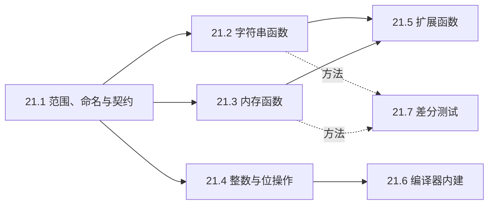

# 21. 库接口实现练习

第一部分有几道习题要求自己写出 `strlen`、`strcmp`、`memset`、`memcpy`、`popcount` 这些函数，写完就跑过测试。当时每个函数一个文件，验证方式是打印几个结果看一眼。这一章把同样的练习收拢成一个库：一个工程、一套头文件、一组按文件注册到 `ctest` 的测试，函数按标准库的规格实现，名字统一加 `mdr_` 前缀，免得落进保留标识符和内建函数的坑里。

范围是三句话：只用普通 C 能表达，不依赖操作系统服务，不依赖 ABI 或没有普通 C 回退的编译器机制。按这三条，`strcpy`、`memmove`、`strlcpy` 能写，`malloc`、`printf`、`setjmp` 不写。第 20 章的 JSON 解析器是一个完整应用，本章退回到函数一级；字符串匹配和二分查找背后的算法在第三部分另讲，这里只关心接口的行为对不对。

## 1. 本章内容

七节按侧栏顺序排列：

1. [21.1 范围、命名与契约](/教程/正文/开发与工程基础/21_库接口实现练习/21_1_范围_命名与契约)：三条标准怎样筛掉一个接口，为什么不能沿用标准库的函数名，怎样把一份规格拆成前置条件和后置条件，最后搭起本章共用的工程骨架。
2. [21.2 字符串函数](/教程/正文/开发与工程基础/21_库接口实现练习/21_2_字符串函数)：`strcpy`、`strncpy`、`strcat`、`strncat`、`strncmp`、`strchr`、`strrchr`、`strspn`、`strcspn`、`strpbrk`、`strstr`、`strtok`，以及 `strncpy` 和 `strtok` 这两处出了名的设计问题。
3. [21.3 内存函数](/教程/正文/开发与工程基础/21_库接口实现练习/21_3_内存函数)：`memmove`、`memcmp`、`memchr`、`memccpy`、`memset_explicit`；重叠区域的复制方向、按字节比较、清除敏感数据时编译器会做什么。
4. [21.4 整数与位操作辅助函数](/教程/正文/开发与工程基础/21_库接口实现练习/21_4_整数与位操作辅助函数)：前导零与尾随零的计数、位宽、`bit_ceil`、循环移位、大小端读写、带溢出检查的加乘，对照 C23 的 `<stdbit.h>` 与 `<stdckdint.h>`。
5. [21.5 易于移植的扩展函数](/教程/正文/开发与工程基础/21_库接口实现练习/21_5_易于移植的扩展函数)：`strlcpy`、`strlcat`、`stpcpy`、`memmem`、`strtok_r`、`strsep` 这类各平台命名和可用性都不一致的函数，以及项目的两种提供方式。
6. [21.6 可回退的编译器内建功能](/教程/正文/开发与工程基础/21_库接口实现练习/21_6_可回退的编译器内建功能)：把 `__builtin_popcount`、`__builtin_clz` 这类内建函数放进可移植接口之后，编译期检测可用性，没有就退回 21.4 的普通 C 版本。
7. [21.7 差分测试与边界验证](/教程/正文/开发与工程基础/21_库接口实现练习/21_7_差分测试与边界验证)：把同一组输入同时喂给 `mdr_` 版本和标准库，比较结果；防护缓冲区、十六进制转储、失败输入的缩小。

21.2 到 21.4 是主体，各写一组函数，彼此独立。21.5 用到 21.2、21.3 的函数，21.6 建立在 21.4 之上。21.7 提供的是验证方法，从写完 21.2 的第一个函数起就可以用。

## 2. 本章代码

本章的代码在 `code/开发与工程基础/21_库接口实现练习/`，一个静态库、四个单元测试程序；21.6 再加一个走普通 C 回退的库目标，21.7 加差分测试：

```text:no-line-numbers
21_库接口实现练习/
├── CMakeLists.txt
├── include/
│   ├── mdr_compiler.h     # MDR_ASSERT，21.6 加内建检测宏
│   ├── mdr_string.h       # 21.2
│   ├── mdr_memory.h       # 21.3
│   ├── mdr_bits.h         # 21.4
│   └── mdr_ext.h          # 21.5
├── src/
│   ├── mdr_string.c
│   ├── mdr_memory.c
│   ├── mdr_bits.c
│   └── mdr_ext.c
├── tests/
│   ├── check.h            # 第 11 章的测试框架
│   ├── check.c
│   ├── test_string.c
│   ├── test_memory.c
│   ├── test_bits.c
│   ├── test_ext.c
│   └── diff_util.c 等     # 21.7 加入
└── exercises/             # 各页习题的起始文件
```

`tests/check.h` 是第 11 章那套框架，`CHECK`、`CHECK_EQ_SIZE`、`CHECK_STR_EQ` 三个宏加一个 `check_report`，没有一行依赖 wordfreq。构建文件用 `file(GLOB ... CONFIGURE_DEPENDS)` 收集 `src/*.c` 和 `tests/test_*.c`，所以后面每节只是往目录里加文件，不用改 `CMakeLists.txt`；每个测试文件自动成为一个 `ctest` 测试，`tests/diff_*.c` 另外多链一份 `tests/diff_util.c`。

在工程目录下构建并运行测试：

::: terminal title="zsh - mdr"

```console
$ cmake -S . -B build
$ cmake --build build
$ ctest --test-dir build
```

:::

全部通过时 `ctest` 最后一行是 `100% tests passed, 0 tests failed out of N`，N 随新增的测试文件增加。测试失败时用 `--output-on-failure` 把失败的那一行打印出来，格式是「文件:行: 实际值与期望值」，第 11 章已经演示过。

工程有两个开关。`-DMDR_SANITIZE=ON` 打开 AddressSanitizer 和 UndefinedBehaviorSanitizer，用法见[编译器诊断与程序检查](/教程/正文/开发与工程基础/13_编译器诊断与程序检查)；本机的 MinGW 缺少这两个运行库，链接时会报 `cannot find -lasan`，到 Linux 或 macOS 上做这个构建。`-DMDR_NO_BUILTINS=ON` 让 21.6 的代码走普通 C 回退，其余各节不需要它；不打开它时，工程也会自动多编一个 `mdr_fallback` 库，供 21.6 对比两条路径。

## 3. 学习顺序

### 3.1 从哪一节开始

先读 21.1。它给出的三条标准、命名规则和规格模板是后面每一节都要用的，代码骨架也在那里搭好；跳过去直接读 21.2，会看不懂头文件里那些「调用方保证」的注释是从哪来的。

之后 21.2、21.3、21.4 三节互不依赖，按兴趣挑一节即可。三节里都有要动手写的函数，读者最好跟着把实现补上再往下读，光看代码不写，`strncpy` 的补零行为和 `memmove` 的方向判断转天就忘。

21.5 用到 21.2 的 `mdr_strnlen`、`mdr_memcpy` 和 21.3 的 `mdr_memchr`：`mdr_strlcpy` 的截断判断靠前者，`mdr_memmem` 的查找靠后两者。21.6 拿 21.4 写的 `mdr_popcount_u32`、`mdr_clz_u32` 当回退分支，没有它们就没有可比较的另一条路径。

21.7 只提供方法，不依赖任何一节写完。建议每写完一组函数就加一个差分测试：同一组输入同时喂给 `mdr_` 版本和标准库，只比较结果。这样后面几节改动时，前面写好的函数仍然有对照。



### 3.2 手边要有的东西

一台能跑 GCC 或 Clang 的机器，CMake 3.20 以上。21.3 要看汇编，用 `gcc -S` 就够，第 3 章讲过怎么读输出。21.7 要对照标准库，Linux 上的 glibc 和 Windows 上的 UCRT 各是一份很好的参照实现，两台机器都跑一遍能发现不少只在一侧成立的行为，`strcmp` 的返回值就是例子。

::: concept mdr-scope-criteria title="本章选材的三条标准"

纳入本章的接口必须同时满足：只用普通 C 能写出来，不依赖编译器扩展或内建函数；不需要操作系统提供服务，例如取得存储、读写文件、查询区域设置；不依赖 ABI 或无法用普通 C 替代的编译器机制，例如遍历可变参数、保存寄存器。按这三条，`strtok`、`memmove`、`strlcpy` 纳入，`malloc`、`printf`、`setjmp`、`va_arg`、原子操作排除在外。

:::

<Quiz
  type="single"
  :options="[
    { label: 'strspn', value: 'A' },
    { label: 'memmove', value: 'B' },
    { label: 'malloc', value: 'C' },
    { label: 'strlcpy', value: 'D' }
  ]"
  answer="C"
>

下列哪个接口不在本章的范围内？

</Quiz>

正确答案是 **C**。`malloc` 的存储要从操作系统取得，纯 C 无法凭空造出一块内存。`strspn`、`memmove` 是标准库函数，`strlcpy` 是扩展函数，三者都能用普通 C 写出来。

<Quiz
  type="single"
  :options="[
    { label: 'mdr_ 前缀让名字更短，输入更快', value: 'A' },
    { label: '标准库中的外部名字是保留的，同名定义属于未定义行为', value: 'B' },
    { label: '链接器要求每个项目的函数都带前缀', value: 'C' },
    { label: '只有带前缀的函数才能被 CTest 测试', value: 'D' }
  ]"
  answer="B"
>

本章的函数为什么都加 `mdr_` 前缀？

</Quiz>

正确答案是 **B**。标准库提供的外部标识符在宿主实现中是保留的，重新定义同名函数属于未定义行为；编译器还常把这些名字当作内建函数，`strlen("abc")` 这种调用在编译期就被折叠掉，自定义的版本根本轮不到执行。加前缀同时避开了这两件事。

## 4. 习题

<Exercise id="22117" :d="2" :w="2">

在 `code/开发与工程基础/21_库接口实现练习/` 下用两个构建目录各配置一次：

```sh
cmake -S . -B build
cmake -S . -B build-fallback -DMDR_NO_BUILTINS=ON
cmake --build build
cmake --build build-fallback
ctest --test-dir build
ctest --test-dir build-fallback
```

记录两次 `ctest` 汇总行里的测试总数，解释两个数为什么不同：默认构建比回退构建多出哪些测试目标，回退构建里同一批测试又覆盖了哪条代码路径。再把 `tests/test_string.c` 里的某个 `CHECK` 换成一个错误的期望值，用 `--output-on-failure` 运行一次，记录失败行的格式，指出这一行给出的四样信息。

验收：两份 ctest 汇总行、一段不超过五句的解释、失败行的原文。

</Exercise>

<Exercise id="22118" :d="3" :w="3">

给库增加一个函数：

```c
void *mdr_memrchr(const void *ptr, int ch, size_t count);
```

它在前 `count` 个字节里从后向前查找 `(unsigned char)ch`，返回最后一次出现的地址，没有出现返回 `NULL`，`count` 为 0 时也返回 `NULL`。完成五件事：

1. 按 21.1 的模板在 `include/mdr_memory.h` 写规格注释：一句话功能、调用方保证、返回值，并注明按 `unsigned char` 比较。
2. 实现在 `src/mdr_memory.c`，使用普通的逐字节循环。
3. 在 `tests/test_memory.c` 加至少五个检查，覆盖目标在首字节、目标在末字节、字节值为 `0x80`、`count` 为 0、没有目标这几种输入。
4. 在 `tests/diff_memory.c` 加差分测试：用现成的 `fill_random` 生成缓冲区，把 `mdr_memrchr` 的结果换算成相对起点的偏移，与一个从末尾向前扫描的参照函数比较。不要拿 glibc 的 `memrchr` 当参照，它要求 `_GNU_SOURCE`，UCRT 上也没有这个函数。
5. 在 `tests/diff_memory.c` 里用 `diff_guard` 做一次越界检查（这个目标链接了 `diff_util.c`，`test_memory` 没有链接，所以放在这里）：分配恰好 `count` 个字节、前后各带 16 个 `0xA5`，调用后确认哨字节没被动过。再把实现里的循环起点改成 `count` 而不是 `count - 1`，运行一次，记录 `diff_guard_check` 报出的内容，然后改正。

验收：两个构建目录重新构建后 `ctest` 全部通过，`-Wall -Wextra` 无警告，第 5 步注入缺陷时的报告原文。

</Exercise>

<Exercise id="22119" :d="4" :w="2">

在工程根目录写一个 `use_mdr.c`，调用 `mdr_strlen("hello")` 与 `mdr_popcount_u32(0xF0F0u)`，按 `5 8` 的格式打印两个结果。用静态库链接：

```sh
gcc -std=c17 -Wall -Wextra -Iinclude use_mdr.c build/libmdr.a -o use_mdr
```

然后：

1. 把 `build/libmdr.a` 挪到源文件前面再链接一次，记录诊断，并用链接器从左到右处理输入的规则解释它。
2. 运行 `nm use_mdr | grep " T mdr_"`，数一数可执行文件里有多少个 `mdr_` 函数；再对照 `ar t build/libmdr.a` 的成员清单，解释为什么是这么多：为什么 `mdr_string.o` 里没有被调用的 `mdr_strcat`、`mdr_strtok` 也进来了，而 `mdr_ext.o` 里的 `mdr_strdup` 一个都没有。只调用 `mdr_strlen` 时再数一次，比较两个数。
3. 另写一个只调用 `mdr_strdup` 的程序，按同样的方式链接。`ar t` 的成员清单没有变，可执行文件里的 `mdr_` 函数却变成三十多个：说出链接器取出了哪几个成员、为什么 `mdr_bits.o` 仍然没被取出、为什么 `mdr_string.o` 与 `mdr_memory.o` 这次整块进来了。再说明 `mdr_strdup` 的返回值为什么必须由调用方 `free`，而 `mdr_strlen` 没有这个问题。

验收：正确链接的运行结果、两次 `nm`/`ar` 的输出、一段不超过五句的解释。环境里没有 `nm` 时用 `objdump -t`。

</Exercise>

<Exercise id="22120" :d="5" :w="4" scope="*">

把 `CMakeLists.txt` 里的单个库目标拆成两个：`mdr_core` 只编 `src/mdr_bits.c`、`src/mdr_memory.c`、`src/mdr_string.c`，`mdr_ext` 只编 `src/mdr_ext.c`，并通过 `target_link_libraries(mdr_ext PUBLIC mdr_core)` 取得核心函数。

要求：

1. 现有的测试目标一行源文件都不改，仍能链接成功，`ctest` 仍全部通过。
2. 写一个只调用 `mdr_popcount_u32` 的小程序，链接 `mdr_core`，用 `nm` 证明可执行文件里没有 `malloc` 这个未定义符号；再把调用换成 `mdr_strdup`，说明这时为什么还必须链接 `mdr_core`，以及 `PUBLIC` 让 CMake 自动做了什么。
3. 解释 `PUBLIC` 在这个位置的含义：链接 `mdr_ext` 的目标为什么自动获得 `mdr_core`，换成 `PRIVATE` 会得到什么结果。
4. 说明这种拆分的实际好处：只用到 21.4 位操作函数的程序，最终可执行文件里不会带进 `mdr_ext` 对 `malloc` 的依赖。

验收：`ctest` 汇总行、两次 `nm` 输出、一段关于 `PUBLIC` 与静态库按需抽取的说明。

</Exercise>

<Exercise id="22121" :d="6" :w="4">

只用本章的 `mdr_` 函数写一个小工具 `wordstat`：从标准输入读入文本，按非字母字节切分，统计每个单词出现的次数，按次数降序、次数相同按 `mdr_strcmp` 升序，打印前五名，格式为「次数 单词」。要求：

1. 程序里不出现 `strlen`、`strcmp`、`strcpy`、`memcpy`、`strchr`、`strtok` 等标准库字符串与内存函数，输入缓冲用 `fread` 读入，输出用 `fprintf`。用 `grep` 检查源码，确认调用点只有 `mdr_` 版本。
2. 单词缓冲区固定 32 字节，超过 31 个字母的单词只保留前 31 个；计数表用定长数组保存，表满时打印提示并以状态 1 退出。
3. 统计部分另写一版，改用 21.5 的 `mdr_strtok_r` 切分（同样要处理超过 31 个字母的单词），与第 1 条里的版本在固定种子的随机文本上对照，输出必须相同。说明为什么 `mdr_strtok_r` 可以嵌套使用而 `mdr_strtok` 不行。
4. 在 `CMakeLists.txt` 里把 `wordstat` 注册成一个可执行目标，并把它加入 `ctest`；两个版本各注册一条 `add_test`。

验收：`ctest` 全部通过；`grep -nE "\\b(strlen|strcmp|strcpy|memcpy|strchr|strtok)\\b"` 在 `wordstat.c` 上没有输出；一段说明里写清为什么不能先用 `mdr_strtok` 切分出单词、再对每个单词调用 `mdr_strtok`。

</Exercise>

## 5. 参考资料

- cppreference，Null-terminated byte strings：<https://en.cppreference.com/w/c/string/byte>
- musl libc，`src/string`：<https://git.musl-libc.org/cgit/musl/tree/src/string>
- POSIX.1-2024：<https://pubs.opengroup.org/onlinepubs/9799919799/>
- Henry S. Warren，**_Hacker's Delight_**，第 2 版，Addison-Wesley，ISBN 978-0-321-84268-8。
- W. M. McKeeman，Differential Testing for Software：<https://www.cs.tufts.edu/comp/150FP/archive/bill-mckeeman/DifferentailTesting.pdf>
- David R. Hanson，**_C Interfaces and Implementations: Techniques for Creating Reusable Software_**，Addison-Wesley，ISBN 978-0-201-49841-7。
