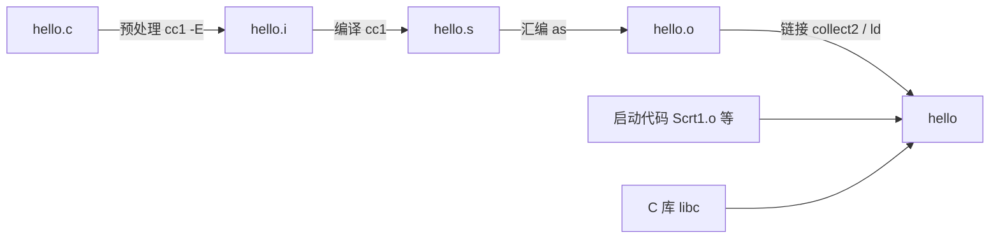

# 3. 从源文件到可执行文件

在终端中键入 `gcc hello.c -o hello`，轻敲回车，操作系统便在数毫秒内交出了一个能够独立运转的二进制程序。在一切顺遂的日常编码中，开发者很容易将这一行指令视作某种无需深究的黑盒；然而，一旦构建遭遇阻碍，控制台涌现的诊断信息往往来自四个职责迥异的底层子系统：头文件找不到来自预处理器的搜寻失败，语句末尾遗漏分号源于编译器语法分析树的构建破裂，而形如 `undefined reference` 的未定义符号警报则是链接器在最终收拢拓扑时的报错。如果无法从报错信息的字里行间分辨出究竟是哪一个工位在发声，开发者就极易在完全无关的层级上徒劳修改代码。

在这一章中，我们将把这一行复合命令从容地拆解为四个独立的工序阶段，分别导出并检视其各个中间产物：展开后的 `.i` 预处理文件、人类可读的 `.s` 汇编源码、包含机器码与未决符号的 `.o` 目标文件、以及最终落地的可执行文件。在此基础之上，我们还会调动 `nm`、`objdump`、`size` 与 `ldd` 等经典的二进制剖析工具，层层剥开机器指令与符号表的内部构造；梳理各个工序阶段所对应的典型故障与诊断特征；并正式确立工程实战中推崇的基础编译标志组合。文中所有的命令行回显均来自 Debian 13 环境下的 GCC 14.2 或 64 位 Windows 11 下的 MinGW-w64 GCC 13.2，关键差异均有明确标注。

配套源文件在 `code/开发与工程基础/3_从源文件到可执行文件/` 下。最基本的 `hello.c` 故意带了注释和一个宏，后面用来说明预处理做了什么：

```c
#include <stdio.h>

/* 这一行注释在预处理后消失 */
#define GREETING "Hello, C!"

int main(void) {
    printf(GREETING "\n");
    return 0;
}
```

## 1. 一条命令背后的四个阶段

在 GCC 的官方架构定义中，一次端到端的构建过程被严格划分为至多四个环环相扣的工序阶段：**预处理（preprocessing）**、**编译核心（compilation proper）**、**汇编（assembly）**以及最后的**链接（linking）**。这一流程的时序是刚性且单向的。我们在终端频繁唤起的 `gcc` 命令本身并不直接完成任何一项具体的机器码翻译或符号解析，它的核心身份是**编译器驱动（compiler driver）**，职责在于根据用户输入的标志开关，依次规划并启动底层的各阶段工具，协调它们之间的参数传递与文件流转。

在执行编译时追加 `-v` 选项，驱动便会将其在幕后调度的每一条底层命令行完整倾泻到标准错误流中。配合 `-save-temps` 参数，我们可以强制要求编译器将流水线中的所有中间产物直接持久化保存在当前工作目录下，而不是在系统临时目录中生成匿名文件并在退出时销毁：

::: terminal title="zsh - gcc -v -save-temps hello.c -o hello"

```console
$ gcc -v -save-temps hello.c -o hello
Using built-in specs.
COLLECT_GCC=gcc
Target: x86_64-linux-gnu
...
 /usr/libexec/gcc/x86_64-linux-gnu/14/cc1 -E -quiet -v -imultiarch x86_64-linux-gnu hello.c -mtune=generic -march=x86-64 -fpch-preprocess -fasynchronous-unwind-tables -o hello.i
 /usr/libexec/gcc/x86_64-linux-gnu/14/cc1 -fpreprocessed hello.i -quiet -dumpbase hello.c -dumpbase-ext .c -mtune=generic -march=x86-64 -version -fasynchronous-unwind-tables -o hello.s
 as -v --64 -o hello.o hello.s
 /usr/libexec/gcc/x86_64-linux-gnu/14/collect2 -plugin /usr/libexec/gcc/x86_64-linux-gnu/14/liblto_plugin.so ...
```

:::

在上述截取的四条核心指令中，前三行分别代表由编译器驱动调用的预处理器前端、编译器本体以及汇编器；而第四行的 `collect2` 则是 GCC 内部专用于统筹与组织底层链接器 `ld` 的辅助调度程序。`collect2` 所接收的实际参数极其冗长，若暂时剥离掉与插件检索（`-plugin`）和库路径（`-L`）相关的参数，剩下递交给链接器的输入文件实体清单如下所示：

```text
Scrt1.o crti.o crtbeginS.o hello.o -lgcc -lgcc_s -lc -lgcc -lgcc_s crtendS.o crtn.o
```

在这一长串输入中，前三个 `.o` 以及末尾的两个 `.o` 属于操作系统与 C 运行库提供的程序初始化引导（Startup Code）与终止清理代码，而 `-lc` 则引入了 C 标准库动态库。虽然我们的业务源文件只有一个精简的 `hello.c`，但为了让操作系统能够顺利装载程序、搭建栈帧环境并安全步入 `main` 函数，这些底层的系统胶水代码都是不可或缺的组成部分。四道工序的对应关系与流转形态可以归纳为如下拓扑：

| 阶段 | 谁执行 | 输入 | 输出 |
| --- | --- | --- | --- |
| 预处理 | `cc1 -E` | `hello.c` 及它包含的头文件 | `hello.i` |
| 编译 | `cc1` | `hello.i` | `hello.s` |
| 汇编 | `as` | `hello.s` | `hello.o` |
| 链接 | `collect2` 调用 `ld` | `hello.o`、启动代码、C 库 | `hello` |



::: concept dev-build-four-stages title="gcc 的四个阶段与各自的产物"

`gcc` 是按顺序调用预处理、编译、汇编、链接四个阶段的驱动。`-E` 停在预处理之后，产物是 `.i`；`-S` 停在编译之后，产物是 `.s`；`-c` 停在汇编之后，产物是 `.o`；不加这三个选项则继续链接，得到可执行文件。`-o` 指定最后一个阶段的输出文件名。

:::

在 ISO C 语言标准规范中，语言层面的代码翻译被细致划分为八个抽象翻译阶段（Translation Phases）：其中第 1 至第 4 阶段处理物理字符映射、多行拼接、记号切分与预处理宏展开；第 5 与第 6 阶段转换字符集并自动拼接相邻的字符串字面量；第 7 阶段完成完整的语法语义分析并生成底层目标代码；第 8 阶段完成外部引用的符号链接。GCC 所划分的四大工程阶段，实际上正是这八个抽象阶段在工业级工具链实现上的物理落地点：预处理器承担了前四个阶段，编译器本体覆盖了第 5 至第 7 阶段，汇编器负责将文本形式的汇编指令固化为二进制机器码，最后由链接器负责统筹第 8 阶段的跨模块地址重定位。两套模型相辅相成：理解语言标准语义时立足于八阶段，而排查具体的工程构建问题时则以四阶段工具链为抓手。

:::: details 完整的 gcc -v 输出

`gcc -v -save-temps hello.c -o hello` 在标准错误上打印的内容（Linux，GCC 14.2）。超长的 `Configured with` 行和 `collect2` 的参数用 `...` 省略：

::: terminal title="zsh - gcc -v -save-temps hello.c -o hello"

```text
Using built-in specs.
COLLECT_GCC=gcc
COLLECT_LTO_WRAPPER=/usr/libexec/gcc/x86_64-linux-gnu/14/lto-wrapper
Target: x86_64-linux-gnu
Configured with: ../src/configure -v --with-pkgversion='Debian 14.2.0-19' ...
Thread model: posix
gcc version 14.2.0 (Debian 14.2.0-19)
COLLECT_GCC_OPTIONS='-v' '-save-temps' '-o' 'hello' '-mtune=generic' '-march=x86-64'
 /usr/libexec/gcc/x86_64-linux-gnu/14/cc1 -E -quiet -v -imultiarch x86_64-linux-gnu hello.c -mtune=generic -march=x86-64 -fpch-preprocess -fasynchronous-unwind-tables -o hello.i
ignoring nonexistent directory "/usr/local/include/x86_64-linux-gnu"
#include "..." search starts here:
#include <...> search starts here:
 /usr/lib/gcc/x86_64-linux-gnu/14/include
 /usr/local/include
 /usr/include/x86_64-linux-gnu
 /usr/include
End of search list.
COLLECT_GCC_OPTIONS='-v' '-save-temps' '-o' 'hello' '-mtune=generic' '-march=x86-64'
 /usr/libexec/gcc/x86_64-linux-gnu/14/cc1 -fpreprocessed hello.i -quiet -dumpbase hello.c -dumpbase-ext .c -mtune=generic -march=x86-64 -version -fasynchronous-unwind-tables -o hello.s
GNU C17 (Debian 14.2.0-19) version 14.2.0 (x86_64-linux-gnu)
COLLECT_GCC_OPTIONS='-v' '-save-temps' '-o' 'hello' '-mtune=generic' '-march=x86-64'
 as -v --64 -o hello.o hello.s
GNU assembler version 2.44 (x86_64-linux-gnu) using BFD version (GNU Binutils for Debian) 2.44
COLLECT_GCC_OPTIONS='-v' '-save-temps' '-o' 'hello' '-mtune=generic' '-march=x86-64' '-dumpdir' 'hello.'
 /usr/libexec/gcc/x86_64-linux-gnu/14/collect2 -plugin /usr/libexec/gcc/x86_64-linux-gnu/14/liblto_plugin.so ... hello.o -lgcc --push-state --as-needed -lgcc_s --pop-state -lc -lgcc --push-state --as-needed -lgcc_s --pop-state ... crtendS.o ... crtn.o
```

:::

在上述冗长输出中，夹杂着许多与阶段调度无直接关系的内部追踪信息：例如 `COLLECT_GCC_OPTIONS` 忠实记录了驱动层接收到的原始标志列表，`COMPILER_PATH` 与 `LIBRARY_PATH` 标明了驱动在操作系统中检索子工具与库文件的目录序列，而诸如 `GGC heuristics` 则属于编译器内部垃圾回收机制的调优参数。真正界定四个核心工序阶段的，仅是调用具体程序二进制（或 `as`）的那四条长命令行。

::::

若在日常排错中只想透视驱动层计划下发哪些指令，而并不希望真正调用底层工具生成实际文件，可以使用 `-###` 选项（Dry Run 预检）。它的输出格式与 `-v` 高度相仿，但驱动在完成参数组装与打印后便会立刻收工退出：

::: terminal title="zsh - gcc -### hello.c -o hello_dry"

```console
$ gcc -### hello.c -o hello_dry 2> dry.log
$ wc -l < dry.log
19
$ ls hello_dry
ls: cannot access 'hello_dry': No such file or directory
```

:::

从回显可以看到，系统生成了完整的调用日志，但磁盘上并未产出任何目标文件。此外，带有空格或特殊符号的参数在 `-###` 输出中会被显式加上引号保护，这为开发者排查「复杂的 Makefile 或 CMake 变量最终究竟向驱动传递了哪些参数」提供了干净的诊断手段。

## 2. 预处理：-E

向编译器驱动传递 `-E` 选项时，流水线会在第一阶段预处理结束时截断。预处理器会将处理后的结果直接写入标准输出流，也可以通过 `-o` 显式将其转储为 `.i` 文本文件：

::: terminal title="zsh - gcc -E hello.c -o hello.i"

```console
$ gcc -E hello.c -o hello.i
$ wc -l hello.c hello.i
    9 hello.c
  819 hello.i
  828 total
```

:::

原本仅仅 9 行的源文件，在预处理后急剧膨胀为 819 行。新增的数百行代码几乎全部来自 `#include <stdio.h>` 指令的递归展开——预处理器机械地找到标准库的 `stdio.h` 头文件，并将其内部声明原汁原味地嫁接到了当前文件的包含锚点处。翻阅 `hello.i` 的文件尾部，我们可以看到处理后的 `main` 函数全貌：

```c
# 6 "hello.c"
int main(void) {
    printf("Hello, C!" "\n");
    return 0;
}
```

对比原始源码，预处理器已经悄然完成了三项关键变形：第一，源文件中的代码注释已被彻底剔除（使用 `grep -c "这一行注释" hello.i` 检验结果为 0）；第二，所有对象宏 `GREETING` 均被原位求值替换为了字符串字面量 `"Hello, C!"`；第三，`#include` 声明自身被头文件的海量类型与函数原型声明所取代。请注意替换后留下的两个相邻字符串字面量 `"Hello, C!" "\n"`：它们此时依然是彼此分离的，因为相邻字符串字面量的合并规约属于语言翻译的第六阶段，这项工作由后续的编译器语法前端承担，预处理器只负责文本记号的替换与剪切。

输出中所有以井号 `#` 起始的特殊行被称为**行标记（linemarker）**，它们负责记录随后的代码片段原本来自哪一个源文件的哪一行号。例如 `# 6 "hello.c"` 标示着下方的 `main` 函数实际上对应源文件 `hello.c` 的第 6 行。后续编译器在处理 `.i` 文件时，一旦发现语法错误，便能依靠这些行标记将诊断精准定位回原始的 `.c` 文件中。以下面这个遗漏了分号的测试为例：我们先借助 `-save-temps` 保留预处理结果，随后独立编译该 `.i` 文件：

::: terminal title="zsh - 编译预处理结果时的诊断"

```console
$ gcc -save-temps missing_semi.c -o missing_semi 2> log.txt
$ gcc -c missing_semi.i -o missing_semi.o
missing_semi.c: In function ‘main’:
missing_semi.c:5:5: error: expected ‘,’ or ‘;’ before ‘for’
```

:::

尽管实际参与编译的是中间文件 `missing_semi.i`，但报错回显依然能够精准穿透并锁定原始 `missing_semi.c` 的第 5 行。如果需要获得纯粹、干净且不夹杂行标记的预处理文本（例如用于快速文本比对或交由第三方静态分析工具读取），可以追加 `-P` 参数。在此参数下，原本 819 行的 `hello.i` 会缩减至 309 行。

在命令行中，利用 `-D` 选项可以在外部动态注入预处理宏定义，其效果完全等同于在源文件最开头写下了一行 `#define` 声明。我们在 `macro_demo.c` 中通过条件编译来控制调试输出块的启闭：

```c
#include <stdio.h>

/* 摄氏温度换算为华氏温度 */
#define FAHRENHEIT(c) ((c) * 9.0 / 5.0 + 32.0)
#define STEP 10
#define LIMIT (3 * STEP)

int main(void) {
    for (int c = 0; c <= LIMIT; c += STEP) {
#ifdef DEBUG
        fprintf(stderr, "debug: c = %d\n", c);
#endif
        printf("%3d C = %5.1f F\n", c, FAHRENHEIT(c));
    }
    return 0;
}
```

当外部未定义宏 `DEBUG` 时，预处理器在扫描到 `#ifdef` 与 `#endif` 这一条件区间时，会将其内部的代码行整段裁撤抹除，后续的编译器核心甚至完全不知道这几行调试语句曾经存在过。配合 `-E -P`（`-P` 用于抑制行标记注入以获得极简文本），我们可以并排对比两种预处理状态下的实际文本形态：

::: terminal title="zsh - gcc -E -P macro_demo.c"

```console
$ gcc -E -P macro_demo.c | tail -n 6
int main(void) {
    for (int c = 0; c <= (3 * 10); c += 10) {
        printf("%3d C = %5.1f F\n", c, ((c) * 9.0 / 5.0 + 32.0));
    }
    return 0;
}
$ gcc -DDEBUG -E -P macro_demo.c | tail -n 7
int main(void) {
    for (int c = 0; c <= (3 * 10); c += 10) {
        fprintf(stderr, "debug: c = %d\n", c);
        printf("%3d C = %5.1f F\n", c, ((c) * 9.0 / 5.0 + 32.0));
    }
    return 0;
}
```

:::

`-DDEBUG` 在外部定义了一个取值为空（即仅具备定义状态）的宏，效果与在代码中显式书写 `#define DEBUG` 别无二致；若需要附带具体数值，写为 `-DDEBUG=1` 即可等价于 `#define DEBUG 1`。请细致观察输出中宏展开的痕迹：`LIMIT` 被机械地展开为记号序列 `(3 * 10)`，`STEP` 被展开为数字记号 `10`，而函数式宏 `FAHRENHEIT(c)` 则被忠实展开为带括号的算术记号表达式。预处理器的工作仅仅是按照语法规则进行记号切分与字符替换，绝对不会介入任何数值计算或常量折叠（表达式的求值计算属于编译器后序语义阶段的工作）。在大型工程中，`-D` 是由构建系统向代码传递外部环境参数与功能开关的标准途径，我们在第 8 章与第 9 章的自动化构建中会反复依赖此机制。

当源文件中通过尖括号 `#include <...>` 引入系统头文件时，预处理器依照预设的目录清单依次搜寻。通过在预处理命令中附加 `-v` 选项，可以清晰检视当前的头文件检索路径列表：

::: terminal title="zsh - gcc -xc -E -v /dev/null"

```console
$ gcc -xc -E -v /dev/null
#include "..." search starts here:
#include <...> search starts here:
 /usr/lib/gcc/x86_64-linux-gnu/14/include
 /usr/local/include
 /usr/include/x86_64-linux-gnu
 /usr/include
End of search list.
```

:::

在上述技巧中，`-xc` 显式指示编译器驱动将后续输入强制解析为 C 语言代码，配合 `/dev/null` 空设备输入，我们无需创建任何实体文件即可探测出编译器内嵌的默认搜索路径列表。

当项目工程将自定义头文件存放在非默认路径（例如项目子目录 `include/`）下时，使用 `-I 目录` 可以在上述检索列表的最顶端插入自定义搜索路径。在配套代码的 `exercises/inc_demo/` 目录中，头文件位于 `include/greet.h`，业务源码位于 `src/useinc.c`：

::: terminal title="zsh - -I 指定头文件目录"

```console
$ gcc -std=c17 -Wall -Wextra -Iinclude src/useinc.c -o useinc
$ ./useinc
Hi from inc
$ gcc -std=c17 -Wall -Wextra src/useinc.c -o useinc2
src/useinc.c:3:10: fatal error: greet.h: No such file or directory
    3 | #include "greet.h"
      |          ^~~~~~~~~
compilation terminated.
```

:::

在第二条命令中，由于缺少了 `-Iinclude` 声明，预处理器仅仅在当前源文件所在目录以及编译器默认的系统库目录中搜寻，在检索落空后便直接以 `fatal error` 中断。这种错误发生在流水线的最早阶段，此时编译器前端甚至尚未开始执行语法合规性检查。关于工程化项目规范下的目录划分与 `-I` 头文件检索边界，我们在第 7 章会有专题剖析。

预处理器从不介入 C 语言本身的语法与类型语义分析，它只专注于识别并执行井号 `#` 起始的预处理指令与记号替换。以下面这段缺少必要分号的残缺代码为例：

::: terminal title="zsh - 预处理不检查语法"

```console
$ printf 'int main(void) { return 0 }\n' | gcc -E -P -xc -
int main(void) { return 0 }
```

:::

虽然代码逻辑严重违反 C 语法规则，但由于其内部没有任何语法非法的预处理指令，预处理器依然顺畅执行并以状态码 0 退出。唯有当流水线推进至后续的编译器前端时，这些语法畸变才会被彻底拦截（例如使用 `gcc -fsyntax-only` 仅做语法分析而不产生二进制代码）。

## 3. 编译：-S

当向驱动传递 `-S` 选项时，流水线会在第二阶段（编译核心）完成后停下，将生成的中间产物以人类可读的汇编语言文本（`.s` 文件）固化到磁盘：

::: terminal title="zsh - gcc -S hello.c"

```console
$ gcc -S hello.c
$ wc -l hello.s
28 hello.s
```

:::

在省略 `-o` 参数时，驱动具备确定的命名惯例：`-S` 会自动把输入源文件的扩展名置换为 `.s`，`-c` 会置换为 `.o`，而 `-E` 默认直奔控制台输出。在实际工程开发中，推荐始终使用 `-o` 显式给出文件名以消除隐式歧义。

打开生成的 `hello.s`，在剔除掉与 DWARF 调试栈展开相关的 `.cfi_` 指令以及 `.LFB0`、`.LFE0` 等编译器内部生成的辅助标签后，其主体结构清晰呈现如下：

```asm
	.file	"hello.c"
	.text
	.section	.rodata
.LC0:
	.string	"Hello, C!"
	.text
	.globl	main
	.type	main, @function
main:
	pushq	%rbp
	movq	%rsp, %rbp
	leaq	.LC0(%rip), %rax
	movq	%rax, %rdi
	call	puts@PLT
	movl	$0, %eax
	popq	%rbp
	ret
	.size	main, .-main
	.ident	"GCC: (Debian 14.2.0-19) 14.2.0"
```

标号 `main:` 之下所包含的代码块构成了函数的汇编实现。阅读汇编语言并不要求开发者具备手写复杂汇编指令的能力，能够辨识出关键的底层流动便已足够：`.LC0` 锚定了只读常量区中字符串 `"Hello, C!"` 的存储偏移；`leaq` 指令计算该字符串的有效地址并载入寄存器；随后通过 `call puts@PLT` 触发外部函数的调用；而 `movl $0, %eax` 则代表将函数返回值 0 存入标准返回值寄存器 `%eax`（对应 C 源码中的 `return 0`）。

在这段汇编输出中，有一处尤为引人瞩目的变化：源程序中书写的 `printf` 符号在汇编中完全不见了踪影，实际发出的调用指令变成了 `call puts@PLT`。这一转变源自 GCC 的内置函数（built-in function）优化策略：当编译器在语法分析期识别出 `printf` 的调用参数为一个不包含转换说明符的静态常量字符串且末尾恰好以换行符 `\n` 结尾时，它会在语义上将其判定为等价于更轻量、无需解析格式控制串的 `puts` 调用，因此即便在最低优化等级 `-O0` 下，也会主动发起这一语义替换。若希望强制编译器严格保留源程序所指定的符号，可以使用 `-fno-builtin` 开关关闭该机制：

::: terminal title="zsh - 关掉内置函数"

```console
$ gcc -O0 -fno-builtin -S hello.c -o hello_nb.s
$ grep call hello_nb.s
	call	printf@PLT
$ gcc -O0 -fno-builtin -c hello.c -o hello_nb.o
$ nm hello_nb.o
0000000000000000 T main
                 U printf
```

:::

这种来自编译器的自发替换对实际调试有着直接影响：如果在 GDB 调试器中对 `printf` 下断点，程序在运行到此处时绝不会暂停，因为汇编中实际发起的跳转目标是 `puts`。在第 12 章探讨调试技巧时，我们还会更频繁地遇到这类「高级源码行与底层机器指令出现错位」的典型工程场景。

优化级别对汇编代码结构的影响非常直观：在 `-O0` 与 `-O2` 下生成的汇编文本长度分别为 28 行与 25 行。在 `-O2` 版本中，编译器省去了繁琐的栈帧基址指针维护（即消除了 `pushq %rbp` 与 `movq %rsp, %rbp`），并且对寄存器的清零采用了更高效率的异或操作：

```asm
main:
	subq	$8, %rsp
	leaq	.LC0(%rip), %rdi
	call	puts@PLT
	xorl	%eax, %eax
	addq	$8, %rsp
	ret
```

编译器优化策略在第 15 章将有系统分析，此处的核心认识在于：`-S` 是从抽象的 C 语言跨入具体 CPU 体系结构指令视窗的第一道窗口。

在 Windows 平台下，使用 MinGW 编译相同的 `hello.c` 时，生成的汇编代码会在 `main` 起始处多出一行特殊的调用指令：

::: terminal title="zsh - MinGW 的 main 开头"

```console
$ gcc -std=c17 -Wall -Wextra -S hello.c -o hello.s
$ sed -n '/^main:/,/call.*puts/p' hello.s
main:
	pushq	%rbp
	.seh_pushreg	%rbp
	movq	%rsp, %rbp
	.seh_setframe	%rbp, 0
	subq	$32, %rsp
	.seh_stackalloc	32
	.seh_endprologue
	call	__main
	leaq	.LC0(%rip), %rax
	movq	%rax, %rcx
	call	puts
```

:::

这里的 `call __main` 属于 MinGW 运行库特有的启动约定：在进入真正的业务逻辑之前，`main` 函数负责先行调用 `__main`，以完成静态全局对象的构造以及运行时环境所需的特定初始化。在 Linux 原生 ELF 环境中不存在该符号。此外，以 `.seh_` 起始的汇编指令是 Windows 结构化异常处理（SEH）在栈展开时所需的元数据描述，并不参与常规的算术流转。在跨平台工程中遇到此类平台特性时，只需理性评估其是否影响整体架构与调用约定即可。

## 4. 汇编：-c 与目标文件

当向驱动传递 `-c` 选项时，流水线会在汇编器（Assembler）工作完成后戛然而止，生成包含二进制机器码但尚未完成链接的**目标文件（object file，通常为 `.o` 扩展名）**：

::: terminal title="zsh - gcc -c hello.c"

```console
$ gcc -c hello.c
$ file hello.o
hello.o: ELF 64-bit LSB relocatable, x86-64, version 1 (SYSV), not stripped
$ nm hello.o
0000000000000000 T main
                 U puts
```

:::

利用二进制实用工具 `nm`，可以迅速提取并展示目标文件内部所记录的**符号表（symbol table）**及其类型。在上面的回显中包含了两条极具代表性的记录：
- `T main`：字母 `T`（Text）表明该符号位于代码段，且属于具有外部可见性的**全局符号**，允许被其他目标文件所引用；`main` 正是由 `hello.c` 亲手定义的入口函数。
- `U puts`：字母 `U`（Undefined）表明这是一个**未决的外部未定义符号**；`hello.o` 在执行打印时确实调用了 `puts`，但其具体的二进制指令实现并未保存在本文件中，此处仅仅预留了一个待填补的符号引用。

在 `nm` 的符号类型规范中，字母的大小写有着严格的界定：大写字母代表全局符号（对外部目标文件可见），小写字母代表仅在当前编译单元私有的局部符号（例如 `static` 修饰的函数或对象）。常见的标记还包括：`D`/`d` 代表已初始化的全局/局部数据段，`B`/`b` 代表未初始化的 BSS 段，`R`/`r` 代表只读常量数据段。

借助反汇编工具 `objdump -dr`，我们可以透视目标文件内部真实的机器码，并同步打印出底层的**重定位条目（relocation records）**：

::: terminal title="zsh - objdump -dr hello.o"

```console
$ objdump -dr hello.o

hello.o:     file format elf64-x86-64

Disassembly of section .text:

0000000000000000 <main>:
   0:	55                   	push   %rbp
   1:	48 89 e5             	mov    %rsp,%rbp
   4:	48 8d 05 00 00 00 00 	lea    0x0(%rip),%rax        # b <main+0xb>
			7: R_X86_64_PC32	.rodata-0x4
   b:	48 89 c7             	mov    %rax,%rdi
   e:	e8 00 00 00 00       	call   13 <main+0x13>
			f: R_X86_64_PLT32	puts-0x4
  13:	b8 00 00 00 00       	mov    $0x0,%eax
  18:	5d                   	pop    %rbp
  19:	c3                   	ret
```

:::

细心观察反汇编结果，在偏移 `e` 处的 `call` 指令其机器码后四字节本该是跳转目标的相对地址，然而此时却被临时填充为占位的全零 `00 00 00 00`；紧随其后的重定位标记 `R_X86_64_PLT32 puts-0x4` 则向链接器留下了明确的备忘凭据：要求链接器在后续收拢阶段，将外部函数 `puts` 的运行时真实相对地址精准回填到该偏移位置。同样的道理，在偏移 `4` 处的 `lea` 指令其针对只读字符串的偏移地址同样暂时留空，等待链接器将 `.rodata` 只读数据段的实际基址计算完成后再行注入。在目标文件中看到密集的零地址与重定位标记是极其自然的：凡是引用了外部模块的代码与数据，汇编器在孤立处理单文件时都无法预知其最终内存地址。

除了悬空的地址引用，此时的 `hello.o` 还完全不具备被操作系统独立加载执行的条件：它内部缺失了操作系统内核识别的启动标号 `_start`，既不知道程序加载进内存后应该从何处建立栈帧并启动，也未曾将运行库中 `puts` 的实现代码绑定进来。这一系列拼接与收尾工作，正是第四阶段链接器的职责。

三大主流操作系统在二进制文件格式上各有其历史标准：Linux 与大多数 Unix 系统普遍采用标准的 ELF（Executable and Linkable Format），Windows 体系采用由 COFF 演进出的 PE/COFF（Portable Executable）格式，而 macOS 则使用 Mach-O 体系。通过调用 `file` 命令，可以直观确认手中目标文件的底层二进制封装格式。在 Windows 下由 MinGW 构建出的 `hello.o` 对应典型的 COFF 结构：

::: terminal title="zsh - MinGW 的目标文件"

```console
$ gcc -c hello.c
$ file hello.o
hello.o: x86-64 COFF object file, no line number info, not stripped, 7 sections, symbol offset=0x210, 20 symbols, 1st section name ".text", 2nd section name ".data"
```

:::

使用 `objdump -dr` 审视该 COFF 目标文件的反汇编首部，可以发现其在 `call` 指令下方同样生成了严谨的重定位标记，只是类型命名体系从 ELF 下的 `R_X86_64_PLT32` 切换为了 PE 格式专有的 `IMAGE_REL_AMD64_REL32`。两者的底层逻辑是完全相通的：即明确提醒链接器，该处硬编码的偏移暂未确定，需待链接时由全局符号表统一计算填充。

::: terminal title="zsh - MinGW 的重定位记录"

```console
$ objdump -dr hello.o | sed -n '7,12p'
0000000000000000 <main>:
   0:	55                   	push   %rbp
   1:	48 89 e5             	mov    %rsp,%rbp
   4:	48 83 ec 20          	sub    $0x20,%rsp
   8:	e8 00 00 00 00       	call   d <main+0xd>
			9: IMAGE_REL_AMD64_REL32	__main
```

:::

在当前阶段，开发者无需深究各种二进制文件头的二进制字节排布，核心在于通过符号表与重定位标记深刻体会到「目标文件只是一份包含未决外部引用与局部指令块的半成品」。需要说明的是，在 Windows 下调用 `nm` 时，默认往往会额外展开一系列以点开头的内部段标号（如 `.text`、`.data`），通常可以通过管道过滤以观察纯粹的函数符号：

::: terminal title="zsh - MinGW 的 nm 输出"

```console
$ nm hello.o | grep -v '\.'
                 U __main
0000000000000000 T main
                 U puts
```

:::

在这份符号清单中，除了预期的 `main` 与外部引用 `puts` 之外，多出的未定义符号 `U __main` 正是前述汇编中由 MinGW 运行时约定注入的初始化钩子，它在最终链接阶段由 MinGW 的启动库代码负责提供。

## 5. 链接

当执行 `gcc hello.o -o hello` 时，编译器驱动将所有的目标文件（此处为 `hello.o`）、系统底层的启动胶水代码（如 `crt1.o`）以及默认的 C 运行库统一转交给链接器：

::: terminal title="zsh - 链接并运行"

```console
$ gcc hello.o -o hello
$ ./hello
Hello, C!
$ echo $?
0
```

:::

链接器的核心职责在于：将输入的各个独立目标文件中的代码段与数据段按规划规整拼接，顺着全局符号表为每一个处于未决状态（`U`）的外部引用寻找确切的唯一定义，随后将计算出的目标运行期地址逐一回填修补到指令的重定位空位中。完成链接后，原本在 `hello.o` 中悬空的 `call` 目标地址已经被正确缝合。重新反汇编最终生成的可执行文件，可以清晰看到指令中的占位零已经被置换为实际的相对调用偏移：

::: terminal title="zsh - 链接后的 call"

```console
$ objdump -d hello | sed -n '/<main>:/,+8p'
0000000000001139 <main>:
    1139:	55                   	push   %rbp
    113a:	48 89 e5             	mov    %rsp,%rbp
    113d:	48 8d 05 c0 0e 00 00 	lea    0xec0(%rip),%rax        # 2004 <_IO_stdin_used+0x4>
    1144:	48 89 c7             	mov    %rax,%rdi
    1147:	e8 e4 fe ff ff       	call   1030 <puts@plt>
    114c:	b8 00 00 00 00       	mov    $0x0,%eax
    1151:	5d                   	pop    %rbp
    1152:	c3                   	ret
```

:::

此时 `call` 指令对应的操作数已变为具体的补码相对偏移 `e8 e4 fe ff ff`。如果在最终的可执行文件上运行 `nm hello`，可能会发现 `puts` 依然伴随类似 `U puts@GLIBC_2.2.5` 的标记，这是因为现代系统默认采用动态链接机制：`puts` 的具体机器指令寄宿在系统共享库 `libc.so.6` 中，链接阶段的职责是将其登记为动态依赖并校准 PLT 跳转槽位，符号悬空的状态已经由链接器正式接管并化解。

在整个编译流水线中，链接阶段最普遍的阻碍莫过于：**某个被调用的符号在所有输入目标文件与链接库中均找不到任何匹配的定义实体**（即未定义引用）。反之，如果同一个符号在多个目标文件中被重复定义，同样会诱发符号冲突，关于跨模块定义的治理规则在第 5 章和第 6 章会有深入剖析。我们在 `area_main.c` 中只提供函数声明并直接调用：

```c
#include <stdio.h>

int area(int w, int h);

int main(void) {
    printf("%d\n", area(3, 4));
    return 0;
}
```

::: terminal title="zsh - 只声明不定义的链接错误"

```console
$ gcc -std=c17 -Wall -Wextra -c area_main.c -o area_main.o
$ gcc area_main.o -o area_main
/usr/bin/ld: area_main.o: in function `main':
area_main.c:(.text+0xf): undefined reference to `area'
collect2: error: ld returned 1 exit status
```

:::

分析上述日志的关键信息：报错由底层的 `/usr/bin/ld` 报出，核心信息为 `undefined reference to 'area'`，并指明这一缺失的引用点位于 `area_main.o` 的 `main` 函数代码段内部。在单独编译 `area_main.c` 为目标文件时，编译前端表现得十分顺畅——因为在 C 语言语法层面只要存在前置声明，编译器便能完成调用时参数与返回类型的合规性校验并生成合法的半成品机器码；唯有当链接器试图拼接出完整可执行程序时，查遍所有目标文件均无法找到 `area` 的实体，流水线才会在此刻中断。补充上对应的函数实现，链接即可一气呵成：

::: terminal title="zsh - 补上定义"

```console
$ gcc -std=c17 -Wall -Wextra -c area.c -o area.o
$ gcc area_main.o area.o -o area_main
$ ./area_main
12
```

:::

另一类经典的链接故障源于外部库的引入。在传统的 Linux 体系中，C 标准数学库被独立打包为 `libm`，并未直接揉进默认挂接的 `libc` 中。因此诸如 `sqrt`、`pow` 等浮点数学函数，必须在链接阶段通过显式追加 `-lm` 选项引导链接器检索：

```c
#include <math.h>
#include <stdio.h>
#include <stdlib.h>

int main(int argc, char *argv[]) {
    if (argc != 2) {
        fprintf(stderr, "usage: root NUMBER\n");
        return 2;
    }
    double x = strtod(argv[1], NULL);
    printf("%g\n", sqrt(x));
    return 0;
}
```

::: terminal title="zsh - sqrt 与 -lm"

```console
$ gcc -c root.c -o root.o
$ gcc root.o -o root
/usr/bin/ld: root.o: in function `main':
root.c:(.text+0x6a): undefined reference to `sqrt'
collect2: error: ld returned 1 exit status
$ gcc root.o -o root -lm
$ ./root 2
1.41421
```

:::

参数 `-l` 紧随库的简称，链接器会自发在库搜索路径中匹配形如 `libm.a`（静态归档）或 `libm.so`（共享对象）的物理文件；与之配套的 `-L 目录` 选项则负责为链接器扩充额外的库检索目录，我们在第 8 章探讨库的构建时会深入应用。

请务必注意命令中参数的排列次序：`-lm` 必须置于待解析目标文件 `root.o` 之后。经典的 GNU 链接器在扫描输入流时严格遵循从左至右的单向线性处理原则：当它先行读取到 `-lm` 时，由于此前尚未解析任何引用了数学符号的目标文件，未解决符号集合尚为空，链接器便会判定该库中的任何符号均无须提取而将其直接掠过；随后当它读取到位于末尾的 `root.o` 时，悬空的 `sqrt` 引用再也得不到先前掠过的库的救赎，从而诱发报错：

::: terminal title="zsh - -lm 放在目标文件前面"

```console
$ gcc -lm root.o -o root_bad
/usr/bin/ld: root.o: in function `main':
root.c:(.text+0x6a): undefined reference to `sqrt'
collect2: error: ld returned 1 exit status
```

:::

这种严格依赖物理排列次序的现象，在后文涉及静态库（`.a`）的循环依赖与组合构建时表现得更为突出。值得一提的是，MinGW-w64 与 macOS 平台直接将标准浮点数学实现整合进了默认挂载的系统 C 运行时库中，因此在这些平台上即使遗漏了 `-lm`，链接器通常也能完成解析。

当构建出的程序运行完毕后，其返回状态码会立刻回传给父进程 Shell，在终端中通过 `echo $?` 即可读取。在 `root` 未附加任何命令行参数时，程序按照防御性设计将用法帮助写入标准错误，并以约定的错误代码 2 退出：

::: terminal title="zsh - 退出状态"

```console
$ ./root
usage: root NUMBER
$ echo $?
2
$ ./root 16
4
$ echo $?
0
```

:::

退出状态码不仅在 Shell 命令串联（如 `&&` 与 `||`）中充当判断锚点，更是上层自动化构建工具（如 Make、Ninja）与自动化单元测试套件判断每一个子任务成败的唯一标准，控制台终端输出的任何日志文本均不参与这一逻辑裁决。

::: tip 拆分编译与链接两步能够精准呈现目标文件名

若直接使用复合命令 `gcc root.c -o root` 并在链接阶段遭遇失败，链接器打印的报错诊断往往会指涉类似于 `/tmp/ccUFD0Si.o` 这样的临时匿名单文件：

```text
/usr/bin/ld: /home/minsecrus/tutorial/tmp/ccUFD0Si.o: in function `main':
root.c:(.text+0x6a): undefined reference to `sqrt'
```

若在工程构建中严格解耦为 `gcc -c root.c -o root.o` 与 `gcc root.o -o root` 两个独立步骤，链接器的诊断信息中便会直接明确定位到 `root.o`。在拥有成百上千个源文件的大型工程中，这种清晰的中间目标边界能够帮助开发者在数秒内锁定是哪一个模块遗漏了定义。

:::

## 6. 错误从哪里来

整个流水线中的四个阶段各自固守不同的校验维度，它们向外汇报的诊断文本在语法风格与语义层级上有着极为鲜明的阶段特征。将常见报错按发出的底层阶段进行归类，能够极大提升日常排查的敏锐度：

| 诊断样式特征 | 所属阶段 | 典型诱因与排查方向 |
| --- | --- | --- |
| `fatal error: xxx.h: No such file or directory` | 预处理 | 头文件路径拼写失误、缺少 `-I` 检索参数、第三方开发库头文件未安装 |
| `error: expected ‘;’ before ...` / 类型失配 | 编译核心 | C 语言语法违规、指针与整数非法转换、函数声明与定义签名冲突 |
| `undefined reference to` 加符号名 | 链接 | 仅提供了函数声明却未实现实体、遗漏了依赖的目标文件或库、`-l` 参数书写顺序有误 |
| `warning: implicit declaration of function` | 编译核心 | 遗漏了包含声明该函数的对应头文件（在 GCC 14+ 下已升级为致命错误） |

在一个包含复合隐患的源文件中，这几个工序阶段的拦截机制会像安检通道一样顺次发挥作用。在配套测试代码 `exercises/three_errors.c` 中，我们故意同时埋下了三个处于不同维度的语法与工程缺陷：

```c
#include <stdoi.h>

int scale(int x);

int main(void) {
    int factor = "3";
    printf("%d\n", scale(factor));
    return 0;
}
```

当直接对该文件发起构建时，控制台首先只会抛出首当其冲的第一道屏障：

::: terminal title="zsh - 三个错误的第一轮"

```console
$ gcc -std=c17 -Wall -Wextra three_errors.c -o three_errors
three_errors.c:1:10: fatal error: stdoi.h: No such file or directory
    1 | #include <stdoi.h>
      |          ^~~~~~~~~
compilation terminated.
```

:::

标记为 `fatal error` 的诊断明确指出流水线在第一阶段预处理期就已彻底崩溃中断，后续的语法解析与符号检查根本尚未启航。将头文件名笔误由 `stdoi.h` 修正为标准的 `stdio.h` 并重新执行构建，流水线顺利穿透预处理器，随后在第二阶段的编译器类型检查中被拦截：

::: terminal title="zsh - 修好头文件之后"

```console
$ gcc -std=c17 -Wall -Wextra three_errors.c -o three_errors
three_errors.c: In function ‘main’:
three_errors.c:6:18: error: initialization of ‘int’ from ‘char *’ makes integer from pointer without a cast [-Wint-conversion]
    6 |     int factor = "3";
      |                  ^~~
```

:::

编译器精准抓住了违规类型转换：无法在没有显式类型转换的情况下把字符指针 `char *`（字符串字面量）直接赋给整型对象 `int`。将代码修正为合法的 `int factor = 3;` 再次推进构建，此时源文件顺利完成编译并产出了合法的目标文件，但最终在第四阶段的链接器处触发了未决符号报警：

::: terminal title="zsh - 修好类型之后"

```console
$ gcc -c three_errors.c -o three_errors.o
$ gcc three_errors.o -o three_errors
/usr/bin/ld: three_errors.o: in function `main':
three_errors.c:(.text+0x15): undefined reference to `scale'
collect2: error: ld returned 1 exit status
```

:::

`scale` 此时仅仅具备前置声明，整个链接目标集内没有任何人提供其实体实现代码。将缺失的函数实体补充完整后，程序终于能够闭环编译并成功打印运行：

```c
int scale(int x) {
    return x * 10;
}
```

::: terminal title="zsh - 补上定义之后"

```console
$ gcc -std=c17 -Wall -Wextra three_errors.c -o three_errors
$ ./three_errors
30
```

:::

回顾上述排错轨迹，控制台吐出诊断的先后时序，严格反映了预处理、编译、链接三个工序阶段的物理先后次序。在工程排错中，一条极为关键的纪律是：**永远优先阅读并修正控制台汇报的第一条错误，修正完毕后立即重新触发构建**。这是因为后续的一大批报错往往仅仅是第一条语法破坏在抽象语法树上引发的连环崩溃反应。例如，仅仅因为漏写了一个小小的分号，就会诱发后续语句解析的全面溃堤：

::: terminal title="zsh - 一条错误引起的连锁反应"

```console
$ gcc -std=c17 -Wall -Wextra missing_semi.c -o missing_semi
missing_semi.c: In function ‘main’:
missing_semi.c:5:5: error: expected ‘,’ or ‘;’ before ‘for’
    5 |     for (int i = 1; i <= 3; i++) {
      |     ^~~
missing_semi.c:5:21: error: ‘i’ undeclared (first use in this function)
    5 |     for (int i = 1; i <= 3; i++) {
      |                     ^
missing_semi.c:5:21: note: each undeclared identifier is reported only once for each function it appears in
missing_semi.c:5:32: error: expected ‘;’ before ‘)’ token
    5 |     for (int i = 1; i <= 3; i++) {
      |                                ^
      |                                ;
missing_semi.c:5:32: error: expected statement before ‘)’ token
```

:::

在上面的报错中，第一条诊断指出了第 5 行 `for` 之前缺少必要的 `;`，实际问题恰恰潜藏在第 4 行代码的末尾；而随后的关于对象 `i` 未声明等一系列刺眼的警报，全都是因为编译器在前序解析破裂后，未能正确建立该循环体的语句作用域所导致的衍生噪音。只需在第 4 行末尾补全遗失的分号，所有的级联报错便会全部烟消云散。

值得特别关注的是语言标准与工具演进带来的语义升级：自 GCC 14 起，调用一个尚未声明的隐式函数被正式裁决为**致命编译错误（error）**，而不再是早年宽容的告警（warning）。在如下示例中，函数 `doubled` 的定义被放置在 `main` 之后，且在调用处前并未提供任何原型声明：

::: terminal title="zsh - GCC 14 上的未声明函数"

```console
$ gcc -std=c17 -Wall -Wextra impl.c -o impl
impl.c: In function ‘main’:
impl.c:5:20: error: implicit declaration of function ‘doubled’ [-Wimplicit-function-declaration]
    5 |     printf("%d\n", doubled(n));
      |                    ^~~~~~~
```

:::

在 GCC 14 下，这会直接遭到编译器的硬性拦截。而相同的代码若放在稍早版本的 GCC 13.2（如 MinGW-w64 环境）中编译，编译器仅会抛出 `warning: implicit declaration of function` 警告，随后依然会勉强产出可执行二进制并打印出计算结果 84：

::: terminal title="zsh - 同一段代码在 MinGW GCC 13.2 上"

```console
$ gcc -std=c17 -Wall -Wextra impl.c -o impl
impl.c: In function 'main':
impl.c:5:20: warning: implicit declaration of function 'doubled' [-Wimplicit-function-declaration]
    5 |     printf("%d\n", doubled(n));
      |                    ^~~~~~~
$ ./impl
84
```

:::

在老式规范中，当调用未声明函数时，编译器只能盲目假设该函数返回 `int` 且接受未知的参数列表，这种脆弱的假设极易在 64 位平台（如传递指针或浮点数时）诱发静默的未定义行为与内存破坏。这也是为什么同一份 C 源码在不同编译器版本下构建行为大相径庭的根源所在。在现代 C 语言工程中，遵循严格的原型前置声明规范是消除此类隐患的根本保证。

<Quiz
  type="single"
  :options="[
    { label: '预处理器；它找不到头文件，后面的阶段就不会运行。', value: 'A' },
    { label: '编译器；声明与调用不一致时编译器才检查。', value: 'B' },
    { label: '汇编器；目标文件里的符号表由它建立。', value: 'C' },
    { label: '链接器；它在所有目标文件里找不到函数定义。', value: 'D' }
  ]"
  answer="D"
>

<template #question>

编译一个单文件程序时出现一条未定义符号（undefined reference）的消息，指出 `parse` 找不到定义。这条消息是哪个阶段报告的？

</template>

正确答案是 **D**。`undefined reference`（未定义引用）是链接器在最终拼接目标文件与函数库时发出的典型警报：在编译核心阶段，只要源码中给出了合法的原型声明，编译器就会默认该函数在外部某个单元中已实现而予以放行；只有到了链接阶段，链接器遍历了所有输入的目标模块与库文件仍无法解析出符号实体时，才会抛出该错误。选项 A 属于预处理器定位头文件失败的特征；选项 B 属于编译器前端的语法或类型校验错误；选项 C 则混淆了汇编器生成局部符号表与跨模块符号解析的边界。

</Quiz>

<Quiz
  type="single"
  :options="[
    { label: '-E', value: 'A' },
    { label: '-S', value: 'B' },
    { label: '-c', value: 'C' },
    { label: '-o', value: 'D' }
  ]"
  answer="C"
>

<template #question>

只要目标文件、不要可执行文件，应该用哪个选项？

</template>

正确答案是 **C**。传递 `-c` 选项会指示编译器驱动在汇编阶段结束后立刻截断流程，为每个输入的源文件独立产出一个包含机器码的目标文件（`.o`），并不调用链接器。选项 A 的 `-E` 会在第一阶段预处理后停下；选项 B 的 `-S` 会在编译出文本汇编代码后停下；选项 D 的 `-o` 仅仅用于指定产物的输出文件路径，并不负责控制构建流水线的停驻工序。

</Quiz>

## 7. 常用工程编译标志

在后续的学习与工程实践中，我们推荐读者在每次手动调用驱动时，均建立起固定的基础标志组合习惯：

```text
gcc -std=c17 -Wall -Wextra -g -o prog prog.c
```

这一长串参数在工程各维度的职责划分如下表所示：

| 选项开关 | 工程作用与边界 | 详细展开章节 |
| --- | --- | --- |
| `-o 文件` | 显式指定最终输出文件的路径与名称（省略时在 Linux 默认落为 `a.out`，在 Windows 默认落为 `a.exe`） | 本章 |
| `-std=c17` | 严格启用 ISO C17 标准语法约束，预定义宏 `__STDC_VERSION__` 为 `201710L`；GCC 14 默认采用包含扩展的 `gnu17` | 第 16 章 |
| `-Wall -Wextra` | 激活第一梯队（`-Wall`）与补充梯队（`-Wextra`）的严谨编译器代码诊断警报 | 第 13 章 |
| `-g` | 产出 DWARF 调试元数据段；虽使磁盘文件有所膨胀，但调试器赖此实现机器指令到源码行的精准映射 | 第 12 章 |
| `-O0` / `-O2` | 控制优化等级：`-O0` 禁用优化以保证调试行为完全吻合，`-O2` 则是工业级发布构建的标准基准 | 第 15 章 |
| `-D名字[=值]` | 从外部向预处理器动态注入宏定义 | 本章 |
| `-I目录` | 为预处理器追加高优先级的头文件检索目录 | 第 7 章 |
| `-L目录`、`-l库` | 为链接器追加库文件检索目录、并链接指定的动态/静态函数库 | 第 8、10 章 |

`-std=c17` 与 GCC 默认采用的 `gnu17` 之间的关键差异，在于前者严格契合 ISO C17 标准并定义标准宏 `__STRICT_ANSI__`，而后者则开启了诸如嵌套函数、特定内联汇编等 GNU 方言扩展。通过探查预定义宏列表，可以清晰看到这一区别：

::: terminal title="zsh - 默认标准模式与 -std=c17"

```console
$ gcc -dM -E - < /dev/null | grep -E '__STDC_VERSION__|__STRICT_ANSI__'
#define __STDC_VERSION__ 201710L
$ gcc -std=c17 -dM -E - < /dev/null | grep -E '__STDC_VERSION__|__STRICT_ANSI__'
#define __STRICT_ANSI__ 1
#define __STDC_VERSION__ 201710L
```

:::

尽管两者的基础标准版本均为 C17（`__STDC_VERSION__` 均为 `201710L`），但在日常开发中坚持使用 `-std=c17`，能够强迫代码遵循纯粹的标准语法，尽早暴露对编译器私有扩展的不经意依赖，在第 16 章的可移植跨平台工程中这一习惯尤显珍贵。

调试标志 `-g` 不会篡改机器码段的执行逻辑，也不影响运行时的内存开销，它仅在二进制文件中额外附着 DWARF 调试符号段：

::: terminal title="zsh - -g 的影响"

```console
$ gcc hello.c -o hello
$ gcc -g hello.c -o hello_g
$ stat -c "%s %n" hello hello_g
15952 hello
16960 hello_g
$ size hello hello_g
   text	   data	    bss	    dec	    hex	filename
   1312	    584	      8	   1904	    770	hello
   1312	    584	      8	   1904	    770	hello_g
```

:::

在上述对比中，磁盘文件大小虽多出约 1 KB，但底层 `size` 统计的实际运行时内存映像段（`text`、`data`、`bss`）尺寸完全丝毫不变。这是因为额外的调试符号段在进程被操作系统内核映射进内存时会被标记为无需加载。选项 `-g` 与优化级别并不互斥，日常开发阶段推荐采用 `-O0 -g` 或面向调试优化的 `-Og`。

当命令行省略 `-o` 参数时，编译器驱动会退回平台约定的默认命名：

::: terminal title="zsh - 默认输出名"

```console
$ gcc hello.c
$ ls a.out
a.out
$ ./a.out
Hello, C!
```

:::

在 Unix 体系下这一产物名称是源远流长的 `a.out`（Assembler Output 的历史遗留），在 Windows 原生环境中则是 `a.exe`。这种容易互相覆盖的命名方式在正规工程中应坚决杜绝，任何编译命令均应通过 `-o` 明确指定具体目标。

::: tip MinGW 环境下关于 `%zu` 格式符的误报应对

在 Windows 平台的 MinGW-w64 GCC 13.2 环境中，开启 `-Wall` 编译包含 `%zu`（打印 `size_t` 类型的标准格式符）的代码时，有时会触发格式字符串警告，而程序实际运行输出却完全准确：

```text
exercises/wformat_mingw.c: In function 'main':
exercises/wformat_mingw.c:4:28: warning: unknown conversion type character 'z' in format [-Wformat=]
    4 |     printf("sizeof(int) = %zu\n", sizeof(int));
      |                            ^
exercises/wformat_mingw.c:4:12: warning: too many arguments for format [-Wformat-extra-args]
```

这是由于旧版 Windows 运行库头文件在默认模式下未将格式化函数直接映射到严格符合 ANSI C99/C11 规范的实现所引发的编译器静态误报。在编译时追加预处理定义 `-D__USE_MINGW_ANSI_STDIO=1`，指示 MinGW 全面启用现代标准 I/O 格式化实现，该警告便会彻底消失：

```console
$ gcc -std=c17 -Wall -Wextra -D__USE_MINGW_ANSI_STDIO=1 exercises/wformat_mingw.c -o wformat
$ ./wformat
sizeof(int) = 4
```

:::

## 8. 可执行文件里有什么

使用 `size` 实用程序，可以对一个二进制可执行文件所包含的核心内存布局段展开结构化剖析：

::: terminal title="zsh - size hello"

```console
$ size hello
   text	   data	    bss	    dec	    hex	filename
   1312	    584	      8	   1904	    770	hello
```

:::

这里的三个核心段落分别承载不同的运行时语义：
- `text`：存放 CPU 真正执行的机器指令代码段，以及只读常量数据（如字符串字面量）；
- `data`：存放已明确赋予初始值的全局对象与静态局部对象；
- `bss`：记录未初始化的全局对象与静态局部对象，在物理磁盘文件中它只占几个字节的元数据记录，在操作系统内核将程序加载入内存时才会被统一清零分配物理页；
- `dec` 与 `hex` 则是前述三个段落总字节数的十进制与十六进制合计。

对于我们仅有 9 行的 `hello` 程序，`text` 段占据了 1312 字节，其中绝大多数空间均被操作系统引导启动胶水代码与运行时装载器所需的元数据所占据，业务代码 `main` 本身仅占几十字节。

如果希望可执行程序彻底摆脱对目标运行机器系统 C 运行库的依赖，可以在链接阶段追加 `-static` 选项执行全局静态链接：

::: terminal title="zsh - 静态链接"

```console
$ gcc -static hello.c -o hello_static
$ stat -c "%s %n" hello hello_static
15952 hello
758448 hello_static
$ size hello_static
   text	   data	    bss	    dec	    hex	filename
 641099	  23688	  22576	 687363	  a7d03	hello_static
$ ldd hello_static
	not a dynamic executable
```

:::

静态链接后的程序体积从 15 KB 骤增至 740 KB，其背后的代价是：链接器直接将整个 `libc.a` 归档中所有被间接依赖的 C 标准库实现代码（涵盖复杂的字符串格式化、内存分配器与系统调用封装）全部拷贝缝合进了当前二进制内部。这种独立性的代价是体积膨胀，在跨发行版分发独立二进制或容器极简镜像（如 Scratch）部署时是一种可选方案。

在动态链接的常规模式下，操作系统在加载二进制程序时，必须依托动态链接器在宿主机器的文件系统中实时定位并装载所依赖的共享库。在 Linux 终端中，调用 `ldd` 可以快速枚举出目标程序在运行时所绑定的动态依赖链条：

::: terminal title="zsh - ldd hello"

```console
$ ldd hello
	linux-vdso.so.1
	libc.so.6 => /lib/x86_64-linux-gnu/libc.so.6
	/lib64/ld-linux-x86-64.so.2
```

:::

在这份依赖列表中，`libc.so.6` 是最为核心的 C 标准库共享对象；`/lib64/ld-linux-x86-64.so.2` 是操作系统内核在拉起 ELF 映像时首先调遣的动态链接器本尊；而 `linux-vdso.so.1` 则是 Linux 内核为每个进程虚拟注入的快速系统调用加速库。对于前述显式链接了数学库的 `root` 程序，其依赖链条中则会对应多出一项 `libm.so.6`：

::: terminal title="zsh - ldd root"

```console
$ ldd root
	linux-vdso.so.1
	libm.so.6 => /lib/x86_64-linux-gnu/libm.so.6
	libc.so.6 => /lib/x86_64-linux-gnu/libc.so.6
	/lib64/ld-linux-x86-64.so.2
```

:::

除了通过执行 `ldd` 进行探测之外，我们还可以直接使用 `objdump -p` 静态读取二进制文件头部的动态节区（Dynamic Section）中的 `NEEDED` 标签。这种方式在完全不运行目标二进制的前提下，纯静态地提取出其所记录的强依赖项：

```console
$ objdump -p root | grep NEEDED
  NEEDED               libm.so.6
  NEEDED               libc.so.6
```

由于 `ldd` 的底层实现机制在部分 Unix 发行版中会真正尝试加载并初始化目标镜像的部分代码，因此在面对不受信任的第三方二进制时，使用纯静态的 `objdump -p` 在安全性上更具保障。在 Windows 平台下，由于缺少原生的 `ldd` 工具，通过 `objdump -p 可执行文件.exe` 过滤其导入表中的 `DLL Name` 是排查 Windows 动态库依赖的标准手法：

::: terminal title="zsh - MinGW 可执行文件的依赖"

```console
$ objdump -p hello.exe | grep "DLL Name" | head -3
	DLL Name: KERNEL32.dll
	DLL Name: api-ms-win-crt-environment-l1-1-0.dll
	DLL Name: api-ms-win-crt-heap-l1-1-0.dll
```

:::

在展开的完整依赖列表中，除操作系统的核心驱动抽象 `KERNEL32.dll` 之外，其余项均属于 Windows 现代通用 C 运行库（UCRT, Universal C Runtime）的细分模块。这些基础动态库由 Windows 系统底层统一搭载维护，开发者在分发标准控制台程序时无需打包随行。

在日常工程维护中，如果面对一个扩展名模糊或无法确认属性的二进制文件，`file` 命令能够直接解开其身份谜题：

::: terminal title="zsh - file hello hello.o"

```console
$ file hello hello.o
hello:   ELF 64-bit LSB pie executable, x86-64, version 1 (SYSV), dynamically linked, interpreter /lib64/ld-linux-x86-64.so.2, BuildID[sha1]=83d1e73f771d82efdff9544219445f142d30f97e, for GNU/Linux 3.2.0, not stripped
hello.o: ELF 64-bit LSB relocatable, x86-64, version 1 (SYSV), not stripped
```

:::

回显中的 `pie executable`（位置无关可执行映像）与 `relocatable`（可重定位目标文件）之间的鸿沟，深刻反映了链接前与链接后的本质差异：前者已经完成了全符号拓扑重绑定，具备明确的系统加载入口与解释器指向，可以被操作系统平稳装载运行；而后者仅仅是一份堆叠着局部机器指令与重定位白条的代码片段集合，即便强行为其赋予执行权限，操作系统内核也绝不可能将其单独启动。

## 9. 习题

### 9.1 巩固

<Exercise id="20301" :d="1" :w="2">

用 `code/开发与工程基础/3_从源文件到可执行文件/macro_demo.c` 分别生成 `.i`、`.s`、`.o` 和可执行文件，记录每一步用了哪个选项、产物的行数（二进制文件记大小）。然后回答：注释在哪一步消失，带参数的宏 `FAHRENHEIT(c)` 在哪一步展开，`-DDEBUG` 让 `.i` 文件多了几行、多的是哪几行。最后把四步分开做和一条命令做各编译一次，用 `cmp` 或 `sha256sum` 比较两个可执行文件是否相同。

</Exercise>

<Exercise id="20302" :d="2" :w="2">

用 `code/开发与工程基础/3_从源文件到可执行文件/exercises/three_errors.c` 做一遍第 6 节的流程，但不看正文：先猜三处问题各由哪个阶段报告，再逐个修正，每次修正后记录新出现的完整诊断，并说明它属于哪个阶段。修完以后，把 `-Wall -Wextra` 去掉再编译一次，看哪些诊断会消失或降级，说明为什么。

</Exercise>

<Exercise id="20303" :d="2" :w="2">

用 `code/开发与工程基础/3_从源文件到可执行文件/symbols.c` 生成目标文件，运行 `nm` 和 `nm -S`，把每一行符号对应到源码中的一项：`counter`、`total`、`calls`、`cache`、`limits`、`banner`、`log_call`、`add`、`main`，以及 `puts`。逐个解释字母 `T`、`t`、`D`、`B`、`b`、`d`、`R`、`r`、`U` 的含义，并说明哪些符号在链接后仍然存在、哪些改了类型。

</Exercise>

<Exercise id="20304" :d="2" :w="2">

在 Linux（或 WSL）上编译 `code/开发与工程基础/3_从源文件到可执行文件/root.c`，分别记录不加 `-lm`、加 `-lm`、把 `-lm` 放在目标文件前面三种写法的结果。再把 `sqrt` 的实参换成常量 `9.0`（可参考同目录的 `const.c`），用 `-S` 查看汇编里还有没有对 `sqrt` 的调用，解释为什么这时不加 `-lm` 也能链接。最后说明 Windows 上为什么不会遇到这个问题。

</Exercise>

<Exercise id="20305" :d="2" :w="2">

用 `code/开发与工程基础/3_从源文件到可执行文件/calc.c`，分别以 `-O0` 和 `-O2` 构建，用 `size` 比较 `text` 段的大小，用 `wc -l` 比较 `-S` 产物的行数。再用 `ldd`（Linux）或 `objdump -p`（Windows）列出两个版本各自依赖的动态库，说明优化级别是否改变依赖关系。把两个版本各运行一次，确认输出相同。

</Exercise>

### 9.2 编程

<Exercise id="20306" :d="3" :w="3">

`code/开发与工程基础/3_从源文件到可执行文件/exercises/stats/` 下有一个三文件的小项目：`include/stats.h`、`src/stats.c`、`app/main.c`。它按顺序会失败两次。要求：

1. 先原样编译 `app/main.c`，记录第一条诊断与它所属的阶段，说明 `-Iinclude` 为什么能解决。
2. 加上 `-Iinclude` 分别编译两个 `.c`，再把两个目标文件链接成程序，记录链接器的诊断（Linux 上会出现 `pow`、`sqrt` 未定义的错误；MinGW 把数学函数并入 C 库，这一步直接成功，也要记下来）。指出这是不是源码的问题，应该怎样修改命令。
3. 修好后运行，核对输出 `mean = 5.00` 与 `spread = 2.00`。
4. 把 `stats.c` 里的 `#include "stats.h"` 改成 `#include <stats.h>`，说明结果与原因。

</Exercise>

<Exercise id="20307" :d="3" :w="3">

`code/开发与工程基础/3_从源文件到可执行文件/exercises/static_scale/` 里的 `helper.c` 把 `scale` 定义成 `static`，`main.c` 却调用它。要求：

1. 分别编译两个文件，用 `nm` 查看 `helper.o` 里 `scale` 的符号类型，解释为什么链接失败。
2. 把 `static` 去掉再链接，确认程序输出 `70`。
3. 写一个脚本 `build.sh`，用 `-c` 分别编译再链接，出错时打印是哪一步失败并返回非 0 状态。
4. 在脚本里加一个选项，让它在链接成功后自动运行程序并打印退出状态。

</Exercise>

<Exercise id="20308" :d="3" :w="3">

写一个 `stage.c`，故意在三个阶段各放一处能被发现的问题（例如一个不存在的头文件、一处类型不匹配、一个只声明没定义的函数被调用），再写一个 `diagnose.sh`：对 `stage.c` 依次运行 `gcc -E`、`gcc -S`、`gcc -c`、`gcc -o`，每次把标准错误里的第一条 `error:` 或 `fatal error:` 提取出来，按「预处理 / 编译 / 汇编 / 链接」标出它来自哪一步。脚本要能对任意给定的 `.c` 文件运行，输出格式为 `<阶段>: <诊断首行>`，某一步失败后继续下一步。

</Exercise>

### 9.3 综合与挑战

<Exercise id="20309" :d="5" :w="4">

写一个工具 `inspect.sh`，给定一个 C 源文件和一组编译选项，生成四份产物并输出一份报告：每一步的命令与产物大小、`.i` 与 `.s` 的行数、`.o` 的 `nm` 符号分类统计（已定义/未定义、全局/局部）、可执行文件的 `size` 与 `ldd` 结果。然后用它对 `hello.c`、`macro_demo.c`（加与不加 `-DDEBUG`）、`calc.c`（`-O0` 与 `-O2`）各运行一次，把报告整理成表格，说明预处理产物的大小主要由什么决定、优化的效果在哪个指标上最明显。脚本要求在缺少 `nm`、`objdump`、`size`、`ldd` 中任一工具时给出明确提示，而不是静默跳过。

</Exercise>

## 10. 参考资料

1. GCC 文档《Options Controlling the Kind of Output》，`-E`、`-S`、`-c`、`-o`、`-v`、`-###`、`-save-temps` 的定义：https://gcc.gnu.org/onlinedocs/gcc/Overall-Options.html
2. GCC 文档《Options Controlling the Preprocessor》，`-D`、`-P`、`-M`、`-MM`：https://gcc.gnu.org/onlinedocs/gcc/Preprocessor-Options.html
3. GCC 文档《Options for Linking》，`-l`、`-L`、`-static` 与输入顺序：https://gcc.gnu.org/onlinedocs/gcc/Link-Options.html
4. GCC 14 移植指南，未声明函数调用成为错误：https://gcc.gnu.org/gcc-14/porting_to.html
5. binutils 文档《nm》，符号类型的字母含义：https://sourceware.org/binutils/docs/binutils/nm.html
6. binutils 文档《objdump》，`-d`、`-r`、`-p` 的用途：https://sourceware.org/binutils/docs/binutils/objdump.html
7. binutils 文档《size》，`text`、`data`、`bss` 三列的定义：https://sourceware.org/binutils/docs/binutils/size.html
8. Clang 文档《Clang Toolchain》，驱动、前端、汇编器与链接器的分工：https://clang.llvm.org/docs/Toolchain.html
9. Randal E. Bryant、David R. O'Hallaron《Computer Systems: A Programmer's Perspective》第 3 版（ISBN 978-0-13-409266-9），第 1 章与第 7 章：https://csapp.cs.cmu.edu/
10. msys2/MINGW-packages 议题 10125，MinGW 的 `%zu` 格式警告：https://github.com/msys2/MINGW-packages/issues/10125
