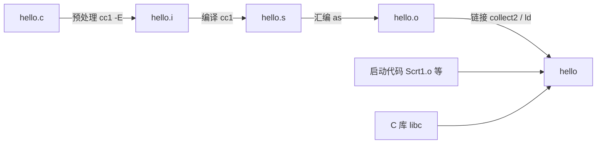

# 3. 从源文件到可执行文件

`gcc hello.c -o hello` 一条命令就得到了能运行的程序。顺利的时候这条命令不需要理解，可一旦失败，报错可能来自四个完全不同的程序：找不到头文件是预处理器报的，少一个分号是编译器报的，`undefined reference` 只有链接器才会说。分不清是谁在说话，就会在错误的地方改代码。

本章把这条命令拆成四步，分别生成 `.i`、`.s`、`.o` 和可执行文件，看清每一步的输入输出；然后用 `nm`、`objdump`、`size`、`ldd` 打开产物看里面有什么；最后整理每条诊断属于哪一步，并给出这一部分默认使用的编译选项。文中的输出来自 Debian 13 上的 GCC 14.2 或 Windows 11 上的 MinGW-w64 GCC 13.2，每段都注明来源。

配套源文件在 `code/开发与工程基础/3_从源文件到可执行文件/` 下。最基本的 `hello.c` 故意带了注释和一个宏，后面用来说明预处理做了什么：

```c
#include <stdio.h>

/* 这一行注释在预处理后消失 */
#define GREETING "Hello, C!"

int main(void) {
    printf(GREETING "\n");
    return 0;
}
```

## 1. 一条命令背后的四个阶段

GCC 文档把一次编译分成至多四个阶段：预处理 (preprocessing)、编译 (compilation proper)、汇编 (assembly) 和链接 (linking)，顺序固定。`gcc` 自己不完成其中任何一步，它按命令行选项决定调用哪些程序、按什么参数传，这个角色称为编译器驱动 (compiler driver)。

在命令里加 `-v`，驱动会把每个阶段实际执行的命令行打印到标准错误。下面是在 Linux 上编译 `hello.c` 的输出（`-save-temps` 让中间文件留在当前目录，否则它们用随机名字放在临时目录并在结束时删除）：

::: terminal title="zsh - gcc -v -save-temps hello.c -o hello"

```console
$ gcc -v -save-temps hello.c -o hello
Using built-in specs.
COLLECT_GCC=gcc
Target: x86_64-linux-gnu
...
 /usr/libexec/gcc/x86_64-linux-gnu/14/cc1 -E -quiet -v -imultiarch x86_64-linux-gnu hello.c -mtune=generic -march=x86-64 -fpch-preprocess -fasynchronous-unwind-tables -o hello.i
 /usr/libexec/gcc/x86_64-linux-gnu/14/cc1 -fpreprocessed hello.i -quiet -dumpbase hello.c -dumpbase-ext .c -mtune=generic -march=x86-64 -version -fasynchronous-unwind-tables -o hello.s
 as -v --64 -o hello.o hello.s
 /usr/libexec/gcc/x86_64-linux-gnu/14/collect2 -plugin /usr/libexec/gcc/x86_64-linux-gnu/14/liblto_plugin.so ...
```

:::

前三行分别是预处理器、编译器和汇编器，第四行是 `collect2`，它负责组织最后的链接。`collect2` 的参数很长，把 `-plugin`、`-L` 之类的选项去掉，剩下的链接输入是这些：

```text
Scrt1.o crti.o crtbeginS.o hello.o -lgcc -lgcc_s -lc -lgcc -lgcc_s crtendS.o crtn.o
```

前三个 `.o` 和最后两个 `.o` 是启动代码与收尾代码，`-lc` 是 C 标准库。它们都不在 `hello.c` 里，却都是可执行文件的一部分。四个阶段的名字、执行者与产物可以列成一张表：

| 阶段 | 谁执行 | 输入 | 输出 |
| --- | --- | --- | --- |
| 预处理 | `cc1 -E` | `hello.c` 及它包含的头文件 | `hello.i` |
| 编译 | `cc1` | `hello.i` | `hello.s` |
| 汇编 | `as` | `hello.s` | `hello.o` |
| 链接 | `collect2` 调用 `ld` | `hello.o`、启动代码、C 库 | `hello` |



::: concept dev-build-four-stages title="gcc 的四个阶段与各自的产物"

`gcc` 是按顺序调用预处理、编译、汇编、链接四个阶段的驱动。`-E` 停在预处理之后，产物是 `.i`；`-S` 停在编译之后，产物是 `.s`；`-c` 停在汇编之后，产物是 `.o`；不加这三个选项则继续链接，得到可执行文件。`-o` 指定最后一个阶段的输出文件名。

:::

第一部分按 C 语言规则把翻译过程分成八个阶段，其中前四个是预处理，第五、六阶段处理字符集和相邻字符串字面量，第七阶段完成语法语义分析并生成代码，第八阶段链接。GCC 的四阶段是这八个阶段在工具上的切分：预处理器做前四个，编译器做第五到第七个，汇编器把汇编代码变成机器码，链接器做第八个。两套说法不冲突，看语言规则时用八个阶段，看命令行时用四个阶段。

:::: details 完整的 gcc -v 输出

`gcc -v -save-temps hello.c -o hello` 在标准错误上打印的内容（Linux，GCC 14.2）。超长的 `Configured with` 行和 `collect2` 的参数用 `...` 省略：

::: terminal title="zsh - gcc -v -save-temps hello.c -o hello"

```text
Using built-in specs.
COLLECT_GCC=gcc
COLLECT_LTO_WRAPPER=/usr/libexec/gcc/x86_64-linux-gnu/14/lto-wrapper
Target: x86_64-linux-gnu
Configured with: ../src/configure -v --with-pkgversion='Debian 14.2.0-19' ...
Thread model: posix
gcc version 14.2.0 (Debian 14.2.0-19)
COLLECT_GCC_OPTIONS='-v' '-save-temps' '-o' 'hello' '-mtune=generic' '-march=x86-64'
 /usr/libexec/gcc/x86_64-linux-gnu/14/cc1 -E -quiet -v -imultiarch x86_64-linux-gnu hello.c -mtune=generic -march=x86-64 -fpch-preprocess -fasynchronous-unwind-tables -o hello.i
ignoring nonexistent directory "/usr/local/include/x86_64-linux-gnu"
#include "..." search starts here:
#include <...> search starts here:
 /usr/lib/gcc/x86_64-linux-gnu/14/include
 /usr/local/include
 /usr/include/x86_64-linux-gnu
 /usr/include
End of search list.
COLLECT_GCC_OPTIONS='-v' '-save-temps' '-o' 'hello' '-mtune=generic' '-march=x86-64'
 /usr/libexec/gcc/x86_64-linux-gnu/14/cc1 -fpreprocessed hello.i -quiet -dumpbase hello.c -dumpbase-ext .c -mtune=generic -march=x86-64 -version -fasynchronous-unwind-tables -o hello.s
GNU C17 (Debian 14.2.0-19) version 14.2.0 (x86_64-linux-gnu)
COLLECT_GCC_OPTIONS='-v' '-save-temps' '-o' 'hello' '-mtune=generic' '-march=x86-64'
 as -v --64 -o hello.o hello.s
GNU assembler version 2.44 (x86_64-linux-gnu) using BFD version (GNU Binutils for Debian) 2.44
COLLECT_GCC_OPTIONS='-v' '-save-temps' '-o' 'hello' '-mtune=generic' '-march=x86-64' '-dumpdir' 'hello.'
 /usr/libexec/gcc/x86_64-linux-gnu/14/collect2 -plugin /usr/libexec/gcc/x86_64-linux-gnu/14/liblto_plugin.so ... hello.o -lgcc --push-state --as-needed -lgcc_s --pop-state -lc -lgcc --push-state --as-needed -lgcc_s --pop-state ... crtendS.o ... crtn.o
```

:::

里面夹着很多与四个阶段无关的行：`COLLECT_GCC_OPTIONS` 记录驱动收到的选项，`COMPILER_PATH`、`LIBRARY_PATH` 是驱动搜索程序与库的目录，`GCC heuristics` 一类是编译器的内部参数。真正说明阶段划分的只有以程序路径或 `as` 开头的那四行。

::::

想只看驱动将要执行什么而不真的执行，用 `-###`。它的输出和 `-v` 相似，但不会运行任何程序，也不会产生文件：

::: terminal title="zsh - gcc -### hello.c -o hello_dry"

```console
$ gcc -### hello.c -o hello_dry 2> dry.log
$ wc -l < dry.log
19
$ ls hello_dry
ls: cannot access 'hello_dry': No such file or directory
```

:::

`-###` 会打印同样的命令，但不会执行；带特殊字符的参数在它的输出里被引号括起来，与 `-v` 只是排版上的差别。排查「编译器到底拿到了哪些选项」时，`-###` 比 `-v` 更干净，因为它不会顺手做一次完整的编译。

## 2. 预处理：-E

`-E` 只做预处理，把结果写到标准输出或 `-o` 指定的文件：

::: terminal title="zsh - gcc -E hello.c -o hello.i"

```console
$ gcc -E hello.c -o hello.i
$ wc -l hello.c hello.i
    9 hello.c
  819 hello.i
  828 total
```

:::

一个 9 行的源文件变成了 819 行，多出来的部分几乎全部来自 `#include <stdio.h>`：预处理把 `stdio.h` 的内容原样插到包含点。`hello.i` 末尾是预处理之后的 `main`：

```c
# 6 "hello.c"
int main(void) {
    printf("Hello, C!" "\n");
    return 0;
}
```

三件事已经发生了。注释不见了（`grep -c "这一行注释" hello.i` 得到 0）；宏 `GREETING` 被替换成了 `"Hello, C!"`（`grep -c GREETING hello.i` 同样是 0）；`#include` 那一行被头文件内容取代。替换之后剩下两个相邻的字符串字面量 `"Hello, C!" "\n"`，它们还没有被连接，因为字符串字面量的连接属于翻译阶段的第六阶段，由编译器而不是预处理器完成。

`#` 开头的行是行标记 (linemarker)，记录后面的内容原本来自哪个文件的哪一行。上面那行 `# 6 "hello.c"` 表示 `main` 在源文件的第 6 行。编译 `.i` 文件时，诊断信息里的文件名和行号就靠这些标记还原。拿第 6 节那个少了分号的程序试一次：先用 `-save-temps` 由源文件生成 `.i`，再单独编译这个 `.i`：

::: terminal title="zsh - 编译预处理结果时的诊断"

```console
$ gcc -save-temps missing_semi.c -o missing_semi 2> log.txt
$ gcc -c missing_semi.i -o missing_semi.o
missing_semi.c: In function ‘main’:
missing_semi.c:5:5: error: expected ‘,’ or ‘;’ before ‘for’
```

:::

即使编译的是 `missing_semi.i`，报错仍然指向 `missing_semi.c` 的第 5 行。需要干净的预处理文本（比如拿去对比、或者喂给不认行标记的工具），加 `-P` 去掉它们，`hello.i` 会从 819 行减到 309 行。

从命令行定义宏用 `-D`，等价于在文件开头写一行 `#define`。`macro_demo.c` 用条件编译控制一段调试输出：

```c
#include <stdio.h>

/* 摄氏温度换算为华氏温度 */
#define FAHRENHEIT(c) ((c) * 9.0 / 5.0 + 32.0)
#define STEP 10
#define LIMIT (3 * STEP)

int main(void) {
    for (int c = 0; c <= LIMIT; c += STEP) {
#ifdef DEBUG
        fprintf(stderr, "debug: c = %d\n", c);
#endif
        printf("%3d C = %5.1f F\n", c, FAHRENHEIT(c));
    }
    return 0;
}
```

不定义 `DEBUG` 时，`#ifdef` 到 `#endif` 之间的内容在预处理阶段就被删掉，编译器根本看不到它。用 `-E -P` 看两遍处理的差别：

::: terminal title="zsh - gcc -E -P macro_demo.c"

```console
$ gcc -E -P macro_demo.c | tail -n 6
int main(void) {
    for (int c = 0; c <= (3 * 10); c += 10) {
        printf("%3d C = %5.1f F\n", c, ((c) * 9.0 / 5.0 + 32.0));
    }
    return 0;
}
$ gcc -DDEBUG -E -P macro_demo.c | tail -n 7
int main(void) {
    for (int c = 0; c <= (3 * 10); c += 10) {
        fprintf(stderr, "debug: c = %d\n", c);
        printf("%3d C = %5.1f F\n", c, ((c) * 9.0 / 5.0 + 32.0));
    }
    return 0;
}
```

:::

`-DDEBUG` 定义了一个没有值的宏，与在文件里写 `#define DEBUG` 等效；写成 `-DDEBUG=1` 则等价于 `#define DEBUG 1`。注意 `LIMIT` 展开成 `(3 * 10)`、`STEP` 展开成 `10`、`FAHRENHEIT(c)` 展开成带括号的表达式，宏只做记号替换，不做计算。`-D` 在工程中的常见用法是给不同构建传入不同的开关，Make 和 CMake 里设置的就是这类选项，第 8、9 章会接上。

尖括号头文件的搜索目录可以在预处理时用 `-v` 看到：

::: terminal title="zsh - gcc -xc -E -v /dev/null"

```console
$ gcc -xc -E -v /dev/null
#include "..." search starts here:
#include <...> search starts here:
 /usr/lib/gcc/x86_64-linux-gnu/14/include
 /usr/local/include
 /usr/include/x86_64-linux-gnu
 /usr/include
End of search list.
```

:::

`-xc` 告诉驱动把输入当 C 源文件，这里输入是空设备，相当于一个空源文件，目的只是让预处理器报告搜索路径。用 `-I` 可以在列表最前面插入目录。`exercises/inc_demo/` 把 `greet.h` 放在 `include/`、`useinc.c` 放在 `src/`，在 `exercises/inc_demo/` 目录里执行：

::: terminal title="zsh - -I 指定头文件目录"

```console
$ gcc -std=c17 -Wall -Wextra -Iinclude src/useinc.c -o useinc
$ ./useinc
Hi from inc
$ gcc -std=c17 -Wall -Wextra src/useinc.c -o useinc2
src/useinc.c:3:10: fatal error: greet.h: No such file or directory
    3 | #include "greet.h"
      |          ^~~~~~~~~
compilation terminated.
```

:::

第二条命令没有加 `-Iinclude`，预处理器只在源文件所在目录和标准目录里找，找不到就报 `fatal error`。这类错误发生在预处理阶段，此时还没有任何语法检查。`-I` 的写法与目录布局在第 7 章展开。

预处理阶段只看预处理指令，不看 C 语法。下面这段有语法错误，`-E` 照样能跑完：

::: terminal title="zsh - 预处理不检查语法"

```console
$ printf 'int main(void) { return 0 }\n' | gcc -E -P -xc -
int main(void) { return 0 }
```

:::

少了分号仍然原样输出，退出状态是 0。要真正检查语法，得让编译阶段跑起来，比如 `gcc -fsyntax-only bad.c`，或者直接编译。

## 3. 编译：-S

`-S` 让编译阶段结束后停下，输出汇编代码：

::: terminal title="zsh - gcc -S hello.c"

```console
$ gcc -S hello.c
$ wc -l hello.s
28 hello.s
```

:::

不加 `-o` 时，`-S` 把 `hello.c` 的后缀换成 `.s`，`-c` 换成 `.o`，`-E` 则写到标准输出。这几个默认行为记不住也不要紧，写惯用 `-o` 指定名字即可。

`hello.s` 去掉以 `.cfi_` 开头的调试辅助指令和 `.LFB0`、`.LFE0` 一类编译器内部标签后是这样的：

```asm
	.file	"hello.c"
	.text
	.section	.rodata
.LC0:
	.string	"Hello, C!"
	.text
	.globl	main
	.type	main, @function
main:
	pushq	%rbp
	movq	%rsp, %rbp
	leaq	.LC0(%rip), %rax
	movq	%rax, %rdi
	call	puts@PLT
	movl	$0, %eax
	popq	%rbp
	ret
	.size	main, .-main
	.ident	"GCC: (Debian 14.2.0-19) 14.2.0"
```

`main:` 这一段就是函数本体。读汇编不需要会写，认得出几件事就够用了：`LC0` 标出了字符串 `"Hello, C!"` 的位置，`leaq` 把它取到寄存器，`call puts@PLT` 调用 `puts`，`movl $0, %eax` 是 `return 0`。

这里最值得注意的一点是 `printf` 不见了。源程序写的是 `printf(GREETING "\n")`，编译后调用的却是 `puts`。GCC 知道「打印一个字符串再加换行」用 `puts` 表达更直接，而 `puts` 不需要解析格式串，于是在 `-O0` 下也做了这个替换。这是编译器内置函数 (built-in function) 的行为，与优化级别无关。加 `-fno-builtin` 关掉它就能看见原来的调用：

::: terminal title="zsh - 关掉内置函数"

```console
$ gcc -O0 -fno-builtin -S hello.c -o hello_nb.s
$ grep call hello_nb.s
	call	printf@PLT
$ gcc -O0 -fno-builtin -c hello.c -o hello_nb.o
$ nm hello_nb.o
0000000000000000 T main
                 U printf
```

:::

这个替换有实际后果：调试时在 `printf` 上设断点不会命中，因为它已经被换成了 `puts`。第 12 章用调试器时还会遇到这类「源码与机器码对不上」的情形。

`-O0` 与 `-O2` 的汇编长度差别一眼可见，同一个文件分别是 28 行和 25 行。`-O2` 的那份省掉了栈帧的建立与拆除，寄存器用得也更直接：

```asm
main:
	subq	$8, %rsp
	leaq	.LC0(%rip), %rdi
	call	puts@PLT
	xorl	%eax, %eax
	addq	$8, %rsp
	ret
```

优化级别在第 15 章系统讨论，这里只需要知道 `-S` 是观察编译器到底生成了什么的窗口。

Windows 上的 MinGW 编译同样的 `hello.c`，汇编里多一行调用：

::: terminal title="zsh - MinGW 的 main 开头"

```console
$ gcc -std=c17 -Wall -Wextra -S hello.c -o hello.s
$ sed -n '/^main:/,/call.*puts/p' hello.s
main:
	pushq	%rbp
	.seh_pushreg	%rbp
	movq	%rsp, %rbp
	.seh_setframe	%rbp, 0
	subq	$32, %rsp
	.seh_stackalloc	32
	.seh_endprologue
	call	__main
	leaq	.LC0(%rip), %rax
	movq	%rax, %rcx
	call	puts
```

:::

`call __main` 是 MinGW 的启动约定：`main` 一进门先调用 `__main`，由它完成运行库要求的一部分初始化。Linux 上不存在这个符号。`.seh_` 开头的指令是 Windows 的异常处理描述，与程序逻辑无关。这类平台差异以后还会遇到，判断的标准是有没有影响操作，不影响就略过。

## 4. 汇编：-c 与目标文件

`-c` 让汇编阶段结束后停下，得到目标文件 (object file)：

::: terminal title="zsh - gcc -c hello.c"

```console
$ gcc -c hello.c
$ file hello.o
hello.o: ELF 64-bit LSB relocatable, x86-64, version 1 (SYSV), not stripped
$ nm hello.o
0000000000000000 T main
                 U puts
```

:::

`nm` 列出目标文件里的符号 (symbol) 及其类型。两条记录，两种含义：

- `T main`：`T` 表示这个符号位于代码段，并且是全局的，别的目标文件可以引用它。`main` 是 `hello.c` 定义的函数。
- `U puts`：`U` 表示未定义。`hello.o` 用到了 `puts`，但它的定义在别处，这里只是一条待填的引用。

小写的 `t` 表示局部符号，`D`、`d` 是已初始化的数据段，`B`、`b` 是未初始化的数据段，`R`、`r` 是只读数据段；大小写的区别是全局与局部。

`objdump -dr` 把机器码反汇编出来，并在旁边列出重定位 (relocation) 记录：

::: terminal title="zsh - objdump -dr hello.o"

```console
$ objdump -dr hello.o

hello.o:     file format elf64-x86-64

Disassembly of section .text:

0000000000000000 <main>:
   0:	55                   	push   %rbp
   1:	48 89 e5             	mov    %rsp,%rbp
   4:	48 8d 05 00 00 00 00 	lea    0x0(%rip),%rax        # b <main+0xb>
			7: R_X86_64_PC32	.rodata-0x4
   b:	48 89 c7             	mov    %rax,%rdi
   e:	e8 00 00 00 00       	call   13 <main+0x13>
			f: R_X86_64_PLT32	puts-0x4
  13:	b8 00 00 00 00       	mov    $0x0,%eax
  18:	5d                   	pop    %rbp
  19:	c3                   	ret
```

:::

`call` 指令后面本该是目标地址，现在填的是 `00 00 00 00`，下面一行 `R_X86_64_PLT32 puts-0x4` 说明这个位置要由链接器填上 `puts` 的地址。`lea` 用来取字符串的地址，也同样留了空位，等链接器填上 `.rodata` 段的真实地址。目标文件里出现成片的零不奇怪：凡是引用了别的文件里的东西，汇编阶段都不知道它的位置。

`hello.o` 缺的不只是地址。它没有 `_start`，没有 C 库，不知道程序从哪开始执行，也不知道 `puts` 在哪里。这些都归链接器管。

三种常见的可执行格式各有各的目标文件格式：Linux 用 ELF，Windows 用 PE/COFF，macOS 用 Mach-O。`file` 命令能直接告诉你手上的是什么。Windows 上编译出的 `hello.o` 是 COFF 格式：

::: terminal title="zsh - MinGW 的目标文件"

```console
$ gcc -c hello.c
$ file hello.o
hello.o: x86-64 COFF object file, no line number info, not stripped, 7 sections, symbol offset=0x210, 20 symbols, 1st section name ".text", 2nd section name ".data"
```

:::

用 `objdump -dr` 看 MinGW 目标文件开头那段，`call` 指令下面同样有重定位记录，只是类型名从 ELF 的 `R_X86_64_PLT32` 变成了 PE 的 `IMAGE_REL_AMD64_REL32`，意思一样：这里要填一个地址。

::: terminal title="zsh - MinGW 的重定位记录"

```console
$ objdump -dr hello.o | sed -n '7,12p'
0000000000000000 <main>:
   0:	55                   	push   %rbp
   1:	48 89 e5             	mov    %rsp,%rbp
   4:	48 83 ec 20          	sub    $0x20,%rsp
   8:	e8 00 00 00 00       	call   d <main+0xd>
			9: IMAGE_REL_AMD64_REL32	__main
```

:::

格式细节不在本章范围内，能认出「这是个还没填完地址的中间产物」就够了。`nm` 在 Windows 上还会多列出 `.text`、`.data` 这类段符号，真正的函数和未定义引用混在中间，需要过滤：

::: terminal title="zsh - MinGW 的 nm 输出"

```console
$ nm hello.o | grep -v '\.'
                 U __main
0000000000000000 T main
                 U puts
```

:::

除了 `main` 和 `puts`，这里还多了一个 `U __main`，就是上一节汇编里那个调用。它由 MinGW 的运行库提供，Linux 上没有对应物。

## 5. 链接

`gcc hello.o -o hello` 把目标文件、启动代码和 C 库交给链接器：

::: terminal title="zsh - 链接并运行"

```console
$ gcc hello.o -o hello
$ ./hello
Hello, C!
$ echo $?
0
```

:::

链接器做的事是把所有目标文件拼在一起，给每个未定义的符号找到定义，再填回那些被留空的位置。`hello.o` 里的 `U puts` 在链接后不再未定义，反汇编可执行文件能看到 `call` 后面填上了 `puts` 的地址：

::: terminal title="zsh - 链接后的 call"

```console
$ objdump -d hello | sed -n '/<main>:/,+8p'
0000000000001139 <main>:
    1139:	55                   	push   %rbp
    113a:	48 89 e5             	mov    %rsp,%rbp
    113d:	48 8d 05 c0 0e 00 00 	lea    0xec0(%rip),%rax        # 2004 <_IO_stdin_used+0x4>
    1144:	48 89 c7             	mov    %rax,%rdi
    1147:	e8 e4 fe ff ff       	call   1030 <puts@plt>
    114c:	b8 00 00 00 00       	mov    $0x0,%eax
    1151:	5d                   	pop    %rbp
    1152:	c3                   	ret
```

:::

`e8 e4 fe ff ff` 是相对偏移，不再是零。`nm hello` 里 `U puts@GLIBC_2.2.5` 仍然标着 `U`，因为程序是动态链接的：`puts` 的代码不在这个文件里，运行时由动态链接器从 `libc.so.6` 加载。但链接这一步已经把它登记成了「由该库提供」，不再算缺失。

链接错误最常见的原因只有一个：某个符号有引用、没有定义。反过来，同一个名字在两个目标文件里都有定义也会报错，那属于多翻译单元的组织问题，第 5、6 章讨论。`area_main.c` 声明了一个 `area` 并调用，但整个项目里没有它的定义：

```c
#include <stdio.h>

int area(int w, int h);

int main(void) {
    printf("%d\n", area(3, 4));
    return 0;
}
```

::: terminal title="zsh - 只声明不定义的链接错误"

```console
$ gcc -std=c17 -Wall -Wextra -c area_main.c -o area_main.o
$ gcc area_main.o -o area_main
/usr/bin/ld: area_main.o: in function `main':
area_main.c:(.text+0xf): undefined reference to `area'
collect2: error: ld returned 1 exit status
```

:::

关键信息在第三行：`undefined reference` 后面跟着缺失的名字 `area`，出处是 `area_main.o` 的 `main`。编译这一步完全成功——声明与调用是一致的，编译器挑不出毛病；只有链接器知道没有任何目标文件提供 `area`。补上一个定义就正常了：

::: terminal title="zsh - 补上定义"

```console
$ gcc -std=c17 -Wall -Wextra -c area.c -o area.o
$ gcc area_main.o area.o -o area_main
$ ./area_main
12
```

:::

另一类链接错误来自库。Linux 上 C 数学库 `libm` 与 `libc` 分开存放，`sqrt`、`pow` 这类函数的定义在 `libm` 里，链接时必须用 `-lm` 指名：

```c
#include <math.h>
#include <stdio.h>
#include <stdlib.h>

int main(int argc, char *argv[]) {
    if (argc != 2) {
        fprintf(stderr, "usage: root NUMBER\n");
        return 2;
    }
    double x = strtod(argv[1], NULL);
    printf("%g\n", sqrt(x));
    return 0;
}
```

::: terminal title="zsh - sqrt 与 -lm"

```console
$ gcc -c root.c -o root.o
$ gcc root.o -o root
/usr/bin/ld: root.o: in function `main':
root.c:(.text+0x6a): undefined reference to `sqrt'
collect2: error: ld returned 1 exit status
$ gcc root.o -o root -lm
$ ./root 2
1.41421
```

:::

`-l` 后面跟库名，链接器去找 `libm.a` 或 `libm.so`；`-L` 用来添加库的搜索目录，第 8 章讲静态库时才会用到。`-lm` 必须放在 `root.o` 后面：链接器按从左到右的顺序处理输入，遇到 `-lm` 时如果还没有未解决的 `sqrt`，它不会把这个库里的成员取出来。把选项写反了同样报错：

::: terminal title="zsh - -lm 放在目标文件前面"

```console
$ gcc -lm root.o -o root_bad
/usr/bin/ld: root.o: in function `main':
root.c:(.text+0x6a): undefined reference to `sqrt'
collect2: error: ld returned 1 exit status
```

:::

`-lm` 的位置问题在静态库上更明显，第 8 章专门讲。MinGW 与 macOS 把数学函数放在 C 库内，写不写 `-lm` 都能链接。

程序运行结束后返回值报告给了 shell，`echo $?` 读到 0。`root` 不带参数时把用法写到标准错误并返回 2：

::: terminal title="zsh - 退出状态"

```console
$ ./root
usage: root NUMBER
$ echo $?
2
$ ./root 16
4
$ echo $?
0
```

:::

退出状态在第 2 章已经用于命令的连接，这里的意义是：脚本、Make、测试框架判断一次编译或一次运行是否成功，靠的就是这个数字，而不是屏幕上打印了什么。

::: tip 先 -c 再链接，错误信息里就是真实文件名

直接 `gcc root.c -o root` 失败时，报错里出现的是 `ccXXXXXX.o` 这样的临时目标文件名：

```text
/usr/bin/ld: /home/minsecrus/tutorial/tmp/ccUFD0Si.o: in function `main':
root.c:(.text+0x6a): undefined reference to `sqrt'
```

分成 `gcc -c root.c -o root.o` 和 `gcc root.o -o root` 两步，报错里就是 `root.o`。文件一多，谁少了一个定义马上就能看出来。

:::

## 6. 错误从哪里来

四个阶段各自报各自的问题，把常见诊断按阶段归类，看到消息就知道该查什么：

| 诊断的样子 | 阶段 | 典型原因 |
| --- | --- | --- |
| `fatal error: xxx.h: No such file or directory` | 预处理 | 头文件名写错、缺少 `-I`、头文件没装 |
| `error: expected ‘;’ before ...` 一类 | 编译 | 语法错误、类型不匹配、声明与定义不一致 |
| `undefined reference to` 加符号名 | 链接 | 有声明没定义、忘了链接库、`-l` 位置不对 |
| `warning: implicit declaration of function` | 编译 | 没包含声明该函数的头文件 |

同一个程序可以依次踩中三个阶段的错误。`exercises/three_errors.c` 里有三处问题：

```c
#include <stdoi.h>

int scale(int x);

int main(void) {
    int factor = "3";
    printf("%d\n", scale(factor));
    return 0;
}
```

直接编译，只会看到第一个：

::: terminal title="zsh - 三个错误的第一轮"

```console
$ gcc -std=c17 -Wall -Wextra three_errors.c -o three_errors
three_errors.c:1:10: fatal error: stdoi.h: No such file or directory
    1 | #include <stdoi.h>
      |          ^~~~~~~~~
compilation terminated.
```

:::

`fatal error` 意味着预处理阶段就终止了，后面两个错误根本没被检查。把 `stdoi.h` 改成 `stdio.h` 再编译，轮到编译阶段说话：

::: terminal title="zsh - 修好头文件之后"

```console
$ gcc -std=c17 -Wall -Wextra three_errors.c -o three_errors
three_errors.c: In function ‘main’:
three_errors.c:6:18: error: initialization of ‘int’ from ‘char *’ makes integer from pointer without a cast [-Wint-conversion]
    6 |     int factor = "3";
      |                  ^~~
```

:::

不能把字符串字面量赋给 `int`。改成 `int factor = 3;` 后再编译，编译阶段通过，链接阶段报第三个：

::: terminal title="zsh - 修好类型之后"

```console
$ gcc -c three_errors.c -o three_errors.o
$ gcc three_errors.o -o three_errors
/usr/bin/ld: three_errors.o: in function `main':
three_errors.c:(.text+0x15): undefined reference to `scale'
collect2: error: ld returned 1 exit status
```

:::

`scale` 只有声明，没有定义。补上定义，程序才能运行：

```c
int scale(int x) {
    return x * 10;
}
```

::: terminal title="zsh - 补上定义之后"

```console
$ gcc -std=c17 -Wall -Wextra three_errors.c -o three_errors
$ ./three_errors
30
```

:::

这一串诊断的顺序就是四个阶段的顺序。永远先读第一条错误，修好它再重新编译；后面的错误常常是第一条的连锁反应，一起改反而容易改错地方。少一个分号会引发一串「期望 `;`」「未声明的标识符」之类的报错，全部来自同一个位置：

::: terminal title="zsh - 一条错误引起的连锁反应"

```console
$ gcc -std=c17 -Wall -Wextra missing_semi.c -o missing_semi
missing_semi.c: In function ‘main’:
missing_semi.c:5:5: error: expected ‘,’ or ‘;’ before ‘for’
    5 |     for (int i = 1; i <= 3; i++) {
      |     ^~~
missing_semi.c:5:21: error: ‘i’ undeclared (first use in this function)
    5 |     for (int i = 1; i <= 3; i++) {
      |                     ^
missing_semi.c:5:21: note: each undeclared identifier is reported only once for each function it appears in
missing_semi.c:5:32: error: expected ‘;’ before ‘)’ token
    5 |     for (int i = 1; i <= 3; i++) {
      |                                ^
      |                                ;
missing_semi.c:5:32: error: expected statement before ‘)’ token
```

:::

第一条说第 5 行 `for` 前面缺了 `;`，指的是第 4 行末尾；后面关于 `i` 未声明的报错都是因为 `for` 这一句没被当成循环解析。补上第 4 行末尾的分号，四条错误一起消失。

GCC 14 起，调用一个没有声明的函数是错误，不再只是警告。下面这段把 `doubled` 的定义放在 `main` 之后，调用之前没有声明：

::: terminal title="zsh - GCC 14 上的未声明函数"

```console
$ gcc -std=c17 -Wall -Wextra impl.c -o impl
impl.c: In function ‘main’:
impl.c:5:20: error: implicit declaration of function ‘doubled’ [-Wimplicit-function-declaration]
    5 |     printf("%d\n", doubled(n));
      |                    ^~~~~~~
```

:::

同一段代码在 GCC 13.2（Windows，MinGW-w64）上只给警告，程序照样生成并输出 84。注意这条输出里的引号是 ASCII 的单引号，与 Linux 上的弯曲引号不同，这是两个版本在诊断信息排版上的差异，内容完全一样：

::: terminal title="zsh - 同一段代码在 MinGW GCC 13.2 上"

```console
$ gcc -std=c17 -Wall -Wextra impl.c -o impl
impl.c: In function 'main':
impl.c:5:20: warning: implicit declaration of function 'doubled' [-Wimplicit-function-declaration]
    5 |     printf("%d\n", doubled(n));
      |                    ^~~~~~~
$ ./impl
84
```

:::

警告里没有函数原型，编译器只能按默认假设处理调用，返回值与参数是否真的匹配它无法检查。这也是别人的程序在自己的编译器上能编译、换个版本就报错的原因之一。把函数的声明放在调用之前，或者把定义移到 `main` 前面，这类问题不会出现。

<Quiz
  type="single"
  :options="[
    { label: '预处理器；它找不到头文件，后面的阶段就不会运行。', value: 'A' },
    { label: '编译器；声明与调用不一致时编译器才检查。', value: 'B' },
    { label: '汇编器；目标文件里的符号表由它建立。', value: 'C' },
    { label: '链接器；它在所有目标文件里找不到函数定义。', value: 'D' }
  ]"
  answer="D"
>

<template #question>

编译一个单文件程序时出现一条未定义符号（undefined reference）的消息，指出 `parse` 找不到定义。这条消息是哪个阶段报告的？

</template>

正确答案是 **D**。`undefined reference` 是链接器 `ld` 的消息：编译阶段检查到 `parse` 有声明、调用方式也正确，所以放行；链接器把目标文件和库都翻过一遍，没有任何地方定义 `parse`，于是报错。A 的 `fatal error: ... No such file or directory`、B 的语法与类型错误都不是这个形式。

</Quiz>

<Quiz
  type="single"
  :options="[
    { label: '-E', value: 'A' },
    { label: '-S', value: 'B' },
    { label: '-c', value: 'C' },
    { label: '-o', value: 'D' }
  ]"
  answer="C"
>

<template #question>

只要目标文件、不要可执行文件，应该用哪个选项？

</template>

正确答案是 **C**。`-c` 停在汇编之后，每个源文件生成一个 `.o`；`-E` 停在预处理之后，`-S` 停在编译之后，`-o` 只是给某个阶段指定输出文件名，本身不决定停在哪里。

</Quiz>

## 7. 常用选项

这一部分的默认命令是：

```text
gcc -std=c17 -Wall -Wextra -g -o prog prog.c
```

各个选项的用途和在哪里深入：

| 选项 | 作用 | 详细讨论 |
| --- | --- | --- |
| `-o 文件` | 指定最终输出文件名，不写时 Linux 上是 `a.out`，Windows 上是 `a.exe` | 本章 |
| `-std=c17` | 选择 C17 标准模式，`__STDC_VERSION__` 为 `201710L`；不加时 GCC 14 默认 `gnu17` | 第 16 章 |
| `-Wall -Wextra` | 打开常用警告，`-Wextra` 在 `-Wall` 之外再加一批 | 第 13 章 |
| `-g` | 生成调试信息，可执行文件变大，调试器靠它对应源码 | 第 12 章 |
| `-O0`、`-O2` | 优化级别，`-O0` 不做优化，`-O2` 是发布构建的常用起点 | 第 15 章 |
| `-D名字[=值]` | 从命令行定义宏 | 本章 |
| `-I目录` | 添加头文件的搜索目录 | 第 7 章 |
| `-L目录`、`-l库` | 添加库搜索目录、链接指定库 | 第 8、10 章 |

`-std=c17` 与默认的 `gnu17` 差别在于后者允许 GNU 扩展，并且不定义 `__STRICT_ANSI__`。查宏定义可以直接看出来：

::: terminal title="zsh - 默认标准模式与 -std=c17"

```console
$ gcc -dM -E - < /dev/null | grep -E '__STDC_VERSION__|__STRICT_ANSI__'
#define __STDC_VERSION__ 201710L
$ gcc -std=c17 -dM -E - < /dev/null | grep -E '__STDC_VERSION__|__STRICT_ANSI__'
#define __STRICT_ANSI__ 1
#define __STDC_VERSION__ 201710L
```

:::

两者都是 C17，区别只在是否严格。日常写程序用 `-std=c17` 能提前暴露对 GNU 扩展的依赖，第 16 章会说明这在跨平台构建中的价值。

`-g` 不影响 `size` 报告的段大小，只让文件变大：

::: terminal title="zsh - -g 的影响"

```console
$ gcc hello.c -o hello
$ gcc -g hello.c -o hello_g
$ stat -c "%s %n" hello hello_g
15952 hello
16960 hello_g
$ size hello hello_g
   text	   data	    bss	    dec	    hex	filename
   1312	    584	      8	   1904	    770	hello
   1312	    584	      8	   1904	    770	hello_g
```

:::

多出来的约 1 KB 是调试信息段，运行时不会被加载进内存。`-g` 与优化级别没有冲突，调试时通常写 `-O0 -g` 或 `-Og`。

不写 `-o` 时，输出文件名按平台习惯取默认值：

::: terminal title="zsh - 默认输出名"

```console
$ gcc hello.c
$ ls a.out
a.out
$ ./a.out
Hello, C!
```

:::

Windows 上同样一条命令生成的是 `a.exe`。这个默认名不适合留在工程里，编译时总是写 `-o`。

::: tip MinGW 的 `%zu` 警告

MinGW-w64 GCC 13.2 在 `-Wall` 下会对 `%zu` 报格式错误，而程序运行的结果是对的。文件在 `code/开发与工程基础/3_从源文件到可执行文件/exercises/wformat_mingw.c`：

```text
exercises/wformat_mingw.c: In function 'main':
exercises/wformat_mingw.c:4:28: warning: unknown conversion type character 'z' in format [-Wformat=]
    4 |     printf("sizeof(int) = %zu\n", sizeof(int));
      |                            ^
exercises/wformat_mingw.c:4:12: warning: too many arguments for format [-Wformat-extra-args]
```

这是该版本运行库对 `%zu` 支持不完整造成的误报。加 `-D__USE_MINGW_ANSI_STDIO=1` 让 MinGW 用自己的格式化实现，警告消失：

```console
$ gcc -std=c17 -Wall -Wextra -D__USE_MINGW_ANSI_STDIO=1 exercises/wformat_mingw.c -o wformat
$ ./wformat
sizeof(int) = 4
```

:::

## 8. 可执行文件里有什么

`size` 把可执行文件的段大小分三列报告：

::: terminal title="zsh - size hello"

```console
$ size hello
   text	   data	    bss	    dec	    hex	filename
   1312	    584	      8	   1904	    770	hello
```

:::

`text` 是代码和只读数据，`data` 是已初始化的可写数据，`bss` 是未初始化、运行时才分配的数据。这个 9 行的程序 `text` 有 1312 字节，占大头的是启动代码与运行库的准备工作，`main` 本身只有几十字节。`dec` 与 `hex` 是三者之和。

用 `-static` 可以要求把 C 库也装进可执行文件：

::: terminal title="zsh - 静态链接"

```console
$ gcc -static hello.c -o hello_static
$ stat -c "%s %n" hello hello_static
15952 hello
758448 hello_static
$ size hello_static
   text	   data	    bss	    dec	    hex	filename
 641099	  23688	  22576	 687363	  a7d03	hello_static
$ ldd hello_static
	not a dynamic executable
```

:::

体积从 15 KB 涨到 740 KB，换来的是不依赖目标机器上的 `libc.so.6`。发布给不确定环境的机器时这是一种选择，平时不必用。

`ldd` 列出程序运行时需要哪些共享库：

::: terminal title="zsh - ldd hello"

```console
$ ldd hello
	linux-vdso.so.1
	libc.so.6 => /lib/x86_64-linux-gnu/libc.so.6
	/lib64/ld-linux-x86-64.so.2
```

:::

`libc.so.6` 是 C 库，`ld-linux-x86-64.so.2` 是动态链接器本身，`linux-vdso.so.1` 是内核提供的虚拟库。`root` 还多一个 `libm.so.6`，因为它用了 `sqrt` 并链接了 `-lm`：

::: terminal title="zsh - ldd root"

```console
$ ldd root
	linux-vdso.so.1
	libm.so.6 => /lib/x86_64-linux-gnu/libm.so.6
	libc.so.6 => /lib/x86_64-linux-gnu/libc.so.6
	/lib64/ld-linux-x86-64.so.2
```

:::

`objdump -p` 读的是文件头里的依赖表，不运行程序，得到的信息与 `ldd` 相同：

```console
$ objdump -p root | grep NEEDED
  NEEDED               libm.so.6
  NEEDED               libc.so.6
```

`ldd` 的实现方式在各个发行版上不一样，有些情况下会实际加载程序；`objdump -p` 只看文件，更保险。Windows 上没有 `ldd`，用 `objdump -p` 看 `DLL Name` 一行行列出依赖：

::: terminal title="zsh - MinGW 可执行文件的依赖"

```console
$ objdump -p hello.exe | grep "DLL Name" | head -3
	DLL Name: KERNEL32.dll
	DLL Name: api-ms-win-crt-environment-l1-1-0.dll
	DLL Name: api-ms-win-crt-heap-l1-1-0.dll
```

:::

完整列表有 9 个 DLL，除 `KERNEL32.dll` 外都是 UCRT (Universal C Runtime) 的组件，也就是 Windows 上的 C 运行库。这些 DLL 属于系统的一部分，不随程序分发。

`file` 一个命令就能看出一份文件是哪种东西：

::: terminal title="zsh - file hello hello.o"

```console
$ file hello hello.o
hello:   ELF 64-bit LSB pie executable, x86-64, version 1 (SYSV), dynamically linked, interpreter /lib64/ld-linux-x86-64.so.2, BuildID[sha1]=83d1e73f771d82efdff9544219445f142d30f97e, for GNU/Linux 3.2.0, not stripped
hello.o: ELF 64-bit LSB relocatable, x86-64, version 1 (SYSV), not stripped
```

:::

`pie executable` 与 `relocatable` 的区别就是链接前与链接后的区别：前者可以直接运行，后者是一堆等待合并的目标代码，加执行权限也运行不起来。

## 9. 习题

### 9.1 巩固

<Exercise id="20301" :d="1" :w="2">

用 `code/开发与工程基础/3_从源文件到可执行文件/macro_demo.c` 分别生成 `.i`、`.s`、`.o` 和可执行文件，记录每一步用了哪个选项、产物的行数（二进制文件记大小）。然后回答：注释在哪一步消失，带参数的宏 `FAHRENHEIT(c)` 在哪一步展开，`-DDEBUG` 让 `.i` 文件多了几行、多的是哪几行。最后把四步分开做和一条命令做各编译一次，用 `cmp` 或 `sha256sum` 比较两个可执行文件是否相同。

</Exercise>

<Exercise id="20302" :d="2" :w="2">

用 `code/开发与工程基础/3_从源文件到可执行文件/exercises/three_errors.c` 做一遍第 6 节的流程，但不看正文：先猜三处问题各由哪个阶段报告，再逐个修正，每次修正后记录新出现的完整诊断，并说明它属于哪个阶段。修完以后，把 `-Wall -Wextra` 去掉再编译一次，看哪些诊断会消失或降级，说明为什么。

</Exercise>

<Exercise id="20303" :d="2" :w="2">

用 `code/开发与工程基础/3_从源文件到可执行文件/symbols.c` 生成目标文件，运行 `nm` 和 `nm -S`，把每一行符号对应到源码中的一项：`counter`、`total`、`calls`、`cache`、`limits`、`banner`、`log_call`、`add`、`main`，以及 `puts`。逐个解释字母 `T`、`t`、`D`、`B`、`b`、`d`、`R`、`r`、`U` 的含义，并说明哪些符号在链接后仍然存在、哪些改了类型。

</Exercise>

<Exercise id="20304" :d="2" :w="2">

在 Linux（或 WSL）上编译 `code/开发与工程基础/3_从源文件到可执行文件/root.c`，分别记录不加 `-lm`、加 `-lm`、把 `-lm` 放在目标文件前面三种写法的结果。再把 `sqrt` 的实参换成常量 `9.0`（可参考同目录的 `const.c`），用 `-S` 查看汇编里还有没有对 `sqrt` 的调用，解释为什么这时不加 `-lm` 也能链接。最后说明 Windows 上为什么不会遇到这个问题。

</Exercise>

<Exercise id="20305" :d="2" :w="2">

用 `code/开发与工程基础/3_从源文件到可执行文件/calc.c`，分别以 `-O0` 和 `-O2` 构建，用 `size` 比较 `text` 段的大小，用 `wc -l` 比较 `-S` 产物的行数。再用 `ldd`（Linux）或 `objdump -p`（Windows）列出两个版本各自依赖的动态库，说明优化级别是否改变依赖关系。把两个版本各运行一次，确认输出相同。

</Exercise>

### 9.2 编程

<Exercise id="20306" :d="3" :w="3">

`code/开发与工程基础/3_从源文件到可执行文件/exercises/stats/` 下有一个三文件的小项目：`include/stats.h`、`src/stats.c`、`app/main.c`。它按顺序会失败两次。要求：

1. 先原样编译 `app/main.c`，记录第一条诊断与它所属的阶段，说明 `-Iinclude` 为什么能解决。
2. 加上 `-Iinclude` 分别编译两个 `.c`，再把两个目标文件链接成程序，记录链接器的诊断（Linux 上会出现 `pow`、`sqrt` 未定义的错误；MinGW 把数学函数并入 C 库，这一步直接成功，也要记下来）。指出这是不是源码的问题，应该怎样修改命令。
3. 修好后运行，核对输出 `mean = 5.00` 与 `spread = 2.00`。
4. 把 `stats.c` 里的 `#include "stats.h"` 改成 `#include <stats.h>`，说明结果与原因。

</Exercise>

<Exercise id="20307" :d="3" :w="3">

`code/开发与工程基础/3_从源文件到可执行文件/exercises/static_scale/` 里的 `helper.c` 把 `scale` 定义成 `static`，`main.c` 却调用它。要求：

1. 分别编译两个文件，用 `nm` 查看 `helper.o` 里 `scale` 的符号类型，解释为什么链接失败。
2. 把 `static` 去掉再链接，确认程序输出 `70`。
3. 写一个脚本 `build.sh`，用 `-c` 分别编译再链接，出错时打印是哪一步失败并返回非 0 状态。
4. 在脚本里加一个选项，让它在链接成功后自动运行程序并打印退出状态。

</Exercise>

<Exercise id="20308" :d="3" :w="3">

写一个 `stage.c`，故意在三个阶段各放一处能被发现的问题（例如一个不存在的头文件、一处类型不匹配、一个只声明没定义的函数被调用），再写一个 `diagnose.sh`：对 `stage.c` 依次运行 `gcc -E`、`gcc -S`、`gcc -c`、`gcc -o`，每次把标准错误里的第一条 `error:` 或 `fatal error:` 提取出来，按「预处理 / 编译 / 汇编 / 链接」标出它来自哪一步。脚本要能对任意给定的 `.c` 文件运行，输出格式为 `<阶段>: <诊断首行>`，某一步失败后继续下一步。

</Exercise>

### 9.3 综合与挑战

<Exercise id="20309" :d="5" :w="4">

写一个工具 `inspect.sh`，给定一个 C 源文件和一组编译选项，生成四份产物并输出一份报告：每一步的命令与产物大小、`.i` 与 `.s` 的行数、`.o` 的 `nm` 符号分类统计（已定义/未定义、全局/局部）、可执行文件的 `size` 与 `ldd` 结果。然后用它对 `hello.c`、`macro_demo.c`（加与不加 `-DDEBUG`）、`calc.c`（`-O0` 与 `-O2`）各运行一次，把报告整理成表格，说明预处理产物的大小主要由什么决定、优化的效果在哪个指标上最明显。脚本要求在缺少 `nm`、`objdump`、`size`、`ldd` 中任一工具时给出明确提示，而不是静默跳过。

</Exercise>

## 10. 参考资料

1. GCC 文档《Options Controlling the Kind of Output》，`-E`、`-S`、`-c`、`-o`、`-v`、`-###`、`-save-temps` 的定义：https://gcc.gnu.org/onlinedocs/gcc/Overall-Options.html
2. GCC 文档《Options Controlling the Preprocessor》，`-D`、`-P`、`-M`、`-MM`：https://gcc.gnu.org/onlinedocs/gcc/Preprocessor-Options.html
3. GCC 文档《Options for Linking》，`-l`、`-L`、`-static` 与输入顺序：https://gcc.gnu.org/onlinedocs/gcc/Link-Options.html
4. GCC 14 移植指南，未声明函数调用成为错误：https://gcc.gnu.org/gcc-14/porting_to.html
5. binutils 文档《nm》，符号类型的字母含义：https://sourceware.org/binutils/docs/binutils/nm.html
6. binutils 文档《objdump》，`-d`、`-r`、`-p` 的用途：https://sourceware.org/binutils/docs/binutils/objdump.html
7. binutils 文档《size》，`text`、`data`、`bss` 三列的定义：https://sourceware.org/binutils/docs/binutils/size.html
8. Clang 文档《Clang Toolchain》，驱动、前端、汇编器与链接器的分工：https://clang.llvm.org/docs/Toolchain.html
9. Randal E. Bryant、David R. O'Hallaron《Computer Systems: A Programmer's Perspective》第 3 版（ISBN 978-0-13-409266-9），第 1 章与第 7 章：https://csapp.cs.cmu.edu/
10. msys2/MINGW-packages 议题 10125，MinGW 的 `%zu` 格式警告：https://github.com/msys2/MINGW-packages/issues/10125
