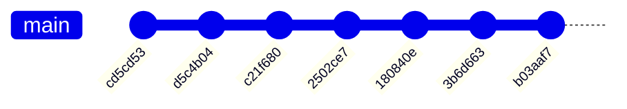

# 4. Git 本地工作流

在软件开发中，几乎所有人都经历过这样的挫败时刻：一段程序昨天还在平稳运行，今天顺手调整了几处逻辑后却突然输出了错误的结果；面对满屏的代码逐行回溯，却怎么也想不起自己究竟碰过哪几处细节。若想退回到那个能够正常工作的版本，只能绝望地凭借模糊的记忆逐行敲退格键撤回修改。代码规模一旦扩大，仅凭脑力记忆版本改动就彻底失效了。版本控制系统（Version Control System）的意义正在于此：Git 允许开发者将每一个经过验证的稳定状态固化为一条不可磨灭的「提交」（Commit）。无论未来经历多少次试错演进，你都可以随时随地将整个工程无损还原到历史中的任意一刻，并且能在毫秒间将任意两个历史版本之间的每行字符变动对照得一清二楚。

在这一章里，我们将亲手为一个经典的 C 语言工程初始化本地 Git 仓库，建立起符合工业界最佳实践的「修改、暂存、提交」节奏。我们将系统推演如何精准检视代码差异与变更脉络、安全撤销日常各类手误修改、优雅保存做到一半的半成品代码（Stash）、规范配置 `.gitignore` 以拦截构建副产物的污染；更重要的是，我们将深入探究 Git 底层对象模型（Blob、Tree、Commit）的物理真相，并在本地建立多条特性分支、完成代码合流以及化解真实的代码冲突。至于团队协作中的远程推送、代码评审流转以及变基（Rebase）技法，我们在[第 17 章 Git 协作](/教程/正文/开发与工程基础/17_Git协作)中会有系统升华。

在开启本章实践之前，读者应当已熟练掌握终端下的目录与文件基本操作（[第 2 章](/教程/正文/开发与工程基础/2_命令行与目录操作)），并能自如使用 `gcc` 驱动程序生成目标文件与二进制（[第 3 章](/教程/正文/开发与工程基础/3_从源文件到可执行文件)）。文中的终端演练均以 Linux 环境下的 Git 2.47.3 实测为基准。为了方便读者对照，演示仓库的作者信息、邮箱以及提交时间戳均做了基准固化以确保生成的哈希指纹可精确复现；读者在本地自主演练时，由于时间戳差异，生成的提交哈希会自然不同。配套脚本 `code/开发与工程基础/4_Git本地工作流/demo.sh` 提供了完整复现该实验仓库的自动化实现。

## 1. 第一次配置

在 Git 的设计体系中，每一条记录进历史的提交对象都必须固化签名其作者的法定姓名与电子邮箱。在初次部署完 Git 之后，最先要做的事情就是在全局环境中登记这两项身份凭证，并顺手声明新建仓库时的默认分支名称与偏好的交互文本编辑器：

::: terminal title="zsh - git config"

```text
$ git config --global user.name "Mdr"
$ git config --global user.email "mdr@example.com"
$ git config --global init.defaultBranch main
$ git config --global core.editor vim
$ git config --global --list
user.name=Mdr
user.email=mdr@example.com
init.defaultbranch=main
core.editor=vim
$ git config --get user.name
Mdr
```

:::

命令行中的 `--global` 标志指示将这些设置持久化写入当前操作系统的用户级配置文件中，对当前用户账户下的所有本地仓库全局生效。如果不附加 `--global` 标志，相关配置项则仅会写入当前仓库内部的私有配置文件 `.git/config` 中，其影响范围严格局限在该单个工程之内。借助 `--show-origin` 选项，我们可以清晰穿透查看每一个生效配置项的底层物理文件归属：

::: terminal title="zsh - git config --show-origin"

```text
$ git config user.email mdr@greet.example
$ git config --show-origin --get user.email
file:.git/config	mdr@greet.example
$ git config --get user.name
Mdr
```

:::

在上述局部覆写的演示中，由于我们在特定仓库中单独为 `user.email` 指定了专用邮箱，Git 在层级解析时判定仓库本地的 `.git/config` 具有更高的优先级，因此最终回显出本地配置的值；而 `user.name` 在当前仓库尚未单独设定，Git 便顺理成章地回退至全局配置中汲取 `Mdr`。全局用户配置通常存放在用户宿主主目录下的 `.gitconfig` 文件中（在 Windows 平台上对应位于 `C:\Users\当前用户名\.gitconfig`）；此外在 Git 的全局安装目录下还存在一份系统级（system-wide）配置，在个人开发中通常保持默认即可。

在最基础的四个配置键中，`user.name` 与 `user.email` 将被直接烘焙进后续生成的每一条提交元数据中；`init.defaultBranch` 决定了使用 `git init` 首次建立空仓库时所生成的初始主干分支名称（现代业界标准普遍推荐将其固定为 `main`）；而 `core.editor` 则用于在用户执行 `git commit` 时未带 `-m` 传参时，指示系统自动唤起哪一个控制台编辑器来编辑长篇提交日志。

如果在尚未配置身份信息的情况下盲目尝试触发提交，Git 会坚决予以拒绝并抛出明确警告：

::: terminal title="zsh - git commit"

```text
$ git commit -m "feat: 建立项目"
Author identity unknown

*** Please tell me who you are.

Run

  git config --global user.email "you@example.com"
  git config --global user.name "Your Name"

to set your account's default identity.
Omit --global to set the identity only in this repository.

fatal: unable to auto-detect email address (got 'user@host.(none)')
```

:::

报错末尾的 `fatal: unable to auto-detect email address` 表明 Git 试图通过读取当前主机的系统账户与主机名自动拼装备用邮箱失败。依照提示使用 `git config --global` 显式完成配置即可消除该阻碍；若希望针对特定公司或开源项目采用隔离的身份凭证，只需在该项目目录下省略 `--global` 重新配置一遍即可。

当系统尚未显式指定 `init.defaultBranch` 时，`git init` 会在初始化时输出一段长提示，提醒用户初始分支名仍默认为历史遗留的 `master`，并提示使用 `git branch -m` 重命名。将其显式全局声明为 `main` 后，该类提示便会彻底静默。此外，`git init` 在默认情况下还会输出新建仓库在磁盘上的绝对路径，在后文所有的演练中我们追加 `--quiet` 选项以保持控制台版面的清爽。

::: tip 跨平台开发中的换行符边界规范

在跨平台的混合开发场景中，Windows 编辑器倾向于在存盘时使用 CRLF（回车换行 `\r\n`）序列，而 Linux 与 macOS 则统一采用 LF（换行 `\n`）。如果团队成员未做规范约束，在提交代码时很容易引发全文件换行符被无谓改写从而污染版本 diff 的灾难。在严肃的工程协作中，推荐在仓库根目录建立 `.gitattributes` 文件对文本文件的换行行为进行硬性固化（我们在[第 17 章](/教程/正文/开发与工程基础/17_Git协作)会有专门规范方案）；在个人本机开发阶段，Git for Windows 安装时提供的默认转换策略已足以应对绝大多数常规诉求。

:::

## 2. 三大核心工作区域

要建立清晰的 Git 心智模型，首先需要理解其文件状态在空间上的三层解耦体系：
1. **工作区（Working Tree）**：开发者在磁盘文件系统中直接肉眼可见、可借助编辑器任意修改的常规目录与源码文件；
2. **暂存区（Staging Area，底层亦称索引 Index）**：充当工作区与持久化仓库之间的缓冲区，专门用于精挑细选并拼装下一次即将提交的快照内容；
3. **本地仓库（Repository）**：隐匿在根目录 `.git` 内部的只读对象数据库，里面严密固化着历次提交所产生的不可变版本拓扑树。

各项高频命令在本质上就是在驱动文件状态在上述三大区域之间有序迁移：


::: concept git-three-areas title="提交记录的是暂存区"

`git add` 把文件在那一刻的内容写入暂存区；此后再修改工作区的文件，暂存区里仍是旧内容。`git commit` 只把暂存区的内容写成一条提交，工作区里没暂存的部分不进入历史。`git restore` 用暂存区的内容覆盖工作区，`git restore --staged` 把暂存区退回最后一次提交的内容。

:::

对于初学者而言，暂存区的存在初看起来似乎多此一举，仿佛每次存盘都要被动多敲一次 `git add`。然而在真实的复杂工程演进中，暂存区是打造高品质提交历史的关键工坊。设想你在同一个源文件中同时调整了一处核心算法，并顺带修补了一个注释笔误：借助暂存区（例如配合 `git add -p` 交互式分块暂存），你可以精准地先将算法变更的局部行划入暂存区提交为一条干净独立的提交，随后再把剩下的笔误修补归拢提交为另一条提交。若缺少暂存区的解耦缓冲，这两组意图相异的改动就只能被粗暴地混入同一个大杂烩提交中，增加了后续代码审查与精准回退（Revert）的沟通成本。

## 3. 第一次提交

为了让全流程具有清晰的推演抓手，本章全程以一个结构极简的 C 语言命令行小项目 `greet` 作为主线。它由三个纯文本文件构成：

::: code-group

```c [greet.c]
#include <stdio.h>

int main(void) {
    puts("Hello, world!");
    return 0;
}
```

```markdown [README.md]
# greet

打印一句问候。
```

```sh [build.sh]
#!/bin/sh
set -eu
mkdir -p build
gcc -std=c17 -Wall -Wextra -o build/greet greet.c
```

:::

在项目根目录下首先初始化本地版本库，并立即检视当前的工作区感知状态：

::: terminal title="zsh - greet"

```text
$ git init --quiet
$ git status
On branch main

No commits yet

nothing to commit (create/copy files and use "git add" to track)
```

:::

`git init` 命令唯一的动作是在项目根目录下生成一个专用的隐藏目录 `.git`，这里便是本地仓库数据库的栖身之所。此时工作区内任何既有的文本均未受到任何侵入式修改，但它们尚处于游离状态，未曾纳入 Git 的版本追踪视线。将上述三份源码文件写入磁盘后，再次查看状态：

::: terminal title="zsh - greet"

```text
$ git status
On branch main

No commits yet

Untracked files:
  (use "git add <file>..." to include in what will be committed)
	README.md
	build.sh
	greet.c

nothing added to commit but untracked files present (use "git add" to track)
$ git status --short
?? README.md
?? build.sh
?? greet.c
$ git add greet.c README.md build.sh
$ git status
On branch main

No commits yet

Changes to be committed:
  (use "git rm --cached <file>..." to unstage)
	new file:   README.md
	new file:   build.sh
	new file:   greet.c

$ git status --short
A  README.md
A  build.sh
A  greet.c
```

:::

`git status` 会按照生命周期阶段将文件划分为清晰的区块：
- `Untracked files`：未跟踪文件，即物理存在于工作区磁盘上，但在 Git 暂存区与仓库历史中从未建档的文件；
- `Changes to be committed`：待提交变更，即已由 `git add` 正式摄入暂存区、整装待发将被打包进下一次提交的内容；
- 此外，对于已纳入跟踪但在工作区又发生新变动的条目，后续还会出现在 `Changes not staged for commit` 区块中。

附带 `--short`（或 `-s`）参数可以获取双列紧凑输出：左列字母反映暂存区的状态，右列字母反映工作区的实时变动。其中 `??` 鲜明代表完全未跟踪的新条目，`A`（Added）代表在暂存区已登记的新增条目，`M`（Modified）代表发生修改。若某条目在左右两列同时亮起字母（例如 `AM` 或 `MM`），则说明该文件既有已暂存的修改，同时在工作区中又追加了尚未暂存的新变动。

通过 `git add` 将这三份文件送入暂存区后，我们即可调度 `git commit` 将暂存区快照正式封存入仓库，并回顾提交历史：

::: terminal title="zsh - greet"

```text
$ git commit -m "feat: 打印问候语" -m "先输出一句固定的问候，下一步再接受命令行参数。"
[main (root-commit) cd5cd53] feat: 打印问候语
 3 files changed, 13 insertions(+)
 create mode 100644 README.md
 create mode 100644 build.sh
 create mode 100644 greet.c
$ git log --oneline
cd5cd53 feat: 打印问候语
$ git log
commit cd5cd53b41d93555e3091d5ea4cbdc04b3edeab1
Author: Mdr <mdr@example.com>
Date:   Mon Oct 19 09:00:00 2026 +0800

    feat: 打印问候语
    
    先输出一句固定的问候，下一步再接受命令行参数。
```

:::

`(root-commit)` 标记指明这是该代码仓库生命周期中的根基点——即没有任何父节点的初始提交；`cd5cd53` 是 SHA-1 校验和的前 7 位缩略指纹，`git log --oneline` 正是以这种单行摘要的形式展开历史演进。而在 `git log` 的完整视图中，Git 会吐出 40 位的全量十六进制哈希指纹，并附带作者信息、精准时间戳以及分段日志说明。

在专业工程协作中，提交日志（Commit Message）的结构有着严格的格式约定。第一行通常采用「类型: 简短概要」的标准范式，常见的语义标签包括：

| 类型 | 用途 |
| --- | --- |
| `feat` | 新增功能 |
| `fix` | 修复缺陷 |
| `docs` | 只改文档 |
| `build` | 构建脚本或产物配置 |
| `refactor` | 不改变行为的重写 |
| `test` | 增加或修改测试 |
| `chore` | 其余杂项 |

首行摘要的存在意义，在于让任何阅读 `git log --oneline` 树状图的工程师能在半秒内理清每个节点的核心动机。在首行之后必须空出完整一行，其后展开的正文段落则用于交代修改背后的上下文背景与决策原因（即「为什么改」），而无需机械重复代码补丁（diff）中已经明摆着的「改了什么」。现代开源与工业级项目广泛遵从的约定式提交（Conventional Commits）规范对这些前缀有详尽阐述，本教程主要选取其中最高频的几类。

## 4. 忽略构建产物

在上一节建立的工程中，构建脚本 `build.sh` 负责调遣编译器将生成出的二进制可执行文件收拢存放在 `build/` 目录下。我们执行一次编译并查看仓库感知：

::: terminal title="zsh - greet"

```text
$ sh build.sh
$ ./build/greet
Hello, world!
$ git status
On branch main
Untracked files:
  (use "git add <file>..." to include in what will be committed)
	build/

nothing added to commit but untracked files present (use "git add" to track)
$ git status --short
?? build/
```

:::

此时控制台忠实提示存在未跟踪的 `build/` 目录。在真实的软件工程规范中，**由编译器与链接器派生的一切中间产物与最终二进制，绝对不应被纳入版本控制系统**。这是因为它们完全可以由源码在任何环境中重新构建生成，并且在跨机器时二进制文件由于动态库与体系结构不匹配往往无法运行；更严重的是，二进制文件的频繁变动会急剧撑爆 Git 仓库的物理存储。为了将这些干扰元素自动屏蔽在暂存区之外，我们在工程根目录下建立配置文件 `.gitignore`：

```text:no-line-numbers
build/
*.o
*.exe
a.out
*.gcda
.vscode/
```

`.gitignore` 的解析机制逐行匹配：
- 以斜杠 `/` 结尾的规则专用于匹配目录，因此 `build/` 能够一举递归忽略该目录及其所有子文件；
- `*.o` 与 `*.exe` 借助星号通配符捕获所有目标文件与 Windows 可执行镜像；
- `a.out` 屏蔽缺省编译产物；
- `*.gcda` 屏蔽后续章节中代码覆盖率统计工具派生的计数缓存；
- `.vscode/` 屏蔽特定于当前开发人员本地个人编辑器的偏好缓存。

当配置文件就绪后，`build/` 目录便会从常规的 `git status` 视图中静默退场。若要逆向排查某个物理文件究竟是由于哪一条规则被 Git 忽略的，可以使用带有 `-v`（Verbose）的 `git check-ignore` 命令：

::: terminal title="zsh - greet"

```text
$ git status
On branch main
Untracked files:
  (use "git add <file>..." to include in what will be committed)
	.gitignore

nothing added to commit but untracked files present (use "git add" to track)
$ git status --ignored
On branch main
Untracked files:
  (use "git add <file>..." to include in what will be committed)
	.gitignore

Ignored files:
  (use "git add -f <file>..." to include in what will be committed)
	build/

nothing added to commit but untracked files present (use "git add" to track)
$ git check-ignore -v build/greet
.gitignore:1:build/	build/greet
$ git check-ignore -v greet.c; echo $?
1
```

:::

附带 `--ignored` 标志会显式翻出当前被规则忽略的全部条目；而 `git check-ignore -v` 则精准汇报了命中规则所位于的行号与规则本体（例如 `.gitignore:1:build/`）。与之相对，由于源文件 `greet.c` 并未触发任何忽略模式，该命令返回退出码 1 且不输出任何文本。

对于已经被规则覆盖忽略的文件，常规的 `git add` 会主动拦截以防误录：

::: terminal title="zsh - greet"

```text
$ git add build/greet
The following paths are ignored by one of your .gitignore files:
build
hint: Use -f if you really want to add them.
hint: Disable this message with "git config advice.addIgnoredFile false"
$ git add -f build/greet
$ git status --short
A  build/greet
?? .gitignore
$ git rm --cached build/greet
rm 'build/greet'
$ git status --short
?? .gitignore
```

:::

如果某些被规则忽略的文件确实需要提交入库，可以使用 `git add -f`（`--force`）强制将该文件加入暂存区。如果之后需要撤销对它的版本跟踪，调用 `git rm --cached` 可以仅从暂存区索引中将该文件注销，而工作区磁盘上的物理文件依然完好无损。

需要特别说明的是：**`.gitignore` 只对尚未纳入版本跟踪的新文件起效**。如果某个构建产物或配置文件在添加忽略规则之前就已经被提交进仓库历史，哪怕后续在 `.gitignore` 中补写了匹配规则，Git 依然会持续追踪它的改动。此时必须显式执行 `git rm --cached <文件>` 将其从索引中剔除并完成一次提交，忽略规则才会对该文件重新生效。

把可执行文件提交进仓库的后果，可以通过一个独立的演示仓库直观观察：

::: terminal title="zsh - bin-demo"

```text
$ git add hi
$ git commit -m "chore: 提交可执行文件"
[main (root-commit) 1f4990f] chore: 提交可执行文件
 1 file changed, 0 insertions(+), 0 deletions(-)
 create mode 100755 hi
$ git show --stat HEAD
commit 1f4990ffc770205e02478ea40016d52adad0a3cf
Author: Mdr <mdr@example.com>
Date:   Mon Oct 19 09:25:00 2026 +0800

    chore: 提交可执行文件

 hi | Bin 0 -> 15952 bytes
 1 file changed, 0 insertions(+), 0 deletions(-)
$ git status --short
 M hi
?? hi.c
$ git diff --stat
 hi | Bin 15952 -> 15952 bytes
 1 file changed, 0 insertions(+), 0 deletions(-)
$ git diff
diff --git a/hi b/hi
index 1475134..5042bba 100755
Binary files a/hi and b/hi differ
$ git ls-files
hi
```

:::

在源码未做大幅改动时重新编译，文件体积或许完全一致，但只要生成的机器指令序列或时间戳产生微小差异，Git 也只能识别为「二进制文件不同」。文本文件支持逐行比对增量、定位具体改动并借助算法自动合并冲突，而可执行文件无法获得这种支持。更关键的是，Git 记录二进制文件时无法计算行级差异，每次重新编译提交都会在仓库中写入一份完整的二进制对象。仓库体积将随着提交次数迅速膨胀，而在排查历史问题时，根本无法从这一堆庞大的二进制快照中看清任何具体修改。

::: tip 分块暂存

在实际编码时，有时会在一个文件里同时顺手修正多处细节。若想将不同的改动拆分到独立的提交中，可以使用 `git add -p` 进行交互式分块暂存。Git 会把每个修改片段（hunk）逐一展示在终端并询问处理方式：输入 `y` 暂存当前块，输入 `n` 跳过，输入 `s` 可将较大的修改块进一步拆细，输入 `q` 则退出交互过程。

:::

## 5. 查看改动与历史

修改 `greet.c`，让它接受一个命令行参数。先不急着执行 `git add`，观察 Git 此时记录下的工作区变动：

::: terminal title="zsh - greet"

```text
$ git diff
diff --git a/greet.c b/greet.c
index 2415757..673fe35 100644
--- a/greet.c
+++ b/greet.c
@@ -1,6 +1,10 @@
 #include <stdio.h>
 
-int main(void) {
-    puts("Hello, world!");
+int main(int argc, char *argv[]) {
+    const char *name = "world";
+    if (argc > 1) {
+        name = argv[1];
+    }
+    printf("Hello, %s!\n", name);
     return 0;
 }
```

:::

`git diff` 默认对比工作区与暂存区之间的差异，直观展示出尚未被暂存的修改。在差异报告中，以 `---` 开头的一侧代表暂存区中的基准版本，`+++` 开头代表工作区的当前版本；减号 `-` 开头的行为被移除的内容，加号 `+` 开头为新增行，`@@` 所在的行为区块头（chunk header），标明改动在源码文件中的具体行号与影响行数。

执行暂存之后，同样的改动会反映在 `--staged` 视图中：

::: terminal title="zsh - greet"

```text
$ git status --short
 M greet.c
$ git add greet.c
$ git status --short
M  greet.c
$ git diff --staged
diff --git a/greet.c b/greet.c
index 2415757..673fe35 100644
--- a/greet.c
+++ b/greet.c
@@ -1,6 +1,10 @@
 #include <stdio.h>
 
-int main(void) {
-    puts("Hello, world!");
+int main(int argc, char *argv[]) {
+    const char *name = "world";
+    if (argc > 1) {
+        name = argv[1];
+    }
+    printf("Hello, %s!\n", name);
     return 0;
 }
```

:::

`git diff --staged` 对比的是暂存区与最后一次提交（`HEAD`）之间的差异，用来检查即将进入下一次提交的具体内容。此时直接运行 `git diff` 不会有任何输出，因为工作区的内容与暂存区已经完全同步。

暂存之后如果在工作区中继续修改文件，两个视图的内容便会自然分开：

::: terminal title="zsh - greet"

```text
$ git status --short
MM greet.c
$ git diff
diff --git a/greet.c b/greet.c
index 673fe35..208c60e 100644
--- a/greet.c
+++ b/greet.c
@@ -1,7 +1,7 @@
 #include <stdio.h>
 
 int main(int argc, char *argv[]) {
-    const char *name = "world";
+    const char *name = "World";
     if (argc > 1) {
         name = argv[1];
     }
$ git diff --staged
diff --git a/greet.c b/greet.c
index 2415757..673fe35 100644
--- a/greet.c
+++ b/greet.c
@@ -1,6 +1,10 @@
 #include <stdio.h>
 
-int main(void) {
-    puts("Hello, world!");
+int main(int argc, char *argv[]) {
+    const char *name = "world";
+    if (argc > 1) {
+        name = argv[1];
+    }
+    printf("Hello, %s!\n", name);
     return 0;
 }
$ git add greet.c
```

:::

在短格式状态中，`MM` 的两个字符分别代表暂存区与工作区的状态：第一个 `M` 说明暂存区相对最后一次提交存在改动（把 `puts` 换为 `printf` 的版本），第二个 `M` 说明工作区相对暂存区又有新的未暂存改动（将初始名字由 `world` 改为 `World`）。此时，`git diff` 仅展示工作区相对暂存区的二次修改，而 `git diff --staged` 展示暂存区中即将提交的内容。再次执行 `git add greet.c` 后，工作区的最新改动也被合并推入暂存区，状态重新收敛为单个 `M `。

<Quiz
  type="single"
  :options="[
    { label: '工作区与暂存区之间的全部差异', value: 'A' },
    { label: '暂存之后又改动的那部分', value: 'B' },
    { label: '暂存区与最后一次提交之间的差异', value: 'C' },
    { label: '没有任何输出', value: 'D' }
  ]"
  answer="B"
>

执行 `git add greet.c` 之后又修改了 `greet.c`，此时 `git diff` 显示什么？

正确答案是 **B**。`git diff` 始终比较工作区和暂存区，暂存之后的新改动只存在于工作区，所以只显示这一部分。C 是 `git diff --staged` 的内容。

</Quiz>

在完成提交后，可以借助不同的查看选项，按不同粒度审查仓库的历史演进：

::: terminal title="zsh - greet"

```text
$ git commit -m "feat: 支持从命令行读入名字。" -m "参数缺省时仍然问候 world。"
[main 4da5718] feat: 支持从命令行读入名字。
 1 file changed, 6 insertions(+), 2 deletions(-)
$ git log --oneline
4da5718 feat: 支持从命令行读入名字。
d5c4b04 build: 忽略构建产物
cd5cd53 feat: 打印问候语
$ git log --stat --oneline
4da5718 feat: 支持从命令行读入名字。
 greet.c | 8 ++++++--
 1 file changed, 6 insertions(+), 2 deletions(-)
d5c4b04 build: 忽略构建产物
 .gitignore | 6 ++++++
 1 file changed, 6 insertions(+)
cd5cd53 feat: 打印问候语
 README.md | 3 +++
 build.sh  | 4 ++++
 greet.c   | 6 ++++++
 3 files changed, 13 insertions(+)
$ git log -S printf --oneline -- greet.c
4da5718 feat: 支持从命令行读入名字。
$ git show --stat HEAD
commit 4da5718fcf45877caa5078b9013b27117bd0acfa
Author: Mdr <mdr@example.com>
Date:   Mon Oct 19 09:40:00 2026 +0800

    feat: 支持从命令行读入名字。
    
    参数缺省时仍然问候 world。

 greet.c | 8 ++++++--
 1 file changed, 6 insertions(+), 2 deletions(-)
$ git log -p -1 -- greet.c
commit 4da5718fcf45877caa5078b9013b27117bd0acfa
Author: Mdr <mdr@example.com>
Date:   Mon Oct 19 09:40:00 2026 +0800

    feat: 支持从命令行读入名字。
    
    参数缺省时仍然问候 world。

diff --git a/greet.c b/greet.c
index 2415757..208c60e 100644
--- a/greet.c
+++ b/greet.c
@@ -1,6 +1,10 @@
 #include <stdio.h>
 
-int main(void) {
-    puts("Hello, world!");
+int main(int argc, char *argv[]) {
+    const char *name = "World";
+    if (argc > 1) {
+        name = argv[1];
+    }
+    printf("Hello, %s!\n", name);
     return 0;
 }
```

:::

日常排查与审查历史时，常用参数组合来调整 `git log` 的信息粒度：
- `--stat` 会在单行提交日志下方追加改动统计，列出本次提交涉及的文件清单以及各文件的增删行数。
- `-S <字符串>`（常被称为 pickaxe 选项）用于检索代码增量历史，能够精确定位到某段字符串（如函数名、特定常量）首次被引入或被彻底移除的那次提交。
- `git show <提交>` 专门用于检视某次特定提交的元数据与完整差异比对，其中 `HEAD` 默认指代当前所在分支的最新提交。
- `-p` 会展开每次提交对应的完整补丁（patch/diff）；配合 `-1` 可以限定只显示最近的一条，追加 `-- greet.c` 则将历史追踪范围收拢到特定源文件。这些选项可以按需自由组合，以便在项目中快速溯源。

## 6. 状态撤销与变更回退

在日常编写代码的过程中，改错代码、误暂存半成品或提交信息写错是常有的事。Git 针对不同的工作区阶段提供了层级分明的回退手段。在执行撤销前，可以对照以下常见场景与对应命令：

| 操作意图 | 推荐命令 | 影响范围 |
| --- | --- | --- |
| 丢弃工作区中未暂存的本地改动 | `git restore <文件>` | 覆盖工作区，改动不可恢复 |
| 撤销暂存，将修改退回工作区 | `git restore --staged <文件>` | 仅清理索引，工作区源码完好保留 |
| 补救最后一次提交（修补说明或追加遗漏文件） | `git commit --amend` | 生成新提交替换原 HEAD，重写局部历史 |
| 逆转历史中某次已有提交的效果 | `git revert <提交>` | 产生一次反向变更的新提交，完整保留历史追溯 |
| 临时检视过去的某个快照状态 | `git switch --detach <提交>` | 分离 HEAD 浏览，结束后通过 `git switch -` 返回 |
| 撤回最后一次提交但保留所有代码变动 | `git reset --soft HEAD~1` | 提交被撤销，改动完整停留在暂存区中 |

下面通过具体的操作步骤体验这些撤销行为。

首先模拟工作区误修改的场景：在 `README.md` 末尾随意追加一段内容，然后将其彻底舍弃：

::: terminal title="zsh - greet"

```text
$ git status --short
 M README.md
$ git diff
diff --git a/README.md b/README.md
index f8ab59c..d51b1d4 100644
--- a/README.md
+++ b/README.md
@@ -1,3 +1,5 @@
 # greet
 
 打印一句问候。
+
+## 运行
$ git restore README.md
$ git status --short
```

:::

`git restore <文件>` 会直接使用暂存区中的快照覆盖工作区对应文件。由于被覆盖的内容此前从未提交过，Git 内部没有任何对象记录，该修改将无法找回。因此在执行直接丢弃未暂存修改前，需要确认这些临时实验确实不再需要。

如果修改已经执行了 `git add`，但随后发现并不适合立即入库，可以先将它从暂存区撤回，回到纯粹的工作区修改状态，再从容决定是否保留：

::: terminal title="zsh - greet"

```text
$ git status --short
 M greet.c
$ git add greet.c
$ git status --short
M  greet.c
$ git restore --staged greet.c
$ git status --short
 M greet.c
$ git diff --staged
$ git restore greet.c
$ git status --short
```

:::

`git restore --staged` 的作用是将暂存区索引重置为与 `HEAD` 完全一致，而工作区磁盘中的源码不会受到任何扰动。因此，文件状态由暂存状态 `M ` 变回工作区未暂存状态 ` M`；此时暂存区为空，`git diff --staged` 无任何输出。如果确认这一版代码确实应当全盘作废，再进一步执行 `git restore greet.c` 将工作区抹平。

如果在完成提交后立刻发现提交信息存在错别字，或是漏掉了一两个附属文件，可以使用 `--amend` 修补。例如前文提交信息的第一行末尾多了一个句号，现在对它进行修正：

::: terminal title="zsh - greet"

```text
$ git log --oneline -1
4da5718 feat: 支持从命令行读入名字。
$ git rev-parse --short HEAD
4da5718
$ git commit --amend -m "feat: 支持从命令行读入名字" -m "参数缺省时仍然问候 world。"
[main c21f680] feat: 支持从命令行读入名字
 Date: Mon Oct 19 09:40:00 2026 +0800
 1 file changed, 6 insertions(+), 2 deletions(-)
$ git log --oneline -1
c21f680 feat: 支持从命令行读入名字
$ git rev-parse --short HEAD
c21f680
```

:::

`--amend` 并不会在原有的提交对象上做就地修改，而是打包当前暂存区中的最新快照，连同更新后的说明信息生成一个全新的提交对象，并将当前分支指针直接指向这个新对象。可以看到，快照的哈希值由 `4da5718` 变为了 `c21f680`——这是因为提交说明、时间戳以及元数据参与了校验哈希的计算，任何微小的改变都会产出全新的哈希值。被替换的旧提交暂时仍保存在 `.git/objects` 中，可以通过 `git reflog` 找到，但它已经从当前分支的主线上脱离。通常只对尚未推送到共享远端的本地私有提交使用 `--amend`。

如果某次提交已经进入历史，甚至是已经推送与团队共享的代码，强行删除历史记录往往会带来协作混乱。此时最稳妥的做法是使用 `git revert` 进行反向冲抵。先构造一次误提交作为示例：

::: terminal title="zsh - greet"

```text
$ git diff
diff --git a/greet.c b/greet.c
index 208c60e..13d62e2 100644
--- a/greet.c
+++ b/greet.c
@@ -1,7 +1,7 @@
 #include <stdio.h>
 
 int main(int argc, char *argv[]) {
-    const char *name = "World";
+    const char *name = "Mdr";
     if (argc > 1) {
         name = argv[1];
     }
$ git add greet.c
$ git commit -m "feat: 默认问候 Mdr" -m "本机自用时省去输入名字。"
[main 2502ce7] feat: 默认问候 Mdr
 1 file changed, 1 insertion(+), 1 deletion(-)
$ sh build.sh
$ ./build/greet
Hello, Mdr!
```

:::

这次改动将默认问候对象写死为了个人名字 `Mdr`，本应只留在本地测试，不该合入主线。现在使用 `git revert` 对其进行反向冲抵：

::: terminal title="zsh - greet"

```text
$ git log --oneline -2
2502ce7 feat: 默认问候 Mdr
c21f680 feat: 支持从命令行读入名字
$ git revert --no-edit HEAD
[main 180840e] Revert "feat: 默认问候 Mdr"
 Date: Mon Oct 19 10:10:00 2026 +0800
 1 file changed, 1 insertion(+), 1 deletion(-)
$ git log --oneline -3
180840e Revert "feat: 默认问候 Mdr"
2502ce7 feat: 默认问候 Mdr
c21f680 feat: 支持从命令行读入名字
$ git show --stat HEAD
commit 180840e118919facae8f98746885280dbca007ff
Author: Mdr <mdr@example.com>
Date:   Mon Oct 19 10:10:00 2026 +0800

    Revert "feat: 默认问候 Mdr"
    
    This reverts commit 2502ce7bf57d3c7d141d58557990fffb95f88155.

 greet.c | 2 +-
 1 file changed, 1 insertion(+), 1 deletion(-)
$ sh build.sh
$ ./build/greet
Hello, World!
```

:::

`git revert <提交>` 会自动分析目标提交所引入的所有变更，计算出一份完全相反的补丁，并将其打包为一条全新的提交推入历史。原来的错误提交依然完好保留在时间线上，这样不仅不会破坏公共分支的演进连续性，还让后续的代码审查人员能够清晰看到引入变更与撤销变更的来龙去脉。参数 `--no-edit` 表示直接采纳 Git 自动生成的反向提交说明，无需弹开文本编辑器。

如果只是想回顾或编译测试历史中的某个旧版本，而不需要创建新分支，可以使用游离头指针（detached HEAD）检出历史快照：

::: terminal title="zsh - greet"

```text
$ git log --oneline -3
180840e Revert "feat: 默认问候 Mdr"
2502ce7 feat: 默认问候 Mdr
c21f680 feat: 支持从命令行读入名字
$ git switch --detach HEAD~3
HEAD is now at d5c4b04 build: 忽略构建产物
$ git branch --show-current
$ git show --stat --oneline HEAD
d5c4b04 build: 忽略构建产物
 .gitignore | 6 ++++++
 1 file changed, 6 insertions(+)
$ git switch -
Previous HEAD position was d5c4b04 build: 忽略构建产物
Switched to branch 'main'
```

:::

语法 `HEAD~3` 表示从当前 `HEAD` 沿提交链往前回溯 3 代（`~` 后跟数字代表步进代数）。在游离状态下，`HEAD` 直接指向了一个具体的提交对象，而非任何分支引用，因此 `git branch --show-current` 没有任何输出。在这一状态下，可以随意翻阅历史代码、执行构建与调试运行；但应注意避免在此处直接进行新的正式提交，因为缺乏分支指针持续引用的游离提交在切换走之后极易遗失。检视完成后，运行 `git switch -` 即可迅速跳回此前所在的分支（此处为 `main`）。

还有一种常见情况：某次提交已经完成，但随后发现里面混杂了太多不相干的改动，想要把它拆解为数个更纯粹的提交；或者需要微调某些细节后再重新提交。此时可以使用 `git reset --soft` 将提交撤销，并将所有代码变动原封不动退回到暂存区：

::: terminal title="zsh - rs"

```text
$ git log --oneline
14320b1 feat: 第二次提交
4042e58 feat: 第一次提交
$ git reset --soft HEAD~1
$ git log --oneline
4042e58 feat: 第一次提交
$ git status --short
M  a.c
$ git diff --staged --stat
 a.c | 2 +-
 1 file changed, 1 insertion(+), 1 deletion(-)
```

:::

可以看到，提交历史被向后挪移了一步，而原提交引入的所有代码变更完整保留在暂存区中，状态显示为暂存态 `M `。此时可以重新梳理暂存内容、拆分文件或微调后再行提交。

`git reset` 的三种模式体现了不同层级的撤销强度：
- `--soft`：仅移动分支指针与 HEAD，不改变暂存区与工作区，适合重新组织最近的提交。
- `--mixed`（默认）：移动指针并同步重置暂存区，工作区中的代码保持不变，改动回退为未暂存状态。
- `--hard`：移动指针并彻底将暂存区与工作区重置到指定提交，工作区中所有未提交的本地修改将被无条件清空。

::: warning 谨防未提交改动的永久丢失

`git restore` 与 `git reset --hard` 对工作区所做的丢弃操作是无法逆转的。由于这些未提交的改动从未生成过 Git 对象，版本库中没有任何可供恢复的底稿。在执行高风险回退命令前，建议先运行 `git status` 与 `git diff` 仔细核对受影响的内容。

:::

## 7. 临时保存：git stash

在实际开发中，经常会遇到被打断的场景：比如正在给 `greet` 编写 `-h` 命令行选项的代码，突然发现 `README.md` 中遗漏了基础用法说明，需要立即修补并提交。此时源码修改只进行到一半，既无法通过编译，也不适合打成一次半成品的提交。Git 提供了储藏（stash）机制，允许将当前工作区与暂存区的未完成修改临时封存入栈，换取一个干净的工作目录：

::: terminal title="zsh - greet"

```text
$ git diff --stat
 greet.c | 11 ++++++++++-
 1 file changed, 10 insertions(+), 1 deletion(-)
$ git status --short
 M greet.c
$ git stash push -m "wip: 增加 -h 用法提示"
Saved working directory and index state On main: wip: 增加 -h 用法提示
$ git status --short
$ git stash list
stash@{0}: On main: wip: 增加 -h 用法提示
```

:::

`git stash push` 会将工作区中所有已跟踪文件的改动及暂存区状态打包压入储藏栈，同时将工作区与暂存区恢复到与当前 `HEAD` 一致的干净状态；附加 `-m` 能为储藏项赋予清晰的说明文字。运行 `git stash list` 可以查看储藏列表，列表按时间逆序排列，最近压栈的一项索引标为 `stash@{0}`。

此时工作区恢复干净，可以从容修补 README 并完成独立提交：

::: terminal title="zsh - greet"

```text
$ git diff
diff --git a/README.md b/README.md
index f8ab59c..170130d 100644
--- a/README.md
+++ b/README.md
@@ -1,3 +1,8 @@
 # greet
 
 打印一句问候。
+
+## 用法
+
+    sh build.sh
+    ./build/greet Ada
$ git add README.md
$ git commit -m "docs: 在 README 中补充用法"
[main 3b6d663] docs: 在 README 中补充用法
 1 file changed, 5 insertions(+)
```

:::

临时任务处理完毕后，再将此前储藏的代码拿回工作区继续推进：

::: terminal title="zsh - greet"

```text
$ git stash list
stash@{0}: On main: wip: 增加 -h 用法提示
$ git stash pop
On branch main
Changes not staged for commit:
  (use "git add <file>..." to update what will be committed)
  (use "git restore <file>..." to discard changes in working directory)
	modified:   greet.c

no changes added to commit (use "git add" and/or "git commit -a")
Dropped refs/stash@{0} (abe5ede9237080b71195e746ea8ca8d3457cc843)
$ git status --short
 M greet.c
$ git diff --stat
 greet.c | 11 ++++++++++-
 1 file changed, 10 insertions(+), 1 deletion(-)
```

:::

`git stash pop` 会尝试将储藏内容重新合并到工作区，并在合并成功后自动将对应的储藏条目从栈中弹出销毁。终端输出的比对统计显示 `greet.c` 增加了 10 行并替换了 1 行，改动完整恢复。

接下来便可以在此基础上补全功能、编译验证并提交：

::: terminal title="zsh - greet"

```text
$ sh build.sh
$ ./build/greet -h
usage: greet [-h] [NAME]
$ git add greet.c
$ git commit -m "feat: 增加 -h 用法提示" -m "用法信息交给 print_usage 输出。"
[main b03aaf7] feat: 增加 -h 用法提示
 1 file changed, 10 insertions(+), 1 deletion(-)
```

:::

在底层操作上，`git stash pop` 等价于先调用 `git stash apply` 恢复改动，再调用 `git stash drop` 销毁条目。如果不希望立即销毁储藏记录，可以显式分步执行：先 `apply` 查看还原效果，测试确认无误后再手动执行 `drop`。

默认的 `stash` 仅处理已跟踪的文件。如果工作区中存在新建的未跟踪文件，需要加上 `-u`（`--include-untracked`）：

::: terminal title="zsh - greet"

```text
$ git status --short
?? notes.txt
$ git stash push -u -m "wip: 未跟踪的笔记"
Saved working directory and index state On main: wip: 未跟踪的笔记
$ git status --short
$ git stash list
stash@{0}: On main: wip: 未跟踪的笔记
$ git stash pop
Already up to date.
On branch main
Untracked files:
  (use "git add <file>..." to include in what will be committed)
	notes.txt

nothing added to commit but untracked files present (use "git add" to track)
Dropped refs/stash@{0} (87acc41ef331a17c973d08ec27f0c5206c7202fb)
$ git status --short
?? notes.txt
```

:::

添加 `-u` 之后，未跟踪的 `notes.txt` 同样被纳入储藏并清出工作区。弹出时输出的 `Already up to date.` 表示已跟踪文件部分没有产生任何冲突或新变更，未跟踪文件则被原样恢复到了工作区。若还需要将 `.gitignore` 忽略的文件也一并储藏起来，可以使用 `-a`（`--all`）参数。

## 8. 提交、树与文件在仓库里的样子

在前面的操作中，我们反复执行了 `git commit`。从用户视角看，提交记录了代码变更；但从 Git 底层机制看，每一次提交究竟在磁盘上存放了什么？底层命令 `git cat-file -p` 可以根据哈希或引用，以人类可读的格式打印任意 Git 对象的内部结构：

::: terminal title="zsh - greet"

```text
$ git log --oneline
b03aaf7 feat: 增加 -h 用法提示
3b6d663 docs: 在 README 中补充用法
180840e Revert "feat: 默认问候 Mdr"
2502ce7 feat: 默认问候 Mdr
c21f680 feat: 支持从命令行读入名字
d5c4b04 build: 忽略构建产物
cd5cd53 feat: 打印问候语
$ git cat-file -t HEAD
commit
$ git cat-file -p HEAD
tree d081bb2ba074f64de6fed9b26b1caa55e3a7f160
parent 3b6d66331308afca2f0089634097682d8f37aff5
author Mdr <mdr@example.com> 1792377000 +0800
committer Mdr <mdr@example.com> 1792377000 +0800

feat: 增加 -h 用法提示

用法信息交给 print_usage 输出。
$ git cat-file -p HEAD^{tree}
100644 blob 9a36cf9b555e0f9c5be74ebd3ba61074fb81f215	.gitignore
100644 blob 170130d897fd449c355fc0dad09e1b6f23c37ed1	README.md
100644 blob 515fc2b26fc2c48d791076cc0c83b7ca1e605348	build.sh
100644 blob a843dbf1c89673667a79f638f778c48e9f469574	greet.c
$ git cat-file -p HEAD:greet.c
#include <stdio.h>
#include <string.h>

static void print_usage(void) {
    puts("usage: greet [-h] [NAME]");
}

int main(int argc, char *argv[]) {
    const char *name = "world";
    if (argc > 1 && strcmp(argv[1], "-h") == 0) {
        print_usage();
        return 0;
    }
    if (argc > 1) {
        name = argv[1];
    }
    printf("Hello, %s!\n", name);
    return 0;
}
```

:::

一个提交对象（commit object）的内部极其紧凑，主要由几组键值对与说明文字构成：
- `tree` 指向顶层目录树对象的哈希，它记录了该次提交时整个项目根目录的完整文件结构快照。
- `parent` 记录上一级父提交的哈希。正是通过一条条向后指涉的父提交指针，Git 构建起了不可篡改的单向提交历史链条。
- `author` 与 `committer` 记录作者和提交者的姓名、邮箱与 Unix 时间戳。
- 空行之后则是用户书写的提交说明正文。

语法 `HEAD^{tree}` 表示剥离外部提交包装，直接提取该提交所指向的根树对象（tree object）。树对象的每一行对应项目中的一个文件或子目录：`100644` 表示普通文件的 UNIX 权限模式，`blob` 表明对应的是数据对象，随后是该文件的内容校验哈希与文件名。如果想跳过树直接查看某个提交中指定文件的全文，可以使用 `HEAD:greet.c` 语法。

Git 底层的对象数据库由四种核心对象构成：
- **数据对象（blob）**：仅存储文件的原始字节流，不包含文件名、目录层级或权限属性。
- **树对象（tree）**：对应文件系统中的目录，记录文件名、文件属性以及指向对应 blob 或子 tree 的哈希指针。
- **提交对象（commit）**：项目在某一时刻的顶层快照入口，绑定根树、父提交指针与元数据。
- **标签对象（tag）**：为特定对象赋予永久性名称与签名，常用于版本发布标记（将在[第 19 章](/教程/正文/开发与工程基础/19_文档_版本与发布)展开）。

所有的对象都采用内容寻址存储（Content-addressable storage）：对象的哈希依据内容计算生成，相同的内容无论出现在多少个文件中，都只在仓库中保留一份数据对象；一旦内容发生任何变动，校验哈希也会发生变化。Git 目前默认使用 SHA-1 算法，同时也支持在初始化时通过 `git init --object-format=sha256` 启用更长的 SHA-256 哈希。

将最近三次连续提交所对应的树对象展开对比，可以直观观察这种内容复用机制：

::: terminal title="zsh - greet"

```text
$ git cat-file -p HEAD^{tree}
100644 blob 9a36cf9b555e0f9c5be74ebd3ba61074fb81f215	.gitignore
100644 blob 170130d897fd449c355fc0dad09e1b6f23c37ed1	README.md
100644 blob 515fc2b26fc2c48d791076cc0c83b7ca1e605348	build.sh
100644 blob a843dbf1c89673667a79f638f778c48e9f469574	greet.c
$ git cat-file -p HEAD~1^{tree}
100644 blob 9a36cf9b555e0f9c5be74ebd3ba61074fb81f215	.gitignore
100644 blob 170130d897fd449c355fc0dad09e1b6f23c37ed1	README.md
100644 blob 515fc2b26fc2c48d791076cc0c83b7ca1e605348	build.sh
100644 blob 208c60e375af643b0af57f21ef78c137844dd46e	greet.c
$ git cat-file -p HEAD~2^{tree}
100644 blob 9a36cf9b555e0f9c5be74ebd3ba61074fb81f215	.gitignore
100644 blob f8ab59cd20e450d3309927fc32d0518558943514	README.md
100644 blob 515fc2b26fc2c48d791076cc0c83b7ca1e605348	build.sh
100644 blob 208c60e375af643b0af57f21ef78c137844dd46e	greet.c
```

:::

比对结果显示：`.gitignore` 与 `build.sh` 在三次提交中的 blob 哈希完全相同，这意味着哪怕跨越多次提交，它们在物理磁盘上始终共用最初生成的那两个数据对象，未产生任何额外存储开销；`README.md` 仅在补充用法的提交中生成了新的哈希；`greet.c` 则在增加了 `-h` 选项后产出了第三个哈希。

这就揭示了 Git 快照高效的核心所在：每次提交并不是粗暴地把整个工程目录完整克隆一份，而是仅为发生改动的文件创建新的数据对象，未改动的文件与子目录则沿用原有哈希。即便提交成千上万次，仓库的体积增长也仅仅对应于实际发生变动的数据增量。

分支与 `HEAD` 的设计同样极度轻量。在 Git 仓库内部，它们并不是厚重的分支快照，而仅仅是记录哈希或引用路径的普通纯文本文件：

::: terminal title="zsh - greet"

```text
$ cat .git/HEAD
ref: refs/heads/main
$ cat .git/refs/heads/main
b03aaf7eccb4d3d22b57050536334b4bfd914c78
$ git branch -v
* main b03aaf7 feat: 增加 -h 用法提示
```

:::

从文件内容可以看出，`.git/HEAD` 中仅记录了一行 `ref: refs/heads/main`，指明当前位于 `main` 分支；而 `.git/refs/heads/main` 中仅仅保存了一串 40 位的哈希字符串，指向最新生成的提交对象。运行 `git branch -v` 时输出的星号，正是依据 `HEAD` 的指向判定当前工作分支。因此在 Git 中创建或切换分支，本质上只是读写一个几十字节的小文件并移动引用指针，开销几乎可以忽略不计。

::: concept git-object-model title="提交、树与数据块"

Git 用四类对象构建起整个版本历史：数据对象 (blob) 保存文件内容，树对象 (tree) 记录目录结构与文件名，提交对象 (commit) 保存顶层树哈希、父提交指针与提交说明，标签对象 (tag) 为特定快照提供不可变的命名。所有对象均采用内容寻址存储；分支是指向具体提交对象的可移动指针，而 HEAD 则是指示当前分支引用的活动指针。

:::

下面这张图是当前这条历史：



::: generate git-object-walkthrough kind=explanation concepts=git-object-model

面向刚学会提交、还没见过 Git 内部结构的读者，沿着正文的 `cat-file` 输出逐层解释：怎样从 `HEAD` 找到提交对象，提交怎样指向树，树里的每一行怎样对应到文件内容。用连续三条提交共用同一个 blob 的实测结果说明「快照」并不复制整个目录，并指出修改一个文件后真正新增的对象有哪几个。

:::

## 9. 本地分支与合并

在 Git 中，分支（branch）代表一条独立演进的提交时间线。创建分支允许在完全隔离的环境中试验新特性或修复问题，而不干扰主线分支的稳定性。

从当前最新的快照派生出一个名为 `shout` 的新分支，并将问候语逻辑修改为全大写输出：

::: terminal title="zsh - greet"

```text
$ git switch -c shout
Switched to a new branch 'shout'
$ git diff
diff --git a/greet.c b/greet.c
index a843dbf..69ddc8b 100644
--- a/greet.c
+++ b/greet.c
@@ -14,6 +14,6 @@ int main(int argc, char *argv[]) {
     if (argc > 1) {
         name = argv[1];
     }
-    printf("Hello, %s!\n", name);
+    printf("HELLO, %s!\n", name);
     return 0;
 }
$ git add greet.c
$ git commit -m "feat: 问候语改为大写"
[shout 5e483c3] feat: 问候语改为大写
 1 file changed, 1 insertion(+), 1 deletion(-)
```

:::

完成特性开发后，切回 `main` 分支执行合并。在这一阶段，`main` 分支在分叉后并未产生任何新提交，因此合并过程只需要将 `main` 的指针向前移动到 `shout` 指向的快照处：

::: terminal title="zsh - greet"

```text
$ git switch main
Switched to branch 'main'
$ git log --oneline -3
b03aaf7 feat: 增加 -h 用法提示
3b6d663 docs: 在 README 中补充用法
180840e Revert "feat: 默认问候 Mdr"
$ git merge shout
Updating b03aaf7..5e483c3
Fast-forward
 greet.c | 2 +-
 1 file changed, 1 insertion(+), 1 deletion(-)
$ git log --graph --oneline
* 5e483c3 feat: 问候语改为大写
* b03aaf7 feat: 增加 -h 用法提示
* 3b6d663 docs: 在 README 中补充用法
* 180840e Revert "feat: 默认问候 Mdr"
* 2502ce7 feat: 默认问候 Mdr
* c21f680 feat: 支持从命令行读入名字
* d5c4b04 build: 忽略构建产物
* cd5cd53 feat: 打印问候语
```

:::

这种最简合并方式称为**快进（fast-forward）**：由于目标提交本身就是当前分支最新提交的直系后代，演进路径上并没有出现任何历史分叉，Git 无需额外生成一个新的合并提交对象。只有当主干与分支两端在分叉点后各自推进了新提交时，快进才无法成立，Git 才会启动三方合并（three-way merge）。

接下来制造一次典型的分叉冲突：创建 `polite` 分支并将问候语改为小写；切回 `main` 分支后，在相同源码行末尾追加感叹号：

::: terminal title="zsh - greet"

```text
$ git switch -c polite
Switched to a new branch 'polite'
$ git diff
diff --git a/greet.c b/greet.c
index 69ddc8b..93ae70b 100644
--- a/greet.c
+++ b/greet.c
@@ -14,6 +14,6 @@ int main(int argc, char *argv[]) {
     if (argc > 1) {
         name = argv[1];
     }
-    printf("HELLO, %s!\n", name);
+    printf("hello, %s!\n", name);
     return 0;
 }
$ git add greet.c
$ git commit -m "fix: 问候语改用小写"
[polite e7dbad2] fix: 问候语改用小写
 1 file changed, 1 insertion(+), 1 deletion(-)
$ git switch main
Switched to branch 'main'
$ git diff
diff --git a/greet.c b/greet.c
index 69ddc8b..638c2dd 100644
--- a/greet.c
+++ b/greet.c
@@ -14,6 +14,6 @@ int main(int argc, char *argv[]) {
     if (argc > 1) {
         name = argv[1];
     }
-    printf("HELLO, %s!\n", name);
+    printf("HELLO, %s!!!\n", name);
     return 0;
 }
$ git add greet.c
$ git commit -m "feat: 问候语末尾加感叹号"
[main 8c02ce1] feat: 问候语末尾加感叹号
 1 file changed, 1 insertion(+), 1 deletion(-)
$ git merge polite
Auto-merging greet.c
CONFLICT (content): Merge conflict in greet.c
Automatic merge failed; fix conflicts and then commit the result.
```

:::

由于两个分支在分叉后各自修改了 `greet.c` 中的相同代码行，Git 无法自行判定应当采纳哪一方，因此自动合并中断，并把存在分歧的两方内容同时内嵌写入源文件，等待人工决策：

::: terminal title="zsh - greet"

```text
$ git status
On branch main
You have unmerged paths.
  (fix conflicts and run "git commit")
  (use "git merge --abort" to abort the merge)

Unmerged paths:
  (use "git add <file>..." to mark resolution)
	both modified:   greet.c

no changes added to commit (use "git add" and/or "git commit -a")
$ git status --short
UU greet.c
$ sed -n "15,24p" greet.c
        name = argv[1];
    }
<<<<<<< HEAD
    printf("HELLO, %s!!!\n", name);
=======
    printf("hello, %s!\n", name);
>>>>>>> polite
    return 0;
}
```

:::

在冲突文件中，Git 使用了专门的标记符号划定分界：
- `<<<<<<< HEAD` 与 `=======` 之间的内容，来自当前所在分支（这里是 `main`）的改动；
- `=======` 与 `>>>>>>> polite` 之间的内容，来自待合并入的目标分支（这里是 `polite`）的改动；
- 在 `git status --short` 中，状态码 `UU`（unmerged, both modified）标明该文件处于未解决的双向冲突状态。

如果此时直接执行编译，现代编译器（如 GCC/Clang）能够识别出这些版本控制冲突标记并报错中断，防止携带未解决冲突的代码被误打包进二进制中：

::: terminal title="zsh - greet"

```text
$ sh build.sh
greet.c: In function ‘main’:
greet.c:17:1: error: version control conflict marker in file
   17 | <<<<<<< HEAD
      | ^~~~~~~
greet.c:19:1: error: version control conflict marker in file
   19 | =======
      | ^~~~~~~
greet.c:21:1: error: version control conflict marker in file
   21 | >>>>>>> polite
      | ^~~~~~~
greet.c:9:17: warning: variable ‘name’ set but not used [-Wunused-but-set-variable]
    9 |     const char *name = "world";
      |                 ^~~~
```

:::

人工排查冲突时，需要理解两边的意图。在当前的例子中，两处改动并不冲突：可以同时采纳小写的 `hello` 与三个感叹号。

::: compare left-title="冲突标记留在文件里" right-title="按两边意图合并后"

```c
    if (argc > 1) {
        name = argv[1];
    }
<<<<<<< HEAD
    printf("HELLO, %s!!!\n", name);
=======
    printf("hello, %s!\n", name);
>>>>>>> polite
    return 0;
}
```

---

```c
    if (argc > 1) {
        name = argv[1];
    }
    printf("hello, %s!!!\n", name);
    return 0;
}
```

:::

依照上述意图编辑源文件，彻底剔除所有冲突标记行。随后重新编译、运行并验证程序行为：

::: terminal title="zsh - greet"

```text
$ sh build.sh
$ ./build/greet Ada
hello, Ada!!!
$ ./build/greet -h
usage: greet [-h] [NAME]
$ git add greet.c
$ git status --short
M  greet.c
$ git commit -m "chore: 合并 polite 分支" -m "两处改动都保留：小写的 hello 和三个感叹号。"
[main 6571f46] chore: 合并 polite 分支
```

:::

冲突手工处理完成后，必须显式执行 `git add greet.c` 将其标记为「已解决」状态；随后的 `git commit` 将把暂存区内容固化为一个全新的**合并提交（merge commit）**。查看该提交的底层对象，可以清晰看到它拥有两个父提交（parent）：

::: terminal title="zsh - greet"

```text
$ git cat-file -p HEAD
tree b3951a5433ee44492b2d3926308b7fa3ba7613bc
parent 8c02ce1890af639e7c02ae41f1f62b19cc234968
parent e7dbad29f15dcdc8df22aa7edd99ff7ed7005c13
author Mdr <mdr@example.com> 1792379400 +0800
committer Mdr <mdr@example.com> 1792379400 +0800

chore: 合并 polite 分支

两处改动都保留：小写的 hello 和三个感叹号。
```

:::

合并完毕后，特性分支的使命已经完成。通过 `git branch -d` 将其安全移除，并利用图谱模式检视仓库的整体历史结构：

::: terminal title="zsh - greet"

```text
$ git branch -d polite
Deleted branch polite (was e7dbad2).
$ git branch -v
* main  6571f46 chore: 合并 polite 分支
  shout 5e483c3 feat: 问候语改为大写
$ git log --graph --oneline --all
*   6571f46 chore: 合并 polite 分支
|\  
| * e7dbad2 fix: 问候语改用小写
* | 8c02ce1 feat: 问候语末尾加感叹号
|/  
* 5e483c3 feat: 问候语改为大写
* b03aaf7 feat: 增加 -h 用法提示
* 3b6d663 docs: 在 README 中补充用法
* 180840e Revert "feat: 默认问候 Mdr"
* 2502ce7 feat: 默认问候 Mdr
* c21f680 feat: 支持从命令行读入名字
* d5c4b04 build: 忽略构建产物
* cd5cd53 feat: 打印问候语
$ git status
On branch main
nothing to commit, working tree clean
```

:::

`git branch -d` 是一项保护性命令，它仅允许删除已经被完整合入当前分支的目标分支；若分支上存在未合入的独立提交，Git 会报错拦截，防止误删代码（若确实需要强制放弃，改用大写 `-D`）。

查看 `git log --graph` 的输出，左侧的 ASCII 线条勾勒出了 `polite` 与 `main` 先分叉后收拢的菱形合并拓扑。此前已经快进合入的 `shout` 分支虽然没有被删除，但因为其所有提交均已线性归入 `main` 的主线上，即便开启 `--all` 也不会产生额外的分支分叉线。

<Quiz
  type="single"
  :options="[
    { label: '当前分支在分叉后没有新提交，目标提交是它的后代', value: 'A' },
    { label: '两个分支都有新提交', value: 'B' },
    { label: '合并时发生了冲突', value: 'C' },
    { label: '两个分支的文件内容完全不同', value: 'D' }
  ]"
  answer="A"
>

什么情况下 `git merge` 会直接快进，不产生合并提交？

正确答案是 **A**。快进就是移动当前分支的指针，条件是目标提交已经在当前提交的前方、中间没有分叉。B 是典型的三方合并，C 是三方合并中才会出现的情况，D 与是否快进无关。

</Quiz>

## 10. 在 C 项目里的提交习惯

在 C 语言工程中，良好的版本控制习惯能够显著降低团队协作的沟通成本与后续调试难度。以下几项实践在实际开发中尤为关键：

- **保持单次提交的原子性（Atomic Commit）**：每次提交应当只专注于解决一个明确的问题或引入一个独立的特性。如果在修复缺陷时顺手调整了周围代码的缩进或重命名了函数，建议拆分为两个独立的提交。这样当未来需要使用 `git revert` 回退该缺陷修复时，不至于连带把代码格式优化一并抹除。检验提交粒度的一个经验方法是：观察提交说明的主题行能否用一句清晰的话概括；如果必须使用「顺便还修改了……」这样的句式，通常说明该提交承载了过多不相干的职责。
- **保证每次提交的代码均可顺利编译**：在 C 项目中，任何合入分支的提交都应处于能够通过编译的状态。在后续章节中，我们将使用 Make（[第 8 章](/教程/正文/开发与工程基础/8_构建图与Make)）和自动化测试框架（[第 11 章](/教程/正文/开发与工程基础/11_自动化测试)）实现一键构建与验证；现阶段在提交前至少应手动运行一次 `sh build.sh`。一旦历史链条中混入了无法编译的提交，自动化二分查找工具（`git bisect`）在排查历史回归缺陷时就会遭遇误判中断，回退操作也更容易引发意外冲突。
- **严守提交内容边界，坚决隔离构建产物**：版本库中应当只存放源代码、构建脚本、公共配置文件与测试用例。中间目标文件（`.o`）、静态库、最终可执行文件以及本地开发环境临时文件（如 `.vscode/` 局部设置）必须严格写入 `.gitignore` 进行屏蔽；而团队共享的代码风格规范（如 `.editorconfig`、`.clang-format`）则属于构建基准，应当妥善纳入版本控制。二进制快照一旦进入 Git 历史，其占用的空间就极难彻底剥离。在执行 `git commit` 之前，养成调用 `git status --short` 快速审阅清单的习惯。
- **本地频繁提交，善用检查点**：在本地分支开发时，不需要苛求每一个临时快照都无可挑剔。当面对复杂的重构或底层逻辑调整时，只要达成了一个阶段性可运行的状态，就可以立即提交一个本地快照作为检查点；即便后续思路需要推倒重来，也能从容回退或利用 `git stash` 暂存。而在最终准备将分支合并发布前，可以借助交互式变基对本地杂乱的提交历史进行融合同步与修整。提交说明要清晰阐述「为什么做出修改」，至于具体改动了什么，代码 diff 本身已经记录得很明确。

::: tip 另一种模型：工作副本就是提交

这一章走的都是 Git 的路线：先改文件、再 `git add`、最后 `git commit`，中间隔着暂存区；改写早期提交要 `rebase -i`，中途撞上冲突就进入半完成状态。另有一套版本控制模型把这几个环节都换掉了——工作副本本身就是一个提交，没有暂存区，改写提交时后代自动跟着走。它叫 Jujutsu（`jj`），可以建立在 Git 仓库之上，推上去的仍然是普通 Git 分支。想了解它长什么样，以及它为什么和眼下这种由人和 AI 一起改代码的方式很合拍，见[番外 6：Jujutsu](/教程/番外/6_Jujutsu)。本章的内容仍然是必修的——绝大多数团队、CI 与代码托管平台只认 Git。

:::

## 11. 习题

### 11.1 巩固

<Exercise id="20401" :d="1" :w="2">

把第 3 章写的单文件程序（含源文件和编译命令）放进一个新目录，为它建立 Git 仓库。要求：

1. 如果本机还没有配置 `user.name` 和 `user.email`，先配置好。
2. 写一个 `.gitignore`，让编译产生的目标文件、可执行文件和 `build/` 目录都不出现在 `git status` 中。
3. 至少做两次提交：第一次提交源文件，第二次提交 `.gitignore` 和 README。
4. 用 `git status --ignored` 和 `git check-ignore -v` 各证明一次忽略规则生效，并解释 `git check-ignore` 对未被忽略的文件返回什么退出状态。

</Exercise>

<Exercise id="20402" :d="2" :w="2">

在一个至少有四次提交的仓库里，只用 Git 命令回答下列问题，把命令和输出记下来：

1. 某个函数（例如 `printf`）第一次出现在哪条提交里？
2. 最近两条提交之间，某个源文件改了哪几行？
3. 某条提交一共改了哪些文件、各改了多少行？
4. 当前工作区里哪些文件有未暂存的修改？

分别写出用到的命令，并说明为什么第 1 问不能只靠 `git log --oneline` 看出来。

</Exercise>

### 11.2 编程

<Exercise id="20403" :d="2" :w="2">

在一个练习仓库里依次制造并撤销下面四种情形，每做一步都用 `git status` 或 `git log` 验证结果：

1. 把一个能编译的文件改坏（例如删掉一个分号），用 `git restore` 恢复，确认文件重新能编译。
2. 误把一个调试用的临时文件 `git add` 进暂存区，用 `git restore --staged` 取消暂存，确认文件本身还在磁盘上。
3. 提交说明写错了一个字，用 `git commit --amend` 改正，记录修改前后 `git rev-parse --short HEAD` 的输出并解释为什么变了。
4. 已经提交的一处错误修改需要撤销，但历史必须保留，用 `git revert` 生成反向提交，确认文件恢复成修改前的样子，且原来的错误提交仍在 `git log` 里。

</Exercise>

<Exercise id="20404" :d="2" :w="2">

模拟「改到一半要先去修别的问题」：

1. 在源文件里给一个函数增加新功能，改到一半不要提交。
2. 用 `git stash push -m` 保存，确认 `git status` 干净、`git stash list` 能看到说明。
3. 修一个无关的小问题并提交。
4. 用 `git stash pop` 恢复，确认改动完整回来，然后编译、运行、提交。
5. 再新建一个未被跟踪的文件，用不带 `-u` 的 `git stash push` 和带 `-u` 的各试一次，记录两次结果的区别。

</Exercise>

<Exercise id="20405" :d="2" :w="3">

在一个仓库里从 `main` 拉出两个分支，让它们修改同一个函数的同一行：

1. 先合并第一个分支，记录 `git merge` 的输出，判断它是不是快进，并说明原因。
2. 再合并第二个分支，制造一次冲突。把冲突标记的原文贴出来，分别指出哪一段来自 `HEAD`、哪一段来自另一个分支。
3. 在冲突状态下执行编译，记录编译器的诊断，解释它为什么能认出冲突标记。
4. 按两边的意图手工合并，编译运行确认正确后 `git add` 并提交，用 `git log --graph --oneline --all` 画出提交图。
5. 用 `git cat-file -p` 查看合并提交，指出它和普通提交有什么不同。

</Exercise>

<Exercise id="20406" :d="3" :w="2">

只使用 `git cat-file`、`git rev-parse` 和 `cat .git/HEAD` 这类底层命令（不用 `git show`、`git log -p`、`git checkout`）：

1. 从 `HEAD` 出发，找到源文件在上上次提交（`HEAD~2`）中的完整内容。
2. 列出这个文件在各次提交中的哈希，指出哪几次相同、为什么相同。
3. 画出从提交对象到树、再到文件对象的路径，标出每一步用到的命令和得到的哈希。
4. 找到当前分支文件的内容，说明它和 `HEAD` 的关系。

</Exercise>

### 11.3 综合与挑战

<Exercise id="20407" :d="4" :w="3">

接手一个别人留下的仓库：里面有提交过的可执行文件和 `build/` 目录，历史混着「改功能」「调格式」「修拼写」三类提交，`git status` 里还挂着一堆构建产物。

1. 写一份检查清单，指出这个仓库在 `.gitignore`、提交粒度、提交说明三方面的问题，每一条对应到本章的哪一节。
2. 制定并执行修复方案：让构建产物不再出现在 `git status` 中，同时说明已经进入历史的那部分无法靠 `.gitignore` 消除，你会怎样处理（不必真的重写历史）。
3. 从历史里挑一条混着格式改动和功能改动的提交，说明如果现在要撤销功能改动，为什么直接 `git revert` 会连格式一起撤掉，给出一种拆分或补救的步骤。
4. 把处理过程写成 `cleanup.sh`，在一份复制的仓库上运行，并用 `git status --ignored` 验证结果。

</Exercise>

## 12. 参考资料

- Pro Git 第 2 章「Git 基础」：[记录每次更新到仓库](https://git-scm.com/book/en/v2/Git-Basics-Recording-Changes-to-the-Repository)、[撤消操作](https://git-scm.com/book/en/v2/Git-Basics-Undoing-Things)、[查看提交历史](https://git-scm.com/book/en/v2/Git-Basics-Viewing-the-Commit-History)
- Pro Git 第 3 章「Git 分支」：[分支简介](https://git-scm.com/book/en/v2/Git-Branching-Branches-in-a-Nutshell)、[分支的新建与合并](https://git-scm.com/book/en/v2/Git-Branching-Basic-Branching-and-Merging)
- Pro Git 第 7 章「Git 工具」：[贮藏与清理](https://git-scm.com/book/en/v2/Git-Tools-Stashing-and-Cleaning)
- Pro Git 第 10 章「Git 内部原理」：[Git 对象](https://git-scm.com/book/en/v2/Git-Internals-Git-Objects)
- MIT Missing Semester 2026：[Version Control and Git](https://missing.csail.mit.edu/2026/version-control/)
- git-config 手册：<https://git-scm.com/docs/git-config>
- git-restore 手册：<https://git-scm.com/docs/git-restore>
- gitignore 手册：<https://git-scm.com/docs/gitignore>
- gitrevisions 手册（`HEAD~3`、`^{tree}`、`HEAD:path` 等写法）：<https://git-scm.com/docs/gitrevisions>
- 约定式提交 1.0.0（中文）：<https://www.conventionalcommits.org/zh-hans/v1.0.0/>
- Chris Beams：[How to Write a Git Commit Message](https://cbea.ms/git-commit/)
