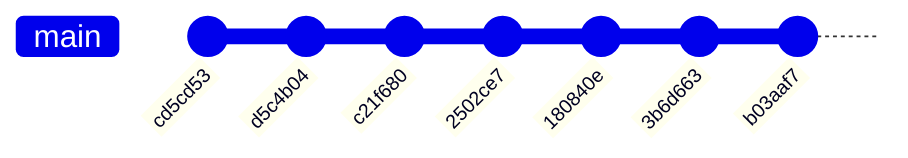

# 4. Git 本地工作流

程序昨天还能运行，今天改了几处之后输出了错误的结果，回头逐行检查，却看不出哪里动过；想回到能运行的版本，只能凭印象把改动一处一处撤回来。改动越多，这种回忆越不可靠。Git 把每次想保留的状态记成一条提交，任何时候都能拿回当时的完整文件，也能看清两次提交之间到底改了什么。

这一章为一个 C 项目建立本地仓库，按「修改、暂存、提交」的顺序记录历史，学会查看差异与历史、撤销常见误操作、临时保存做到一半的修改、忽略构建产物，并在最后理解提交和分支在仓库里的形式，在本地创建分支、合并，解决一次冲突。远程仓库、协作流程和变基留到[第 17 章 Git 协作](/教程/正文/开发与工程基础/17_Git协作)。

读这一章之前，应该已经会在命令行里操作目录和文件（[第 2 章](/教程/正文/开发与工程基础/2_命令行与目录操作)），并能用 `gcc` 编译运行单文件程序（[第 3 章](/教程/正文/开发与工程基础/3_从源文件到可执行文件)）。

正文的终端输出来自 Linux 上的 Git 2.47.3。演示仓库的作者、邮箱和提交时间都是固定的，因此提交哈希可以复现；按本章步骤自己操作时，时间不同，哈希也不同。随文的 `code/开发与工程基础/4_Git本地工作流/demo.sh` 能重建同样的仓库。

## 1. 第一次配置

Git 在每次提交里记录作者的名字和邮箱。安装后先设置这两项，再指定新仓库的初始分支名和默认编辑器：

::: terminal title="zsh - git config"

```text
$ git config --global user.name "Mdr"
$ git config --global user.email "mdr@example.com"
$ git config --global init.defaultBranch main
$ git config --global core.editor vim
$ git config --global --list
user.name=Mdr
user.email=mdr@example.com
init.defaultbranch=main
core.editor=vim
$ git config --get user.name
Mdr
```

:::

`--global` 表示写入当前用户的配置，对本机所有仓库生效。不加 `--global` 时写入当前仓库的 `.git/config`，只影响这一个仓库。用 `--show-origin` 可以看到每个值来自哪个文件：

::: terminal title="zsh - git config --show-origin"

```text
$ git config user.email mdr@greet.example
$ git config --show-origin --get user.email
file:.git/config	mdr@greet.example
$ git config --get user.name
Mdr
```

:::

先在某一个仓库里单独设置了邮箱，所以 `user.email` 的来源是仓库内的 `.git/config`；`user.name` 在这个仓库里没有设置，取的是全局值 `Mdr`。仓库配置优先于全局配置。全局配置保存在用户主目录的 `.gitconfig`，Windows 上也在同一位置（`C:\Users\你的用户名\.gitconfig`）；Git 安装目录下还有一份系统级配置，一般不需要动。

四个键里，`user.name` 和 `user.email` 会写进每一条提交；`init.defaultBranch` 决定 `git init` 创建的第一个分支叫什么；`core.editor` 只在执行 `git commit` 不带 `-m` 时用到，Git 会用这个编辑器打开提交说明。

没有配置身份就提交，Git 会拒绝，输出类似：

::: terminal title="zsh - git commit"

```text
$ git commit -m "feat: 建立项目"
Author identity unknown

*** Please tell me who you are.

Run

  git config --global user.email "you@example.com"
  git config --global user.name "Your Name"

to set your account's default identity.
Omit --global to set the identity only in this repository.

fatal: unable to auto-detect email address (got 'user@host.(none)')
```

:::

最后一行里的 `user@host` 是 Git 用当前登录名和主机名拼出来的地址，凑不出合法地址就报错退出。按提示用 `git config --global` 写好 `user.email` 和 `user.name` 即可；只想让某一个仓库使用别的身份时，在该仓库里去掉 `--global` 再设置一次，就像上一段演示的那样。

没有设置 `init.defaultBranch` 时，`git init` 会打印一段提示，说明初始分支名是 `master`，并给出用 `git branch -m` 改名的方法。设置成 `main` 之后这段提示不再出现。`git init` 默认还会打印新仓库的路径，`--quiet` 可以省略这一行，下面统一加上。

::: tip 换行符在不同系统间不一致

Windows 上的编辑器常把换行保存成 CRLF，Linux 和 macOS 用 LF。跨系统协作时用仓库里的 `.gitattributes` 统一换行，具体写法在[第 17 章](/教程/正文/开发与工程基础/17_Git协作)。个人本机使用时，Git for Windows 的默认设置已经能应付大多数情况。

:::

## 2. 三个区域

Git 把文件的状态分成三处：工作区 (working tree) 是磁盘上能直接编辑的文件；暂存区 (staging area，也叫索引 index) 是下一次提交的准备内容；仓库 (repository) 是 `.git` 目录里已经提交的历史。一条命令负责一处迁移：


::: concept git-three-areas title="提交记录的是暂存区"

`git add` 把文件在那一刻的内容写入暂存区；此后再修改工作区的文件，暂存区里仍是旧内容。`git commit` 只把暂存区的内容写成一条提交，工作区里没暂存的部分不进入历史。`git restore` 用暂存区的内容覆盖工作区，`git restore --staged` 把暂存区退回最后一次提交的内容。

:::

暂存区看起来多了一步，实际用处是拼装提交：改了两个互不相关的问题时，可以先用 `git add -p` 逐块挑选属于第一个问题的改动提交，剩下的再单独提交。只有一个「保存」动作的版本控制做不到这一点，两类改动只能挤在同一条提交里。

## 3. 第一次提交

本章用一个很小的项目 `greet` 演示。它由三个文件组成：

::: code-group

```c [greet.c]
#include <stdio.h>

int main(void) {
    puts("Hello, world!");
    return 0;
}
```

```markdown [README.md]
# greet

打印一句问候。
```

```sh [build.sh]
#!/bin/sh
set -eu
mkdir -p build
gcc -std=c17 -Wall -Wextra -o build/greet greet.c
```

:::

在项目目录里初始化仓库，然后查看状态：

::: terminal title="zsh - greet"

```text
$ git init --quiet
$ git status
On branch main

No commits yet

nothing to commit (create/copy files and use "git add" to track)
```

:::

`git init` 在项目目录里创建 `.git` 子目录，此后这个目录就是一个仓库。目录里原有的文件不会被改动，也没有被 Git 记录。把三个文件写好后再看：

::: terminal title="zsh - greet"

```text
$ git status
On branch main

No commits yet

Untracked files:
  (use "git add <file>..." to include in what will be committed)
	README.md
	build.sh
	greet.c

nothing added to commit but untracked files present (use "git add" to track)
$ git status --short
?? README.md
?? build.sh
?? greet.c
$ git add greet.c README.md build.sh
$ git status
On branch main

No commits yet

Changes to be committed:
  (use "git rm --cached <file>..." to unstage)
	new file:   README.md
	new file:   build.sh
	new file:   greet.c

$ git status --short
A  README.md
A  build.sh
A  greet.c
```

:::

`git status` 把文件分成几组：`Untracked files` 是 Git 从未记录过的文件；`Changes to be committed` 是暂存区里、将进入下一次提交的改动；已经跟踪但工作区又改过的文件会出现在 `Changes not staged for commit`。`git status --short` 用两列字母表示同样的信息：左列是暂存区，右列是工作区；`??` 表示未跟踪，`A` 表示新增，`M` 表示修改。两列都有字母时，文件同时存在已暂存和未暂存的改动。

`git add` 之后，三个文件进入暂存区。提交并查看历史：

::: terminal title="zsh - greet"

```text
$ git commit -m "feat: 打印问候语" -m "先输出一句固定的问候，下一步再接受命令行参数。"
[main (root-commit) cd5cd53] feat: 打印问候语
 3 files changed, 13 insertions(+)
 create mode 100644 README.md
 create mode 100644 build.sh
 create mode 100644 greet.c
$ git log --oneline
cd5cd53 feat: 打印问候语
$ git log
commit cd5cd53b41d93555e3091d5ea4cbdc04b3edeab1
Author: Mdr <mdr@example.com>
Date:   Mon Oct 19 09:00:00 2026 +0800

    feat: 打印问候语
    
    先输出一句固定的问候，下一步再接受命令行参数。
```

:::

`(root-commit)` 表示这是仓库的第一条提交；`cd5cd53` 是提交哈希的前七位，`git log --oneline` 用这个短形式列出历史。`git log` 的完整输出里，哈希是四十位十六进制数，后面是作者、日期和提交说明，说明的第一行之后空一行，再写正文。

提交说明的第一行写「类型: 简述」，类型用几个固定的词：

| 类型 | 用途 |
| --- | --- |
| `feat` | 新增功能 |
| `fix` | 修复缺陷 |
| `docs` | 只改文档 |
| `build` | 构建脚本或产物配置 |
| `refactor` | 不改变行为的重写 |
| `test` | 增加或修改测试 |
| `chore` | 其余杂项 |

这一行的作用是在 `git log --oneline` 里一眼看出每条提交做了什么。空一行之后的正文写为什么改、改之前是什么样，不必重复 diff 里已经能看到的细节。提交说明用祈使语气，读起来像「应用这条提交会……」。约定式提交 (Conventional Commits) 对这些前缀有完整规定，本教程只用其中最常用的几个。

## 4. 忽略构建产物

`build.sh` 把可执行文件放进 `build/`。运行一次再看状态：

::: terminal title="zsh - greet"

```text
$ sh build.sh
$ ./build/greet
Hello, world!
$ git status
On branch main
Untracked files:
  (use "git add <file>..." to include in what will be committed)
	build/

nothing added to commit but untracked files present (use "git add" to track)
$ git status --short
?? build/
```

:::

`build/` 里的内容由源文件生成，每次重新编译都会变，不应该进入历史。在项目根目录写一个 `.gitignore`：

```text:no-line-numbers
build/
*.o
*.exe
a.out
*.gcda
.vscode/
```

每行一个模式。以 `/` 结尾的只匹配目录，`build/` 因此能忽略整个目录；`*.o` 里的 `*` 不跨目录，匹配任意目录下的目标文件；`*.gcda` 是后面章节做覆盖率测试时生成的计数文件；`.vscode/` 是本机编辑器的工作目录。前导 `/` 把模式锚定在仓库根目录，`!` 开头表示重新包含，这些写法在需要时再查 `gitignore` 文档即可。

写好后，`git status` 里不再出现 `build/`。要确认某个文件为什么被忽略，用 `git check-ignore -v`：

::: terminal title="zsh - greet"

```text
$ git status
On branch main
Untracked files:
  (use "git add <file>..." to include in what will be committed)
	.gitignore

nothing added to commit but untracked files present (use "git add" to track)
$ git status --ignored
On branch main
Untracked files:
  (use "git add <file>..." to include in what will be committed)
	.gitignore

Ignored files:
  (use "git add -f <file>..." to include in what will be committed)
	build/

nothing added to commit but untracked files present (use "git add" to track)
$ git check-ignore -v build/greet
.gitignore:1:build/	build/greet
$ git check-ignore -v greet.c; echo $?
1
```

:::

`--ignored` 把被忽略的路径也列出来。`check-ignore -v` 输出匹配到的规则、规则在 `.gitignore` 中的行号和路径；`greet.c` 没有命中任何规则，`git check-ignore` 以状态 1 退出，不打印内容。

被忽略的文件 `git add` 不会接受：

::: terminal title="zsh - greet"

```text
$ git add build/greet
The following paths are ignored by one of your .gitignore files:
build
hint: Use -f if you really want to add them.
hint: Disable this message with "git config advice.addIgnoredFile false"
$ git add -f build/greet
$ git status --short
A  build/greet
?? .gitignore
$ git rm --cached build/greet
rm 'build/greet'
$ git status --short
?? .gitignore
```

:::

`-f` 强制加入，`git rm --cached` 把它从索引里移除，文件本身留在磁盘上。已经提交过的文件再写进 `.gitignore` 不会自动退出历史：`.gitignore` 只影响未跟踪的文件，已跟踪的文件会继续出现在 `git status` 里，需要用 `git rm --cached` 移除后再提交。

把可执行文件提交进仓库的后果，可以用一个单独的仓库看清楚：

::: terminal title="zsh - bin-demo"

```text
$ git add hi
$ git commit -m "chore: 提交可执行文件"
[main (root-commit) 1f4990f] chore: 提交可执行文件
 1 file changed, 0 insertions(+), 0 deletions(-)
 create mode 100755 hi
$ git show --stat HEAD
commit 1f4990ffc770205e02478ea40016d52adad0a3cf
Author: Mdr <mdr@example.com>
Date:   Mon Oct 19 09:25:00 2026 +0800

    chore: 提交可执行文件

 hi | Bin 0 -> 15952 bytes
 1 file changed, 0 insertions(+), 0 deletions(-)
$ git status --short
 M hi
?? hi.c
$ git diff --stat
 hi | Bin 15952 -> 15952 bytes
 1 file changed, 0 insertions(+), 0 deletions(-)
$ git diff
diff --git a/hi b/hi
index 1475134..5042bba 100755
Binary files a/hi and b/hi differ
$ git ls-files
hi
```

:::

重新编译一次，文件大小没变，Git 也只能说「二进制文件不同」。文本文件能逐行对比、能合并冲突，可执行文件两样都做不到；每次重新编译还会往仓库里多存一份完整的二进制对象。仓库体积会随着编译次数增长，而出错时又无法从这些对象里看出任何有意义的信息。

::: tip 分块暂存

`git add -p` 逐块显示改动并询问是否暂存，适合一次修改里混着几件不同的事。回答 `y` 暂存当前块，`n` 跳过，`s` 把大块拆小，`q` 退出。

:::

## 5. 查看改动与历史

修改 `greet.c`，让它接受一个命令行参数。先不急着 `git add`，看看 Git 记录了什么：

::: terminal title="zsh - greet"

```text
$ git diff
diff --git a/greet.c b/greet.c
index 2415757..673fe35 100644
--- a/greet.c
+++ b/greet.c
@@ -1,6 +1,10 @@
 #include <stdio.h>
 
-int main(void) {
-    puts("Hello, world!");
+int main(int argc, char *argv[]) {
+    const char *name = "world";
+    if (argc > 1) {
+        name = argv[1];
+    }
+    printf("Hello, %s!\n", name);
     return 0;
 }
```

:::

`git diff` 比较工作区和暂存区，输出还没有暂存的改动。`---` 开头的一侧是旧内容，`+++` 开头的一侧是新内容，`-` 开头的行被删除，`+` 开头的行被添加，`@@` 指出改动在文件中的位置。

`git add` 之后，同样的改动出现在 `--staged` 视图里：

::: terminal title="zsh - greet"

```text
$ git status --short
 M greet.c
$ git add greet.c
$ git status --short
M  greet.c
$ git diff --staged
diff --git a/greet.c b/greet.c
index 2415757..673fe35 100644
--- a/greet.c
+++ b/greet.c
@@ -1,6 +1,10 @@
 #include <stdio.h>
 
-int main(void) {
-    puts("Hello, world!");
+int main(int argc, char *argv[]) {
+    const char *name = "world";
+    if (argc > 1) {
+        name = argv[1];
+    }
+    printf("Hello, %s!\n", name);
     return 0;
 }
```

:::

`git diff --staged` 比较暂存区和最后一次提交，也就是「下一次提交会包含什么」。此时 `git diff` 没有任何输出，因为工作区和暂存区一致。

暂存之后再改一次，两个视图就分开了：

::: terminal title="zsh - greet"

```text
$ git status --short
MM greet.c
$ git diff
diff --git a/greet.c b/greet.c
index 673fe35..208c60e 100644
--- a/greet.c
+++ b/greet.c
@@ -1,7 +1,7 @@
 #include <stdio.h>
 
 int main(int argc, char *argv[]) {
-    const char *name = "world";
+    const char *name = "World";
     if (argc > 1) {
         name = argv[1];
     }
$ git diff --staged
diff --git a/greet.c b/greet.c
index 2415757..673fe35 100644
--- a/greet.c
+++ b/greet.c
@@ -1,6 +1,10 @@
 #include <stdio.h>
 
-int main(void) {
-    puts("Hello, world!");
+int main(int argc, char *argv[]) {
+    const char *name = "world";
+    if (argc > 1) {
+        name = argv[1];
+    }
+    printf("Hello, %s!\n", name);
     return 0;
 }
$ git add greet.c
```

:::

`MM` 的两个字母分别对应暂存区和工作区：暂存的是把 `puts` 换成 `printf` 的那一版，工作区又在此基础上改了初始名字。`git diff` 只显示后一次改动，`git diff --staged` 显示前一次。再执行一次 `git add`，两个版本合并进暂存区。

<Quiz
  type="single"
  :options="[
    { label: '工作区与暂存区之间的全部差异', value: 'A' },
    { label: '暂存之后又改动的那部分', value: 'B' },
    { label: '暂存区与最后一次提交之间的差异', value: 'C' },
    { label: '没有任何输出', value: 'D' }
  ]"
  answer="B"
>

执行 `git add greet.c` 之后又修改了 `greet.c`，此时 `git diff` 显示什么？

正确答案是 **B**。`git diff` 始终比较工作区和暂存区，暂存之后的新改动只存在于工作区，所以只显示这一部分。C 是 `git diff --staged` 的内容。

</Quiz>

提交之后，历史可以用几种粒度查看：

::: terminal title="zsh - greet"

```text
$ git commit -m "feat: 支持从命令行读入名字。" -m "参数缺省时仍然问候 world。"
[main 4da5718] feat: 支持从命令行读入名字。
 1 file changed, 6 insertions(+), 2 deletions(-)
$ git log --oneline
4da5718 feat: 支持从命令行读入名字。
d5c4b04 build: 忽略构建产物
cd5cd53 feat: 打印问候语
$ git log --stat --oneline
4da5718 feat: 支持从命令行读入名字。
 greet.c | 8 ++++++--
 1 file changed, 6 insertions(+), 2 deletions(-)
d5c4b04 build: 忽略构建产物
 .gitignore | 6 ++++++
 1 file changed, 6 insertions(+)
cd5cd53 feat: 打印问候语
 README.md | 3 +++
 build.sh  | 4 ++++
 greet.c   | 6 ++++++
 3 files changed, 13 insertions(+)
$ git log -S printf --oneline -- greet.c
4da5718 feat: 支持从命令行读入名字。
$ git show --stat HEAD
commit 4da5718fcf45877caa5078b9013b27117bd0acfa
Author: Mdr <mdr@example.com>
Date:   Mon Oct 19 09:40:00 2026 +0800

    feat: 支持从命令行读入名字。
    
    参数缺省时仍然问候 world。

 greet.c | 8 ++++++--
 1 file changed, 6 insertions(+), 2 deletions(-)
$ git log -p -1 -- greet.c
commit 4da5718fcf45877caa5078b9013b27117bd0acfa
Author: Mdr <mdr@example.com>
Date:   Mon Oct 19 09:40:00 2026 +0800

    feat: 支持从命令行读入名字。
    
    参数缺省时仍然问候 world。

diff --git a/greet.c b/greet.c
index 2415757..208c60e 100644
--- a/greet.c
+++ b/greet.c
@@ -1,6 +1,10 @@
 #include <stdio.h>
 
-int main(void) {
-    puts("Hello, world!");
+int main(int argc, char *argv[]) {
+    const char *name = "World";
+    if (argc > 1) {
+        name = argv[1];
+    }
+    printf("Hello, %s!\n", name);
     return 0;
 }
```

:::

`--stat` 在每条提交下加一行改动统计；`-S` 找出增加或删除过某个字符串的提交，这里找的是第一次出现 `printf` 的提交；`git show <提交>` 显示该提交的说明和完整 diff，`HEAD` 指当前提交；`-p` 让 `git log` 带上 diff，`-1` 表示只显示一条，`-- greet.c` 把范围限制在文件上，三者可以组合。

## 6. 撤销

误操作有几种，撤销方式各不同。先按情形选命令，再做一次：

| 情形 | 命令 |
| --- | --- |
| 丢弃工作区里未暂存的修改 | `git restore <文件>` |
| 取消暂存，保留工作区的修改 | `git restore --staged <文件>` |
| 修改最后一次提交的说明或内容 | `git commit --amend` |
| 撤销一次已经提交的改动，保留历史 | `git revert <提交>` |
| 查看某个旧版本 | `git switch --detach <提交>`，看完用 `git switch -` 回来 |
| 把最后一次提交退回暂存区 | `git reset --soft HEAD~1` |

往 `README.md` 末尾加一行，再把它丢掉：

::: terminal title="zsh - greet"

```text
$ git status --short
 M README.md
$ git diff
diff --git a/README.md b/README.md
index f8ab59c..d51b1d4 100644
--- a/README.md
+++ b/README.md
@@ -1,3 +1,5 @@
 # greet
 
 打印一句问候。
+
+## 运行
$ git restore README.md
$ git status --short
```

:::

`git restore` 用暂存区里的内容覆盖工作区，`git status --short` 于是没有任何输出。这个动作不经过确认，被覆盖的修改没有进入过任何提交，Git 没有留下副本。

如果改动已经 `git add`，先取消暂存再决定是否丢弃：

::: terminal title="zsh - greet"

```text
$ git status --short
 M greet.c
$ git add greet.c
$ git status --short
M  greet.c
$ git restore --staged greet.c
$ git status --short
 M greet.c
$ git diff --staged
$ git restore greet.c
$ git status --short
```

:::

`git restore --staged` 只把暂存区退回到 `HEAD`，工作区的修改原样保留，所以状态从 `M ` 变回 ` M`；`git diff --staged` 此时为空。确认不要了，再执行 `git restore` 丢弃工作区的内容。

提交说明写错了，或者忘了把一个文件放进最后一次提交，用 `--amend`。上面那条提交的小标题末尾多了一个句号，改掉：

::: terminal title="zsh - greet"

```text
$ git log --oneline -1
4da5718 feat: 支持从命令行读入名字。
$ git rev-parse --short HEAD
4da5718
$ git commit --amend -m "feat: 支持从命令行读入名字" -m "参数缺省时仍然问候 world。"
[main c21f680] feat: 支持从命令行读入名字
 Date: Mon Oct 19 09:40:00 2026 +0800
 1 file changed, 6 insertions(+), 2 deletions(-)
$ git log --oneline -1
c21f680 feat: 支持从命令行读入名字
$ git rev-parse --short HEAD
c21f680
```

:::

`--amend` 不修改原来那条提交，而是用暂存区的内容和新的说明生成一条提交，替换掉旧的。哈希从 `4da5718` 变成 `c21f680`，因为提交对象里包含了说明和父提交，任何一处不同都会得到不同的哈希。旧对象还留在 `.git` 里，`git reflog` 会记下它，但它已经不在当前历史上了。只对还没有推送给别人的提交使用 `--amend`。

已经提交的改动需要撤销，又要保留历史，用 `git revert`。先做一条改错的提交：

::: terminal title="zsh - greet"

```text
$ git diff
diff --git a/greet.c b/greet.c
index 208c60e..13d62e2 100644
--- a/greet.c
+++ b/greet.c
@@ -1,7 +1,7 @@
 #include <stdio.h>
 
 int main(int argc, char *argv[]) {
-    const char *name = "World";
+    const char *name = "Mdr";
     if (argc > 1) {
         name = argv[1];
     }
$ git add greet.c
$ git commit -m "feat: 默认问候 Mdr" -m "本机自用时省去输入名字。"
[main 2502ce7] feat: 默认问候 Mdr
 1 file changed, 1 insertion(+), 1 deletion(-)
$ sh build.sh
$ ./build/greet
Hello, Mdr!
```

:::

这个改动其实不该提交：默认名字应该是 `World`，`Mdr` 只是本机实验。撤销它：

::: terminal title="zsh - greet"

```text
$ git log --oneline -2
2502ce7 feat: 默认问候 Mdr
c21f680 feat: 支持从命令行读入名字
$ git revert --no-edit HEAD
[main 180840e] Revert "feat: 默认问候 Mdr"
 Date: Mon Oct 19 10:10:00 2026 +0800
 1 file changed, 1 insertion(+), 1 deletion(-)
$ git log --oneline -3
180840e Revert "feat: 默认问候 Mdr"
2502ce7 feat: 默认问候 Mdr
c21f680 feat: 支持从命令行读入名字
$ git show --stat HEAD
commit 180840e118919facae8f98746885280dbca007ff
Author: Mdr <mdr@example.com>
Date:   Mon Oct 19 10:10:00 2026 +0800

    Revert "feat: 默认问候 Mdr"
    
    This reverts commit 2502ce7bf57d3c7d141d58557990fffb95f88155.

 greet.c | 2 +-
 1 file changed, 1 insertion(+), 1 deletion(-)
$ sh build.sh
$ ./build/greet
Hello, World!
```

:::

`git revert` 生成一条新提交，内容正好是目标提交的反向改动，原来的错误提交仍在历史里。`--no-edit` 表示沿用自动生成的说明，不打开编辑器。历史被保留下来，后来的人能查到改过什么、为什么又撤销。

只看旧版本，用游离头指针 (detached HEAD)：

::: terminal title="zsh - greet"

```text
$ git log --oneline -3
180840e Revert "feat: 默认问候 Mdr"
2502ce7 feat: 默认问候 Mdr
c21f680 feat: 支持从命令行读入名字
$ git switch --detach HEAD~3
HEAD is now at d5c4b04 build: 忽略构建产物
$ git branch --show-current
$ git show --stat --oneline HEAD
d5c4b04 build: 忽略构建产物
 .gitignore | 6 ++++++
 1 file changed, 6 insertions(+)
$ git switch -
Previous HEAD position was d5c4b04 build: 忽略构建产物
Switched to branch 'main'
```

:::

`HEAD~3` 表示当前提交往前数第三条，`~` 后面跟数字。游离状态下不在任何分支上，所以 `git branch --show-current` 那一行是空的。此时可以查看文件、编译运行，但不要在这里提交新内容：新提交没有分支指向它，切回分支就找不到了。`git switch -` 回到上一个位置，这里是 `main`。

最后一种情况是提交本身没做错，但想把它拆开或改一改，用 `git reset --soft` 把提交退回暂存区：

::: terminal title="zsh - rs"

```text
$ git log --oneline
14320b1 feat: 第二次提交
4042e58 feat: 第一次提交
$ git reset --soft HEAD~1
$ git log --oneline
4042e58 feat: 第一次提交
$ git status --short
M  a.c
$ git diff --staged --stat
 a.c | 2 +-
 1 file changed, 1 insertion(+), 1 deletion(-)
```

:::

历史退回一条，第二次提交的改动原样留在暂存区，可以重新组织后再提交。`--soft` 不碰工作区和暂存区；`--mixed`（默认）会同时取消暂存；`--hard` 连工作区一起覆盖。

::: warning 未提交的修改找不回来

`git restore` 和 `git reset --hard` 丢弃的改动没有进入过任何提交，Git 没有它们的副本，也无法恢复。执行前用 `git diff` 看清楚要丢的是什么。

:::

## 7. 临时保存：git stash

正在给 `greet` 加 `-h` 时，发现 README 里少写了用法，需要先修这个再继续。改到一半的代码不能提交，可以先放进 stash：

::: terminal title="zsh - greet"

```text
$ git diff --stat
 greet.c | 11 ++++++++++-
 1 file changed, 10 insertions(+), 1 deletion(-)
$ git status --short
 M greet.c
$ git stash push -m "wip: 增加 -h 用法提示"
Saved working directory and index state On main: wip: 增加 -h 用法提示
$ git status --short
$ git stash list
stash@{0}: On main: wip: 增加 -h 用法提示
```

:::

`git stash push` 把已跟踪文件的修改存进栈里，并把工作区恢复到 `HEAD`，`-m` 给这一条加说明。`git stash list` 按从新到旧的顺序列出，最近一条是 `stash@{0}`。工作区干净之后，修 README 并提交：

::: terminal title="zsh - greet"

```text
$ git diff
diff --git a/README.md b/README.md
index f8ab59c..170130d 100644
--- a/README.md
+++ b/README.md
@@ -1,3 +1,8 @@
 # greet
 
 打印一句问候。
+
+## 用法
+
+    sh build.sh
+    ./build/greet Ada
$ git add README.md
$ git commit -m "docs: 在 README 中补充用法"
[main 3b6d663] docs: 在 README 中补充用法
 1 file changed, 5 insertions(+)
```

:::

再把做到一半的改动拿回来：

::: terminal title="zsh - greet"

```text
$ git stash list
stash@{0}: On main: wip: 增加 -h 用法提示
$ git stash pop
On branch main
Changes not staged for commit:
  (use "git add <file>..." to update what will be committed)
  (use "git restore <file>..." to discard changes in working directory)
	modified:   greet.c

no changes added to commit (use "git add" and/or "git commit -a")
Dropped refs/stash@{0} (abe5ede9237080b71195e746ea8ca8d3457cc843)
$ git status --short
 M greet.c
$ git diff --stat
 greet.c | 11 ++++++++++-
 1 file changed, 10 insertions(+), 1 deletion(-)
```

:::

`pop` 把改动合并回工作区，并从栈里删除这一条。合并后的统计和存进去时一样，说明改动完整回来了。继续修改、编译、提交：

::: terminal title="zsh - greet"

```text
$ sh build.sh
$ ./build/greet -h
usage: greet [-h] [NAME]
$ git add greet.c
$ git commit -m "feat: 增加 -h 用法提示" -m "用法信息交给 print_usage 输出。"
[main b03aaf7] feat: 增加 -h 用法提示
 1 file changed, 10 insertions(+), 1 deletion(-)
```

:::

`git stash pop` 相当于 `git stash apply` 加 `git stash drop`：`apply` 只恢复不删除，确认没问题后再手动 `drop`。默认的 `stash` 只处理已跟踪的文件，新建的文件要加 `-u`：

::: terminal title="zsh - greet"

```text
$ git status --short
?? notes.txt
$ git stash push -u -m "wip: 未跟踪的笔记"
Saved working directory and index state On main: wip: 未跟踪的笔记
$ git status --short
$ git stash list
stash@{0}: On main: wip: 未跟踪的笔记
$ git stash pop
Already up to date.
On branch main
Untracked files:
  (use "git add <file>..." to include in what will be committed)
	notes.txt

nothing added to commit but untracked files present (use "git add" to track)
Dropped refs/stash@{0} (87acc41ef331a17c973d08ec27f0c5206c7202fb)
$ git status --short
?? notes.txt
```

:::

`-u` 包含未跟踪的文件，被 `.gitignore` 忽略的文件要 `-a` 才会一并存进去。`Already up to date.` 是说这次恢复只带回未跟踪文件，已跟踪文件没有变化。

## 8. 提交、树与文件在仓库里的样子

前面一直在用「提交」这个词，现在打开一个提交看它的内部。`git cat-file -p` 按内容打印任意对象：

::: terminal title="zsh - greet"

```text
$ git log --oneline
b03aaf7 feat: 增加 -h 用法提示
3b6d663 docs: 在 README 中补充用法
180840e Revert "feat: 默认问候 Mdr"
2502ce7 feat: 默认问候 Mdr
c21f680 feat: 支持从命令行读入名字
d5c4b04 build: 忽略构建产物
cd5cd53 feat: 打印问候语
$ git cat-file -t HEAD
commit
$ git cat-file -p HEAD
tree d081bb2ba074f64de6fed9b26b1caa55e3a7f160
parent 3b6d66331308afca2f0089634097682d8f37aff5
author Mdr <mdr@example.com> 1792377000 +0800
committer Mdr <mdr@example.com> 1792377000 +0800

feat: 增加 -h 用法提示

用法信息交给 print_usage 输出。
$ git cat-file -p HEAD^{tree}
100644 blob 9a36cf9b555e0f9c5be74ebd3ba61074fb81f215	.gitignore
100644 blob 170130d897fd449c355fc0dad09e1b6f23c37ed1	README.md
100644 blob 515fc2b26fc2c48d791076cc0c83b7ca1e605348	build.sh
100644 blob a843dbf1c89673667a79f638f778c48e9f469574	greet.c
$ git cat-file -p HEAD:greet.c
#include <stdio.h>
#include <string.h>

static void print_usage(void) {
    puts("usage: greet [-h] [NAME]");
}

int main(int argc, char *argv[]) {
    const char *name = "world";
    if (argc > 1 && strcmp(argv[1], "-h") == 0) {
        print_usage();
        return 0;
    }
    if (argc > 1) {
        name = argv[1];
    }
    printf("Hello, %s!\n", name);
    return 0;
}
```

:::

提交对象只有几行：一个顶层树的哈希、父提交的哈希、作者与提交者的名字和时间、空行之后的说明。`HEAD^{tree}` 表示取出这条提交的树；树里每行是一个目录项，`100644` 是普通文件的模式，`blob` 是对象类型，中间是哈希，最后是文件名。`HEAD:greet.c` 则直接取出该提交中这个文件的内容。

Git 保存的对象有四种：`blob` 只存文件内容，不带文件名；`tree` 存一层目录；`commit` 存一次快照的入口；第四种是标签 (tag)，用来给某个对象起一个固定的名字，[第 19 章](/教程/正文/开发与工程基础/19_文档_版本与发布)讲发布时再用。对象按内容的 SHA-1 命名：同样的内容只存一份，任何改动都会得到全新的哈希。Git 也支持用 `git init --object-format=sha256` 建 SHA-256 仓库，那样的哈希更长；本章的演示仓库用默认的 SHA-1。

连续三条提交的树放在一起，能直接看到这一点：

::: terminal title="zsh - greet"

```text
$ git cat-file -p HEAD^{tree}
100644 blob 9a36cf9b555e0f9c5be74ebd3ba61074fb81f215	.gitignore
100644 blob 170130d897fd449c355fc0dad09e1b6f23c37ed1	README.md
100644 blob 515fc2b26fc2c48d791076cc0c83b7ca1e605348	build.sh
100644 blob a843dbf1c89673667a79f638f778c48e9f469574	greet.c
$ git cat-file -p HEAD~1^{tree}
100644 blob 9a36cf9b555e0f9c5be74ebd3ba61074fb81f215	.gitignore
100644 blob 170130d897fd449c355fc0dad09e1b6f23c37ed1	README.md
100644 blob 515fc2b26fc2c48d791076cc0c83b7ca1e605348	build.sh
100644 blob 208c60e375af643b0af57f21ef78c137844dd46e	greet.c
$ git cat-file -p HEAD~2^{tree}
100644 blob 9a36cf9b555e0f9c5be74ebd3ba61074fb81f215	.gitignore
100644 blob f8ab59cd20e450d3309927fc32d0518558943514	README.md
100644 blob 515fc2b26fc2c48d791076cc0c83b7ca1e605348	build.sh
100644 blob 208c60e375af643b0af57f21ef78c137844dd46e	greet.c
```

:::

`.gitignore` 和 `build.sh` 三条提交里的哈希完全相同，因为文件没改过；README 只在最早的那条里不同；`greet.c` 在较早的两条里相同，只有加上 `-h` 的那条改了它。一次提交新增的只有提交对象、包含改动目录的那几个树对象，以及改动文件的新数据对象；没变过的目录项仍然指向原来的对象，因此历史再长，也不等于把整个项目复制了很多份。

分支和 `HEAD` 都只是文件。`HEAD` 写着当前分支的名字，分支文件写着提交的哈希：

::: terminal title="zsh - greet"

```text
$ cat .git/HEAD
ref: refs/heads/main
$ cat .git/refs/heads/main
b03aaf7eccb4d3d22b57050536334b4bfd914c78
$ git branch -v
* main b03aaf7 feat: 增加 -h 用法提示
```

:::

`git branch -v` 里星号标出当前分支。提交时 Git 写一个新对象，再把当前分支文件里的哈希改成新对象，`HEAD` 本身不变。

::: concept git-object-model title="提交、树与数据块"

Git 用四类对象保存历史：数据对象 (blob) 存文件内容，树对象 (tree) 存目录项，提交对象 (commit) 存顶层树的哈希、父提交、作者和说明，标签对象 (tag) 给某个对象起名字。对象按内容计算哈希，内容相同就只有一个对象；分支是指向提交的可移动名字，`HEAD` 指向当前分支。

:::

下面这张图是当前这条历史：



::: generate git-object-walkthrough kind=explanation concepts=git-object-model

面向刚学会提交、还没见过 Git 内部结构的读者，沿着正文的 `cat-file` 输出逐层解释：怎样从 `HEAD` 找到提交对象，提交怎样指向树，树里的每一行怎样对应到文件内容。用连续三条提交共用同一个 blob 的实测结果说明「快照」并不复制整个目录，并指出修改一个文件后真正新增的对象有哪几个。

:::

## 9. 本地分支与合并

分支是一条独立的提交线。从当前提交创建 `shout`，把问候语改成大写：

::: terminal title="zsh - greet"

```text
$ git switch -c shout
Switched to a new branch 'shout'
$ git diff
diff --git a/greet.c b/greet.c
index a843dbf..69ddc8b 100644
--- a/greet.c
+++ b/greet.c
@@ -14,6 +14,6 @@ int main(int argc, char *argv[]) {
     if (argc > 1) {
         name = argv[1];
     }
-    printf("Hello, %s!\n", name);
+    printf("HELLO, %s!\n", name);
     return 0;
 }
$ git add greet.c
$ git commit -m "feat: 问候语改为大写"
[shout 5e483c3] feat: 问候语改为大写
 1 file changed, 1 insertion(+), 1 deletion(-)
```

:::

切回 `main` 合并。`main` 在创建分支后没有新提交，合并只是把 `main` 的指针移到 `shout` 的位置：

::: terminal title="zsh - greet"

```text
$ git switch main
Switched to branch 'main'
$ git log --oneline -3
b03aaf7 feat: 增加 -h 用法提示
3b6d663 docs: 在 README 中补充用法
180840e Revert "feat: 默认问候 Mdr"
$ git merge shout
Updating b03aaf7..5e483c3
Fast-forward
 greet.c | 2 +-
 1 file changed, 1 insertion(+), 1 deletion(-)
$ git log --graph --oneline
* 5e483c3 feat: 问候语改为大写
* b03aaf7 feat: 增加 -h 用法提示
* 3b6d663 docs: 在 README 中补充用法
* 180840e Revert "feat: 默认问候 Mdr"
* 2502ce7 feat: 默认问候 Mdr
* c21f680 feat: 支持从命令行读入名字
* d5c4b04 build: 忽略构建产物
* cd5cd53 feat: 打印问候语
```

:::

这种情况称为快进 (fast-forward)：目标提交是当前提交的后代，两边没有分叉，Git 不需要新建提交。只要 `main` 在分叉之后也有自己的提交，快进就不成立，必须做一次真正的合并。

再做一个分支 `polite`，把问候语改成小写；同时在 `main` 上给同一行加感叹号：

::: terminal title="zsh - greet"

```text
$ git switch -c polite
Switched to a new branch 'polite'
$ git diff
diff --git a/greet.c b/greet.c
index 69ddc8b..93ae70b 100644
--- a/greet.c
+++ b/greet.c
@@ -14,6 +14,6 @@ int main(int argc, char *argv[]) {
     if (argc > 1) {
         name = argv[1];
     }
-    printf("HELLO, %s!\n", name);
+    printf("hello, %s!\n", name);
     return 0;
 }
$ git add greet.c
$ git commit -m "fix: 问候语改用小写"
[polite e7dbad2] fix: 问候语改用小写
 1 file changed, 1 insertion(+), 1 deletion(-)
$ git switch main
Switched to branch 'main'
$ git diff
diff --git a/greet.c b/greet.c
index 69ddc8b..638c2dd 100644
--- a/greet.c
+++ b/greet.c
@@ -14,6 +14,6 @@ int main(int argc, char *argv[]) {
     if (argc > 1) {
         name = argv[1];
     }
-    printf("HELLO, %s!\n", name);
+    printf("HELLO, %s!!!\n", name);
     return 0;
 }
$ git add greet.c
$ git commit -m "feat: 问候语末尾加感叹号"
[main 8c02ce1] feat: 问候语末尾加感叹号
 1 file changed, 1 insertion(+), 1 deletion(-)
$ git merge polite
Auto-merging greet.c
CONFLICT (content): Merge conflict in greet.c
Automatic merge failed; fix conflicts and then commit the result.
```

:::

两个分支都改了 `greet.c` 里的同一行，Git 无法判断该保留哪一版，于是把合并停在中间，把两个版本都写进文件：

::: terminal title="zsh - greet"

```text
$ git status
On branch main
You have unmerged paths.
  (fix conflicts and run "git commit")
  (use "git merge --abort" to abort the merge)

Unmerged paths:
  (use "git add <file>..." to mark resolution)
	both modified:   greet.c

no changes added to commit (use "git add" and/or "git commit -a")
$ git status --short
UU greet.c
$ sed -n "15,24p" greet.c
        name = argv[1];
    }
<<<<<<< HEAD
    printf("HELLO, %s!!!\n", name);
=======
    printf("hello, %s!\n", name);
>>>>>>> polite
    return 0;
}
```

:::

`<<<<<<< HEAD` 到 `=======` 之间是当前分支的版本，`=======` 到 `>>>>>>> polite` 之间是被合并分支的版本。`UU` 表示两边都改过、还没解决。修改时把三行标记连同它们的整行一起删掉，留下正确的代码。冲突没解决时编译会失败，因为编译器认得这三行标记：

::: terminal title="zsh - greet"

```text
$ sh build.sh
greet.c: In function ‘main’:
greet.c:17:1: error: version control conflict marker in file
   17 | <<<<<<< HEAD
      | ^~~~~~~
greet.c:19:1: error: version control conflict marker in file
   19 | =======
      | ^~~~~~~
greet.c:21:1: error: version control conflict marker in file
   21 | >>>>>>> polite
      | ^~~~~~~
greet.c:9:17: warning: variable ‘name’ set but not used [-Wunused-but-set-variable]
    9 |     const char *name = "world";
      |                 ^~~~
```

:::

这两个改动并不矛盾：小写的 `hello` 和三个感叹号可以同时保留。

::: compare left-title="冲突标记留在文件里" right-title="按两边意图合并后"

```c
    if (argc > 1) {
        name = argv[1];
    }
<<<<<<< HEAD
    printf("HELLO, %s!!!\n", name);
=======
    printf("hello, %s!\n", name);
>>>>>>> polite
    return 0;
}
```

---

```c
    if (argc > 1) {
        name = argv[1];
    }
    printf("hello, %s!!!\n", name);
    return 0;
}
```

:::

按这个意思改好文件，重新编译、运行，确认行为正确：

::: terminal title="zsh - greet"

```text
$ sh build.sh
$ ./build/greet Ada
hello, Ada!!!
$ ./build/greet -h
usage: greet [-h] [NAME]
$ git add greet.c
$ git status --short
M  greet.c
$ git commit -m "chore: 合并 polite 分支" -m "两处改动都保留：小写的 hello 和三个感叹号。"
[main 6571f46] chore: 合并 polite 分支
```

:::

冲突解决后同样要先 `git add`，把文件标记为已解决，`git commit` 才会继续。`git commit` 会自动带上一段合并说明，用 `-m` 可以覆盖。这次的提交有两个父提交：

::: terminal title="zsh - greet"

```text
$ git cat-file -p HEAD
tree b3951a5433ee44492b2d3926308b7fa3ba7613bc
parent 8c02ce1890af639e7c02ae41f1f62b19cc234968
parent e7dbad29f15dcdc8df22aa7edd99ff7ed7005c13
author Mdr <mdr@example.com> 1792379400 +0800
committer Mdr <mdr@example.com> 1792379400 +0800

chore: 合并 polite 分支

两处改动都保留：小写的 hello 和三个感叹号。
```

:::

合并完成，删掉已经并入的分支，看最终的历史形状：

::: terminal title="zsh - greet"

```text
$ git branch -d polite
Deleted branch polite (was e7dbad2).
$ git branch -v
* main  6571f46 chore: 合并 polite 分支
  shout 5e483c3 feat: 问候语改为大写
$ git log --graph --oneline --all
*   6571f46 chore: 合并 polite 分支
|\  
| * e7dbad2 fix: 问候语改用小写
* | 8c02ce1 feat: 问候语末尾加感叹号
|/  
* 5e483c3 feat: 问候语改为大写
* b03aaf7 feat: 增加 -h 用法提示
* 3b6d663 docs: 在 README 中补充用法
* 180840e Revert "feat: 默认问候 Mdr"
* 2502ce7 feat: 默认问候 Mdr
* c21f680 feat: 支持从命令行读入名字
* d5c4b04 build: 忽略构建产物
* cd5cd53 feat: 打印问候语
$ git status
On branch main
nothing to commit, working tree clean
```

:::

`git branch -d` 只删除已经合并进当前分支的分支，没有合并时会拒绝并提示用 `-D`。图里左侧的竖线和斜线画出了两条并行的分支在合并提交处汇合。`shout` 没有删，它指向的提交本来就在 `main` 的历史上，`--all` 把它的引用一起算进来，图上也不会多出线条。

<Quiz
  type="single"
  :options="[
    { label: '当前分支在分叉后没有新提交，目标提交是它的后代', value: 'A' },
    { label: '两个分支都有新提交', value: 'B' },
    { label: '合并时发生了冲突', value: 'C' },
    { label: '两个分支的文件内容完全不同', value: 'D' }
  ]"
  answer="A"
>

什么情况下 `git merge` 会直接快进，不产生合并提交？

正确答案是 **A**。快进就是移动当前分支的指针，条件是目标提交已经在当前提交的前方、中间没有分叉。B 是典型的三方合并，C 是三方合并中才会出现的情况，D 与是否快进无关。

</Quiz>

## 10. 在 C 项目里的提交习惯

一次提交只做一件事。修 bug 时顺手改了缩进、重命名了函数，就把它们拆成两条提交：日后想撤销那个 bug 修复时，不必连带把格式改动一起撤掉。判断标准是提交说明能否用一句话说清；说不清就说明混了几件事。

提交之前让项目处于能编译的状态。[第 8 章](/教程/正文/开发与工程基础/8_构建图与Make)会用 Make 把编译写成一条命令，[第 11 章](/教程/正文/开发与工程基础/11_自动化测试)再加上测试，到那时提交前跑一遍 `make` 和测试。现在至少手动执行一次 `build.sh`。一个提交如果编译不过，`git bisect` 这类按提交查找问题的工具会直接失效，`git revert` 撤起来也容易碰到别的改动。

只提交源码、构建脚本和测试数据。`build/`、目标文件、可执行文件、编辑器缓存都写进 `.gitignore`。团队共享的 `.editorconfig`、`.clang-format` 属于构建配置，应该提交；只属于本机的 `.vscode/` 设置不提交。二进制文件一旦进入历史就很难彻底移走，提交前用 `git status --short` 看一眼清单。

在本地多提交，不要求每条都完美。改到一半想换个思路，先提交一个检查点，再用 `git restore`、`git stash` 收拾；想让历史更整齐，第 17 章讲变基和整理提交。提交的信息写清楚为什么改：diff 已经说明了改了什么，说明里再重复一遍没有意义。

## 11. 习题

### 11.1 巩固

<Exercise id="20401" :d="1" :w="2">

把第 3 章写的单文件程序（含源文件和编译命令）放进一个新目录，为它建立 Git 仓库。要求：

1. 如果本机还没有配置 `user.name` 和 `user.email`，先配置好。
2. 写一个 `.gitignore`，让编译产生的目标文件、可执行文件和 `build/` 目录都不出现在 `git status` 中。
3. 至少做两次提交：第一次提交源文件，第二次提交 `.gitignore` 和 README。
4. 用 `git status --ignored` 和 `git check-ignore -v` 各证明一次忽略规则生效，并解释 `git check-ignore` 对未被忽略的文件返回什么退出状态。

</Exercise>

<Exercise id="20402" :d="2" :w="2">

在一个至少有四次提交的仓库里，只用 Git 命令回答下列问题，把命令和输出记下来：

1. 某个函数（例如 `printf`）第一次出现在哪条提交里？
2. 最近两条提交之间，某个源文件改了哪几行？
3. 某条提交一共改了哪些文件、各改了多少行？
4. 当前工作区里哪些文件有未暂存的修改？

分别写出用到的命令，并说明为什么第 1 问不能只靠 `git log --oneline` 看出来。

</Exercise>

### 11.2 编程

<Exercise id="20403" :d="2" :w="2">

在一个练习仓库里依次制造并撤销下面四种情形，每做一步都用 `git status` 或 `git log` 验证结果：

1. 把一个能编译的文件改坏（例如删掉一个分号），用 `git restore` 恢复，确认文件重新能编译。
2. 误把一个调试用的临时文件 `git add` 进暂存区，用 `git restore --staged` 取消暂存，确认文件本身还在磁盘上。
3. 提交说明写错了一个字，用 `git commit --amend` 改正，记录修改前后 `git rev-parse --short HEAD` 的输出并解释为什么变了。
4. 已经提交的一处错误修改需要撤销，但历史必须保留，用 `git revert` 生成反向提交，确认文件恢复成修改前的样子，且原来的错误提交仍在 `git log` 里。

</Exercise>

<Exercise id="20404" :d="2" :w="2">

模拟「改到一半要先去修别的问题」：

1. 在源文件里给一个函数增加新功能，改到一半不要提交。
2. 用 `git stash push -m` 保存，确认 `git status` 干净、`git stash list` 能看到说明。
3. 修一个无关的小问题并提交。
4. 用 `git stash pop` 恢复，确认改动完整回来，然后编译、运行、提交。
5. 再新建一个未被跟踪的文件，用不带 `-u` 的 `git stash push` 和带 `-u` 的各试一次，记录两次结果的区别。

</Exercise>

<Exercise id="20405" :d="2" :w="3">

在一个仓库里从 `main` 拉出两个分支，让它们修改同一个函数的同一行：

1. 先合并第一个分支，记录 `git merge` 的输出，判断它是不是快进，并说明原因。
2. 再合并第二个分支，制造一次冲突。把冲突标记的原文贴出来，分别指出哪一段来自 `HEAD`、哪一段来自另一个分支。
3. 在冲突状态下执行编译，记录编译器的诊断，解释它为什么能认出冲突标记。
4. 按两边的意图手工合并，编译运行确认正确后 `git add` 并提交，用 `git log --graph --oneline --all` 画出提交图。
5. 用 `git cat-file -p` 查看合并提交，指出它和普通提交有什么不同。

</Exercise>

<Exercise id="20406" :d="3" :w="2">

只使用 `git cat-file`、`git rev-parse` 和 `cat .git/HEAD` 这类底层命令（不用 `git show`、`git log -p`、`git checkout`）：

1. 从 `HEAD` 出发，找到源文件在上上次提交（`HEAD~2`）中的完整内容。
2. 列出这个文件在各次提交中的哈希，指出哪几次相同、为什么相同。
3. 画出从提交对象到树、再到文件对象的路径，标出每一步用到的命令和得到的哈希。
4. 找到当前分支文件的内容，说明它和 `HEAD` 的关系。

</Exercise>

### 11.3 综合与挑战

<Exercise id="20407" :d="4" :w="3">

接手一个别人留下的仓库：里面有提交过的可执行文件和 `build/` 目录，历史混着「改功能」「调格式」「修拼写」三类提交，`git status` 里还挂着一堆构建产物。

1. 写一份检查清单，指出这个仓库在 `.gitignore`、提交粒度、提交说明三方面的问题，每一条对应到本章的哪一节。
2. 制定并执行修复方案：让构建产物不再出现在 `git status` 中，同时说明已经进入历史的那部分无法靠 `.gitignore` 消除，你会怎样处理（不必真的重写历史）。
3. 从历史里挑一条混着格式改动和功能改动的提交，说明如果现在要撤销功能改动，为什么直接 `git revert` 会连格式一起撤掉，给出一种拆分或补救的步骤。
4. 把处理过程写成 `cleanup.sh`，在一份复制的仓库上运行，并用 `git status --ignored` 验证结果。

</Exercise>

## 12. 参考资料

- Pro Git 第 2 章「Git 基础」：[记录每次更新到仓库](https://git-scm.com/book/en/v2/Git-Basics-Recording-Changes-to-the-Repository)、[撤消操作](https://git-scm.com/book/en/v2/Git-Basics-Undoing-Things)、[查看提交历史](https://git-scm.com/book/en/v2/Git-Basics-Viewing-the-Commit-History)
- Pro Git 第 3 章「Git 分支」：[分支简介](https://git-scm.com/book/en/v2/Git-Branching-Branches-in-a-Nutshell)、[分支的新建与合并](https://git-scm.com/book/en/v2/Git-Branching-Basic-Branching-and-Merging)
- Pro Git 第 7 章「Git 工具」：[贮藏与清理](https://git-scm.com/book/en/v2/Git-Tools-Stashing-and-Cleaning)
- Pro Git 第 10 章「Git 内部原理」：[Git 对象](https://git-scm.com/book/en/v2/Git-Internals-Git-Objects)
- MIT Missing Semester 2026：[Version Control and Git](https://missing.csail.mit.edu/2026/version-control/)
- git-config 手册：<https://git-scm.com/docs/git-config>
- git-restore 手册：<https://git-scm.com/docs/git-restore>
- gitignore 手册：<https://git-scm.com/docs/gitignore>
- gitrevisions 手册（`HEAD~3`、`^{tree}`、`HEAD:path` 等写法）：<https://git-scm.com/docs/gitrevisions>
- 约定式提交 1.0.0（中文）：<https://www.conventionalcommits.org/zh-hans/v1.0.0/>
- Chris Beams：[How to Write a Git Commit Message](https://cbea.ms/git-commit/)
