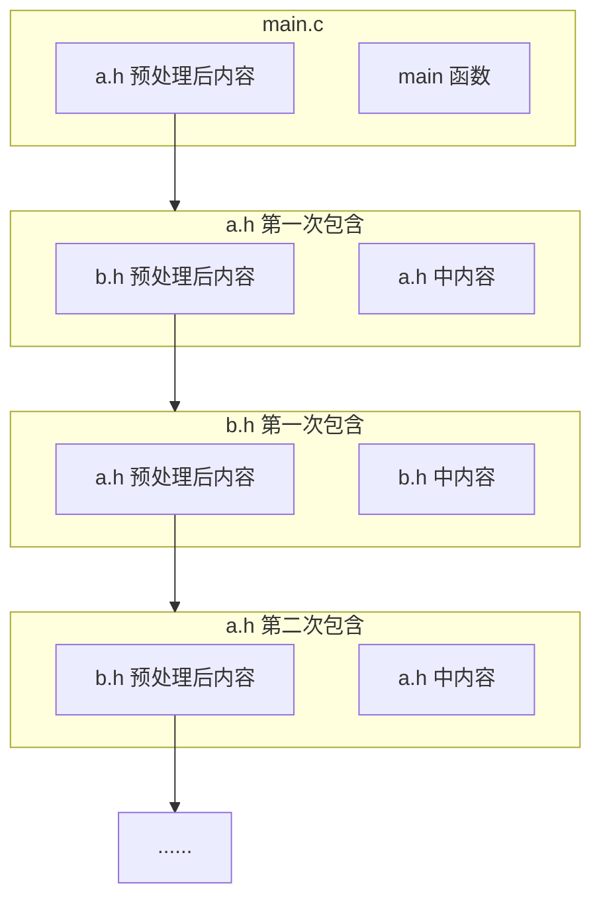
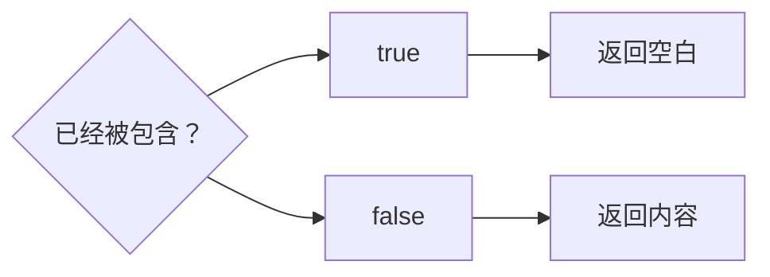
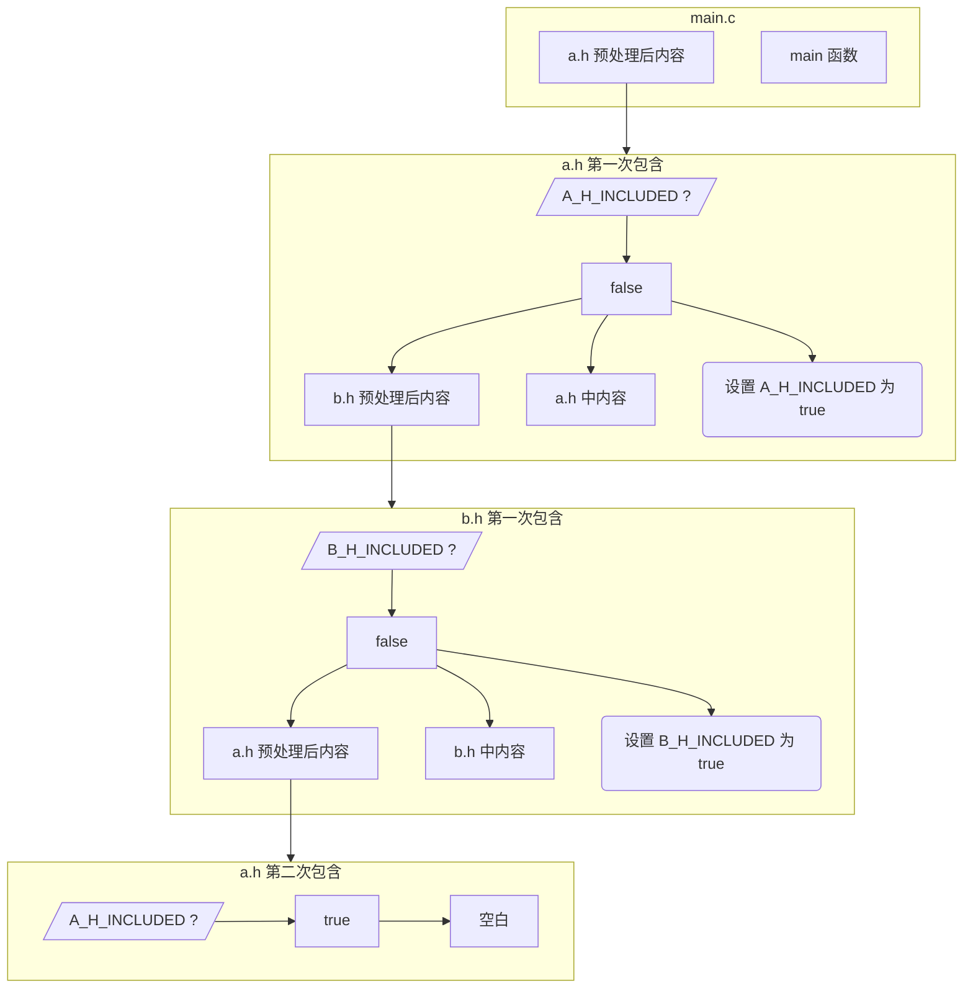

# 6.1 `#include` 与头文件

在多文件 C 语言工程中，源码文件之间并非互不相通的孤岛，而是需要依托统一的接口协议进行跨模块协作。将分散的源文件与公共声明串联在一起的最基础桥梁，正是预处理指令 `#include`。

## 1. `#include` 预处理指令

在语法规范上，`#include` 指令支持两种核心形态：

1. `#include <字符序列>`（尖括号形式）：指示预处理器按照实现定义的方式，在系统预设的头文件目录以及构建系统指定的系统路径中检索目标文件。
2. `#include "字符序列"`（双引号形式）：指示预处理器首先在当前正在预处理的源文件就近位置或用户自定目录中展开搜索；若未能命中，再自动退回尖括号形式的系统目录继续检索。

在工程实践中，开发者通常遵循清晰的包含纪律：**项目内部编写的局部头文件统一采用双引号形式，C 标准库头文件与第三方外部依赖库的头文件统一采用尖括号形式**。具体的搜索路径匹配顺序完全以目标平台工具链的实现和构建系统的配置参数（如 `-I` 选项）为准。

理解 `#include` 指令的核心直觉在于物理视角的文本替换：预处理器在识别到包含指令后，会将指定文件的全部内容经过预处理展开后，原封不动地直接拼接到当前指令所在的物理位置。下面的反例仅用于直观展示其文本注入效果；在正式的软件工程中，切勿在源码中包含 `.c` 文件。

::: code-group

```c [main.c]
#include <stdio.h>

int main(void) {
#include "arr.c"
    for(int i = 0; i < 10; i++){
        printf("%d ",arr[i]);
    }
    return 0;
}
```

```c [arr.c]
int arr[10] = {
    1, 2, 3, 4, 5, 6, 7, 8, 9, 10
};
```

:::

::: error 永远不要 `#include` 任何 `.c` 文件

在标准的构建流中，工程目录下的每一个 `.c` 源文件都会被编译器独立处理为一个翻译单元，并输出对应的目标文件（`.o`）。如果直接 `#include` 了一个 `.c` 文件，相当于将其中的函数实现与对象定义全盘复制注入到了另一个翻译单元中。

若项目中后续仍将原 `.c` 文件一并交给编译器构建，那么同一个函数或外部对象就会在两个不同的目标文件中各自生成一份强符号。最终链接器在合并所有目标文件时，就会因为无法裁决符号归属而报出严重的 `multiple definition` 冲突错误。

因此，代码跨文件调用时应当且仅当包含用于公开接口契约的头文件。头文件适宜存放类型定义、宏定义、内联说明与纯声明，而不应随意放置会在多个翻译单元间重复产生外部强符号定义的实体代码。

:::

经过翻译阶段 4 的文本替换处理之后，预处理器输出的 `main.c` 实际内容将呈现为：

```c
// stdio.h 内容

int main(void) {
    int arr[10] = {
1, 2, 3, 4, 5, 6, 7, 8, 9, 10
    };
    for(int i = 0; i < 10; i++){
        printf("%d ",arr[i]);
    }
    return 0;
}
```

输出：

::: terminal

1 2 3 4 5 6 7 8 9 10

:::

:::: info 原封不动

预处理器本质上是基于词法记号的文本处理机，它在执行文件插入时完全不理解也不校验目标文件是否构成合法的 C 语言语法结构；语法分析器最终看到的，是整套展开拼接完成后的完整记号序列。

基于这种特质，即便被包含的文件只是不完整的语法碎片，语法分析器依然能够顺利解析通过：

::: code-group

```c [main.c]
#include <stdio.h>

int main() {
    int arr[10] = {
#include "arr.txt"
    };
    for(int i = 0; i < 10; i++){
        printf("%d ",arr[i]);
    }
    return 0;
}
```

```txt [arr.txt]
1, 2, 3, 4, 5, 6, 7, 8, 9, 10
```

:::

但在正式工程中应当极力规避这种技巧。这种跨文件的语法切片极易破坏代码的可读性；当嵌入文本中混入拼写错误时，编译器的错误行号诊断往往会跨越物理文件与包含边界，导致排错极其痛苦。此外，如果文本中的数据长度发生变化，外部源文件的数组边界也必须随之硬编码调整，严重加剧了模块耦合。

若确实需要将静态数据文件嵌入二进制中，现代工程更推荐编写代码生成脚本，在构建前自动将数据转换为结构规范的 `.c` 与 `.h` 文件，或者使用现代编译器支持的资源嵌入扩展。

::::

根据 C 语言翻译阶段的规范，任何被包含的文件在展开时都会递归执行翻译阶段 1 至 4。当被包含的文件内部同样嵌套了 `#include` 指令时，包含关系就会向下传递。

而在实际开发中，若模块设计不当，常常会出现两个头文件彼此直接或间接包含的尴尬局面：文件 A 包含了文件 B，而文件 B 又包含了文件 A。此时若无防护措施，预处理器就会陷入无限嵌套的深渊：

::: code-group

```c [a.h]
#include "b.h"

void a(void);
```

```c [b.h]
#include "a.h"

void b(void);
```

```c [main.c]
#include "a.h"

int main(void) { /* ... */ }
```

:::

::: details 为什么会循环包含

若沿着预处理器的执行路径追踪，`main.c` 包含 `a.h` 后，其展开过程最初如下：

```c
// a.h 内容（记作代码①）

int main(void) { /* ... */ }
```

然而，被包含的 `a.h` 本身必须先完成预处理展开，才能将最终记号序列插入到 `// a.h 内容` 占位处。当预处理器读取 `a.h` 时，发现其内部又包含了 `b.h`，于是代码①被继续细分：

```c
// b.h 内容（记作代码②）

void a(void);
```

紧接着，被包含的 `b.h` 文件同样需要递归执行预处理展开。预处理器读入 `b.h`，发现它反过来又包含了 `a.h`：

```c
// a.h 内容

void b(void);
```

如此一来，展开 `a.h` 需要先展开 `b.h`，而展开 `b.h` 又反过来请求展开 `a.h`。预处理器会沿着这条相互依赖的链路无限递归。当嵌套层级达到编译器内置的递归安全上限（例如 GCC 默认的 200 层）时，预处理器将被迫崩溃并抛出 `fatal error: #include nested too deeply` 错误中断构建。

展开的无限递归链路如下图所示：



:::

为了杜绝这种无限递归并防止多重包含引发的类型重定义，工程中最通用的规范是为每个头文件配置**包含保护（Include Guard）**。标准写法是在头文件的最外层包裹一组条件编译宏：

```c
#ifndef TOKEN
#define TOKEN
// 声明与接口定义
#endif
```

这里的 `TOKEN` 必须是在整个工程甚至其依赖链中保持全局唯一的标识符。常见的工程命名规范是采用全大写，并结合项目名称、模块子目录与文件名进行拼接，例如 `MYPROJECT_MATH_EXT_H`。

有了这层防护之后，当某个头文件在当前翻译单元中被首次读入时，`TOKEN` 尚未被定义，`#ifndef` 条件判定为真，预处理器顺利进入内部并立即通过 `#define TOKEN` 标记该文件已加载；当后续该头文件被直接或间接再次包含时，`TOKEN` 已处于被定义状态，`#ifndef` 条件判定为假，预处理器会瞬间跳过整个文件的正文内容，直接输出空白。其逻辑决策过程如下：



将这套包含保护机制应用于前文交叉引用的示例代码中：

::: code-group

```c [a.h]
#ifndef A_H_INCLUDED
#define A_H_INCLUDED
#include "b.h"

void a(void) { /* ... */ }
#endif // A_H_INCLUDED
```

```c [b.h]
#ifndef B_H_INCLUDED
#define B_H_INCLUDED
#include "a.h"

void b(void) { /* ... */ }
#endif // B_H_INCLUDED
```

```c [main.c]
#include "a.h"

int main(void) { /* ... */ }
```

:::

此时，预处理器在处理 `main.c` 时的展开步骤被安全截断：

```c
// a.h 内容

int main(void) { /* ... */ }
```

预处理器首次进入 `a.h`，定义宏 `A_H_INCLUDED` 并解析其内部的 `#include "b.h"`：

```c
// b.h 内容

void a(void) { /* ... */ }
```

预处理器首次进入 `b.h`，定义宏 `B_H_INCLUDED` 并解析其内部的 `#include "a.h"`：

```c
// a.h 内容

void b(void) { /* ... */ }
```

此时再次进入 `a.h`，预处理器检测到宏 `A_H_INCLUDED` 已经存在，条件编译直接将 `a.h` 内部全部判定为跳过，因而返回空白。此时 `b.h` 顺利完成展开，只剩下自身的实体代码：

```c
void b(void) { /* ... */ }
```

随后回溯到 `a.h`，将展开后的 `b.h` 与自身的函数实体拼接：

```c
void b(void) { /* ... */ }

void a(void) { /* ... */ }
```

最终，`main.c` 经预处理后生成的完整代码流呈现为清晰线性的结构：

```c
void b(void) { /* ... */ }

void a(void) { /* ... */ }

int main(void) { /*... */ }
```

整个防护与状态流转过程也可以通过状态图清晰表示：



依靠包含保护，循环展开在第二次命中时被及时遏制。

除了传统的 `#ifndef` 宏守卫，绝大多数现代主流编译器（包括 GCC、Clang、MSVC）还普遍支持非标准的专用预处理指令 `#pragma once`。将其直接放置在头文件的首行，编译器底层会依据物理文件的唯一标识（如文件系统 inode 或标准化绝对路径）来判断是否已经载入，无需人工维护宏名称，且能完全杜绝宏名冲突。在重视极致移植性的经典项目或公共开源库中，开发者常常两者兼备或优先选用标准 `#ifndef` 宏保护；而在内部现代工程中，`#pragma once` 则因简练高效而被广泛接纳。

## 2. 习题

<Exercise id="20604" :d="3" :w="3">

在下面这个小工程里，同一个名字 `config.h` 有两个副本：

```text
proj/
├── include/
│   └── config.h        # 内容为 #define APP_NAME "include"
└── src/
    ├── config.h        # 内容为 #define APP_NAME "src"
    └── main.c
```

`src/main.c` 的内容是：

```c
#include <stdio.h>

#include "config.h"

int main(void) {
    puts(APP_NAME);
    return 0;
}
```

两个 `config.h` 都只有一行 `#define`，分别把 `APP_NAME` 定义成 `"include"` 和 `"src"`。所有命令都在 `proj/` 目录下执行。

1. 不加任何搜索选项，编译并运行 `src/main.c`，记下输出。再用 `gcc -E src/main.c` 查看预处理结果。以 `# 1 "文件名"` 开头的行是行标记（line marker），它说明后面的内容来自哪个文件。找到 `config.h` 对应的行标记，确认实际被采用的那一份。
2. 加上 `-Iinclude` 重新编译运行，输出变了吗？对照本页第 1 节给出的搜索规则解释原因。
3. 把 `main.c` 里的引号形式改成尖括号形式，分别在有、无 `-Iinclude` 时编译，记录两次结果。其中一次为什么会停在预处理阶段？
4. 用一句话概括引号形式与尖括号形式在搜索顺序上的差别，并说明工程里通常让本项目头文件用引号、让外部依赖的头文件用尖括号的理由。

验收：四次编译的结果（成功时给输出，失败时贴完整诊断），以及第 1、2 问中各取一处 `config.h` 的行标记原文。第 2 问的结论必须能用行标记作证。

</Exercise>

<Exercise id="20605" :d="4" :w="3">

两个原本独立的头文件分别声明字符串与数值处理函数，但由于疏忽，头文件保护宏使用了完全相同的标识符：

```c
/* text_util.h */
#ifndef UTIL_H
#define UTIL_H

int text_length(const char *s);

#endif
```

```c
/* math_util.h */
#ifndef UTIL_H
#define UTIL_H

double math_square(double x);

#endif
```

`text_util.c` 与 `math_util.c` 分别实现这两个函数，定义放在各自的 `.c` 文件里。`main.c` 依次包含两个头文件，然后调用它们：

```c
#include <stdio.h>

#include "text_util.h"
#include "math_util.h"

int main(void) {
    printf("%d\n", text_length("abc"));
    printf("%.1f\n", math_square(4.0));
    return 0;
}
```

1. 编译 `main.c`，贴出诊断，并记下它被当作警告还是错误。GCC 13 默认为警告，编译继续走到链接；GCC 14 起默认按错误处理，此时加 `-Wno-error=implicit-function-declaration` 退回警告再继续。在能链接的环境里运行程序，记录两行实际输出：第一行是 `3`，第二行的数值为什么不能当作 `math_square(4.0)` 的结果？
2. 用 `gcc -E main.c` 的结果确认 `math_square` 的声明是否还在预处理产物里（可以数它出现的次数，或者看它前面还有没有 `double`）。结合 `#ifndef` 的执行过程，说明 `math_util.h` 为什么整段消失。
3. 说明编译器在没有声明时按什么规则理解这次调用，为什么这种理解会让第二行的结果出错。这个规则从 C99 起已不在标准里，GCC 只是作为扩展仍然接受。再用 `-Werror=implicit-function-declaration`（把这一类诊断当作错误）编译一次，记录结果，并说明工程里这样设置为什么能让同一个缺陷在更早的阶段就被拦住。
4. 把两个头文件的防护换成 `#pragma once`，重复第 1 步。此时结果是否正确？解释 `#pragma once` 与 `#ifndef` 判断「已经包含过」的依据有什么不同，并说明正式的头文件为什么仍要让防护标识符带上模块名。

验收：至少三次编译的诊断原文、两次运行输出、预处理产物的统计结果，以及第 4 问的对比结论。

</Exercise>

<Exercise id="20606" :d="4" :w="3">

下面是一个典型的反例设计：两个头文件彼此直接交叉包含，并且将函数的实体定义直接书写在了头文件中：

```c
/* a.h */
#include "b.h"

void a(void) { }

int a_value(void);
```

```c
/* b.h */
#include "a.h"

void b(void) { }

int b_value(void);
```

```c
/* main.c */
#include <stdio.h>

#include "a.h"
#include "b.h"

int main(void) {
    a();
    b();
    printf("%d\n", a_value() + b_value());
    return 0;
}
```

`a.c`、`b.c` 各自包含同名头文件，并实现 `a_value`、`b_value`，返回值分别为 1 和 2。构建命令是 `gcc -std=c17 -Wall -Wextra main.c a.c b.c -o app`。

1. 原样构建，贴出第一条诊断。它由预处理器还是编译器给出？诊断里给出的嵌套深度上限是多少，可以用哪个选项改？如果只编译 `main.c`、不把 `a.c`、`b.c` 列进命令，这条诊断还在吗？由此说明它属于哪个阶段。
2. 给两个头文件各加一组 `#ifndef` / `#define` / `#endif`，函数定义仍留在头文件里，重新构建。预处理不再无限递归，链接却失败了。贴出链接器诊断，指出 `a`、`b` 各被定义了几次、分别来自哪些目标文件。
3. 说明防护为什么只能阻止同一个翻译单元内的重复展开，挡不住不同翻译单元各生成一份定义。
4. 把 `void a(void)`、`void b(void)` 的函数体移到 `a.c`、`b.c`，头文件只留声明。保留两个头文件之间的交叉包含，构建并运行。然后删掉 `a.h` 里的 `#include "b.h"` 和 `b.h` 里的 `#include "a.h"`，再构建一次。用 `gcc -H -c a.c -o a.o` 比较删除前后的包含层次（`-H` 每包含一个文件打印一行，行首的点数表示层数），说明这对交叉包含在本例中是否必要，以及什么时候它确实是必需的。

验收：每一步的完整诊断或运行输出；第 4 问要给出两次 `-H` 输出的对比。

</Exercise>

<Exercise id="20607" :d="5" :w="4">

正文提到，当静态数据存放在 `.txt` 文本中时，可以通过构建脚本在编译前自动生成规范的数组定义。请实现该工具，并与直接包含数据切片的做法进行多维度的工程对照。

初始数据 `numbers.txt`，每行一个整数：

```text
3
1
4
1
5
9
2
6
5
3
```

1. 写 `gen_array.c`，读 `numbers.txt`，生成 `data_array.c` 与 `data_array.h`。头文件只放 `extern` 声明和元素个数的声明，生成文件里的两个对象都加 `const`，并在开头包含自己的头文件。元素个数由程序统计，不要写死。
2. 用生成的两个文件配一个 `main.c`，打印全部元素、元素个数与总和。分步构建：先编出生成器并运行，再用 `gcc -c` 编出 `data_array.o`、`main.o`，最后链接。记录运行输出，并用 `nm data_array.o` 确认两个符号属于哪一类，说明 `const` 带来的差别。
3. 往 `numbers.txt` 末尾追加一个数，只重新运行生成器、重编 `data_array.o` 并重新链接（不重编 `main.c`）。程序能否反映新数据？记录前后两次的输出。
4. 换一种写法：把数据写成 `numbers.inc`，内容是一行 `3, 1, 4, 1, 5, 9, 2, 6, 5, 3`，在 `main.c` 的数组初始化里用 `#include "numbers.inc"` 引入。确认它能编译运行并记录结果，然后回答：
   - 直接在文件作用域包含这个片段，会得到什么诊断？为什么？
   - 把 `int g_numbers[] = { ... };` 连同片段一起写进一个头文件，让两个 `.c` 文件各包含一次，构建时又会出现什么问题？贴出链接器诊断，说明它和上面那条诊断不同在哪里。
   - 在一个函数里用同一个片段初始化两个数组，第一次用不带防护的 `numbers.inc`，第二次给它套上 `#ifndef` / `#define` / `#endif`。用 `-std=c17 -Wall -Wextra` 编译，记下两次的输出，解释第二次为什么没有任何诊断，第二个数组里又是什么。这条实验说明数据片段和头文件的防护规则是否相同？
   - 一个库要对外提供这张表时，两种做法各有什么代价，你选哪一种？
5. 把第 1 问生成的 `data_array.c` 当成头文件，在两个 `.c` 文件里各 `#include "data_array.c"` 一次，再一起链接。贴出诊断，指出是哪个阶段发现的、重复的是哪些符号。对照本页那条「永远不要 `#include` 任何 `.c` 文件」的说明，解释为什么把生成的数据放进 `.c` 交给链接器处理才是正确的做法。
6. 写出从修改 `numbers.txt` 到可执行文件更新的一条完整命令序列（可以写成一个 shell 脚本）。指出其中哪一步最容易漏掉，漏掉时程序会表现出什么现象。

验收：生成器源码、最终的两个生成文件、`nm` 输出、前后两次运行输出，以及第 4、5 问的诊断与结论。

</Exercise>
