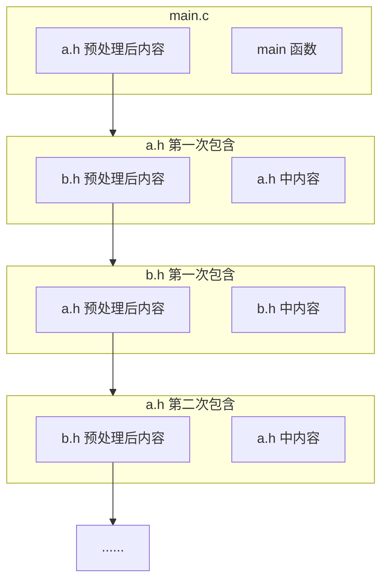
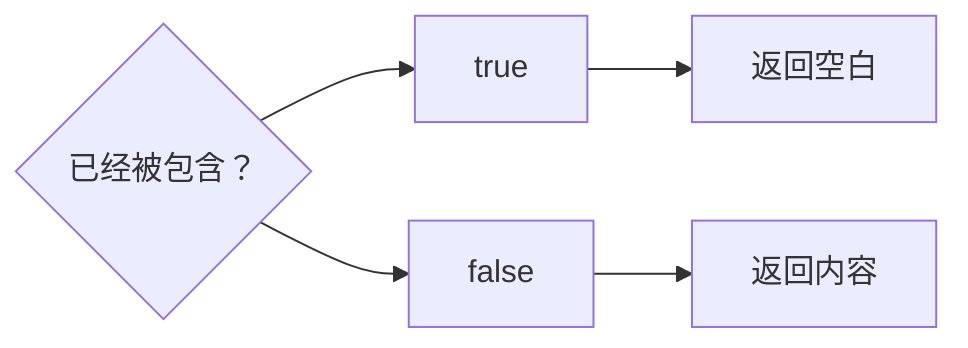
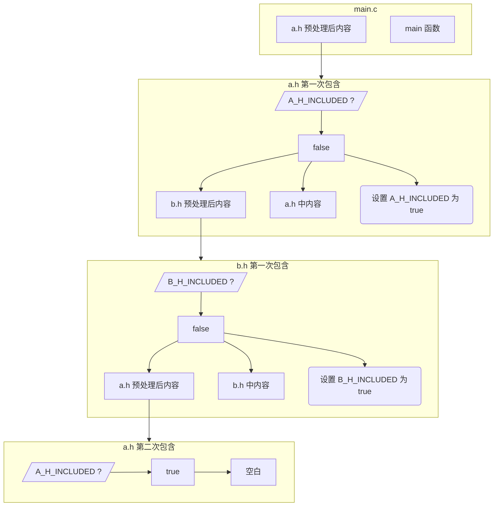

# 6.1 `#include` 与头文件

## 1. `#include` 预处理指令

1. `#include <字符序列>`：按实现定义的方式搜索头或源文件。
2. `#include "字符序列"`：先按实现定义的方式搜索与当前源文件相关的位置；若没有找到，再按尖括号形式处理。

工程中通常用引号形式包含本项目头文件，用尖括号形式包含标准头和由构建系统配置搜索路径的外部头文件。具体搜索目录及先后顺序必须以目标实现和构建配置为准。

可以先把这个指令理解为：指定文件经过相应预处理后，其预处理记号出现在当前文件的包含点。下面的反例只用于展示效果；工程中不要包含 `.c` 文件。

::: code-group

```c [main.c]
#include <stdio.h>

int main(void) {
#include "arr.c"
    for(int i = 0; i < 10; i++){
        printf("%d ",arr[i]);
    }
    return 0;
}
```

```c [arr.c]
int arr[10] = {
    1, 2, 3, 4, 5, 6, 7, 8, 9, 10
};
```

:::

::: error 永远不要 `#include` 任何 `.c` 文件

每个 `.c` 文件都会变成一个翻译单元，被编译成目标文件。`#include` 一个 `.c` 文件，相当于把它的所有代码（包括函数定义等）复制到了另一个 `.c` 文件中。如果你在项目中还有其他地方用到了被包含的那个 `.c` 文件，同一个函数或对象就会被定义两次，链接器在合并所有目标文件时就会发现冲突并报错。

所以，应包含用于公开接口的头文件，而不是 `.c` 文件。头文件可以包含类型定义、宏定义和满足链接规则的其他定义，但通常不应放置会让多个翻译单元重复产生外部定义的函数或对象。

:::

经过翻译阶段 4 的处理（代码中没有表现出翻译阶段 1~3 的处理）之后，`main.c` 文件会变成：

```c
// stdio.h 内容

int main(void) {
    int arr[10] = {
1, 2, 3, 4, 5, 6, 7, 8, 9, 10
    };
    for(int i = 0; i < 10; i++){
        printf("%d ",arr[i]);
    }
    return 0;
}
```

输出：

::: terminal

1 2 3 4 5 6 7 8 9 10

:::

:::: info 原封不动

预处理器不会按 C 语法检查被包含文件是否构成独立程序片段；语法分析看到的是包含完成后的记号序列。

也就是说，下面的代码可以通过编译：

::: code-group

```c [main.c]
#include <stdio.h>

int main() {
    int arr[10] = {
#include "arr.txt"
    };
    for(int i = 0; i < 10; i++){
        printf("%d ",arr[i]);
    }
    return 0;
}
```

```txt [arr.txt]
1, 2, 3, 4, 5, 6, 7, 8, 9, 10
```

:::

但不要这样做。阅读代码的人可能弄不明白 `arr.txt` 文件的内容；如果其中内容出现错误，编译诊断可能跨越包含点和 `arr.txt`，加大调试难度；如果 `arr.txt` 增加一个数，`main.c` 中的数组声明也要相应修改，增大了耦合。

如果数据确实保存在 `.txt` 文件当中，可以编写脚本程序，在编译时读取 `txt` 文件，生成含有 `arr` 数组定义的代码，再将该代码包含到 `main.c` 文件中。

::::

根据翻译阶段的规则，被包含的文件会被重新执行翻译阶段 1~4。当被包含的文件里面仍然有 `#include` 指令时，会嵌套包含。我们有时会遇到这种情况：A 文件包含 B 文件，B 文件包含 A 文件。这时就会出现循环包含的问题，如下：

::: code-group

```c [a.h]
#include "b.h"

void a(void);
```

```c [b.h]
#include "a.h"

void b(void);
```

```c [main.c]
#include "a.h"

int main(void) { /* ... */ }
```

:::

::: details 为什么会循环包含

从 `main.c` 开始看，它包含了 `a.h`，处理之后本该变成这样：

```c
// a.h 内容（记作代码①）

int main(void) { /* ... */ }
```

但是，包含的 `a.h` 文件要经过预处理，才能将其内容插入上述代码块中 `// a.h 内容` 所在之处。它又包含了 `b.h`，处理之后的 `a.h`（代码①）变成了这样：

```c
// b.h 内容（记作代码②）

void a(void);
```

包含的 `b.h` 文件也要经过预处理，才能将其内容插入上述代码块中 `// b.h 内容` 所在之处：

```c
// a.h 内容

void b(void);
```

这样，预处理的过程就会无限递归下去，如下面的流程图：



:::

为避免这个问题，我们通常采取**头文件防护**的措施。典型的做法是在每个头文件的开头加上：

```c
#ifndef TOKEN
#define TOKEN
// some code
#endif
```

其中，`TOKEN` 是用来标识这个文件的独一无二的名字。

这样，第一次包含该头文件时，`TOKEN` 没有被定义，`#ifndef` 后面的代码会被执行。当第二次包含该头文件时，`TOKEN` 已经被定义，`#ifndef` 后面的代码不会被执行。流程图如下：



用上面的代码做例子：

::: code-group

```c [a.h]
#ifndef A_H_INCLUDED
#define A_H_INCLUDED
#include "b.h"

void a(void) { /* ... */ }
#endif // A_H_INCLUDED
```

```c [b.h]
#ifndef B_H_INCLUDED
#define B_H_INCLUDED
#include "a.h"

void b(void) { /* ... */ }
#endif // B_H_INCLUDED
```

```c [main.c]
#include "a.h"

int main(void) { /* ... */ }
```

:::

这样，`main.c` 经过预处理的步骤如下：

```c
// a.h 内容

int main(void) { /* ... */ }
```

上述代码中的 `a.h` 经过预处理后如下：

```c
// b.h 内容

void a(void) { /* ... */ }
```

此时定义了 `A_H_INCLUDED`。

上述代码中的 `b.h` 经过预处理后如下：

```c
// a.h 内容

void b(void) { /* ... */ }
```

此时定义了 `B_H_INCLUDED`。

上述代码中的 `a.h` 再次经过预处理。因为已经定义了 `A_H_INCLUDED`，`a.h` 内容为空，`b.h` 只剩以下内容：

```c
void b(void) { /* ... */ }
```

`a.h` 经过预处理之后的内容：

```c
void b(void) { /* ... */ }

void a(void) { /* ... */ }
```

`main.c` 经过预处理之后的内容：

```c
void b(void) { /* ... */ }

void a(void) { /* ... */ }

int main(void) { /*... */ }
```

也可以将上面的过程画成流程图：



这样就防止了头文件的循环包含。

很多编译器实现了 `#pragma once` 指令，可以与上面的方法实现相同效果。可以同时采用这两种方式。

## 2. 习题

<Exercise id="20604" :d="3" :w="3">

在下面这个小工程里，同一个名字 `config.h` 有两个副本：

```text
proj/
├── include/
│   └── config.h        # 内容为 #define APP_NAME "include"
└── src/
    ├── config.h        # 内容为 #define APP_NAME "src"
    └── main.c
```

`src/main.c` 的内容是：

```c
#include <stdio.h>

#include "config.h"

int main(void) {
    puts(APP_NAME);
    return 0;
}
```

两个 `config.h` 都只有一行 `#define`，分别把 `APP_NAME` 定义成 `"include"` 和 `"src"`。所有命令都在 `proj/` 目录下执行。

1. 不加任何搜索选项，编译并运行 `src/main.c`，记下输出。再用 `gcc -E src/main.c` 查看预处理结果。以 `# 1 "文件名"` 开头的行是行标记（line marker），它说明后面的内容来自哪个文件。找到 `config.h` 对应的行标记，确认实际被采用的那一份。
2. 加上 `-Iinclude` 重新编译运行，输出变了吗？对照本页第 1 节给出的搜索规则解释原因。
3. 把 `main.c` 里的引号形式改成尖括号形式，分别在有、无 `-Iinclude` 时编译，记录两次结果。其中一次为什么会停在预处理阶段？
4. 用一句话概括引号形式与尖括号形式在搜索顺序上的差别，并说明工程里通常让本项目头文件用引号、让外部依赖的头文件用尖括号的理由。

验收：四次编译的结果（成功时给输出，失败时贴完整诊断），以及第 1、2 问中各取一处 `config.h` 的行标记原文。第 2 问的结论必须能用行标记作证。

</Exercise>

<Exercise id="20605" :d="4" :w="3">

两个头文件分别提供字符串和数值函数，防护却用了同一个标识符：

```c
/* text_util.h */
#ifndef UTIL_H
#define UTIL_H

int text_length(const char *s);

#endif
```

```c
/* math_util.h */
#ifndef UTIL_H
#define UTIL_H

double math_square(double x);

#endif
```

`text_util.c` 与 `math_util.c` 分别实现这两个函数，定义放在各自的 `.c` 文件里。`main.c` 依次包含两个头文件，然后调用它们：

```c
#include <stdio.h>

#include "text_util.h"
#include "math_util.h"

int main(void) {
    printf("%d\n", text_length("abc"));
    printf("%.1f\n", math_square(4.0));
    return 0;
}
```

1. 编译 `main.c`，贴出诊断，并记下它被当作警告还是错误。GCC 13 默认为警告，编译继续走到链接；GCC 14 起默认按错误处理，此时加 `-Wno-error=implicit-function-declaration` 退回警告再继续。在能链接的环境里运行程序，记录两行实际输出：第一行是 `3`，第二行的数值为什么不能当作 `math_square(4.0)` 的结果？
2. 用 `gcc -E main.c` 的结果确认 `math_square` 的声明是否还在预处理产物里（可以数它出现的次数，或者看它前面还有没有 `double`）。结合 `#ifndef` 的执行过程，说明 `math_util.h` 为什么整段消失。
3. 说明编译器在没有声明时按什么规则理解这次调用，为什么这种理解会让第二行的结果出错。这个规则从 C99 起已不在标准里，GCC 只是作为扩展仍然接受。再用 `-Werror=implicit-function-declaration`（把这一类诊断当作错误）编译一次，记录结果，并说明工程里这样设置为什么能让同一个缺陷在更早的阶段就被拦住。
4. 把两个头文件的防护换成 `#pragma once`，重复第 1 步。此时结果是否正确？解释 `#pragma once` 与 `#ifndef` 判断「已经包含过」的依据有什么不同，并说明正式的头文件为什么仍要让防护标识符带上模块名。

验收：至少三次编译的诊断原文、两次运行输出、预处理产物的统计结果，以及第 4 问的对比结论。

</Exercise>

<Exercise id="20606" :d="4" :w="3">

下面是一对互相包含的头文件，函数定义直接写在头文件里：

```c
/* a.h */
#include "b.h"

void a(void) { }

int a_value(void);
```

```c
/* b.h */
#include "a.h"

void b(void) { }

int b_value(void);
```

```c
/* main.c */
#include <stdio.h>

#include "a.h"
#include "b.h"

int main(void) {
    a();
    b();
    printf("%d\n", a_value() + b_value());
    return 0;
}
```

`a.c`、`b.c` 各自包含同名头文件，并实现 `a_value`、`b_value`，返回值分别为 1 和 2。构建命令是 `gcc -std=c17 -Wall -Wextra main.c a.c b.c -o app`。

1. 原样构建，贴出第一条诊断。它由预处理器还是编译器给出？诊断里给出的嵌套深度上限是多少，可以用哪个选项改？如果只编译 `main.c`、不把 `a.c`、`b.c` 列进命令，这条诊断还在吗？由此说明它属于哪个阶段。
2. 给两个头文件各加一组 `#ifndef` / `#define` / `#endif`，函数定义仍留在头文件里，重新构建。预处理不再无限递归，链接却失败了。贴出链接器诊断，指出 `a`、`b` 各被定义了几次、分别来自哪些目标文件。
3. 说明防护为什么只能阻止同一个翻译单元内的重复展开，挡不住不同翻译单元各生成一份定义。
4. 把 `void a(void)`、`void b(void)` 的函数体移到 `a.c`、`b.c`，头文件只留声明。保留两个头文件之间的交叉包含，构建并运行。然后删掉 `a.h` 里的 `#include "b.h"` 和 `b.h` 里的 `#include "a.h"`，再构建一次。用 `gcc -H -c a.c -o a.o` 比较删除前后的包含层次（`-H` 每包含一个文件打印一行，行首的点数表示层数），说明这对交叉包含在本例中是否必要，以及什么时候它确实是必需的。

验收：每一步的完整诊断或运行输出；第 4 问要给出两次 `-H` 输出的对比。

</Exercise>

<Exercise id="20607" :d="5" :w="4">

本页提到，数据存在 `.txt` 里时可以写一个程序，在编译前生成数组定义。把这个工具做出来，并和直接包含数据片段的写法做比较。

初始数据 `numbers.txt`，每行一个整数：

```text
3
1
4
1
5
9
2
6
5
3
```

1. 写 `gen_array.c`，读 `numbers.txt`，生成 `data_array.c` 与 `data_array.h`。头文件只放 `extern` 声明和元素个数的声明，生成文件里的两个对象都加 `const`，并在开头包含自己的头文件。元素个数由程序统计，不要写死。
2. 用生成的两个文件配一个 `main.c`，打印全部元素、元素个数与总和。分步构建：先编出生成器并运行，再用 `gcc -c` 编出 `data_array.o`、`main.o`，最后链接。记录运行输出，并用 `nm data_array.o` 确认两个符号属于哪一类，说明 `const` 带来的差别。
3. 往 `numbers.txt` 末尾追加一个数，只重新运行生成器、重编 `data_array.o` 并重新链接（不重编 `main.c`）。程序能否反映新数据？记录前后两次的输出。
4. 换一种写法：把数据写成 `numbers.inc`，内容是一行 `3, 1, 4, 1, 5, 9, 2, 6, 5, 3`，在 `main.c` 的数组初始化里用 `#include "numbers.inc"` 引入。确认它能编译运行并记录结果，然后回答：
   - 直接在文件作用域包含这个片段，会得到什么诊断？为什么？
   - 把 `int g_numbers[] = { ... };` 连同片段一起写进一个头文件，让两个 `.c` 文件各包含一次，构建时又会出现什么问题？贴出链接器诊断，说明它和上面那条诊断不同在哪里。
   - 在一个函数里用同一个片段初始化两个数组，第一次用不带防护的 `numbers.inc`，第二次给它套上 `#ifndef` / `#define` / `#endif`。用 `-std=c17 -Wall -Wextra` 编译，记下两次的输出，解释第二次为什么没有任何诊断，第二个数组里又是什么。这条实验说明数据片段和头文件的防护规则是否相同？
   - 一个库要对外提供这张表时，两种做法各有什么代价，你选哪一种？
5. 把第 1 问生成的 `data_array.c` 当成头文件，在两个 `.c` 文件里各 `#include "data_array.c"` 一次，再一起链接。贴出诊断，指出是哪个阶段发现的、重复的是哪些符号。对照本页那条「永远不要 `#include` 任何 `.c` 文件」的说明，解释为什么把生成的数据放进 `.c` 交给链接器处理才是正确的做法。
6. 写出从修改 `numbers.txt` 到可执行文件更新的一条完整命令序列（可以写成一个 shell 脚本）。指出其中哪一步最容易漏掉，漏掉时程序会表现出什么现象。

验收：生成器源码、最终的两个生成文件、`nm` 输出、前后两次运行输出，以及第 4、5 问的诊断与结论。

</Exercise>
