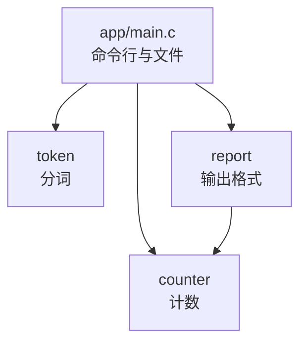

# 7. 项目目录与模块划分

在整个「开发与工程基础」部分中，我们将围绕一个贯穿始终的工程实例——`wordfreq` 展开探索。从本章建立目录骨架开始，一直到第 19 章的自动化打包与发布，这个项目将一步步从简陋的手工构建脚本演变为一个结构规范、具备测试套件且可跨平台编译的现代 C 工程。

`wordfreq` 的核心功能非常明确：从给定的若干纯文本文件中读取内容，统计每个独立单词的出现频次，并按照出现次数由高到低在终端格式化输出前若干个高频词。其命令行调用形态如下：

::: info 名字的来历
这个名字借自 Steven Bird 等人开发的 Python 库 [wordfreq](https://github.com/rspeer/wordfreq)。那个库统计的是大规模语料中各词的常见程度，这里的程序只是当场数一段文本里的词，两者做的事情并不相同。本教程用同一个名字，算是对它的致意。
:::

```text
usage: wordfreq [-n N] [FILE...]
```

业务逻辑看似并不庞杂，但在细节处理上却包含着完整的边界约束：单词被定义为连续的 ASCII 字母序列（A–Z、a–z），在统计前统一折叠为小写；单个单词长度若超出 63 个字母，超出部分将被截断丢弃；若多个单词的出现频次相同，则依据 `strcmp` 字典序升序稳定排列；遇到无法正常打开的文件时，程序以状态码 1 退出并在标准错误流输出具体诊断；若命令行参数格式非法，则以状态码 2 退出并打印标准用法提示。

文中给出的终端命令与构建输出均取自 Debian 13 环境下的 GCC 14.2 工具链；涉及 Windows 平台特有的差异时，会在相关操作点给出对照说明。

如果将上述所有业务逻辑全部塞进单个 `main.c` 文件中，源码规模会迅速攀升至两百余行，其代码结构大致呈现为：

```text:no-line-numbers
main.c（两百多行）
├── is_letter / to_lower          字符判断与转换
├── next_word                     从缓冲区里切出下一个单词
├── read_file                     读入整个文件
├── find_entry / add_word         线性查找，动态数组，重复单词计数加一
├── compare / print_top           排序并输出
└── main                          解析 -n，循环处理文件，打印
```

这种单源文件结构虽然能够顺利完成编译运行，但在工程维护上很快会遭遇瓶颈：
- **单元测试困难**：如果想单独验证「大写 `The` 是否被正确归一化为小写 `the`」，测试人员必须运行整个庞大的程序，重定向标准输出并在大段结果中费力检索。
- **重构成本高昂**：当数据量增大需要将线性查找升级为哈希表或有序二分查找时，开发者必须在两百余行代码中小心翼翼地梳理所有与内存动态增长、查找匹配相关的语句，极易破坏周围不相干的代码。
- **全局命名污染**：像 `find_entry`、`compare` 这样过于通用的函数名，一旦散落于全局符号表中，在拆分文件或引入外部第三方库时，链接器极易因为重名而报出 `multiple definition` 冲突。

为了解决这些问题，本章将把该程序拆分为四个职责分明的模块：三个功能模块各拥有一对头文件与实现文件，而命令行参数解析与文件流读取则统筹收敛在 `app/main.c` 中。完成目录规划后，我们将借助最底层的编译器指令完成多目录构建。当前这个初始版本被标记为 v0.1，后续章节将在此基础上层层递进：第 8 章引入 Makefile，第 9 章迁移至 CMake，第 11 章接入单元测试框架。该工程源码完整存放在 `code/开发与工程基础/7_项目目录与模块划分/wordfreq/`，三个头文件与四个源文件累计 435 行。

## 1. 按职责划分

模块化拆分的第一项工作，是梳理并拆解程序所承担的核心工作流。在 `wordfreq` 中，数据流经四个清晰的处理阶段：

| 模块 | 一句话职责 | 对外公开的名字 |
| --- | --- | --- |
| token | 从一段文本里依次取出单词，转成小写 | `WF_WORD_MAX`、`wf_tokenizer`、`wf_tokenizer_init`、`wf_tokenizer_next` |
| counter | 记录每个单词出现的次数，按次数取出前若干项 | `wf_counter`、`wf_entry`、`wf_counter_create`、`wf_counter_destroy`、`wf_counter_add`、`wf_counter_get`、`wf_counter_size`、`wf_counter_top` |
| report | 把结果按固定格式写到输出流 | `wf_report_print` |
| app | 解析命令行、读文件、把三个模块串起来 | `main` 和几个 `static` 函数，不对外 |

这种划分为四个模块的方案，遵循了三项关键的架构原则：

- **单一职责原则（Single Responsibility）**：每个模块的核心职责应当能够用一句完整通顺的短语清晰概括。分词模块 `token` 只专注于识别单词切分点与字符变形，无需关心取出的单词将被用于何种业务；计数模块 `counter` 仅维护单词与频次的映射与频次排序，对文本来源一无所知；报表模块 `report` 仅负责按照规范列宽与对齐规则输出结果，不参与任何频次计算。当一项职责在表述中必须借助「并且」、「同时还要」等连词时，通常表明该模块应当继续拆解。
- **可独立测试性（Testability）**：高质量的模块应当能够脱离具体的输入介质（如文件系统）与输出目标（如终端），在内存中就地进行验证。向 `token` 传入一段测试字符串与字符缓冲区，就能独立验证分词的边界处理；向 `counter` 推入一组预设的单词序列，就能验证哈希桶或数组排序逻辑。这为第 11 章展开自动化单元测试铺平了道路。
- **实现变更对调用方透明（Implementation Hiding）**：当某一模块的底层算法或数据结构发生翻新时，消费该模块的上层代码应当保持稳定。在后续第 15 章中，我们将把 `counter` 底层的线性查找彻底替换为有序数组配合二分检索，但位于 `app/main.c` 的调用方代码完全无需变更任何一行。

至于将文件内容读取进内存的逻辑，并未被单独提升为一个独立的公用模块，而是作为私有 `static` 辅助函数 `read_stream` 直接保留在 `app/main.c` 内部。在当下的工程形态中，文件读取仅服务于本程序的入口流程，尚无第二个消费者。过早地为臆想中的「未来复用」设计空泛的公用工具模块，往往只会催生出一个权责模糊、难以维护的膨胀文件。等到未来真正出现第二个需要复用文件读取能力的程序时，再抽离出专门的 I/O 模块才是更加稳健的演进路径。

## 2. 模块的接口

在 C 语言的经典模块化设计中，一个内聚的模块通常由一对紧密协作的文件构成：头文件（`.h`）面向外部调用方，负责声明对外公开的数据类型、常量宏与函数签名；实现文件（`.c`）面向编译器，负责落地具体的算法逻辑与内部状态。调用方通过包含头文件即可完成编译期的语法与类型检查，而无需知晓源文件内部的实现细节。

以下给出三个功能模块的公开接口头文件：

::: code-group

```c [include/wf/token.h]
/*
 * 分词模块的接口：从一段文本中依次取出单词。
 *
 * 单词是连续的 ASCII 字母（A-Z、a-z），其它字节都是分隔符，
 * 取出的单词一律转成小写。
 */
#ifndef WF_TOKEN_H
#define WF_TOKEN_H

#include <stddef.h>

/* 单词缓冲区的长度，含终止空字符；超长的单词只保留前 63 个字母 */
#define WF_WORD_MAX 64

/* 分词器的状态；调用方只通过下面两个函数使用，不直接读写成员 */
typedef struct {
    const char *cur;
    const char *end;
} wf_tokenizer;

/* 准备从 text 的前 len 个字节中取单词；取词期间 text 必须保持有效 */
void wf_tokenizer_init(wf_tokenizer *tz, const char *text, size_t len);

/*
 * 取出下一个单词，转成小写写入 word，并在末尾放终止空字符。
 * cap >= 1：至多写入 cap-1 个字母；
 * 返回写入的长度，0 表示没有更多单词。
 */
size_t wf_tokenizer_next(wf_tokenizer *tz, char *word, size_t cap);

#endif
```

```c [include/wf/counter.h]
/*
 * 计数模块的接口：记录每个单词出现的次数，并按次数取出前若干项。
 */
#ifndef WF_COUNTER_H
#define WF_COUNTER_H

#include <stddef.h>

/* 结构定义在 src/counter.c 中，调用方只能通过指针使用计数器 */
typedef struct wf_counter wf_counter;

typedef struct {
    /* 指向计数器内部存储，在下一次 wf_counter_add 或
       wf_counter_destroy 之前有效 */
    const char *word;
    size_t count;
} wf_entry;

/* 创建空计数器；内存不足时返回空指针 */
wf_counter *wf_counter_create(void);

/* 释放计数器以及它保存的全部单词 */
void wf_counter_destroy(wf_counter *c);

/* 把 word 的次数加 1，第一次出现时保存一份副本；0 成功，-1 内存不足 */
int wf_counter_add(wf_counter *c, const char *word);

/* 返回 word 出现的次数，没有出现过时返回 0 */
size_t wf_counter_get(const wf_counter *c, const char *word);

/* 返回不同单词的个数 */
size_t wf_counter_size(const wf_counter *c);

/*
 * 按次数降序、次数相同按 strcmp 升序取出前 n 项。
 * 返回写入的项数 min(n, size)；内存不足时返回 0。
 */
size_t wf_counter_top(const wf_counter *c, wf_entry *out, size_t n);

#endif
```

```c [include/wf/report.h]
/*
 * 输出模块的接口：把计数结果按固定格式写到输出流。
 */
#ifndef WF_REPORT_H
#define WF_REPORT_H

#include <stdio.h>

#include "wf/counter.h"

/* 每项输出一行：次数右对齐占 7 列，一个空格，再接单词 */
void wf_report_print(FILE *out, const wf_entry *entries, size_t n);

#endif
```

:::

通读这三个头文件的设计，可以提炼出几项在工程中通用的规范：

- **统一前缀充当命名空间**：C 语言在语言层面上缺少命名空间语法，链接器眼中的全局符号表是一张平铺直叙的哈希/散列表。像 `init`、`create`、`add` 这类过于普通的函数名，在稍具规模的工程中极易发生命名碰撞。为所有对外暴露的符号统一附加 `wf_` 前缀，等于在平坦的符号空间中人工划定了一块隔离领地。C 标准库中 `strcpy`、`strcmp` 前缀 `str`，以及 POSIX 规范中的各式前缀，均遵循这一考量。
- **内部私有函数严格收敛于 `static`**：凡是仅在模块内部辅助实现的函数，一律在声明与定义前加上 `static` 关键字。例如 `token.c` 中的字符分类与转换函数，`counter.c` 中的动态扩容、内部线性匹配与排序比较函数，以及 `main.c` 内部的命令行参数校验函数，全部被限定在所属翻译单元中。

使用 GNU 工具链中的 `nm` 工具审视各目标文件，这种内外分界的控制效果非常清晰：

::: terminal title="zsh - nm"

```console
$ nm -g --defined-only build/*.o

build/counter.o:
000000000000022e T wf_counter_add
0000000000000174 T wf_counter_create
00000000000001c1 T wf_counter_destroy
0000000000000305 T wf_counter_get
0000000000000344 T wf_counter_size
00000000000003c9 T wf_counter_top

build/main.o:
0000000000000411 T main

build/report.o:
0000000000000000 T wf_report_print

build/token.o:
0000000000000053 T wf_tokenizer_init
0000000000000084 T wf_tokenizer_next
```

:::

参数 `-g` 限定只展示外部符号（全局符号），输出恰好严格对应于各头文件公开的接口清单，以及唯一的程序入口 `main`。若去掉 `-g` 限制打印 `counter.o` 的完整符号表，则会多出一系列小写 `t` 标记的内部私有符号，以及带 `U`（未解析引用）标记的外部库调用：

::: terminal title="zsh - nm build/counter.o"

```console
$ nm build/counter.o
0000000000000356 t compare_entries
0000000000000000 t dup_string
0000000000000058 t find_entry
                 U free
                 U malloc
                 U memcpy
                 U qsort
                 U realloc
00000000000000c2 t reserve_one
                 U strcmp
                 U strlen
000000000000022e T wf_counter_add
0000000000000174 T wf_counter_create
00000000000001c1 T wf_counter_destroy
0000000000000305 T wf_counter_get
0000000000000344 T wf_counter_size
00000000000003c9 T wf_counter_top
```

:::

大写字母 `T` 代表由当前翻译单元定义且允许外部跨模块调用的函数，小写字母 `t` 代表仅在本地翻译单元内部生效的局部符号，`U` 则代表当前代码引用了由其他目标文件或 C 运行库提供的外部符号。一旦由于疏忽遗漏了 `static`，例如将 `find_entry` 暴露在外，它就会跃升为全局符号；未来一旦另一个文件也无意中定义了同名的内部辅助函数，链接器就会立刻报出 `multiple definition` 冲突并拒绝生成可执行文件。

- **保证头文件的自足性（Self-containment）**：任何一个合法的头文件，必须保证无论被单独包含在何处，都能够无需额外依赖直接通过编译。头文件绝不应该隐式假定「调用方此前一定会提前包含某个特定头文件」。在上述代码中：
  - `token.h` 与 `counter.h` 的函数签名中使用了 `size_t`，因此它们显式包含了 `<stddef.h>`；
  - `report.h` 接收 `FILE *` 输出流，因此显式包含了 `<stdio.h>`；
  - `report.h` 的参数类型涉及 `wf_entry`，因此显式包含了 `"wf/counter.h"`。

我们可以通过一个反例观察破坏头文件自足性的严重后果：倘若将 `token.h` 内部的那行 `#include <stddef.h>` 删去，然后尝试单独编译一个仅包含 `token.h` 的探测源文件：

```c [probe.c]
#include "wf/token.h"

int main(void) {
    return 0;
}
```

::: terminal title="zsh - gcc -fsyntax-only"

```console
$ gcc -std=c17 -Wall -Wextra -Iinclude -fsyntax-only probe.c
In file included from probe.c:1:
include/wf/token.h:21:60: error: unknown type name ‘size_t’
   21 | void wf_tokenizer_init(wf_tokenizer *tz, const char *text, size_t len);
      |                                                            ^~~~~~
include/wf/token.h:1:1: note: ‘size_t’ is defined in header ‘<stddef.h>’; this is probably fixable by adding ‘#include <stddef.h>’
  +++ |+#include <stddef.h>
    1 | /*
include/wf/token.h:28:1: error: unknown type name ‘size_t’
...
```

:::

诊断信息直接报出了对未识别类型 `size_t` 的错误，并提示应当补齐 `<stddef.h>`。如果头文件不具备自足性，在遇到不同的调用方或调整了头文件的包含先后顺序时，就会诱发极难排查的嵌套报错。

::: tip 每个 `.c` 的第一行包含自己的头文件

在编写实现文件时，始终将模块自身的公开头文件作为源文件的第一行非注释代码引入（例如 `token.c` 首行包含 `"wf/token.h"`，`report.c` 首行包含 `"wf/report.h"`）。这是一项低成本且极为有效的工程自检纪律：如果该头文件自身存在拼写错误或遗漏了必要的依赖包含，在编译对应的 `.o` 目标文件时就会立即暴露，而不必等到调用方在复杂的包含链中触发隐式失败。

:::

## 3. 依赖方向

在多文件工程中，模块之间相互调用的网络关系，可以形式化地绘制为一张有向图（Directed Graph）：



在上述拓扑图中，有向箭头的起点代表包含方，终点代表被调用的接口提供方。位于最顶层的 `app` 统一协调整个工作流，因而依赖全部三个底层模块；负责格式化呈现的 `report` 由于需要使用统计结果条目 `wf_entry`，因此单向依赖了 `counter`；而最基础的数据处理单元 `counter` 与 `token` 则完全独立，不依赖工程内的任何其他模块。整张拓扑图呈现出严格的有向无环图（DAG）特征。

::: concept dev-mod-dependency-direction title="依赖只能从上层指向下层"

模块之间只允许上层包含下层的头文件，下层不得包含上层的头文件。下层模块不知道谁在调用它，因此可以单独编译、单独测试，也可以被另一个程序直接拿去用。

:::

维持依赖关系的单向性，是保证软件工程可拓展性的核心：
- **独立的编译与测试**：编译底层的 `counter.c` 时，预处理器只需读取 `counter.h` 以及标准库头文件，完全不受上层模块改动的影响；即使上层的报表格式或命令行参数正在频繁重构，底层的编译与单测依然可以稳定通行。
- **纯粹的模块复用**：如果未来需要编写另一个批处理工具来统计单词频次，开发者只需直接拷贝 `token` 与 `counter` 模块即可无缝接入，绝不会连带把特定于原程序的终端报表逻辑或命令行解析代码作为冗余负担拖拽进来。

在初学多文件组织时，最容易诱发架构退化的做法是建立一个所谓的 `common.h`，试图把工程中所有可能共享的类型别名、宏常量以及辅助函数全盘塞入其中。随着项目膨胀，`common.h` 往往会退化为一个无所不包的杂物箱：它为了提供通用工具而引入 `counter.h`，为了报表输出又引入 `report.h`，最终导致所有模块都间接依赖了工程里的所有头文件。原本清晰分层的有向图被压缩成高度耦合的完全图，循环依赖的隐患随之爆发。

在 `wordfreq` 的设计中，我们明确拒绝建立 `common.h`。模块之间真正需要共享的数据契约仅有一处：`report` 需要处理 `counter` 所产出的 `wf_entry` 数组。解决方案清晰而克制：直接由 `report.h` 单向包含 `"wf/counter.h"`；而仅供 `token` 与 `app` 协商缓冲区尺寸的常量 `WF_WORD_MAX`，则就近安放在 `token.h` 内部。

当模块间不慎出现环形依赖时，最标准的重构手法是「职责下移」或「由上层装配」。我们通过一个具体的反例来观察循环依赖的破坏力：假设有人为了方便，在 `counter.h` 中随意补写了一行 `#include "wf/report.h"`，此时拓扑图中便产生了一条 `counter → report` 的反向边，与既有的 `report → counter` 形成死结：

::: terminal title="zsh - gcc -c src/counter.c"

```console
$ gcc -std=c17 -Wall -Wextra -Iinclude -c src/counter.c -o build/counter.o
In file included from include/wf/counter.h:8,
                 from src/counter.c:1:
include/wf/report.h:12:39: error: unknown type name ‘wf_entry’
   12 | void wf_report_print(FILE *out, const wf_entry *entries, size_t n);
      |                                       ^~~~~~~~
```

:::

这个报错揭示了一个至关重要的底层事实：预处理器中的头文件保护宏能够阻断 `#include` 的无限死循环递归，但**它完全无法解决「类型在使用前尚未被完整声明」的时序冲突**。当 `counter.c` 包含 `counter.h` 时，在尚未读取到 `wf_entry` 的定义之前就先行展开了 `report.h`；而 `report.h` 此时又急需消费 `wf_entry`，编译器只得报错中断。消除这个环的正确方式，是明确认知到 `report` 是展示层，底层的 `counter` 绝不应该知晓展示层的存在；打印操作完全应当由顶层的调用方获取 `wf_entry` 数组后转交 `report` 处理，`counter` 自身必须坚决剔除对 `report.h` 的包含。

在工程实践中，排查头文件依赖无需依赖人肉核对。GCC 提供了 `-MM` 编译选项，能够指示预处理器解析所有被源文件直接或间接引入的用户头文件，并将其自动渲染为规则列表：

::: terminal title="zsh - gcc -MM"

```console
$ gcc -MM -Iinclude src/*.c app/*.c
counter.o: src/counter.c include/wf/counter.h
report.o: src/report.c include/wf/report.h include/wf/counter.h
token.o: src/token.c include/wf/token.h
main.o: app/main.c include/wf/counter.h include/wf/report.h \
 include/wf/token.h
```

:::

输出中的每一行对应一个即将生成的目标文件，冒号后侧清晰列出了该目标文件所绑定的头文件依赖集（系统的标准库头文件已被自动过滤）。对照此清单可以清晰看到：`counter.o` 与 `token.o` 仅各自依赖自身接口，`report.o` 依赖两项，而 `main.o` 聚合三项，整体呈现完美的树状分层结构。如果存在双向包含，相关头文件就会在彼此的依赖行中同时现身。在第 8 章中，我们将直接借助这一机制，由 Makefile 自动化维护工程的头文件增量更新。

::: generate dev-mod-dependency-walk kind=explanation concepts=dev-mod-dependency-direction

面向第一次拆分多文件项目的读者，从 `main.c` 的第一行包含开始，逐个文件演示一次编译时预处理器会顺着哪些 `#include` 走到哪些头文件：说明为什么 `counter.h` 不会把 `report.h` 带进来，为什么 `report.h` 一定会带进 `counter.h`，并对照 `-MM` 的四行输出解释「直接包含」和「间接包含」在依赖表里的区别。

:::

## 4. 不透明类型

在 C 语言中，语言本身并不提供类似现代面向对象语言的 `private` 访问控制关键字。要在 C 中实现严格的信息隐藏，最核心的工程手法是使用**不透明类型（Opaque Type）**。

在公开的 `counter.h` 中，我们看不到 `struct wf_counter` 的具体成员布局，而仅有一行前向声明：

```c
typedef struct wf_counter wf_counter;
```

这行声明向编译器传达了一个确切的信息：存在一个名为 `struct wf_counter` 的结构体标签，且赋予了它别名 `wf_counter`；但该结构体的具体字段组成，在当前头文件以及所有包含它的调用方视野中均被隐去。其真正的成员定义被物理封装在 `src/counter.c` 内部：

```c
struct item {
    char *word; /* 计数器自己保存的副本 */
    size_t count;
};

struct wf_counter {
    struct item *items;
    size_t size;     /* 已使用的元素个数 */
    size_t capacity; /* items 能容纳的元素个数 */
};
```

这种机制产生的直接约束是：外部调用方可以自由声明指向该结构的指针 `wf_counter *`，并在函数间传递该句柄；但由于当前翻译单元缺少结构体的完整尺寸信息，调用方绝对无法直接在栈上定义 `wf_counter` 类型的实体对象，也无法通过 `c->size` 越权读写任何内部字段。若尝试直接在栈上实例化该对象：

```c [incomplete.c]
#include "wf/counter.h"

int main(void) {
    wf_counter c;
    return 0;
}
```

::: terminal title="zsh - gcc -c incomplete.c"

```console
$ gcc -std=c17 -Wall -Wextra -Iinclude -c incomplete.c -o incomplete.o
incomplete.c: In function ‘main’:
incomplete.c:4:16: error: storage size of ‘c’ isn’t known
    4 |     wf_counter c;
      |                ^
incomplete.c:4:16: warning: unused variable ‘c’ [-Wunused-variable]
```

:::

编译器因为无法知晓该结构在内存中到底占用多少字节（即 `sizeof(wf_counter)` 未知），无法为其在栈帧中预留内存空间，因而报错中断。这也顺理成章地确立了对象的生命周期契约：调用方必须显式借助成对的工厂函数 `wf_counter_create` 与资源回收函数 `wf_counter_destroy`，由模块内部负责堆内存的分配与销毁：

```c
wf_counter *counter = wf_counter_create();
if (counter == NULL) {
    return out_of_memory();
}
/* ... 正常消费接口 ... */
wf_counter_destroy(counter);
```

::: details 展开：counter.c 里计数是怎么做的

在 v0.1 版本中，我们采用最直观的实现手段：单词按出现的先后顺序依次存放在动态扩容数组中，每处理一个新单词都从头遍历比对。所有未导出的辅助逻辑均加上 `static` 予以内部收敛：

```c
/* 复制字符串；内存不足时返回空指针 */
static char *dup_string(const char *s) {
    size_t len = strlen(s);
    char *copy = malloc(len + 1);
    if (copy != NULL) {
        memcpy(copy, s, len + 1);
    }
    return copy;
}

/* 线性查找 word；找不到时返回空指针 */
static struct item *find_entry(const wf_counter *c, const char *word) {
    for (size_t i = 0; i < c->size; i++) {
        struct item *e = &c->items[i];
        if (strcmp(word, e->word) == 0) {
            return e;
        }
    }
    return NULL;
}

int wf_counter_add(wf_counter *c, const char *word) {
    struct item *e = find_entry(c, word);
    if (e != NULL) {
        e->count++;
        return 0;
    }

    if (reserve_one(c) != 0) {
        return -1;
    }
    char *copy = dup_string(word);
    if (copy == NULL) {
        return -1;
    }
    c->items[c->size].word = copy;
    c->items[c->size].count = 1;
    c->size++;
    return 0;
}
```

函数 `wf_counter_add` 在向内部数组注册新条目时，会通过 `dup_string` 为其在堆上克隆一份独立的字符串副本。这意味着调用方传入的外部暂存缓冲区可以在调用完成后立即覆写或释放。相应地，每个单词都持有独立的动态内存，必须在计数器销毁时由 `wf_counter_destroy` 逐项释放。上面未贴出的 `reserve_one` 负责在容量不足时触发几何级扩容与 `realloc`。

:::

不透明类型在大型工程中具备极高的架构价值：
- **实现替换对外界完全解耦**：在第 15 章中，我们将把 `counter` 底层的线性遍历彻底重构为有序二分数组或哈希表。尽管 `src/counter.c` 内部的结构体字段和算法逻辑被大范围改写，但公共头文件 `counter.h` 的函数签名与所有调用方代码无需变动任何一行。
- **隔绝级联重新编译**：结构体内部字段的增删微调完全局限在 `counter.c` 单个翻译单元内。调整字段后，构建系统仅需重新编译 `counter.o` 并重新链接，整个工程的其他几十个上层调用模块完全不需要经历冗长的重编译。

当然，这种设计也伴随着必要的工程权衡：每次创建不透明对象通常需要承担一次堆内存申请开销，且调用方无法直接将该对象就地内嵌于自身的复合结构体中。

在设计模块时，并不是所有结构体都必须包装为不透明类型。例如供外部遍历展示的 `wf_entry`，调用方天然需要直接读取其 `word` 与 `count` 两个字段，将其定义为公开透明的普通结构体更为高效自然。一般的选型准则是：**如果调用方需要直接高频访问具体数据字段，将其作为透明结构体公开在头文件中；如果调用方只需将数据作为上下文状态持有或转交，始终将其设计为不透明类型。**

值得留意的是，公开结构中的指针字段可能附带着严格的生命周期约束。在 `counter.h` 中，对 `wf_entry.word` 的生命周期给出了明确的文档注释：

```c
typedef struct {
    /* 指向计数器内部存储，在下一次 wf_counter_add 或
       wf_counter_destroy 之前有效 */
    const char *word;
    size_t count;
} wf_entry;
```

由于 `word` 指针直接借用并指向计数器内部持有的缓冲区，其内存所有权属于计数器本身，调用方绝对不可越权对该指针执行 `free`，也不应在后续调用 `wf_counter_add`（扩容可能导致旧地址失效）或 `wf_counter_destroy` 之后继续解引用该指针。在 C 语言的类型系统无法在编译期强制表达所有权转移（Borrowing）时，清晰的接口注释与契约说明就成为了保障内存安全的核心护栏。

<Quiz
  :options="[
    { label: '因为 wf_counter 没有定义成员，编译器不知道它占多少字节', value: 'A' },
    { label: '因为栈空间不够', value: 'B' },
    { label: '因为结构里用了 malloc', value: 'C' },
    { label: '因为 typedef 不能用于定义对象', value: 'D' }
  ]"
  answer="A"
>

<template #question>

在只包含 `wf/counter.h` 的文件里写 `wf_counter c;`，编译失败，原因是：

</template>

正确答案是 **A**。头文件里的 `typedef struct wf_counter wf_counter;` 只声明了类型名，结构定义在 `counter.c` 中，编译器看不到成员，也就不知道 `sizeof(wf_counter)`。B、C 与错误无关，D 说反了：有完整定义的 `typedef` 类型完全可以用来定义对象。

</Quiz>

<Quiz
  :options="[
    { label: '调用方可以直接读 entries[0].word 和 entries[0].count', value: 'A' },
    { label: '调用方应当 free(entries[0].word) 以免泄漏', value: 'B' },
    { label: 'entries[0].word 在 wf_counter_destroy 之后仍然有效', value: 'C' },
    { label: '调用方可以修改 entries[0].count 来改变统计结果', value: 'D' }
  ]"
  answer="A"
>

<template #question>

`wf_counter_top` 把结果写进调用方提供的 `wf_entry` 数组。关于这些条目，下列说法正确的是：

</template>

正确答案是 **A**。`wf_entry` 是公开结构，两个成员都可以读。B 错：`word` 指向计数器内部存储，所有权归计数器，`free` 它会在 `wf_counter_destroy` 时二次释放（Linux 上实测报 `free(): double free detected in tcache 2`）。C 错：头文件注释写明有效期到下一次 `wf_counter_add` 或 `wf_counter_destroy`。D 错：数组是 `wf_counter_top` 写出的副本，改它不影响计数器里的计数。

</Quiz>

## 5. 目录布局

将三个功能模块的源码、头文件、命令行主入口、测试样例数据以及构建脚本规范归位，我们得到如下整洁的项目目录树：

```text:no-line-numbers
wordfreq/
├── include/
│   └── wf/
│       ├── token.h          分词模块的接口
│       ├── counter.h        计数模块的接口
│       └── report.h         输出模块的接口
├── src/
│   ├── token.c
│   ├── counter.c
│   └── report.c
├── app/
│   └── main.c               命令行程序
├── tests/
│   └── data/
│       ├── sample.txt       两行样例文本
│       └── sample.expected  期望输出
├── build_by_hand.sh         手工构建脚本，第 8 章换成 Makefile
├── README.md
└── .gitignore               只有一行 build/
```

这套目录结构中，各级子目录的分工极具条理：
- `include/` 专用于存放对外公开的公共头文件，它构成了编译器搜索头文件时的根目录。
- `src/` 用于承载各功能模块的 `.c` 实现源码；未来若出现仅在模块间共享、不对外公开的私有内部头文件，也应当存放在此。
- `app/` 专门存放可执行程序的入口主函数（`main`），将业务装配逻辑与底层算法库物理隔离。
- `tests/data/` 存放基准测试语料与预期输出，为后续章节接入自动化回归测试提供支撑。

特别需要注意的是，公开头文件并没有直接平铺在 `include/` 根目录下，而是嵌套在 `include/wf/` 子目录中。当代码中编写 `#include "wf/counter.h"` 并向编译器传递 `-Iinclude` 参数时，路径中的 `wf/` 恰好与物理磁盘上的 `include/wf/` 一一对应。多出这一层命名空间目录具有长远的工程考量：未来即便项目引入了其他子系统，或是将库打包安装到系统级目录 `/usr/include/wf/`，头文件名称也绝不会与系统其他库发生意外冲突。

这套目录规范主要参考了 C/C++ 社区广泛倡导的 **Pitchfork Layout（PFL）** 规约。PFL 归纳了两种经典的源码布局形态：

| 布局模式 | 公开头文件位置 | 实现源码与私有头文件 | 调用方引入的搜索根路径 |
| --- | --- | --- | --- |
| separate（分离式） | `include/`，相对路径与 `src/` 一致 | `src/` | 仅暴露 `include/` |
| merged（混合式） | 直接与实现文件混排于 `src/` | `src/` | 直接引入 `src/` |

在 separate 分离模式下，调用方在编译搜索路径中只能窥见 `include/`，即便 `src/` 中存在私有头文件也无法被外界越权探测，物理隔离强度最高；其微小的代价是开发者在增删接口时需要在两棵目录树间切换。merged 混合模式目录较为紧凑，但公开接口与私有细节的区隔完全依赖于开发者的自觉。PFL 规范明确要求同一个工程在选定布局后不得混用。同时，PFL 要求构建输出必须统一收敛在专用的 `build/` 临时目录中，并通过版本控制工具予以彻底忽略。

PFL 原始规范主要面向库的开发，并未硬性规定 `app/` 目录。在 `wordfreq` 中增设 `app/`，是为了清晰区分「可重用的底层逻辑库」与「具体的命令行终端应用」。这种物理拆分带来了极佳的构建弹性：在第 9 章迁移至 CMake 时，构建脚本可以极其轻快地把 `src/` 打包为一个名为 `wf` 的静态库目标，再把 `app/main.c` 编译为依赖该库的可执行文件目标 `wordfreq`。

构建输出目录 `build/` 绝不应该被纳入版本仓库。因为中间目标文件随时可以由源码一键重新生成，且不同编译架构与优化选项生成的二进制互不兼容。在 `.gitignore` 中仅需保留干净的一行：

```text
build/
```

我们可以对照反例来体会清晰目录布局的价值：

:::: compare left-title="所有文件堆在根目录" right-title="按职责分目录"

```text
messy_layout/
├── globals.h
├── words.h
├── util.c
├── words.c
├── report.c
└── main.c
```

左图这个项目在 `code/开发与工程基础/7_项目目录与模块划分/exercises/messy_layout/`，一条 `gcc main.c` 就能编译运行，输出也正确，但接口和依赖都是乱的：`globals.h` 里直接定义全局对象，`words.c` 用 `#include "util.c"` 引入实现，`main.c` 又包含 `words.c` 与 `report.c`。

---

```text
wordfreq/
├── include/wf/   公开接口
├── src/          实现
├── app/          程序入口
└── tests/data/   样例数据
```

右图的做法把「哪些是接口、哪些是实现、哪个是程序」写进了路径。谁依赖谁从目录就能看出大概，新增一个模块只需在 `include/wf/` 和 `src/` 各加一个文件。

::::

表面上看，左侧混杂的代码借助一条 `gcc main.c` 同样能碰巧跑通；但一旦遵循标准的多目标文件分别编译流程，各种低级错误便会蜂拥而至：

::: terminal title="zsh - 逐个编译后链接"

```console
$ gcc -std=c17 -Wall -Wextra -c main.c -o main.o
$ gcc -std=c17 -Wall -Wextra -c words.c -o words.o
$ gcc -std=c17 -Wall -Wextra -c report.c -o report.o
$ gcc -std=c17 -Wall -Wextra -c util.c -o util.o
$ gcc main.o words.o report.o util.o -o messy2
/usr/bin/ld: words.o:(.bss+0x0): multiple definition of `g_letter_count'; main.o:(.bss+0x0): first defined here
/usr/bin/ld: words.o: in function `is_letter':
words.c:(.text+0x0): multiple definition of `is_letter'; main.o:main.c:(.text+0x23): first defined here
/usr/bin/ld: report.o: in function `print_report':
report.c:(.text+0x0): multiple definition of `print_report'; main.o:main.c:(.text+0x0): first defined here
...
```

:::

由于 `main.c` 粗暴地包含了其他 `.c` 文件，其编译出的 `main.o` 中已经复制嵌入了全套实现代码；当与其他独立的 `.o` 文件交由链接器拼装时，全局符号的冲突碰撞便在所难免。只有遵循模块化边界、坚决剔除对 `.c` 文件的包含，这类由于架构混乱诱发的构建错误才能从源头上得以根绝。

## 6. 包含路径

在整个项目中，所有需要引用公共模块的源文件，均采用统一且规范的书写方式：

```c
#include "wf/counter.h"
```

在调用编译器时，我们在命令行参数中统一追加 `-Iinclude` 选项。这一参数的意义在于将项目的 `include` 目录注册进编译器的头文件检索列表，代码中所书写的相对路径 `wf/counter.h` 即可顺利拼装为物理存在的 `include/wf/counter.h`。正如前文[第 6.1 节](/教程/正文/开发与工程基础/6_头文件与接口边界/6_1_include与头文件)所介绍的规则：双引号形式会优先检索当前被编译源文件所在的本地目录，随后按顺序查找 `-I` 参数注册的目录，最后回退至系统目录；而尖括号形式则直接略过源文件所在目录，从搜索路径首项开始遍历。

需要特别强调的是：**`-I` 后面跟随的目录路径，是相对于运行 `gcc` 时的编译器当前工作目录（CWD）解析的**，源文件自身的磁盘物理位置并不会参与这一基准路径的换算。在项目根目录下触发编译能够顺利定位；但如果先执行 `cd src` 切换了工作路径再行构建，相同的参数 `-Iinclude` 就会被解析为并不存在的 `src/include`，导致头文件检索中断：

::: terminal title="zsh - cd src 后编译"

```console
$ cd src
$ gcc -std=c17 -Wall -Wextra -Iinclude -c token.c -o ../build/token.o
token.c:1:10: fatal error: wf/token.h: No such file or directory
    1 | #include "wf/token.h"
      |          ^~~~~~~~~~~~
compilation terminated.
```

:::

因此，软件工程中的自动化构建脚本通常严格约定以项目根目录作为统一的执行基准，后续章节中的 Makefile 与 CMake 构建系统也均恪守这一规范。

在代码中应当避免直接编写类似 `#include "../include/wf/counter.h"` 的相对越级路径。表面上看，从 `src/counter.c` 出发采用相对路径似乎无需指定 `-I` 即可编译通过；但当依赖链路延伸至下一层时，隐患便会爆发：当 `report.c` 包含 `../include/wf/report.h` 时，`report.h` 内部依然通过 `"wf/counter.h"` 引用计数器，此时预处理器会误以 `include/wf/` 作为起点去检索 `include/wf/wf/counter.h`，直接导致构建失败：

::: terminal title="zsh - 相对路径包含"

```console
$ gcc -std=c17 -Wall -Wextra -c src/report.c -o build/report.o
In file included from src/report.c:1:
src/../include/wf/report.h:9:10: fatal error: wf/counter.h: No such file or directory
    9 | #include "wf/counter.h"
      |          ^~~~~~~~~~~~~~
compilation terminated.
```

:::

更致命的是，一旦后续调整源文件在子目录间的存放层级，所有交织的相对路径都会瞬间失效。通过 `-Iinclude` 将项目根目录下的包含入口固定下来，源码中只需声明 `wf/...`，不仅路径语义明确，而且即使将来源文件被移动到更深层的子目录中，也完全无需修改任何一行源码。

此外，在编写包含路径时必须保证文件名大小写与物理磁盘完全吻合。在 Windows 默认不区分大小写的文件系统上，书写 `wf/Counter.h` 能够侥幸通过，但在区分大小写的 Linux 服务器或持续集成环境中则会立刻报出找不到文件的致命错误。保持大小写严格匹配，是保证项目具备跨平台可移植性的最基础素养。

## 7. 手工构建一次

对于一个多目录的工程，虽然我们也可以直接执行一条全局命令 `gcc -std=c17 -Wall -Wextra -Iinclude src/*.c app/main.c -o build/wordfreq` 强行一次性生成二进制，但这种粗放的构建方式存在巨大的效率浪费：每次即便只改动了一个文件中的标点符号，编译器也必须从头把所有源文件全部重新翻译一遍。

现代软件构建的核心思想是**分别编译与按需增量链接**：先将每个独立的 `.c` 源文件分别编译为对应的目标文件（`.o`），随后再由链接器将这些目标文件聚合装配为最终的可执行文件。这样一来，未发生变动的目标文件就可以被完整复用。以下展示的 `build_by_hand.sh` 脚本，完整体现了这一经典的分离构建流程：

```sh
#!/bin/sh
# 手工构建 wordfreq：把每个 .c 文件分别编译成 build/ 下的目标文件，
# 再把四个目标文件链接成可执行文件。
# 在项目根目录执行：sh build_by_hand.sh
set -e # 任何一条命令失败就停止
set -x # 执行每条命令之前先把它打印出来

mkdir -p build
gcc -std=c17 -Wall -Wextra -Iinclude -c src/token.c -o build/token.o
gcc -std=c17 -Wall -Wextra -Iinclude -c src/counter.c -o build/counter.o
gcc -std=c17 -Wall -Wextra -Iinclude -c src/report.c -o build/report.o
gcc -std=c17 -Wall -Wextra -Iinclude -c app/main.c -o build/main.o
gcc build/main.o build/token.o build/counter.o build/report.o -o build/wordfreq
```

脚本首部的 `set -e` 确保了任一步骤遭遇错误时立即熔断退出，`set -x` 则将每一条执行的具体指令实时回显在终端，使得整个流水线透明可溯。运行该构建脚本并验证基础输出：

::: terminal title="zsh - sh build_by_hand.sh"

```console
$ sh build_by_hand.sh
+ mkdir -p build
+ gcc -std=c17 -Wall -Wextra -Iinclude -c src/token.c -o build/token.o
+ gcc -std=c17 -Wall -Wextra -Iinclude -c src/counter.c -o build/counter.o
+ gcc -std=c17 -Wall -Wextra -Iinclude -c src/report.c -o build/report.o
+ gcc -std=c17 -Wall -Wextra -Iinclude -c app/main.c -o build/main.o
+ gcc build/main.o build/token.o build/counter.o build/report.o -o build/wordfreq
$ ./build/wordfreq -n 3 tests/data/sample.txt
      4 the
      2 on
      2 sat
```

:::

在最后的链接指令中，目标文件的排列次序并不影响函数的绑定解析，`main.o` 居首仅仅是工程排版的通行惯例。如果需要严格核实程序输出是否与标准基准逐字节吻合，可以将运行结果通过管道对接至 `diff` 工具：

::: terminal title="zsh - diff"

```console
$ ./build/wordfreq -n 3 tests/data/sample.txt | diff - tests/data/sample.expected
$ echo $?
0
```

:::

退出码为 `0`，说明生成的统计报表与基准完全一致（Windows 环境下换行符为 `\r\n`，若与纯 Unix 格式的期望文件比对，可先通过 `tr -d '\r'` 抹平换行符差异）。

现在我们来体验增量重编的高效：假设我们仅对格式化报表进行了微调，将输出占位宽度由 `%7zu` 缩减为 `%5zu`。根据此前的依赖拓扑图，改动仅局限在 `src/report.c` 单个翻译单元内。我们只需重编对应的 `report.o` 并重新链接，其余三个目标文件原样保留：

::: terminal title="zsh - 只改 report.c"

```console
$ sed -i 's/%7zu/%5zu/' src/report.c
$ gcc -std=c17 -Wall -Wextra -Iinclude -c src/report.c -o build/report.o
$ gcc build/main.o build/token.o build/counter.o build/report.o -o build/wordfreq
$ ./build/wordfreq -n 3 tests/data/sample.txt
    4 the
    2 on
    2 sat
```

:::

构建仅消耗了编译单个文件与链接的极短时间，程序行为正确更新。

然而，修改公共头文件所引发的影响则要深远得多。依据依赖分析，`counter.h` 被 `counter.c`、`report.c` 与 `main.c` 三个翻译单元共同引入。一旦修改了头文件，所有直接或间接包含它的目标文件必须被同步重新编译。

如果仅凭人脑记忆在大型工程中进行增量更新，极容易发生遗漏。而遗漏重编往往会埋下极其危险的暗病：**链接器只负责依据名字匹配符号地址，它完全无法校验各个目标文件对同一个结构体的内存布局理解是否一致**。

我们通过一次严谨的破坏性实验来观察这种布局错位所引发的灾难：在 `wf_entry` 中将 `count` 与 `word` 的声明顺序颠倒：

```c
typedef struct {
    size_t count;
    /* 指向计数器内部存储，在下一次 wf_counter_add 或
       wf_counter_destroy 之前有效 */
    const char *word;
} wf_entry;
```

修改完成后，我们只重新编译了 `counter.o` 与 `main.o`，故意漏掉了同样依赖它的 `report.o`，并直接执行链接：

::: terminal title="zsh - 漏掉一个目标文件"

```console
$ gcc -std=c17 -Wall -Wextra -Iinclude -c src/counter.c -o build/counter.o
$ gcc -std=c17 -Wall -Wextra -Iinclude -c app/main.c -o build/main.o
$ gcc build/main.o build/token.o build/counter.o build/report.o -o build/wordfreq
$ ./build/wordfreq -n 3 tests/data/sample.txt
Segmentation fault
```

:::

链接器在装配时没有报出任何警告，但程序运行时却当场发生段错误（Segmentation fault）崩溃退出。其根源在于：未经重新编译的 `report.o` 仍然固执地按照旧的内存布局运作，它假定结构体起始偏移 `0` 处存放的是字符串指针 `word`；然而由新代码生成的结构体在偏移 `0` 处放置的却是整数计数值 `4`。当 `report.o` 将数值 `0x4` 当作内存指针传入 `fprintf` 读取字符序列时，非法的野指针解引用立即触发了操作系统的内存保护机制。

重新将 `report.o` 补编后，结构体偏移重新恢复对齐，程序立即恢复正常。这一实验充分证明：手工维护目标文件的依赖更新不仅枯燥，而且极易因疏忽诱发灾难性的内存崩溃。在项目规模扩展到几十上百个文件时，自动计算头文件依赖、精准判断重编时机的任务，必须交由专业的自动化构建系统来承担——这正是我们在[第 8 章](/教程/正文/开发与工程基础/8_构建图与Make)引入 Make 以及在[第 9 章](/教程/正文/开发与工程基础/9_CMake与XMake)引入 CMake 的根本原因。

在四个源文件的小项目中，依靠人工记忆尚能理清重编链条；但当项目规模扩大至数十个乃至成百上千个源文件时，哪些文件需要重编、按何种依赖拓扑先后执行、构建目录不存在时如何安全创建，仅凭人脑追踪必将漏洞百出。这些机械而关键的繁杂工作，应当全盘交由构建系统自动化调度。在[第 8 章](/教程/正文/开发与工程基础/8_构建图与Make)中，我们将把手工命令重构为基于依赖图的 Makefile；而在[第 9 章](/教程/正文/开发与工程基础/9_CMake与XMake)中，我们将进一步升级至现代跨平台元构建系统 CMake。

## 8. 习题

### 8.1 巩固

<Exercise id="20701" :d="1" :w="2">

自足性检查。在 `code/开发与工程基础/7_项目目录与模块划分/wordfreq/` 下新建 `probe.c`：

```c
#include "wf/counter.h"

int main(void) { return 0; }
```

用 `gcc -std=c17 -Wall -Wextra -Iinclude -fsyntax-only probe.c` 编译。然后依次做三个实验，每次只改一处：

1. 把 `counter.h` 里的 `#include <stddef.h>` 删掉，再编译 `probe.c`，记录诊断的第一行和那条 note。
2. 恢复上一步，把 `report.h` 里的 `#include <stdio.h>` 删掉，仿照上面写一个只包含 `report.h` 的 `probe2.c`，记录诊断。
3. 在 `probe2.c` 的第一行加上 `#include <stdio.h>`，再编译一次，说明为什么这时错误消失了，以及这种「碰巧能过」的写法为什么不能作为头文件自足的证据。

验收：三次诊断的原文（或说明没有任何输出）、一句结论。做完把 `probe.c`、`probe2.c` 删掉。

</Exercise>

<Exercise id="20702" :d="2" :w="2">

依赖表与环。在 `wordfreq/` 下运行：

```sh
gcc -MM -Iinclude src/*.c app/*.c
```

1. 把四行输出整理成一张表：目标文件、它直接包含的头文件、间接带进来的头文件。
2. 画出模块依赖图，标出每条边来自哪一行 `#include`，确认没有环。
3. 在 `counter.h` 定义 `wf_entry` 之前加一行 `#include "wf/report.h"`，重新运行同一条命令并尝试编译 `src/counter.c`，记录两处结果。解释为什么头文件保护没有救下这次编译，以及正确的修法是什么。
4. 改完之后再跑一次 `gcc -MM`，指出哪一行发生了变化，这一个变化为什么就足以说明环还在。

验收：改前改后的 `-MM` 输出、一次编译诊断、一段说明。最后把 `counter.h` 恢复原样。

</Exercise>

<Exercise id="20703" :d="2" :w="2">

用 `nm` 检查外部链接。在 `wordfreq/` 下手工构建（`sh build_by_hand.sh`），然后：

1. 运行 `nm -g --defined-only build/*.o`，把输出按目标文件分组抄下来，对照三个头文件，指出多出来的那一个名字及其来源。
2. 运行 `nm build/counter.o`，找出 `find_entry`、`dup_string`、`reserve_one`、`compare_entries` 的符号类型字母，说明小写和大写分别意味着什么。
3. 把 `src/counter.c` 里 `find_entry` 前面的 `static` 删掉，重新编译 `counter.o`；再写一个有 `main` 的源文件，里面同样定义一个 `int find_entry(void) { return 0; }`，编译后与 `counter.o` 一起链接，记录诊断。
4. 恢复 `static`，写出 `wf_` 前缀与 `static` 各自防住的是哪一类冲突。

验收：三次 `nm` 输出中的相关行、链接诊断原文、两句结论。

</Exercise>

### 8.2 编程

<Exercise id="20704" :d="3" :w="3">

增加 stats 模块。在 `wordfreq/` 下新建 `include/wf/stats.h` 与 `src/stats.c`，公开接口固定为：

```c
#include <stddef.h>

#include "wf/counter.h"

typedef struct {
    size_t total_words;
    size_t distinct_words;
    double average_length;
} wf_stats;

void wf_stats_compute(const wf_counter *c, wf_stats *out);
```

`total_words` 是全部单词的出现次数之和，`distinct_words` 是不同单词的个数，`average_length` 是按出现次数加权的平均字母数。在 `app/main.c` 里加一个 `-s` 选项，输出三行：

```text
total: 12
distinct: 7
average: 2.83
```

样例数据用 `tests/data/sample.txt`，`-s` 与 `-n` 可以同时给出，此时只输出统计不输出排名；不给 `-s` 时行为与原来完全一致。更新 `build_by_hand.sh`，把 `stats.c` 编进去并加进链接命令。

要求：`stats.h` 与前缀、自足头文件、依赖方向的约定一致；`stats.c` 里只在本文件使用的辅助函数加 `static`；`stats.h` 允许包含 `counter.h`，反过来不行。用 `gcc -MM -Iinclude src/stats.c` 验证依赖只有一条边。

再回答一个问题：`wf_stats` 是公开结构，`wf_counter` 是不透明类型，两者的判断依据各是什么？如果把 `wf_stats` 也改成不透明类型、只提供三个 `wf_stats_total()` 一类的读取函数，调用方代码要改几处、换来了什么；反过来把 `wf_counter` 的定义搬进 `counter.h`，本章正文里哪条保证会失去。

验收：`sh build_by_hand.sh` 无警告，`./build/wordfreq -s tests/data/sample.txt` 输出上面三行，`./build/wordfreq -n 3 tests/data/sample.txt` 仍输出原来的三行，另加一段对两种类型的取舍说明。

</Exercise>

<Exercise id="20705" :d="3" :w="3">

重构反例项目。`code/开发与工程基础/7_项目目录与模块划分/exercises/messy_layout/` 是一个能跑但结构混乱的项目：文件全在根目录，`globals.h` 里定义全局对象，`words.c` 用 `#include "util.c"` 引入实现，`main.c` 又包含 `words.c` 与 `report.c`。先按它的 README 构建一次，确认输出是 `letters: 13` 与 `words: 2`。

然后把它重构成本章的布局：

1. 目录分成 `include/mf/`、`src/`、`app/`，公开头文件只有 `mf/words.h` 与 `mf/report.h`，`build/` 加入 `.gitignore`。
2. `globals.h` 里的两个计数对象不能留在头文件里。改成由 `words.c` 与 `report.c` 共用的接口：提供 `mf_letter_count()`、`mf_word_count()` 两个读取函数，以及 `mf_set_word_count()`；对象定义放进 `words.c` 并加 `static`。
3. `words.c` 不得再包含 `util.c`，`main.c` 不得包含任何 `.c` 文件；每个模块的头文件自足。
4. 写一个新的 `build_by_hand.sh`，逐个编译再链接，命令写在脚本里。
5. 用 `nm -g --defined-only build/*.o` 证明对外只暴露 `mf_` 开头的名字和 `main`。

验收：重构后输出与重构前逐字节相同；脚本从项目根目录执行成功；`nm` 输出里没有 `g_letter_count`、`g_word_count`、`is_letter` 这类名字。把重构后的目录树写在答案里。

</Exercise>

<Exercise id="20706" :d="3" :w="2">

包含路径的四个实验，都在 `wordfreq/` 下做：

1. 先 `cd src`，再执行 `gcc -std=c17 -Wall -Wextra -Iinclude -c token.c -o ../build/token.o`，记录错误并解释 `-I` 相对谁解析。
2. 把 `src/report.c` 的第一行改成 `#include "../include/wf/report.h"`，在项目根目录执行 `gcc -std=c17 -Wall -Wextra -c src/report.c -o build/report.o`，记录错误，说明 `report.h` 内部那行 `#include "wf/counter.h"` 是从哪个目录开始找的。
3. 上一步的错误加 `-Iinclude` 可以消除。再用 `-iquote include` 重做一次，说明 `-iquote` 与 `-I` 在搜索引号形式时各管什么。
4. 在 `src/` 下建一个 `src/wf/token.h`，内容写一行 `#error shadowed`，保持 `src/token.c` 的第一行为 `#include "wf/token.h"`，编译 `src/token.c`，记录结果；再把这一行改成尖括号形式，编译，说明两种形式的搜索顺序差异。

验收：四次诊断（或成功）的原文、四句解释。做完删掉 `src/wf/` 并把 `report.c` 恢复原样。

</Exercise>

<Exercise id="20707" :d="4" :w="4">

增量重编的判断。在 `wordfreq/` 下用 `sh build_by_hand.sh` 构建一次，保留 `build/` 里的目标文件，之后不再运行脚本。

1. 只改 `src/report.c` 里的格式宽度（`%7zu` 改成 `%5zu`），重编需要的那几个目标文件并重新链接，运行 `-n 3` 确认输出变化，列出你重跑了哪几条命令、依据是什么。
2. 把 `include/wf/counter.h` 里 `wf_entry` 的两个成员顺序对调，只重编 `counter.o` 与 `main.o`，保留旧的 `report.o`，链接后运行。记录程序的表现（正文里这一步是 `Segmentation fault`，MinGW 上通常是程序直接消失、退出状态 139 或异常终止），解释 `report.o` 为什么仍然按旧布局理解这两个成员。
3. 换一个实验：在 `src/counter.c` 的 `struct wf_counter` 末尾加一个新成员 `size_t lookups;`，只重编 `counter.o` 再链接，运行。解释为什么这次结果正确，和第 2 步的差别在哪里。
4. 根据 `gcc -MM -Iinclude src/*.c app/*.c` 的输出，写一张「改了哪个头文件就要重编哪些目标文件」的表，覆盖三个公开头文件。

验收：两次运行的实际结果、第 4 步的完整表格、一段说明。这个表格在第 8 章会被 Make 自动生成，现在先手工做一遍。

</Exercise>

<Exercise id="20708" :d="4" :w="3">

用同一批模块写第二个程序。在 `wordfreq/` 旁边新建 `tools/`，写 `wfdump.c`：把标准输入整个读进来交给 `wf_tokenizer`（单词按 token 模块的规则切分，转小写），统计后输出不同单词的个数与前三个高频词，两列之间用制表符分隔：

```text
distinct	3
3	the
1	cat
1	dog
```

上面的输出对应输入 `the cat the dog the`。读入整个标准输入可以照抄 `app/main.c` 里的 `read_stream`。

要求：

1. 只链接 `token.o` 与 `counter.o`，不链接 `report.o` 与 `main.o`，编译命令写出来。
2. 不修改 `token.c`、`counter.c` 与三个头文件中的任何一个；如果发现做不到，指出是哪条接口挡住了你，并说明最小改动是什么。
3. 统计结束后按 `wf_counter_destroy` 交还计数器，并在注释里写明 `wf_entry.word` 的所有权。
4. 回答：如果 `counter.h` 里包含了 `report.h`，这个程序会受到什么影响。第 8 章会把这三条命令写进 Makefile 的 `tools` 目标。

验收：编译链接命令、运行结果、对第 2 条与第 4 条各一段说明。

</Exercise>

### 8.3 综合与挑战

<Exercise id="20709" :d="5" :w="4">

设计一个可复用的模块并交付出去。目标：写一个 `pathjoin` 模块，把若干段路径拼成一个，段之间补一个 `/`，重复的 `/` 只留一个，结果超过缓冲区时截断并返回 0，成功返回 1。

```c
/* 返回 1 成功，0 表示结果被截断 */
int mf_pathjoin(char *dst, size_t cap, const char *const parts[], size_t n);
```

要求：

1. 按本章的布局建立 `mini/`：`include/mf/pathjoin.h`、`src/pathjoin.c`、`app/demo.c`、`tests/`（一个 `main` 直接返回 0 的占位程序即可），`build/` 写入 `.gitignore`。
2. `pathjoin.h` 自足，不包含任何项目内头文件；`pathjoin.c` 的私有辅助函数全部 `static`；公开名字只用 `mf_` 前缀。
3. 只在 `src/` 下放一个私有头文件 `pathjoin_internal.h`，让 `pathjoin.c` 包含它；用 `gcc -Iinclude -fsyntax-only` 从 `app/` 里尝试包含它，证明调用方拿不到这个头文件。
4. 写 `build_by_hand.sh`，从项目根目录一次构建出 `build/demo`。`demo` 依次拼接 `{"/", "/usr/", "/local", "bin"}`、`{"a//", "//b"}`、`{"x"}`，每行先打印返回值再打印结果，第一个应是 `1 /usr/local/bin`。
5. 说明你为什么把 `pathjoin_internal.h` 放在 `src/` 而不是 `include/mf/`，以及如果 `mini/` 被另一个项目以 merged 布局取走，这条界线会变成什么。
6. 用 `gcc -MM -Iinclude src/*.c app/*.c` 输出最终依赖表，确认 `app/demo.c` 只依赖 `include/mf/pathjoin.h`。

验收：`build_by_hand.sh` 跑出的三行输出（`1 /usr/local/bin`、`1 a/b`、`1 x`）、`-MM` 输出、两段设计说明。

</Exercise>

## 9. 参考资料

1. Pitchfork Layout（PFL）规范，目录布局、`build/` 的定位与两种布局的区分：https://github.com/vector-of-bool/pitchfork
2. David R. Hanson，《C Interfaces and Implementations: Techniques for Creating Reusable Software》，Addison-Wesley，1996，ISBN 978-0-201-49841-7。第 1 章讲接口与实现分离，第 2 章「Interfaces and Implementations」讲不透明指针、成对的分配与释放接口，以及每个接口一份头文件的组织方式。
3. Brian W. Kernighan、Rob Pike，《The Practice of Programming》，Addison-Wesley，1999，ISBN 978-0-201-61586-9。第 4 章「Interfaces」：接口与实现分开、隐藏表示、避免全局对象。
4. GCC 文档《Options for Directory Search》，`-I`、`-iquote` 与搜索顺序：https://gcc.gnu.org/onlinedocs/gcc/Directory-Options.html
5. GCC 文档《The C Preprocessor: Search Path》，引号形式与尖括号形式的查找顺序：https://gcc.gnu.org/onlinedocs/cpp/Search-Path.html
6. GCC 文档《Options Controlling the Preprocessor》，`-MM` 生成的依赖列表格式：https://gcc.gnu.org/onlinedocs/gcc/Preprocessor-Options.html
7. binutils 文档《nm》，符号类型字母（`T`、`t`、`U`）的含义：https://sourceware.org/binutils/docs/binutils/nm.html
