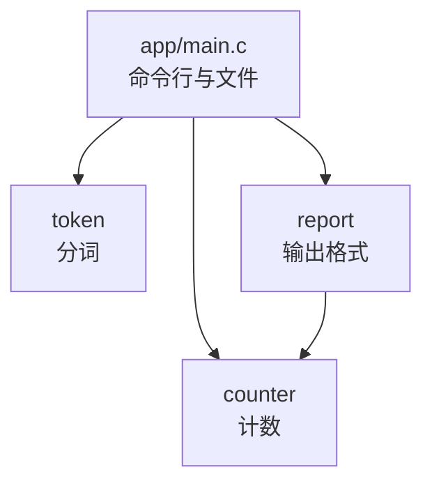

# 7. 项目目录与模块划分

wordfreq 是这一部分从本章一直用到第 19 章的例子：读入若干文本文件，统计每个单词出现的次数，按次数从多到少打印前若干项。用法只有一行：

```text
usage: wordfreq [-n N] [FILE...]
```

功能不多，规则却不少。单词是连续的 ASCII 字母（A–Z、a–z），统计时转成小写；超过 63 个字母的单词只保留前 63 个；次数相同的单词按 `strcmp` 升序排列；文件打不开时以状态 1 退出，并在标准错误上说明原因；参数写错时以状态 2 退出，并打印用法。

文中的命令和输出取自 Debian 13 上的 GCC 14.2。Windows 上的差别在影响操作时单独说明。

如果把这一切写进一个 `main.c`，文件会到两百多行，结构大致是这样：

```text:no-line-numbers
main.c（两百多行）
├── is_letter / to_lower          字符判断与转换
├── next_word                     从缓冲区里切出下一个单词
├── read_file                     读入整个文件
├── find_entry / add_word         线性查找，动态数组，重复单词计数加一
├── compare / print_top           排序并输出
└── main                          解析 -n，循环处理文件，打印
```

这样写能跑，但三件事会立刻变得难办。想单独验证「`The` 要被转成 `the`」，必须先把整个程序跑起来，从输出里找有没有 `the`；想换一种计数方法，得在两百多行里找出所有与计数有关的地方；`find_entry`、`compare` 这类名字太常见，拆成多个文件之后，第二个文件里再写一个 `compare`，链接器就会报重复定义。

本章把这个程序拆成四个模块：三个功能模块各有一对头文件和源文件，命令行与读文件合在 `app/main.c` 里。安排好目录之后，再用最原始的命令把多目录的项目构建出来。拆完的版本记作 v0.1，后面每一章都在这份代码上添加内容：第 8 章加 Makefile，第 9 章加 CMake，第 11 章加测试。源码在 `code/开发与工程基础/7_项目目录与模块划分/wordfreq/`，三个头文件与四个源文件合计 435 行。

## 1. 按职责划分

拆模块的第一步不是分文件，而是把程序要做的事列出来。wordfreq 有四项互不相干的工作：

| 模块 | 一句话职责 | 对外公开的名字 |
| --- | --- | --- |
| token | 从一段文本里依次取出单词，转成小写 | `WF_WORD_MAX`、`wf_tokenizer`、`wf_tokenizer_init`、`wf_tokenizer_next` |
| counter | 记录每个单词出现的次数，按次数取出前若干项 | `wf_counter`、`wf_entry`、`wf_counter_create`、`wf_counter_destroy`、`wf_counter_add`、`wf_counter_get`、`wf_counter_size`、`wf_counter_top` |
| report | 把结果按固定格式写到输出流 | `wf_report_print` |
| app | 解析命令行、读文件、把三个模块串起来 | `main` 和几个 `static` 函数，不对外 |

分成这四个而不是别的数量，依据的是三条标准。

职责要能用一句话说清。token 只管哪里是一个单词、它长什么样，不知道单词会被拿去做什么；counter 只管这个单词出现几次，不知道单词从哪来、结果要打印成什么样；report 只管一行输出长什么样，不知道次数是怎么算出来的。任何一项职责需要用「并且」「同时」来描述时，通常就该拆成两个模块。

模块要能单独测试。给 token 一段文本和一个缓冲区，就能验证它取出的每个单词；给 counter 一串单词，就能验证计数和排序。这两件事都不需要打开文件，也不需要看输出。第 11 章的自动化测试正是这样做的。

换实现时调用方不用改。第 15 章会把 counter 的线性查找换成有序数组加二分查找，`app/main.c` 一行都不用动。如果每次改进都要牵动所有文件，说明职责没有分干净。

读文件没有单独成模块，留在 `app/main.c` 里由 `static` 函数 `read_stream` 完成。它只服务这一个程序，没有第二个调用者；等到真有第二个程序需要读文件时再抽出来也不迟。预先为想象中的复用建模块，往往建出一个谁都不满意的「工具」模块。

## 2. 模块的接口

一个模块由一对文件组成：头文件放声明，源文件放定义。调用方包含头文件，就能使用模块公开的名字；源文件里的实现细节，调用方看不到。三个模块的公开头文件如下。

::: code-group

```c [include/wf/token.h]
/*
 * 分词模块的接口：从一段文本中依次取出单词。
 *
 * 单词是连续的 ASCII 字母（A-Z、a-z），其它字节都是分隔符，
 * 取出的单词一律转成小写。
 */
#ifndef WF_TOKEN_H
#define WF_TOKEN_H

#include <stddef.h>

/* 单词缓冲区的长度，含终止空字符；超长的单词只保留前 63 个字母 */
#define WF_WORD_MAX 64

/* 分词器的状态；调用方只通过下面两个函数使用，不直接读写成员 */
typedef struct {
    const char *cur;
    const char *end;
} wf_tokenizer;

/* 准备从 text 的前 len 个字节中取单词；取词期间 text 必须保持有效 */
void wf_tokenizer_init(wf_tokenizer *tz, const char *text, size_t len);

/*
 * 取出下一个单词，转成小写写入 word，并在末尾放终止空字符。
 * cap >= 1：至多写入 cap-1 个字母；
 * 返回写入的长度，0 表示没有更多单词。
 */
size_t wf_tokenizer_next(wf_tokenizer *tz, char *word, size_t cap);

#endif
```

```c [include/wf/counter.h]
/*
 * 计数模块的接口：记录每个单词出现的次数，并按次数取出前若干项。
 */
#ifndef WF_COUNTER_H
#define WF_COUNTER_H

#include <stddef.h>

/* 结构定义在 src/counter.c 中，调用方只能通过指针使用计数器 */
typedef struct wf_counter wf_counter;

typedef struct {
    /* 指向计数器内部存储，在下一次 wf_counter_add 或
       wf_counter_destroy 之前有效 */
    const char *word;
    size_t count;
} wf_entry;

/* 创建空计数器；内存不足时返回空指针 */
wf_counter *wf_counter_create(void);

/* 释放计数器以及它保存的全部单词 */
void wf_counter_destroy(wf_counter *c);

/* 把 word 的次数加 1，第一次出现时保存一份副本；0 成功，-1 内存不足 */
int wf_counter_add(wf_counter *c, const char *word);

/* 返回 word 出现的次数，没有出现过时返回 0 */
size_t wf_counter_get(const wf_counter *c, const char *word);

/* 返回不同单词的个数 */
size_t wf_counter_size(const wf_counter *c);

/*
 * 按次数降序、次数相同按 strcmp 升序取出前 n 项。
 * 返回写入的项数 min(n, size)；内存不足时返回 0。
 */
size_t wf_counter_top(const wf_counter *c, wf_entry *out, size_t n);

#endif
```

```c [include/wf/report.h]
/*
 * 输出模块的接口：把计数结果按固定格式写到输出流。
 */
#ifndef WF_REPORT_H
#define WF_REPORT_H

#include <stdio.h>

#include "wf/counter.h"

/* 每项输出一行：次数右对齐占 7 列，一个空格，再接单词 */
void wf_report_print(FILE *out, const wf_entry *entries, size_t n);

#endif
```

:::

三个头文件有几个共同点。

所有对外名字都带 `wf_` 前缀。C 没有命名空间，链接器看到的是一张平铺的符号表。`init`、`create`、`add` 这样的名字放进任何一个稍大的程序都会撞车，加上前缀等于手工划出一块命名空间。第 10 章评估的 `c_exception` 用 `cx_` 前缀，道理相同；标准库的 `strcpy`、`strcmp`、`isalpha` 也是靠开头的 `str`、`is` 划出自己那一片。

只在模块内部使用的函数一律加 `static`。`token.c` 的 `is_ascii_letter`、`to_ascii_lower`，`counter.c` 的 `dup_string`、`find_entry`、`reserve_one`、`compare_entries`，`main.c` 的 `usage`、`read_stream` 等，全部是 `static`。用 `nm` 看目标文件，这一层分得很清楚：

::: terminal title="zsh - nm"

```console
$ nm -g --defined-only build/*.o

build/counter.o:
000000000000022e T wf_counter_add
0000000000000174 T wf_counter_create
00000000000001c1 T wf_counter_destroy
0000000000000305 T wf_counter_get
0000000000000344 T wf_counter_size
00000000000003c9 T wf_counter_top

build/main.o:
0000000000000411 T main

build/report.o:
0000000000000000 T wf_report_print

build/token.o:
0000000000000053 T wf_tokenizer_init
0000000000000084 T wf_tokenizer_next
```

:::

`-g` 只列出外部符号，结果正好是各模块头文件里公开的那些名字，再加上 `main`：去掉 `-g` 再看 `counter.o`，多出几个小写 `t` 的内部定义，还有几行 `U`：

::: terminal title="zsh - nm build/counter.o"

```console
$ nm build/counter.o
0000000000000356 t compare_entries
0000000000000000 t dup_string
0000000000000058 t find_entry
                 U free
                 U malloc
                 U memcpy
                 U qsort
                 U realloc
00000000000000c2 t reserve_one
                 U strcmp
                 U strlen
000000000000022e T wf_counter_add
0000000000000174 T wf_counter_create
00000000000001c1 T wf_counter_destroy
0000000000000305 T wf_counter_get
0000000000000344 T wf_counter_size
00000000000003c9 T wf_counter_top
```

:::

大写 `T` 是别的翻译单元可以调用的定义，小写 `t` 只在本文件可见，`U` 是这里用到、别处定义的名字。`find_entry` 一旦去掉 `static`，它会出现在第一张表里，成为整个程序都能调用的名字；哪天另一个模块也写一个 `find_entry`，链接器就会报 `multiple definition`。

头文件必须自足。每个头文件自己包含它用到的标准头，不指望调用方先包含别的什么。`token.h` 和 `counter.h` 用了 `size_t`，所以包含 `<stddef.h>`；`report.h` 用了 `FILE`，所以包含 `<stdio.h>`；`report.h` 的参数类型是 `wf_entry`，所以包含 `"wf/counter.h"`。把 `token.h` 里那行 `<stddef.h>` 删掉，单独编译一个只包含它的文件：

```c [probe.c]
#include "wf/token.h"

int main(void) {
    return 0;
}
```

::: terminal title="zsh - gcc -fsyntax-only"

```console
$ gcc -std=c17 -Wall -Wextra -Iinclude -fsyntax-only probe.c
In file included from probe.c:1:
include/wf/token.h:21:60: error: unknown type name ‘size_t’
   21 | void wf_tokenizer_init(wf_tokenizer *tz, const char *text, size_t len);
      |                                                            ^~~~~~
include/wf/token.h:1:1: note: ‘size_t’ is defined in header ‘<stddef.h>’; this is probably fixable by adding ‘#include <stddef.h>’
  +++ |+#include <stddef.h>
    1 | /*
include/wf/token.h:28:1: error: unknown type name ‘size_t’
...
```

:::

编译器不但指出了缺哪个头文件，还给出了要加的那一行。Windows 上的 MinGW 措辞略有不同，note 是 `'size_t' is defined in header '<stddef.h>'; did you forget to '#include <stddef.h>'?`，意思一样。不写成自足的头文件，换一个包含顺序就可能编译失败，而错误指向的是头文件深处，很难联想到包含顺序。

::: tip 每个 `.c` 的第一行包含自己的头文件

`token.c` 的第一行是 `#include "wf/token.h"`，`report.c` 的第一行是 `#include "wf/report.h"`。这既是习惯，也是检查手段：如果头文件里有写错的地方，编译这个 `.c` 时立刻就会暴露，而不是等到某个调用方以特定顺序包含时才出问题。

:::

## 3. 依赖方向

四个模块之间谁用谁，画出来是一张有向图：



箭头表示「包含对方的头文件、调用对方的函数」。`app` 依赖全部三个模块；`report` 需要 `wf_entry` 这个类型，所以依赖 `counter`；`counter` 和 `token` 不依赖任何其他模块，是这张图的最底层。整个图没有环。

::: concept dev-mod-dependency-direction title="依赖只能从上层指向下层"

模块之间只允许上层包含下层的头文件，下层不得包含上层的头文件。下层模块不知道谁在调用它，因此可以单独编译、单独测试，也可以被另一个程序直接拿去用。

:::

这条规则不是审美要求，它决定了两件事能不能做到。第一是单独编译：编译 `counter.c` 时只需要 `counter.h` 和几个标准头，不需要项目里其他任何文件。第二是单独复用：另一个程序想统计词频，只要拿走 `token.c`、`counter.c` 和它们的头文件就够了，不会连带把 `main.c` 里的命令行解析一起拖进来。反过来的依赖会把这些全部绑死。

最容易破坏方向的做法是建一个 `common.h`，把所有模块都要用的类型和常量都塞进去，然后每个模块都包含它。这样看起来省事，实际上 `common.h` 会逐渐变成一个什么都放的地方：它包含 `counter.h` 取 `wf_entry`，包含 `report.h` 取输出格式，再包含 `token.h` 取 `WF_WORD_MAX`，于是每个模块都间接依赖了所有其他模块，图上的边全部连在一起，环也随之出现。

wordfreq 没有 `common.h`。模块之间需要共享的东西只有一处：`report` 需要 `counter` 的 `wf_entry`。解决方式是让 `report.h` 直接包含 `"wf/counter.h"`，依赖是一条单向边；`WF_WORD_MAX` 只有 `token` 和 `app` 用，就直接放在 `token.h` 里。

出现环时，正确的做法是把共用的部分下移，而不是在上层之间互相包含。假设有人觉得 `counter` 也该能打印结果，于是在 `counter.h` 里写上 `#include "wf/report.h"`，依赖图就多出一条 `counter → report`，与 `report → counter` 构成环。把这一行加进去再编译：

::: terminal title="zsh - gcc -c src/counter.c"

```console
$ gcc -std=c17 -Wall -Wextra -Iinclude -c src/counter.c -o build/counter.o
In file included from include/wf/counter.h:8,
                 from src/counter.c:1:
include/wf/report.h:12:39: error: unknown type name ‘wf_entry’
   12 | void wf_report_print(FILE *out, const wf_entry *entries, size_t n);
      |                                       ^~~~~~~~
```

:::

报错的原因值得看清：`counter.c` 先包含 `counter.h`，`counter.h` 在定义 `wf_entry` 之前就包含了 `report.h`，而 `report.h` 又要用 `wf_entry`，此时它还没有被定义。头文件保护挡住了无限递归，却挡不住「先用到、后定义」。把 `wf_entry` 的定义挪到包含 `report.h` 之前能让这一次编译通过，但环还在，换个包含顺序又会坏。真正的解法是认清 `report` 依赖 `counter`，而 `counter` 不该知道 `report` 的存在；`counter` 要打印，就由调用方把 `wf_entry` 交给 `report`，`counter` 本身不包含 `report.h`。

依赖关系不必靠眼睛核对。GCC 的 `-MM` 让预处理器只列出源文件包含的用户头文件，输出正好是 make 规则的形式：

::: terminal title="zsh - gcc -MM"

```console
$ gcc -MM -Iinclude src/*.c app/*.c
counter.o: src/counter.c include/wf/counter.h
report.o: src/report.c include/wf/report.h include/wf/counter.h
token.o: src/token.c include/wf/token.h
main.o: app/main.c include/wf/counter.h include/wf/report.h \
 include/wf/token.h
```

:::

四行对应四个 `.c` 文件，冒号后面是它直接或间接包含的用户头文件（标准头被 `-MM` 滤掉了）。`counter.o` 只依赖 `counter.h`，`token.o` 只依赖 `token.h`，`report.o` 依赖 `report.h` 和 `counter.h`（后者是 `report.h` 自己包含的），`main.o` 依赖三个公开头文件。把这张表与上面的图对照，箭头完全吻合，没有环。

把 `counter.h` 里那一行 `#include "wf/report.h"` 留着再跑一次 `-MM`，`counter.o` 那一行会多出 `include/wf/report.h`，环在依赖表里一眼可见。第 8 章会拿这份输出生成头文件依赖，让 make 知道改了哪个头文件要重编哪些目标文件。

::: generate dev-mod-dependency-walk kind=explanation concepts=dev-mod-dependency-direction

面向第一次拆分多文件项目的读者，从 `main.c` 的第一行包含开始，逐个文件演示一次编译时预处理器会顺着哪些 `#include` 走到哪些头文件：说明为什么 `counter.h` 不会把 `report.h` 带进来，为什么 `report.h` 一定会带进 `counter.h`，并对照 `-MM` 的四行输出解释「直接包含」和「间接包含」在依赖表里的区别。

:::

## 4. 不透明类型

`counter.h` 里没有 `struct wf_counter` 的定义，只有一行：

```c
typedef struct wf_counter wf_counter;
```

这行声明告诉编译器「有一个叫 `struct wf_counter` 的结构类型，`wf_counter` 是它的别名」，但不说明它有哪些成员。结构真正的定义在 `counter.c` 里：

```c
struct item {
    char *word; /* 计数器自己保存的副本 */
    size_t count;
};

struct wf_counter {
    struct item *items;
    size_t size;     /* 已使用的元素个数 */
    size_t capacity; /* items 能容纳的元素个数 */
};
```

这样做的效果是：调用方可以声明 `wf_counter *`、可以把它传来传去，但不能定义 `wf_counter` 类型的对象，也不能访问 `c->size` 之类的成员。试着定义一下就知道了：

```c [incomplete.c]
#include "wf/counter.h"

int main(void) {
    wf_counter c;
    return 0;
}
```

::: terminal title="zsh - gcc -c incomplete.c"

```console
$ gcc -std=c17 -Wall -Wextra -Iinclude -c incomplete.c -o incomplete.o
incomplete.c: In function ‘main’:
incomplete.c:4:16: error: storage size of ‘c’ isn’t known
    4 |     wf_counter c;
      |                ^
incomplete.c:4:16: warning: unused variable ‘c’ [-Wunused-variable]
```

:::

编译器不知道这个类型有多大，没法在栈上为它留空间。调用方于是只能用 `wf_counter_create` 得到指针、用 `wf_counter_destroy` 交还，两个函数必须成对调用：

```c
wf_counter *counter = wf_counter_create();
if (counter == NULL) {
    return out_of_memory();
}
/* ... 使用 ... */
wf_counter_destroy(counter);
```

::: details 展开：counter.c 里计数是怎么做的

v0.1 用最简单的做法：单词按第一次出现的顺序存在一个动态数组里，每加入一个单词都从头线性查找。几个内部函数都带 `static`，外面看不到：

```c
/* 复制字符串；内存不足时返回空指针 */
static char *dup_string(const char *s) {
    size_t len = strlen(s);
    char *copy = malloc(len + 1);
    if (copy != NULL) {
        memcpy(copy, s, len + 1);
    }
    return copy;
}

/* 线性查找 word；找不到时返回空指针 */
static struct item *find_entry(const wf_counter *c, const char *word) {
    for (size_t i = 0; i < c->size; i++) {
        struct item *e = &c->items[i];
        if (strcmp(word, e->word) == 0) {
            return e;
        }
    }
    return NULL;
}

int wf_counter_add(wf_counter *c, const char *word) {
    struct item *e = find_entry(c, word);
    if (e != NULL) {
        e->count++;
        return 0;
    }

    if (reserve_one(c) != 0) {
        return -1;
    }
    char *copy = dup_string(word);
    if (copy == NULL) {
        return -1;
    }
    c->items[c->size].word = copy;
    c->items[c->size].count = 1;
    c->size++;
    return 0;
}
```

`wf_counter_add` 保存的是 `word` 的一份副本，所以调用方的缓冲区马上可以复用或释放。反过来说，每个单词都占一块自己的堆内存，计数器销毁时要逐个 `free`。上面没贴出的 `reserve_one` 只做一件事：数组满了就把容量翻倍再 `realloc`。这里用的是自己写的 `dup_string` 而不是 `strdup`，原因第 16 章讲可移植构建时再说。

:::

这种类型在 C 里叫不透明类型 (opaque type)。它带来两个直接好处。

内部表示可以随时替换，调用方不受影响。第 15 章把线性查找换成有序数组加二分查找时，`struct wf_counter` 的成员会变，`src/counter.c` 大改，但 `counter.h` 和所有调用方一行不改。刚才那句「换实现时调用方不用改」，靠的就是这一点。

减少重编译。`struct wf_counter` 只出现在 `counter.c` 里，改它只需要重编 `counter.o` 再链接。实测：给结构加一个成员，只重编 `counter.o`，链接后运行结果不变。

代价是每次创建都要一次堆分配，且调用方不能把计数器放在栈上或嵌进自己的结构里。对 wordfreq 这种程序，这点代价可以忽略；对性能敏感的库，有的实现会提供 `wf_counter_init(wf_counter *c)` 让调用方提供存储，但那要求结构定义公开，不透明性就没了。两者只能选一个。

并非所有公开类型都要做成不透明的。`wf_entry` 就是公开的结构，调用方需要读它的 `word` 和 `count` 两个成员。公开结构可以自由访问成员，因此它的布局一旦发布就很难再改，改了就要求所有调用方重编。判断标准是：调用方需要读成员，就公开；只需要拿着指针传来传去，就不透明。

`wf_entry.word` 指向计数器内部的存储，这个指针的所有权不在调用方手里。`counter.h` 的注释写明了它的有效期：

```c
typedef struct {
    /* 指向计数器内部存储，在下一次 wf_counter_add 或
       wf_counter_destroy 之前有效 */
    const char *word;
    size_t count;
} wf_entry;
```

调用方不能 `free` 这个指针，也不该在下次 `wf_counter_add` 或 `wf_counter_destroy` 之后继续使用它。这条约束必须写在头文件里，因为类型系统表达不了它。

<Quiz
  :options="[
    { label: '因为 wf_counter 没有定义成员，编译器不知道它占多少字节', value: 'A' },
    { label: '因为栈空间不够', value: 'B' },
    { label: '因为结构里用了 malloc', value: 'C' },
    { label: '因为 typedef 不能用于定义对象', value: 'D' }
  ]"
  answer="A"
>

<template #question>

在只包含 `wf/counter.h` 的文件里写 `wf_counter c;`，编译失败，原因是：

</template>

正确答案是 **A**。头文件里的 `typedef struct wf_counter wf_counter;` 只声明了类型名，结构定义在 `counter.c` 中，编译器看不到成员，也就不知道 `sizeof(wf_counter)`。B、C 与错误无关，D 说反了：有完整定义的 `typedef` 类型完全可以用来定义对象。

</Quiz>

<Quiz
  :options="[
    { label: '调用方可以直接读 entries[0].word 和 entries[0].count', value: 'A' },
    { label: '调用方应当 free(entries[0].word) 以免泄漏', value: 'B' },
    { label: 'entries[0].word 在 wf_counter_destroy 之后仍然有效', value: 'C' },
    { label: '调用方可以修改 entries[0].count 来改变统计结果', value: 'D' }
  ]"
  answer="A"
>

<template #question>

`wf_counter_top` 把结果写进调用方提供的 `wf_entry` 数组。关于这些条目，下列说法正确的是：

</template>

正确答案是 **A**。`wf_entry` 是公开结构，两个成员都可以读。B 错：`word` 指向计数器内部存储，所有权归计数器，`free` 它会在 `wf_counter_destroy` 时二次释放（Linux 上实测报 `free(): double free detected in tcache 2`）。C 错：头文件注释写明有效期到下一次 `wf_counter_add` 或 `wf_counter_destroy`。D 错：数组是 `wf_counter_top` 写出的副本，改它不影响计数器里的计数。

</Quiz>

## 5. 目录布局

把三个功能模块的六个文件、程序入口、样例数据和构建脚本摆进一个目录，得到这样的结构：

```text:no-line-numbers
wordfreq/
├── include/
│   └── wf/
│       ├── token.h          分词模块的接口
│       ├── counter.h        计数模块的接口
│       └── report.h         输出模块的接口
├── src/
│   ├── token.c
│   ├── counter.c
│   └── report.c
├── app/
│   └── main.c               命令行程序
├── tests/
│   └── data/
│       ├── sample.txt       两行样例文本
│       └── sample.expected  期望输出
├── build_by_hand.sh         手工构建脚本，第 8 章换成 Makefile
├── README.md
└── .gitignore               只有一行 build/
```

三层目录各管一件事。`include/` 放对外公开的头文件，是编译器搜索路径的根；`src/` 放实现，将来若有只在模块之间共享、不对外公开的头文件也放这里；`app/` 放程序入口。`tests/data/` 目前只有两份样例数据，第 11 章会在 `tests/` 下加测试代码。

公开头文件没有直接放在 `include/` 下，而是多一层 `include/wf/`。因为头文件里写的是 `#include "wf/counter.h"`，`-Iinclude` 之后，路径中的 `wf/` 对应 `include/wf/`。多这一层是为了给所有公开名字加上一个共同的前缀目录：将来同一个 `include/` 里再放别的库，头文件名不会撞车；安装到系统时也落在 `/usr/include/wf/` 而不是散在 `/usr/include/` 顶层。

这套布局参考了 Pitchfork Layout（PFL），它是一份 C 和 C++ 项目的目录约定，本身不规定用哪种构建系统。PFL 区分两种布局：

| 布局 | 公开头文件 | 实现与私有头文件 | 调用方拿到的搜索根 |
| --- | --- | --- | --- |
| separate | `include/`，路径与 `src/` 一一对应 | `src/` | 只有 `include/` |
| merged | 与实现一起放在 `src/` | `src/` | `src/` |

separate 布局的好处是调用方只能看到公开头文件，模块的私有头文件即使放在 `src/` 里也包含不到；代价是每个模块在两个目录树里各有一个位置。merged 布局文件少，改一个模块只在一个目录里动，但公开与私有的界线只靠约定维持。PFL 要求同一个库的源码树里两种布局不能混用。它还规定 `build/` 只是构建产物的暂存处，必须被版本控制忽略，这一点与 wordfreq 的 `.gitignore` 一致。

PFL 的规范里没有 `app/` 目录，它是本项目加的。PFL 面向的是给别人链接的库，而 wordfreq 是一个程序：三个模块可以看成一个内部的小库，`main.c` 是使用这个库的程序，两者的改动理由不同。放进 `app/` 之后，第 9 章的 CMake 可以很自然地把 `src/` 编成库目标 `wf`、把 `app/main.c` 编成可执行文件目标 `wordfreq`。如果项目只有两三个 `.c`，全部放 `src/` 也完全够用，不必为了目录整齐而分层。

`build/` 不出现在目录树里，因为它只放构建产物，删掉随时可以重建，不同机器、不同选项生成的产物也各不相同。它不进版本库，`.gitignore` 里只有一行：

```text
build/
```

对照一下反面：

:::: compare left-title="所有文件堆在根目录" right-title="按职责分目录"

```text
messy_layout/
├── globals.h
├── words.h
├── util.c
├── words.c
├── report.c
└── main.c
```

左图这个项目在 `code/开发与工程基础/7_项目目录与模块划分/exercises/messy_layout/`，一条 `gcc main.c` 就能编译运行，输出也正确，但接口和依赖都是乱的：`globals.h` 里直接定义全局对象，`words.c` 用 `#include "util.c"` 引入实现，`main.c` 又包含 `words.c` 与 `report.c`。

---

```text
wordfreq/
├── include/wf/   公开接口
├── src/          实现
├── app/          程序入口
└── tests/data/   样例数据
```

右图的做法把「哪些是接口、哪些是实现、哪个是程序」写进了路径。谁依赖谁从目录就能看出大概，新增一个模块只需在 `include/wf/` 和 `src/` 各加一个文件。

::::

两个项目都不缺能跑的代码，差别在文件之间的关系能不能从目录上看出来。右边把「接口、实现、哪个是程序」写进路径之后，同类问题从 `ls` 的输出就能回答一半。左边那种写法按常规方式逐个编译再链接，则直接失败：

::: terminal title="zsh - 逐个编译后链接"

```console
$ gcc -std=c17 -Wall -Wextra -c main.c -o main.o
$ gcc -std=c17 -Wall -Wextra -c words.c -o words.o
$ gcc -std=c17 -Wall -Wextra -c report.c -o report.o
$ gcc -std=c17 -Wall -Wextra -c util.c -o util.o
$ gcc main.o words.o report.o util.o -o messy2
/usr/bin/ld: words.o:(.bss+0x0): multiple definition of `g_letter_count'; main.o:(.bss+0x0): first defined here
/usr/bin/ld: words.o: in function `is_letter':
words.c:(.text+0x0): multiple definition of `is_letter'; main.o:main.c:(.text+0x23): first defined here
/usr/bin/ld: report.o: in function `print_report':
report.c:(.text+0x0): multiple definition of `print_report'; main.o:main.c:(.text+0x0): first defined here
...
```

:::

`main.o` 里已经有一份从被包含的 `.c` 文件抄过来的实现，`words.o`、`util.o`、`report.o` 各自又编译出一份，链接器把它们放在一起时就会撞名。把 `#include "util.c"` 这类写法去掉、按职责拆成模块，这个错误从根上消失。

## 6. 包含路径

所有源文件都写同一种形式的包含：

```c
#include "wf/counter.h"
```

编译时统一加 `-Iinclude`。`-I` 把 `include` 目录加进搜索路径，路径中的 `wf/counter.h` 就相对于它解析。`#include` 两种写法的基本规则在[第 6.1 节](/教程/正文/开发与工程基础/6_头文件与接口边界/6_1_include与头文件)讲过；GCC 的具体搜索顺序是：引号形式先找当前源文件所在目录，再找 `-I` 给出的目录，最后找系统目录；尖括号形式不找源文件目录，直接从 `-I` 的目录开始。

`-I` 后面的路径相对于编译器的工作目录，也就是运行 `gcc` 时所在的目录，不是相对于源文件。在项目根目录执行没有问题；先 `cd src` 再编译，同一个 `-Iinclude` 就指向了 `src/include`，找不到头文件：

::: terminal title="zsh - cd src 后编译"

```console
$ cd src
$ gcc -std=c17 -Wall -Wextra -Iinclude -c token.c -o ../build/token.o
token.c:1:10: fatal error: wf/token.h: No such file or directory
    1 | #include "wf/token.h"
      |          ^~~~~~~~~~~~
compilation terminated.
```

:::

构建脚本因此总是从项目根目录执行，第 8 章的 Makefile 也约定在根目录运行。

不要写相对路径 `#include "../include/wf/counter.h"`。从 `src/counter.c` 出发，这样写确实能编译，而且不需要 `-I`，因为 `counter.h` 不再包含任何项目内的头文件。问题出在下一层：`report.c` 这样包含 `../include/wf/report.h` 之后，`report.h` 里写的仍是 `#include "wf/counter.h"`，预处理器从 `include/wf/` 出发去找 `include/wf/wf/counter.h`，立刻失败。实测把 `src/report.c` 的第一行改成 `#include "../include/wf/report.h"`，编译报的就是这个错：

::: terminal title="zsh - 相对路径包含"

```console
$ gcc -std=c17 -Wall -Wextra -c src/report.c -o build/report.o
In file included from src/report.c:1:
src/../include/wf/report.h:9:10: fatal error: wf/counter.h: No such file or directory
    9 | #include "wf/counter.h"
      |          ^~~~~~~~~~~~~~
compilation terminated.
```

:::

另一个问题是文件一挪位置，所有相对路径全部失效。统一写 `wf/...` 加 `-Iinclude`，路径里的层级只表达「这是哪个库的头文件」，与源文件在树里的位置无关，模块挪进子目录也不用改。

把引号换成尖括号，配合 `-Iinclude` 同样能编译。本项目仍用引号形式，因为它表达「这是本项目的头文件」，尖括号留给标准头和由构建系统配置搜索路径的外部头文件。这个区分是约定，编译器对两者的处理差别只在是否先搜源文件目录。

文件名大小写要与磁盘一致。Linux 上 `#include "wf/Counter.h"` 找不到文件，Windows 上因为文件系统不区分大小写而能编译通过，于是同一个错误会在换平台时才暴露。第 16 章讲可移植构建时会再遇到这类问题。

## 7. 手工构建一次

多目录的项目也能用一条命令编出来。先建好 `build/`，再执行 `gcc -std=c17 -Wall -Wextra -Iinclude src/*.c app/main.c -o build/wordfreq`，得到的程序和下面分步构建的一样。代价是每次都把全部源文件从头编译一遍，改一个文件也要等其余文件重新编完。把编译和链接分开，每个 `.c` 文件单独编译成目标文件，再链接成可执行文件，已经编好的目标文件就能留着复用。这正是 `build_by_hand.sh` 做的事：

```sh
#!/bin/sh
# 手工构建 wordfreq：把每个 .c 文件分别编译成 build/ 下的目标文件，
# 再把四个目标文件链接成可执行文件。
# 在项目根目录执行：sh build_by_hand.sh
set -e # 任何一条命令失败就停止
set -x # 执行每条命令之前先把它打印出来

mkdir -p build
gcc -std=c17 -Wall -Wextra -Iinclude -c src/token.c -o build/token.o
gcc -std=c17 -Wall -Wextra -Iinclude -c src/counter.c -o build/counter.o
gcc -std=c17 -Wall -Wextra -Iinclude -c src/report.c -o build/report.o
gcc -std=c17 -Wall -Wextra -Iinclude -c app/main.c -o build/main.o
gcc build/main.o build/token.o build/counter.o build/report.o -o build/wordfreq
```

`set -e` 让任何一条命令失败时脚本立刻停止，`set -x` 在每条命令执行前把它打印出来，省得自己猜跑到哪一步了。运行过程和结果：

::: terminal title="zsh - sh build_by_hand.sh"

```console
$ sh build_by_hand.sh
+ mkdir -p build
+ gcc -std=c17 -Wall -Wextra -Iinclude -c src/token.c -o build/token.o
+ gcc -std=c17 -Wall -Wextra -Iinclude -c src/counter.c -o build/counter.o
+ gcc -std=c17 -Wall -Wextra -Iinclude -c src/report.c -o build/report.o
+ gcc -std=c17 -Wall -Wextra -Iinclude -c app/main.c -o build/main.o
+ gcc build/main.o build/token.o build/counter.o build/report.o -o build/wordfreq
$ ./build/wordfreq -n 3 tests/data/sample.txt
      4 the
      2 on
      2 sat
```

:::

链接命令里目标文件的顺序不影响结果，`main.o` 放在最前面只是习惯。Windows 上 MinGW 会对 `%zu` 报三条格式警告（第 3 章第 7 节的 tip 解释过），脚本照常执行完毕，程序输出与 Linux 一致。想验证输出是否与期望值完全相同，把标准输出交给 `diff`：

::: terminal title="zsh - diff"

```console
$ ./build/wordfreq -n 3 tests/data/sample.txt | diff - tests/data/sample.expected
$ echo $?
0
```

:::

Windows 上程序的换行是 `\r\n`，与 `sample.expected` 的 `\n` 直接比较会有三行不同，先 `tr -d '\r'` 再比。

这套命令每次重编全部四个文件。工程上更常见的情形是只改了一个文件，这时该重跑哪些命令，取决于它被谁包含。`gcc -MM` 的输出就是答案：`report.c` 只被 `report.o` 依赖，改它只需重编 `report.o` 再链接：

::: terminal title="zsh - 只改 report.c"

```console
$ sed -i 's/%7zu/%5zu/' src/report.c
$ gcc -std=c17 -Wall -Wextra -Iinclude -c src/report.c -o build/report.o
$ gcc build/main.o build/token.o build/counter.o build/report.o -o build/wordfreq
$ ./build/wordfreq -n 3 tests/data/sample.txt
    4 the
    2 on
    2 sat
```

:::

改成 `%5zu` 之后次数只占 5 列，`the` 前面少了两个空格；其他三个目标文件没有重编，结果依然正确。

改头文件影响的面大得多。按 `-MM` 的表，`counter.h` 被 `counter.c`、`report.c`、`main.c` 三个文件包含，所以改它要重编 `counter.o`、`report.o`、`main.o`，`token.o` 不受影响。凭记忆回答这类问题，迟早会漏掉一个。漏掉的那个目标文件仍然按旧的结构布局读写数据，链接器不会报错，运行时才会出问题。下面这个实验把 `wf_entry` 的两个成员的顺序对调：

```c
typedef struct {
    size_t count;
    /* 指向计数器内部存储，在下一次 wf_counter_add 或
       wf_counter_destroy 之前有效 */
    const char *word;
} wf_entry;
```

改完之后只重编 `counter.o` 和 `main.o`，故意不碰 `report.o`：

::: terminal title="zsh - 漏掉一个目标文件"

```console
$ gcc -std=c17 -Wall -Wextra -Iinclude -c src/counter.c -o build/counter.o
$ gcc -std=c17 -Wall -Wextra -Iinclude -c app/main.c -o build/main.o
$ gcc build/main.o build/token.o build/counter.o build/report.o -o build/wordfreq
$ ./build/wordfreq -n 3 tests/data/sample.txt
Segmentation fault
```

:::

`report.o` 还是按旧布局理解的：它以为偏移 0 处是 `word` 指针。可新的结构在偏移 0 处放的是 `count`，值只有 4，`fprintf` 拿着地址 `0x4` 去读字符串，程序当场崩溃，退出状态 139。把 `report.o` 补编上，同样的命令立刻恢复正常。链接器只检查名字，不检查结构布局是否一致，这类错误只能靠完整、准确的依赖关系来避免。

四个文件时还能手工回答，二十个文件时就没有把握了。哪些文件需要重编、按什么顺序、目录不存在时先建哪个，这些都可以交给工具自动判断。第 8 章把这一串命令改写成 Makefile，第 9 章换成 CMake。

## 8. 习题

### 8.1 巩固

<Exercise id="20701" :d="1" :w="2">

自足性检查。在 `code/开发与工程基础/7_项目目录与模块划分/wordfreq/` 下新建 `probe.c`：

```c
#include "wf/counter.h"

int main(void) { return 0; }
```

用 `gcc -std=c17 -Wall -Wextra -Iinclude -fsyntax-only probe.c` 编译。然后依次做三个实验，每次只改一处：

1. 把 `counter.h` 里的 `#include <stddef.h>` 删掉，再编译 `probe.c`，记录诊断的第一行和那条 note。
2. 恢复上一步，把 `report.h` 里的 `#include <stdio.h>` 删掉，仿照上面写一个只包含 `report.h` 的 `probe2.c`，记录诊断。
3. 在 `probe2.c` 的第一行加上 `#include <stdio.h>`，再编译一次，说明为什么这时错误消失了，以及这种「碰巧能过」的写法为什么不能作为头文件自足的证据。

验收：三次诊断的原文（或说明没有任何输出）、一句结论。做完把 `probe.c`、`probe2.c` 删掉。

</Exercise>

<Exercise id="20702" :d="2" :w="2">

依赖表与环。在 `wordfreq/` 下运行：

```sh
gcc -MM -Iinclude src/*.c app/*.c
```

1. 把四行输出整理成一张表：目标文件、它直接包含的头文件、间接带进来的头文件。
2. 画出模块依赖图，标出每条边来自哪一行 `#include`，确认没有环。
3. 在 `counter.h` 定义 `wf_entry` 之前加一行 `#include "wf/report.h"`，重新运行同一条命令并尝试编译 `src/counter.c`，记录两处结果。解释为什么头文件保护没有救下这次编译，以及正确的修法是什么。
4. 改完之后再跑一次 `gcc -MM`，指出哪一行发生了变化，这一个变化为什么就足以说明环还在。

验收：改前改后的 `-MM` 输出、一次编译诊断、一段说明。最后把 `counter.h` 恢复原样。

</Exercise>

<Exercise id="20703" :d="2" :w="2">

用 `nm` 检查外部链接。在 `wordfreq/` 下手工构建（`sh build_by_hand.sh`），然后：

1. 运行 `nm -g --defined-only build/*.o`，把输出按目标文件分组抄下来，对照三个头文件，指出多出来的那一个名字及其来源。
2. 运行 `nm build/counter.o`，找出 `find_entry`、`dup_string`、`reserve_one`、`compare_entries` 的符号类型字母，说明小写和大写分别意味着什么。
3. 把 `src/counter.c` 里 `find_entry` 前面的 `static` 删掉，重新编译 `counter.o`；再写一个有 `main` 的源文件，里面同样定义一个 `int find_entry(void) { return 0; }`，编译后与 `counter.o` 一起链接，记录诊断。
4. 恢复 `static`，写出 `wf_` 前缀与 `static` 各自防住的是哪一类冲突。

验收：三次 `nm` 输出中的相关行、链接诊断原文、两句结论。

</Exercise>

### 8.2 编程

<Exercise id="20704" :d="3" :w="3">

增加 stats 模块。在 `wordfreq/` 下新建 `include/wf/stats.h` 与 `src/stats.c`，公开接口固定为：

```c
#include <stddef.h>

#include "wf/counter.h"

typedef struct {
    size_t total_words;
    size_t distinct_words;
    double average_length;
} wf_stats;

void wf_stats_compute(const wf_counter *c, wf_stats *out);
```

`total_words` 是全部单词的出现次数之和，`distinct_words` 是不同单词的个数，`average_length` 是按出现次数加权的平均字母数。在 `app/main.c` 里加一个 `-s` 选项，输出三行：

```text
total: 12
distinct: 7
average: 2.83
```

样例数据用 `tests/data/sample.txt`，`-s` 与 `-n` 可以同时给出，此时只输出统计不输出排名；不给 `-s` 时行为与原来完全一致。更新 `build_by_hand.sh`，把 `stats.c` 编进去并加进链接命令。

要求：`stats.h` 与前缀、自足头文件、依赖方向的约定一致；`stats.c` 里只在本文件使用的辅助函数加 `static`；`stats.h` 允许包含 `counter.h`，反过来不行。用 `gcc -MM -Iinclude src/stats.c` 验证依赖只有一条边。

再回答一个问题：`wf_stats` 是公开结构，`wf_counter` 是不透明类型，两者的判断依据各是什么？如果把 `wf_stats` 也改成不透明类型、只提供三个 `wf_stats_total()` 一类的读取函数，调用方代码要改几处、换来了什么；反过来把 `wf_counter` 的定义搬进 `counter.h`，本章正文里哪条保证会失去。

验收：`sh build_by_hand.sh` 无警告，`./build/wordfreq -s tests/data/sample.txt` 输出上面三行，`./build/wordfreq -n 3 tests/data/sample.txt` 仍输出原来的三行，另加一段对两种类型的取舍说明。

</Exercise>

<Exercise id="20705" :d="3" :w="3">

重构反例项目。`code/开发与工程基础/7_项目目录与模块划分/exercises/messy_layout/` 是一个能跑但结构混乱的项目：文件全在根目录，`globals.h` 里定义全局对象，`words.c` 用 `#include "util.c"` 引入实现，`main.c` 又包含 `words.c` 与 `report.c`。先按它的 README 构建一次，确认输出是 `letters: 13` 与 `words: 2`。

然后把它重构成本章的布局：

1. 目录分成 `include/mf/`、`src/`、`app/`，公开头文件只有 `mf/words.h` 与 `mf/report.h`，`build/` 加入 `.gitignore`。
2. `globals.h` 里的两个计数对象不能留在头文件里。改成由 `words.c` 与 `report.c` 共用的接口：提供 `mf_letter_count()`、`mf_word_count()` 两个读取函数，以及 `mf_set_word_count()`；对象定义放进 `words.c` 并加 `static`。
3. `words.c` 不得再包含 `util.c`，`main.c` 不得包含任何 `.c` 文件；每个模块的头文件自足。
4. 写一个新的 `build_by_hand.sh`，逐个编译再链接，命令写在脚本里。
5. 用 `nm -g --defined-only build/*.o` 证明对外只暴露 `mf_` 开头的名字和 `main`。

验收：重构后输出与重构前逐字节相同；脚本从项目根目录执行成功；`nm` 输出里没有 `g_letter_count`、`g_word_count`、`is_letter` 这类名字。把重构后的目录树写在答案里。

</Exercise>

<Exercise id="20706" :d="3" :w="2">

包含路径的四个实验，都在 `wordfreq/` 下做：

1. 先 `cd src`，再执行 `gcc -std=c17 -Wall -Wextra -Iinclude -c token.c -o ../build/token.o`，记录错误并解释 `-I` 相对谁解析。
2. 把 `src/report.c` 的第一行改成 `#include "../include/wf/report.h"`，在项目根目录执行 `gcc -std=c17 -Wall -Wextra -c src/report.c -o build/report.o`，记录错误，说明 `report.h` 内部那行 `#include "wf/counter.h"` 是从哪个目录开始找的。
3. 上一步的错误加 `-Iinclude` 可以消除。再用 `-iquote include` 重做一次，说明 `-iquote` 与 `-I` 在搜索引号形式时各管什么。
4. 在 `src/` 下建一个 `src/wf/token.h`，内容写一行 `#error shadowed`，保持 `src/token.c` 的第一行为 `#include "wf/token.h"`，编译 `src/token.c`，记录结果；再把这一行改成尖括号形式，编译，说明两种形式的搜索顺序差异。

验收：四次诊断（或成功）的原文、四句解释。做完删掉 `src/wf/` 并把 `report.c` 恢复原样。

</Exercise>

<Exercise id="20707" :d="4" :w="4">

增量重编的判断。在 `wordfreq/` 下用 `sh build_by_hand.sh` 构建一次，保留 `build/` 里的目标文件，之后不再运行脚本。

1. 只改 `src/report.c` 里的格式宽度（`%7zu` 改成 `%5zu`），重编需要的那几个目标文件并重新链接，运行 `-n 3` 确认输出变化，列出你重跑了哪几条命令、依据是什么。
2. 把 `include/wf/counter.h` 里 `wf_entry` 的两个成员顺序对调，只重编 `counter.o` 与 `main.o`，保留旧的 `report.o`，链接后运行。记录程序的表现（正文里这一步是 `Segmentation fault`，MinGW 上通常是程序直接消失、退出状态 139 或异常终止），解释 `report.o` 为什么仍然按旧布局理解这两个成员。
3. 换一个实验：在 `src/counter.c` 的 `struct wf_counter` 末尾加一个新成员 `size_t lookups;`，只重编 `counter.o` 再链接，运行。解释为什么这次结果正确，和第 2 步的差别在哪里。
4. 根据 `gcc -MM -Iinclude src/*.c app/*.c` 的输出，写一张「改了哪个头文件就要重编哪些目标文件」的表，覆盖三个公开头文件。

验收：两次运行的实际结果、第 4 步的完整表格、一段说明。这个表格在第 8 章会被 Make 自动生成，现在先手工做一遍。

</Exercise>

<Exercise id="20708" :d="4" :w="3">

用同一批模块写第二个程序。在 `wordfreq/` 旁边新建 `tools/`，写 `wfdump.c`：把标准输入整个读进来交给 `wf_tokenizer`（单词按 token 模块的规则切分，转小写），统计后输出不同单词的个数与前三个高频词，两列之间用制表符分隔：

```text
distinct	3
3	the
1	cat
1	dog
```

上面的输出对应输入 `the cat the dog the`。读入整个标准输入可以照抄 `app/main.c` 里的 `read_stream`。

要求：

1. 只链接 `token.o` 与 `counter.o`，不链接 `report.o` 与 `main.o`，编译命令写出来。
2. 不修改 `token.c`、`counter.c` 与三个头文件中的任何一个；如果发现做不到，指出是哪条接口挡住了你，并说明最小改动是什么。
3. 统计结束后按 `wf_counter_destroy` 交还计数器，并在注释里写明 `wf_entry.word` 的所有权。
4. 回答：如果 `counter.h` 里包含了 `report.h`，这个程序会受到什么影响。第 8 章会把这三条命令写进 Makefile 的 `tools` 目标。

验收：编译链接命令、运行结果、对第 2 条与第 4 条各一段说明。

</Exercise>

### 8.3 综合与挑战

<Exercise id="20709" :d="5" :w="4">

设计一个可复用的模块并交付出去。目标：写一个 `pathjoin` 模块，把若干段路径拼成一个，段之间补一个 `/`，重复的 `/` 只留一个，结果超过缓冲区时截断并返回 0，成功返回 1。

```c
/* 返回 1 成功，0 表示结果被截断 */
int mf_pathjoin(char *dst, size_t cap, const char *const parts[], size_t n);
```

要求：

1. 按本章的布局建立 `mini/`：`include/mf/pathjoin.h`、`src/pathjoin.c`、`app/demo.c`、`tests/`（一个 `main` 直接返回 0 的占位程序即可），`build/` 写入 `.gitignore`。
2. `pathjoin.h` 自足，不包含任何项目内头文件；`pathjoin.c` 的私有辅助函数全部 `static`；公开名字只用 `mf_` 前缀。
3. 只在 `src/` 下放一个私有头文件 `pathjoin_internal.h`，让 `pathjoin.c` 包含它；用 `gcc -Iinclude -fsyntax-only` 从 `app/` 里尝试包含它，证明调用方拿不到这个头文件。
4. 写 `build_by_hand.sh`，从项目根目录一次构建出 `build/demo`。`demo` 依次拼接 `{"/", "/usr/", "/local", "bin"}`、`{"a//", "//b"}`、`{"x"}`，每行先打印返回值再打印结果，第一个应是 `1 /usr/local/bin`。
5. 说明你为什么把 `pathjoin_internal.h` 放在 `src/` 而不是 `include/mf/`，以及如果 `mini/` 被另一个项目以 merged 布局取走，这条界线会变成什么。
6. 用 `gcc -MM -Iinclude src/*.c app/*.c` 输出最终依赖表，确认 `app/demo.c` 只依赖 `include/mf/pathjoin.h`。

验收：`build_by_hand.sh` 跑出的三行输出（`1 /usr/local/bin`、`1 a/b`、`1 x`）、`-MM` 输出、两段设计说明。

</Exercise>

## 9. 参考资料

1. Pitchfork Layout（PFL）规范，目录布局、`build/` 的定位与两种布局的区分：https://github.com/vector-of-bool/pitchfork
2. David R. Hanson，《C Interfaces and Implementations: Techniques for Creating Reusable Software》，Addison-Wesley，1996，ISBN 978-0-201-49841-7。第 1 章讲接口与实现分离，第 2 章「Interfaces and Implementations」讲不透明指针、成对的分配与释放接口，以及每个接口一份头文件的组织方式。
3. Brian W. Kernighan、Rob Pike，《The Practice of Programming》，Addison-Wesley，1999，ISBN 978-0-201-61586-9。第 4 章「Interfaces」：接口与实现分开、隐藏表示、避免全局对象。
4. GCC 文档《Options for Directory Search》，`-I`、`-iquote` 与搜索顺序：https://gcc.gnu.org/onlinedocs/gcc/Directory-Options.html
5. GCC 文档《The C Preprocessor: Search Path》，引号形式与尖括号形式的查找顺序：https://gcc.gnu.org/onlinedocs/cpp/Search-Path.html
6. GCC 文档《Options Controlling the Preprocessor》，`-MM` 生成的依赖列表格式：https://gcc.gnu.org/onlinedocs/gcc/Preprocessor-Options.html
7. binutils 文档《nm》，符号类型字母（`T`、`t`、`U`）的含义：https://sourceware.org/binutils/docs/binutils/nm.html
