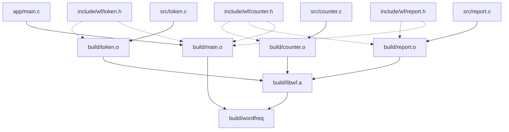

# 8. 构建图与 Make

第 7 章最后把 wordfreq 的编译过程写进了 `build_by_hand.sh`。脚本能用，但它每运行一次都把四个源文件全部重新编译，哪怕只改了一个：

::: terminal title="zsh - 只改 report.c，脚本仍全编"

```console
$ touch src/report.c
$ sh build_by_hand.sh
+ mkdir -p build
+ gcc -std=c17 -Wall -Wextra -Iinclude -c src/token.c -o build/token.o
+ gcc -std=c17 -Wall -Wextra -Iinclude -c src/counter.c -o build/counter.o
+ gcc -std=c17 -Wall -Wextra -Iinclude -c src/report.c -o build/report.o
+ gcc -std=c17 -Wall -Wextra -Iinclude -c app/main.c -o build/main.o
+ gcc build/main.o build/token.o build/counter.o build/report.o -o build/wordfreq
```

:::

多等几秒还在其次，真正麻烦的是改头文件。`counter.h` 被 `counter.c`、`report.c`、`main.c` 三个文件包含，改过之后哪几个目标文件必须重编，第 7 章是拿 `gcc -MM` 的输出一条条查的；漏掉一个，程序就在运行时崩溃。文件一多，这件事没人能靠记忆做对。

本章把整个项目的构建写成一张构建图 (build graph)，交给 GNU Make 执行：每个文件由什么生成、谁比谁新、哪些命令可以跳过，全由 make 按图计算。写好之后的 Makefile 不仅能增量构建，还能把互不依赖的编译并行起来，并给出一致的 `make test`、`make clean` 入口。

配套代码在 `code/开发与工程基础/8_构建图与Make/` 下：`hello/` 是两个源文件的最小例子，`wordfreq/` 是本章结束时的完整项目。文中的输出取自 Debian 13 上的 GNU Make 4.4.1 与 GCC 14.2；Windows 上的差别在影响操作的地方单独说明。

## 1. 构建图

wordfreq 的每个产物都由别的文件生成：四个 `.o` 分别由四个 `.c` 编译，`libwf.a` 由三个模块的 `.o` 打包，`build/wordfreq` 由 `main.o` 和库链接得到。头文件不直接生成任何东西，但包含了它的 `.o` 必须在它变化之后重编。把这些关系画出来，是一张有向图：



实线表示「由……生成」，虚线表示「被包含」。图的每一条边都对应 Makefile 里写的一条先决条件，make 自己不读源代码，也不会猜 `#include` 的关系，图上有什么它就只认什么。这张图画的是本章结束时构建的样子；中间几节先用简化的版本，第 6 节才把静态库加进来。

有了图，判断就简单了：从最终产物往下追，目标文件不存在，或者任何一个先决条件比它新，就执行生成它的命令；否则跳过。比较的是文件的修改时间 (modification time)，不是内容。`touch` 一个文件会改它的修改时间，因此能强制触发重编；反过来，从备份里恢复文件时如果保留了旧的修改时间，make 会认为不需要重编。

::: concept dev-make-target-update title="目标何时需要重建"

对每个目标，make 先递归更新它的全部先决条件，然后比较修改时间：目标不存在，或任一先决条件比目标新，就执行这个目标的配方 (recipe)；否则什么也不做。

:::

这种按需重跑的构建方式称为增量构建 (incremental build)。第 7 章手工判断该重跑哪几条命令，做的正是同一件事，只是由人来做。make 把这件工作变成了规则，规则写对一次，以后都不必再想。

<Quiz
  :options="[
    { label: '目标不存在，或任一先决条件比目标新', value: 'A' },
    { label: '目标的内容与上一次构建时不同', value: 'B' },
    { label: '源文件里新增了函数或全局对象', value: 'C' },
    { label: '只要运行 make，就从头执行全部配方', value: 'D' }
  ]"
  answer="A"
>

<template #question>

make 决定一条规则要不要执行，依据的是什么？

</template>

正确答案是 **A**。make 只比较修改时间。B 错在 make 不读文件内容；C 错在 make 不分析源代码；D 说反了，增量构建正是 make 的基本行为。

</Quiz>

## 2. 第一个 Makefile

从只有两个源文件的程序开始。`hello/` 下是第 7 章之前写过的那种最小项目：

::: code-group

```c [main.c]
#include <stdio.h>

#include "greet.h"

int main(void) {
    greet("world");
    return 0;
}
```

```c [greet.c]
#include "greet.h"

#include <stdio.h>

void greet(const char *name) { printf("Hello, %s!\n", name); }
```

```c [greet.h]
#ifndef GREET_H
#define GREET_H

/* 打印一行问候；name 不能为空指针 */
void greet(const char *name);

#endif
```

:::

不写构建文件时，手工编译要两条 `gcc -c` 加一条链接。Makefile 把这三条命令和它们的前后关系写下来：

```makefile [Makefile]
hello: main.o greet.o
	gcc -o hello main.o greet.o

main.o: main.c greet.h
	gcc -std=c17 -Wall -Wextra -c main.c -o main.o

greet.o: greet.c greet.h
	gcc -std=c17 -Wall -Wextra -c greet.c -o greet.o
```

一条规则由三部分组成：冒号左边是目标 (target)，右边是先决条件 (prerequisite)，下面以制表符开头的一行或多行是配方。下面从最小版本开始，第 3 节补上变量和 `clean`，完整文件在 `code/开发与工程基础/8_构建图与Make/hello/Makefile`。

make 读入文件后，从第一条规则的目标开始，递归更新它的先决条件，全部就绪后再执行配方。文件里默认的目标就是第一条规则的目标 `hello`，所以在项目根目录直接敲 `make` 即可。

::: terminal title="zsh - make"

```console
$ make
gcc -std=c17 -Wall -Wextra -c main.c -o main.o
gcc -std=c17 -Wall -Wextra -c greet.c -o greet.o
gcc -o hello main.o greet.o
$ ./hello
Hello, world!
```

:::

第一次运行时三个目标文件都不存在，三条配方依次执行。再运行一次，所有目标都比先决条件新：

::: terminal title="zsh - 再次 make"

```console
$ make
make: 'hello' is up to date.
```

:::

`touch greet.c` 只改 `greet.c` 的修改时间，`greet.o` 因此过期，`hello` 又依赖 `greet.o`，所以重编一个文件再重新链接：

::: terminal title="zsh - touch greet.c"

```console
$ touch greet.c
$ make
gcc -std=c17 -Wall -Wextra -c greet.c -o greet.o
gcc -o hello main.o greet.o
```

:::

`greet.h` 同时是 `main.o` 和 `greet.o` 的先决条件，改它（或 `touch` 它）会让两个目标文件都重编：

::: terminal title="zsh - touch greet.h"

```console
$ touch greet.h
$ make
gcc -std=c17 -Wall -Wextra -c main.c -o main.o
gcc -std=c17 -Wall -Wextra -c greet.c -o greet.o
gcc -o hello main.o greet.o
```

:::

配方行必须以制表符 (TAB) 开头，这条语法从 make 诞生起就没变过。用空格缩进的配方不会被当作配方，make 把它当成一条缺少冒号的规则：

::: warning 配方必须用制表符缩进

用空格缩进配方时，make 报 `missing separator` 并立即停止，退出状态 2。编辑器里的「把制表符替换成空格」如果开着，复制来的 Makefile 就会这样坏掉。

:::

`hello/Makefile.spaces.mk` 的内容与本节的 Makefile 相同，三个配方行都改成了四个空格。运行结果：

::: terminal title="zsh - missing separator"

```console
$ make -f Makefile.spaces.mk
Makefile.spaces.mk:5: *** missing separator.  Stop.
```

:::

看不到区别时，用 `cat -A Makefile` 检查。制表符显示为 `^I`，空格就是空格。编辑器里把 C 文件和 Makefile 分开设置缩进，或者干脆把「按 Tab 插入制表符」打开，都能避免这类问题。

make 在目录里依次寻找 `GNUmakefile`、`makefile`、`Makefile`，找到第一个就用。三者同时存在时后两个被忽略，这常常是「我明明改了 Makefile，怎么没生效」的原因。本教程统一用 `Makefile`。

## 3. 变量与自动变量

上面的 Makefile 把编译选项抄了两遍，换编译器或加一个选项要改两处。Make 变量用来消除这种重复：

```makefile [Makefile]
CC = gcc
CFLAGS = -std=c17 -Wall -Wextra

hello: main.o greet.o
	$(CC) -o $@ $^

main.o: main.c greet.h
	$(CC) $(CFLAGS) -c main.c -o $@

greet.o: greet.c greet.h
	$(CC) $(CFLAGS) -c greet.c -o $@

clean:
	$(RM) hello hello.exe main.o greet.o
```

`$@` 和 `$^` 是自动变量 (automatic variable)，make 在执行每条配方前按当前规则填好：

| 写法 | 含义 |
| --- | --- |
| `$@` | 这条规则的目标 |
| `$<` | 第一个先决条件 |
| `$^` | 全部先决条件，去掉重复项 |
| `$?` | 比目标新的那部分先决条件 |
| `$*` | 模式规则里 `%` 匹配到的部分 |

把 `$@`、`$<`、`$^` 打印出来看得更直接。在 `hello/` 下另建一份 `autovar.mk`，把链接规则的配方换成一句 `echo`：

```makefile [autovar.mk]
CC = gcc
CFLAGS = -std=c17 -Wall -Wextra

demo: main.o greet.o
	@echo "target=$@ first=$< all=$^"

main.o: main.c greet.h
	$(CC) $(CFLAGS) -c main.c -o $@

greet.o: greet.c greet.h
	$(CC) $(CFLAGS) -c greet.c -o $@
```

运行结果：

::: terminal title="zsh - 自动变量"

```console
$ make -f autovar.mk
gcc -std=c17 -Wall -Wextra -c main.c -o main.o
gcc -std=c17 -Wall -Wextra -c greet.c -o greet.o
target=demo first=main.o all=main.o greet.o
```

:::

`$<` 只给出第一个先决条件，`$^` 给出全部。用了自动变量之后，链接规则写成 `$(CC) -o $@ $^`，以后往先决条件里加文件，配方一行都不用改。

`CC`、`CFLAGS`、`CPPFLAGS`、`LDFLAGS`、`LDLIBS` 是约定俗成的名字，make 的内置规则按它们取值，别的工具和读 Makefile 的人看到这些名字也知道该覆盖谁：

| 名字 | 交给谁 | 通常放什么 |
| --- | --- | --- |
| `CC` | 编译器驱动 | 编译器命令，make 内置值为 `cc` |
| `CFLAGS` | C 编译器 | `-std`、`-O`、`-g`、警告选项 |
| `CPPFLAGS` | 预处理器 | `-I`、`-D` |
| `LDFLAGS` | 链接器 | `-L`、`-Wl,` 一类 |
| `LDLIBS` | 链接器 | `-l`、库文件名 |

区分 `CFLAGS` 与 `CPPFLAGS` 不是为了好看：`-I` 和 `-D` 只影响预处理，`-O` 和 `-g` 只影响编译，不同的工具在各自的阶段读取对应的名字。把 `-I` 塞进 `CFLAGS` 通常也能编译，但换到别的构建系统或 IDE 里，搜索路径就不再跟着预处理器走了。

变量有两种赋值方式。`=` 是延迟展开，赋值时先存原文，用到时才展开；`:=` 是立即展开，赋值当场算出结果。由 `wildcard` 生成的列表用 `:=` 更省心：

```makefile
SRCS := $(wildcard src/*.c)
```

有一个坑要避开：`CFLAGS = $(CFLAGS) -O2` 这种写法会让变量引用自己，make 直接报错 `Recursive variable 'CFLAGS' references itself (eventually).  Stop.`。要在原值后追加，用 `+=`：

```makefile
CFLAGS += -O2
```

命令行上给出的变量会覆盖 Makefile 里的同名赋值。下面这条命令把整个 `CFLAGS` 换掉，而不是追加，因此 `-std=c17` 和 `-Wall -Wextra` 都不见了：

::: terminal title="zsh - 命令行覆盖 CFLAGS"

```console
$ make clean
rm -f hello hello.exe main.o greet.o
$ make CFLAGS=-O2
gcc -O2 -c main.c -o main.o
gcc -O2 -c greet.c -o greet.o
gcc -o hello main.o greet.o
```

:::

命令行变量一旦给出，Makefile 里的 `CFLAGS = ...` 就整条失效，连文件里的 `CFLAGS += ...` 也不再生效。命令行的 `CFLAGS+=-O2` 追加到的是命令行自己的初始值（空串）后面，所以结果只有 `-O2`，与文件里原有的值无关。要让选项可以叠加，在 Makefile 里另开一个变量：

```makefile
CFLAGS = -std=c17 -Wall -Wextra $(EXTRA_CFLAGS)
```

使用时 `make EXTRA_CFLAGS="-O2 -g"`，默认值一个字都不用重抄。Makefile 里确实需要压过命令行的默认值时用 `override CFLAGS = ...`，但这类写法越少越好，用命令行覆盖本来就是 make 留给使用者的入口。

配方里的每一行都在单独的 shell 中执行，上一行的 `cd` 不会影响下一行：

::: terminal title="zsh - 每行一个 shell"

```console
$ cat shell.mk
show:
	cd /tmp
	pwd
$ make -f shell.mk
cd /tmp
pwd
/home/minsecrus/tutorial/work/mk8/wordfreq
```

:::

`pwd` 打印的仍是 make 启动时所在的目录。需要在一行里完成两步，就用 `&&` 或分号连起来；需要整条命令在别的目录里执行，用第 7 节的 `make -C`。

make 自己带了一套内置规则 (built-in rule)，没有写编译规则时也能编译 C 文件。`make -p -f /dev/null` 把内置数据库打印出来，其中与本项目有关的三行是：

::: terminal title="zsh - make -p -f /dev/null（节选）"

```text
CC = cc
COMPILE.c = $(CC) $(CFLAGS) $(CPPFLAGS) $(TARGET_ARCH) -c
%.o: %.c
```

:::

`%.o: %.c` 就是第 4 节要讲的模式规则，配方是 `$(COMPILE.c) $(OUTPUT_OPTION) $<`。所以只写一条链接规则，程序照样能构建出来：

::: terminal title="zsh - 依赖内置规则"

```console
$ cat Makefile
hello: main.o greet.o
	$(CC) -o $@ $^
$ make
cc    -c -o main.o main.c
cc    -c -o greet.o greet.c
cc -o hello main.o greet.o
```

:::

注意编译命令用的是 `cc`，没有任何警告选项，`-std` 也没设。内置规则省事，代价是构建过程变得不透明：换一台机器、换一套工具链，用的可能就不是你以为的编译器。本教程的项目一律把规则写全，不依赖内置规则。

## 4. 模式规则与构建目录

wordfreq 有四个源文件，按上一节的办法要写四条几乎一样的规则。make 的模式规则 (pattern rule) 把「从 `src/` 下的任意 `.c` 生成 `build/` 下的同名 `.o`」写成一条：

```makefile [Makefile]
CC = gcc
CPPFLAGS = -Iinclude
CFLAGS = -std=c17 -Wall -Wextra
LDFLAGS =
LDLIBS =

SRCS := $(wildcard src/*.c)
OBJS := $(SRCS:src/%.c=build/%.o) build/main.o

all: build/wordfreq

build/wordfreq: $(OBJS)
	$(CC) $(LDFLAGS) -o $@ $^ $(LDLIBS)

build/%.o: src/%.c | build
	$(CC) $(CPPFLAGS) $(CFLAGS) -c $< -o $@

build/main.o: app/main.c | build
	$(CC) $(CPPFLAGS) $(CFLAGS) -c $< -o $@

build:
	mkdir -p $@

clean:
	$(RM) -r build
```

`build/%.o: src/%.c` 里的 `%` 匹配文件名的共同部分（称为词干，stem）。make 需要 `build/token.o` 时，用 `token` 填进模式，得到先决条件 `src/token.c`，再执行配方；配方里的 `$<` 就是 `src/token.c`。`app/main.c` 不在 `src/` 下，所以单独写一条规则，其余部分完全相同。

两个函数生成了文件列表。`$(wildcard src/*.c)` 展开成当前存在的源文件列表，`$(SRCS:src/%.c=build/%.o)` 是替换引用：把 `SRCS` 里每个匹配 `src/%.c` 的单词换成 `build/%.o`。文件名不是手抄的，新增一个模块时只要把 `.c` 放进 `src/`，Makefile 不用改。

`| build` 是顺序先决条件 (order-only prerequisite)，竖线后面的先决条件只要求「先把它做好」，它比目标新并不导致目标重建。`build` 规则用 `mkdir -p` 建目录。目录的修改时间会在往里创建或删除文件时更新，链接一步新建 `build/wordfreq`，目录就比里面的 `.o` 新了；如果不加竖线，每一轮 make 都会判定所有 `.o` 过期，变成全量重编。把这份 Makefile 另存为 `dir_dep.mk`，只去掉两处 `| build`，第一次构建正常，第二次构建仍然重编全部文件：

::: terminal title="zsh - 目录当普通先决条件的后果"

```console
$ make -f dir_dep.mk
mkdir -p build
gcc -Iinclude -std=c17 -Wall -Wextra -c src/counter.c -o build/counter.o
gcc -Iinclude -std=c17 -Wall -Wextra -c src/report.c -o build/report.o
gcc -Iinclude -std=c17 -Wall -Wextra -c src/token.c -o build/token.o
gcc -Iinclude -std=c17 -Wall -Wextra -c app/main.c -o build/main.o
gcc  -o build/wordfreq build/counter.o build/report.o build/token.o build/main.o
$ make -f dir_dep.mk
gcc -Iinclude -std=c17 -Wall -Wextra -c src/counter.c -o build/counter.o
gcc -Iinclude -std=c17 -Wall -Wextra -c src/report.c -o build/report.o
gcc -Iinclude -std=c17 -Wall -Wextra -c src/token.c -o build/token.o
gcc -Iinclude -std=c17 -Wall -Wextra -c app/main.c -o build/main.o
gcc  -o build/wordfreq build/counter.o build/report.o build/token.o build/main.o
```

:::

原因就在时间上：链接命令往 `build/` 里写了 `wordfreq`，目录的修改时间因此晚于所有 `.o`，下一轮 make 便认为每个 `.o` 都过期了。顺序先决条件解决的正是这个问题。

这一版 Makefile 的构建过程：

::: terminal title="zsh - 第一版 wordfreq 的 Makefile"

```console
$ make
mkdir -p build
gcc -Iinclude -std=c17 -Wall -Wextra -c src/counter.c -o build/counter.o
gcc -Iinclude -std=c17 -Wall -Wextra -c src/report.c -o build/report.o
gcc -Iinclude -std=c17 -Wall -Wextra -c src/token.c -o build/token.o
gcc -Iinclude -std=c17 -Wall -Wextra -c app/main.c -o build/main.o
gcc  -o build/wordfreq build/counter.o build/report.o build/token.o build/main.o
$ ./build/wordfreq -n 3 tests/data/sample.txt
      4 the
      2 on
      2 sat
$ make
make: Nothing to be done for 'all'.
```

:::

`mkdir -p` 出现在编译之前，是因为编译需要 `build/` 存在，而四个 `.o` 都把它列为顺序先决条件；make 先执行 `build` 规则，再并行或依次编译。make 自己不会删除任何文件，换编译器、改选项之后旧的 `.o` 可能不再匹配，那时要手动 `make clean`。

## 5. 头文件依赖

这一版 Makefile 看起来完整，漏了一件事：`build/token.o` 的先决条件只有 `src/token.c` 和 `build` 目录，`include/wf/token.h` 不在里面，而 `token.c` 的第一行就是 `#include "wf/token.h"`。

把 `include/wf/token.h` 里的 `WF_WORD_MAX` 从 64 改成 8，词缓冲区随之变小，超过 7 个字母的单词只保留前 7 个。改完再 make：

::: terminal title="zsh - 改了头文件，make 什么也不做"

```console
$ printf 'extraordinary\n' | ./build/wordfreq
      1 extraordinary
$ sed -i 's/#define WF_WORD_MAX 64/#define WF_WORD_MAX 8/' include/wf/token.h
$ make
make: Nothing to be done for 'all'.
$ printf 'extraordinary\n' | ./build/wordfreq
      1 extraordinary
```

:::

程序用的还是旧的 `token.o`，缓冲区仍是 64 字节，截断长度仍是 63。`make clean` 后重新构建才看到新行为：

::: terminal title="zsh - clean 之后重建"

```console
$ make clean
rm -f -r build
$ make
mkdir -p build
gcc -Iinclude -std=c17 -Wall -Wextra -c src/counter.c -o build/counter.o
gcc -Iinclude -std=c17 -Wall -Wextra -c src/report.c -o build/report.o
gcc -Iinclude -std=c17 -Wall -Wextra -c src/token.c -o build/token.o
gcc -Iinclude -std=c17 -Wall -Wextra -c app/main.c -o build/main.o
gcc  -o build/wordfreq build/counter.o build/report.o build/token.o build/main.o
$ printf 'extraordinary\n' | ./build/wordfreq
      1 extraor
```

:::

这个错误不会让链接器报错，也不会让程序崩溃，只是结果不对。第 7 章用 `gcc -MM` 得到过依赖表，但没有人愿意每次改完头文件都手工跑一遍再对表。

GCC 可以在编译的同时把这张表写下来。给 `CPPFLAGS` 加上 `-MMD -MP`：

```makefile
CPPFLAGS = -Iinclude -MMD -MP
```

`-MMD` 让预处理器把依赖关系写到与目标文件同名的 `.d` 文件里，`-MP` 再为每个头文件补一条没有先决条件和配方的空规则。之后还要让 make 把 `.d` 读进来，也就是在 Makefile 里加上两行：

```makefile
DEPS := $(OBJS:.o=.d)

-include $(DEPS)
```

`$(OBJS:.o=.d)` 把所有目标文件的名字换成对应的 `.d` 文件名。`-include` 前面的减号表示文件不存在时不要报错：第一次构建时 `.d` 还没有生成，这一行什么也读不到，属于正常情况。

构建之后，`build/` 里多出四个 `.d` 文件。`build/counter.d` 只有两行：

```text
build/counter.o: src/counter.c include/wf/counter.h
include/wf/counter.h:
```

第一行是依赖规则，格式与手写的一样：目标文件依赖源文件和它包含的头文件。第二行的空规则来自 `-MP`，它声明 `include/wf/counter.h` 这个目标存在但没有配方。`build/main.d` 长一些：

```text
build/main.o: app/main.c include/wf/counter.h include/wf/report.h \
 include/wf/token.h
include/wf/counter.h:
include/wf/report.h:
include/wf/token.h:
```

反斜杠是换行续写。`main.c` 直接包含了三个公开头文件，`report.h` 又包含 `counter.h`，依赖表里只出现一次。make 把这些规则和 Makefile 里的规则合并，`include/wf/counter.h` 就真正成了 `main.o` 的先决条件。

修好之后再改 `counter.h`，make 的反应就对了：

::: terminal title="zsh - 改 counter.h 之后"

```console
$ touch include/wf/counter.h
$ make
gcc -Iinclude -MMD -MP -std=c17 -Wall -Wextra -c src/counter.c -o build/counter.o
gcc -Iinclude -MMD -MP -std=c17 -Wall -Wextra -c src/report.c -o build/report.o
gcc -Iinclude -MMD -MP -std=c17 -Wall -Wextra -c app/main.c -o build/main.o
gcc  -o build/wordfreq build/counter.o build/report.o build/token.o build/main.o
```

:::

`main.o`、`counter.o`、`report.o` 重编，`token.o` 没有动，因为 `token.c` 不包含 `counter.h`。这正是第 7 章手工查 `-MM` 得出的结论，现在由 make 自动完成。

`-MP` 解决的问题不那么直观。没有它时，`.d` 里只有「`build/report.o` 依赖 `include/wf/report.h`」这一条，而没有说明这个头文件本身是什么。如果头文件被删除或改名，make 找不到它，会在运行任何命令之前直接停下：

::: terminal title="zsh - 没有 -MP，头文件改名后"

```console
$ mv include/wf/report.h include/wf/output.h
$ sed -i 's|wf/report.h|wf/output.h|' app/main.c src/report.c
$ make
make: *** No rule to make target 'include/wf/report.h', needed by 'build/report.o'.  Stop.
```

:::

源代码已经不再包含 `report.h`，可旧 `.d` 里还记着它。有了 `-MP` 补的空规则，make 不会在读到这条过时记录时停下，而是照常重编那些源文件，新的依赖表随后覆盖旧记录：

::: terminal title="zsh - 有 -MP，同样的改名"

```console
$ make
gcc -Iinclude -MMD -MP -std=c17 -Wall -Wextra -c src/report.c -o build/report.o
gcc -Iinclude -MMD -MP -std=c17 -Wall -Wextra -c app/main.c -o build/main.o
gcc  -o build/wordfreq build/counter.o build/report.o build/token.o build/main.o
```

:::

如果只删掉头文件、一行源代码都不改，`-MP` 的效果表现为错误信息换了地方。没有它时 make 在开始执行前就停下，报的是 `No rule to make target`；有了它，make 一路走到编译，编译器报出真正的原因：

::: terminal title="zsh - 只删头文件，不改编代码"

```console
$ rm include/wf/report.h
$ make
gcc -Iinclude -MMD -MP -std=c17 -Wall -Wextra -c src/report.c -o build/report.o
src/report.c:1:10: fatal error: wf/report.h: No such file or directory
    1 | #include "wf/report.h"
      |          ^~~~~~~~~~~~~
compilation terminated.
make: *** [Makefile:17: build/report.o] Error 1
```

:::

::: compare left-title="只写 -MMD" right-title="-MMD -MP"

```makefile
CPPFLAGS = -Iinclude -MMD
# 删除或改名头文件后：
# make: *** No rule to make target
# 'include/wf/report.h' ...
```

---

```makefile
CPPFLAGS = -Iinclude -MMD -MP
# 头文件改名后照常重编；
# 删除时由编译器报出真正的错误，
# 旧的依赖记录被新的 .d 覆盖
```

:::

最后一点容易踩空：从一个不带 `-MMD` 的构建目录切换到带 `-MMD` 的 Makefile，第一次 make 时 `.d` 还不存在，`-include` 读不到任何东西，make 仍然什么也不重编。必须 `make clean` 一次，让下一次构建边编译边生成 `.d`。从旧做法迁移到这一套时，这一步不能忘。

`-include` 如果写成 `include`，第一次构建会直接失败：

::: terminal title="zsh - 没有减号"

```console
$ cat Makefile
DEPS := missing.d
include $(DEPS)
all:
	echo built
$ make
Makefile:2: missing.d: No such file or directory
make: *** No rule to make target 'missing.d'.  Stop.
```

:::

## 6. 静态库与链接顺序

上一版把四个目标文件直接交给链接器，能用，但模块和程序没有分开：以后测试程序也要用这三个模块，就得把三个 `.o` 再列一遍。把模块的目标文件打包成静态库 (static library)，程序和测试都链接同一个文件，模块的实现只编译一次。

GNU 工具链里打包的工具是 `ar`，产物习惯上叫 `libwf.a`。Makefile 加上库目标：

```makefile
AR = ar
CPPFLAGS = -Iinclude -MMD -MP
LDFLAGS =
LDLIBS =

SRCS := $(wildcard src/*.c)
LIB_OBJS := $(SRCS:src/%.c=build/%.o)
OBJS := $(LIB_OBJS) build/main.o

build/libwf.a: $(LIB_OBJS)
	$(RM) $@
	$(AR) rcs $@ $^

build/wordfreq: build/main.o build/libwf.a
	$(CC) $(LDFLAGS) -o $@ build/main.o -Lbuild -lwf $(LDLIBS)
```

`ar rcs` 的三个字母分别是：`r` 替换或插入成员，`c` 在归档不存在时创建，`s` 写符号索引。链接器要靠这个索引在库里查找符号。`$^` 展开成三个模块的目标文件，`ar` 把它们逐个放进归档。

配方第一行的 `$(RM) $@` 不能省。`ar r` 只增加或替换给出的成员，参数里没有的成员原样保留。模块改名或删掉一个 `.c` 之后，旧的目标文件会一直留在库里，链接时被取出来，报一堆莫名其妙的重复定义或失效符号。实测：

::: terminal title="zsh - ar 不会删掉成员"

```console
$ gcc -c a.c b.c
$ ar rcs libx.a a.o b.o
$ ar t libx.a
a.o
b.o
$ ar rcs libx.a a.o
$ ar t libx.a
a.o
b.o
```

:::

第二次只给了 `a.o`，`b.o` 仍在。先删再建，归档内容才和当前的源文件对得上。

`ar t` 列出归档成员，可以用来确认库里到底有什么：

::: terminal title="zsh - ar t"

```console
$ ar t build/libwf.a
counter.o
report.o
token.o
```

:::

链接命令里的 `-Lbuild` 把 `build` 加进库的搜索目录，`-lwf` 让链接器去找名为 `libwf.a` 的库（`lib` 前缀和 `.a` 后缀由链接器补上）。这两个选项直接写在了配方里，位置就在 `build/main.o` 后面。

也可以不走 `-L/-l`，直接把归档的路径写进命令：

```console
$ gcc -o build/wordfreq build/main.o build/libwf.a
```

链接器同样能找到成员，结果一样。用 `-lwf` 的好处是与别的库写法一致，换目录时只改 `-L`；第 10 章接入第三方库、第 11 章的测试程序都用同一种形式。

也可以把参数放进变量：配方写 `$(CC) $(LDFLAGS) -o $@ $^ $(LDLIBS)`，另设 `LDFLAGS = -Lbuild`、`LDLIBS = -lwf`，构建结果完全相同。这样再加一个库时只改 `LDLIBS` 一行，命令行临时给 `LDLIBS=-lm` 也落在目标文件之后，顺序不会错。本章的示例用前一种写法，把 `-lwf` 的位置直接摆在眼前。

`-lwf` 必须放在目标文件后面。把顺序换过来：

::: terminal title="zsh - -lwf 写在 main.o 前面"

```console
$ gcc -Lbuild -o build/wordfreq -lwf build/main.o
/usr/bin/ld: build/main.o: in function `count_stream':
main.c:(.text+0x280): undefined reference to `wf_tokenizer_init'
/usr/bin/ld: main.c:(.text+0x29c): undefined reference to `wf_counter_add'
/usr/bin/ld: main.c:(.text+0x2c2): undefined reference to `wf_tokenizer_next'
/usr/bin/ld: build/main.o: in function `print_top':
main.c:(.text+0x3b5): undefined reference to `wf_counter_top'
/usr/bin/ld: main.c:(.text+0x3d3): undefined reference to `wf_counter_size'
/usr/bin/ld: main.c:(.text+0x3fc): undefined reference to `wf_report_print'
/usr/bin/ld: build/main.o: in function `main':
main.c:(.text+0x4d2): undefined reference to `wf_counter_create'
main.c:(.text+0x57b): undefined reference to `wf_counter_destroy'
collect2: error: ld returned 1 exit status
```

:::

写进 Makefile 里同样失败，make 最后一行是 `make: *** [Makefile:25: build/wordfreq] Error 1`。

::: concept dev-make-link-order title="链接器从左到右处理输入"

链接器按命令行顺序依次处理目标文件和库。遇到静态库时，它只取出「能解决当前尚未定义的符号」的成员；已经处理过的库不会回头再看。因此库必须放在使用它的目标文件之后，多个库之间也按依赖顺序排列。

:::

错误信息里列出了 `wf_tokenizer_init`、`wf_counter_add` 等八个符号，全是 `main.o` 引用、`libwf.a` 里定义的函数。处理 `-lwf` 时 `main.o` 还没出现，链接器手里没有未定义符号，于是一个成员都没有取出；等读到 `main.o`，库已经处理完了。

这个问题在逻辑上和第 3 章 `-lm` 的位置完全一样，只是静态库把「按需取成员」的规则表现得更加明显。第 10 章评估第三方库时，链接顺序还会再出现。

<Quiz
  :options="[
    { label: '静态库放在目标文件前面，链接器处理它时还没有未定义符号', value: 'A' },
    { label: '-Lbuild 必须写在命令的最后面', value: 'B' },
    { label: 'libwf.a 必须先转换成共享库才能被链接', value: 'C' },
    { label: 'build/main.o 没有包含 wf/counter.h', value: 'D' }
  ]"
  answer="A"
>

<template #question>

命令 `gcc -Lbuild -o build/wordfreq -lwf build/main.o` 报出一串 `undefined reference`，库中确实有这些函数。原因是什么？

</template>

正确答案是 **A**。链接器从左到右扫描，处理 `-lwf` 时还没有任何未定义符号，库成员不会被取出。把 `build/main.o` 移到 `-lwf` 前面就恢复正常。B 错在 `-L` 的位置与查找无关；C、D 都与现象无关，`main.o` 引用的正是库里的函数。

</Quiz>

## 7. 伪目标与常用目标

工程里的 Makefile 除了构建，还要提供几个固定的入口：编译全部、清理、运行测试。这些名字不对应任何文件，称为伪目标 (phony target)。把它们声明进 `.PHONY`，make 就不会去磁盘上找同名文件：

```makefile
.PHONY: all clean test run

all: build/wordfreq

test: build/wordfreq
	@build/wordfreq -n 3 tests/data/sample.txt | tr -d '\r' | diff -u tests/data/sample.expected -
	@echo "sample: ok"

run: build/wordfreq
	@build/wordfreq tests/data/sample.txt

clean:
	$(RM) -r build
```

`all` 是默认目标，只依赖最终的 `build/wordfreq`。`clean` 用 `$(RM)` 删掉整个构建目录；`RM` 是 make 的内置变量，值为 `rm -f`，所以在 Linux 上执行的是 `rm -f -r build`。删文件用 `$(RM)` 而不是直接写 `rm -f`，为的是换环境时可以整条覆盖它：在 Makefile 里给 `RM` 重新赋值（Windows 的 cmd 下通常是 `del`），所有用到它的配方一起改变。

`test` 目标的配方分成两步：运行程序并把输出与期望文件比较，一致时打印 `sample: ok`。中间的 `tr -d '\r'` 是为 Windows 准备的，Windows 上程序的标准输出是文本模式，行尾为 CRLF，直接比较会因每行多一个回车而失败；Linux 上这条命令什么也不改。`diff -u` 在文件不同时以非 0 状态退出，make 随之中止并报错。把 `report.c` 的输出宽度从 `%7zu` 改成 `%5zu`，重新构建后再运行：

::: terminal title="zsh - make test 失败"

```console
$ make test
--- tests/data/sample.expected	2026-10-21 23:54:40.153937691 +0900
+++ -	2026-10-22 00:09:34.788202697 +0900
@@ -1,3 +1,3 @@
-      4 the
-      2 on
-      2 sat
+    4 the
+    2 on
+    2 sat
make: *** [Makefile:44: test] Error 1
```

:::

配方行前面的 `@` 让 make 不打印这条命令本身，只留程序输出。失败时 `diff` 的退出状态非 0，make 打印最后的 `Error 1` 并以状态 2 退出，脚本或 CI 里用退出状态判断成败的写法因此能拿到结论。这个 `test` 目标只比较输出，覆盖不到内部逻辑；第 11 章会加上单元测试程序，并把测试接进 CMake 与 CTest。

`make run` 用默认的 10 行运行一遍：

::: terminal title="zsh - make run"

```console
$ make run
      4 the
      2 on
      2 sat
      1 cat
      1 dog
      1 log
      1 mat
```

:::

`.PHONY` 不是可有可无的声明。没有它，`test` 只是一个普通目标名；目录里恰好有一个同名文件时，make 把文件当成目标，文件存在且没有先决条件，结论是「不必做任何事」。用一个只有 `test` 目标的最小 Makefile 演示：

::: terminal title="zsh - 名为 test 的文件挡住了伪目标"

```console
$ cat Makefile
test:
	echo running tests
$ touch test
$ make test
make: 'test' is up to date.
```

:::

加上 `.PHONY: test` 之后，同样的文件还在，目标照常执行。

`make -C` 让 make 转到另一个目录再读那里的 Makefile：

::: terminal title="zsh - make -C"

```console
$ make -C hello
make: Entering directory '/home/minsecrus/tutorial/work/mk8/hello'
gcc -std=c17 -Wall -Wextra -c main.c -o main.o
gcc -std=c17 -Wall -Wextra -c greet.c -o greet.o
gcc -o hello main.o greet.o
make: Leaving directory '/home/minsecrus/tutorial/work/mk8/hello'
```

:::

这正是第 3 节「每行一个 shell」的补救办法：想让整次构建在别的目录里进行，用 `-C`，而不是在配方里 `cd`。

把前面几节的改动合起来，wordfreq 的 Makefile 最终是这样，文件在 `code/开发与工程基础/8_构建图与Make/wordfreq/Makefile`：

```makefile [wordfreq/Makefile]
# wordfreq 的构建文件。
#
#   make        构建 build/wordfreq
#   make test   用样例数据运行，并与期望输出比较
#   make run    用样例数据运行
#   make clean  删除 build/

CC = gcc
AR = ar
CPPFLAGS = -Iinclude -MMD -MP
CFLAGS = -std=c17 -Wall -Wextra
LDFLAGS =
LDLIBS =

SRCS := $(wildcard src/*.c)
LIB_OBJS := $(SRCS:src/%.c=build/%.o)
OBJS := $(LIB_OBJS) build/main.o
DEPS := $(OBJS:.o=.d)

.PHONY: all clean test run

all: build/wordfreq

build/wordfreq: build/main.o build/libwf.a
	$(CC) $(LDFLAGS) -o $@ build/main.o -Lbuild -lwf $(LDLIBS)

# 先删掉旧的归档：ar 只增加或替换成员，不会去掉已经过时的成员
build/libwf.a: $(LIB_OBJS)
	$(RM) $@
	$(AR) rcs $@ $^

build/%.o: src/%.c | build
	$(CC) $(CPPFLAGS) $(CFLAGS) -c $< -o $@

build/main.o: app/main.c | build
	$(CC) $(CPPFLAGS) $(CFLAGS) -c $< -o $@

# 只作先决条件使用的目录：写成 order-only，目录的时间戳变化不触发重编
build:
	mkdir -p $@

# Windows 上程序的 stdout 是文本模式，行尾为 CRLF；去掉回车再比较
test: build/wordfreq
	@build/wordfreq -n 3 tests/data/sample.txt | tr -d '\r' | diff -u tests/data/sample.expected -
	@echo "sample: ok"

run: build/wordfreq
	@build/wordfreq tests/data/sample.txt

clean:
	$(RM) -r build

-include $(DEPS)
```

第一次构建的完整输出：

::: terminal title="zsh - make"

```console
$ make
mkdir -p build
gcc -Iinclude -MMD -MP -std=c17 -Wall -Wextra -c app/main.c -o build/main.o
gcc -Iinclude -MMD -MP -std=c17 -Wall -Wextra -c src/counter.c -o build/counter.o
gcc -Iinclude -MMD -MP -std=c17 -Wall -Wextra -c src/report.c -o build/report.o
gcc -Iinclude -MMD -MP -std=c17 -Wall -Wextra -c src/token.c -o build/token.o
rm -f build/libwf.a
ar rcs build/libwf.a build/counter.o build/report.o build/token.o
gcc  -o build/wordfreq build/main.o -Lbuild -lwf
```

:::

## 8. 并行构建与排查

构建图除了告诉 make 什么时候重编，还告诉了它哪些任务之间没有先后关系。四个 `.o` 互相独立，可以同时编译。`-j` 指定同时运行的任务数：

::: terminal title="zsh - make -j2"

```console
$ make clean
rm -f -r build
$ make -j2
mkdir -p build
gcc -Iinclude -MMD -MP -std=c17 -Wall -Wextra -c app/main.c -o build/main.o
gcc -Iinclude -MMD -MP -std=c17 -Wall -Wextra -c src/counter.c -o build/counter.o
gcc -Iinclude -MMD -MP -std=c17 -Wall -Wextra -c src/report.c -o build/report.o
gcc -Iinclude -MMD -MP -std=c17 -Wall -Wextra -c src/token.c -o build/token.o
rm -f build/libwf.a
ar rcs build/libwf.a build/counter.o build/report.o build/token.o
gcc  -o build/wordfreq build/main.o -Lbuild -lwf
```

:::

并行时几条编译命令的先后顺序不固定，取决于调度；归档和链接必须等它需要的目标文件都完成，make 按图排序，不需要人工安排。

并行构建能正常工作，前提是图上的每条边都写对了。少一条边，单线程时可能因为碰巧的执行顺序而看不出问题，并行时才暴露。把 `build/%.o: src/%.c | build` 里的 `| build` 去掉，也就是不再声明编译需要目录，再给 `build` 规则加一句 `sleep 0.3` 把窗口放大，然后把 `build/main.o` 那条规则里的 `| build` 留着（仅仅为了演示，正常项目不这么写）：

::: terminal title="zsh - 漏写顺序先决条件，-j1 与 -j2"

```console
$ make -j1
sleep 0.3
mkdir -p build
gcc -Iinclude -MMD -MP -std=c17 -Wall -Wextra -c app/main.c -o build/main.o
gcc -Iinclude -MMD -MP -std=c17 -Wall -Wextra -c src/counter.c -o build/counter.o
gcc -Iinclude -MMD -MP -std=c17 -Wall -Wextra -c src/report.c -o build/report.o
gcc -Iinclude -MMD -MP -std=c17 -Wall -Wextra -c src/token.c -o build/token.o
rm -f build/libwf.a
ar rcs build/libwf.a build/counter.o build/report.o build/token.o
gcc  -o build/wordfreq build/main.o -Lbuild -lwf
$ make clean
rm -f -r build
$ make -j2
sleep 0.3
gcc -Iinclude -MMD -MP -std=c17 -Wall -Wextra -c src/counter.c -o build/counter.o
src/counter.c:140:1: fatal error: opening dependency file build/counter.d: No such file or directory
  140 | }
      | ^
compilation terminated.
make: *** [Makefile:33: build/counter.o] Error 1
make: *** Waiting for unfinished jobs....
mkdir -p build
$ echo $?
2
```

:::

`-j1` 时 make 先更新 `main.o`，`main.o` 仍保留着 `| build`，于是先建目录再编译，碰巧没有出错。`-j2` 时 `counter.o` 和 `build` 目录同时被安排，编译抢在 `mkdir` 前面执行，`-MMD` 想写 `build/counter.d` 却找不到目录。这个失败模式每次的受害文件可能不同，取决于哪个编译先启动。修复的办法就是恢复那条顺序先决条件：目录必须先存在，而它的时间戳与是否需要重编无关。

排查 Makefile 不需要靠猜。`make -n` 只打印将要执行的命令，不真的执行：

::: terminal title="zsh - make -n"

```console
$ touch src/token.c
$ make -n
gcc -Iinclude -MMD -MP -std=c17 -Wall -Wextra -c src/token.c -o build/token.o
rm -f build/libwf.a
ar rcs build/libwf.a build/counter.o build/report.o build/token.o
gcc  -o build/wordfreq build/main.o -Lbuild -lwf
```

:::

`make --trace` 不仅打印命令，还打印每条规则被触发的原因：

::: terminal title="zsh - make --trace"

```console
$ touch src/report.c
$ make --trace
Makefile:33: update target 'build/report.o' due to: src/report.c
gcc -Iinclude -MMD -MP -std=c17 -Wall -Wextra -c src/report.c -o build/report.o
Makefile:29: update target 'build/libwf.a' due to: build/report.o
rm -f build/libwf.a
ar rcs build/libwf.a build/counter.o build/report.o build/token.o
Makefile:25: update target 'build/wordfreq' due to: build/libwf.a
gcc  -o build/wordfreq build/main.o -Lbuild -lwf
```

:::

`due to:` 后面就是让 make 下决心的那几个先决条件，行号指向 Makefile 里的规则。怀疑某个变量没展开成预期值时，用 `$(info ...)` 在解析阶段打印它。把三行加到 Makefile 末尾：

```makefile
$(info SRCS = $(SRCS))
$(info OBJS = $(OBJS))
$(info DEPS = $(DEPS))
```

再运行 `make -n`：

::: terminal title="zsh - $(info)"

```console
$ make -n
SRCS = src/counter.c src/report.c src/token.c
OBJS = build/counter.o build/report.o build/token.o build/main.o
DEPS = build/counter.d build/report.d build/token.d build/main.d
make: Nothing to be done for 'all'.
```

:::

`$(info)` 在读取 Makefile 时执行，每次运行 make 都会打印，与目标是否需要更新无关。排查完记得删掉这几行，否则正常构建也会输出它们。

::: tip 三个排查命令

- `make -n`：只看命令，不改磁盘。
- `make --trace`：看每条规则为什么被触发。
- `$(info 变量)`：看变量在解析后到底是什么内容。

:::

还有一种情况 make 永远不会处理：改了编译选项，但源文件没变。先以 `-O2` 构建一遍，再运行不带参数的 make：

::: terminal title="zsh - 选项变了，文件没变"

```console
$ make clean
rm -f hello hello.exe main.o greet.o
$ make CFLAGS=-O2
gcc -O2 -c main.c -o main.o
gcc -O2 -c greet.c -o greet.o
gcc -o hello main.o greet.o
$ make
make: 'hello' is up to date.
```

:::

make 比较的是修改时间，不知道上一条命令用了哪些选项。要换回 Makefile 里的选项，必须先 `make clean`，或者用 `make -B` 强制重跑所有配方：

::: terminal title="zsh - make -B"

```console
$ make -B
gcc -std=c17 -Wall -Wextra -c main.c -o main.o
gcc -std=c17 -Wall -Wextra -c greet.c -o greet.o
gcc -o hello main.o greet.o
```

:::

`-B` 会把整张图上的目标都当成过期，适合确认「从零构建是否也能成功」。日常开发里改选项时更常用的做法是 `make clean`，它把遗留的 `.d` 和归档也一并清掉。

## 9. Make 的局限

写到这里，Makefile 已经把增量构建、头文件依赖、静态库、伪目标和并行都处理好了。它简单、直接，任何装得下 `make` 的系统都能用。但有几件事它做不了。

配方是 shell 命令，Makefile 的效果取决于运行它的 shell。Windows 上要在 MSYS2 UCRT64 或 Git Bash 里运行 make，`rm`、`mkdir -p`、`tr`、`diff` 这些命令才存在。在 cmd 里直接跑 `mingw32-make clean`，如果 PATH 里没有 `rm`，`$(RM)` 展开出的 `rm -f` 找不到，make 报 `CreateProcess(NULL, rm -f -r build, ...) failed.` 与 `make (e=2)`，`clean` 目标失败。

Windows 上还有一处细节：MinGW 的链接器生成的是 `build/wordfreq.exe`，而规则里的目标写的是 `build/wordfreq`。make 检查目标时找不到这个文件，每次运行都重新链接一遍：

::: terminal title="bash - Windows 上每次 make 都重新链接"

```console
$ mingw32-make
gcc  -o build/wordfreq build/main.o -Lbuild -lwf
$ mingw32-make
gcc  -o build/wordfreq build/main.o -Lbuild -lwf
```

:::

程序照常运行，bash 会自动补上 `.exe` 后缀，`make run` 与 `make test` 都不受影响。要让构建文件同时照顾两个平台，就得写条件判断，按平台改变量或文件名，那是第 16 章的内容。

编译选项也一样。GCC 用 `-Wall -Wextra`，MSVC 用 `/W4`，Clang 的某些警告开关又与 GCC 不同。Makefile 本身不提供「按编译器选选项」的机制，只能手写 `ifeq` 判断；第三方库的头文件在哪、库文件叫什么，也要一条条写进 `-I` 和 `-L`。项目依赖的库一多，构建文件里与项目本身无关的行会超过与项目有关的行。

Make 也没有配置阶段。它按当前环境直接执行配方，不会先探测编译器支持哪些选项、系统里装了哪些库。Autotools 用 `./configure && make` 补上了这一步（第 10 章的 c_exception 就用它构建），Meson 则用另一套描述文件生成 Ninja 构建。它们的共同思路是：先由脚本探测环境、生成构建文件，再交给 make 一类工具执行。

make 还有一类常见误用是每个子目录一份 Makefile、父目录用 `cd 子目录 && make` 串联：每份 Makefile 只看见本目录的依赖，目录之间的先后关系在并行构建时无法表达。本章用一个顶层 Makefile 覆盖全部目录，避开了这个问题，Peter Miller 的文章《Recursive Make Considered Harmful》对它有一份完整的分析。

作者的建议：几十个文件、两三个平台的小项目，本章这样的 Makefile 完全够用，写好之后很少需要改动。目标一多、平台一多、要接的第三方库一多，手写的条件判断和路径就会盖过项目逻辑本身，这时换一个能生成构建文件的工具更省事。第 9 章用 CMake 和 XMake 重写 wordfreq 的构建描述，生成和执行的仍然是本章这样的构建图。

## 10. 习题

### 10.1 巩固

<Exercise id="20801" :d="2" :w="3">

`code/开发与工程基础/8_构建图与Make/exercises/three_files/` 下有三个源文件与一个共用头文件，没有任何构建文件，手工构建的命令写在它的 README 里。从零为它写一个 `Makefile`：

1. 用一条模式规则从任意 `.c` 生成 `build/` 下的同名 `.o`，`build/` 用顺序先决条件建立。
2. 提供 `all` 与 `clean`，`all` 是默认目标，产物是 `build/calc`。
3. 执行 `./build/calc 6 7`，输出应为 `sum: 13` 与 `product: 42`。
4. 依次 `touch sum.c`、`touch calc.h`、`touch product.c`，每一步之后运行 `make`，记录实际执行了哪几条命令并解释。注意 `calc.h` 那一次的结果说明了什么。若某一步 make 什么也没做，先等一秒再 `touch`：修改时间以秒为单位记录时，同一秒内的改动分不出先后，这本身也是增量构建的一个前提。

验收：`make` 从干净目录一次成功，四次运行的命令清单，一段关于头文件依赖的解释。

</Exercise>

<Exercise id="20802" :d="2" :w="2">

复现过期构建并修好它。把 `exercises/stale_deps/no_deps.mk` 复制到 `wordfreq/` 下：

```sh
make -f no_deps.mk
touch include/wf/counter.h
make -f no_deps.mk
```

第二次应当输出 `make: Nothing to be done for 'all'.`。

1. 解释为什么 `counter.h` 变了，make 却什么都不做。
2. 把 `CPPFLAGS` 改成 `-Iinclude -MMD -MP`，在末尾加 `-include $(DEPS)` 与 `DEPS := $(OBJS:.o=.d)`，然后 `make clean` 再构建。查看 `build/counter.d` 与 `build/main.d`，逐行说明每一行的作用，指出哪一行来自 `-MP`。
3. 不 `clean` 直接换用新 Makefile，再 `touch include/wf/counter.h`，记录结果并解释为什么会这样。
4. 删掉 `include/wf/report.h` 后运行 `make`，对比有 `-MP` 与去掉 `-MP` 两种情况下 make 的报告位置有什么不同。

验收：两次「什么都没做」的现象、`.d` 文件原文与逐行说明、删除头文件后两种报告的开头两行。

</Exercise>

<Exercise id="20803" :d="2" :w="2">

静态库与链接顺序。在 `wordfreq/` 的 Makefile 上增加库目标 `build/libwf.a`，由三个模块的目标文件用 `ar rcs` 打包，链接命令改成：

```makefile
build/wordfreq: build/main.o build/libwf.a
	$(CC) $(LDFLAGS) -o $@ build/main.o -Lbuild -lwf $(LDLIBS)
```

1. 构建成功后用 `ar t build/libwf.a` 列出成员。
2. 手工执行 `gcc -Lbuild -o build/wordfreq -lwf build/main.o`，记录诊断，数一数报了几个未定义符号。
3. 把 `-lwf` 移到 `build/main.o` 之后再做一次，确认恢复正常。
4. 把库目标的配方第一行 `$(RM) $@` 删掉，然后做这个实验：构建一次，把 `src/token.c` 改名为 `src/lexer.c`，把 `lexer.c` 里的 `to_ascii_lower` 改成原样返回（不再转小写），再构建。用 `ar t` 看归档成员，运行 `printf 'Hello\n' | ./build/wordfreq`，记录输出的字母大小写。
5. 把 `$(RM) $@` 加回去，`make clean` 后重复第 4 步的实验。两次输出有什么不同？

验收：两次链接诊断或成功、两次 `ar t` 输出、第 4、5 步的程序输出，以及一段说明：归档里同时存在两份定义同名符号的成员时，链接器取了哪一份，为什么单靠「链接不报错」发现不了这个问题。

</Exercise>

<Exercise id="20804" :d="2" :w="2">

给 `wordfreq/` 增加 `test` 与 `run` 两个伪目标，都声明进 `.PHONY`。`test` 运行 `build/wordfreq -n 3 tests/data/sample.txt`，用 `tr -d '\r'` 去掉 Windows 的回车，再与 `tests/data/sample.expected` 做 `diff -u`，一致时打印 `sample: ok`。

1. 在 `src/report.c` 里把 `%7zu` 改成 `%5zu`，重新构建后 `make test`，记录输出末尾几行与退出状态（`echo $?`）。
2. 去掉 `test` 前面的 `.PHONY`，在项目根目录 `touch test`，再运行 `make test`，记录结果并解释。
3. 回答：为什么 `diff` 的退出状态能决定 make 的成败，而 `echo` 不能。

验收：失败时 `diff` 输出的前六行、退出状态、`touch test` 之后的输出与解释。

</Exercise>

<Exercise id="20805" :d="3" :w="2">

两套配置。让 `wordfreq/` 支持 `make BUILD=debug` 与 `make BUILD=release`，两套目标文件与库分别放进 `build/debug/` 与 `build/release/`，选项分别为 `-O0 -g` 与 `-O2 -DNDEBUG`；`BUILD` 取其他值时在解析阶段就以错误停止。

要求：

1. 变量用 `?=` 给默认值，让不带参数的 `make` 等价于 `BUILD=debug`。
2. 用 `ifeq` 选择选项，用 `$(error ...)` 处理非法取值，错误信息里包含非法值。
3. 两个目录各自带自己的 `-MMD -MP` 依赖，互不干扰：先分别构建两种配置，再改一个头文件，然后只运行 `make BUILD=release`，应当只重编 release 下的目标文件，debug 下的留到下次 `make BUILD=debug` 时才重编。
4. 用 `make -n BUILD=release` 确认编译命令里含 `-O2 -DNDEBUG`。

验收：两种配置的构建命令、`build/` 下的目录结构、一次只重编一侧的 `--trace` 或 `-n` 输出。

</Exercise>

### 10.2 编程

<Exercise id="20806" :d="3" :w="3">

把自动变量和变量展开弄清楚。在一个临时目录里写一份 `Makefile`，目标 `demo` 的先决条件写成 `x y z`（其中 `x` 重复一次）加一个顺序先决条件 `d`，配方只有一行 `echo`，把下面六个自动变量全部打印出来：

```makefile
demo: x x y | d
	@echo "at=[$@] lt=[$<] caret=[$^] plus=[$+] bar=[$|] q=[$?]"
```

`x`、`y`、`z`、`d` 各自用一条规则创建。

1. 运行 `make`，把六个变量的值抄下来，说明 `$^` 与 `$+`、`$<` 与 `$^` 的区别。
2. `touch y` 之后再运行一次，`$?` 变成了什么，其余几个变没变。
3. 把 `demo` 改成真实文件（配方里加一句 `touch $@`），删掉产物后重复第 1、2 步，说明 `$?` 在两种情形下的差别。
4. 在 `Makefile` 里依次加入 `CFLAGS = -Wall`、`CFLAGS = $(CFLAGS) -O2`，运行 `make`，记录诊断；改用 `+=` 后记录结果；再用 `make CFLAGS=-g` 覆盖一次，解释命令行变量为什么连文件里的 `+=` 也压住了。
5. 在末尾加 `$(info CFLAGS = $(CFLAGS))`，用 `make -n` 运行，说明这条信息在什么时候打印、为什么与目标是否过期无关。

验收：六变量的两组取值、三次 `CFLAGS` 的结果、`$(info)` 的输出位置。

</Exercise>

<Exercise id="20807" :d="4" :w="3">

生成的头文件。很多项目的版本号放在 `VERSION` 文件里，构建时生成一个 `build/version.h`。为 `wordfreq/` 增加这条规则：

```makefile
VERSION := $(shell cat VERSION)

build/version.h: VERSION | build
	sed 's/.*/#define APP_VERSION "&"/' VERSION > $@

build/main.o: app/main.c build/version.h | build
	$(CC) $(CPPFLAGS) -Ibuild $(CFLAGS) -c $< -o $@
```

程序里用 `APP_VERSION` 打印一行版本。

1. `make` 之后修改 `VERSION` 的内容，再 `make`：`version.h`、`main.o`、可执行文件是否都更新了？用 `make --trace` 记录因果链。改文件前先等一秒，修改时间只精确到秒时，同一秒内的两次写分不出先后。
2. 说明 `VERSION :=` 与 `VERSION =` 的区别可以怎样测出来：把命令改成 `$(shell echo call >> calls.log; cat VERSION)`，再加一条打印两次 `$(VERSION)` 的 `show` 目标，分别用 `:=` 与 `=` 各跑一次 `make show`，数 `calls.log` 的行数。解释两个数字的来历，以及 `=` 在什么情况下会让同一份 Makefile 里两次引用得到不同的值。
3. 把 `build/version.h` 那条规则改成没有 `| build`、在配方第一步写 `mkdir -p build`，说明在 `-j2` 下有什么风险。
4. 假设 `VERSION` 文件不存在，`make` 会报什么？这与 `-include` 的场景有什么相通之处。

验收：两次构建的 `--trace` 输出、`calls.log` 两次的行数、两段解释。

</Exercise>

<Exercise id="20808" :d="4" :w="3">

并行构建的正确性。在 `wordfreq/` 的 Makefile 上做四个实验：

1. 把 `build/%.o: src/%.c | build` 里的 `| build` 去掉，给 `build` 规则加一句 `sleep 0.3`，只保留 `build/main.o` 那条规则的 `| build`。先 `make clean` 再 `make -j1`，应当成功；再 `make clean` 后 `make -j2`，应当失败。记录失败信息与每次都不同的受害文件。
2. 恢复竖线。构造 `make -j2 clean all`：连着运行三次，记录是否每次都成功，并解释为什么 `clean` 与 `all` 在同一次调用里会被同时调度。给出一种解决办法，并说明它为什么不如「两次分开调用」稳妥。
3. 回答：为什么 `build` 目录用顺序先决条件而不是普通先决条件也能避免第 1 步的失败，却不能解决 `clean all` 的问题？两者各自防的是什么？
4. 把顶层 Makefile 改成分目录的两份：根目录一份，`src/Makefile` 一份，根目录的配方写 `$(MAKE) -C src`。先 `make -j2` 构建一次，再 `touch include/wf/token.h` 运行 `make -j2`，记录哪些目标被重编。解释为什么子目录里的 make 不知道 `main.o` 依赖 `token.h`，以及为什么这种写法在并行时连「先建好库再链接」都保证不了。

验收：`-j1` 与 `-j2` 的输出、三次 `clean all` 的结果、递归 make 的重编清单、三段解释。

</Exercise>

<Exercise id="20809" :d="4" :w="3">

排查命令。在 `wordfreq/` 上依次做：

1. `touch src/token.c`，分别运行 `make -n`、`make --trace`、`make`，把三条输出并排比较，说明各自多做或少做了什么，`--trace` 里 `due to:` 后面是什么。
2. 在 `Makefile` 末尾加三行 `$(info ...)` 打印 `SRCS`、`OBJS`、`DEPS`，用 `make -n` 运行，说明这三行为什么在「什么都不用做」时也会打印。
3. 先 `make clean`，用 `make CFLAGS=-O2` 在 `hello/` 下构建一遍，然后不带参数再 `make`，记录输出。解释 make 为什么认为 `hello` 已是最新，以及 `make -B` 与 `make clean` 两种出路各适合什么场合。

验收：三组输出、`$(info)` 的输出、`-B` 与 `clean` 的对比说明。

</Exercise>

### 10.3 综合与挑战

<Exercise id="20810" :d="5" :w="4">

把 `wordfreq/` 的构建扩展成同时产出两个程序。`app/wfdump.c` 与第 7 章习题 20708 是同一个程序（把标准输入整个读入，用 `wf_tokenizer` 切词，输出不同单词数与前三个高频词），输入 `the cat the dog the` 时的输出是：

```text
distinct	3
3	the
1	cat
1	dog
```

没有做第 7 章那道题也可以直接写：`app/main.c` 里的 `read_stream` 与计数循环原样搬过来，换掉最后的打印部分即可。要求：

1. 一个 `libwf.a` 同时供 `wordfreq` 与 `wfdump` 链接，两个可执行文件都要在 `build/` 下。
2. 保留 `-MMD -MP` 与 `-include $(DEPS)`，`test` 目标至少比较 `wordfreq` 的样例输出。
3. 增加 `make tools` 只构建 `wfdump`，`make clean` 清掉全部产物。
4. 解决 Windows 上每次都重新链接的问题：用 `$(OS)` 判断是否给可执行文件目标加上 `.exe` 后缀，让第二次 `make` 输出 `Nothing to be done for 'all'.`；同时说明为什么 `make test` 与 `make run` 也能用同一个变量。
5. 把 `wfdump` 的链接命令写成 `$(CC) $(LDFLAGS) -o $@ $^ $(LDLIBS)`，另设 `LDFLAGS = -Lbuild`、`LDLIBS = -lwf`，说明这种写法比把 `-lwf` 直接写在配方里多解决了什么问题。

验收：`make`、`make tools`、第二次 `make`、`make test`、`make clean` 五次运行的输出；一段关于 `.exe` 后缀与 `$(OS)` 的说明。

</Exercise>

## 11. 参考资料

1. GNU Make 手册，规则、自动变量、模式规则、顺序先决条件、伪目标与并行执行的官方说明：https://www.gnu.org/software/make/manual/make.html
2. Paul D. Smith，《Auto-Dependency Generation》，`-MMD -MP` 与 `-include` 这套做法的来龙去脉：https://make.mad-scientist.net/papers/advanced-auto-dependency-generation/
3. GCC 手册《Options Controlling the Preprocessor》，`-MM`、`-MMD`、`-MP` 的输出格式：https://gcc.gnu.org/onlinedocs/gcc/Preprocessor-Options.html
4. Eli Bendersky，《Library order in static linking》，链接器扫描静态库的过程与顺序问题：https://eli.thegreenplace.net/2013/07/09/library-order-in-static-linking
5. binutils 文档《ar》，`r`、`c`、`s` 选项与归档成员的增删规则：https://sourceware.org/binutils/docs/binutils/ar.html
6. Peter Miller，《Recursive Make Considered Harmful》：https://aegis.sourceforge.net/auug97.pdf
7. Robert Mecklenburg，《Managing Projects with GNU Make》第 3 版，变量、模式规则与自动依赖生成的系统讲解：https://www.oreilly.com/openbook/make3/book/
8. 本教程：[7. 项目目录与模块划分](/教程/正文/开发与工程基础/7_项目目录与模块划分) 的 `build_by_hand.sh` 与 `gcc -MM` 输出、[3. 从源文件到可执行文件](/教程/正文/开发与工程基础/3_从源文件到可执行文件) 的 `-lm` 位置、[11. 自动化测试](/教程/正文/开发与工程基础/11_自动化测试) 对 `make test` 的替换。
