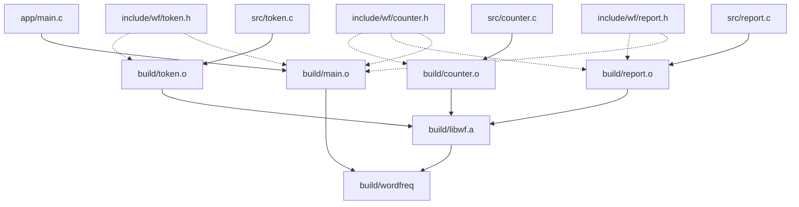

# 8. 构建图与 Make

在第 7 章的末尾，我们编写了 `build_by_hand.sh` 脚本来串联 `wordfreq` 项目的编译与链接。虽然脚本省去了逐行敲击终端命令的繁琐，但它的执行逻辑是线性且盲目的：无论开发者仅仅微调了某一行注释还是修改了核心逻辑，每次运行脚本都会无条件地将四个源文件全部从头编译一遍：

::: terminal title="zsh - 只改 report.c，脚本仍全编"

```console
$ touch src/report.c
$ sh build_by_hand.sh
+ mkdir -p build
+ gcc -std=c17 -Wall -Wextra -Iinclude -c src/token.c -o build/token.o
+ gcc -std=c17 -Wall -Wextra -Iinclude -c src/counter.c -o build/counter.o
+ gcc -std=c17 -Wall -Wextra -Iinclude -c src/report.c -o build/report.o
+ gcc -std=c17 -Wall -Wextra -Iinclude -c app/main.c -o build/main.o
+ gcc build/main.o build/token.o build/counter.o build/report.o -o build/wordfreq
```

:::

全量重编带来的等待时间尚在其次，更大的工程隐患在于公共头文件的变更。在 `wordfreq` 中，`counter.h` 被三个源文件共同引用；当其内部的结构体字段发生变动时，必须严格确保所有关联的目标文件被同步重新编译。在第 7 章中，我们是借助 `gcc -MM` 人工核对依赖清单的。然而在规模稍大的现实工程中，任何依赖人工记忆与肉眼比对的更新策略，都迟早会因遗漏而引发结构体偏移错位乃至段错误崩溃。

本章的核心任务，是将整个软件工程的生成依赖关系形式化为一张**构建图（Build Graph）**，并交由经典的构建引擎 GNU Make 来自动化调度执行。通过将文件间的因果前驱关系描述为 Makefile 规则，Make 能够依据时间戳精准计算出哪些文件需要重新编译、哪些中间产物可以安全跳过，同时充分利用多核处理器并发执行相互独立的编译任务，并对外暴露统一规范的构建动作入口（如 `make test`、`make clean`）。

本章配套代码位于 `code/开发与工程基础/8_构建图与Make/` 目录下：其中 `hello/` 展示了双源文件的最小构建范例，`wordfreq/` 则是经过完整自动化重构后的工程形态。正文中的运行日志基于 Debian 13 环境下的 GNU Make 4.4.1 与 GCC 14.2；涉及跨平台特异性的细节会在相关节点单独补充。

## 1. 构建图

在多文件 C 项目中，每一个生成文件都有其明确的源头契约：四个目标文件（`.o`）分别由对应的源文件（`.c`）编译产出，静态库归档 `libwf.a` 由三个功能模块的目标文件打包聚合而成，最终的可执行文件 `build/wordfreq` 则由程序入口 `main.o` 与静态库链接生成。头文件虽然不直接产出任何机器指令，但所有包含了该头文件的目标文件，都必须在其内容发生变动后强制重新编译。

将这些文件之间的生成与包含关系在二维平面上展开，便构成了一张清晰的有向图：



在图示中，实线箭头代表显式的物理生成流向，虚线箭头代表逻辑上的头文件依赖约束。构建图中的每一条连线，在底层都映射为 Makefile 中的一条先决条件声明。Make 本身并不具备静态分析 C 语言代码语义的能力，它对 `#include` 的真实关系一无所知；引擎唯一的决策依据，就是开发者（或依赖探测工具）在 Makefile 中显式描摹的依赖拓扑图。

拥有了这张构建图之后，构建更新的决策算法变得非常清晰：引擎从最终目标出发，沿着有向依赖树自顶向下递归追溯。当遇到某个目标文件在磁盘上尚未生成，或者发现其任何一个前驱先决条件文件的最后修改时间（Modification Time，mtime）晚于当前目标的时间戳时，Make 便立即调用与该目标绑定的命令行配方执行重建；否则直接予以跳过。

需要指明的是，Make 的失效检测建立在**文件系统时间戳**的比对之上，而非文件内容的哈希校验。通过 `touch` 命令刷新某个文件的修改时间，就会强制诱发下游产物的重编；反之，若在还原备份时保留了陈旧的文件时间戳，Make 则会误判其无需更新。

::: concept dev-make-target-update title="目标何时需要重建"

对每个目标，make 先递归更新它的全部先决条件，然后比较修改时间：目标不存在，或任一先决条件比目标新，就执行这个目标的配方 (recipe)；否则什么也不做。

:::

这种基于依赖拓扑与时间戳的高效更新机制，称为**增量构建（Incremental Build）**。在第 7 章中由人工费心判定的增量调度，如今被固化为形式化的确定规则。只要依赖声明准确无误，日常编译便再无后顾之忧。

<Quiz
  :options="[
    { label: '目标不存在，或任一先决条件比目标新', value: 'A' },
    { label: '目标的内容与上一次构建时不同', value: 'B' },
    { label: '源文件里新增了函数或全局对象', value: 'C' },
    { label: '只要运行 make，就从头执行全部配方', value: 'D' }
  ]"
  answer="A"
>

<template #question>

make 决定一条规则要不要执行，依据的是什么？

</template>

正确答案是 **A**。make 只比较修改时间。B 错在 make 不读文件内容；C 错在 make 不分析源代码；D 说反了，增量构建正是 make 的基本行为。

</Quiz>

## 2. 第一个 Makefile

为了以最直观的方式观察 Make 的运作机制，我们从一个仅由两个源文件构成的最小项目入手。在 `hello/` 目录下存放着如下代码：

::: code-group

```c [main.c]
#include <stdio.h>

#include "greet.h"

int main(void) {
    greet("world");
    return 0;
}
```

```c [greet.c]
#include "greet.h"

#include <stdio.h>

void greet(const char *name) { printf("Hello, %s!\n", name); }
```

```c [greet.h]
#ifndef GREET_H
#define GREET_H

/* 打印一行问候；name 不能为空指针 */
void greet(const char *name);

#endif
```

:::

在脱离构建工具时，开发者需要手动输入两条 `gcc -c` 指令分别编译中间目标，再敲击一条链接命令合成最终可执行程序。Makefile 的核心职责，就是以声明式的语法将这几条指令及其前后依存的时序关系固定下来：

```makefile [Makefile]
hello: main.o greet.o
	gcc -o hello main.o greet.o

main.o: main.c greet.h
	gcc -std=c17 -Wall -Wextra -c main.c -o main.o

greet.o: greet.c greet.h
	gcc -std=c17 -Wall -Wextra -c greet.c -o greet.o
```

在语法上，一条标准的 Make 规则由三部分构成：
- **目标（Target）**：位于冒号左侧，通常是这条规则期望生成的物理文件名（如可执行文件或目标文件），也可以是不对应物理实体的伪目标名称。
- **先决条件（Prerequisites）**：位于冒号右侧，列出了生成该目标所必需的前驱文件列表。
- **配方（Recipe）**：紧随其后、必须以制表符（Tab）缩进的一行或多行 Shell 命令，指明了利用先决条件产出目标的具体操作。

当我们在终端运行 `make` 时，引擎会默认选取文件中的第一条规则目标（此处为 `hello`）作为总任务入口。随后，Make 沿先决条件链条向下递归解析：发现 `main.o` 与 `greet.o` 尚未生成，于是优先触发对应的编译配方，最后回溯执行链接配方：

::: terminal title="zsh - make"

```console
$ make
gcc -std=c17 -Wall -Wextra -c main.c -o main.o
gcc -std=c17 -Wall -Wextra -c greet.c -o greet.o
gcc -o hello main.o greet.o
$ ./hello
Hello, world!
```

:::

初次构建时所有目标均不存在，三条配方依次按拓扑顺序执行完毕。若立刻紧接着再次执行 `make`，引擎比对发现所有目标文件的时间戳均晚于其对应的源码与头文件，于是直接给出最新状态提示：

::: terminal title="zsh - 再次 make"

```console
$ make
make: 'hello' is up to date.
```

:::

现在通过 `touch greet.c` 模拟单文件微调：此时仅有 `greet.c` 的时间戳被刷新，下游的 `greet.o` 随之判定过期并被重新编译，最终 `hello` 也因依赖了更新的 `greet.o` 而被重新链接，而毫无变动的 `main.o` 则被完美跳过：

::: terminal title="zsh - touch greet.c"

```console
$ touch greet.c
$ make
gcc -std=c17 -Wall -Wextra -c greet.c -o greet.o
gcc -o hello main.o greet.o
```

:::

若改动的是公共头文件 `greet.h`，由于它同时被列入了两处目标文件的先决条件，Make 会准确识别出两个目标均已失效，从而驱动两处编译与最终链接：

::: terminal title="zsh - touch greet.h"

```console
$ touch greet.h
$ make
gcc -std=c17 -Wall -Wextra -c main.c -o main.o
gcc -std=c17 -Wall -Wextra -c greet.c -o greet.o
gcc -o hello main.o greet.o
```

:::

在编写 Makefile 时，有一个极易让初学者受挫的硬性语法约束：**配方命令行首必须且只能使用单个制表符（Tab，ASCII 码 0x09）缩进**。如果使用空格缩进配方，Make 在词法分析时无法识别其为配方体，而会将其误判为一条缺失冒号的非法规则：

::: warning 配方必须用制表符缩进

用空格缩进配方时，make 报 `missing separator` 并立即停止，退出状态 2。编辑器里的「把制表符替换成空格」如果开着，复制来的 Makefile 就会这样坏掉。

:::

在附带的示例目录中，`hello/Makefile.spaces.mk` 将三个配方前缀全部替换为了四个空格，直接运行该文件便能复现这一经典报错：

::: terminal title="zsh - missing separator"

```console
$ make -f Makefile.spaces.mk
Makefile.spaces.mk:5: *** missing separator.  Stop.
```

:::

当肉眼难以分辨缩进字符时，可以在终端借助 `cat -A Makefile` 展开不可见字符进行审查：制表符会高亮显示为 `^I`，而空格则保持原样。现代编辑器通常支持针对 Makefile 文件类型独立关闭「Tab 转空格」行为。

此外，Make 在启动时会在当前工作目录中按优先级依次检索 `GNUmakefile`、`makefile` 与 `Makefile` 三种命名，一旦命中首个文件便停止检索后续同名候选项。为了保证工程规范的清晰统一，本项目一律采用大写的 `Makefile` 作为标准文件命名。

## 3. 变量与自动变量

在上一节的简单 Makefile 中，编译选项 `-std=c17 -Wall -Wextra` 被逐字逐句硬编码重复了两次。一旦需要更换编译器品牌或者微调优化等级，就必须在多处规则中同步修改。为了消除冗余并提升可维护性，Make 提供了变量机制来统一管理公共配置：

```makefile [Makefile]
CC = gcc
CFLAGS = -std=c17 -Wall -Wextra

hello: main.o greet.o
	$(CC) -o $@ $^

main.o: main.c greet.h
	$(CC) $(CFLAGS) -c main.c -o $@

greet.o: greet.c greet.h
	$(CC) $(CFLAGS) -c greet.c -o $@

clean:
	$(RM) hello hello.exe main.o greet.o
```

在上述配方中，出现了一些以 `$` 打头的特殊标识——它们是 Make 在执行配方前动态注入上下文的**自动变量（Automatic Variables）**：

| 写法 | 含义 |
| --- | --- |
| `$@` | 当前规则所要生成的目标名称 |
| `$<` | 当前规则中的第一个先决条件名称 |
| `$^` | 当前规则中列出的全部先决条件清单（自动剔除重复项） |
| `$?` | 所有修改时间晚于当前目标的先决条件子集 |
| `$*` | 在模式规则中被通配符 `%` 所匹配到的词干部分 |

我们可以通过一份专门的演示脚本 `autovar.mk`，在终端直观观察这些自动变量在执行时的实时展开内容：

```makefile [autovar.mk]
CC = gcc
CFLAGS = -std=c17 -Wall -Wextra

demo: main.o greet.o
	@echo "target=$@ first=$< all=$^"

main.o: main.c greet.h
	$(CC) $(CFLAGS) -c main.c -o $@

greet.o: greet.c greet.h
	$(CC) $(CFLAGS) -c greet.c -o $@
```

运行该文件，终端打印如下：

::: terminal title="zsh - 自动变量"

```console
$ make -f autovar.mk
gcc -std=c17 -Wall -Wextra -c main.c -o main.o
gcc -std=c17 -Wall -Wextra -c greet.c -o greet.o
target=demo first=main.o all=main.o greet.o
```

:::

从输出可以看出：`$<` 精确提取了首个先决条件 `main.o`，而 `$^` 则完整捕获了 `main.o greet.o` 两者。引入自动变量之后，最终的链接规则得以凝练地表述为 `$(CC) -o $@ $^`。未来即使向工程中追加新的模块目标文件，链接规则的配方行也完全无需任何变动。

在 Unix 与 C 构建生态中，有一批被各工具链广泛遵循的标准变量命名。Make 的内置规则会默认取用它们，阅读 Makefile 的同伴也能直观建立预期：

| 变量名称 | 消费组件 | 推荐承载的参数内容 |
| --- | --- | --- |
| `CC` | 编译器驱动入口 | 编译器二进制名称，Make 内置默认值为 `cc` |
| `CFLAGS` | C 编译器内核 | 语言标准版本（`-std`）、代码优化级别（`-O`）、调试符号（`-g`）及警告选项 |
| `CPPFLAGS` | C 预处理器（CPP） | 头文件检索路径（`-I`）以及全局宏定义（`-D`） |
| `LDFLAGS` | 链接器前端 | 库检索路径（`-L`）以及传递给底层链接器的驱动选项（`-Wl,`） |
| `LDLIBS` | 链接器输入 | 具体链接的外部库名称（`-l` 参数或静态库路径） |

规范区分 `CFLAGS` 与 `CPPFLAGS` 并非单纯的美学追求：预处理器选项（如 `-I`）仅在源码展开阶段发挥作用，而优化开关（如 `-O2`）则服务于后续的机器指令生成。将两者的职责划清，便于在更复杂的交叉编译环境或集成开发环境（IDE）中精确对接各个工具链阶段。

在 Make 中，变量的赋值包含两种截然不同的求值时机：
- **延迟展开（Deferred Expansion，使用 `=`）**：赋值时仅原样存储文本模板，只有当该变量在配方或规则中被真正引用展开时，才会回溯解析其最终内容。
- **立即展开（Simply Expanded，使用 `:=`）**：在定义语句被读入的当下，右侧表达式立即被就地执行计算并固化结果。在处理 `wildcard` 扫描目录文件等动态列表时，使用 `:=` 能够避免后续被反复重新执行：

```makefile
SRCS := $(wildcard src/*.c)
```

需要警惕的是，若使用延迟展开书写 `CFLAGS = $(CFLAGS) -O2`，会导致变量陷入循环自引用的死锁，Make 会直接抛出 `Recursive variable 'CFLAGS' references itself (eventually). Stop.` 致命错误。向既有变量安全追加内容，应当使用专门的追加运算符 `+=`：

```makefile
CFLAGS += -O2
```

当从命令行直接向 `make` 传递变量时（例如 `make CFLAGS=-O2`），该传参具有最高优先级，会无条件覆盖 Makefile 内部原有的静态赋值：

::: terminal title="zsh - 命令行覆盖 CFLAGS"

```console
$ make clean
rm -f hello hello.exe main.o greet.o
$ make CFLAGS=-O2
gcc -O2 -c main.c -o main.o
gcc -O2 -c greet.c -o greet.o
gcc -o hello main.o greet.o
```

:::

从日志中可以发现，Makefile 中原设的 `-std=c17` 与 `-Wall -Wextra` 全部被命令行参数顶替。如果希望在保留基础编译选项的同时允许用户在外部叠加个性化参数，更优雅的工程做法是在 Makefile 中预留专用的扩展槽位：

```makefile
CFLAGS = -std=c17 -Wall -Wextra $(EXTRA_CFLAGS)
```

在日常使用时，只需执行 `make EXTRA_CFLAGS="-O2 -g"`，既能灵活叠加新标志，又不会破坏基础的语法约束。

在理解 Make 配方执行时，还需牢记一项系统级特征：**配方中的每一行命令，都是在一个全新的独立子 Shell 中启动执行的**。上一行命令所引起的进程环境变更（例如 `cd /tmp`），绝不会自然继承到下一行：

::: terminal title="zsh - 每行一个 shell"

```console
$ cat shell.mk
show:
	cd /tmp
	pwd
$ make -f shell.mk
cd /tmp
pwd
/home/minsecrus/tutorial/work/mk8/wordfreq
```

:::

从日志可以看出，第二行的 `pwd` 打印出的仍然是 Make 最初被唤起的根目录。如果必须在特定路径下串联执行多项操作，需要借助 `&&` 或分号将它们连在单行配方中；或者在更高层级借助 `make -C` 显式切换上下文。

最后需要说明的是，Make 内部预设了一整套**隐含规则（Built-in Rules）**。通过执行 `make -p -f /dev/null` 可以查阅 Make 的内置规则数据库，其中就预置了无需手写即可将 `.c` 翻译为 `.o` 的通用规则模式。然而，过度依赖内置规则会使编译过程退化为不可预测的隐式行为（例如默认起用未指定语言版本的 `cc` 驱动器）。在追求工程确定性的现代项目中，推荐始终在 Makefile 中显式显式声明规则与变量，不留任何环境隐患。

## 4. 模式规则与构建目录

在 `wordfreq` 工程中，业务模块的代码分散在不同的源文件中。如果沿用上一节的做法，我们就必须为每一个源文件机械编写一条结构雷同的编译规则。Make 提供了强大的**模式规则（Pattern Rule）**，能够将「从 `src/` 下的任意 `.c` 文件编译生成 `build/` 下同名 `.o` 文件」的通用规律收敛为唯一的模板语句：

```makefile [Makefile]
CC = gcc
CPPFLAGS = -Iinclude
CFLAGS = -std=c17 -Wall -Wextra
LDFLAGS =
LDLIBS =

SRCS := $(wildcard src/*.c)
OBJS := $(SRCS:src/%.c=build/%.o) build/main.o

all: build/wordfreq

build/wordfreq: $(OBJS)
	$(CC) $(LDFLAGS) -o $@ $^ $(LDLIBS)

build/%.o: src/%.c | build
	$(CC) $(CPPFLAGS) $(CFLAGS) -c $< -o $@

build/main.o: app/main.c | build
	$(CC) $(CPPFLAGS) $(CFLAGS) -c $< -o $@

build:
	mkdir -p $@

clean:
	$(RM) -r build
```

在模式规则 `build/%.o: src/%.c` 中，百分号 `%` 充当了模式匹配符，其捕获的公共子串被称为**词干（Stem）**。当 Make 为了生成 `build/token.o` 而匹配该规则时，它会将词干 `token` 带入右侧先决条件中，自动推导出输入文件为 `src/token.c`，并随后启动配方；配方中的 `$<` 便自然绑定为推导出的源文件路径。由于 `app/main.c` 存放在独立的程序目录中，其路径模式与 `src/` 不符，因此单独书写一条规则。

在文件列表的管理上，我们使用了 Make 的内置函数以摆脱人工罗列：
- `$(wildcard src/*.c)` 会在解析阶段扫描文件系统，返回 `src/` 目录下实际存在的源文件清单；
- `$(SRCS:src/%.c=build/%.o)` 属于变量替换引用（Substitution Reference），它将 `SRCS` 列表中每个形如 `src/*.c` 的路径精准转写为对应的 `build/*.o`。这样一来，未来若向 `src/` 中新增模块源码，Makefile 无需任何改动即可自动识别并将其合入构建流水线。

规则中出现的 `| build` 语法，被称为**顺序先决条件（Order-only Prerequisite）**。竖线右侧的先决条件具备特殊的约束语义：**Make 只要求在编译目标之前确保该先决条件已经存在，但该先决条件本身时间戳的更新，绝不会被视作导致目标过期的依据。**

这一设计针对的是文件系统目录的天然特性：目录本身也是一种文件，每当向目录中新建、重命名或删除文件时，操作系统都会自动更新该目录的时间戳。若直接将 `build` 作为普通先决条件引入（即写成 `build/%.o: src/%.c build`），当最终链接命令生成 `build/wordfreq` 时，`build/` 目录的时间戳会被再次刷新，从而导致其 mtime 晚于刚刚编译好的所有 `.o` 目标。其直接恶果是：在下一轮调用 `make` 时，引擎会误判所有的 `.o` 均已陈旧，导致工程彻底失去增量编译能力，陷入每轮都全量重编的怪圈。

我们在 `dir_dep.mk` 中移除竖线亲测这一陷阱，终端输出印证了这一时间戳错位：

::: terminal title="zsh - 目录当普通先决条件的后果"

```console
$ make -f dir_dep.mk
mkdir -p build
gcc -Iinclude -std=c17 -Wall -Wextra -c src/counter.c -o build/counter.o
gcc -Iinclude -std=c17 -Wall -Wextra -c src/report.c -o build/report.o
gcc -Iinclude -std=c17 -Wall -Wextra -c src/token.c -o build/token.o
gcc -Iinclude -std=c17 -Wall -Wextra -c app/main.c -o build/main.o
gcc  -o build/wordfreq build/counter.o build/report.o build/token.o build/main.o
$ make -f dir_dep.mk
gcc -Iinclude -std=c17 -Wall -Wextra -c src/counter.c -o build/counter.o
gcc -Iinclude -std=c17 -Wall -Wextra -c src/report.c -o build/report.o
gcc -Iinclude -std=c17 -Wall -Wextra -c src/token.c -o build/token.o
gcc -Iinclude -std=c17 -Wall -Wextra -c app/main.c -o build/main.o
gcc  -o build/wordfreq build/counter.o build/report.o build/token.o build/main.o
```

:::

借助顺序先决条件 `| build`，这一矛盾被优雅化解：`mkdir -p build` 仅在输出目录缺失时执行一次；一旦目录就绪，后续编译链接所引起的时间戳跃迁绝不干扰目标的有效性。此时再次执行构建，增量特性稳固生效：

::: terminal title="zsh - 第一版 wordfreq 的 Makefile"

```console
$ make
mkdir -p build
gcc -Iinclude -std=c17 -Wall -Wextra -c src/counter.c -o build/counter.o
gcc -Iinclude -std=c17 -Wall -Wextra -c src/report.c -o build/report.o
gcc -Iinclude -std=c17 -Wall -Wextra -c src/token.c -o build/token.o
gcc -Iinclude -std=c17 -Wall -Wextra -c app/main.c -o build/main.o
gcc  -o build/wordfreq build/counter.o build/report.o build/token.o build/main.o
$ ./build/wordfreq -n 3 tests/data/sample.txt
      4 the
      2 on
      2 sat
$ make
make: Nothing to be done for 'all'.
```

:::

## 5. 头文件依赖

在上一版 Makefile 中，工程的增量编译似乎已经初具雏形。然而，如果仔细审视构建图，就会发现一处重大的依赖断层：`build/token.o` 的先决条件仅仅登记了 `src/token.c` 与 `build` 目录，完全没有出现 `include/wf/token.h`。而事实上，`token.c` 的第一行代码正是对该头文件的包含。

这种隐式遗漏会诱发极度隐蔽的陈旧构建问题。我们可以做一个实验：将 `include/wf/token.h` 中的 `WF_WORD_MAX` 由 64 缩减为 8，此时理论上分词缓冲区应当变小，超过 7 个字符的长词应当被截断。修改后直接运行 `make`：

::: terminal title="zsh - 改了头文件，make 什么也不做"

```console
$ printf 'extraordinary\n' | ./build/wordfreq
      1 extraordinary
$ sed -i 's/#define WF_WORD_MAX 64/#define WF_WORD_MAX 8/' include/wf/token.h
$ make
make: Nothing to be done for 'all'.
$ printf 'extraordinary\n' | ./build/wordfreq
      1 extraordinary
```

:::

Make 比对发现 `token.c` 的时间戳并未改变，于是断定 `token.o` 依然新鲜，直接跳过了重编。程序继续沿用旧的二进制对象，截断功能并未生效。只有执行 `make clean` 彻底清除旧产物后全量重建，新的逻辑才会体现：

::: terminal title="zsh - clean 之后重建"

```console
$ make clean
rm -f -r build
$ make
mkdir -p build
gcc -Iinclude -std=c17 -Wall -Wextra -c src/counter.c -o build/counter.o
gcc -Iinclude -std=c17 -Wall -Wextra -c src/report.c -o build/report.o
gcc -Iinclude -std=c17 -Wall -Wextra -c src/token.c -o build/token.o
gcc -Iinclude -std=c17 -Wall -Wextra -c app/main.c -o build/main.o
gcc  -o build/wordfreq build/counter.o build/report.o build/token.o build/main.o
$ printf 'extraordinary\n' | ./build/wordfreq
      1 extraor
```

:::

这种失效既不触发链接错误，也不导致程序当场崩溃，只是无声地产出错误的结果。在第 7 章中，我们曾通过手工运行 `gcc -MM` 打印依赖表，但要求开发者在每次增删 `#include` 时都手动改写 Makefile，显然违背了工程自动化的初衷。

现代 C 工具链提供了一套全自动的解决方案：**让编译器在执行预处理和代码生成的同时，顺手将当前翻译单元实际展开的所有头文件清单输出为 Makefile 规则片段**。在 GCC/Clang 中，这通过在 `CPPFLAGS` 中追加 `-MMD -MP` 选项实现：

```makefile
CPPFLAGS = -Iinclude -MMD -MP
```

随后，在 Makefile 的末尾指示 Make 动态载入这些生成的依赖文件：

```makefile
DEPS := $(OBJS:.o=.d)

-include $(DEPS)
```

其中，`$(OBJS:.o=.d)` 将所有目标文件的后缀 `.o` 映射为对应的依赖文件名 `.d`。指令 `-include` 前置的连字符减号具有明确的容错语义：在工程初次构建时，`.d` 文件尚未生成，此时即便找不到目标文件，Make 也会静默跳过而绝不报错中断。

当首次编译完成后，`build/` 目录下会伴随每个目标文件生成一份 `.d` 文件。例如 `build/counter.d` 的内容非常精练：

```text
build/counter.o: src/counter.c include/wf/counter.h
include/wf/counter.h:
```

第一行是标准的 Make 依赖语法：清晰记录了 `counter.o` 对 `counter.c` 以及 `counter.h` 的真实依赖。第二行的空目标规则则是由 `-MP` 标志自动追加的。而包含了多个接口的 `build/main.d` 则更加详尽：

```text
build/main.o: app/main.c include/wf/counter.h include/wf/report.h \
 include/wf/token.h
include/wf/counter.h:
include/wf/report.h:
include/wf/token.h:
```

由于 `main.c` 直接或间接包含了全部三个公开头文件，预处理器将其一一记录在册。Make 在解析 Makefile 时，会透明地将这套规则合并进主构建图中，使得 `include/wf/counter.h` 真正成为了 `main.o` 的先决条件。

现在再次验证头文件修改的效果：

::: terminal title="zsh - 改 counter.h 之后"

```console
$ touch include/wf/counter.h
$ make
gcc -Iinclude -MMD -MP -std=c17 -Wall -Wextra -c src/counter.c -o build/counter.o
gcc -Iinclude -MMD -MP -std=c17 -Wall -Wextra -c src/report.c -o build/report.o
gcc -Iinclude -MMD -MP -std=c17 -Wall -Wextra -c app/main.c -o build/main.o
gcc  -o build/wordfreq build/counter.o build/report.o build/token.o build/main.o
```

:::

`main.o`、`counter.o` 与 `report.o` 被精确触发重编，而与 `counter.h` 毫无牵连的 `token.o` 则稳如泰山。此前人工比对依赖树的工作，现在完全由编译器与 Make 全自动无感协同完成。

选项 `-MP` 所解决的问题非常典型：倘若只开启 `-MMD` 而遗漏了 `-MP`，`.d` 文件中将仅记录类似于 `build/report.o: include/wf/report.h` 的依赖行。若日后重构代码将 `report.h` 重命名或删除，当 Make 读入陈旧的 `.d` 缓存时，会发现目标依赖了一个在磁盘上已经不存在、且没有任何生成规则的前驱文件，此时构建会当场瘫痪：

::: terminal title="zsh - 没有 -MP，头文件改名后"

```console
$ mv include/wf/report.h include/wf/output.h
$ sed -i 's|wf/report.h|wf/output.h|' app/main.c src/report.c
$ make
make: *** No rule to make target 'include/wf/report.h', needed by 'build/report.o'.  Stop.
```

:::

开发者尽管已经修改了 `.c` 源码中的 `#include`，但旧的 `.d` 文件却形成了一道无法解脱的死结。而 `-MP` 为每一个头文件追加的空规则，向 Make 保证了「即便该文件在磁盘上消失，它也是一个无需任何配方的合法目标」。这使得 Make 能够顺利绕过陈旧前驱的阻碍，正常启动新版源文件的编译，并在编译完成后自动生成全新的 `.d` 覆盖旧数据：

::: terminal title="zsh - 有 -MP，同样的改名"

```console
$ make
gcc -Iinclude -MMD -MP -std=c17 -Wall -Wextra -c src/report.c -o build/report.o
gcc -Iinclude -MMD -MP -std=c17 -Wall -Wextra -c app/main.c -o build/main.o
gcc  -o build/wordfreq build/counter.o build/report.o build/token.o build/main.o
```

:::

若只是误删了头文件而未调整源码，`-MP` 则会将拦截时机后移给编译器自身，由 GCC 清晰报出 `#include "wf/report.h": No such file or directory` 的具象源码错误，而非抽象的 Make 拓扑报错：

::: terminal title="zsh - 只删头文件，不改编代码"

```console
$ rm include/wf/report.h
$ make
gcc -Iinclude -MMD -MP -std=c17 -Wall -Wextra -c src/report.c -o build/report.o
src/report.c:1:10: fatal error: wf/report.h: No such file or directory
    1 | #include "wf/report.h"
      |          ^~~~~~~~~~~~~
compilation terminated.
make: *** [Makefile:17: build/report.o] Error 1
```

:::

::: compare left-title="只写 -MMD" right-title="-MMD -MP"

```makefile
CPPFLAGS = -Iinclude -MMD
# 删除或改名头文件后：
# make: *** No rule to make target
# 'include/wf/report.h' ...
```

---

```makefile
CPPFLAGS = -Iinclude -MMD -MP
# 头文件改名后照常重编；
# 删除时由编译器报出真正的错误，
# 旧的依赖记录被新的 .d 覆盖
```

:::

在工程迁移过程中还需牢记一点：当首次从无依赖生成的旧构建系统切换到带 `-MMD -MP` 的 Makefile 时，由于磁盘上尚无任何 `.d` 缓存，务必先执行一次 `make clean`，让后续的首轮全量构建为所有模块落地基准依赖拓扑。若直接书写 `include $(DEPS)` 而漏掉了前导减号，初次构建便会因找不到未生成的文件而直接中止。

## 6. 静态库与链接顺序

在上一阶段的方案中，链接器直接抓取了四个单独的目标文件生成可执行程序。虽然能够正常运行，但核心功能模块与主程序的边界并未划分清楚：后续若是引入单元测试或辅助工具，同样需要依赖分词、计数和报表三个模块，就不得不将分散的 `.o` 路径重复列写在多处规则中。更为规范的做法，是将各模块编译出的目标文件封装为一个静态库归档（static library）。如此一来，主程序与后续的测试固件只需共同依赖这一份静态库文件，模块自身的实现逻辑便保持了一份独立的编译边界。

在 GNU 工具链环境下，用于归档目标文件的工具为 `ar`，生成的静态库文件按照 Unix 惯例命名为 `libwf.a`。我们在 Makefile 中为此增加归档目标的规则：

```makefile
AR = ar
CPPFLAGS = -Iinclude -MMD -MP
LDFLAGS =
LDLIBS =

SRCS := $(wildcard src/*.c)
LIB_OBJS := $(SRCS:src/%.c=build/%.o)
OBJS := $(LIB_OBJS) build/main.o

build/libwf.a: $(LIB_OBJS)
	$(RM) $@
	$(AR) rcs $@ $^

build/wordfreq: build/main.o build/libwf.a
	$(CC) $(LDFLAGS) -o $@ build/main.o -Lbuild -lwf $(LDLIBS)
```

参数 `rcs` 分别代表三项控制操作：`r`（replace）用于替换或追加成员文件；`c`（create）指示在归档文件不存在时直接建立，无需打印提示；`s`（symbol table）则命令 `ar` 在归档头部写入符号索引表。链接器在读取静态库时，正是依赖这张索引表快速检索所需符号由哪个具体的目标文件提供。自动变量 `$^` 在此展开为三个模块的目标文件列表，由 `ar` 逐一打包汇聚。

规则配方首行的 `$(RM) $@` 极具工程实用价值，切莫随意省略。`ar r` 模式的行为特点是增量操作：它只会更新或追加配方中传入的目标文件，而磁盘上若原本存在该库，且库内包含了不再被当前源码所使用的旧 `.o`，`ar` 并不会自动清理它们。一旦模块文件被重命名或在源码目录中被移除，旧的目标文件就会如同幽灵般长期滞留在归档内部。未来进行链接排查时，这些残留的符号极易引发意料之外的重复定义或陈旧行为冲突。我们不妨通过一段简单的命令实测观察这一现象：

::: terminal title="zsh - ar 不会删掉成员"

```console
$ gcc -c a.c b.c
$ ar rcs libx.a a.o b.o
$ ar t libx.a
a.o
b.o
$ ar rcs libx.a a.o
$ ar t libx.a
a.o
b.o
```

:::

实测结果非常直观：第二次执行 `ar rcs` 时即便只传入了 `a.o`，归档中的 `b.o` 依然安然无恙。因此，在每次打包静态库前先行移除旧的归档文件，才能保证最终生成的库内容与当前源文件列表精准对应。

在日常排查中，还可以利用 `ar t` 命令快速打印归档文件内的成员清单，以此确认最终打进库的目标文件是否与预期相符：

::: terminal title="zsh - ar t"

```console
$ ar t build/libwf.a
counter.o
report.o
token.o
```

:::

在主程序的链接命令中，`-Lbuild` 指示链接器将 `build` 目录加入静态库搜索路径，而 `-lwf` 则要求链接器在搜索路径下检索名为 `libwf.a` 的归档文件（Unix 工具链会自动为 `-l` 后的库名补齐 `lib` 前缀与 `.a` 后缀）。在当前的 Makefile 配方中，这两个参数紧跟在 `build/main.o` 之后。

实际上，链接命令也可以直接将静态库的完整文件路径作为输入参数：

```console
$ gcc -o build/wordfreq build/main.o build/libwf.a
```

这两种形式在最终链接产物上并无差异。但在 Makefile 工程组织中，采用 `-L` 配合 `-l` 的解耦风格更贴合规范实践：更换库文件输出目录时仅需调整 `-L` 选项，且后续接入第三方库或编译独立测试套件时，均能沿用统一的库引用格式。

此外，在更为通用的 Makefile 模板中，常常将此类选项抽象到内置变量中：配方写为 `$(CC) $(LDFLAGS) -o $@ $^ $(LDLIBS)`，并将 `-Lbuild` 赋给 `LDFLAGS`，把 `-lwf` 赋给 `LDLIBS`。当后续需要增添新库时只需扩充 `LDLIBS`，在命令行临时覆盖指定追加第三方库时，选项也会依照规范自然排布在所有目标文件之后。在当前示例中，我们先直接在配方里书写明确的链接选项，以便将依赖项的排列次序直观呈现在眼前。

这里存在一个极其关键的排布法则：`-lwf` 必须置于调用它的目标文件 `build/main.o` 之后。假若我们调转位置，把静态库排在最前面：

::: terminal title="zsh - -lwf 写在 main.o 前面"

```console
$ gcc -Lbuild -o build/wordfreq -lwf build/main.o
/usr/bin/ld: build/main.o: in function `count_stream':
main.c:(.text+0x280): undefined reference to `wf_tokenizer_init'
/usr/bin/ld: main.c:(.text+0x29c): undefined reference to `wf_counter_add'
/usr/bin/ld: main.c:(.text+0x2c2): undefined reference to `wf_tokenizer_next'
/usr/bin/ld: build/main.o: in function `print_top':
main.c:(.text+0x3b5): undefined reference to `wf_counter_top'
/usr/bin/ld: main.c:(.text+0x3d3): undefined reference to `wf_counter_size'
/usr/bin/ld: main.c:(.text+0x3fc): undefined reference to `wf_report_print'
/usr/bin/ld: build/main.o: in function `main':
main.c:(.text+0x4d2): undefined reference to `wf_counter_create'
main.c:(.text+0x57b): undefined reference to `wf_counter_destroy'
collect2: error: ld returned 1 exit status
```

:::

若将该命令写入 Makefile 中执行，同样会由于链接器退出状态码异常而报错中断，终端最后留下 `make: *** [Makefile:25: build/wordfreq] Error 1`。

::: concept dev-make-link-order title="链接器从左到右处理输入"

链接器按命令行顺序依次处理目标文件和库。遇到静态库时，它只取出「能解决当前尚未定义的符号」的成员；已经处理过的库不会回头再看。因此库必须放在使用它的目标文件之后，多个库之间也按依赖顺序排列。

:::

错误信息清晰地抛出了针对 `wf_tokenizer_init`、`wf_counter_add` 等八个函数的未解析引用。这些函数在源码逻辑中由 `main.c` 发起调用，其函数实现全部封装在 `libwf.a` 内部。当链接器自左向右逐项处理输入参数时，首先读到了 `-lwf`；但在处理该库的当下，链接器尚未遇到 `main.o`，手头的未决符号表处于完全清空的状态。按照静态库的提取规则，链接器只会在库中寻找“能满足当前已有未决符号”的成员文件；既然没有未决需求，链接器便略过了 `libwf.a` 中的所有目标文件。等到紧随其后读入 `main.o` 并发现八处未定调用时，静态库的检索阶段已经彻底结束，链接器并不会再次回头重读库文件，最终只能抛出未决错误。

这一行为机制与第 3 章中探讨 `-lm` 必须置于源码之后的机理完全同源，只是静态库的“按需提取成员”机制使得这一顺序要求更加不可逾越。后续引入第三方库或多模块交叉依赖时，这一底层原理仍将持续发挥决定性作用。

<Quiz
  :options="[
    { label: '静态库放在目标文件前面，链接器处理它时还没有未定义符号', value: 'A' },
    { label: '-Lbuild 必须写在命令的最后面', value: 'B' },
    { label: 'libwf.a 必须先转换成共享库才能被链接', value: 'C' },
    { label: 'build/main.o 没有包含 wf/counter.h', value: 'D' }
  ]"
  answer="A"
>

<template #question>

命令 `gcc -Lbuild -o build/wordfreq -lwf build/main.o` 报出一串 `undefined reference`，库中确实有这些函数。原因是什么？

</template>

正确答案是 **A**。链接器从左到右扫描，处理 `-lwf` 时还没有任何未定义符号，库成员不会被取出。把 `build/main.o` 移到 `-lwf` 前面就恢复正常。B 错在 `-L` 的位置与查找无关；C、D 都与现象无关，`main.o` 引用的正是库里的函数。

</Quiz>

## 7. 伪目标与常用目标

在实际软件工程中，Makefile 除了负责编译核心产物，通常还需要提供一系列标准化的工作流入口：全量构建、清理构建产物、执行回归测试、直接启动运行等。这些操作本质上代表某种维护动作，并不指代磁盘上的真实文件，在构建系统中被称为伪目标（phony target）。为了避免 Make 将它们误判为文件，我们需要使用特殊内置目标 `.PHONY` 进行显式声明：

```makefile
.PHONY: all clean test run

all: build/wordfreq

test: build/wordfreq
	@build/wordfreq -n 3 tests/data/sample.txt | tr -d '\r' | diff -u tests/data/sample.expected -
	@echo "sample: ok"

run: build/wordfreq
	@build/wordfreq tests/data/sample.txt

clean:
	$(RM) -r build
```

`all` 通常作为 Makefile 的首个规则，承担默认入口的角色，在当前工程中只依赖最终的二进制可执行文件 `build/wordfreq`。

`clean` 目标调用 `$(RM)` 递归移除整个构建输出目录。`RM` 是 Make 的内置预设变量，默认展开为 `rm -f`，因此在 Unix/Linux 平台下实际触发的指令为 `rm -f -r build`。在编写配方时，优先使用 `$(RM)` 而非将 `rm -f` 写死，是兼顾构建文件跨平台移植性的良好实践：当需要在不同的操作系统或自定义清理工具环境下工作时，只需在顶层统一重定义 `RM` 变量（例如在 Windows 经典控制台环境下适配为 `del`），所有使用该变量的清理规则便能自动适配，无需逐处修改命令字符串。

`test` 目标的配方分为两个阶段：首先驱动可执行程序以样例数据运行，并将重定向的标准输出与基准文件（golden output）进行比对；比对一致时输出 `sample: ok`。配方管线中间加入的 `tr -d '\r'` 是针对 Windows 运行环境的防御性设计：在 Windows 平台下，C 运行时环境默认以文本模式输出标准流，行尾以 CRLF（`\r\n`）结束，若直接与采用 LF 换行的基准期望文件比对，会导致每行均因多出一个回车符而报错失败；在 Linux 环境下，该命令则作为无副作用的透明管道通过。当比较工具 `diff -u` 检测到任何行差异时，会以非零状态码退出，Make 随之中止后续配方的执行并抛出错误提示。

我们可以刻意修改 `report.c` 中报表宽度的格式化占位符（例如由 `%7zu` 改为 `%5zu`），重新编译并触发 `make test`：

::: terminal title="zsh - make test 失败"

```console
$ make test
--- tests/data/sample.expected	2026-10-21 23:54:40.153937691 +0900
+++ -	2026-10-22 00:09:34.788202697 +0900
@@ -1,3 +1,3 @@
-      4 the
-      2 on
-      2 sat
+    4 the
+    2 on
+    2 sat
make: *** [Makefile:44: test] Error 1
```

:::

配方命令前缀的 `@` 符号用于抑制 Make 在终端回显该命令行文本，使输出窗口保持清爽，仅保留程序自身的标准流与诊断反馈。测试比对失败时，`diff` 工具返回非零退出状态码，Make 随即捕获到子进程异常并打印错误提示，最终以状态码 2 中止退出。持续集成（CI）服务器与自动化测试流水线正是依赖这一退出状态码判断测试任务的成败。需要说明的是，当前阶段实现的 `test` 规则仅能在端到端层面校验字符输出，尚未深入覆盖各功能模块的内部状态；在第 11 章中，我们将引入专业单元测试套件，并将其深度整合至 CMake 与 CTest 自动化测试框架中。

`run` 目标则直接拉起构建好的程序，并传入样例文件以打印默认的前十条高频词统计：

::: terminal title="zsh - make run"

```console
$ make run
      4 the
      2 on
      2 sat
      1 cat
      1 dog
      1 log
      1 mat
```

:::

`.PHONY` 声明并非多余的语法修饰。如果在构建脚本中省略了该声明，诸如 `test` 或 `clean` 等名字就仅仅被当作常规的文件目标对待。一旦工程根目录下因某种巧合存在一个名为 `test` 的文件或同名子目录，Make 在解析规则时就会先检查磁盘上的 `test` 文件；由于该文件真实存在且未显式声明先决依赖，Make 会依据时间戳推断出目标“已是最新”，从而直接跳过所有测试配方。我们不妨通过一个精简的最小用例观察这一静默失败现象：

::: terminal title="zsh - 名为 test 的文件挡住了伪目标"

```console
$ cat Makefile
test:
	echo running tests
$ touch test
$ make test
make: 'test' is up to date.
```

:::

显式添加 `.PHONY: test` 声明后，Make 便会彻底忽略磁盘上的同名物理文件，每次调用均无条件执行对应的配方指令。

在处理嵌套子目录的项目时，`make -C` 参数允许 Make 先切换当前工作路径至指定目录，再行加载执行该目录下的 Makefile 文件：

::: terminal title="zsh - make -C"

```console
$ make -C hello
make: Entering directory '/home/minsecrus/tutorial/work/mk8/hello'
gcc -std=c17 -Wall -Wextra -c main.c -o main.o
gcc -std=c17 -Wall -Wextra -c greet.c -o greet.o
gcc -o hello main.o greet.o
make: Leaving directory '/home/minsecrus/tutorial/work/mk8/hello'
```

:::

这一机制为我们在多目录工程中调度子模块提供了标准的官方解法：如果希望整套构建工作流在特定子路径内展开，应当采用 `make -C` 参数，而非在每行配方中繁琐地嵌套执行 `cd` 命令。

将前面探讨的模式规则、自动变量、order-only 目录依赖、依赖文件自动追踪以及伪目标规则融合在一起，便构成了 wordfreq 项目在现阶段的完整 Makefile。该文件的物理路径位于 `code/开发与工程基础/8_构建图与Make/wordfreq/Makefile`：

```makefile [wordfreq/Makefile]
# wordfreq 的构建文件。
#
#   make        构建 build/wordfreq
#   make test   用样例数据运行，并与期望输出比较
#   make run    用样例数据运行
#   make clean  删除 build/

CC = gcc
AR = ar
CPPFLAGS = -Iinclude -MMD -MP
CFLAGS = -std=c17 -Wall -Wextra
LDFLAGS =
LDLIBS =

SRCS := $(wildcard src/*.c)
LIB_OBJS := $(SRCS:src/%.c=build/%.o)
OBJS := $(LIB_OBJS) build/main.o
DEPS := $(OBJS:.o=.d)

.PHONY: all clean test run

all: build/wordfreq

build/wordfreq: build/main.o build/libwf.a
	$(CC) $(LDFLAGS) -o $@ build/main.o -Lbuild -lwf $(LDLIBS)

# 先删掉旧的归档：ar 只增加或替换成员，不会去掉已经过时的成员
build/libwf.a: $(LIB_OBJS)
	$(RM) $@
	$(AR) rcs $@ $^

build/%.o: src/%.c | build
	$(CC) $(CPPFLAGS) $(CFLAGS) -c $< -o $@

build/main.o: app/main.c | build
	$(CC) $(CPPFLAGS) $(CFLAGS) -c $< -o $@

# 只作先决条件使用的目录：写成 order-only，目录的时间戳变化不触发重编
build:
	mkdir -p $@

# Windows 上程序的 stdout 是文本模式，行尾为 CRLF；去掉回车再比较
test: build/wordfreq
	@build/wordfreq -n 3 tests/data/sample.txt | tr -d '\r' | diff -u tests/data/sample.expected -
	@echo "sample: ok"

run: build/wordfreq
	@build/wordfreq tests/data/sample.txt

clean:
	$(RM) -r build

-include $(DEPS)
```

第一次构建的完整输出：

::: terminal title="zsh - make"

```console
$ make
mkdir -p build
gcc -Iinclude -MMD -MP -std=c17 -Wall -Wextra -c app/main.c -o build/main.o
gcc -Iinclude -MMD -MP -std=c17 -Wall -Wextra -c src/counter.c -o build/counter.o
gcc -Iinclude -MMD -MP -std=c17 -Wall -Wextra -c src/report.c -o build/report.o
gcc -Iinclude -MMD -MP -std=c17 -Wall -Wextra -c src/token.c -o build/token.o
rm -f build/libwf.a
ar rcs build/libwf.a build/counter.o build/report.o build/token.o
gcc  -o build/wordfreq build/main.o -Lbuild -lwf
```

:::

## 8. 并行构建与排查

构建图的作用远不止于判定哪些文件需要重编，它同时也是并发执行调度的天然依据。在生成的依赖图谱中，四个 `.o` 目标文件彼此之间没有边相连，这意味着它们在逻辑上互不依赖，完全可以并行编译。通过在命令行添加 `-j`（`--jobs`）参数，可以指定 Make 同时并发执行的子进程上限：

::: terminal title="zsh - make -j2"

```console
$ make clean
rm -f -r build
$ make -j2
mkdir -p build
gcc -Iinclude -MMD -MP -std=c17 -Wall -Wextra -c app/main.c -o build/main.o
gcc -Iinclude -MMD -MP -std=c17 -Wall -Wextra -c src/counter.c -o build/counter.o
gcc -Iinclude -MMD -MP -std=c17 -Wall -Wextra -c src/report.c -o build/report.o
gcc -Iinclude -MMD -MP -std=c17 -Wall -Wextra -c src/token.c -o build/token.o
rm -f build/libwf.a
ar rcs build/libwf.a build/counter.o build/report.o build/token.o
gcc  -o build/wordfreq build/main.o -Lbuild -lwf
```

:::

在并行构建状态下，各编译进程的完成次序不再固定，取决于操作系统的线程调度与 CPU 分配；而静态库归档与主程序链接这两步由于显式声明了依赖关系，Make 会保证在所有必需的目标文件均已落地之后才开始执行，无需人工强加时序约束。

并发构建能够平稳运行的核心基石，在于依赖拓扑图中的每一条边都严谨准确。如果漏写了某条先决依赖，在单线程构建时可能仅仅因为串行任务碰巧按理想的次序发生而掩盖了缺陷；一旦切换到多线程环境，并发竞态就会立刻暴露。我们将 `build/%.o: src/%.c | build` 规则中的顺序依赖 `| build` 故意删去，取消“编译前目录必须存在”的约束，并在 `build` 规则中追加一句 `sleep 0.3` 刻意拉长创建目录的时间窗口；同时保留 `build/main.o` 规则里的 `| build`（此处仅用于构造并发竞态的反例实验）：

::: terminal title="zsh - 漏写顺序先决条件，-j1 与 -j2"

```console
$ make -j1
sleep 0.3
mkdir -p build
gcc -Iinclude -MMD -MP -std=c17 -Wall -Wextra -c app/main.c -o build/main.o
gcc -Iinclude -MMD -MP -std=c17 -Wall -Wextra -c src/counter.c -o build/counter.o
gcc -Iinclude -MMD -MP -std=c17 -Wall -Wextra -c src/report.c -o build/report.o
gcc -Iinclude -MMD -MP -std=c17 -Wall -Wextra -c src/token.c -o build/token.o
rm -f build/libwf.a
ar rcs build/libwf.a build/counter.o build/report.o build/token.o
gcc  -o build/wordfreq build/main.o -Lbuild -lwf
$ make clean
rm -f -r build
$ make -j2
sleep 0.3
gcc -Iinclude -MMD -MP -std=c17 -Wall -Wextra -c src/counter.c -o build/counter.o
src/counter.c:140:1: fatal error: opening dependency file build/counter.d: No such file or directory
  140 | }
      | ^
compilation terminated.
make: *** [Makefile:33: build/counter.o] Error 1
make: *** Waiting for unfinished jobs....
mkdir -p build
$ echo $?
2
```

:::

在 `-j1` 单任务模式下，Make 碰巧优先处理声明了 `| build` 的 `main.o`，首先触发了目录创建，后续三个编译任务执行时目录已经存在，因而掩盖了拓扑漏洞。但在 `-j2` 双并发模式下，`counter.o` 与 `build` 目录被同时抛入调度队列，编译器率先启动，试图通过 `-MMD` 选项将依赖信息写入 `build/counter.d`，此时 `build` 目录尚未建立，直接抛出 `No such file or directory` 的致命错误而夭折。这类并发故障在实际开发中往往表现为不稳定的偶发失败，每次崩溃的目标各不相同。排查与消除此类竞态的根本法则，是严密补齐所有顺序先决条件：确保目录在任何写入发生前已真实存在。

在复杂的工程构建排查中，切忌仅凭直觉猜测依赖流转。Make 提供了数项极其锋利的内建诊断手段：

首先是 `make -n`（或 `--dry-run`），它会完整推演并打印即将执行的所有配方命令，但完全不触碰磁盘，也不会真正拉起编译器：

::: terminal title="zsh - make -n"

```console
$ touch src/token.c
$ make -n
gcc -Iinclude -MMD -MP -std=c17 -Wall -Wextra -c src/token.c -o build/token.o
rm -f build/libwf.a
ar rcs build/libwf.a build/counter.o build/report.o build/token.o
gcc  -o build/wordfreq build/main.o -Lbuild -lwf
```

:::

其次是 `make --trace`，它不仅打印每一步触发的执行指令，还会清清楚楚地交代 Make 判定该目标需要被更新的具体原因（`due to:`）以及该规则在 Makefile 中的行号定义：

::: terminal title="zsh - make --trace"

```console
$ touch src/report.c
$ make --trace
Makefile:33: update target 'build/report.o' due to: src/report.c
gcc -Iinclude -MMD -MP -std=c17 -Wall -Wextra -c src/report.c -o build/report.o
Makefile:29: update target 'build/libwf.a' due to: build/report.o
rm -f build/libwf.a
ar rcs build/libwf.a build/counter.o build/report.o build/token.o
Makefile:25: update target 'build/wordfreq' due to: build/libwf.a
gcc  -o build/wordfreq build/main.o -Lbuild -lwf
```

:::

终端中打印的 `due to:` 后缀，正是促使 Make 触发配方的先决条件；行号则精确指引了触发该更新逻辑的代码位置。

当需要确认某个宏变量在解析阶段是否正确拼接展开时，可以在 Makefile 脚本末尾嵌入 `$(info ...)` 诊断函数：

```makefile
$(info SRCS = $(SRCS))
$(info OBJS = $(OBJS))
$(info DEPS = $(DEPS))
```

再运行 `make -n` 进行查看：

::: terminal title="zsh - $(info)"

```console
$ make -n
SRCS = src/counter.c src/report.c src/token.c
OBJS = build/counter.o build/report.o build/token.o build/main.o
DEPS = build/counter.d build/report.d build/token.d build/main.d
make: Nothing to be done for 'all'.
```

:::

`$(info)` 函数在 Make 读取与解析 Makefile 语法树的第一阶段就会立即向标准输出打印信息，即使没有任何目标需要构建也会照常执行。排查完毕后务必及时清理这些诊断语句，避免干扰日常构建输出。

::: tip 三个排查命令

- `make -n`：只看命令，不改磁盘。
- `make --trace`：看每条规则为什么被触发。
- `$(info 变量)`：看变量在解析后到底是什么内容。

:::

在增量构建模型中，还存在一处 Make 无法自动察觉的天然盲区：编译器选项变动。例如源码文件毫发未损，但在构建命令中临时更改了优化等级或预定义宏。我们先指定 `-O2` 完成编译，再执行不带参数的 `make`：

::: terminal title="zsh - 选项变了，文件没变"

```console
$ make clean
rm -f hello hello.exe main.o greet.o
$ make CFLAGS=-O2
gcc -O2 -c main.c -o main.o
gcc -O2 -c greet.c -o greet.o
gcc -o hello main.o greet.o
$ make
make: 'hello' is up to date.
```

:::

Make 的决策体系完全基于“源文件与目标的修改时间戳比较”，它并不会将上一次编译所使用的命令行参数记录到磁盘缓存中。因此，当构建选项或编译标志发生变化时，如果希望完全应用新的参数，通常需要手动执行 `make clean` 清空历史输出，或者使用 `make -B`（`--always-make`）强制无条件重跑整张拓扑图中的全部配方：

::: terminal title="zsh - make -B"

```console
$ make -B
gcc -std=c17 -Wall -Wextra -c main.c -o main.o
gcc -std=c17 -Wall -Wextra -c greet.c -o greet.o
gcc -o hello main.o greet.o
```

:::

参数 `-B` 会强制忽略磁盘时间戳，将整张构建图上的所有目标均视为过期，非常适合用于离线环境下的全量干净验证。在日常敏捷开发中，改动关键配置后执行 `make clean` 依然是最稳妥的选择，能确保陈旧的 `.d` 依赖缓存与静态库归档被一并彻底抹除。

## 9. Make 的局限

行文至此，我们为 wordfreq 建立的 Makefile 已经平稳支撑起了增量构建、头文件依赖追踪、静态库归档封装、伪目标工作流以及多核并行编译。它的结构清晰透明，在任何部署了 GNU Make 的环境中都能开箱即用。然而，随着软件项目工程规模的演进，Make 作为通用文本构建工具，其固有设计也呈现出几项难以规避的局限。

配方本质上是宿主系统的 shell 命令行，这导致 Makefile 的跨平台执行极度依赖运行环境。在 Windows 上需要依托 MSYS2、Git Bash 等兼容环境，`rm`、`mkdir -p`、`tr`、`diff` 等基础命令才能得到解析；若在原生命令提示符（cmd.exe）下调用 MinGW 提供的 `mingw32-make`，由于预设变量 `$(RM)` 展开后的 `rm -f` 无法在系统环境变量 PATH 中找到对应执行文件，Make 便会直接抛出子进程创建失败的错误：`CreateProcess(NULL, rm -f -r build, ...) failed.` 与 `make (e=2)`，导致 `clean` 目标中断。

在 Windows 平台上还存在一处细微差异：MinGW 的链接器默认生成的可执行文件带有 `.exe` 扩展名（即 `build/wordfreq.exe`），而规则中书写的目标名则是未加后缀的 `build/wordfreq`。Make 检查目标时无法在磁盘上找到精确匹配的无后缀文件，从而在每次触发构建时均强制重新链接：

::: terminal title="bash - Windows 上每次 make 都重新链接"

```console
$ mingw32-make
gcc  -o build/wordfreq build/main.o -Lbuild -lwf
$ mingw32-make
gcc  -o build/wordfreq build/main.o -Lbuild -lwf
```

:::

尽管在类 Unix shell 环境下补全调用不受影响，`make run` 与 `make test` 均能照常运转，但若要让一份 Makefile 在多平台间实现完全无缝的精准增量控制，就必须引入复杂的平台条件判断与文件名宏定义分支，这一主题将在第 16 章展开讨论。

在编译参数层面同样存在一致性挑战。不同的编译器家族有着各自独立的参数体系：GCC 与 Clang 采用 `-Wall -Wextra`，MSVC 则对应 `/W4`；不仅开关各异，告警等级的判定规则也互不兼容。Makefile 自身并不具备跨编译器的抽象能力，开发者只能通过手动书写 `ifeq` 条件分支逐项判断。对于第三方依赖库的头文件路径与库名，也必须逐条手工录入 `-I` 与 `-L` 参数。随着项目引入的外部依赖逐渐增多，Makefile 中与平台环境适配相关的胶水脚本往往会迅速膨胀，甚至超过核心项目构建本身的体积。

更为关键的是，Make 缺乏独立的配置阶段（Configure Step）。它在读取规则后直接在当前宿主环境中依次执行配方指令，无法在构建启动前先行探测目标系统是否支持某项 C 语言标准特性、是否安装了特定版本的库依赖。传统的 Autotools 体系通过 `./configure && make` 补齐了前置环境探测环节；现代构建系统如 CMake、Meson 则借助更高维度的工程描述文件，先完成环境检查，再生成对应的 Ninja 或底层构建图。这种将“环境探测配置”与“底层并行编译”解耦的架构，已成为大型现代工程的标配。

此外，在过往的多目录项目中，曾广泛流行在每个子目录独立维护一份 Makefile、并由根目录通过 `cd 子目录 && make` 串联调度的递归模式。这种做法割裂了完整的依赖拓扑，各个子 Makefile 只能看到局部依赖，使得跨模块目录的并行编译在缺乏全局顺序依赖表达时极易崩溃。本章所采用的单一顶层统一 Makefile 规避了这一陷阱，关于递归 Make 的深刻剖析可以参考 Peter Miller 的经典论文《Recursive Make Considered Harmful》。

在工程选型上，如果项目规模在数十个源文件以内、仅面向两三个特定平台，采用本章建立的规范 Makefile 往往足矣，逻辑清晰透明且无需引入额外工具依赖。然而随着工程体量扩大、目标平台多样化以及第三方依赖库日渐增多，手写条件分支与路径探测所消耗的维护成本，很快就会超出核心代码本身。此时将构建描述提升至更高维度，借助能够自动探测系统并生成底层构建图的现代工具，往往能大幅提升工程效率与可维护性。在第 9 章中，我们将分别借助 CMake 与 XMake 重新组织 wordfreq 的构建逻辑，但最终底层生成并执行的，依然是本章所揭示的这套构建拓扑。

## 10. 习题

### 10.1 巩固

<Exercise id="20801" :d="2" :w="3">

`code/开发与工程基础/8_构建图与Make/exercises/three_files/` 下有三个源文件与一个共用头文件，没有任何构建文件，手工构建的命令写在它的 README 里。从零为它写一个 `Makefile`：

1. 用一条模式规则从任意 `.c` 生成 `build/` 下的同名 `.o`，`build/` 用顺序先决条件建立。
2. 提供 `all` 与 `clean`，`all` 是默认目标，产物是 `build/calc`。
3. 执行 `./build/calc 6 7`，输出应为 `sum: 13` 与 `product: 42`。
4. 依次 `touch sum.c`、`touch calc.h`、`touch product.c`，每一步之后运行 `make`，记录实际执行了哪几条命令并解释。注意 `calc.h` 那一次的结果说明了什么。若某一步 make 什么也没做，先等一秒再 `touch`：修改时间以秒为单位记录时，同一秒内的改动分不出先后，这本身也是增量构建的一个前提。

验收：`make` 从干净目录一次成功，四次运行的命令清单，一段关于头文件依赖的解释。

</Exercise>

<Exercise id="20802" :d="2" :w="2">

复现过期构建并修好它。把 `exercises/stale_deps/no_deps.mk` 复制到 `wordfreq/` 下：

```sh
make -f no_deps.mk
touch include/wf/counter.h
make -f no_deps.mk
```

第二次应当输出 `make: Nothing to be done for 'all'.`。

1. 解释为什么 `counter.h` 变了，make 却什么都不做。
2. 把 `CPPFLAGS` 改成 `-Iinclude -MMD -MP`，在末尾加 `-include $(DEPS)` 与 `DEPS := $(OBJS:.o=.d)`，然后 `make clean` 再构建。查看 `build/counter.d` 与 `build/main.d`，逐行说明每一行的作用，指出哪一行来自 `-MP`。
3. 不 `clean` 直接换用新 Makefile，再 `touch include/wf/counter.h`，记录结果并解释为什么会这样。
4. 删掉 `include/wf/report.h` 后运行 `make`，对比有 `-MP` 与去掉 `-MP` 两种情况下 make 的报告位置有什么不同。

验收：两次「什么都没做」的现象、`.d` 文件原文与逐行说明、删除头文件后两种报告的开头两行。

</Exercise>

<Exercise id="20803" :d="2" :w="2">

静态库与链接顺序。在 `wordfreq/` 的 Makefile 上增加库目标 `build/libwf.a`，由三个模块的目标文件用 `ar rcs` 打包，链接命令改成：

```makefile
build/wordfreq: build/main.o build/libwf.a
	$(CC) $(LDFLAGS) -o $@ build/main.o -Lbuild -lwf $(LDLIBS)
```

1. 构建成功后用 `ar t build/libwf.a` 列出成员。
2. 手工执行 `gcc -Lbuild -o build/wordfreq -lwf build/main.o`，记录诊断，数一数报了几个未定义符号。
3. 把 `-lwf` 移到 `build/main.o` 之后再做一次，确认恢复正常。
4. 把库目标的配方第一行 `$(RM) $@` 删掉，然后做这个实验：构建一次，把 `src/token.c` 改名为 `src/lexer.c`，把 `lexer.c` 里的 `to_ascii_lower` 改成原样返回（不再转小写），再构建。用 `ar t` 看归档成员，运行 `printf 'Hello\n' | ./build/wordfreq`，记录输出的字母大小写。
5. 把 `$(RM) $@` 加回去，`make clean` 后重复第 4 步的实验。两次输出有什么不同？

验收：两次链接诊断或成功、两次 `ar t` 输出、第 4、5 步的程序输出，以及一段说明：归档里同时存在两份定义同名符号的成员时，链接器取了哪一份，为什么单靠「链接不报错」发现不了这个问题。

</Exercise>

<Exercise id="20804" :d="2" :w="2">

给 `wordfreq/` 增加 `test` 与 `run` 两个伪目标，都声明进 `.PHONY`。`test` 运行 `build/wordfreq -n 3 tests/data/sample.txt`，用 `tr -d '\r'` 去掉 Windows 的回车，再与 `tests/data/sample.expected` 做 `diff -u`，一致时打印 `sample: ok`。

1. 在 `src/report.c` 里把 `%7zu` 改成 `%5zu`，重新构建后 `make test`，记录输出末尾几行与退出状态（`echo $?`）。
2. 去掉 `test` 前面的 `.PHONY`，在项目根目录 `touch test`，再运行 `make test`，记录结果并解释。
3. 回答：为什么 `diff` 的退出状态能决定 make 的成败，而 `echo` 不能。

验收：失败时 `diff` 输出的前六行、退出状态、`touch test` 之后的输出与解释。

</Exercise>

<Exercise id="20805" :d="3" :w="2">

两套配置。让 `wordfreq/` 支持 `make BUILD=debug` 与 `make BUILD=release`，两套目标文件与库分别放进 `build/debug/` 与 `build/release/`，选项分别为 `-O0 -g` 与 `-O2 -DNDEBUG`；`BUILD` 取其他值时在解析阶段就以错误停止。

要求：

1. 变量用 `?=` 给默认值，让不带参数的 `make` 等价于 `BUILD=debug`。
2. 用 `ifeq` 选择选项，用 `$(error ...)` 处理非法取值，错误信息里包含非法值。
3. 两个目录各自带自己的 `-MMD -MP` 依赖，互不干扰：先分别构建两种配置，再改一个头文件，然后只运行 `make BUILD=release`，应当只重编 release 下的目标文件，debug 下的留到下次 `make BUILD=debug` 时才重编。
4. 用 `make -n BUILD=release` 确认编译命令里含 `-O2 -DNDEBUG`。

验收：两种配置的构建命令、`build/` 下的目录结构、一次只重编一侧的 `--trace` 或 `-n` 输出。

</Exercise>

### 10.2 编程

<Exercise id="20806" :d="3" :w="3">

把自动变量和变量展开弄清楚。在一个临时目录里写一份 `Makefile`，目标 `demo` 的先决条件写成 `x y z`（其中 `x` 重复一次）加一个顺序先决条件 `d`，配方只有一行 `echo`，把下面六个自动变量全部打印出来：

```makefile
demo: x x y | d
	@echo "at=[$@] lt=[$<] caret=[$^] plus=[$+] bar=[$|] q=[$?]"
```

`x`、`y`、`z`、`d` 各自用一条规则创建。

1. 运行 `make`，把六个变量的值抄下来，说明 `$^` 与 `$+`、`$<` 与 `$^` 的区别。
2. `touch y` 之后再运行一次，`$?` 变成了什么，其余几个变没变。
3. 把 `demo` 改成真实文件（配方里加一句 `touch $@`），删掉产物后重复第 1、2 步，说明 `$?` 在两种情形下的差别。
4. 在 `Makefile` 里依次加入 `CFLAGS = -Wall`、`CFLAGS = $(CFLAGS) -O2`，运行 `make`，记录诊断；改用 `+=` 后记录结果；再用 `make CFLAGS=-g` 覆盖一次，解释命令行变量为什么连文件里的 `+=` 也压住了。
5. 在末尾加 `$(info CFLAGS = $(CFLAGS))`，用 `make -n` 运行，说明这条信息在什么时候打印、为什么与目标是否过期无关。

验收：六变量的两组取值、三次 `CFLAGS` 的结果、`$(info)` 的输出位置。

</Exercise>

<Exercise id="20807" :d="4" :w="3">

生成的头文件。很多项目的版本号放在 `VERSION` 文件里，构建时生成一个 `build/version.h`。为 `wordfreq/` 增加这条规则：

```makefile
VERSION := $(shell cat VERSION)

build/version.h: VERSION | build
	sed 's/.*/#define APP_VERSION "&"/' VERSION > $@

build/main.o: app/main.c build/version.h | build
	$(CC) $(CPPFLAGS) -Ibuild $(CFLAGS) -c $< -o $@
```

程序里用 `APP_VERSION` 打印一行版本。

1. `make` 之后修改 `VERSION` 的内容，再 `make`：`version.h`、`main.o`、可执行文件是否都更新了？用 `make --trace` 记录因果链。改文件前先等一秒，修改时间只精确到秒时，同一秒内的两次写分不出先后。
2. 说明 `VERSION :=` 与 `VERSION =` 的区别可以怎样测出来：把命令改成 `$(shell echo call >> calls.log; cat VERSION)`，再加一条打印两次 `$(VERSION)` 的 `show` 目标，分别用 `:=` 与 `=` 各跑一次 `make show`，数 `calls.log` 的行数。解释两个数字的来历，以及 `=` 在什么情况下会让同一份 Makefile 里两次引用得到不同的值。
3. 把 `build/version.h` 那条规则改成没有 `| build`、在配方第一步写 `mkdir -p build`，说明在 `-j2` 下有什么风险。
4. 假设 `VERSION` 文件不存在，`make` 会报什么？这与 `-include` 的场景有什么相通之处。

验收：两次构建的 `--trace` 输出、`calls.log` 两次的行数、两段解释。

</Exercise>

<Exercise id="20808" :d="4" :w="3">

并行构建的正确性。在 `wordfreq/` 的 Makefile 上做四个实验：

1. 把 `build/%.o: src/%.c | build` 里的 `| build` 去掉，给 `build` 规则加一句 `sleep 0.3`，只保留 `build/main.o` 那条规则的 `| build`。先 `make clean` 再 `make -j1`，应当成功；再 `make clean` 后 `make -j2`，应当失败。记录失败信息与每次都不同的受害文件。
2. 恢复竖线。构造 `make -j2 clean all`：连着运行三次，记录是否每次都成功，并解释为什么 `clean` 与 `all` 在同一次调用里会被同时调度。给出一种解决办法，并说明它为什么不如「两次分开调用」稳妥。
3. 回答：为什么 `build` 目录用顺序先决条件而不是普通先决条件也能避免第 1 步的失败，却不能解决 `clean all` 的问题？两者各自防的是什么？
4. 把顶层 Makefile 改成分目录的两份：根目录一份，`src/Makefile` 一份，根目录的配方写 `$(MAKE) -C src`。先 `make -j2` 构建一次，再 `touch include/wf/token.h` 运行 `make -j2`，记录哪些目标被重编。解释为什么子目录里的 make 不知道 `main.o` 依赖 `token.h`，以及为什么这种写法在并行时连「先建好库再链接」都保证不了。

验收：`-j1` 与 `-j2` 的输出、三次 `clean all` 的结果、递归 make 的重编清单、三段解释。

</Exercise>

<Exercise id="20809" :d="4" :w="3">

排查命令。在 `wordfreq/` 上依次做：

1. `touch src/token.c`，分别运行 `make -n`、`make --trace`、`make`，把三条输出并排比较，说明各自多做或少做了什么，`--trace` 里 `due to:` 后面是什么。
2. 在 `Makefile` 末尾加三行 `$(info ...)` 打印 `SRCS`、`OBJS`、`DEPS`，用 `make -n` 运行，说明这三行为什么在「什么都不用做」时也会打印。
3. 先 `make clean`，用 `make CFLAGS=-O2` 在 `hello/` 下构建一遍，然后不带参数再 `make`，记录输出。解释 make 为什么认为 `hello` 已是最新，以及 `make -B` 与 `make clean` 两种出路各适合什么场合。

验收：三组输出、`$(info)` 的输出、`-B` 与 `clean` 的对比说明。

</Exercise>

### 10.3 综合与挑战

<Exercise id="20810" :d="5" :w="4">

把 `wordfreq/` 的构建扩展成同时产出两个程序。`app/wfdump.c` 与第 7 章习题 20708 是同一个程序（把标准输入整个读入，用 `wf_tokenizer` 切词，输出不同单词数与前三个高频词），输入 `the cat the dog the` 时的输出是：

```text
distinct	3
3	the
1	cat
1	dog
```

没有做第 7 章那道题也可以直接写：`app/main.c` 里的 `read_stream` 与计数循环原样搬过来，换掉最后的打印部分即可。要求：

1. 一个 `libwf.a` 同时供 `wordfreq` 与 `wfdump` 链接，两个可执行文件都要在 `build/` 下。
2. 保留 `-MMD -MP` 与 `-include $(DEPS)`，`test` 目标至少比较 `wordfreq` 的样例输出。
3. 增加 `make tools` 只构建 `wfdump`，`make clean` 清掉全部产物。
4. 解决 Windows 上每次都重新链接的问题：用 `$(OS)` 判断是否给可执行文件目标加上 `.exe` 后缀，让第二次 `make` 输出 `Nothing to be done for 'all'.`；同时说明为什么 `make test` 与 `make run` 也能用同一个变量。
5. 把 `wfdump` 的链接命令写成 `$(CC) $(LDFLAGS) -o $@ $^ $(LDLIBS)`，另设 `LDFLAGS = -Lbuild`、`LDLIBS = -lwf`，说明这种写法比把 `-lwf` 直接写在配方里多解决了什么问题。

验收：`make`、`make tools`、第二次 `make`、`make test`、`make clean` 五次运行的输出；一段关于 `.exe` 后缀与 `$(OS)` 的说明。

</Exercise>

## 11. 参考资料

1. GNU Make 手册，规则、自动变量、模式规则、顺序先决条件、伪目标与并行执行的官方说明：https://www.gnu.org/software/make/manual/make.html
2. Paul D. Smith，《Auto-Dependency Generation》，`-MMD -MP` 与 `-include` 这套做法的来龙去脉：https://make.mad-scientist.net/papers/advanced-auto-dependency-generation/
3. GCC 手册《Options Controlling the Preprocessor》，`-MM`、`-MMD`、`-MP` 的输出格式：https://gcc.gnu.org/onlinedocs/gcc/Preprocessor-Options.html
4. Eli Bendersky，《Library order in static linking》，链接器扫描静态库的过程与顺序问题：https://eli.thegreenplace.net/2013/07/09/library-order-in-static-linking
5. binutils 文档《ar》，`r`、`c`、`s` 选项与归档成员的增删规则：https://sourceware.org/binutils/docs/binutils/ar.html
6. Peter Miller，《Recursive Make Considered Harmful》：https://aegis.sourceforge.net/auug97.pdf
7. Robert Mecklenburg，《Managing Projects with GNU Make》第 3 版，变量、模式规则与自动依赖生成的系统讲解：https://www.oreilly.com/openbook/make3/book/
8. 本教程：[7. 项目目录与模块划分](/教程/正文/开发与工程基础/7_项目目录与模块划分) 的 `build_by_hand.sh` 与 `gcc -MM` 输出、[3. 从源文件到可执行文件](/教程/正文/开发与工程基础/3_从源文件到可执行文件) 的 `-lm` 位置、[11. 自动化测试](/教程/正文/开发与工程基础/11_自动化测试) 对 `make test` 的替换。
