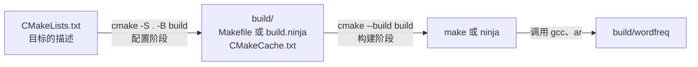
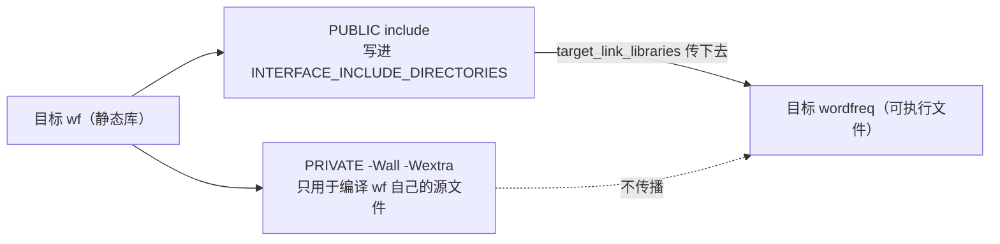

# 9. CMake 与 XMake

第 8 章的 Makefile 在 Linux 上工作得很好。把它交给一个用 Visual Studio 的同事，得为 MSBuild 再写一份工程文件；在 CLion 里打开这个项目，CLion 会先要一份 `CMakeLists.txt`；接到持续集成上，Linux 的作业跑 `make`，Windows 的作业跑 `mingw32-make`，两套脚本都要维护。文件越写越多，项目本身的代码一行没改。

CMake 把这件事收成一份描述：只维护 `CMakeLists.txt`，配置时按当前平台生成 Ninja、make 或 Visual Studio 的构建文件，构建时再调用那个工具。XMake 不需要指定生成器，也不依赖系统里装的 make 或 ninja，自己按 `xmake.lua` 执行构建。本章把 wordfreq 的构建从手写 Makefile 改成 CMake，写一份等价的 `xmake.lua`，最后说明这两个工具各自适合什么场合。读完之后，应当能看懂常见 C 项目里的 `CMakeLists.txt`，能为自己的多目录项目写出目标描述，并用一条命令完成配置和构建。

本章的大部分命令和输出取自 Debian 13 上的 CMake 3.31.6、GCC 14.2 与 Unix Makefiles；涉及多配置生成器、`option()` 和生成器对照的几段取自 Windows 上的 CMake 3.29.2、Ninja 1.12 与 MinGW-w64 GCC 13.2，用到时分别注明。教程使用的两台机器都没有安装 XMake，涉及它的部分只给文件和命令，不贴运行输出。项目代码在 `code/开发与工程基础/9_CMake与XMake/wordfreq/`，是第 8 章那份源码再加上 `CMakeLists.txt` 与 `xmake.lua`。

## 1. 构建系统生成器

CMake 不编译任何文件。它做两件事，分成两个阶段。

配置阶段 (configure)：读入 `CMakeLists.txt`，探测系统里可用的编译器、构建工具和库，把这些结果写进一个构建目录，同时按生成器 (generator) 写出该平台的原生构建文件。生成器是「生成哪种构建文件」的选择：Ninja 生成 `build.ninja`，Unix Makefiles 生成 `Makefile`，MinGW Makefiles 生成给 `mingw32-make` 用的 `Makefile`，Visual Studio 生成 `.sln` 与 `.vcxproj`。

构建阶段 (build)：`cmake --build build` 读出构建目录里记录的生成器，调用对应的工具，由它按依赖关系执行 `gcc` 和 `ar`。第 8 章手写的构建图仍然存在，只是这回由 CMake 生成。



配置的结果记在构建目录的 `CMakeCache.txt` 里。文件是纯文本，键值成对，看一眼就知道这次构建用了什么：

```text
CMAKE_BUILD_TYPE:STRING=
CMAKE_C_COMPILER:FILEPATH=D:/Software/Strawberry/c/bin/gcc.exe
CMAKE_MAKE_PROGRAM:FILEPATH=D:/Software/Strawberry/c/bin/ninja.exe
CMAKE_GENERATOR:INTERNAL=Ninja
```

这是 Windows 上一份用 Ninja 配置的缓存。编译器的完整路径、构建工具、生成器都在里面，所以换 PATH 不会改变已经配置好的构建目录；要换编译器，得删掉构建目录重新配置，或者配置时用 `-DCMAKE_C_COMPILER=...` 指定。第 1 章在排查「IDE 里能运行、终端里报错」时正是靠这一点。

生成器在第一次配置时写进缓存，之后不能改。同一个目录先按 Ninja 配置，再想换成 MinGW Makefiles，CMake 直接拒绝：

::: terminal title="zsh - 换生成器"

```console
$ cmake -S . -B build -G "MinGW Makefiles"
CMake Error: Error: generator : MinGW Makefiles
Does not match the generator used previously: Ninja
Either remove the CMakeCache.txt file and CMakeFiles directory or choose a different binary directory.
```

:::

用哪个生成器由 `-G` 指定，不写时用 CMake 自己选的默认值，`cmake --help` 里带星号的那个就是：Debian 上是 Unix Makefiles，本机 Windows 上是 Ninja，装了 Visual Studio 的机器上通常是某一版 Visual Studio。一个配置一个构建目录，换生成器或换构建类型就换目录，后面第 4 节会反复用到这条。

第 0 部分 [6.1 CLion](/教程/正文/导读与学习指南/6_工具与环境导航/6_1_CLion) 新建项目时生成的 `CMakeLists.txt`，就是给这套流程准备的：CLion 在项目下建一个 `cmake-build-debug/` 作为构建目录，点「运行」时先让 CMake 配置，再调用 Ninja 或它自带的 make 构建。第 1 章第 1 节走过同样的两步，那时看的是输出，现在能说清每一步在做什么。

## 2. 第一个 CMakeLists.txt

第 8 章的 `hello/` 有三个源文件：`main.c`、`greet.c` 和一个共用的 `greet.h`。给它加一份 `CMakeLists.txt`，全文三行：

```cmake [CMakeLists.txt]
cmake_minimum_required(VERSION 3.20)
project(hello LANGUAGES C)
add_executable(hello main.c greet.c)
```

第一行要求 CMake 版本不低于 3.20，低版本会直接报错退出。第二行声明工程名和语言，`LANGUAGES C` 告诉 CMake 只启用 C 编译器，不去找 C++ 和 Fortran。第三行定义一个可执行文件目标：名字 `hello`，源文件 `main.c` 和 `greet.c`。头文件不列进去，编译器在预处理时自己找。

在项目根目录配置并构建：

::: terminal title="zsh - 配置、构建、运行"

```console
$ cmake -S . -B build
-- The C compiler identification is GNU 14.2.0
-- Detecting C compiler ABI info
-- Detecting C compiler ABI info - done
-- Check for working C compiler: /usr/bin/cc - skipped
-- Detecting C compile features
-- Detecting C compile features - done
-- Configuring done (0.3s)
-- Generating done (0.0s)
-- Build files have been written to: /home/minsecrus/tutorial/work/ch09/hello/build
$ cmake --build build
[ 33%] Building C object CMakeFiles/hello.dir/main.c.o
[ 66%] Building C object CMakeFiles/hello.dir/greet.c.o
[100%] Linking C executable hello
[100%] Built target hello
$ ./build/hello
Hello, world!
```

`-S .` 是源码目录，`-B build` 是构建目录，两个都可以写相对路径。配置阶段的输出报告了它找到的编译器：Debian 上是 `/usr/bin/cc`，Windows 上是 `D:/Software/Strawberry/c/bin/gcc.exe`，还顺带测了它能不能正常工作。之后每次构建都复用这个结果，不再重新探测。

`build/` 里除了可执行文件，还有 `CMakeCache.txt`、`CMakeFiles/`、`cmake_install.cmake` 和原生构建文件。源码目录里一个文件都没多出来，这种构建方式叫源码外构建 (out-of-source build)。它带来的直接好处是清理简单：删掉 `build/` 就回到刚放完源码的状态，源码目录里也不会混进 `.o` 文件和可执行文件。wordfreq 的 `.gitignore` 里只有一行 `build/`，原因就在这里。

加 `--verbose` 能看到构建阶段真正执行的命令：

::: terminal title="zsh - cmake --build build --verbose"

```console
$ cmake --build build --verbose
Change Dir: '/home/minsecrus/tutorial/work/ch09/hello/build'

Run Build Command(s): /home/minsecrus/tutorial/tools/cmake-3.31.6-linux-x86_64/bin/cmake -E env VERBOSE=1 /usr/bin/gmake -f Makefile
...
[ 33%] Building C object CMakeFiles/hello.dir/main.c.o
/usr/bin/cc    -MD -MT CMakeFiles/hello.dir/main.c.o -MF CMakeFiles/hello.dir/main.c.o.d -o CMakeFiles/hello.dir/main.c.o -c /home/minsecrus/tutorial/work/ch09/hello/main.c
[ 66%] Building C object CMakeFiles/hello.dir/greet.c.o
/usr/bin/cc    -MD -MT CMakeFiles/hello.dir/greet.c.o -MF CMakeFiles/hello.dir/greet.c.o.d -o CMakeFiles/hello.dir/greet.c.o -c /home/minsecrus/tutorial/work/ch09/hello/greet.c
[100%] Linking C executable hello
/usr/bin/cc -Wl,--dependency-file=CMakeFiles/hello.dir/link.d CMakeFiles/hello.dir/main.c.o CMakeFiles/hello.dir/greet.c.o -o hello
[100%] Built target hello
```

:::

实际调用的就是两条 `cc -c` 加一条链接，和手写的一样。`-MD -MT -MF` 那一组选项让编译器顺带写出依赖文件，记录每个目标文件包含过哪些头文件。第 8 章为了这件事手写了 `-MMD -MP` 并 `-include` 依赖文件，CMake 默认就做了。

构建也是增量的。改一个源文件，只重编它再重新链接：

::: terminal title="zsh - 只改 greet.c"

```console
$ touch greet.c
$ cmake --build build
[ 33%] Building C object CMakeFiles/hello.dir/greet.c.o
[ 66%] Linking C executable hello
[100%] Built target hello
```

:::

`-G` 后面跟生成器名字，名字里有空格时要加引号：

| 生成器 | 构建目录里的构建文件 | 调用的构建工具 |
| --- | --- | --- |
| `Ninja` | `build.ninja` | `ninja` |
| `Unix Makefiles` | `Makefile` | `make` |
| `MinGW Makefiles` | `Makefile` | `mingw32-make` |
| `Visual Studio 17 2022` | `.sln` 与 `.vcxproj` | MSBuild |

同一份 `CMakeLists.txt`，用两个生成器各配置一个目录，编译出的程序相同。在本机 Windows 上试一遍（两个目录早已配好，这里只看构建这一步）：

::: terminal title="zsh - 两个生成器并行"

```console
$ cmake --build build
[1/3] Building C object CMakeFiles/hello.dir/main.c.obj
[2/3] Building C object CMakeFiles/hello.dir/greet.c.obj
[3/3] Linking C executable hello.exe
$ cmake --build build-mingw
[ 33%] Building C object CMakeFiles/hello.dir/main.c.obj
[ 66%] Building C object CMakeFiles/hello.dir/greet.c.obj
[100%] Linking C executable hello.exe
[100%] Built target hello
$ ./build/hello.exe
Hello, world!
$ ./build-mingw/hello.exe
Hello, world!
```

:::

Ninja 的进度行只数步骤，不报百分比；Makefile 的百分比来自 make 自己的进度显示，`Built target` 那一行也是 make 加的。缓存里与编译无关的项目一致，差别集中在构建目录路径、生成器和构建工具这几项，两个 `hello.exe` 大小相同、输出相同（PE 文件头里带着链接时间，逐字节比较会有差异）。生成器只影响「谁来执行编译命令」，不影响编译命令本身。

## 3. 目标与使用要求

wordfreq 的 `CMakeLists.txt` 全文如下，比 hello 多了一个库目标：

```cmake [CMakeLists.txt]
cmake_minimum_required(VERSION 3.20)
project(wordfreq VERSION 0.1.0 LANGUAGES C)

set(CMAKE_C_STANDARD 17)
set(CMAKE_C_STANDARD_REQUIRED ON)
set(CMAKE_C_EXTENSIONS OFF)
set(CMAKE_EXPORT_COMPILE_COMMANDS ON)

add_library(wf STATIC
    src/token.c
    src/counter.c
    src/report.c
)
target_include_directories(wf PUBLIC include)
target_compile_options(wf PRIVATE -Wall -Wextra)

# MinGW 的 -Wformat 不认识 %zu（运行结果正确），加上这个宏改用 UCRT 的格式化函数
if(MINGW)
    target_compile_definitions(wf PUBLIC __USE_MINGW_ANSI_STDIO=1)
endif()

add_executable(wordfreq app/main.c)
target_link_libraries(wordfreq PRIVATE wf)
target_compile_options(wordfreq PRIVATE -Wall -Wextra)
```

`project(wordfreq VERSION 0.1.0 LANGUAGES C)` 里的版本号不是摆设：后面第 19 章用它生成 `version.h`，打包时也用它填版本。三行 `CMAKE_C_STANDARD` 让编译器使用 C17：`REQUIRED ON` 表示编译器不支持时直接报错，而不是悄悄退回旧标准；`C_EXTENSIONS OFF` 关掉 GNU 扩展，命令行上得到 `-std=c17` 而不是默认的 `-std=gnu17`。关掉扩展的代价是 `strdup` 这类 POSIX 函数可能不再声明，第 16 章会拿这个差别做例子，讲清楚什么时候该开、什么时候该在源文件里加功能测试宏。

`add_library(wf STATIC ...)` 把三个模块编成静态库 `libwf.a`，`STATIC` 写明了库的类型。不写这个关键字时，库的类型由 `BUILD_SHARED_LIBS` 决定；共享库和导出符号是第 16 章的内容。把模块编成独立的库而不是把所有源文件塞进可执行文件，是为了让第 11 章的测试程序也能链接同一份实现。

`target_include_directories(wf PUBLIC include)` 告诉 CMake：编译 wf 自己的源文件需要 `-Iinclude`，并且这个要求要传给链接 wf 的目标。`target_compile_options(wf PRIVATE -Wall -Wextra)` 则只作用于 wf 自己的三个源文件。`-Wall -Wextra` 是 GCC 与 Clang 的选项，MSVC 不认；这里先这样写，第 16 章改成按编译器分支。

`if(MINGW)` 那一段用的是第 3 章第 7 节讲过的现象：MinGW-w64 GCC 13.2 对 `%zu` 报格式警告，而运行结果正确。`__USE_MINGW_ANSI_STDIO=1` 让格式化改走 MinGW 自己的实现，警告消失。这个宏改变的是 `<stdio.h>` 里 `printf` 系列绑定到哪一套实现，所以写成 PUBLIC 而不是 PRIVATE：同一个程序里的每个翻译单元都按同一种方式包含头文件，库和程序用到的才是同一套格式化。

最后三行定义可执行文件：源文件只有 `app/main.c`，链接 wf，警告选项同样只作用于自己。这里用 `PRIVATE` 链接 wf，意思是「wordfreq 需要 wf，但将来谁链接 wordfreq 都不需要知道 wf」。

配置、构建、运行：

::: terminal title="zsh - 构建 wordfreq"

```console
$ cmake -S . -B build
-- The C compiler identification is GNU 14.2.0
-- Detecting C compiler ABI info
-- Detecting C compiler ABI info - done
-- Check for working C compiler: /usr/bin/cc - skipped
-- Detecting C compile features
-- Detecting C compile features - done
-- Configuring done (0.3s)
-- Generating done (0.0s)
-- Build files have been written to: /home/minsecrus/tutorial/work/ch09/wordfreq/build
$ cmake --build build -j 2
[ 16%] Building C object CMakeFiles/wf.dir/src/token.c.o
[ 33%] Building C object CMakeFiles/wf.dir/src/counter.c.o
[ 50%] Building C object CMakeFiles/wf.dir/src/report.c.o
[ 66%] Linking C static library libwf.a
[ 66%] Built target wf
[ 83%] Building C object CMakeFiles/wordfreq.dir/app/main.c.o
[100%] Linking C executable wordfreq
[100%] Built target wordfreq
$ ./build/wordfreq -n 3 tests/data/sample.txt
      4 the
      2 on
      2 sat
```

构建阶段的进度百分比按构建步骤计算，`wf` 到 66% 就完成了，剩下的给 `wordfreq`。`--verbose` 里三条编译命令都带 `-I.../include` 和 `-std=c17 -Wall -Wextra`，链接那一步把 `libwf.a` 放在目标文件后面：

::: terminal title="zsh - wordfreq 的实际命令（节选）"

```console
$ cmake --build build --verbose
[ 16%] Building C object CMakeFiles/wf.dir/src/token.c.o
/usr/bin/cc  -I/home/minsecrus/tutorial/work/ch09/wordfreq/include -std=c17 -Wall -Wextra -MD -MT CMakeFiles/wf.dir/src/token.c.o -MF CMakeFiles/wf.dir/src/token.c.o.d -o CMakeFiles/wf.dir/src/token.c.o -c /home/minsecrus/tutorial/work/ch09/wordfreq/src/token.c
...
[ 66%] Linking C static library libwf.a
/usr/bin/ar qc libwf.a CMakeFiles/wf.dir/src/token.c.o CMakeFiles/wf.dir/src/counter.c.o CMakeFiles/wf.dir/src/report.c.o
...
[100%] Linking C executable wordfreq
/usr/bin/cc -Wl,--dependency-file=CMakeFiles/wordfreq.dir/link.d CMakeFiles/wordfreq.dir/app/main.c.o -o wordfreq  libwf.a
```

:::

`app/main.c` 的编译命令里也有 `-Iinclude`。`wordfreq` 目标自己没写过任何 `target_include_directories`，这个选项是 `target_link_libraries(wordfreq PRIVATE wf)` 把 wf 的接口要求带过来的。CMake 把这类随目标传递的编译要求称为使用要求 (usage requirements)。

一个 `target_` 命令里的三个关键字决定哪些要求传出去：

| 关键字 | 编译本目标时使用 | 写进 `INTERFACE_*`，传给链接它的目标 |
| --- | --- | --- |
| `PRIVATE` | 是 | 否 |
| `PUBLIC` | 是 | 是 |
| `INTERFACE` | 否 | 是 |

这张表对包含目录、编译定义、编译选项、链接库都成立。`PRIVATE` 的典型例子是 `-Wall -Wextra`：编译器警告是写代码的人自己的事，没有必要强加给调用方。`PUBLIC` 的典型例子是库的公开头文件目录：库自己的源文件要包含它们，使用这个库的程序也要。`INTERFACE` 用在只属于调用方的东西上，比如一个只有使用方才会引用的头文件目录，或者一个「用这个库就必须定义」的宏。

传播是沿链接方向逐级的。A 链接 B、B 链接 C，C 的 PUBLIC 与 INTERFACE 要求会经 B 到达 A：



::: concept dev-cmake-usage-requirements title="使用要求沿链接方向传播"

目标 B 的 `INTERFACE_*` 属性（由 `PUBLIC` 与 `INTERFACE` 关键字写入）在目标 A 链接 B 时加到 A 的编译选项、包含目录和链接依赖上。这与 A 用 `PRIVATE` 还是 `PUBLIC` 链接 B 无关。A 用 `PUBLIC` 链接 B 时，B 还会出现在 A 的 `INTERFACE_LINK_LIBRARIES` 里，继续传给链接 A 的目标；用 `PRIVATE` 时，传播到 A 为止。

:::

这条规则解释了一个常见现象：`app/main.c` 的编译命令里没有写过 `-Iinclude`，`main.c` 却能用 `#include "wf/counter.h"` 找到头文件。这个选项是 `target_link_libraries(wordfreq PRIVATE wf)` 这一行带来的。漏掉这一行，`main.c` 的编译就会因为找不到头文件而失败，头文件和库是一起传的。

写目标属性有一个更省事的替代品 `include_directories()`，它把目录加到当前目录及其子目录的所有目标上。两种写法都能让代码编过，差别在一个新加的目标会不会沾上不相干的路径。给 wordfreq 加一个只需要标准库的 `tools/linecount.c`，两种写法下它的编译命令不同：

::: compare left-title="全局 include_directories()" right-title="挂在目标上的 target_include_directories()"

```cmake
include_directories(include)

add_library(wf STATIC src/token.c src/counter.c src/report.c)
add_executable(wordfreq app/main.c)
target_link_libraries(wordfreq PRIVATE wf)
add_executable(linecount tools/linecount.c)
```

---

```cmake
add_library(wf STATIC src/token.c src/counter.c src/report.c)
target_include_directories(wf PUBLIC include)

add_executable(wordfreq app/main.c)
target_link_libraries(wordfreq PRIVATE wf)
add_executable(linecount tools/linecount.c)
```

:::

`linecount.c` 只包含 `<stdio.h>`，与 `include/` 毫无关系。左边那版给它的编译命令多了一个 `-I`（下面两条取自本机 Windows 的 Ninja 构建，路径里的 `scope-global` 与 `scope-target` 是两份只差这一行的工程）：

::: terminal title="zsh - 同一个 linecount.c 的两条编译命令"

```text
[4/8] D:\Software\Strawberry\c\bin\gcc.exe  -IC:/work/scope-global/include -std=c17 -MD -MT CMakeFiles/linecount.dir/tools/linecount.c.obj ... -c C:/work/scope-global/tools/linecount.c
[4/8] D:\Software\Strawberry\c\bin\gcc.exe   -std=c17 -MD -MT CMakeFiles/linecount.dir/tools/linecount.c.obj ... -c C:/work/scope-target/tools/linecount.c
```

:::

第一行来自左边的写法，第二行来自右边。目录一多、目标一多，全局设置会让每个目标都带着别人的包含路径，改一个目录会影响一大片，还容易掩盖「这个文件其实漏了链接某个库」的问题。本书一律用 `target_` 开头的写法。

把头文件目录从 `PUBLIC` 改成 `PRIVATE`，wf 自己还能编，但 `wordfreq` 编译 `app/main.c` 时找不到头文件：

::: terminal title="zsh - PUBLIC 改成 PRIVATE"

```console
$ cmake --build build -j 2
[ 16%] Building C object CMakeFiles/wf.dir/src/token.c.o
[ 33%] Building C object CMakeFiles/wf.dir/src/counter.c.o
[ 50%] Building C object CMakeFiles/wf.dir/src/report.c.o
[ 66%] Linking C static library libwf.a
[ 66%] Built target wf
[ 83%] Building C object CMakeFiles/wordfreq.dir/app/main.c.o
/home/minsecrus/tutorial/work/ch09/wordfreq/app/main.c:13:10: fatal error: wf/counter.h: No such file or directory
   13 | #include "wf/counter.h"
      |          ^~~~~~~~~~~~~~
compilation terminated.
```

:::

改成 `INTERFACE` 则反过来：wf 自己的源文件编不过，`wordfreq` 还没轮到：

::: terminal title="zsh - PUBLIC 改成 INTERFACE"

```console
$ cmake --build build -j 2
[ 16%] Building C object CMakeFiles/wf.dir/src/token.c.o
[ 33%] Building C object CMakeFiles/wf.dir/src/counter.c.o
/home/minsecrus/tutorial/work/ch09/wordfreq/src/token.c:1:10: fatal error: wf/token.h: No such file or directory
    1 | #include "wf/token.h"
      |          ^~~~~~~~~~~~
compilation terminated.
/home/minsecrus/tutorial/work/ch09/wordfreq/src/counter.c:1:10: fatal error: wf/counter.h: No such file or directory
    1 | #include "wf/counter.h"
      |          ^~~~~~~~~~~~~~
compilation terminated.
gmake[2]: *** [CMakeFiles/wf.dir/build.make:79: CMakeFiles/wf.dir/src/token.c.o] Error 1
gmake[2]: *** Waiting for unfinished jobs....
```

:::

两条错误分别对应表格里的两列：PRIVATE 不给别人，INTERFACE 不给自己。看到「库的源文件找不到自己的头文件」，先查 `INTERFACE`；看到「使用方的源文件找不到库的头文件」，先查 `PRIVATE`。

<Quiz
  :options="[
    { label: 'PUBLIC 的包含目录用于编译 wf 自己的源文件，也传给链接 wf 的目标', value: 'A' },
    { label: 'PUBLIC 只传给链接 wf 的目标，wf 自己不用', value: 'B' },
    { label: 'PRIVATE 的包含目录会传给链接 wf 的目标', value: 'C' },
    { label: 'INTERFACE 的包含目录会用于编译 wf 自己的源文件', value: 'D' }
  ]"
  answer="A"
>

<template #question>

`target_include_directories(wf PUBLIC include)` 中的 `PUBLIC` 表示：

</template>

正确答案是 **A**。PUBLIC 是「自己用，也给调用方」；INTERFACE 只给调用方，PRIVATE 只给自己。B 描述的是 INTERFACE，D 把 INTERFACE 说反了，C 把 PRIVATE 的传播关系说反了。

</Quiz>

## 4. 构建类型与选项

第 3 节的构建命令里没有 `-O` 也没有 `-g`。CMake 单配置生成器的优化与调试信息由 `CMAKE_BUILD_TYPE` 决定，这个缓存变量默认是空的，于是编译器按自己的默认值走（GCC 是 `-O0`、没有调试信息）。常用的四个取值对应的选项如下，取自 `--verbose` 的实际输出：

| `CMAKE_BUILD_TYPE` | 传给 GCC 的选项 | 用途 |
| --- | --- | --- |
| 未设置 | 无 | 只适合确认代码能编过 |
| `Debug` | `-g` | 调试，保留全部符号，不做优化 |
| `Release` | `-O3 -DNDEBUG` | 发布，优化到最高，去掉断言 |
| `RelWithDebInfo` | `-O2 -g -DNDEBUG` | 优化过但保留调试信息，排查发布版问题时用 |
| `MinSizeRel` | `-Os -DNDEBUG` | 优先减小体积 |

这些值是 CMake 为 GCC 准备的默认规则，换编译器时由 CMake 自己的规则替换，不用手写。拿 wordfreq 分别配置 Debug 和 Release，编译 `token.c` 的命令只差中间几个选项：

::: terminal title="zsh - Debug 与 Release 的编译命令"

```text
$ cmake -S . -B build-dbg -DCMAKE_BUILD_TYPE=Debug
$ cmake --build build-dbg --verbose | grep "token\.c\.o -c"
/usr/bin/cc  -I/home/minsecrus/tutorial/work/ch09/wordfreq/include -g -std=c17 -Wall -Wextra -MD -MT CMakeFiles/wf.dir/src/token.c.o -MF CMakeFiles/wf.dir/src/token.c.o.d -o CMakeFiles/wf.dir/src/token.c.o -c /home/minsecrus/tutorial/work/ch09/wordfreq/src/token.c
$ cmake -S . -B build-rel -DCMAKE_BUILD_TYPE=Release
$ cmake --build build-rel --verbose | grep "token\.c\.o -c"
/usr/bin/cc  -I/home/minsecrus/tutorial/work/ch09/wordfreq/include -O3 -DNDEBUG -std=c17 -Wall -Wextra -MD -MT CMakeFiles/wf.dir/src/token.c.o -MF CMakeFiles/wf.dir/src/token.c.o.d -o CMakeFiles/wf.dir/src/token.c.o -c /home/minsecrus/tutorial/work/ch09/wordfreq/src/token.c
```

:::

`-DNDEBUG` 的作用在第 11 章讲过一次：它让 `assert` 宏展开成什么也不做。用构建类型来演示，比手工加 `-D` 更贴近实际。一个小程序算两个数的平均值，负数输入在 Debug 构建里会触发断言：

```c [main.c]
#include <assert.h>
#include <stdio.h>

static int average(int a, int b) {
    assert(a >= 0 && b >= 0);
    return (a + b) / 2;
}

int main(void) {
    printf("average = %d\n", average(3, -5));
    return 0;
}
```

同样的源码，两个构建目录。`assert_demo/CMakeLists.txt` 与 hello 那份一样只有三行，只需把目标名换成 `assertdemo`，源文件写成 `main.c`：

::: terminal title="zsh - 同一份源码的 Debug 与 Release"

```console
$ cmake -S assert_demo -B assert_demo/build-debug -DCMAKE_BUILD_TYPE=Debug
$ cmake --build assert_demo/build-debug -j 2
$ ./assert_demo/build-debug/assertdemo 2>&1; echo "status=$?"
assertdemo: /home/minsecrus/tutorial/work/ch09/assert_demo/main.c:5: average: Assertion `a >= 0 && b >= 0' failed.
status=134
$ cmake -S assert_demo -B assert_demo/build-release -DCMAKE_BUILD_TYPE=Release
$ cmake --build assert_demo/build-release -j 2
$ ./assert_demo/build-release/assertdemo 2>&1; echo "status=$?"
average = -1
status=0
```

:::

Debug 版本被 SIGABRT 终止，退出状态 134；Release 版本里断言整条消失，程序带着错误的输入算出 `-1` 并正常退出。这就是发布构建里不该依赖 `assert` 检查输入的原因：它是给开发者自己看的，不是错误处理。

Windows 上的 CMake 默认生成器是 Ninja，同样是单配置，用法一致。Visual Studio 的生成器和 `Ninja Multi-Config` 是多配置生成器 (multi-config generator)：一次配置同时生成 Debug 和 Release 两套规则，构建时用 `--config` 选择。用 `Ninja Multi-Config` 试一遍：

::: terminal title="zsh - 多配置生成器"

```console
$ cmake -S . -B build -G "Ninja Multi-Config"
$ cmake --build build --config Debug
[1/6] Building C object CMakeFiles/wf.dir/Debug/src/token.c.obj
[2/6] Building C object CMakeFiles/wf.dir/Debug/src/report.c.obj
[3/6] Building C object CMakeFiles/wf.dir/Debug/src/counter.c.obj
[4/6] Building C object CMakeFiles/wordfreq.dir/Debug/app/main.c.obj
[5/6] Linking C static library Debug\libwf.a
[6/6] Linking C executable Debug\wordfreq.exe
$ cmake --build build --config Release
[1/6] Building C object CMakeFiles/wf.dir/Release/src/token.c.obj
[2/6] Building C object CMakeFiles/wf.dir/Release/src/report.c.obj
[3/6] Building C object CMakeFiles/wf.dir/Release/src/counter.c.obj
[4/6] Building C object CMakeFiles/wordfreq.dir/Release/app/main.c.obj
[5/6] Linking C static library Release\libwf.a
[6/6] Linking C executable Release\wordfreq.exe
```

:::

产物分别落在 `build/Debug/` 和 `build/Release/` 下，两个配置互不覆盖。多配置生成器不需要 `CMAKE_BUILD_TYPE`，配置时给了也不影响生成的规则；单配置生成器没有「配置」这个概念，`--config` 给了也不起作用。项目要同时支持两种生成器时，构建命令写成 `cmake --build build --config Release`，在单配置上多出来的参数会被忽略，两种生成器都能用同一条命令。

第三类配置是布尔开关，用 `option()` 声明：

```cmake
option(WF_BUILD_TOOLS "Build helper tools" OFF)
```

第一个参数是名字，第二个是显示在 CMake 图形界面里的说明，第三个是默认值。开关打开时才定义的目标放进 `if()` 里：

```cmake
if(WF_BUILD_TOOLS)
    add_executable(linecount tools/linecount.c)
    target_compile_options(linecount PRIVATE -Wall -Wextra)
endif()
```

配置时用 `-D` 打开，值写进缓存。下面仍在本机的 Windows 环境上演示：

::: terminal title="zsh - 用 option 控制目标"

```console
$ cmake -S . -B build
$ cmake --build build
[1/6] Building C object CMakeFiles/wf.dir/src/token.c.obj
[2/6] Building C object CMakeFiles/wf.dir/src/counter.c.obj
[3/6] Building C object CMakeFiles/wf.dir/src/report.c.obj
[4/6] Building C object CMakeFiles/wordfreq.dir/app/main.c.obj
[5/6] Linking C static library libwf.a
[6/6] Linking C executable wordfreq.exe
$ cmake -S . -B build-on -G Ninja -DWF_BUILD_TOOLS=ON
$ cmake --build build-on
[1/8] Building C object CMakeFiles/wf.dir/src/token.c.obj
[2/8] Building C object CMakeFiles/wf.dir/src/counter.c.obj
[3/8] Building C object CMakeFiles/wf.dir/src/report.c.obj
[4/8] Building C object CMakeFiles/linecount.dir/tools/linecount.c.obj
[5/8] Building C object CMakeFiles/wordfreq.dir/app/main.c.obj
[6/8] Linking C static library libwf.a
[7/8] Linking C executable linecount.exe
[8/8] Linking C executable wordfreq.exe
$ ./build-on/linecount.exe tests/data/sample.txt
2
```

:::

`build/CMakeCache.txt` 里与它有关的两行是：

```text
//Build helper tools
WF_BUILD_TOOLS:BOOL=OFF
```

注释行是 `option()` 的说明文字，下一行是缓存的类型和值。`-D` 只影响配置这一遍；之后直接删掉 `-D` 再配置，缓存里的值仍然保留，因为缓存变量一旦写进去就以缓存为准。要改回来，再给一次 `-DWF_BUILD_TOOLS=OFF`，或者删掉构建目录重新配置。这是缓存变量与普通 CMake 变量最容易混淆的一点：普通变量每次配置都从头算，缓存变量会活到构建目录被删掉为止。

一个配置一个构建目录，是这一节所有例子的共同前提。Debug、Release、带 Sanitizer 的构建、打开可选目标的构建，各占一个目录，互不干扰。第 13 章会把 `build-asan/` 和 `build/` 并排放在一起，第 18 章的持续集成则为每个作业准备一个干净的构建目录。

<Quiz
  :options="[
    { label: 'Release 定义了 NDEBUG，assert 被预处理成空语句，检查不再执行', value: 'A' },
    { label: 'Release 的 -O3 让 assert 内部的判断被优化掉，但失败时仍会中止', value: 'B' },
    { label: 'Debug 构建不带断言，Release 构建才带', value: 'C' },
    { label: 'assert 在两种构建里的行为相同，差别只出在调试器上', value: 'D' }
  ]"
  answer="A"
>

<template #question>

同一份带 `assert(a >= 0 && b >= 0)` 的源码，Debug 构建里断言失败会中止程序，Release 构建里同样的输入却继续算出结果。原因是：

</template>

正确答案是 **A**。`-DNDEBUG` 在预处理阶段就把 `assert` 换成空操作，判断和终止代码都不存在。B 错在优化不会改变断言失败时的行为，只有宏的展开结果能决定它是否存在；C 说反了；D 错在两者的可执行文件本身就不一样。

</Quiz>

## 5. compile_commands.json

编辑器做补全和跳转的语言服务器、做静态检查的 clang-tidy，都需要知道每个源文件的编译选项。这些选项由 CMake 拼出来，手工再抄一遍既费事又容易过期。让 CMake 把每条编译命令原样导出成一份 JSON：

```cmake
set(CMAKE_EXPORT_COMPILE_COMMANDS ON)
```

这行已经在 wordfreq 的 `CMakeLists.txt` 里。配置完成后，构建目录里多出 `compile_commands.json`，内容是一个数组，每个源文件一项：

```json
[
{
  "directory": "/home/minsecrus/tutorial/work/ch09/wordfreq/build",
  "command": "/usr/bin/cc  -I/home/minsecrus/tutorial/work/ch09/wordfreq/include -std=c17 -Wall -Wextra -o CMakeFiles/wf.dir/src/token.c.o -c /home/minsecrus/tutorial/work/ch09/wordfreq/src/token.c",
  "file": "/home/minsecrus/tutorial/work/ch09/wordfreq/src/token.c",
  "output": "CMakeFiles/wf.dir/src/token.c.o"
}
]
```

`directory` 是编译时的工作目录，`command` 是完整命令行，`file` 是被编译的源文件，`output` 是目标文件。wordfreq 有四个源文件，文件里就有四项。编辑器读 `command` 里的 `-I`、`-std`、`-D`，补全时就能找到 `wf/counter.h`，诊断也与命令行构建一致。

第 1 章第 5 节配置 VS Code 时用 `-DCMAKE_EXPORT_COMPILE_COMMANDS=ON` 临时打开过这个选项，写在 `CMakeLists.txt` 里之后，每个配置这个构建目录的人都会得到这份文件，不必记得加参数。clangd 从源文件所在目录向上查找这份文件，找不到时用 `--compile-commands-dir=<构建目录>` 直接指明位置；VS Code 的 C/C++ 扩展则在设置里填同样的路径。第 13 章的 clang-tidy 用 `-p build` 指定同一个目录。

::: tip 只有 Makefile 与 Ninja 生成器支持

CMake 文档写明，`compile_commands.json` 只由 Makefile 生成器和 Ninja 生成器输出，Visual Studio 生成器会忽略这个选项。用 VS 生成器时，clangd 一类的工具需要另外的配置方式，或者另建一个 Ninja 构建目录专门给编辑器用。

:::

## 6. 引入外部代码的三种方式

自己的代码写完了，下一步往往是用别人写的库。CMake 提供了三种接入方式，适用的场合不同。

**源码就在附近**：把对方的整个源码目录放进项目，比如 `external/greet/`，然后在顶层 `CMakeLists.txt` 里 `add_subdirectory`。下面用 hello 的例子改造：把 `greet.c` 和 `greet.h` 移进 `external/greet/`，让子目录自己带一份 `CMakeLists.txt`：

```text:no-line-numbers
hello_ext/
├── CMakeLists.txt
├── external/
│   └── greet/
│       ├── CMakeLists.txt
│       ├── greet.c
│       └── include/
│           └── greet.h
└── main.c
```

::: code-group

```cmake [hello_ext/CMakeLists.txt]
cmake_minimum_required(VERSION 3.20)
project(hello_ext LANGUAGES C)

add_subdirectory(external/greet)

add_executable(hello main.c)
target_link_libraries(hello PRIVATE greet)
```

```cmake [hello_ext/external/greet/CMakeLists.txt]
add_library(greet STATIC greet.c)
target_include_directories(greet PUBLIC ${CMAKE_CURRENT_SOURCE_DIR}/include)
```

:::

子目录里的 `add_library` 与主工程里写的完全一样，`add_subdirectory` 只是把它的目标并进同一张构建图。`${CMAKE_CURRENT_SOURCE_DIR}` 是当前处理的 `CMakeLists.txt` 所在目录，在子目录里展开成 `external/greet`。父工程链接 `greet` 时，子目录里声明的 PUBLIC 包含目录照样传过去。实际构建：

::: terminal title="zsh - add_subdirectory"

```console
$ cmake -S . -B build
-- The C compiler identification is GNU 14.2.0
...
-- Build files have been written to: /home/minsecrus/tutorial/work/ch09/greet_ext/build
$ cmake --build build -j 2
[ 25%] Building C object external/greet/CMakeFiles/greet.dir/greet.c.o
[ 50%] Linking C static library libgreet.a
[ 50%] Built target greet
[ 75%] Building C object CMakeFiles/hello.dir/main.c.o
[100%] Linking C executable hello
[100%] Built target hello
$ ./build/hello
Hello, world!
```

:::

这种方式要求对方也提供了 `CMakeLists.txt`，并且你愿意把它的源码放进自己的仓库。第 10 章评估的 `c_exception` 用的是 Autotools，只提供了 `configure.ac` 与 `Makefile.am`，没有 CMake 支持，接进来时得自己写一份目标定义。

**库已经装在系统里**：用 `find_package` 找它，链接它提供的导入目标 (imported target)。标准库之外的例子是线程：

```cmake
find_package(Threads REQUIRED)

add_executable(thrd main.c)
target_link_libraries(thrd PRIVATE Threads::Threads)
```

配置时能看到查找结果，`FindThreads` 先试了 libc 自带的 pthread：

::: terminal title="zsh - find_package(Threads)"

```console
$ cmake -S . -B build
-- The C compiler identification is GNU 14.2.0
...
-- Performing Test CMAKE_HAVE_LIBC_PTHREAD
-- Performing Test CMAKE_HAVE_LIBC_PTHREAD - Success
-- Found Threads: TRUE
-- Configuring done (0.4s)
-- Generating done (0.0s)
-- Build files have been written to: /home/minsecrus/tutorial/work/ch09/thrd/build
$ cmake --build build -j 2
[ 50%] Building C object CMakeFiles/thrd.dir/main.c.o
[100%] Linking C executable thrd
[100%] Built target thrd
$ ./build/thrd
worker: hello
```

:::

`Threads::Threads` 是 CMake 自带的 FindThreads 模块定义的导入目标，它按平台决定要加什么：glibc 2.34 之后 pthread 的函数已经在 libc 里，链接行上不需要额外选项；换一个平台，模块会加对应的库。调用方只写目标名，不写 `-lpthread` 这类与平台相关的选项。`REQUIRED` 表示找不到就让配置失败，而不是留下一个链接时才暴露的问题。第三方库装好后通常会提供 `<包名>::<目标名>` 形式的导入目标，比如 `ZLIB::ZLIB`。

**源码在网上，配置时下载**：`FetchContent` 在配置阶段拉取源码并把它当作子目录处理：

```cmake
include(FetchContent)

FetchContent_Declare(
    cjson
    GIT_REPOSITORY https://github.com/DaveGamble/cJSON.git
    GIT_TAG v1.7.18
)
FetchContent_MakeAvailable(cjson)

add_executable(app main.c)
target_link_libraries(app PRIVATE cjson)
```

`GIT_TAG` 写具体版本而不是默认分支，配置结果才能重复。下载发生在配置阶段，第一次配置要联网，之后源码缓存在构建目录里。这个例子只列写法，本教程的示例不联网下载依赖，也没有把 cJSON 编进任何程序。选哪一种方式，取决于库的规模、许可证、是否需要打补丁，以及团队能不能接受配置时联网，这些是第 10 章评估第三方依赖时要回答的问题。

其他构建系统也遵循同样的分工：Autotools 用 `./configure && make` 先探测环境再生成 Makefile，Meson 用 `meson setup build` 生成 Ninja 构建。名字不同，都是「先描述、再生成、最后执行」。

## 7. XMake

XMake 不生成 Makefile 或 `build.ninja`，读 `xmake.lua` 后自己算依赖、直接调编译器，系统里不必先装 make 或 Ninja。配置这一步仍然存在，只是藏在 `xmake f` 里，结果存进项目下的 `.xmake/` 和 `build/`。

wordfreq 的 `xmake.lua` 全文如下，另一个标签页是等价的 CMake 目标定义，对照着看：

::: code-group

```lua [xmake.lua]
add_rules("mode.debug", "mode.release")
set_languages("c17")
set_warnings("allextra")

target("wf")
    set_kind("static")
    add_files("src/*.c")
    add_includedirs("include", {public = true})

target("wordfreq")
    set_kind("binary")
    add_deps("wf")
    add_files("app/main.c")
```

```cmake [CMakeLists.txt（目标部分）]
set(CMAKE_C_STANDARD 17)
set(CMAKE_C_STANDARD_REQUIRED ON)
set(CMAKE_C_EXTENSIONS OFF)

add_library(wf STATIC
    src/token.c
    src/counter.c
    src/report.c
)
target_include_directories(wf PUBLIC include)

add_executable(wordfreq app/main.c)
target_link_libraries(wordfreq PRIVATE wf)
```

:::

`add_rules("mode.debug", "mode.release")` 引入两组构建模式，用 `xmake f -m debug` 或 `-m release` 切换，作用相当于 `CMAKE_BUILD_TYPE`。`set_languages("c17")` 定标准，`set_warnings("allextra")` 打开 `-Wall -Wextra` 一级的警告。两个 `target` 对应 CMake 的两个目标：`wf` 是静态库，源文件用通配符 `src/*.c` 一次收进来；`add_includedirs("include", {public = true})` 的 `public` 就是 CMake 的 `PUBLIC`，包含目录既给自己用也传给使用方。`wordfreq` 是 `binary`，`add_deps("wf")` 声明依赖，XMake 自动处理链接顺序和包含目录。

同样的意思，XMake 少写了几行。常用的命令：

| 命令 | 作用 |
| --- | --- |
| `xmake` | 按当前配置构建所有目标 |
| `xmake run wordfreq -n 3 tests/data/sample.txt` | 构建并运行 `wordfreq`，后面的参数交给程序 |
| `xmake f -m debug` | 切换构建模式，下次构建按新模式重编 |
| `xmake -v` | 显示实际执行的编译和链接命令 |
| `xmake project -k compile_commands` | 生成编辑器用的 `compile_commands.json` |

`xmake -v` 的输出与 CMake 加 `--verbose` 的作用相同，都是看清工具到底执行了什么。`xmake project -k compile_commands` 补上编辑器支持这一环，语言服务器读到的选项与 `xmake` 实际使用的一致。

XMake 还自带包管理，这一条是 CMake 没有的：

```lua
add_requires("zlib")
target("wordfreq")
    add_packages("zlib")
```

`add_requires` 从 XMake 的官方仓库下载并编译依赖，版本、编译选项和平台差异由包定义处理；CMake 里对应的做法是 `find_package` 加系统包管理器，或者 `FetchContent`，两者都要调用方多写一些配置。

教程使用的 Windows 与 Debian 环境都没有安装 XMake。上面的文件和命令按官方文档写成，没有在这两台机器上运行过，因此不贴输出。第 11 章给 `xmake.lua` 加测试时也只作写法对照。

## 8. 选哪一个

CMake 的长处不在写法，而在它已经成了 C 和 C++ 项目的通用接口。CLion 和 Visual Studio 直接读 `CMakeLists.txt`；开源库的安装说明第一条通常是 CMake 配置；`find_package` 背后是一整套已经写好的查找模块；CTest、CPack、预设文件（第 11、16、19 章）都长在它上面。工程要接多个第三方库、要在几种 IDE 和 CI 之间共用一份构建描述时，选它能省掉大量对接工作。它的代价是 CMake 语言本身：命令靠关键字和参数拼装，写复杂条件时像另一门语言，不同版本的模块行为也有差别，遇到问题要查文档而不是凭直觉改。

XMake 的写法短，配置、构建、测试、包管理、生成 `compile_commands.json` 都收在一个 `xmake.lua` 和几条命令里，个人项目或新项目上手快。它的短板是生态：用 CMake 描述的项目更多，IDE 和 CI 的现成模板更多，团队里熟悉 XMake 的人更少。换工具的成本不在写构建文件，而在周围所有工具的默认假设。

本书后续以 CMake 为主。第 11 章往 `CMakeLists.txt` 里加测试，第 13、14 章加 Sanitizer 与覆盖率选项，第 16 章处理编译器差异和预设，第 18 章接持续集成，第 19 章加安装与打包。用 XMake 的读者可以按第 7 节的对照把每一处翻译过去。两种工具描述的仍然是第 8 章那张构建图，目标、先决条件、执行命令三样东西没有变。

## 9. 习题

### 9.1 巩固

<Exercise id="20901" :d="1" :w="3">

第 1 节那份缓存来自 Windows 上的一次配置，节选如下：

```text
CMAKE_BUILD_TYPE:STRING=
CMAKE_C_COMPILER:FILEPATH=D:/Software/Strawberry/c/bin/gcc.exe
CMAKE_MAKE_PROGRAM:FILEPATH=D:/Software/Strawberry/c/bin/ninja.exe
CMAKE_GENERATOR:INTERNAL=Ninja
```

(1) 生成器、编译器、构建工具各是哪一个，分别从哪一行读出？`CMAKE_BUILD_TYPE:STRING=` 后面为空表示什么？

(2) 现在把另一版 gcc 放到 PATH 最前面，执行 `cmake --build build`，实际调用的是哪一个 gcc？要改用新版，有哪两种做法？

(3) 在同一个构建目录执行 `cmake -S . -B build -G "MinGW Makefiles"`，抄下错误的前两行。CMake 建议删除哪两样东西？只删 `CMakeCache.txt`、保留 `CMakeFiles/` 再配置一次，配置能过吗？构建目录里会同时留下什么？说明为什么仍不推荐这样做。

(4) 实际操作：用第 8 章 `hello/` 的三个源文件与三行 `CMakeLists.txt`，在 Windows 上分别用 `Ninja` 和 `MinGW Makefiles` 各配置一个目录（Linux 上用 `Ninja` 和 `Unix Makefiles`），构建并运行。对比两次 `cmake --build` 的输出，指出进度百分比和 `Built target` 分别由谁打印。

</Exercise>

<Exercise id="20902" :d="2" :w="2">

在 hello 项目上执行 `cmake --build build --verbose`，回答：

(1) 编译 `main.c` 的那条命令里，`-MD -MT -MF` 各做了什么？它们合起来替代了第 8 章 Makefile 里的哪些写法？

(2) 编译命令里有 `-MD -MF`，说明确有一个依赖文件被写出来。在 `Unix Makefiles` 或 `MinGW Makefiles` 的构建目录里找到它：路径在哪，打开看格式。再在 `Ninja` 的构建目录里找同名文件，找不到的话，依赖信息去了哪里？用 `ninja -t deps` 查一次，对比两边记录的内容。同一个 CMake 行为，为什么两种生成器留下的文件不同？

(3) 依次做三次修改并各构建一次：`touch greet.c`；在 `greet.h` 末尾加一行注释；在 `main.c` 末尾加一个空行。记录每次重编了哪些目标文件、是否重新链接。`greet.h` 没有出现在 `add_executable` 的源文件列表里，改动它为什么仍会触发重编？

(4) 把 `greet.h` 也写进 `add_executable(hello main.c greet.c greet.h)`，重新配置并构建。编译命令和产物有变化吗？CMake 接受这种写法是为了什么？

(5) 不改任何源文件，只 `touch CMakeLists.txt` 再执行 `cmake --build build`。构建工具在编译之前先做了什么？这与你平时「改了 CMakeLists.txt 必须手动重新配置」的印象是否一致？`cmake --build` 之后 `build/` 里哪个文件的时间戳变了？

</Exercise>

<Exercise id="20903" :d="2" :w="2">

wordfreq 配置完成后，构建目录里有一份 `compile_commands.json`。

(1) 数一数有几项，与源文件个数是否一致。把 `src/token.c` 和 `app/main.c` 两项的 `command` 抄下来，指出相同的选项来自哪一行，不同的只有哪几处。

(2) `directory` 为什么是构建目录而不是源码目录？语言服务器拿它和 `command` 做什么？

(3) 从 `CMakeLists.txt` 里删掉 `set(CMAKE_EXPORT_COMPILE_COMMANDS ON)`，在两个新构建目录分别配置：一个不加参数，一个加 `-DCMAKE_EXPORT_COMPILE_COMMANDS=ON`。哪个目录里有这份文件？写在文件里和写在命令行上各适合什么场合？

(4) 在一个已经生成过这份文件的构建目录里把选项改成 `OFF` 再配置，文件会消失吗？实际看一眼，解释看到的结果。

(5) 换成 Visual Studio 生成器，这份文件还出得来吗？说明理由，并给出一种仍能让 clangd 正常工作的安排。

</Exercise>

### 9.2 编程

<Exercise id="20904" :d="3" :w="3">

`code/开发与工程基础/3_从源文件到可执行文件/exercises/stats/` 下是一个三文件项目：`include/stats.h`、`src/stats.c`、`app/main.c`，目前只能用命令行逐个编译。

为它写一份 `CMakeLists.txt`：

1. `src/stats.c` 编成静态库 `stats`，`app/main.c` 编成可执行文件 `stats_app` 并链接它；
2. 库的公开头文件目录通过 `target_include_directories` 传给使用方，`main.c` 一侧不另设包含路径；
3. 使用 C17，不允许编译器扩展，两个目标都开 `-Wall -Wextra`；
4. 源码外构建，构建目录名为 `build`。

按 `cmake -S . -B build -G Ninja`、`cmake --build build -j 2`、`./build/stats_app`（Windows 上为 `build/stats_app.exe`）验证，输出必须是：

```text
mean = 5.00
spread = 2.00
```

然后：

(1) 用 `--verbose` 抄下编译 `stats.c` 与 `main.c` 的命令，指出 `-I`、`-std=`、`-Wall -Wextra` 各来自哪一行。

(2) 把 `src/stats.c` 里 `mean` 的整个定义删掉（头文件中的声明保留），重新构建，记录失败发生在编译还是链接、诊断原文是什么。再把 `target_link_libraries` 删掉并恢复 `mean`，重新构建，记录这一次失败的目标与阶段。两次失败分别用什么证据判断？

(3) 如果 `stats.c` 用了 `pow`、`sqrt`，在 Linux 上还要补什么？Windows 上的 MinGW 为什么不需要？

</Exercise>

<Exercise id="20905" :d="4" :w="3">

给 wordfreq 加一个只数行数的小工具 `tools/linecount.c`：从标准输入读，输出行数，默认不构建。

(1) 用 `option()` 与 `if()` 把它做成可选目标 `linecount`，链接 `wf`。分别在不加参数和 `-DWF_BUILD_TOOLS=ON` 两种配置下，用 `cmake --build build --target help` 确认目标列表。

(2) 在已经用 `-DWF_BUILD_TOOLS=ON` 配置过的目录里，去掉 `-D` 再配置一次，缓存里是什么值？`linecount` 还构建吗？接着执行一次 `-DWF_BUILD_TOOLS=OFF`，再执行一次 `-U WF_BUILD_TOOLS`，记录三次之后缓存里的值与目标列表。最后检查构建目录里的 `linecount` 可执行文件是否还在，解释它为什么不会随目标一起消失。

(3) `cmake -LH build` 比 `cmake -L build` 多输出什么？这与 `option()` 的第二个参数有什么关系？

(4) 下面这段来自另一个项目，第一次配置时默认值写的是 `ON`，`linecount` 却没有生成；在同一目录再配置一次，它又出现了。指出原因，给出两种修法。

```cmake
if(WF_BUILD_TOOLS)
    add_executable(linecount tools/linecount.c)
endif()

option(WF_BUILD_TOOLS "Build helper tools" ON)
```

</Exercise>

<Exercise id="20906" :d="4" :w="3">

三个目标排成一条链，每个目标有自己的公开头文件目录：

```text
chain/
├── CMakeLists.txt          # 依次 add_subdirectory base、mid、app
├── base/
│   ├── CMakeLists.txt
│   ├── base.c              # int base_value(void) { return BASE_LEVEL; }
│   └── include/base.h
├── mid/
│   ├── CMakeLists.txt
│   ├── mid.c               # 包含 base.h；int mid_total(void) { return base_value() * 10; }
│   └── include/mid.h
└── app/
    ├── CMakeLists.txt
    └── main.c              # 包含 mid.h，打印 mid_total()
```

三个子目录的 `CMakeLists.txt` 主体如下：

```cmake
# base/CMakeLists.txt
add_library(base STATIC base.c)
target_include_directories(base PUBLIC ${CMAKE_CURRENT_SOURCE_DIR}/include)
target_compile_definitions(base PUBLIC BASE_LEVEL=2)

# mid/CMakeLists.txt
add_library(mid STATIC mid.c)
target_include_directories(mid PUBLIC ${CMAKE_CURRENT_SOURCE_DIR}/include)
target_link_libraries(mid PRIVATE base)

# app/CMakeLists.txt
add_executable(chain main.c)
target_link_libraries(chain PRIVATE mid)
```

(1) 先不构建，写下 `app/main.c` 与 `mid/mid.c` 两条编译命令里预期出现的 `-I` 与 `-D`，再构建并用 `--verbose` 核对。

(2) 把 `mid` 的链接改成 `PUBLIC base`，重新配置。`app/main.c` 的编译命令多了什么？这一项通过哪个属性传到 `app`？

(3) 两种写法下，`chain` 的链接命令里都有 `libbase.a`。`PRIVATE` 的依赖为什么仍要出现在链接行上？静态库缺少它时，错误会出现在链接阶段还是运行阶段？

(4) 在 `app/main.c` 里写 `#include "base.h"`，两种写法下分别试一次。说明「链接时看得到 base」与「编译时看得到 base 的头文件」是两件事，分别由哪项设置决定。

</Exercise>

<Exercise id="20907" :d="4" :w="4">

wordfreq 有四个常用构建类型。

(1) 用 `Debug`、`Release`、`RelWithDebInfo`、`MinSizeRel` 各配置一个构建目录，从 `--verbose` 抄出编译 `src/token.c` 那一条命令，把多出来的选项填成一张表；同时记录四个 `wordfreq` 可执行文件的字节数。

(2) 用 `objdump -h` 查看两个目录里 `CMakeFiles/wf.dir/src/token.c.obj` 的段表，`Debug` 有 `.debug_info`、`.debug_line`，`Release` 没有；再用 `size` 比较两者的 `text` 段，解释两个差别分别由哪个选项造成。

(3) 创建第五个目录，配置时写 `-DCMAKE_BUILD_TYPE=Relase`（少一个字母）。构建后检查编译命令里有没有 `-O3` 与 `-DNDEBUG`，缓存里 `CMAKE_BUILD_TYPE` 是什么。CMake 为什么不报错？给出两种能在脚本里发现这类拼写错误的办法。

(4) 在单配置生成器的目录上执行 `cmake --build build --config Release`，看输出；同一条命令用在 `Ninja Multi-Config` 的目录上又是什么效果？

(5) 用第 4 节那个断言版本的小程序，在 `Release` 目录里运行，确认断言不再触发。修改它的 `CMakeLists.txt`，让这个目标在 `Release` 下仍保留断言，写出改动并验证断言重新生效（Linux 上进程被 SIGABRT 终止，状态 134；Windows 上打印 `Assertion failed:` 后异常终止）。

</Exercise>

### 9.3 综合与挑战

<Exercise id="20908" :d="4" :w="3" scope="*">

把 `stats` 项目（`include/stats.h`、`src/stats.c`、`app/main.c`）翻译成 `xmake.lua`。

(1) 写出完整的 `xmake.lua`：C17、打开 `-Wall -Wextra` 一级警告、`stats` 为静态库且 `include/` 对使用方公开、`stats_app` 链接它。与第 7 节的 `xmake.lua` 对照，指出 `add_files`、`add_includedirs` 的 `{public = true}`、`add_deps` 分别对应 `CMakeLists.txt` 的哪一行。

(2) `add_files("src/*.c")` 用通配符，`CMakeLists.txt` 逐个列出源文件。新增一个 `src/extra.c` 时两种写法各要做什么？从构建结果可重复的角度看，通配符有什么代价？

(3) 写出构建、运行、切换到 debug 模式、生成 `compile_commands.json` 的四条命令，与 CMake 的对应命令排成一张对照表。

(4) 这台机器没有安装 XMake，文件不必运行；逐行对照官方文档确认用到的 API。然后回答第 8 节的问题：一个 8 人团队，成员分别用 Visual Studio 与 CLion，CI 跑 Linux，要接 zlib 与 OpenSSL，还要给 clangd 提供编译参数，选 CMake 还是 XMake？给出三条理由；如果选 XMake，哪一环最容易出问题？

</Exercise>

<Exercise id="20909" :d="5" :w="5">

一个只提供 CMake 支持的库 `greet`，已经在本机建成 Git 仓库并打上标签 `v1.0`。用两种方式把它接进 hello 项目。

(1) `add_subdirectory`：把仓库目录复制为 `external/greet/`，顶层写 `add_subdirectory(external/greet)`，链接 `greet`。构建成功后，指出 `greet` 的目标文件落在构建目录的什么位置，以及改动 `external/greet/greet.c` 后重新构建会重编哪些文件。

(2) `FetchContent`：`GIT_REPOSITORY` 指向本地仓库，`GIT_TAG v1.0`，构建。检查 `build/_deps/` 下出现了哪几个目录，源码被放在哪里；同一目录再配置一次会不会重新克隆，删掉 `_deps/` 再配置呢？把 `GIT_TAG` 换成不存在的标签，记录第一条与 `FetchContent` 有关的错误（形如 `Build step for greet failed`）。

(3) 系统里已装 zlib 时用 `find_package`：写一个打印 `zlibVersion()` 的程序，在配置输出里找到 `Found ZLIB` 一行，链接 `ZLIB::ZLIB`。去掉 `REQUIRED` 后，在一台没有 zlib 的机器上会发生什么？为什么带 `REQUIRED` 更好？

(4) 三种方式各适合什么场合？按「库的源码是否在手边、是否需要修改、配置时能否联网」列一张表，每格一句话。

测试用的 `greet` 仓库可以自己造，`greet.h` 声明 `void greet(const char *name);`，`greet.c` 打印一行问候：

```sh
mkdir greetsrc && cd greetsrc
# 写入 greet.c、include/greet.h、CMakeLists.txt
git init
git add -A
git commit -m "greet v1.0"
git tag v1.0
```

</Exercise>

<Exercise id="20910" :d="6" :w="4">

下面的 `CMakeLists.txt` 属于小项目 `unitconv`：库 `unit` 提供 `double unit_f_to_c(double f)`，`app/main.c` 打印 212 华氏度对应的摄氏度，`tools/scale.c` 按 `%3d F = %6.1f C` 打印 0、50、100 三个值的换算表。文件里有几处问题，依次表现为：配置时多找一个编译器；构建时报头文件找不到；按 `option()` 里写的名字传 `-D` 时可选目标不出现；C 标准没有传给编译器。

```cmake
cmake_minimum_required(VERSION 3.20)
project(unitconv)

add_library(unit STATIC src/unit.c)
target_include_directories(unit PRIVATE include)
target_compile_options(unit PRIVATE -Wall -Wextra)

add_executable(unitconv app/main.c)
target_compile_options(unitconv PRIVATE -Wall -Wextra)

if(UNIT_BUILD_TOOLS)
    add_executable(scale tools/scale.c)
    target_link_libraries(scale PRIVATE unit)
endif()

option(UNIT_BUILD_TOOL "Build helper tools" OFF)

set(CMAKE_C_STANDARD 17)
set(CMAKE_C_STANDARD_REQUIRED ON)
```

按顺序完成：

(1) 配置一次，在输出里找出「多找一个编译器」的证据，指出由哪一行导致，写出最小改动。

(2) 构建，抄下诊断。此时 `unit` 自己能编过，`app/main.c` 编不过。只把库的 `PRIVATE` 改成 `PUBLIC` 再构建，诊断变了吗？为什么单改这一处没有用？补上把 `unitconv` 链接到 `unit` 的那一行，确认 `unitconv` 能编译、链接并运行。然后用 `-DUNIT_BUILD_TOOLS=ON` 打开 `scale`，确认它也能构建；再把 `PUBLIC` 改回 `PRIVATE`，只用 `--target scale` 构建它：`scale` 明明已经写了 `target_link_libraries(scale PRIVATE unit)`，为什么仍找不到头文件？这两次失败是不是同一处设置引起的？

(3) 修好 (2) 之后，执行 `cmake -S . -B build -DUNIT_BUILD_TOOL=ON`，`scale` 出现吗？再试 `-DUNIT_BUILD_TOOLS=ON`。缓存里分别写进了哪个名字？指出 `if()` 的条件名与 `option()` 的名字差在哪里。把两处名字统一，再把 `option()` 的默认值改成 `ON`：在全新目录配置一次，`scale` 出现吗？在同一目录再配置一次呢？解释这两次结果的差别，并说明为什么本项目不该依赖这个默认值。

(4) 用 `--verbose` 查看 `src/unit.c` 的编译命令，有 `-std=` 选项吗？解释原因，给出两种修法：把 `set()` 移到目标之前，或改用目标自身的属性（`set_target_properties(... PROPERTIES C_STANDARD 17 ...)`）。再验证一件事：只搬 `set()` 而不设 `CMAKE_C_EXTENSIONS`，命令行得到的是 `-std=gnu17` 还是 `-std=c17`？要让结果是后者，还差哪一行设置？

(5) 把 (3) 里改过的默认值恢复成 `OFF`，删掉构建目录，用 `-DUNIT_BUILD_TOOLS=ON` 重新配置并构建。确认 `unitconv` 输出 `100.0`，`scale` 输出：

```text
  0 F =  -17.8 C
 50 F =   10.0 C
100 F =   37.8 C
```

且 `src/unit.c` 的编译命令里带 `-std=c17`。

</Exercise>

## 10. 参考资料

1. CMake 官方教程《CMake Tutorial》，从最小工程到测试与安装的完整步骤：https://cmake.org/cmake/help/latest/guide/tutorial/index.html
2. CMake 文档《cmake-buildsystem(7)》，目标、使用要求、`INTERFACE_*` 属性与传播规则：https://cmake.org/cmake/help/latest/manual/cmake-buildsystem.7.html
3. CMake 文档《target_include_directories》，`PRIVATE`、`PUBLIC`、`INTERFACE` 与 `SYSTEM` 的含义：https://cmake.org/cmake/help/latest/command/target_include_directories.html
4. CMake 文档《CMAKE_BUILD_TYPE》，单配置生成器的构建类型与默认值：https://cmake.org/cmake/help/latest/variable/CMAKE_BUILD_TYPE.html
5. CMake 文档《CMAKE_EXPORT_COMPILE_COMMANDS》，JSON 格式与只支持 Makefile、Ninja 生成器的说明：https://cmake.org/cmake/help/latest/variable/CMAKE_EXPORT_COMPILE_COMMANDS.html
6. CMake 文档《FetchContent》，配置阶段拉取依赖的用法：https://cmake.org/cmake/help/latest/module/FetchContent.html
7. CMake 文档《cmake-generators(7)》，各生成器与多配置生成器的区别：https://cmake.org/cmake/help/latest/manual/cmake-generators.7.html
8. Henry Schreiner 等《Modern CMake》，按目标组织的写法与常见误区：https://cliutils.gitlab.io/modern-cmake/
9. 《Modern CMake》中文版：https://modern-cmake-cn.github.io/Modern-CMake-zh_CN/
10. Craig Scott，《Professional CMake: A Practical Guide》，目标属性、使用要求与生成器表达式的系统讲解。
11. XMake 文档《Quick Start》，`xmake.lua` 的基本写法与常用命令：https://xmake.io/guide/quick-start.html
12. XMake 文档《Project Target》，`set_kind`、`add_files`、`add_includedirs`、`add_deps` 的参数：https://xmake.io/api/description/project-target.html
13. 本教程：[7. 项目目录与模块划分](/教程/正文/开发与工程基础/7_项目目录与模块划分) 的目录布局与模块接口、[8. 构建图与 Make](/教程/正文/开发与工程基础/8_构建图与Make) 的构建图与静态库链接顺序、[11. 自动化测试](/教程/正文/开发与工程基础/11_自动化测试) 的 CTest 接入、[13. 编译器诊断与程序检查](/教程/正文/开发与工程基础/13_编译器诊断与程序检查) 的 clang-tidy、[16. 可移植构建](/教程/正文/开发与工程基础/16_可移植构建) 的编译器差异与预设、[19. 文档、版本与发布](/教程/正文/开发与工程基础/19_文档_版本与发布) 的安装与打包、[14.1 `<assert.h>`](/教程/正文/语法和标准库/14_文本转换_错误与程序生命周期/14_1_assert) 的断言与 `NDEBUG`、[6.1 CLion](/教程/正文/导读与学习指南/6_工具与环境导航/6_1_CLion) 的 `CMakeLists.txt`。
