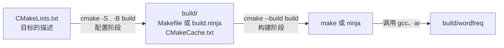
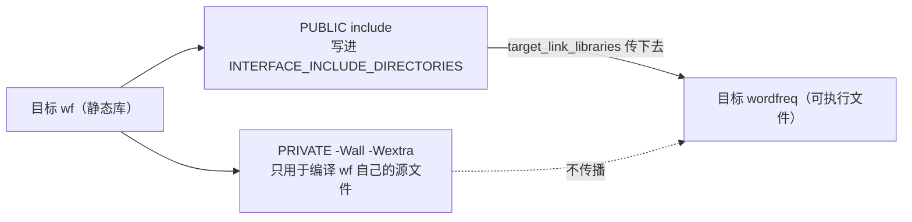

# 9. CMake 与 XMake

在第 8 章中编写的 Makefile 在类 Unix 终端下表现出色，能够高效且精确地驱动增量构建。然而当工程接入真实的团队协作环境时，单一的 Makefile 往往会遇到跨环境适配的瓶颈：使用 Visual Studio 的开发者习惯于通过 MSBuild 或解决方案（.sln）管理项目；在 CLion 等现代 IDE 中导入工程时，环境首先期待一份标准的 `CMakeLists.txt`；持续集成流水线中，Linux 容器运行 `make`，而 Windows 构建节点则依赖 `mingw32-make`。倘若针对每套工具与环境分别维护独立的构建脚本，不仅工程维护成本倍增，不同环境之间的编译选项也极易发生隐蔽的配置漂移。

为了从根本上解耦工程结构描述与底层编译动作，现代工程广泛采用了“元构建系统（Meta-build System）”。CMake 通过一份中心化的 `CMakeLists.txt` 文件抽象工程结构，在配置阶段依据目标系统与开发者偏好，自动生成对应平台的原生构建文件（如 Ninja 的 `build.ninja`、GNU Make 的 `Makefile` 或 Visual Studio 工程文件），并在构建阶段驱动相应的原生工具完成编译。XMake 则提供了另一种敏捷思路：它基于轻量直观的 `xmake.lua` 描述工程，内置了跨平台的依赖解析与编译器调度引擎，无需额外生成中间构建脚本即可直接执行构建。我们将 wordfreq 项目从手写 Makefile 迁移至 CMake 目标体系，并给出等价的 `xmake.lua` 描述，梳理两种构建范式的核心概念与选型考量。

本章大部分终端命令与执行反馈基于 Debian 13 环境下的 CMake 3.31.6、GCC 14.2 与 Unix Makefiles 生成器；涉及多配置生成器、`option()` 开关及生成器对比的实验环节，则基于 Windows 环境下的 CMake 3.29.2、Ninja 1.12 与 MinGW-w64 GCC 13.2 实测，文内均会明确标注上下文。由于教程使用的两台基准主机未全局预装 XMake，涉及 XMake 的小节以配置语法规则与标准命令解析为主。配套的项目源码位于 `code/开发与工程基础/9_CMake与XMake/wordfreq/`，在第 8 章项目代码的基础上补充了完整的 `CMakeLists.txt` 与 `xmake.lua`。

## 1. 构建系统生成器

CMake 本身并不充当编译器，它也不直接读取源码去生成机器码，而是将软件的构建工作流清晰地划分为两个阶段：

**配置阶段（Configure Step）**：CMake 解析工程根目录及子目录下的 `CMakeLists.txt` 文件，自动探测宿主环境中可用的 C 编译器、链接器特性以及系统库依赖。完成环境探测后，CMake 会在指定的构建输出目录中记录这些环境特征，并依据所选的生成器（Generator）输出对应平台的原生构建描述文件。生成器决定了底层构建由谁接管：`Ninja` 生成器产出 `build.ninja`，`Unix Makefiles` 生成用于 GNU Make 的 `Makefile`，`MinGW Makefiles` 生成适用于 Windows 下 `mingw32-make` 的构建脚本，而 `Visual Studio` 生成器则产出 `.sln` 解决方案与 `.vcxproj` 工程文件。

**构建阶段（Build Step）**：通过在终端执行 `cmake --build build`，CMake 会读取构建目录中记载的生成器类型，代理拉起对应的底层构建工具（如 `make` 或 `ninja`）。底层工具依据生成的依赖图谱，有序调度 `gcc` 和 `ar` 完成编译与打包。第 8 章中所探讨的由源码、目标文件和静态库组成的拓扑结构依然完整存在，只是其具体的拓扑计算与时序调度全部交由 CMake 自动推演。



在配置阶段推演出的各项环境参数，会被固化在构建目录下的 `CMakeCache.txt` 缓存文件中。该文件为标准键值对文本，直观展现了当前构建环境的固定状态：

```text
CMAKE_BUILD_TYPE:STRING=
CMAKE_C_COMPILER:FILEPATH=D:/Software/Strawberry/c/bin/gcc.exe
CMAKE_MAKE_PROGRAM:FILEPATH=D:/Software/Strawberry/c/bin/ninja.exe
CMAKE_GENERATOR:INTERNAL=Ninja
```

这份片段展示了在 Windows 环境下选用 Ninja 生成器配置后的缓存内容。其中记录了 C 编译器与构建程序的绝对物理路径。一旦配置完成，即便后续在控制台修改了系统的 `PATH` 环境变量，当前构建目录依然会忠实调用缓存中锁定的工具链。如果需要更换编译器版本，规范的做法是彻底清理原构建目录并重新配置，或在配置命令中显式传入 `-DCMAKE_C_COMPILER=...` 覆盖设定。在第 1 章中分析 IDE 内部运行正常而外部终端调用失败的案例时，这一缓存机制正是核心原因所在。

生成器的选择在首轮配置写入缓存后即被锁定，无法在已有目录中直接更改。若试图在一个已经按照 Ninja 生成器配置的输出目录中指定生成 MinGW Makefiles，CMake 会立刻报错拦截：

::: terminal title="zsh - 换生成器"

```console
$ cmake -S . -B build -G "MinGW Makefiles"
CMake Error: Error: generator : MinGW Makefiles
Does not match the generator used previously: Ninja
Either remove the CMakeCache.txt file and CMakeFiles directory or choose a different binary directory.
```

:::

目标生成器可以通过命令行参数 `-G` 显式指定；若省略该参数，CMake 会回退至当前平台预设的默认生成器（在 `cmake --help` 输出的列表末尾标注星号）。例如在 Debian 环境下默认匹配 `Unix Makefiles`，而在未显式配置的 Windows 环境中则倾向于匹配 Ninja 或当前安装的 Visual Studio。在现代工程实践中，保持“一份配置对应一个独立的构建输出目录”是核心原则：切换生成器或切换构建类型时，直接创建新的构建目录即可。

在第 0 部分 [6.1 CLion](/教程/正文/导读与学习指南/6_工具与环境导航/6_1_CLion) 中新建项目时自动生成的 `CMakeLists.txt`，正是依托这套元构建机制运转：CLion 会在工程内部建立名为 `cmake-build-debug/` 的专属构建输出目录，点击“运行”或“构建”按钮时，IDE 内部依次驱动 CMake 完成配置，再拉起集成在工具链中的 Ninja 或 Make 展开增量构建。第 1 章第 1 节走过同样的两步，彼时侧重于观察输出现象，如今则能清晰洞察每一步背后的系统行为。

## 2. 第一个 CMakeLists.txt

回顾第 8 章引入的最小多文件项目 `hello/`，该目录包含 `main.c`、`greet.c` 以及公共接口头文件 `greet.h`。我们为该项目编写一份最为精简的 `CMakeLists.txt`，全文仅需三行指令：

```cmake [CMakeLists.txt]
cmake_minimum_required(VERSION 3.20)
project(hello LANGUAGES C)
add_executable(hello main.c greet.c)
```

首行 `cmake_minimum_required(VERSION 3.20)` 确立了当前工程能够向下兼容的 CMake 最低版本约束。若开发者宿主环境中的 CMake 版本低于 3.20，解析过程将直接中断报错并提示升级，以此避免因构建系统版本陈旧而产生不可预期的语法或策略不一致。第二行 `project(hello LANGUAGES C)` 声明了工程名称，其中明确指定 `LANGUAGES C`，指示 CMake 仅初始化 C 语言工具链，跳过不必要的 C++ 或 Fortran 编译器探测流程。第三行 `add_executable(hello main.c greet.c)` 声明了一个名为 `hello` 的可执行文件构建目标，并传入构成该产物的源文件列表。接口头文件 `greet.h` 无需显式列入参数列表，编译器在执行预处理阶段时，会依据源文件内部的包含指令自行定位并展开。

在项目根目录配置并构建：

::: terminal title="zsh - 配置、构建、运行"

```console
$ cmake -S . -B build
-- The C compiler identification is GNU 14.2.0
-- Detecting C compiler ABI info
-- Detecting C compiler ABI info - done
-- Check for working C compiler: /usr/bin/cc - skipped
-- Detecting C compile features
-- Detecting C compile features - done
-- Configuring done (0.3s)
-- Generating done (0.0s)
-- Build files have been written to: /home/minsecrus/tutorial/work/ch09/hello/build
$ cmake --build build
[ 33%] Building C object CMakeFiles/hello.dir/main.c.o
[ 66%] Building C object CMakeFiles/hello.dir/greet.c.o
[100%] Linking C executable hello
[100%] Built target hello
$ ./build/hello
Hello, world!
```

在执行命令中，`-S .` 显式指示源码根目录所在路径，`-B build` 则指定本次构建产物的专属输出目录，二者均支持相对路径书写。在配置阶段，CMake 自动完成了 C 编译器版本标识识别、ABI 兼容性验证以及基础编译特性探测，并将这些关键结论固化于构建目录的缓存中。后续的多次增量构建均会直接复用该探测成果，无需反复进行耗时的环境嗅探。

构建完成后，所有的目标文件、依赖映射表、原生构建图以及最终的二进制可执行产物均整洁地汇聚在 `build/` 目录下，源码树本身未受到任何附带修改。这种设计被称为“源码外构建（Out-of-source build）”。相较于传统手写脚本常常将 `.o`、`.d` 与源文件混杂存放的凌乱做法，源码外构建赋予了工程极具确定性的清理与隔离边界：只需整体移除 `build/` 目录，就能立刻将代码库彻底复原为纯净初始状态。在 wordfreq 工程的 `.gitignore` 规则中仅需写入 `build/` 一行，根源便在于此。

通过在构建指令中追加 `--verbose` 参数，可以直观审查 CMake 代理底层工具真正派发的完整命令行：

::: terminal title="zsh - cmake --build build --verbose"

```console
$ cmake --build build --verbose
Change Dir: '/home/minsecrus/tutorial/work/ch09/hello/build'

Run Build Command(s): /home/minsecrus/tutorial/tools/cmake-3.31.6-linux-x86_64/bin/cmake -E env VERBOSE=1 /usr/bin/gmake -f Makefile
...
[ 33%] Building C object CMakeFiles/hello.dir/main.c.o
/usr/bin/cc    -MD -MT CMakeFiles/hello.dir/main.c.o -MF CMakeFiles/hello.dir/main.c.o.d -o CMakeFiles/hello.dir/main.c.o -c /home/minsecrus/tutorial/work/ch09/hello/main.c
[ 66%] Building C object CMakeFiles/hello.dir/greet.c.o
/usr/bin/cc    -MD -MT CMakeFiles/hello.dir/greet.c.o -MF CMakeFiles/hello.dir/greet.c.o.d -o CMakeFiles/hello.dir/greet.c.o -c /home/minsecrus/tutorial/work/ch09/hello/greet.c
[100%] Linking C executable hello
/usr/bin/cc -Wl,--dependency-file=CMakeFiles/hello.dir/link.d CMakeFiles/hello.dir/main.c.o CMakeFiles/hello.dir/greet.c.o -o hello
[100%] Built target hello
```

:::

终端展现的真实调用指令一目了然：两次编译器调用 `cc -c` 分别将 `main.c` 与 `greet.c` 编译为目标文件，随后由一条链接指令将它们拼接为可执行文件，与手写 Makefile 的核心意图别无二致。值得关注的是命令行中携带的 `-MD -MT -MF` 一组编译器选项：这组参数命令 GCC 在编译源文件的同时，自动向对应目录输出详细的依赖关系清单（`.d`），精确记录该目标文件展开过的所有头文件路径。在第 8 章中，为了实现精准的头文件增量重编，我们不得不手动拼装 `-MMD -MP` 编译参数并显式维护 `-include $(DEPS)` 规则；而在现代 CMake 体系下，这一系列复杂的依赖追踪逻辑已被封装为开箱即用的默认行为。

构建也是增量的。改一个源文件，只重编它再重新链接：

::: terminal title="zsh - 只改 greet.c"

```console
$ touch greet.c
$ cmake --build build
[ 33%] Building C object CMakeFiles/hello.dir/greet.c.o
[ 66%] Linking C executable hello
[100%] Built target hello
```

:::

参数 `-G` 允许我们显式指定目标生成器的类型，当生成器名称包含空格时需使用双引号包裹：

| 生成器 | 构建目录里的构建文件 | 调用的构建工具 |
| --- | --- | --- |
| `Ninja` | `build.ninja` | `ninja` |
| `Unix Makefiles` | `Makefile` | `make` |
| `MinGW Makefiles` | `Makefile` | `mingw32-make` |
| `Visual Studio 17 2022` | `.sln` 与 `.vcxproj` | MSBuild |

对于同一份声明清晰的 `CMakeLists.txt`，分别采用不同生成器指向各自独立的构建目录，所编译出的最终二进制程序具备完全一致的功能语义。我们在 Windows 环境下分别利用 Ninja 与 MinGW Makefiles 验证这一特性：

::: terminal title="zsh - 两个生成器并行"

```console
$ cmake --build build
[1/3] Building C object CMakeFiles/hello.dir/main.c.obj
[2/3] Building C object CMakeFiles/hello.dir/greet.c.obj
[3/3] Linking C executable hello.exe
$ cmake --build build-mingw
[ 33%] Building C object CMakeFiles/hello.dir/main.c.obj
[ 66%] Building C object CMakeFiles/hello.dir/greet.c.obj
[100%] Linking C executable hello.exe
[100%] Built target hello
$ ./build/hello.exe
Hello, world!
$ ./build-mingw/hello.exe
Hello, world!
```

:::

两类生成器的终端输出风格呈现出细微差异：Ninja 采用步骤计数形式打印构建进度（如 `[1/3]`），而 Makefiles 体系则展示按总体百分比折算的进度（如 `[ 33%]`），并在目标完成时追加特定的 `Built target` 提示行。检查两者的缓存文件，差异仅集中于构建路径、生成器标识与底层驱动程序等环境元数据上，生成的两个 `hello.exe` 产物大小一致、功能完全相同（PE 格式文件头中记录了各自的链接时间戳，因此逐字节比对会存在元数据差异）。这一实验充分印证了元构建系统的核心抽象：生成器仅决定“由哪款工具负责排布与派发指令”，而底层的编译链接指令及其逻辑结果完全由 CMake 的目标模型统筹约束。

## 3. 目标与使用要求

wordfreq 项目的 `CMakeLists.txt` 在基础可执行文件之上，引入了独立的静态库目标以实现模块化解耦：

```cmake [CMakeLists.txt]
cmake_minimum_required(VERSION 3.20)
project(wordfreq VERSION 0.1.0 LANGUAGES C)

set(CMAKE_C_STANDARD 17)
set(CMAKE_C_STANDARD_REQUIRED ON)
set(CMAKE_C_EXTENSIONS OFF)
set(CMAKE_EXPORT_COMPILE_COMMANDS ON)

add_library(wf STATIC
    src/token.c
    src/counter.c
    src/report.c
)
target_include_directories(wf PUBLIC include)
target_compile_options(wf PRIVATE -Wall -Wextra)

# MinGW 的 -Wformat 不认识 %zu（运行结果正确），加上这个宏改用 UCRT 的格式化函数
if(MINGW)
    target_compile_definitions(wf PUBLIC __USE_MINGW_ANSI_STDIO=1)
endif()

add_executable(wordfreq app/main.c)
target_link_libraries(wordfreq PRIVATE wf)
target_compile_options(wordfreq PRIVATE -Wall -Wextra)
```

在工程根节点的声明中，`project(wordfreq VERSION 0.1.0 LANGUAGES C)` 显式给出了语义化版本号。这一版本信息并非形式化的占位符：在后续第 19 章中，CMake 将借助该变量自动生成工程头文件 `version.h`，并在打包发布阶段作为安装包的基准版本。紧随其后的三项 C 语言标准配置构成了严谨的编译基线：`set(CMAKE_C_STANDARD 17)` 规定基准语言标准为 C17；`CMAKE_C_STANDARD_REQUIRED ON` 命令 CMake 在当前编译器无法提供 C17 支持时直接中断报错，坚决杜绝构建系统悄悄回退至老旧标准；`CMAKE_C_EXTENSIONS OFF` 则禁用 GCC/Clang 默认附带的 GNU 编译器方言扩展，强制在命令行中派发纯净的 `-std=c17` 而非宽容的 `-std=gnu17`。关闭方言扩展虽然可能导致诸如 `strdup` 等非标准 POSIX 函数的原型声明被标准头文件隐藏，但能强迫源码保持纯粹的标准兼容性；在第 16 章中我们将针对这一现象展开深入讨论，展示如何借助特性测试宏（Feature Test Macros）进行跨平台适配。

`add_library(wf STATIC ...)` 将分词、计数与报表三个模块打包为静态库目标 `libwf.a`，其中的 `STATIC` 关键字明确指定了库类型。若省略该关键字，CMake 会根据全局变量 `BUILD_SHARED_LIBS` 的取值决定生成静态库还是动态共享库；动态库的导出符号与跨平台适配规则将在第 16 章系统介绍。将核心功能沉淀为独立静态库，而非直接将全部 `.c` 塞进单一可执行文件，为第 11 章中让独立单元测试套件复用相同实现打下了干净的基础。

`target_include_directories(wf PUBLIC include)` 向 CMake 声明了关键的依赖路径规则：编译 `wf` 自身的三个源文件需要附加 `-Iinclude` 参数，并且这一路径需求必须沿依赖链路透明传递给所有链接了 `wf` 的目标。与此相对，`target_compile_options(wf PRIVATE -Wall -Wextra)` 指定的告警参数则被限制为仅对 `wf` 自身的源文件生效。需要说明的是，`-Wall -Wextra` 属于 GCC 与 Clang 工具链的专属参数，MSVC 并不识别；当前阶段我们先采用通用选项，在第 16 章中再演进为按编译器分支适配。

针对 MinGW 环境的条件分支 `if(MINGW)`，复现了我们在第 3 章第 7 节分析过的标准流格式化缺陷：MinGW-w64 附带的 GCC 13.2 在检查 `%zu` 占位符时会产生误报告警，而实际运行时解析完全正确。通过注入预定义宏 `__USE_MINGW_ANSI_STDIO=1`，可以强制 MinGW 运行时切换至遵循 C99/C11 规范的 ANSI 格式化实现，从而消除该误报警。这一宏定义决定了 `<stdio.h>` 中声明的 `printf` 系列函数在预处理阶段绑定至哪一套实现符号，因此必须声明为 `PUBLIC` 而非 `PRIVATE`：确保主程序与静态库的所有翻译单元在包含标准头文件时遵循完全一致的函数原型签名与 ABI 约定。

脚本末尾的三行指令完成主程序目标的组装：`add_executable` 声明源文件仅包含 `app/main.c`；`target_link_libraries(wordfreq PRIVATE wf)` 建立起主程序对静态库的链接依赖；随后同样为其私有赋予告警参数。此处的 `PRIVATE` 关键字精准表达了所有权边界：可执行程序 `wordfreq` 内部依赖 `wf` 的实现，但作为一个终端可执行文件产物，它并不需要向外部任何下游实体暴露 `wf` 的接口特性。

配置、构建、运行：

::: terminal title="zsh - 构建 wordfreq"

```console
$ cmake -S . -B build
-- The C compiler identification is GNU 14.2.0
-- Detecting C compiler ABI info
-- Detecting C compiler ABI info - done
-- Check for working C compiler: /usr/bin/cc - skipped
-- Detecting C compile features
-- Detecting C compile features - done
-- Configuring done (0.3s)
-- Generating done (0.0s)
-- Build files have been written to: /home/minsecrus/tutorial/work/ch09/wordfreq/build
$ cmake --build build -j 2
[ 16%] Building C object CMakeFiles/wf.dir/src/token.c.o
[ 33%] Building C object CMakeFiles/wf.dir/src/counter.c.o
[ 50%] Building C object CMakeFiles/wf.dir/src/report.c.o
[ 66%] Linking C static library libwf.a
[ 66%] Built target wf
[ 83%] Building C object CMakeFiles/wordfreq.dir/app/main.c.o
[100%] Linking C executable wordfreq
[100%] Built target wordfreq
$ ./build/wordfreq -n 3 tests/data/sample.txt
      4 the
      2 on
      2 sat
```

构建阶段的进度百分比按拓扑任务步骤递增计算，`wf` 静态库目标在达到 66% 时便已完成归档，随后的进度推进留给最终的主程序 `wordfreq`。通过 `--verbose` 审查实际编译指令，可以看到所有源文件编译时均整齐带上了 `-I.../include` 与 `-std=c17 -Wall -Wextra`，而在最后的可执行文件链接步骤中，CMake 自动将依赖的静态库 `libwf.a` 严谨排布在主程序目标文件之后，完全规避了第 8 章中手写参数次序错误所导致的未定义符号隐患：

::: terminal title="zsh - wordfreq 的实际命令（节选）"

```console
$ cmake --build build --verbose
[ 16%] Building C object CMakeFiles/wf.dir/src/token.c.o
/usr/bin/cc  -I/home/minsecrus/tutorial/work/ch09/wordfreq/include -std=c17 -Wall -Wextra -MD -MT CMakeFiles/wf.dir/src/token.c.o -MF CMakeFiles/wf.dir/src/token.c.o.d -o CMakeFiles/wf.dir/src/token.c.o -c /home/minsecrus/tutorial/work/ch09/wordfreq/src/token.c
...
[ 66%] Linking C static library libwf.a
/usr/bin/ar qc libwf.a CMakeFiles/wf.dir/src/token.c.o CMakeFiles/wf.dir/src/counter.c.o CMakeFiles/wf.dir/src/report.c.o
...
[100%] Linking C executable wordfreq
/usr/bin/cc -Wl,--dependency-file=CMakeFiles/wordfreq.dir/link.d CMakeFiles/wordfreq.dir/app/main.c.o -o wordfreq  libwf.a
```

:::

仔细观察 `app/main.c` 实际被派发的编译命令，可以发现参数中同样出现了 `-Iinclude`。然而审视 `wordfreq` 目标的构建描述，我们从未为其显式调用过任何 `target_include_directories`。这一包含路径完全是由 `target_link_libraries(wordfreq PRIVATE wf)` 从静态库 `wf` 的接口属性中自动继承而来的。CMake 将这种随着目标依赖链条自动向外流转的编译配置，定义为使用要求（Usage Requirements）。

在各类 `target_*` 命令中，`PRIVATE`、`PUBLIC` 与 `INTERFACE` 三个修饰关键字精确调控着属性的生效范围与对外可见性：

| 关键字 | 编译本目标时使用 | 写进 `INTERFACE_*`，传给链接它的目标 |
| --- | --- | --- |
| `PRIVATE` | 是 | 否 |
| `PUBLIC` | 是 | 是 |
| `INTERFACE` | 否 | 是 |

这套修饰体系统一适用于头文件搜索路径（`target_include_directories`）、预编译宏（`target_compile_definitions`）、编译参数（`target_compile_options`）以及链接依赖（`target_link_libraries`）。`PRIVATE` 的代表性场景是 `-Wall -Wextra`：编译告警等级是模块自身的工程质量要求，没有必要强加给使用该模块的外部调用方。`PUBLIC` 的典型场景则是库对外暴露的接口头文件目录：不仅静态库自身的实现源码需要包含这些头文件，调用该库的可执行程序同样必须能找到这些接口声明。`INTERFACE` 则适用于仅供调用方消费而模块自身无感的属性，例如纯头文件库（Header-only library）的接口目录，或是要求调用方必须开启的特定兼容性宏定义。

使用要求的传播在整个依赖拓扑中沿着链接依赖关系逐级向前级联传递：若目标 A 链接目标 B，且目标 B 链接目标 C，则目标 C 声明的 `PUBLIC` 与 `INTERFACE` 要求会沿着链接链条自然抵达目标 A：



::: concept dev-cmake-usage-requirements title="使用要求沿链接方向传播"

目标 B 的 `INTERFACE_*` 属性（由 `PUBLIC` 与 `INTERFACE` 关键字写入）在目标 A 链接 B 时加到 A 的编译选项、包含目录和链接依赖上。这与 A 用 `PRIVATE` 还是 `PUBLIC` 链接 B 无关。A 用 `PUBLIC` 链接 B 时，B 还会出现在 A 的 `INTERFACE_LINK_LIBRARIES` 里，继续传给链接 A 的目标；用 `PRIVATE` 时，传播到 A 为止。

:::

这一传播模型解释了我们在编写大型工程时最常见的一处疑问：在 `wordfreq` 目标的声明中并未显式包含 `-Iinclude`，`main.c` 源码内部却能顺畅通过 `#include "wf/counter.h"` 索引到头文件。这正是由于 `target_link_libraries(wordfreq PRIVATE wf)` 在建立链接拓扑的同时，自动将静态库 `wf` 挂载在 `INTERFACE_INCLUDE_DIRECTORIES` 上的路径需求合并进了主程序的编译上下文中。如果遗漏了这一行依赖声明，`main.c` 的编译过程便会在预处理阶段由于无法解析头文件而直接报错中止——在现代 CMake 设计中，接口头文件与编译库依赖被绑定为不可分割的整体。

在早期 CMake 教程或陈旧项目中，经常能看到一种更为省事的全局配置命令 `include_directories()`。该命令会将指定的搜索路径粗暴地注入当前作用域及其后续声明的所有构建目标中。尽管两种写法在小型实验工程里都能将代码顺利编译通过，但在工程规模扩大后，全局命令会彻底摧毁目标之间的抽象边界。假设我们在 wordfreq 工程中增添一个仅依赖 C 标准库的独立辅助工具 `tools/linecount.c`，对比两套配置策略对其编译环境的影响：

::: compare left-title="全局 include_directories()" right-title="挂在目标上的 target_include_directories()"

```cmake
include_directories(include)

add_library(wf STATIC src/token.c src/counter.c src/report.c)
add_executable(wordfreq app/main.c)
target_link_libraries(wordfreq PRIVATE wf)
add_executable(linecount tools/linecount.c)
```

---

```cmake
add_library(wf STATIC src/token.c src/counter.c src/report.c)
target_include_directories(wf PUBLIC include)

add_executable(wordfreq app/main.c)
target_link_libraries(wordfreq PRIVATE wf)
add_executable(linecount tools/linecount.c)
```

:::

源文件 `linecount.c` 仅仅调用了 `<stdio.h>`，逻辑上与分词工程的核心头文件目录 `include/` 毫无牵扯。审视两组工程在 Windows 下通过 Ninja 派发的真实编译指令：

::: terminal title="zsh - 同一个 linecount.c 的两条编译命令"

```text
[4/8] D:\Software\Strawberry\c\bin\gcc.exe  -IC:/work/scope-global/include -std=c17 -MD -MT CMakeFiles/linecount.dir/tools/linecount.c.obj ... -c C:/work/scope-global/tools/linecount.c
[4/8] D:\Software\Strawberry\c\bin\gcc.exe   -std=c17 -MD -MT CMakeFiles/linecount.dir/tools/linecount.c.obj ... -c C:/work/scope-target/tools/linecount.c
```

:::

第一行指令由左侧的全局指令生成，`linecount` 无辜地背负了与其无关的 `-I.../include` 路径；第二行指令则展现了右侧目标化属性的严密隔离。在复杂的工业级工程中，全局路径污染往往会埋下极深的设计隐患：它不仅会使每个模块被动引入大量不相关的头文件命名空间，还会严重掩盖“某个实现文件实际漏写了模块依赖”的拓扑漏洞。因此，本书遵循现代 CMake 的工程规范，一律使用以 `target_` 开头的精确目标作用域指令。

为了直观体会使用要求修饰词的控制边界，我们不妨刻意制造两起属性配置错误：

若将 `target_include_directories(wf PUBLIC include)` 中的 `PUBLIC` 误写为 `PRIVATE`，静态库 `wf` 自身在编译时依然能够找到头文件，但下游可执行文件 `wordfreq` 在编译 `app/main.c` 时便会立刻中断：

::: terminal title="zsh - PUBLIC 改成 PRIVATE"

```console
$ cmake --build build -j 2
[ 16%] Building C object CMakeFiles/wf.dir/src/token.c.o
[ 33%] Building C object CMakeFiles/wf.dir/src/counter.c.o
[ 50%] Building C object CMakeFiles/wf.dir/src/report.c.o
[ 66%] Linking C static library libwf.a
[ 66%] Built target wf
[ 83%] Building C object CMakeFiles/wordfreq.dir/app/main.c.o
/home/minsecrus/tutorial/work/ch09/wordfreq/app/main.c:13:10: fatal error: wf/counter.h: No such file or directory
   13 | #include "wf/counter.h"
      |          ^~~~~~~~~~~~~~
compilation terminated.
```

:::

反之，若将其误改写为 `INTERFACE`，结果则刚好调转：头文件路径完全暴露给了外部调用方，库自身的内部实现源文件却得不到该配置支持，导致库构建阶段率先夭折：

::: terminal title="zsh - PUBLIC 改成 INTERFACE"

```console
$ cmake --build build -j 2
[ 16%] Building C object CMakeFiles/wf.dir/src/token.c.o
[ 33%] Building C object CMakeFiles/wf.dir/src/counter.c.o
/home/minsecrus/tutorial/work/ch09/wordfreq/src/token.c:1:10: fatal error: wf/token.h: No such file or directory
    1 | #include "wf/token.h"
      |          ^~~~~~~~~~~~
compilation terminated.
/home/minsecrus/tutorial/work/ch09/wordfreq/src/counter.c:1:10: fatal error: wf/counter.h: No such file or directory
    1 | #include "wf/counter.h"
      |          ^~~~~~~~~~~~~~
compilation terminated.
gmake[2]: *** [CMakeFiles/wf.dir/build.make:79: CMakeFiles/wf.dir/src/token.c.o] Error 1
gmake[2]: *** Waiting for unfinished jobs....
```

:::

这两起实测现象精准对应了属性传递的判定准则：`PRIVATE` 阻断向外传播，`INTERFACE` 豁免自身使用。在日常开发排查中，这一规律非常清晰：当发现“库自身的源码无法识别本模块头文件”时，应当优先排查是否误写了 `INTERFACE`；当遇到“调用方的源文件报头文件缺失”时，则应当优先检查被依赖库是否错误配置了 `PRIVATE`。

<Quiz
  :options="[
    { label: 'PUBLIC 的包含目录用于编译 wf 自己的源文件，也传给链接 wf 的目标', value: 'A' },
    { label: 'PUBLIC 只传给链接 wf 的目标，wf 自己不用', value: 'B' },
    { label: 'PRIVATE 的包含目录会传给链接 wf 的目标', value: 'C' },
    { label: 'INTERFACE 的包含目录会用于编译 wf 自己的源文件', value: 'D' }
  ]"
  answer="A"
>

<template #question>

`target_include_directories(wf PUBLIC include)` 中的 `PUBLIC` 表示：

</template>

正确答案是 **A**。PUBLIC 是「自己用，也给调用方」；INTERFACE 只给调用方，PRIVATE 只给自己。B 描述的是 INTERFACE，D 把 INTERFACE 说反了，C 把 PRIVATE 的传播关系说反了。

</Quiz>

## 4. 构建类型与选项

在第 3 节的构建输出中，我们并未在编译参数中见到优化选项 `-O` 或调试符号参数 `-g`。在采用单配置生成器（如 Ninja 或 Unix Makefiles）时，二进制产物的优化级别与调试信息由内置缓存变量 `CMAKE_BUILD_TYPE` 决定。若未在配置阶段显式赋予该变量取值，CMake 会保持其为空，此时编译器将退回到自身内置的默认行为（以 GCC 为例，默认为 `-O0` 且不生成调试符号）。CMake 标准预设了四种常用的构建类型，其向 GCC 派发的标志选项如下表所示：

| `CMAKE_BUILD_TYPE` | 传给 GCC 的选项 | 用途 |
| --- | --- | --- |
| 未设置 | 无 | 只适合确认代码能编过 |
| `Debug` | `-g` | 调试，保留全部符号，不做优化 |
| `Release` | `-O3 -DNDEBUG` | 发布，优化到最高，去掉断言 |
| `RelWithDebInfo` | `-O2 -g -DNDEBUG` | 优化过但保留调试信息，排查发布版问题时用 |
| `MinSizeRel` | `-Os -DNDEBUG` | 优先减小体积 |

这些编译标志是 CMake 针对 GCC 预设的最佳实践规则；当切换至 MSVC 或 Clang 时，CMake 会自动无缝替换为对应工具链的对等参数（如 `/MD /O2` 或 `/MDd /Zi`），无需开发者在工程脚本中手动编写繁复的平台分支。我们为 wordfreq 分别建立 Debug 与 Release 两个输出目录，通过 `--verbose` 提取编译 `token.c` 的真实指令，可以直观看到标志的差异：

::: terminal title="zsh - Debug 与 Release 的编译命令"

```text
$ cmake -S . -B build-dbg -DCMAKE_BUILD_TYPE=Debug
$ cmake --build build-dbg --verbose | grep "token\.c\.o -c"
/usr/bin/cc  -I/home/minsecrus/tutorial/work/ch09/wordfreq/include -g -std=c17 -Wall -Wextra -MD -MT CMakeFiles/wf.dir/src/token.c.o -MF CMakeFiles/wf.dir/src/token.c.o.d -o CMakeFiles/wf.dir/src/token.c.o -c /home/minsecrus/tutorial/work/ch09/wordfreq/src/token.c
$ cmake -S . -B build-rel -DCMAKE_BUILD_TYPE=Release
$ cmake --build build-rel --verbose | grep "token\.c\.o -c"
/usr/bin/cc  -I/home/minsecrus/tutorial/work/ch09/wordfreq/include -O3 -DNDEBUG -std=c17 -Wall -Wextra -MD -MT CMakeFiles/wf.dir/src/token.c.o -MF CMakeFiles/wf.dir/src/token.c.o.d -o CMakeFiles/wf.dir/src/token.c.o -c /home/minsecrus/tutorial/work/ch09/wordfreq/src/token.c
```

:::

在发布构建中，`-DNDEBUG` 发挥着极为关键的作用：它使得标准头文件 `<assert.h>` 中定义的 `assert()` 断言宏在预处理阶段被直接置空。借助构建类型的切换观察断言行为，能直观展现其与发布版错误处理的本质差异。以下面的均值计算小程序为例，函数显式断言入参不得为负数：

```c [main.c]
#include <assert.h>
#include <stdio.h>

static int average(int a, int b) {
    assert(a >= 0 && b >= 0);
    return (a + b) / 2;
}

int main(void) {
    printf("average = %d\n", average(3, -5));
    return 0;
}
```

为该程序配置一份极简的 `CMakeLists.txt`，分别在两个独立的构建目录中以 Debug 与 Release 模式进行构建并传入负数验证：

::: terminal title="zsh - 同一份源码的 Debug 与 Release"

```console
$ cmake -S assert_demo -B assert_demo/build-debug -DCMAKE_BUILD_TYPE=Debug
$ cmake --build assert_demo/build-debug -j 2
$ ./assert_demo/build-debug/assertdemo 2>&1; echo "status=$?"
assertdemo: /home/minsecrus/tutorial/work/ch09/assert_demo/main.c:5: average: Assertion `a >= 0 && b >= 0' failed.
status=134
$ cmake -S assert_demo -B assert_demo/build-release -DCMAKE_BUILD_TYPE=Release
$ cmake --build assert_demo/build-release -j 2
$ ./assert_demo/build-release/assertdemo 2>&1; echo "status=$?"
average = -1
status=0
```

:::

实测反馈非常鲜明：Debug 构建下的程序在断言失败处被内核派发的 `SIGABRT` 信号强行终止，进程异常退出并返回状态码 134，向开发者精确指明了断言违背的文件与行号；而在 Release 构建中，断言逻辑在编译期便被彻底剥离，程序带着非法输入继续运算并输出了荒谬的结果 `-1`，最终以状态码 0 正常退出。这一对比给出了明确的工程警示：断言纯粹是开发阶段用于验证程序内部不变式（Invariants）与前置条件的防御手段，绝不能将其替代为针对外部非预期输入或运行时异常的常规错误处理逻辑。

在 Windows 下默认调用的 Ninja 生成器与 Linux 下的 Unix Makefiles 一样，均属于单配置生成器。而 Visual Studio 解决方案生成器以及 `Ninja Multi-Config` 则归属于多配置生成器（Multi-Config Generator）。它们的显著特征是：仅需经历一次前置配置阶段，便能在同一个构建目录内同时输出涵盖 Debug 与 Release 等多种模式的原生构建规则。在实际构建阶段，开发者通过在命令行传递 `--config <Type>` 参数直接指定构建目标：

::: terminal title="zsh - 多配置生成器"

```console
$ cmake -S . -B build -G "Ninja Multi-Config"
$ cmake --build build --config Debug
[1/6] Building C object CMakeFiles/wf.dir/Debug/src/token.c.obj
[2/6] Building C object CMakeFiles/wf.dir/Debug/src/report.c.obj
[3/6] Building C object CMakeFiles/wf.dir/Debug/src/counter.c.obj
[4/6] Building C object CMakeFiles/wordfreq.dir/Debug/app/main.c.obj
[5/6] Linking C static library Debug\libwf.a
[6/6] Linking C executable Debug\wordfreq.exe
$ cmake --build build --config Release
[1/6] Building C object CMakeFiles/wf.dir/Release/src/token.c.obj
[2/6] Building C object CMakeFiles/wf.dir/Release/src/report.c.obj
[3/6] Building C object CMakeFiles/wf.dir/Release/src/counter.c.obj
[4/6] Building C object CMakeFiles/wordfreq.dir/Release/app/main.c.obj
[5/6] Linking C static library Release\libwf.a
[6/6] Linking C executable Release\wordfreq.exe
```

:::

多配置模式下的产物分别规整存放在 `build/Debug/` 与 `build/Release/` 子目录中，两套配置的中间目标文件与二进制输出完全隔离、互不覆盖。多配置生成器会完全忽略全局的 `CMAKE_BUILD_TYPE` 缓存变量；而单配置生成器由于缺少内部多配置分支机制，传入 `--config` 参数时会被静默忽略。在编写跨平台持续集成流水线时，统一采用 `cmake --build build --config Release` 是经典的行业最佳实践，它能保证同一条构建指令在 Visual Studio 与 Ninja 环境下均按预期工作。

除了构建类型外，工程中还广泛存在控制模块启停的布尔特性开关。CMake 使用 `option()` 语句声明此类开关变量：

```cmake
option(WF_BUILD_TOOLS "Build helper tools" OFF)
```

该命令的第一个参数为选项变量名，第二个参数为在 CMake 交互界面中展现的帮助说明，第三个参数则为默认布尔初值。在脚本中，借助 `if()` 条件块将可选目标的声明包裹起来：

```cmake
if(WF_BUILD_TOOLS)
    add_executable(linecount tools/linecount.c)
    target_compile_options(linecount PRIVATE -Wall -Wextra)
endif()
```

开发者在配置阶段可以通过 `-D` 参数动态重写该开关状态。以下继续在 Windows 的 Ninja 环境下进行实测验证：

::: terminal title="zsh - 用 option 控制目标"

```console
$ cmake -S . -B build
$ cmake --build build
[1/6] Building C object CMakeFiles/wf.dir/src/token.c.obj
[2/6] Building C object CMakeFiles/wf.dir/src/counter.c.obj
[3/6] Building C object CMakeFiles/wf.dir/src/report.c.obj
[4/6] Building C object CMakeFiles/wordfreq.dir/app/main.c.obj
[5/6] Linking C static library libwf.a
[6/6] Linking C executable wordfreq.exe
$ cmake -S . -B build-on -G Ninja -DWF_BUILD_TOOLS=ON
$ cmake --build build-on
[1/8] Building C object CMakeFiles/wf.dir/src/token.c.obj
[2/8] Building C object CMakeFiles/wf.dir/src/counter.c.obj
[3/8] Building C object CMakeFiles/wf.dir/src/report.c.obj
[4/8] Building C object CMakeFiles/linecount.dir/tools/linecount.c.obj
[5/8] Building C object CMakeFiles/wordfreq.dir/app/main.c.obj
[6/8] Linking C static library libwf.a
[7/8] Linking C executable linecount.exe
[8/8] Linking C executable wordfreq.exe
$ ./build-on/linecount.exe tests/data/sample.txt
2
```

:::

打开默认构建目录下的 `build/CMakeCache.txt`，可以看到与该开关对应的持久化记录：

```text
//Build helper tools
WF_BUILD_TOOLS:BOOL=OFF
```

首行是 `option()` 提供的注释说明，次行则是变量的数据类型与当前锁定的布尔值。此处涉及 CMake 变量模型中最易产生混淆的机制：普通局部变量在每次 CMake 读取执行脚本时均从头初始化并计算；而缓存变量（Cache Variables）一经写入磁盘，其生命周期将持续存在直至构建目录被彻底销毁。这意味着，一旦某个开关通过 `-DWF_BUILD_TOOLS=ON` 写入了缓存，后续在相同目录下重新执行 `cmake` 时，即便命令中漏掉了 `-D` 参数，CMake 依然会优先沿用缓存中已固化的 `ON` 状态。若希望将其重置回默认的关闭状态，必须在命令行显式传入 `-DWF_BUILD_TOOLS=OFF`、使用 `-U WF_BUILD_TOOLS` 从缓存中注销该键，或者直接清空整个构建目录。

坚持“一个特定配置独占一个专属构建目录”是避免配置相互污染的核心工程规范。无论面对 Debug、Release 还是后续第 13 章探讨的带有 AddressSanitizer 的诊断构建，将它们分别指派给 `build-debug/`、`build-release/` 与 `build-asan/` 独立目录，不仅能确保增量编译的严谨性，也极大简化了持续集成流水线中各个构建任务的环境清理工作。

<Quiz
  :options="[
    { label: 'Release 定义了 NDEBUG，assert 被预处理成空语句，检查不再执行', value: 'A' },
    { label: 'Release 的 -O3 让 assert 内部的判断被优化掉，但失败时仍会中止', value: 'B' },
    { label: 'Debug 构建不带断言，Release 构建才带', value: 'C' },
    { label: 'assert 在两种构建里的行为相同，差别只出在调试器上', value: 'D' }
  ]"
  answer="A"
>

<template #question>

同一份带 `assert(a >= 0 && b >= 0)` 的源码，Debug 构建里断言失败会中止程序，Release 构建里同样的输入却继续算出结果。原因是：

</template>

正确答案是 **A**。`-DNDEBUG` 在预处理阶段就把 `assert` 换成空操作，判断和终止代码都不存在。B 错在优化不会改变断言失败时的行为，只有宏的展开结果能决定它是否存在；C 说反了；D 错在两者的可执行文件本身就不一样。

</Quiz>

## 5. compile_commands.json

现代编辑器中的语言服务器（如 clangd）、智能补全插件以及静态代码分析工具（如 clang-tidy），都需要准确获知工程中每个 C 源文件在编译时所采用的包含路径（`-I`）、宏定义（`-D`）以及语言标准开关（`-std`）。若依赖开发者在编辑器配置中手动重复录入这些选项，不仅繁琐低效，而且极易随着项目结构演进而产生隐蔽的配置漂移。CMake 提供了直接导出标准编译数据库的能力：

```cmake
set(CMAKE_EXPORT_COMPILE_COMMANDS ON)
```

这行配置已经写入了 wordfreq 的 `CMakeLists.txt` 中。配置阶段完成后，构建目录下便会自动生成一份结构严谨的 `compile_commands.json` 文件。其内部为一个标准 JSON 数组，每个编译单元占据一个条目：

```json
[
{
  "directory": "/home/minsecrus/tutorial/work/ch09/wordfreq/build",
  "command": "/usr/bin/cc  -I/home/minsecrus/tutorial/work/ch09/wordfreq/include -std=c17 -Wall -Wextra -o CMakeFiles/wf.dir/src/token.c.o -c /home/minsecrus/tutorial/work/ch09/wordfreq/src/token.c",
  "file": "/home/minsecrus/tutorial/work/ch09/wordfreq/src/token.c",
  "output": "CMakeFiles/wf.dir/src/token.c.o"
}
]
```

条目中的 `directory` 记录了编译派发时的工作基准路径，`command` 为派发至底层的完整编译命令行，`file` 为当前源文件的磁盘位置，`output` 则标明了编译出的目标文件。wordfreq 包含四个源文件，文件中便对应生成四个描述对象。代码分析工具读取 `command` 中的编译参数后，便能完全站在与真实编译器相同的视野下解析代码，符号跳转、上下文自动补全以及静态语法诊断均能与终端构建保持高度一致。

在第 1 章第 5 节配置 VS Code 环境时，我们曾在命令行通过 `-DCMAKE_EXPORT_COMPILE_COMMANDS=ON` 临时启用过该特性；将该设置固化在 `CMakeLists.txt` 中之后，任何克隆并配置该仓库的开发者都会默认获得这一数据库。clangd 会自动从源码目录逐级向上检索该文件，未命中时可通过 `--compile-commands-dir=<构建目录>` 显式指定；VS Code 的 C/C++ 扩展同样支持在设置中直接填入该路径；后续第 13 章探讨 clang-tidy 静态代码分析时，同样直接复用该文件。

::: tip 只有 Makefile 与 Ninja 生成器支持

CMake 官方文档明确指出，`compile_commands.json` 仅在选用 Makefile 或 Ninja 系列生成器时才会被生成，Visual Studio 解决方案生成器会忽略该选项。若团队深度依赖 VS 生成器，代码分析工具通常需要借助额外插件转换，或单独建立一个专属的 Ninja 构建目录供分析工具检索。

:::

## 6. 引入外部代码的三种方式

随着软件模块化的深入，现代 C 项目不可避免地需要集成外部第三方库或公共工具代码。CMake 提供了三种标准集成范式，分别对应不同的工程场景与协作约定。

**源码内嵌与子目录集成（In-tree Source via `add_subdirectory`）**：将第三方库的完整源码树以子目录或 Git Submodule 形式纳入工程仓库中（例如置于 `external/greet/`），随后在工程顶层 `CMakeLists.txt` 中通过 `add_subdirectory` 命令引入。我们以改造后的 `hello` 工程为例说明：将 `greet.c` 与 `greet.h` 迁移至 `external/greet/` 下，并由子目录维护独立的 `CMakeLists.txt`：

```text:no-line-numbers
hello_ext/
├── CMakeLists.txt
├── external/
│   └── greet/
│       ├── CMakeLists.txt
│       ├── greet.c
│       └── include/
│           └── greet.h
└── main.c
```

::: code-group

```cmake [hello_ext/CMakeLists.txt]
cmake_minimum_required(VERSION 3.20)
project(hello_ext LANGUAGES C)

add_subdirectory(external/greet)

add_executable(hello main.c)
target_link_libraries(hello PRIVATE greet)
```

```cmake [hello_ext/external/greet/CMakeLists.txt]
add_library(greet STATIC greet.c)
target_include_directories(greet PUBLIC ${CMAKE_CURRENT_SOURCE_DIR}/include)
```

:::

子目录中的 `add_library` 指令与顶级项目里的目标声明完全对等，`add_subdirectory` 负责将子目录中声明的目标与依赖关系并入全局构建拓扑。内置变量 `${CMAKE_CURRENT_SOURCE_DIR}` 始终指向当前正在被解析的 `CMakeLists.txt` 所在路径，在子目录中精准展开为 `external/greet`。父工程在链接 `greet` 目标时，子目录对外公开的 `PUBLIC` 包含路径便会沿着依赖关系自动传递。实际构建过程如下：

::: terminal title="zsh - add_subdirectory"

```console
$ cmake -S . -B build
-- The C compiler identification is GNU 14.2.0
...
-- Build files have been written to: /home/minsecrus/tutorial/work/ch09/greet_ext/build
$ cmake --build build -j 2
[ 25%] Building C object external/greet/CMakeFiles/greet.dir/greet.c.o
[ 50%] Linking C static library libgreet.a
[ 50%] Built target greet
[ 75%] Building C object CMakeFiles/hello.dir/main.c.o
[100%] Linking C executable hello
[100%] Built target hello
$ ./build/hello
Hello, world!
```

:::

这种子目录集成模式的前提条件是该第三方项目自身提供了规范的 `CMakeLists.txt`，并且团队倾向于将第三方源码纳入本工程版本控制进行严格的版本锚定。在第 10 章评估外部开源库时，诸如 `c_exception` 等传统 C 库采用的是 Autotools 体系（仅包含 `configure.ac` 与 `Makefile.am`），并未提供现代 CMake 配置，接入此类库时就需要开发者在父工程中手动为其编写目标定义。

**系统预装库与导入目标（System Package via `find_package`）**：若外部库已经由宿主系统的包管理器（如 Debian 的 APT 或 Homebrew）安装至系统的标准搜索路径下，现代 CMake 的标准做法是通过 `find_package` 指令定位该模块，并直接链接其生成的导入目标（Imported Target）。以操作系统自带的多线程支持为例：

```cmake
find_package(Threads REQUIRED)

add_executable(thrd main.c)
target_link_libraries(thrd PRIVATE Threads::Threads)
```

配置时能看到查找结果，`FindThreads` 先试了 libc 自带的 pthread：

::: terminal title="zsh - find_package(Threads)"

```console
$ cmake -S . -B build
-- The C compiler identification is GNU 14.2.0
...
-- Performing Test CMAKE_HAVE_LIBC_PTHREAD
-- Performing Test CMAKE_HAVE_LIBC_PTHREAD - Success
-- Found Threads: TRUE
-- Configuring done (0.4s)
-- Generating done (0.0s)
-- Build files have been written to: /home/minsecrus/tutorial/work/ch09/thrd/build
$ cmake --build build -j 2
[ 50%] Building C object CMakeFiles/thrd.dir/main.c.o
[100%] Linking C executable thrd
[100%] Built target thrd
$ ./build/thrd
worker: hello
```

:::

在上述指令中，`Threads::Threads` 是 CMake 内置的 `FindThreads` 模块抽象出的标准导入目标。它彻底隔绝了不同平台之间的链接差异：在现代 Linux（glibc 2.34 及以上）环境中，POSIX 线程函数已被直接整合进底层 libc，命令行无需追加额外参数；而在其他操作系统或老旧发行版中，该模块会自动为链接行附加 `-lpthread`。调用方只需在自己的目标中声明链接 `Threads::Threads`，而无需硬编码任何平台相关的编译选项。关键字 `REQUIRED` 确保当系统环境缺失该依赖时直接在配置期报错中断，坚决防止将环境缺失问题拖延至链接阶段。绝大多数现代开源 C 库在安装后均会向系统注册类似的导入目标（通常遵循 `<包名>::<目标名>` 的命名范式，如 `ZLIB::ZLIB`）。

**配置期动态拉取（Remote Source via `FetchContent`）**：在 CMake 3.11 之后引入的官方 `FetchContent` 模块，允许构建系统在前置配置阶段自动从远程 Git 仓库拉取依赖源码，并将其无缝转化为当前工程的子目录目标：

```cmake
include(FetchContent)

FetchContent_Declare(
    cjson
    GIT_REPOSITORY https://github.com/DaveGamble/cJSON.git
    GIT_TAG v1.7.18
)
FetchContent_MakeAvailable(cjson)

add_executable(app main.c)
target_link_libraries(app PRIVATE cjson)
```

在配置参数中，`GIT_TAG` 务必显式锁定为具体的发布 Tag 或 Commit Hash，避免使用浮动的默认分支，以保障全团队构建结果的可重现性（Reproducibility）。拉取与检出动作发生在 CMake 配置阶段，因此首次配置时宿主环境必须具备网络访问能力，随后拉取的源码将被持久缓存在构建目录的 `_deps/` 路径下。在实际工程架构中，选择哪一种依赖接入策略，需要综合权衡第三方库的代码规模、开源许可证、是否需要定制补丁以及持续集成环境的网络访问限制等因素，这一工程权衡体系将在第 10 章深入展开。

纵观软件构建的发展脉络，其它主流现代构建系统同样贯彻了类似的架构分工：Autotools 依靠 `./configure && make` 先完成探测生成再展开构建，Meson 则通过 `meson setup build` 先行探测并生成 Ninja 构建图。各工具的语法描述虽各具特色，但“前置环境探测并生成拓扑图，后置并发调度执行编译”的双阶段设计已成为系统级工程的共同共识。

## 7. XMake

与 CMake 生成中间构建文件的元构建路径不同，XMake 采取了更加紧凑一体的设计路线：它直接读取基于 Lua 语法的 `xmake.lua` 工程描述，在工具内部完成依赖拓扑计算，并直接派发编译器和归档命令，宿主环境中无需预装 GNU Make 或 Ninja。前置的环境探测与配置步骤同样存在，但被高度收敛在 `xmake f`（`xmake config`）命令内部，探测到的参数自动记录在工程根目录的 `.xmake/` 与 `build/` 缓存中。

wordfreq 项目的 `xmake.lua` 完整描述如下，右侧标签页展示了与之等价的 CMake 目标声明，两者形成了清晰的语义镜像：

::: code-group

```lua [xmake.lua]
add_rules("mode.debug", "mode.release")
set_languages("c17")
set_warnings("allextra")

target("wf")
    set_kind("static")
    add_files("src/*.c")
    add_includedirs("include", {public = true})

target("wordfreq")
    set_kind("binary")
    add_deps("wf")
    add_files("app/main.c")
```

```cmake [CMakeLists.txt（目标部分）]
set(CMAKE_C_STANDARD 17)
set(CMAKE_C_STANDARD_REQUIRED ON)
set(CMAKE_C_EXTENSIONS OFF)

add_library(wf STATIC
    src/token.c
    src/counter.c
    src/report.c
)
target_include_directories(wf PUBLIC include)

add_executable(wordfreq app/main.c)
target_link_libraries(wordfreq PRIVATE wf)
```

:::

两套描述体现出直观的语法映射关系：`add_rules("mode.debug", "mode.release")` 为工程注入了 Debug 与 Release 两种构建模式，通过 `xmake f -m debug` 或 `-m release` 即可平滑切换，作用完全等价于 CMake 的 `CMAKE_BUILD_TYPE`。`set_languages("c17")` 锁定语言标准，`set_warnings("allextra")` 统一开启对应 `-Wall -Wextra` 等级的严格警告。在目标定义块中，`target("wf")` 声明静态库产物（`set_kind("static")`），其源文件支持使用 `src/*.c` 通配符批量收纳；`add_includedirs("include", {public = true})` 明确将公共头文件目录标记为公开，不仅供自身编译使用，还会透明传递给依赖它的下游目标。下游目标 `target("wordfreq")` 声明为可执行文件（`set_kind("binary")`），并通过 `add_deps("wf")` 显式关联库依赖，XMake 在底层会自动排布正确的链接次序与包含路径。

在完成等价工程建模的前提下，XMake 的描述明显更为紧凑平实。日常开发中最核心的高频指令包括：

| 命令 | 作用 |
| --- | --- |
| `xmake` | 按当前配置构建所有目标 |
| `xmake run wordfreq -n 3 tests/data/sample.txt` | 触发增量构建并运行 `wordfreq`，后续参数直接传给可执行程序 |
| `xmake f -m debug` | 切换当前工程的构建模式，下次构建自动按新参数重编 |
| `xmake -v` | 在终端回显底层实际派发的编译与链接指令 |
| `xmake project -k compile_commands` | 导出代码补全与语言服务器所需的 `compile_commands.json` |

命令 `xmake -v` 与 CMake 追加 `--verbose` 参数的作用完全相同，用于审查底层调用的编译器参数细节；而 `xmake project -k compile_commands` 则能一键打通代码分析工具链，确保语言服务器获得的配置与实际构建完全一致。

此外，XMake 原生整合了中心化的包管理能力，这在传统构建体系中通常需要额外搭建：

```lua
add_requires("zlib")
target("wordfreq")
    add_packages("zlib")
```

`add_requires` 会自动从官方维护的包仓库中检索、拉取源码并按当前平台工具链编译依赖库，跨平台的符号适配与路径配置由包脚本统筹托管；而在 CMake 体系下，类似需求通常需要组合运用系统包管理、`find_package` 以及针对环境差异的手动适配脚本。

由于本教程基准测试主机未全局部署 XMake，以上配置示例基于 XMake 官方规范编写，用于对比构建抽象的设计差异，文内不附带实机运行输出。在第 11 章引入自动化测试时，我们同样会给出对应的配置对比。

## 8. 选哪一个

在现代工程选型中，CMake 的核心竞争力并不体现在语法表达的优雅度上，而在于它作为 C 与 C++ 工业界事实标准所筑起的庞大生态屏障。主流现代 IDE（如 CLion、Visual Studio、VS Code）均能够直接原生解析 `CMakeLists.txt`；主流开源库的安装与集成指引均以 CMake 优先；`find_package` 体系沉淀了海量现成的环境探测与依赖导入模块；涵盖 CTest（测试驱动）、CPack（安装打包）以及 CMake Presets（环境预设）的工具链，构成了极深的一体化工程支撑。当项目需要密集集成复杂的异构第三方依赖，或需要在多种 IDE 与持续集成矩阵中保持一致构建时，选用 CMake 能大幅降低跨环境协同的摩擦成本。相应的代价则是 CMake 自身的语法范式：命令参数拼接偏向宏语言风格，跨版本行为策略演进较为繁琐，排查深层构建问题往往需要严格依赖官方文档。

XMake 则代表了现代化敏捷构建的演进方向。其语法短小精悍，将配置、编译、测试、包管理以及编译数据库导出有机融合在单一日程指令体系中，对于个人项目、中小型独立团队或全新架构的工程而言，具备极高的启动效率与使用舒适度。它的主要制约在于生态贯性：大型开源项目与工业级 CI 流水线模板普遍以 CMake 为默认假设，团队成员的技术储备也往往更偏向 CMake。更换构建系统的核心门槛，往往不在于重写几行构建脚本，而在于打破周围既有工具链的默认协作假设。

本书后续的工程实践章节将以工业标准的 CMake 为主线展开。在第 11 章中我们将使用 CTest 挂载自动化测试套件；第 13 与 14 章将配置 AddressSanitizer 诊断与代码覆盖率分析；第 16 章将系统探讨跨编译器特性分支与 CMake Presets 预设；第 18 与 19 章则分别打通自动化持续集成流水线与跨平台打包发布。倾向于使用 XMake 的读者，可以根据本章建立的语义对应法则，平滑地将各项工程配置转译至 `xmake.lua` 中。无论表面语法如何变换，二者在底层统筹调度与维护的，依然是第 8 章所揭示的那张严谨的构建拓扑图。

## 9. 习题

### 9.1 巩固

<Exercise id="20901" :d="1" :w="3">

第 1 节那份缓存来自 Windows 上的一次配置，节选如下：

```text
CMAKE_BUILD_TYPE:STRING=
CMAKE_C_COMPILER:FILEPATH=D:/Software/Strawberry/c/bin/gcc.exe
CMAKE_MAKE_PROGRAM:FILEPATH=D:/Software/Strawberry/c/bin/ninja.exe
CMAKE_GENERATOR:INTERNAL=Ninja
```

(1) 生成器、编译器、构建工具各是哪一个，分别从哪一行读出？`CMAKE_BUILD_TYPE:STRING=` 后面为空表示什么？

(2) 现在把另一版 gcc 放到 PATH 最前面，执行 `cmake --build build`，实际调用的是哪一个 gcc？要改用新版，有哪两种做法？

(3) 在同一个构建目录执行 `cmake -S . -B build -G "MinGW Makefiles"`，抄下错误的前两行。CMake 建议删除哪两样东西？只删 `CMakeCache.txt`、保留 `CMakeFiles/` 再配置一次，配置能过吗？构建目录里会同时留下什么？说明为什么仍不推荐这样做。

(4) 实际操作：用第 8 章 `hello/` 的三个源文件与三行 `CMakeLists.txt`，在 Windows 上分别用 `Ninja` 和 `MinGW Makefiles` 各配置一个目录（Linux 上用 `Ninja` 和 `Unix Makefiles`），构建并运行。对比两次 `cmake --build` 的输出，指出进度百分比和 `Built target` 分别由谁打印。

</Exercise>

<Exercise id="20902" :d="2" :w="2">

在 hello 项目上执行 `cmake --build build --verbose`，回答：

(1) 编译 `main.c` 的那条命令里，`-MD -MT -MF` 各做了什么？它们合起来替代了第 8 章 Makefile 里的哪些写法？

(2) 编译命令里有 `-MD -MF`，说明确有一个依赖文件被写出来。在 `Unix Makefiles` 或 `MinGW Makefiles` 的构建目录里找到它：路径在哪，打开看格式。再在 `Ninja` 的构建目录里找同名文件，找不到的话，依赖信息去了哪里？用 `ninja -t deps` 查一次，对比两边记录的内容。同一个 CMake 行为，为什么两种生成器留下的文件不同？

(3) 依次做三次修改并各构建一次：`touch greet.c`；在 `greet.h` 末尾加一行注释；在 `main.c` 末尾加一个空行。记录每次重编了哪些目标文件、是否重新链接。`greet.h` 没有出现在 `add_executable` 的源文件列表里，改动它为什么仍会触发重编？

(4) 把 `greet.h` 也写进 `add_executable(hello main.c greet.c greet.h)`，重新配置并构建。编译命令和产物有变化吗？CMake 接受这种写法是为了什么？

(5) 不改任何源文件，只 `touch CMakeLists.txt` 再执行 `cmake --build build`。构建工具在编译之前先做了什么？这与你平时「改了 CMakeLists.txt 必须手动重新配置」的印象是否一致？`cmake --build` 之后 `build/` 里哪个文件的时间戳变了？

</Exercise>

<Exercise id="20903" :d="2" :w="2">

wordfreq 配置完成后，构建目录里有一份 `compile_commands.json`。

(1) 数一数有几项，与源文件个数是否一致。把 `src/token.c` 和 `app/main.c` 两项的 `command` 抄下来，指出相同的选项来自哪一行，不同的只有哪几处。

(2) `directory` 为什么是构建目录而不是源码目录？语言服务器拿它和 `command` 做什么？

(3) 从 `CMakeLists.txt` 里删掉 `set(CMAKE_EXPORT_COMPILE_COMMANDS ON)`，在两个新构建目录分别配置：一个不加参数，一个加 `-DCMAKE_EXPORT_COMPILE_COMMANDS=ON`。哪个目录里有这份文件？写在文件里和写在命令行上各适合什么场合？

(4) 在一个已经生成过这份文件的构建目录里把选项改成 `OFF` 再配置，文件会消失吗？实际看一眼，解释看到的结果。

(5) 换成 Visual Studio 生成器，这份文件还出得来吗？说明理由，并给出一种仍能让 clangd 正常工作的安排。

</Exercise>

### 9.2 编程

<Exercise id="20904" :d="3" :w="3">

`code/开发与工程基础/3_从源文件到可执行文件/exercises/stats/` 下是一个三文件项目：`include/stats.h`、`src/stats.c`、`app/main.c`，目前只能用命令行逐个编译。

为它写一份 `CMakeLists.txt`：

1. `src/stats.c` 编成静态库 `stats`，`app/main.c` 编成可执行文件 `stats_app` 并链接它；
2. 库的公开头文件目录通过 `target_include_directories` 传给使用方，`main.c` 一侧不另设包含路径；
3. 使用 C17，不允许编译器扩展，两个目标都开 `-Wall -Wextra`；
4. 源码外构建，构建目录名为 `build`。

按 `cmake -S . -B build -G Ninja`、`cmake --build build -j 2`、`./build/stats_app`（Windows 上为 `build/stats_app.exe`）验证，输出必须是：

```text
mean = 5.00
spread = 2.00
```

然后：

(1) 用 `--verbose` 抄下编译 `stats.c` 与 `main.c` 的命令，指出 `-I`、`-std=`、`-Wall -Wextra` 各来自哪一行。

(2) 把 `src/stats.c` 里 `mean` 的整个定义删掉（头文件中的声明保留），重新构建，记录失败发生在编译还是链接、诊断原文是什么。再把 `target_link_libraries` 删掉并恢复 `mean`，重新构建，记录这一次失败的目标与阶段。两次失败分别用什么证据判断？

(3) 如果 `stats.c` 用了 `pow`、`sqrt`，在 Linux 上还要补什么？Windows 上的 MinGW 为什么不需要？

</Exercise>

<Exercise id="20905" :d="4" :w="3">

给 wordfreq 加一个只数行数的小工具 `tools/linecount.c`：从标准输入读，输出行数，默认不构建。

(1) 用 `option()` 与 `if()` 把它做成可选目标 `linecount`，链接 `wf`。分别在不加参数和 `-DWF_BUILD_TOOLS=ON` 两种配置下，用 `cmake --build build --target help` 确认目标列表。

(2) 在已经用 `-DWF_BUILD_TOOLS=ON` 配置过的目录里，去掉 `-D` 再配置一次，缓存里是什么值？`linecount` 还构建吗？接着执行一次 `-DWF_BUILD_TOOLS=OFF`，再执行一次 `-U WF_BUILD_TOOLS`，记录三次之后缓存里的值与目标列表。最后检查构建目录里的 `linecount` 可执行文件是否还在，解释它为什么不会随目标一起消失。

(3) `cmake -LH build` 比 `cmake -L build` 多输出什么？这与 `option()` 的第二个参数有什么关系？

(4) 下面这段来自另一个项目，第一次配置时默认值写的是 `ON`，`linecount` 却没有生成；在同一目录再配置一次，它又出现了。指出原因，给出两种修法。

```cmake
if(WF_BUILD_TOOLS)
    add_executable(linecount tools/linecount.c)
endif()

option(WF_BUILD_TOOLS "Build helper tools" ON)
```

</Exercise>

<Exercise id="20906" :d="4" :w="3">

三个目标排成一条链，每个目标有自己的公开头文件目录：

```text
chain/
├── CMakeLists.txt          # 依次 add_subdirectory base、mid、app
├── base/
│   ├── CMakeLists.txt
│   ├── base.c              # int base_value(void) { return BASE_LEVEL; }
│   └── include/base.h
├── mid/
│   ├── CMakeLists.txt
│   ├── mid.c               # 包含 base.h；int mid_total(void) { return base_value() * 10; }
│   └── include/mid.h
└── app/
    ├── CMakeLists.txt
    └── main.c              # 包含 mid.h，打印 mid_total()
```

三个子目录的 `CMakeLists.txt` 主体如下：

```cmake
# base/CMakeLists.txt
add_library(base STATIC base.c)
target_include_directories(base PUBLIC ${CMAKE_CURRENT_SOURCE_DIR}/include)
target_compile_definitions(base PUBLIC BASE_LEVEL=2)

# mid/CMakeLists.txt
add_library(mid STATIC mid.c)
target_include_directories(mid PUBLIC ${CMAKE_CURRENT_SOURCE_DIR}/include)
target_link_libraries(mid PRIVATE base)

# app/CMakeLists.txt
add_executable(chain main.c)
target_link_libraries(chain PRIVATE mid)
```

(1) 先不构建，写下 `app/main.c` 与 `mid/mid.c` 两条编译命令里预期出现的 `-I` 与 `-D`，再构建并用 `--verbose` 核对。

(2) 把 `mid` 的链接改成 `PUBLIC base`，重新配置。`app/main.c` 的编译命令多了什么？这一项通过哪个属性传到 `app`？

(3) 两种写法下，`chain` 的链接命令里都有 `libbase.a`。`PRIVATE` 的依赖为什么仍要出现在链接行上？静态库缺少它时，错误会出现在链接阶段还是运行阶段？

(4) 在 `app/main.c` 里写 `#include "base.h"`，两种写法下分别试一次。说明「链接时看得到 base」与「编译时看得到 base 的头文件」是两件事，分别由哪项设置决定。

</Exercise>

<Exercise id="20907" :d="4" :w="4">

wordfreq 有四个常用构建类型。

(1) 用 `Debug`、`Release`、`RelWithDebInfo`、`MinSizeRel` 各配置一个构建目录，从 `--verbose` 抄出编译 `src/token.c` 那一条命令，把多出来的选项填成一张表；同时记录四个 `wordfreq` 可执行文件的字节数。

(2) 用 `objdump -h` 查看两个目录里 `CMakeFiles/wf.dir/src/token.c.obj` 的段表，`Debug` 有 `.debug_info`、`.debug_line`，`Release` 没有；再用 `size` 比较两者的 `text` 段，解释两个差别分别由哪个选项造成。

(3) 创建第五个目录，配置时写 `-DCMAKE_BUILD_TYPE=Relase`（少一个字母）。构建后检查编译命令里有没有 `-O3` 与 `-DNDEBUG`，缓存里 `CMAKE_BUILD_TYPE` 是什么。CMake 为什么不报错？给出两种能在脚本里发现这类拼写错误的办法。

(4) 在单配置生成器的目录上执行 `cmake --build build --config Release`，看输出；同一条命令用在 `Ninja Multi-Config` 的目录上又是什么效果？

(5) 用第 4 节那个断言版本的小程序，在 `Release` 目录里运行，确认断言不再触发。修改它的 `CMakeLists.txt`，让这个目标在 `Release` 下仍保留断言，写出改动并验证断言重新生效（Linux 上进程被 SIGABRT 终止，状态 134；Windows 上打印 `Assertion failed:` 后异常终止）。

</Exercise>

### 9.3 综合与挑战

<Exercise id="20908" :d="4" :w="3" scope="*">

把 `stats` 项目（`include/stats.h`、`src/stats.c`、`app/main.c`）翻译成 `xmake.lua`。

(1) 写出完整的 `xmake.lua`：C17、打开 `-Wall -Wextra` 一级警告、`stats` 为静态库且 `include/` 对使用方公开、`stats_app` 链接它。与第 7 节的 `xmake.lua` 对照，指出 `add_files`、`add_includedirs` 的 `{public = true}`、`add_deps` 分别对应 `CMakeLists.txt` 的哪一行。

(2) `add_files("src/*.c")` 用通配符，`CMakeLists.txt` 逐个列出源文件。新增一个 `src/extra.c` 时两种写法各要做什么？从构建结果可重复的角度看，通配符有什么代价？

(3) 写出构建、运行、切换到 debug 模式、生成 `compile_commands.json` 的四条命令，与 CMake 的对应命令排成一张对照表。

(4) 这台机器没有安装 XMake，文件不必运行；逐行对照官方文档确认用到的 API。然后回答第 8 节的问题：一个 8 人团队，成员分别用 Visual Studio 与 CLion，CI 跑 Linux，要接 zlib 与 OpenSSL，还要给 clangd 提供编译参数，选 CMake 还是 XMake？给出三条理由；如果选 XMake，哪一环最容易出问题？

</Exercise>

<Exercise id="20909" :d="5" :w="5">

一个只提供 CMake 支持的库 `greet`，已经在本机建成 Git 仓库并打上标签 `v1.0`。用两种方式把它接进 hello 项目。

(1) `add_subdirectory`：把仓库目录复制为 `external/greet/`，顶层写 `add_subdirectory(external/greet)`，链接 `greet`。构建成功后，指出 `greet` 的目标文件落在构建目录的什么位置，以及改动 `external/greet/greet.c` 后重新构建会重编哪些文件。

(2) `FetchContent`：`GIT_REPOSITORY` 指向本地仓库，`GIT_TAG v1.0`，构建。检查 `build/_deps/` 下出现了哪几个目录，源码被放在哪里；同一目录再配置一次会不会重新克隆，删掉 `_deps/` 再配置呢？把 `GIT_TAG` 换成不存在的标签，记录第一条与 `FetchContent` 有关的错误（形如 `Build step for greet failed`）。

(3) 系统里已装 zlib 时用 `find_package`：写一个打印 `zlibVersion()` 的程序，在配置输出里找到 `Found ZLIB` 一行，链接 `ZLIB::ZLIB`。去掉 `REQUIRED` 后，在一台没有 zlib 的机器上会发生什么？为什么带 `REQUIRED` 更好？

(4) 三种方式各适合什么场合？按「库的源码是否在手边、是否需要修改、配置时能否联网」列一张表，每格一句话。

测试用的 `greet` 仓库可以自己造，`greet.h` 声明 `void greet(const char *name);`，`greet.c` 打印一行问候：

```sh
mkdir greetsrc && cd greetsrc
# 写入 greet.c、include/greet.h、CMakeLists.txt
git init
git add -A
git commit -m "greet v1.0"
git tag v1.0
```

</Exercise>

<Exercise id="20910" :d="6" :w="4">

下面的 `CMakeLists.txt` 属于小项目 `unitconv`：库 `unit` 提供 `double unit_f_to_c(double f)`，`app/main.c` 打印 212 华氏度对应的摄氏度，`tools/scale.c` 按 `%3d F = %6.1f C` 打印 0、50、100 三个值的换算表。文件里有几处问题，依次表现为：配置时多找一个编译器；构建时报头文件找不到；按 `option()` 里写的名字传 `-D` 时可选目标不出现；C 标准没有传给编译器。

```cmake
cmake_minimum_required(VERSION 3.20)
project(unitconv)

add_library(unit STATIC src/unit.c)
target_include_directories(unit PRIVATE include)
target_compile_options(unit PRIVATE -Wall -Wextra)

add_executable(unitconv app/main.c)
target_compile_options(unitconv PRIVATE -Wall -Wextra)

if(UNIT_BUILD_TOOLS)
    add_executable(scale tools/scale.c)
    target_link_libraries(scale PRIVATE unit)
endif()

option(UNIT_BUILD_TOOL "Build helper tools" OFF)

set(CMAKE_C_STANDARD 17)
set(CMAKE_C_STANDARD_REQUIRED ON)
```

按顺序完成：

(1) 配置一次，在输出里找出「多找一个编译器」的证据，指出由哪一行导致，写出最小改动。

(2) 构建，抄下诊断。此时 `unit` 自己能编过，`app/main.c` 编不过。只把库的 `PRIVATE` 改成 `PUBLIC` 再构建，诊断变了吗？为什么单改这一处没有用？补上把 `unitconv` 链接到 `unit` 的那一行，确认 `unitconv` 能编译、链接并运行。然后用 `-DUNIT_BUILD_TOOLS=ON` 打开 `scale`，确认它也能构建；再把 `PUBLIC` 改回 `PRIVATE`，只用 `--target scale` 构建它：`scale` 明明已经写了 `target_link_libraries(scale PRIVATE unit)`，为什么仍找不到头文件？这两次失败是不是同一处设置引起的？

(3) 修好 (2) 之后，执行 `cmake -S . -B build -DUNIT_BUILD_TOOL=ON`，`scale` 出现吗？再试 `-DUNIT_BUILD_TOOLS=ON`。缓存里分别写进了哪个名字？指出 `if()` 的条件名与 `option()` 的名字差在哪里。把两处名字统一，再把 `option()` 的默认值改成 `ON`：在全新目录配置一次，`scale` 出现吗？在同一目录再配置一次呢？解释这两次结果的差别，并说明为什么本项目不该依赖这个默认值。

(4) 用 `--verbose` 查看 `src/unit.c` 的编译命令，有 `-std=` 选项吗？解释原因，给出两种修法：把 `set()` 移到目标之前，或改用目标自身的属性（`set_target_properties(... PROPERTIES C_STANDARD 17 ...)`）。再验证一件事：只搬 `set()` 而不设 `CMAKE_C_EXTENSIONS`，命令行得到的是 `-std=gnu17` 还是 `-std=c17`？要让结果是后者，还差哪一行设置？

(5) 把 (3) 里改过的默认值恢复成 `OFF`，删掉构建目录，用 `-DUNIT_BUILD_TOOLS=ON` 重新配置并构建。确认 `unitconv` 输出 `100.0`，`scale` 输出：

```text
  0 F =  -17.8 C
 50 F =   10.0 C
100 F =   37.8 C
```

且 `src/unit.c` 的编译命令里带 `-std=c17`。

</Exercise>

## 10. 参考资料

1. CMake 官方教程《CMake Tutorial》，从最小工程到测试与安装的完整步骤：https://cmake.org/cmake/help/latest/guide/tutorial/index.html
2. CMake 文档《cmake-buildsystem(7)》，目标、使用要求、`INTERFACE_*` 属性与传播规则：https://cmake.org/cmake/help/latest/manual/cmake-buildsystem.7.html
3. CMake 文档《target_include_directories》，`PRIVATE`、`PUBLIC`、`INTERFACE` 与 `SYSTEM` 的含义：https://cmake.org/cmake/help/latest/command/target_include_directories.html
4. CMake 文档《CMAKE_BUILD_TYPE》，单配置生成器的构建类型与默认值：https://cmake.org/cmake/help/latest/variable/CMAKE_BUILD_TYPE.html
5. CMake 文档《CMAKE_EXPORT_COMPILE_COMMANDS》，JSON 格式与只支持 Makefile、Ninja 生成器的说明：https://cmake.org/cmake/help/latest/variable/CMAKE_EXPORT_COMPILE_COMMANDS.html
6. CMake 文档《FetchContent》，配置阶段拉取依赖的用法：https://cmake.org/cmake/help/latest/module/FetchContent.html
7. CMake 文档《cmake-generators(7)》，各生成器与多配置生成器的区别：https://cmake.org/cmake/help/latest/manual/cmake-generators.7.html
8. Henry Schreiner 等《Modern CMake》，按目标组织的写法与常见误区：https://cliutils.gitlab.io/modern-cmake/
9. 《Modern CMake》中文版：https://modern-cmake-cn.github.io/Modern-CMake-zh_CN/
10. Craig Scott，《Professional CMake: A Practical Guide》，目标属性、使用要求与生成器表达式的系统讲解。
11. XMake 文档《Quick Start》，`xmake.lua` 的基本写法与常用命令：https://xmake.io/guide/quick-start.html
12. XMake 文档《Project Target》，`set_kind`、`add_files`、`add_includedirs`、`add_deps` 的参数：https://xmake.io/api/description/project-target.html
13. 本教程：[7. 项目目录与模块划分](/教程/正文/开发与工程基础/7_项目目录与模块划分) 的目录布局与模块接口、[8. 构建图与 Make](/教程/正文/开发与工程基础/8_构建图与Make) 的构建图与静态库链接顺序、[11. 自动化测试](/教程/正文/开发与工程基础/11_自动化测试) 的 CTest 接入、[13. 编译器诊断与程序检查](/教程/正文/开发与工程基础/13_编译器诊断与程序检查) 的 clang-tidy、[16. 可移植构建](/教程/正文/开发与工程基础/16_可移植构建) 的编译器差异与预设、[19. 文档、版本与发布](/教程/正文/开发与工程基础/19_文档_版本与发布) 的安装与打包、[14.1 `<assert.h>`](/教程/正文/语法和标准库/14_文本转换_错误与程序生命周期/14_1_assert) 的断言与 `NDEBUG`、[6.1 CLion](/教程/正文/导读与学习指南/6_工具与环境导航/6_1_CLion) 的 `CMakeLists.txt`。
