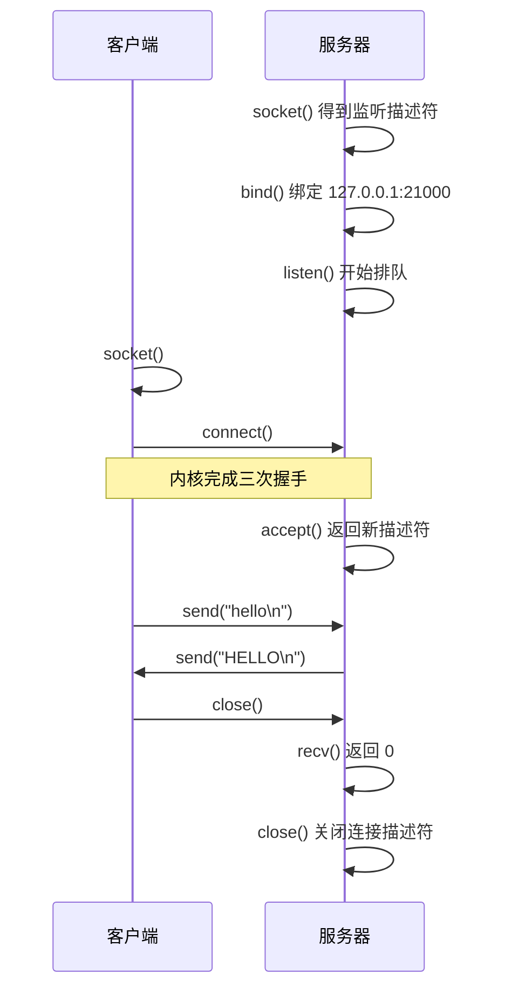
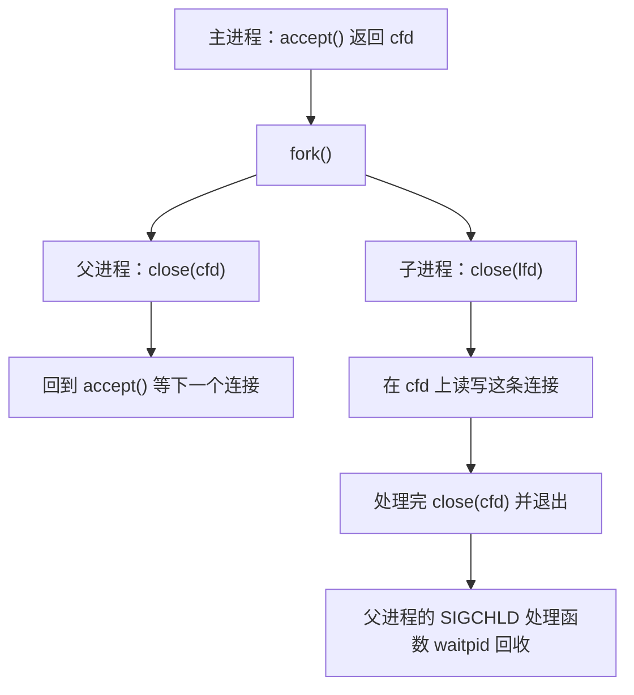

# 10. 套接字编程

`nc`、`curl`、浏览器、数据库客户端，背后都是同一组系统调用。程序调用 `socket` 拿到一个描述符，用 `bind` 和 `listen` 在某个端口上等待，用 `connect` 建立连接，然后像读写普通文件一样收发数据。这一页从这组调用出发，写出一个能同时服务多个客户端的小服务器，并处理这条路上绕不开的几件事：地址怎么表示、消息的边界在哪里、连接怎样关闭、服务器怎样同时服务多个客户端。

这一页的服务器一律绑定 `127.0.0.1`，端口从 21000 起，客户端用 `nc` 或 `code/系统编程/10_套接字编程/` 下配套的程序。前面[第 9 章](/教程/正文/系统编程/9_网络基础)讲了 TCP 与 UDP 的协议行为，这里讲程序怎么调用它们。文中终端里的端口号、PID 和耗时都来自某次运行，读者自己跑出来的数字会不同。

## 1. 套接字是什么

`socket` 系统调用返回一个文件描述符，和 `open` 返回的是同一类东西：可以 `read`、`write`、`close`，也可以放进 `poll` 或 `select` 等待（[第 11 章](/教程/正文/系统编程/11_非阻塞IO与IO多路复用)）。`read` 和 `write` 对套接字完全有效，`send` 和 `recv` 是同一套读写操作的入口，多出一个 `flags` 参数。

::: concept sys-socket-is-fd title="套接字就是文件描述符"

在 POSIX 中，套接字 (socket) 是一个文件描述符。它可以使用 `read`、`write`、`close` 以及 I/O 多路复用函数。`send`、`recv`、`sendto`、`recvfrom` 是这个描述符上的同类操作，区别在于可以携带标志和数据报的地址。

:::

创建套接字要指定两个属性：地址族 (address family) 和套接字类型 (socket type)。地址族决定地址怎么表示、谁来路由数据；类型决定数据以字节流还是数据报的形式交付。

| 地址族 | 地址形式 | 说明 |
| --- | --- | --- |
| `AF_INET` | IPv4 地址加端口 | 最常用，本页绝大多数示例 |
| `AF_INET6` | IPv6 地址加端口 | `::1` 是回环地址，与 `127.0.0.1` 对应 |
| `AF_UNIX` | 文件系统路径 | 同一台机器上的进程通信，路径就是一个套接字文件 |

| 类型 | 语义 | 对应协议 |
| --- | --- | --- |
| `SOCK_STREAM` | 有序、可靠的字节流，先建立连接 | TCP |
| `SOCK_DGRAM` | 保留消息边界的数据报，不保证送达和顺序 | UDP |

`AF_INET` 配 `SOCK_STREAM` 就是 TCP 套接字，配 `SOCK_DGRAM` 就是 UDP 套接字。`AF_UNIX` 两种类型都支持，用它写的程序不需要经过网络协议栈，但调用方式与 TCP 套接字相同。

三种地址族、两种类型，写出来的调用序列大致分两套。TCP 服务器依次调用 `socket`、`bind`、`listen`，然后反复 `accept`；客户端调用 `socket` 和 `connect`。UDP 服务器 `bind` 之后直接 `recvfrom`，没有 `listen` 和 `accept`。



图中的三次握手发生在 `connect` 与 `accept` 之间。`connect` 返回成功时握手已经完成；`accept` 只是从已完成队列里取出一条连接，队列为空时它阻塞等待。

::: tip 监听描述符和连接描述符是两回事

`listen` 之后套接字变成监听套接字，它只负责接收新的连接请求，不能用来收发数据。`accept` 返回的是另一个描述符，代表某一条已经建立的连接。服务器对每个连接读写的是 `accept` 的返回值，监听套接字自始至终只用来 `accept`。

:::

<Quiz
  type="single"
  :options="[
    { label: 'accept 返回的描述符', value: 'A' },
    { label: '监听套接字本身', value: 'B' },
    { label: 'connect 成功之后的套接字', value: 'C' },
    { label: 'bind 返回的描述符', value: 'D' }
  ]"
  answer="A"
>

服务器要往某条已建立的 TCP 连接上写数据，应该用哪个描述符？

</Quiz>

## 2. 地址与字节序

套接字的地址不是单个结构体，而是一族结构体共用的前缀布局。IPv4 用 `struct sockaddr_in`，IPv6 用 `struct sockaddr_in6`，Unix 域用 `struct sockaddr_un`。所有函数都接收 `struct sockaddr *`，这个类型只声明了地址族字段，具体布局由各地址族自己解释。

```c
struct sockaddr {
    sa_family_t sa_family;   /* 地址族：AF_INET、AF_INET6、AF_UNIX… */
    char sa_data[14];        /* 各地址族自己解释这部分 */
};

struct sockaddr_in {
    sa_family_t sin_family;  /* AF_INET */
    in_port_t sin_port;      /* 16 位端口，网络字节序 */
    struct in_addr sin_addr; /* 32 位 IPv4 地址，网络字节序 */
    /* 填充到 sizeof(struct sockaddr) */
};

struct sockaddr_in6 {
    sa_family_t sin6_family;   /* AF_INET6 */
    in_port_t sin6_port;       /* 16 位端口，网络字节序 */
    uint32_t sin6_flowinfo;
    struct in6_addr sin6_addr; /* 128 位 IPv6 地址 */
    uint32_t sin6_scope_id;
};
```

传给 `bind`、`connect` 的总是 `struct sockaddr *`，实际参数则是指向 `sockaddr_in` 或 `sockaddr_in6` 的指针，转换过去，同时给出真实长度。函数先读开头的 `sa_family`，判断该按哪一族的布局解释后面的字节，长度参数保证它不会越过结构体的末尾。这种「共用开头一段 + 长度参数」的写法就是套接字接口的约定，转换本身只改变指针的静态类型。接收地址时用 `struct sockaddr_storage`，它足够大，能装下所有地址族。

端口和 IPv4 地址在内存里必须按网络字节序 (network byte order) 存放，也就是大端序：高位字节在前。不同机器的本机字节序不同，所以写入前要用 `htons`（host to network short）和 `htonl`（host to network long）转换，读出来时用 `ntohs`、`ntohl` 转回本机序。

```c
#define _POSIX_C_SOURCE 200809L

#include <arpa/inet.h>
#include <stdint.h>
#include <stdio.h>

int main(void) {
    uint16_t host_port = 21000;
    uint32_t host_addr = 0x7f000001u;

    uint16_t net_port = htons(host_port);
    uint32_t net_addr = htonl(host_addr);

    printf("host order: port=0x%04x addr=0x%08x\n", host_port, host_addr);
    printf("network order: port=0x%04x addr=0x%08x\n", net_port, net_addr);
    printf("back again: port=%u addr=0x%08x\n", ntohs(net_port),
           ntohl(net_addr));

    uint32_t be = htonl(host_addr);
    const unsigned char *raw = (const unsigned char *)&be;
    printf("127.0.0.1 on the wire: %u.%u.%u.%u\n", raw[0], raw[1],
           raw[2], raw[3]);

    struct in_addr a;
    if (inet_pton(AF_INET, "192.168.1.10", &a) != 1) {
        return 1;
    }
    char text[INET_ADDRSTRLEN];
    if (inet_ntop(AF_INET, &a, text, sizeof text) == NULL) {
        return 1;
    }
    printf("inet_pton then inet_ntop: %s\n", text);

    struct in6_addr a6;
    if (inet_pton(AF_INET6, "::1", &a6) != 1) {
        return 1;
    }
    char text6[INET6_ADDRSTRLEN];
    if (inet_ntop(AF_INET6, &a6, text6, sizeof text6) == NULL) {
        return 1;
    }
    printf("IPv6 loopback: %s (buffer %d bytes)\n", text6, INET6_ADDRSTRLEN);
    return 0;
}
```

在 x86-64 上运行（完整文件在 `code/系统编程/10_套接字编程/endian.c`）：

::: terminal title="bash - endian"

<span class="prompt">\$</span> gcc -std=c17 -Wall -Wextra -g endian.c -o endian

<span class="prompt">\$</span> ./endian

host order: port=0x5208 addr=0x7f000001

network order: port=0x0852 addr=0x0100007f

back again: port=21000 addr=0x7f000001

127.0.0.1 on the wire: 127.0.0.1

inet_pton then inet_ntop: 192.168.1.10

IPv6 loopback: ::1 (buffer 46 bytes)

:::

21000 写成十六进制是 `0x5208`，`htons` 之后变成 `0x0852`；这个 16 位整数在小端机上存进内存时，地址从低到高的两个字节是 `52 08`，按顺序发到线上正好是大端的 `0x5208`。`0x7f000001` 转成 `0x0100007f` 之后，内存字节依次是 `7f 00 00 01`，正好是 `127.0.0.1` 的四段。

不转换的后果不会立刻报错，而是安静地绑到另一个端口上。`code/系统编程/10_套接字编程/htons_bug.c` 把 `sin_port` 直接赋成 `21000`：

::: terminal title="bash - htons_bug"

<span class="prompt">\$</span> ./htons_bug

kernel reports port 2130 (0x0852)

:::

内核把 `0x5208` 当成网络字节序解释，换算出来是 2130。程序自己以为在 21000 上监听，`ss` 里看到的是 2130。这是套接字程序最常见的错误之一。

::: tip 只在填地址时判断是否要转换

凡是从结构体里取出或写入端口、IPv4 地址的地方都过一遍 `htons`/`htonl`，`inet_pton` 和 `inet_ntop` 自己处理字节序，不需要再转换。IPv6 的 `sin6_addr` 由 `inet_pton` 填好，也不用转。

:::

`inet_pton`（presentation to network）把 `"192.168.1.10"` 这样的字符串转成二进制地址，`inet_ntop`（network to presentation）反过来输出文本。缓冲区用 `INET6_ADDRSTRLEN`（46 字节）足够放下 IPv6 的完整写法，IPv4 用 `INET_ADDRSTRLEN`（16 字节）。用 `sprintf` 手工拼接地址字符串在套接字程序里没有必要，也容易漏掉字节序。

`127.0.0.1` 和 `::1` 是回环地址，指向本机。只有本机进程能连上绑定在回环地址上的服务器，这正是本页所有示例绑定 `127.0.0.1` 的原因。端口小于 1024 需要特权，本页统一从 21000 起。

<Quiz
  type="single"
  :options="[
    { label: '因为网络传输统一使用大端序，端口和 IPv4 地址要转换', value: 'A' },
    { label: '因为 htons 会顺便检查端口是否合法', value: 'B' },
    { label: '因为 bind 要求端口必须是奇数', value: 'C' },
    { label: '不转换也能工作，只是可读性差', value: 'D' }
  ]"
  answer="A"
>

给 `sin_port` 赋值前为什么要调用 `htons`？

</Quiz>

::: generate sys-sockaddr-family kind=explanation concepts=sys-socket-is-fd

面向第一次见到 `sockaddr` 这一族结构的读者，讲清三件事：为什么 `bind` 和 `connect` 的参数类型是 `struct sockaddr *` 而不是 `sockaddr_in *`（C 没有继承，只能用一个共用的虚类型加长度参数表达「可能是哪一种」）；强制类型转换在这里为什么能工作、又以什么为前提；以及 `sockaddr_storage` 在接收地址时解决什么问题。用 `AF_INET`、`AF_INET6`、`AF_UNIX` 三个例子对照，不要展开协议细节。

:::

## 3. getaddrinfo

手工填 `sockaddr_in` 要自己判断地址是 IPv4 还是 IPv6、要不要查 DNS、端口写成数字还是服务名。`getaddrinfo` 把这些事一起做了：给它主机名和端口，拿回一串地址候选，程序逐个尝试。

```c
int getaddrinfo(const char *node, const char *service,
                const struct addrinfo *hints, struct addrinfo **res);
void freeaddrinfo(struct addrinfo *res);
const char *gai_strerror(int errcode);
```

`node` 是主机名或数字地址，`service` 是端口号或服务名（`"http"` 就是 80）。`hints` 告诉它你要什么：地址族、套接字类型、是否用于服务器。返回的是一条 `addrinfo` 链表，每个节点都填好了一个完整的地址，可以直接拿去 `socket` 和 `bind`/`connect`。

```c
struct addrinfo {
    int ai_flags;             /* AI_PASSIVE、AI_NUMERICHOST 等 */
    int ai_family;            /* AF_INET、AF_INET6 或 AF_UNSPEC */
    int ai_socktype;          /* SOCK_STREAM、SOCK_DGRAM */
    int ai_protocol;          /* 通常为 0，由前两项决定 */
    socklen_t ai_addrlen;     /* ai_addr 的长度 */
    struct sockaddr *ai_addr; /* 指向一个 sockaddr_in 或 sockaddr_in6 */
    char *ai_canonname;
    struct addrinfo *ai_next; /* 下一条候选 */
};
```

`hints` 只需要填关心的字段，其余清零。最常用的三项：`ai_family = AF_UNSPEC` 表示 IPv4 和 IPv6 都要，`ai_socktype = SOCK_STREAM` 表示要 TCP，`ai_flags = AI_PASSIVE` 表示给服务器用（`node` 传 `NULL` 时返回 `0.0.0.0` 和 `::` 这样的通配地址）。

::: concept sys-getaddrinfo-error title="getaddrinfo 的错误约定"

`getaddrinfo` 不设置 `errno`，也不返回 -1。它返回 0 表示成功，返回非零的错误码，用 `gai_strerror` 转成说明文字。这和「返回 -1 并设置 errno」的惯例不同，和 pthread 函数「直接返回错误号」的做法相同。

:::

这是全书出现的第三种错误约定。`errno` 在这里没有意义，`perror` 打出来的东西也不对。

`getaddrinfo` 返回的链表可能有多条：`localhost` 同时解析出 `::1` 和 `127.0.0.1`，一个主机名也可能对应多个 IP。程序应当逐个尝试，而不是只取第一条。

```c
#define _POSIX_C_SOURCE 200809L

#include <netdb.h>
#include <netinet/in.h>
#include <stdio.h>
#include <stdlib.h>
#include <string.h>
#include <sys/socket.h>
#include <sys/types.h>

int main(int argc, char *argv[]) {
    if (argc != 3) {
        fprintf(stderr, "usage: %s HOST PORT\n", argv[0]);
        return EXIT_FAILURE;
    }

    struct addrinfo hints = {0};
    hints.ai_family = AF_UNSPEC;
    hints.ai_socktype = SOCK_STREAM;

    struct addrinfo *res = NULL;
    int rc = getaddrinfo(argv[1], argv[2], &hints, &res);
    if (rc != 0) {
        fprintf(stderr, "getaddrinfo: %s\n", gai_strerror(rc));
        return EXIT_FAILURE;
    }

    for (const struct addrinfo *p = res; p != NULL; p = p->ai_next) {
        char host[INET6_ADDRSTRLEN];
        char serv[16];
        rc = getnameinfo(p->ai_addr, p->ai_addrlen, host, sizeof host, serv,
                         sizeof serv, NI_NUMERICHOST | NI_NUMERICSERV);
        if (rc != 0) {
            fprintf(stderr, "getnameinfo: %s\n", gai_strerror(rc));
            continue;
        }
        const char *family = "other";
        if (p->ai_family == AF_INET) {
            family = "AF_INET";
        } else if (p->ai_family == AF_INET6) {
            family = "AF_INET6";
        }
        printf("family=%-7s socktype=%d protocol=%2d address=%s port=%s\n",
               family, p->ai_socktype, p->ai_protocol, host, serv);
    }

    freeaddrinfo(res);
    return EXIT_SUCCESS;
}
```

完整文件在 `code/系统编程/10_套接字编程/resolve.c`。运行：

::: terminal title="bash - resolve"

<span class="prompt">\$</span> ./resolve localhost 21000

family=AF_INET6 socktype=1 protocol= 6 address=::1 port=21000

family=AF_INET socktype=1 protocol= 6 address=127.0.0.1 port=21000

<span class="prompt">\$</span> ./resolve 127.0.0.1 80

family=AF_INET socktype=1 protocol= 6 address=127.0.0.1 port=80

<span class="prompt">\$</span> ./resolve localhost http

family=AF_INET6 socktype=1 protocol= 6 address=::1 port=80

family=AF_INET socktype=1 protocol= 6 address=127.0.0.1 port=80

:::

`localhost` 先给出 IPv6 的 `::1`，再给出 IPv4 的 `127.0.0.1`。服务名 `http` 被解析成 80。这个顺序由系统的名称解析配置决定，程序不该假定第一个一定是 IPv4。

解析失败时：

::: terminal title="bash - resolve"

<span class="prompt">\$</span> ./resolve no-such-host.invalid 80

getaddrinfo: Name or service not known

<span class="prompt">\$</span> ./resolve localhost nosuchservice

getaddrinfo: Servname not supported for ai_socktype

:::

错误码转成了可读文字。注意第二条例子里主机名没问题，是服务名不被 `SOCK_STREAM` 支持。

`getnameinfo` 是反向操作：把二进制的 `sockaddr` 变回文本。参数 `NI_NUMERICHOST | NI_NUMERICSERV` 要求直接输出数字，不要做反向 DNS 查询。服务器收到一个连接时打印对端地址，如果这里触发了 DNS 查询，一个请求就能让它卡住几秒。缓冲区用 `INET6_ADDRSTRLEN` 就够了，不需要 `NI_MAXHOST`（那个宏要 `_DEFAULT_SOURCE`，比需要的长度大得多）。

服务器端用 `getaddrinfo` 时，`hints.ai_flags = AI_PASSIVE`，`node` 传 `NULL`，得到通配地址（`passive.c`）：

::: terminal title="bash - passive"

<span class="prompt">\$</span> ./passive

family=2 addr=0.0.0.0

family=10 addr=::

:::

`0.0.0.0` 和 `::` 表示监听本机所有地址。本页的服务器不这样做，而是显式写出 `"127.0.0.1"`，只接受本机连接。

<Quiz
  type="single"
  :options="[
    { label: '检查 errno 并调用 perror', value: 'A' },
    { label: '把返回值交给 gai_strerror 转成文字', value: 'B' },
    { label: '打印 strerror(getaddrinfo(...)) 的结果', value: 'C' },
    { label: '检查返回值是否为 -1', value: 'D' }
  ]"
  answer="B"
>

`getaddrinfo` 返回非零值时，应该怎么得到错误说明？

</Quiz>

::: generate sys-getaddrinfo-walk kind=explanation concepts=sys-getaddrinfo-error

面向刚写完第一个 `resolve` 的读者，逐段走读上面那段 `getaddrinfo` 用法：`hints` 每项各管什么、为什么 `ai_protocol` 留 0、链表为什么要遍历而不是取第一条、`freeaddrinfo` 释放的是什么。用一个「服务器同时有 IPv4 和 IPv6 地址，客户端只支持其中一种」的场景说明遍历的必要性，不要写 DNS 协议细节。

:::

## 4. 第一个 TCP 服务器和客户端

有了 `getaddrinfo`，服务器和客户端的骨架就可以写得和协议无关。服务器监听一个端口，把收到的每一行转成大写发回去，收到 `quit` 就关闭连接。这个程序在本部分后面几章会反复出现，按章升级。

### 4.1 服务器

```c
static int tcp_listen(const char *host, const char *port, int reuse) {
    struct addrinfo hints = {0};
    hints.ai_family = AF_UNSPEC;
    hints.ai_socktype = SOCK_STREAM;

    struct addrinfo *res = NULL;
    int rc = getaddrinfo(host, port, &hints, &res);
    if (rc != 0) {
        fprintf(stderr, "getaddrinfo: %s\n", gai_strerror(rc));
        exit(EXIT_FAILURE);
    }

    int lfd = -1;
    for (struct addrinfo *p = res; p != NULL; p = p->ai_next) {
        lfd = socket(p->ai_family, p->ai_socktype | SOCK_CLOEXEC,
                     p->ai_protocol);
        if (lfd < 0) {
            continue;
        }
        if (reuse) {
            int one = 1;
            if (setsockopt(lfd, SOL_SOCKET, SO_REUSEADDR, &one, sizeof one) <
                0) {
                die("setsockopt");
            }
        }
        if (bind(lfd, p->ai_addr, p->ai_addrlen) == 0) {
            break;
        }
        close(lfd);
        lfd = -1;
    }
    freeaddrinfo(res);

    if (lfd < 0) {
        die("bind");
    }
    if (listen(lfd, 16) < 0) {
        die("listen");
    }
    return lfd;
}
```

这段代码把 `getaddrinfo` 的结果逐条试着 `socket` 加 `bind`，第一条成功就退出循环。服务器不能假定某个特定地址族的地址一定可用。

`listen` 的第二个参数是 backlog，表示已完成握手、等待 `accept` 取走的连接队列长度。16 对一个演示程序足够；`SOMAXCONN` 让内核决定上限。队列满了以后新的连接请求会被拒绝或忽略，这跟服务器处理速度有关，不是越大越好。

`accept` 返回新描述符和对端地址：

```c
for (;;) {
    struct sockaddr_storage peer;
    socklen_t peer_len = sizeof peer;
    int cfd = accept(lfd, (struct sockaddr *)&peer, &peer_len);
    if (cfd < 0) {
        if (errno == EINTR) {
            continue;
        }
        die("accept");
    }
    print_peer(&peer, peer_len);
    handle_connection(cfd);
    close(cfd);
}
```

`peer` 用 `sockaddr_storage` 装，因为不知道对端是 IPv4 还是 IPv6。`peer_len` 是值—结果参数：调用前告诉内核缓冲区多大，调用后内核改成实际写入的长度。`print_peer` 用 `getnameinfo` 加 `NI_NUMERICHOST` 把它转成文本。`lecho_iter` 启动时还调用了 `signal(SIGPIPE, SIG_IGN)`，理由见 6.2 节。

`handle_connection` 是本页后面几节的主角，先看它处理一行的部分：

```c
static int handle_connection(int fd) {
    char buf[LINE_CAP];
    size_t used = 0;

    for (;;) {
        ssize_t n = recv(fd, buf + used, sizeof buf - used, 0);
        if (n < 0) {
            if (errno == EINTR) {
                continue;
            }
            return -1;
        }
        if (n == 0) {
            return 0;
        }
        used += (size_t)n;

        size_t start = 0;
        for (size_t i = 0; i < used; i++) {
            if (buf[i] != '\n') {
                continue;
            }
            buf[i] = '\0';
            if (strcmp(buf + start, "quit") == 0) {
                return 0;
            }
            for (char *q = buf + start; *q != '\0'; q++) {
                *q = (char)toupper((unsigned char)*q);
            }
            if (write_all(fd, buf + start, strlen(buf + start)) < 0 ||
                write_all(fd, "\n", 1) < 0) {
                return -1;
            }
            start = i + 1;
        }
        memmove(buf, buf + start, used - start);
        used -= start;
        if (used == sizeof buf) {
            return -1;
        }
    }
}
```

缓冲区里可能一次收到几行，也可能收到半行。每找到一行就处理，处理完把剩下的半行挪到开头。这就是第 5 节要展开的按行分帧，这里先把它写对。

完整服务器在 `code/系统编程/10_套接字编程/lecho_iter.c`。编译运行，另开一个终端用 `nc` 测试：

::: terminal title="bash - lecho_iter"

<span class="prompt">\$</span> gcc -std=c17 -Wall -Wextra -g lecho_iter.c -o lecho_iter

<span class="prompt">\$</span> ss -ltn 'sport = :21000'

State  Recv-Q Send-Q Local Address:Port  Peer Address:Port

<span class="prompt">\$</span> ./lecho_iter 21000

listening on 127.0.0.1 port 21000

:::

另一个终端：

::: terminal title="bash - nc"

<span class="prompt">\$</span> printf "hello\nworld\nquit\n" | nc -q 1 127.0.0.1 21000

HELLO

WORLD

:::

服务端输出：

::: terminal title="bash - lecho_iter"

listening on 127.0.0.1 port 21000

connection from 127.0.0.1 port 58266

:::

`ss -ltn 'sport = :21000'` 是确认端口状态的标准手法。`sport` 是本地端口，只挑出自己关心的那一条，不会把机器上其他服务列出来。启动前查一次，只输出表头，说明端口空闲；启动后再查一次，应该看到 `LISTEN`。

### 4.2 客户端

客户端只需要 `socket` 和 `connect`，本地端口由内核挑。同样要遍历 `getaddrinfo` 的候选：

```c
static int connect_to(const char *host, const char *port) {
    struct addrinfo hints = {0};
    hints.ai_family = AF_UNSPEC;
    hints.ai_socktype = SOCK_STREAM;

    struct addrinfo *res = NULL;
    int rc = getaddrinfo(host, port, &hints, &res);
    if (rc != 0) {
        fprintf(stderr, "getaddrinfo: %s\n", gai_strerror(rc));
        exit(EXIT_FAILURE);
    }

    int fd = -1;
    for (struct addrinfo *p = res; p != NULL; p = p->ai_next) {
        fd = socket(p->ai_family, p->ai_socktype | SOCK_CLOEXEC,
                    p->ai_protocol);
        if (fd < 0) {
            continue;
        }
        if (connect(fd, p->ai_addr, p->ai_addrlen) == 0) {
            break;
        }
        close(fd);
        fd = -1;
    }
    freeaddrinfo(res);

    if (fd < 0) {
        fprintf(stderr, "could not connect to %s port %s\n", host, port);
        exit(EXIT_FAILURE);
    }
    return fd;
}
```

循环尝试很重要：`localhost` 的第一条候选是 IPv6，如果服务器只监听 `127.0.0.1`，第一次 `connect` 会失败，第二次才成功。完整客户端在 `code/系统编程/10_套接字编程/lecho_client.c`。

::: terminal title="bash - lecho_client"

<span class="prompt">\$</span> printf "hello\nworld\nquit\n" | ./lecho_client 127.0.0.1 21000

echo: HELLO

echo: WORLD

connection closed

:::

`connection closed` 来自 `recv` 返回 0，第 6 节讲它的含义。

### 4.3 重启服务器：SO_REUSEADDR

服务器主动关闭一条连接之后，那个连接会进入 `TIME_WAIT` 状态，通常持续一分钟左右。如果服务器要绑定的端口上存在这样的连接，不带 `SO_REUSEADDR` 的 `bind` 会被拒绝。下面用 `lecho_iter PORT noreuse` 启动一个不设置该选项的服务器，连一次、发 `quit`，然后结束服务器：

::: terminal title="bash - lecho_iter"

<span class="prompt">\$</span> ./lecho_iter 21025 noreuse

listening on 127.0.0.1 port 21025

:::

客户端连上、发 `quit`，服务器关闭这条连接；结束服务器之后查看端口状态：

::: terminal title="bash - ss"

<span class="prompt">\$</span> ss -tan 'sport = :21025 or dport = :21025'

State     Recv-Q Send-Q Local Address:Port  Peer Address:Port

TIME-WAIT 0      0          127.0.0.1:21025    127.0.0.1:47340

:::

立即重启，`bind` 被拒绝：

::: terminal title="bash - lecho_iter"

<span class="prompt">\$</span> ./lecho_iter 21025 noreuse

bind: Address already in use

:::

`lecho_iter` 在 `bind` 失败时直接 `die`，进程以非零状态退出。这里的 `TIME_WAIT` 是服务器主动关闭那条连接留下的：客户端先关闭时，残留落在客户端的临时端口上，服务器端口就能直接绑定。

换成设置过 `SO_REUSEADDR` 的版本，在另一个端口重复同样步骤：

::: terminal title="bash - lecho_iter"

<span class="prompt">\$</span> ./lecho_iter 21026

listening on 127.0.0.1 port 21026

:::

::: terminal title="bash - ss"

<span class="prompt">\$</span> ss -tan 'sport = :21026 or dport = :21026'

State     Recv-Q Send-Q Local Address:Port  Peer Address:Port

TIME-WAIT 0      0          127.0.0.1:21026    127.0.0.1:36518

:::

同样产生了 `TIME_WAIT`，但重启成功：

::: terminal title="bash - lecho_iter"

<span class="prompt">\$</span> ./lecho_iter 21026

listening on 127.0.0.1 port 21026

:::

`TIME_WAIT` 为什么存在，[第 9.2 节](/教程/正文/系统编程/9_网络基础/9_2_TCP)讲过：它让连接中残存的报文彻底消散，避免旧报文被误当成新连接的数据。对服务器来说这不表示端口「正在使用」，只是上一段对话的残留。`SO_REUSEADDR` 允许在这种状态下绑同一个本地地址和端口。

::: concept sys-so-reuseaddr title="SO_REUSEADDR 允许绑定处于 TIME_WAIT 的本地端口"

设置了 `SO_REUSEADDR` 的监听套接字可以绑定本地地址和端口，即使该端口上存在处于 `TIME_WAIT` 状态的连接。它不会让两个进程同时监听同一个端口，也不会改变 `TIME_WAIT` 的持续时间。

:::

有一个细节值得记住：Linux 上要复用某个端口的 `TIME_WAIT`，上一次占用该端口的套接字也必须设置过 `SO_REUSEADDR`。只在重启后的程序里设置，而旧程序没设置时，绑定仍然会失败，这条规则在 socket(7) 的 `SO_REUSEADDR` 一节里写明。所以它应该从一开始就打开，不是等出问题再加。

::: compare left-title="不设置 SO_REUSEADDR" right-title="设置 SO_REUSEADDR"

```c
int lfd = socket(p->ai_family, p->ai_socktype, p->ai_protocol);
bind(lfd, p->ai_addr, p->ai_addrlen);
listen(lfd, 16);
```

---

```c
int lfd = socket(p->ai_family, p->ai_socktype, p->ai_protocol);
int one = 1;
setsockopt(lfd, SOL_SOCKET, SO_REUSEADDR, &one, sizeof one);
bind(lfd, p->ai_addr, p->ai_addrlen);
listen(lfd, 16);
```

:::

`SO_REUSEADDR` 必须在 `bind` 之前设置。客户端主动关闭时残留落在客户端的临时端口上，内核按需回绕，不需要程序操心；服务器端口上的 `TIME_WAIT` 才是这个选项要处理的情况。

<Quiz
  type="single"
  :options="[
    { label: '让两个进程同时监听同一个端口，实现多进程负载均衡', value: 'A' },
    { label: '允许服务器在重启后绑定仍有 TIME_WAIT 连接的本地端口', value: 'B' },
    { label: '加快 TIME_WAIT 状态的超时时间', value: 'C' },
    { label: '防止服务器因为客户端断开而收到 SIGPIPE', value: 'D' }
  ]"
  answer="B"
>

`SO_REUSEADDR` 解决什么问题？

</Quiz>

::: generate sys-first-server-walk kind=explanation concepts=sys-socket-is-fd

面向刚写完第一个能跑的 TCP 服务器的读者，按 `socket` → `bind` → `listen` → `accept` 的顺序逐行解释 `tcp_listen` 和主循环：为什么 `bind` 失败要换成下一条候选、`listen` 的 backlog 在内核里对应哪个队列、`accept` 返回的描述符与监听描述符的关系、`peer` 和 `peer_len` 这对参数怎么用。最后用一句话指出客户端 `connect` 的循环和服务器 `bind` 的循环结构一样，都是「遍历候选直到成功」。

:::

## 5. 字节流与消息分帧

TCP 不保留消息边界。`send` 一次送进去 12 个字节，对方 `recv` 可能一次收到 12 个，也可能先收到 5 个再收到 7 个，还可能连后面一次 `send` 的数据一起收到。这是字节流 (byte stream) 的定义，不是异常。应用层把字节流切成一条条消息的做法叫消息分帧 (message framing)。

::: concept sys-tcp-byte-stream title="TCP 是字节流，不保留消息边界"

TCP 保证字节按顺序送达，不保证 `send` 与 `recv` 一一对应。一次 `send` 的数据可能被拆成多次 `recv` 收到，多次 `send` 的数据也可能合并成一次 `recv`。应用层必须自己定义消息边界。

:::

先看合并。`code/系统编程/10_套接字编程/boundary.c` 的 `merge` 模式让客户端连续 `send` `"hello\n"` 和 `"world\n"`，中间隔 50 毫秒；服务器等 200 毫秒再一次 `recv`：

::: terminal title="bash - boundary"

<span class="prompt">\$</span> ./boundary merge

one recv returned 12 bytes: hello\nworld\n

:::

两次 `send` 的内容出现在一次 `recv` 的返回值里。服务器如果写「一次 `recv` 就是一条消息」，它会把这两条当成一条。

再看拆分。`split` 模式让客户端一次 `send` 1 MiB，服务器用 64 KiB 缓冲区收：

::: terminal title="bash - boundary"

<span class="prompt">\$</span> ./boundary split

sender: 1 write() calls for 1048576 bytes

recv side: 17 calls, 1048576 bytes total

:::

发送方一次 `write` 调用写完了 1 MiB（`write_all` 内部只调用了一次 `write`），接收方用了 17 次 `recv`。这个次数取决于内核缓冲区大小、网络条件和调度，每次运行可能不同；用 `strace -e trace=network` 能看到 `recvfrom` 的实际次数。

两个方向都会发生，而且可以同时发生：一次 `send` 被拆开，几次 `send` 被合并。指望 `recv` 的返回值等于某条消息的长度，程序只在开发机的回环测试里能跑。

### 5.1 按分隔符分帧

最常见的方案是用一个不出现在内容里的字节作分隔符。文本协议几乎都选换行符，`HTTP`、`SMTP`、`Redis` 的行命令都是这样。接收方维护一个缓冲区，每次 `recv` 追加进去，扫描缓冲区里的分隔符，找到一个完整的帧就处理一个。

```c
struct line_reader {
    int fd;
    char buf[LINE_CAP];
    size_t start; /* 下一个未处理的字节 */
    size_t end;   /* 已收到数据的末尾 */
};

/* 取一行，去掉行尾换行；连接关闭或出错时返回 -1。 */
static int next_line(struct line_reader *lr, char *out, size_t cap) {
    for (;;) {
        for (size_t i = lr->start; i < lr->end; i++) {
            if (lr->buf[i] != '\n') {
                continue;
            }
            size_t len = i - lr->start;
            if (len >= cap) {
                len = cap - 1;
            }
            memcpy(out, lr->buf + lr->start, len);
            out[len] = '\0';
            lr->start = i + 1;
            return (int)len;
        }

        if (lr->start > 0) {
            memmove(lr->buf, lr->buf + lr->start, lr->end - lr->start);
            lr->end -= lr->start;
            lr->start = 0;
        }
        if (lr->end == sizeof lr->buf) {
            return -1;
        }

        ssize_t n = recv(lr->fd, lr->buf + lr->end, sizeof lr->buf - lr->end, 0);
        if (n < 0) {
            if (errno == EINTR) {
                continue;
            }
            return -1;
        }
        if (n == 0) {
            return -1;
        }
        lr->end += (size_t)n;
    }
}
```

`next_line` 的循环结构是这段代码的要点：先在已有数据里找分隔符，找不到就挪动剩余数据、再 `recv`，直到找到或者连接关闭。缓冲区满而没有分隔符说明对方在发超长行，这时返回 -1 断开，而不是无限制地扩大缓冲区（[第 14 章](/教程/正文/系统编程/14_系统程序的健壮性与安全边界)会把这个上限做成参数）。

::: warning 半行必须留在缓冲区里

`recv` 的返回值是「这次拿到了多少字节」，不是「一条消息有多长」。一行的后半截可能还在网络上，下一次 `recv` 才到达。直接对 `recv` 的结果按整行处理，会在网络繁忙时丢掉半行。

:::

### 5.2 长度前缀分帧

二进制协议通常不用分隔符，因为任何字节值都可能出现在数据里。做法是在消息前面加一个固定长度的长度字段：先读 4 个字节得到长度 $L$，再读 $L$ 个字节得到负载。长度字段本身用网络字节序传送。

```c
/* 读满 len 个字节；对端提前关闭时返回已读字节数。 */
static int read_full(int fd, void *buf, size_t len) {
    char *p = buf;
    size_t got = 0;

    while (got < len) {
        ssize_t n = read(fd, p + got, len - got);
        if (n < 0) {
            if (errno == EINTR) {
                continue;
            }
            return -1;
        }
        if (n == 0) {
            break;
        }
        got += (size_t)n;
    }
    return (int)got;
}

/* 发送一条消息：4 字节长度前缀（网络字节序）加负载。 */
static int send_msg(int fd, const void *payload, size_t len) {
    uint32_t be = htonl((uint32_t)len);
    if (write(fd, &be, sizeof be) != (ssize_t)sizeof be) {
        return -1;
    }
    const char *p = payload;
    size_t left = len;
    while (left > 0) {
        ssize_t n = write(fd, p, left);
        if (n < 0) {
            if (errno == EINTR) {
                continue;
            }
            return -1;
        }
        p += n;
        left -= (size_t)n;
    }
    return 0;
}

/* 接收一条消息；调用者提供缓冲区并给出容量。成功返回负载长度。 */
static int recv_msg(int fd, char *buf, size_t cap) {
    uint32_t be = 0;
    if (read_full(fd, &be, sizeof be) != (int)sizeof be) {
        return -1;
    }
    size_t len = ntohl(be);
    if (len >= cap) {
        return -1;
    }
    if (read_full(fd, buf, len) != (int)len) {
        return -1;
    }
    buf[len] = '\0';
    return (int)len;
}
```

`read_full` 的名称和签名在全书统一（[第 2 章](/教程/正文/系统编程/2_文件描述符与非缓冲IO)定义了 `write_all`），后面的章节直接沿用。它返回实际读到的字节数，正常情况等于 `len`，对端提前关闭时小于 `len`。`recv_msg` 先用 `read_full` 读长度，再读负载，中间不关心内核把数据分成几段。`send_msg` 的长度字段用 `write` 一次写出，4 个字节远小于内核缓冲区，不会只写出一部分；负载部分仍走循环，因为大消息确实可能只写出一部分。

完整程序在 `code/系统编程/10_套接字编程/length_prefix.c`：

::: terminal title="bash - length_prefix"

<span class="prompt">\$</span> gcc -std=c17 -Wall -Wextra -g length_prefix.c -o length_prefix

<span class="prompt">\$</span> ./length_prefix

server got 5 bytes: first

server got 23 bytes: a longer second message

server got 5 bytes: third

server: peer closed

:::

客户端连续发了三条消息，服务器按消息处理，长度各不相同也正确。三条消息的负载加长度前缀一共 45 字节，如果直接拿 `recv` 的返回值当消息，这 45 个字节会被切成两三段，切在哪里由内核决定。

::: compare left-title="假设一次 recv 就是一条消息" right-title="按帧解析"

```c
/* 错误：边界由发送方的 send 决定 */
ssize_t n = recv(fd, buf, sizeof buf, 0);
if (n > 0) {
    buf[n] = '\0';
    handle_message(buf);
}
```

---

```c
/* 正确：边界由协议决定 */
struct line_reader lr = {.fd = fd};
char line[LINE_CAP];
while (next_line(&lr, line, sizeof line) >= 0) {
    handle_message(line);
}
```

:::

左栏的写法在回环上跑一百次可能九十九次都对，剩下的那一次在线上就是数据错乱。分帧规则定义在协议里，不是从 `recv` 的返回值里观察出来的。

::: tip 长度字段的上限

长度字段是对方给的值，不能拿来直接分配内存。先检查它是否超过协议允许的最大长度，再决定是接受、丢掉还是断开。`recv_msg` 里的 `len >= cap` 检查就是这一条。

:::

::: generate sys-framing-walk kind=explanation concepts=sys-tcp-byte-stream

面向刚被「一次 recv 收到两行」或「1 MiB 发了 17 次」弄糊涂的读者，用两条时间线分别讲合并与拆分：发送方 `send` 几次、内核缓冲区怎么攒、接收方 `recv` 为什么看到不同的切分。然后演示如果不用分帧，同一段程序在慢速网络下会出现什么错误结果。最后对比分隔符与长度前缀两种方案各适合什么数据（文本对二进制）。

:::

## 6. 关闭连接

`close` 把一个文件描述符还给内核，但套接字的关闭有更多层次：可以只关一个方向，也可以等到对端关闭。

### 6.1 半关闭

`shutdown(fd, SHUT_WR)` 做半关闭 (half-close)，关闭写方向：以后不能再 `send`，而本端仍然可以 `recv`；对端读到的是 EOF，与对端调用 `close` 时看到的一样。这适合「发完请求、接着读应答」的协议。`SHUT_RD` 关闭读方向，`SHUT_RDWR` 两个方向都关。

```c
static void client(uint16_t port) {
    /* 省略 socket 与 connect，完整代码见 halfclose.c */
    const char *request = "hello server\n";
    if (write_all(fd, request, strlen(request)) < 0) {
        die("write");
    }

    puts("client: request sent, calling shutdown(SHUT_WR)");
    fflush(stdout);
    if (shutdown(fd, SHUT_WR) < 0) {
        die("shutdown");
    }

    char buf[4096];
    for (;;) {
        ssize_t n = recv(fd, buf, sizeof buf, 0);
        if (n < 0) {
            if (errno == EINTR) {
                continue;
            }
            die("recv");
        }
        if (n == 0) {
            puts("client: recv returned 0");
            fflush(stdout);
            break;
        }
        printf("client received: %.*s", (int)n, buf);
        fflush(stdout);
    }
    close(fd);
}
```

服务器一直读到 EOF 才处理整段请求，然后把结果写回：

::: terminal title="bash - halfclose"

<span class="prompt">\$</span> ./halfclose

client: request sent, calling shutdown(SHUT_WR)

server: got 13 bytes before EOF

client received: HELLO SERVER

client: recv returned 0

:::

`recv` 返回 0 表示对端关闭了写方向（正常关闭），没有更多数据。这是字节流的 EOF，和读文件读到末尾一样。

::: tip recv 返回 0 是关闭，返回值小于 0 才是错误

`recv` 的三个返回值各有含义：大于 0 是字节数，等于 0 是对端关闭，小于 0 是错误（`errno` 说明原因）。把 0 当成错误处理，或者用 `<= 0` 判断 EOF 而不管 `errno`，都会让网络瞬断被误报成数据结束。

:::

`close` 和 `shutdown` 的区别在于影响范围：`close` 只释放本进程手里的这一个描述符，如果有别的进程通过 `fork` 或 `dup` 持有同一连接，他们照样能读写；`shutdown` 影响的是连接本身，共享这个连接的所有进程都受影响。第 7 节的 fork 服务器依赖前者：父进程 `close` 掉连接描述符之后，子进程手里那份仍然能用。

### 6.2 SIGPIPE

往一个已经被对端关闭的连接写数据，进程会收到 `SIGPIPE`。它的默认动作是终止进程，所以一个没处理的服务器，只要客户端提前关闭连接，整个服务器就没了。

测这个行为需要一个「读完立刻关闭」的服务器。`code/系统编程/10_套接字编程/close_at_once.c` 接受连接、读一次、然后立刻 `close`；同目录的 `sigpipe_client.c` 每 100 毫秒发 256 字节，连发三次：

::: terminal title="bash - close_at_once"

<span class="prompt">\$</span> ./close_at_once 21021

server: read 256 bytes, then closes the connection

:::

::: terminal title="bash - sigpipe_client"

<span class="prompt">\$</span> ./sigpipe_client 127.0.0.1 21021

send #1: wrote 256 bytes

send #2: wrote 256 bytes

<span class="prompt">\$</span> echo \$?

141

:::

进程被 `SIGPIPE` 终止，shell 报出的退出状态是 141，即 128 加 13（SIGPIPE 的编号）。前两次 `send` 都返回了成功：数据交给了内核，而对端关闭的通知还没传回来。第三次 `send` 时内核已经知道连接失效，信号就是在这一次调用里发出的，所以进程没能打印出 `send #3` 那一行。

::: concept sys-sigpipe title="向已关闭的连接写入产生 SIGPIPE"

当对端已经关闭了连接，再向套接字写入数据，内核会向进程发送 `SIGPIPE`。`SIGPIPE` 没有被忽略或捕获时，进程按默认动作终止，写入调用不再返回。它被忽略或捕获时，写入调用返回 -1，`errno` 为 `EPIPE`。

:::

处理方式有两种。第一是忽略这个信号，让 `write` 返回 `EPIPE`，由程序决定怎么办：

```c
signal(SIGPIPE, SIG_IGN);
```

第二是在每次写入时加 `MSG_NOSIGNAL` 标志，只抑制这一次调用的信号：

::: terminal title="bash - sigpipe_client"

<span class="prompt">\$</span> ./sigpipe_client 127.0.0.1 21021 nosignal

send #1: wrote 256 bytes

send #2: wrote 256 bytes

send #3: Broken pipe

<span class="prompt">\$</span> echo \$?

0

:::

同一段代码，加上 `MSG_NOSIGNAL` 之后进程正常退出，`send` 返回 -1、`errno` 为 `EPIPE`。服务器一般在启动时 `signal(SIGPIPE, SIG_IGN)`，这样任何一次写都不会被信号打死；客户端如果只在一两处写，用 `MSG_NOSIGNAL` 更精确。

::: compare left-title="只检查 send 的返回值" right-title="忽略 SIGPIPE 并处理 EPIPE"

```c
ssize_t n = send(fd, buf, len, 0);
if (n < 0) {
    perror("send");
    return -1;
}
```

---

```c
signal(SIGPIPE, SIG_IGN);
/* … */
ssize_t n = send(fd, buf, len, 0);
if (n < 0) {
    if (errno == EPIPE) {
        return 0; /* 对端不再接收，正常收场 */
    }
    perror("send");
    return -1;
}
```

:::

左栏的 `perror` 永远执行不到：进程在 `send` 返回之前就已经被信号终止了。

连接被重置是另一种关闭。对端用 RST 关闭（进程被杀、`SO_LINGER` 设为 0、协议错误）之后，本端的 `recv` 返回 `ECONNRESET`，之前的未读数据全部丢失。TCP 重置的成因[第 9.2 节](/教程/正文/系统编程/9_网络基础/9_2_TCP)讲过，程序这边只需要知道 `ECONNRESET` 和普通关闭一样，按连接结束处理即可。

## 7. 同时服务多个客户端

迭代服务器一次只服务一个客户端。第二个客户端连上来时，内核接受了它的连接（三次握手完成，连接在队列里），但服务器还在处理第一个，`accept` 没轮到它。

实测：A 连接后停 4 秒再退出，B 在 1 秒后连接并要求回显：

::: terminal title="bash - lecho_iter"

<span class="prompt">\$</span> ./lecho_iter 21082

listening on 127.0.0.1 port 21082

connection from 127.0.0.1 port 56404

:::

`connection from` 这一行是 A。B 的 `connection from` 要等 A 断开、服务器转回 `accept` 之后才打印出来。

另一个终端，A 占着连接期间执行：

::: terminal title="bash - nc"

<span class="prompt">\$</span> time (printf "beta\n" | nc -q 5 127.0.0.1 21082)

BETA

real    0m4.000s

user    0m0.006s

sys     0m0.000s

:::

B 的请求发出去了，等了 4 秒才拿到回复。它得等 A 断开、服务器从 `accept` 返回并处理完 A，才轮到自己的连接。这段延迟与网络无关，纯粹是服务器串行处理的结果。

两个办法让服务器同时服务多个连接：每个连接开一个子进程，或者每个连接开一个线程。

### 7.1 每连接一进程

主进程 `accept` 之后 `fork`，子进程负责这条连接，主进程立刻回去 `accept` 下一条：

```c
for (;;) {
    int cfd = accept(lfd, NULL, NULL);
    if (cfd < 0) {
        if (errno == EINTR) {
            continue;
        }
        die("accept");
    }

    pid_t pid = fork();
    if (pid < 0) {
        die("fork");
    }
    if (pid == 0) {
        close(lfd);
        handle_connection(cfd);
        close(cfd);
        exit(EXIT_SUCCESS);
    }

    close(cfd);
}
```

两行 `close` 各有原因。子进程关掉监听套接字，否则服务器进程结束时端口还会被子进程占着，重启时 `bind` 失败。父进程关掉连接描述符，否则每条连接会多留一个引用，即使子进程退出，连接也不会真正关闭。



父进程只碰监听套接字，子进程只碰连接描述符，两边各关掉自己不需要的那一份。最后一个节点由主进程的信号处理函数完成，与连接处理的执行流并行。

子进程退出后要回收，否则留下僵尸进程。[第 6 章](/教程/正文/系统编程/6_信号_时间与定时器)讲过，SIGCHLD 的处理函数里要循环 `waitpid`：

```c
static void reap_children(int signo) {
    (void)signo;
    int saved = errno;
    while (waitpid(-1, NULL, WNOHANG) > 0) {
    }
    errno = saved;
}

struct sigaction sa = {0};
sa.sa_handler = reap_children;
sigemptyset(&sa.sa_mask);
sa.sa_flags = SA_RESTART;
sigaction(SIGCHLD, &sa, NULL);
```

信号会合并，一次 `SIGCHLD` 可能对应多个子进程退出，所以处理函数里必须循环，不能只 `waitpid` 一次。`SA_RESTART` 让 `accept` 在信号到达后自动继续，不必在 `accept` 返回 `EINTR` 时自己重试；代码里照常检查 `EINTR`，因为有些调用无论如何都会被打断。

运行 `code/系统编程/10_套接字编程/lecho_fork.c`，用 A 占住连接时，B 立刻得到回应：

::: terminal title="bash - lecho_fork"

<span class="prompt">\$</span> ./lecho_fork 21030

listening on 127.0.0.1 port 21030 (one process per connection)

:::

同时另开一个终端，用 `nc` 发一行并在 3 秒后退出：

::: terminal title="bash - nc"

<span class="prompt">\$</span> printf "beta\n" | nc -q 3 127.0.0.1 21030

BETA

:::

`BETA` 立即返回，没有等 A 断开。A 还连着的时候，服务器进程的子树里能多看到一个 `lecho_fork`，就是为 A 服务的那个子进程（服务器的 PID 从上面那条 `listening` 之后的进程信息里取）：

::: terminal title="bash - ps"

<span class="prompt">\$</span> ps -o pid,ppid,stat,comm --ppid 3903073

    PID    PPID STAT COMMAND

3903095 3903073 S    lecho_fork

:::

A 断开后这个子进程消失，父进程照常接受新连接。`--ppid` 只列出这个服务器的子进程，不会碰到机器上其他进程。

### 7.2 每连接一线程

线程方案的结构一样，只是把 `fork` 换成 `pthread_create`。线程共享地址空间，所以不用关监听套接字，但描述符要按值传给线程，不能传局部对象的地址：

```c
struct conn_args {
    int fd;
};

static void *connection_thread(void *arg) {
    struct conn_args *ca = arg;
    int fd = ca->fd;
    free(ca);

    handle_connection(fd);
    close(fd);
    return NULL;
}

/* 主循环里的这一段，`attr` 见下文 */
for (;;) {
    int cfd = accept(lfd, NULL, NULL);
    if (cfd < 0) {
        if (errno == EINTR) {
            continue;
        }
        die("accept");
    }

    struct conn_args *ca = malloc(sizeof *ca);
    if (ca == NULL) {
        die("malloc");
    }
    ca->fd = cfd;

    pthread_t tid;
    int rc = pthread_create(&tid, &attr, connection_thread, ca);
    if (rc != 0) {
        close(cfd);
        free(ca);
        fprintf(stderr, "pthread_create: %s\n", strerror(rc));
    }
}
```

`attr` 在进入主循环之前用 `pthread_attr_init` 建好，再用 `pthread_attr_setdetachstate` 设成 `PTHREAD_CREATE_DETACHED`。分离线程结束后资源自动回收，不需要主线程 `pthread_join`。如果像[第 8 章](/教程/正文/系统编程/8_操作系统线程与同步)里很多示例那样用可连接线程，服务器就需要维护一张线程 ID 表，还得处理「线程已退出但没 join」的中间状态，得不偿失。

::: warning 按值传描述符

线程函数的参数是一个指针。主循环里的 `cfd` 是局部对象，每轮循环都重新赋值。如果把 `&cfd` 传给线程，线程拿到的是主循环那块存储的地址，下一轮 `accept` 时就变成新的描述符了。用一个每次 `malloc` 出来的结构体，或者把整数转成 `void *` 传（`(void *)(intptr_t)cfd`），都可以，但不要传局部对象的地址。

:::

运行 `code/系统编程/10_套接字编程/lecho_thread.c`，让一个客户端连着，再用 `ps -L` 看这个进程的线程（PID 换成服务器的）：

::: terminal title="bash - ps"

<span class="prompt">\$</span> ps -L -o pid,lwp,stat,comm -p 3903159

    PID     LWP STAT COMMAND

3903159 3903159 Sl   lecho_thread

3903159 3903207 Sl   lecho_thread

:::

两个 LWP（轻量级进程，即线程）中，一个在 `accept`，一个在处理连接。

### 7.3 三种模型对照

| 模型 | 隔离性 | 开销 | 共享状态 |
| --- | --- | --- | --- |
| 迭代 | 无并发 | 最低 | 天然串行 |
| 每连接一进程 | 完全独立，一个连接崩溃不影响其他 | 进程创建、页表、上下文切换 | 需要共享内存或 IPC |
| 每连接一线程 | 共享地址空间，一个线程崩溃波及整个进程 | 线程栈、上下文切换 | 直接访问，需要同步 |

进程模型的隔离对服务器是实实在在的优点：处理请求的代码如果有越界写，只毁掉一个子进程，主进程还能继续服务。代价是每个连接一个进程的内存和调度开销，几百个连接时可能还撑得住，几千个就开始吃力。

线程模型写起来更简单，共享数据不用 `mmap` 或管道，但一个处理函数里的空指针就足以让整个服务器退出。线程栈的默认大小跟 `ulimit -s` 走（通常是 8 MiB），这是保留的虚拟地址空间，拨给哪个线程就占掉那么多地址范围；几千个线程时，页表和栈的总量都要算一算。

作者的做法：连接数在几十个，两种都可以，按团队更熟悉哪个来；到成百上千个，这两个模型都不合适。每个连接一个执行单元的开销按连接数线性增长，而绝大多数连接在任意时刻都没有数据可处理。[第 11 章](/教程/正文/系统编程/11_非阻塞IO与IO多路复用)的多路复用把「等待」从每个连接一个执行单元里拿出来，用一个线程照看所有描述符，是这类服务器的标准做法。

::: generate sys-concurrency-models kind=explanation concepts=sys-tcp-byte-stream

面向已经写出迭代服务器、正在选并发模型的读者，用一个具体场景（200 个聊天连接，每个每秒发一句话）算一算三种模型各自要付出什么：进程模型 200 个进程的内存与调度、线程模型 200 个线程的栈与同步、多路复用 1 个线程加 200 个缓冲区。不做压力测试，只做数量级估算。最后说明为什么第 11 章要引入非阻塞 I/O。

:::

## 8. UDP

UDP 套接字没有连接，一次 `sendto` 指定目标地址，一次 `recvfrom` 得到数据和来源地址。

```c
ssize_t sendto(int fd, const void *buf, size_t len, int flags,
               const struct sockaddr *dest, socklen_t addrlen);
ssize_t recvfrom(int fd, void *buf, size_t len, int flags,
                 struct sockaddr *src, socklen_t *addrlen);
```

服务器 `bind` 之后循环 `recvfrom`，从 `src` 里拿到客户端地址，用 `sendto` 回给它。客户端可以 `bind` 一个固定端口，也可以不 `bind`，第一次 `sendto` 时由内核分配。与 TCP 不同，这里没有 `listen` 和 `accept`，也没有连接状态。

### 8.1 数据报边界

UDP 保留消息边界：一次 `sendto` 对应一次 `recvfrom`（丢掉的不算）。这听起来比 TCP 省心，但代价是缓冲区大小：`recvfrom` 的缓冲区装不下整个数据报时，多余的部分直接丢弃，不报错。`code/系统编程/10_套接字编程/udp_trunc.c` 演示这一点：

::: terminal title="bash - udp_trunc"

<span class="prompt">\$</span> ./udp_trunc

datagram of 10 bytes read into a 4-byte buffer: recv returned 4

last byte in buffer: '3'

second recv: Resource temporarily unavailable (nothing left)

:::

发送 10 字节，接收缓冲区 4 字节，`recv` 返回 4。剩下的 6 个字节不会留在队列里等下一次读，第二次读没有数据，返回 `EAGAIN`。要检测截断，得用 `recvmsg` 检查 `MSG_TRUNC` 标志，或者一开始就用够大的缓冲区。

### 8.2 connect 过的 UDP

UDP 套接字也可以 `connect`。它不发送任何报文，只是给套接字记下默认对端：之后可以用 `send`/`recv` 而不用每次写地址，内核也只把这个对端之外的报文丢掉。连接一个没有监听的端口，`connect` 本身成功，发送之后才在 `recv` 上得到错误（`udp_connected.c`）：

::: terminal title="bash - udp_connected"

<span class="prompt">\$</span> ./udp_connected

connect() succeeded without any listener

recv: Connection refused

:::

这个 `ECONNREFUSED` 来自对端的 ICMP 端口不可达报文。对需要重试或超时的程序，能区分「对端没在听」和「报文在路上丢了」是有用的。

### 8.3 骰子服务器

示例是一个掷骰子的 UDP 服务器（`code/系统编程/10_套接字编程/dice_server.c` 与 `dice_client.c`）：客户端发 `3d6`，服务器返回三个 1 到 6 之间的随机数；客户端设置 1 秒接收超时，超时后重试，最多三次。

超时用 `SO_RCVTIMEO`：

```c
struct timeval tv = {1, 0};
setsockopt(fd, SOL_SOCKET, SO_RCVTIMEO, &tv, sizeof tv);
```

超时之后 `recvfrom` 返回 -1，`errno` 是 `EAGAIN`。客户端的重试循环：

```c
for (int attempt = 1; attempt <= 3; attempt++) {
    sendto(fd, request, strlen(request), 0, res->ai_addr, res->ai_addrlen);
    ssize_t n = recvfrom(fd, reply, sizeof reply - 1, 0, NULL, NULL);
    if (n >= 0) {
        reply[n] = '\0';
        printf("attempt %d: %s", attempt, reply);
        return EXIT_SUCCESS;
    }
    if (errno == EAGAIN || errno == EWOULDBLOCK) {
        printf("attempt %d: timeout, retrying\n", attempt);
        continue;
    }
    die("recvfrom");
}
```

服务器端加了 `drop` 参数，按百分比随机丢弃请求。用 30% 的丢包率跑三次：

::: terminal title="bash - dice_client"

<span class="prompt">\$</span> ./dice_client 127.0.0.1 21052 3d6

attempt 1: 3d6 = 3 3 1 (total 7)

<span class="prompt">\$</span> ./dice_client 127.0.0.1 21052 3d6

attempt 1: timeout, retrying

attempt 2: 3d6 = 5 2 6 (total 13)

<span class="prompt">\$</span> ./dice_client 127.0.0.1 21052 3d6

attempt 1: 3d6 = 1 2 5 (total 8)

:::

第二次运行的第一个请求被丢了，重发一次就拿到结果。丢包率越高，需要重试的次数越多；连续两次都丢的概率是 $0.3 \times 0.3 = 0.09$，所以绝大多数请求第一次或第二次就能成功。丢包率 100% 时三次全超时，客户端报告放弃：

::: terminal title="bash - dice_client"

<span class="prompt">\$</span> ./dice_client 127.0.0.1 21051 3d6

attempt 1: timeout, retrying

attempt 2: timeout, retrying

attempt 3: timeout, retrying

giving up after 3 attempts

:::

::: warning 重试要能识别重复

请求超时重发时，第一个请求可能并没有丢，只是应答回来得晚了。服务器要能识别重复的请求，否则一次操作会被执行多次。这个骰子服务器无所谓（重掷一次没有副作用），但转账、下单这类操作必须有请求编号之类的去重手段。

:::

::: tip UDP 的缓冲区要按最大数据报给

UDP 的数据报在一次 `recvfrom` 里完整交付，缓冲区小于数据报就会截断。要么按协议规定的最大报文长度分配缓冲区，要么用 `recvmsg` 加 `MSG_TRUNC` 检测截断。

:::

<Quiz
  type="multi"
  :options="[
    { label: '一条消息可能被拆成多次 recv', value: 'A' },
    { label: '多次 send 的内容可能合并成一次 recv', value: 'B' },
    { label: 'recv 返回 0 表示对端关闭了写方向', value: 'C' },
    { label: '一次 UDP 的 recvfrom 可能收到两个数据报', value: 'D' }
  ]"
  :answer="['A', 'B', 'C']"
>

关于字节流和数据报的区别，下列说法正确的是哪些？

</Quiz>

## 9. Unix 域套接字

Unix 域套接字 (Unix domain socket) 用文件系统路径当地址，只在本机内通信。调用接口和 TCP 完全一样：`socket`、`bind`、`listen`、`accept`、`connect`、`send`、`recv` 全都能用。区别只在地址结构和一些本机特性。

```c
struct sockaddr_un {
    sa_family_t sun_family;  /* AF_UNIX */
    char sun_path[108];      /* 文件系统路径 */
};
```

几个要注意的地方：

- `bind` 会在文件系统里创建一个套接字文件，路径长度受 `sun_path` 限制（Linux 是 108 字节）。把路径写在当前目录下，像 `echo.sock`，就不用管绝对路径的长度。
- 路径已存在时 `bind` 失败。程序重启前要先 `unlink`，否则上一次留下的文件会挡住。
- 文件和普通文件一样有权限位，由文件的权限和目录的权限决定谁能连接。把套接字文件放在一个只有属主可进入的目录里，就是最简单的访问控制。
- 不经过 IP 协议栈，不需要端口和地址转换，同机通信比回环 TCP 少一些开销。
- 抽象命名空间（Linux 专有）：`sun_path[0]` 写成 `'\0'` 时不会创建文件，地址只是一段名字。适合不需要文件系统权限的场景，代价是别的进程在文件系统里看不到它。

`code/系统编程/10_套接字编程/unix_echo.c` 是一个完整的例子：进程先 `fork`，子进程反复尝试连接，父进程 `bind` 一个路径、`accept`、打印对端凭证、把收到的行转成大写发回。父子之间靠「连不上就稍等再试」同步，省掉了一根通知管道。

### 9.1 SO_PEERCRED

服务器想知道连接自己的是谁。TCP 上这需要应用层自报身份，Unix 域套接字由内核直接给出对端进程的凭证：

```c
struct ucred cred;
socklen_t cred_len = sizeof cred;
getsockopt(cfd, SOL_SOCKET, SO_PEERCRED, &cred, &cred_len);
printf("server: peer pid=%d uid=%u gid=%u\n", cred.pid,
       (unsigned)cred.uid, (unsigned)cred.gid);
```

::: terminal title="bash - unix_echo"

<span class="prompt">\$</span> gcc -std=c17 -Wall -Wextra -g unix_echo.c -o unix_echo

<span class="prompt">\$</span> ./unix_echo echo.sock

server: peer pid=3904127 uid=1003 gid=1003

client: reply "HELLO OVER UNIX SOCKET"

server: received "hello over unix socket"

:::

凭证是内核在 `connect` 时记录的，客户端无法伪造。基于这一点，服务器可以只接受某个用户 ID 的连接，或者用 PID 去查 `/proc/PID` 核对对方。`SO_PEERCRED` 和 `struct ucred` 是 Linux 专有接口，需要 `_GNU_SOURCE`。

### 9.2 socketpair

需要一对已连接的本机套接字时，`socketpair` 一步到位：

```c
int sv[2];
if (socketpair(AF_UNIX, SOCK_STREAM | SOCK_CLOEXEC, 0, sv) < 0) {
    die("socketpair");
}
```

`sv[0]` 和 `sv[1]` 是双向连接的两端，两端的交流可以直接用 `read`/`write`。[第 7 章](/教程/正文/系统编程/7_进程间通信)用两根管道做双向通信，`socketpair` 只用一根，而且 `fork` 之后父子进程各拿一端就能用。这是父子进程之间传描述符的常用载体。

### 9.3 传递打开的文件描述符

Unix 域套接字可以在进程之间传「打开的文件描述符」本身，不只是数据。`SCM_RIGHTS` 类型的辅助数据携带一个描述符，接收方拿到的是一个指向同一个打开文件描述的新描述符。

```c
static int send_fd(int sock, int fd) {
    struct msghdr msg = {0};
    char byte = 'F';
    struct iovec iov = {&byte, 1};

    char control[CMSG_SPACE(sizeof(int))];
    memset(control, 0, sizeof control);
    msg.msg_iov = &iov;
    msg.msg_iovlen = 1;
    msg.msg_control = control;
    msg.msg_controllen = sizeof control;

    struct cmsghdr *cmsg = CMSG_FIRSTHDR(&msg);
    cmsg->cmsg_level = SOL_SOCKET;
    cmsg->cmsg_type = SCM_RIGHTS;
    cmsg->cmsg_len = CMSG_LEN(sizeof(int));
    memcpy(CMSG_DATA(cmsg), &fd, sizeof(int));

    return sendmsg(sock, &msg, 0) < 0 ? -1 : 0;
}

static int recv_fd(int sock) {
    struct msghdr msg = {0};
    char byte = 0;
    struct iovec iov = {&byte, 1};

    char control[CMSG_SPACE(sizeof(int))];
    memset(control, 0, sizeof control);
    msg.msg_iov = &iov;
    msg.msg_iovlen = 1;
    msg.msg_control = control;
    msg.msg_controllen = sizeof control;

    if (recvmsg(sock, &msg, 0) <= 0) {
        return -1;
    }

    struct cmsghdr *cmsg = CMSG_FIRSTHDR(&msg);
    if (cmsg == NULL || cmsg->cmsg_level != SOL_SOCKET ||
        cmsg->cmsg_type != SCM_RIGHTS) {
        return -1;
    }

    int fd = -1;
    memcpy(&fd, CMSG_DATA(cmsg), sizeof(int));
    return fd;
}
```

发送方必须至少带一个字节的普通数据，`sendmsg` 才把辅助数据发出去。`CMSG_SPACE` 算的是控制缓冲区需要的字节数（含对齐），`CMSG_LEN` 是实际写入的长度，两者不能混用。接收出来的描述符和发送方的描述符指向同一个打开文件描述，`lseek` 的偏移也共享；用完各自 `close`。完整程序在 `code/系统编程/10_套接字编程/passfd.c`：

::: terminal title="bash - passfd"

<span class="prompt">\$</span> gcc -std=c17 -Wall -Wextra -g passfd.c -o passfd

<span class="prompt">\$</span> ./passfd

parent received fd 4

first line via received fd: #define _POSIX_C_SOURCE 200809L

:::

子进程打开当前目录，把目录描述符传给父进程；父进程用这个描述符 `openat` 读到了 `boundary.c` 的第一行。传过去的不是路径，是打开的文件本身。父进程甚至不需要有路径的访问权限。

::: details 什么时候需要传递描述符

服务器把监听套接字传给子进程，让子进程分担 `accept`；把已经打开的数据库文件传给工作进程；把客户端的连接转交给另一个进程处理（比如让一个负责权限检查的守卫进程先检查，再把连接描述符交给业务进程）。systemd 的 socket 激活、容器运行时、Wayland 显示服务器都用这个机制。第 14 章讲完降权之后，会看到「先以特权打开端口，降权后把描述符传下去」这种用法。

:::

## 10. 调试网络程序

三个工具足够应付大多数问题：`ss` 看连接状态，`nc` 当客户端或服务器，`strace` 看系统调用。

### 10.1 ss

`ss` 输出的是内核里的套接字状态。

::: terminal title="bash - ss"

<span class="prompt">\$</span> ss -ltn 'sport = :21000'

State  Recv-Q Send-Q Local Address:Port  Peer Address:Port

LISTEN 0      16         127.0.0.1:21000      0.0.0.0:*

<span class="prompt">\$</span> ss -tan 'sport = :21018 or dport = :21018'

State  Recv-Q Send-Q Local Address:Port  Peer Address:Port

LISTEN 0      16         127.0.0.1:21018      0.0.0.0:*

ESTAB  0      0          127.0.0.1:35188    127.0.0.1:21018

ESTAB  0      0          127.0.0.1:21018    127.0.0.1:35188

:::

`-l` 只看监听，`-t` 只看 TCP，`-n` 不做名称解析。过滤表达式 `sport = :21000` 按本地端口筛，可能把客户端那一侧也筛进来（客户端调用的本地端口恰好是 21000 时），所以查询时通常加上 `dport` 一起写。`ESTAB` 是已建立连接，`TIME-WAIT` 是关闭后的残留，`Recv-Q` 和 `Send-Q` 分别是接收和发送队列里的字节数。服务器卡住时，这两列会暴露哪一端没在读。

### 10.2 nc

`nc`（netcat）既是客户端也是服务器。Debian 的 netcat-traditional 语法：

```text
nc -q 1 127.0.0.1 21000    # 当客户端：连上服务器，标准输入发过去，-q 让它在 EOF 后多等 1 秒
nc -l -p 21071              # 当服务器：监听 21071，收到的内容打到标准输出
```

`-q 1` 让客户端在标准输入结束后等 1 秒再关闭，确保服务端的回复能回来。`-l -p PORT` 监听一个端口，收到的内容打到标准输出。测试服务器时把 `nc -l -p` 开在一边，用自己写的客户端去连，能看到客户端到底发了什么。

::: terminal title="bash - nc"

<span class="prompt">\$</span> { printf "HTTP/1.0 200 OK\r\n\r\nhello from nc\n"; sleep 2; } | nc -l -p 21073

<span class="prompt">\$</span> nc -q 1 127.0.0.1 21073

HTTP/1.0 200 OK

hello from nc

:::

前一条命令预先准备好回复并发给连上来的客户端，后一条连上去就显示出收到的内容。没有真实服务器时，用这个方法测试客户端很方便。

::: tip nc 的版本差异

不同发行版的 `nc` 参数不兼容：netcat-traditional 用 `-l -p PORT`，netcat-openbsd 用 `nc -l PORT`，还有 `ncat`。脚本里用 `nc` 之前先用 `nc -h` 确认一下。

:::

### 10.3 strace

`strace -e trace=network` 只看网络相关的系统调用，输出很短：

::: terminal title="bash - strace"

<span class="prompt">\$</span> strace -f -e trace=network ./lecho_client 127.0.0.1 21060

socket(AF_INET, SOCK_STREAM|SOCK_CLOEXEC, IPPROTO_TCP) = 3

connect(3, {sa_family=AF_INET, sin_port=htons(21060), sin_addr=inet_addr("127.0.0.1")}, 16) = 0

recvfrom(3, "HELLO", 4096, 0, NULL, NULL) = 5

recvfrom(3, "\n", 4091, 0, NULL, NULL)  = 1

:::

这台机器上 libc 把 `recv` 实现成 `recvfrom`。服务器回的是 `HELLO\n` 六个字节，客户端分两次拿到，第一次 5 个字节、第二次 1 个字节，正是第 5 节说的拆分，在回环上也会发生。服务器端能看到完整的调用链：

::: terminal title="bash - strace"

<span class="prompt">\$</span> strace -f -e trace=network ./lecho_iter 21090

socket(AF_INET, SOCK_STREAM|SOCK_CLOEXEC, IPPROTO_TCP) = 3

setsockopt(3, SOL_SOCKET, SO_REUSEADDR, [1], 4) = 0

bind(3, {sa_family=AF_INET, sin_port=htons(21090), sin_addr=inet_addr("127.0.0.1")}, 16) = 0

listen(3, 16)                   = 0

accept(3, {sa_family=AF_INET, sin_port=htons(59610), sin_addr=inet_addr("127.0.0.1")}, [128 => 16]) = 4

recvfrom(4, "hello\nquit\n", 4096, 0, NULL, NULL) = 11

:::

对照 `socket`、`setsockopt`、`bind`、`listen`、`accept`、`recvfrom` 的返回值和参数，就能确认程序真的在做它以为在做的事。`accept` 的最后一个参数 `[128 => 16]` 说明传进去的是 128（`sizeof(sockaddr_storage)`），内核写回 16（`sizeof(sockaddr_in)`）。

`tcpdump` 和 Wireshark 能看到线上的报文，但它们需要特权，且输出比这三个工具复杂得多，排查「程序调用错了」这一类问题用不上。

## 11. 习题

题面用到的程序都在 `code/系统编程/10_套接字编程/` 下。

### 11.1 巩固

<Exercise id="41001" :d="2" :w="2" multi>

(1) _[2.2]_ 写一个 daytime 服务器 `daytime_server PORT`：每接受一个连接，用 `strftime` 把当前时间格式化成一行（例如 `2026-10-20 22:45:01`），发送这一行加换行，然后关闭连接。用 `nc -q 1 127.0.0.1 PORT` 验证能看到时间，再用 `date` 命令对照，确认时区一致。

(2) _[2.3]_ 写一个 `showaddrs HOST PORT`，用 `getaddrinfo` 列出某个主机名和端口的所有候选，每行打印地址族、`socktype`、`ai_protocol`、数字形式的地址和端口。分别运行 `./showaddrs localhost 21000`、`./showaddrs 127.0.0.1 21000`、`./showaddrs ::1 21000` 和 `./showaddrs localhost http`。再把端口分别以本机序和 `htons` 转换后的值打印出来，解释两者的区别。最后把程序改成只取链表第一条去 `connect`（连上就打印 `connected`），对着只监听 `127.0.0.1` 的 `lecho_iter` 执行一次 `./showaddrs localhost 21000`，观察失败并说明原因。

</Exercise>

### 11.2 编程

<Exercise id="41002" :d="3" :w="3">

写一个 `kvserver PORT`，用行协议实现三个命令：

- `SET key value`：存一个键值对，返回 `OK`
- `GET key`：返回对应的值，不存在时返回 `(nil)`
- `DEL key`：删除键，返回 `1` 或 `0`

键和值都不含空格。服务器是迭代式的（一次服务一个连接），同一份键值表在多次连接之间保留。用 `nc` 手工测试，再用一个脚本连续发 20 条命令核对输出。测试时用 `ss -ltn 'sport = :PORT'` 确认监听状态，用 `ss -tan 'sport = :PORT or dport = :PORT'` 在客户端连接期间观察 `ESTAB` 行。第 11 章会把它改成多路复用版本，第 12 章会加上过期时间。

</Exercise>

<Exercise id="41003" :d="3" :w="3">

把第 8 节的骰子服务器改成支持 `NdM` 和 `NdM+K` 两种请求格式（`+K` 是固定加值，例如 `2d6+3`），并且给每条应答带上服务器随机生成的请求编号。客户端设置 1 秒超时、最多重试 3 次。让服务器以 30% 的概率丢弃请求，运行 20 次，统计平均重试次数，并说明重试次数与丢包率的关系。再让服务器对同一个请求编号重复应答（模拟迟到的重复报文），客户端应该在收到第二个应答时忽略它。

</Exercise>

<Exercise id="41004" :d="4" :w="3">

实现 `send_msg`/`recv_msg`（4 字节网络字节序长度加负载），写一对程序：

- 客户端连续发送 1000 条随机长度的消息（1 到 4000 字节），每条消息 = 4 字节校验和 + 负载；校验和取负载各字节之和的低 32 位（溢出按 2³² 取模），用网络字节序；
- 服务器逐条接收，按同样的算法重算校验和，不匹配就报错退出，全部正确时打印 `1000 messages ok`。

要求 `recv_msg` 对每条消息只做一次「检查长度是否超限」的判断，不做任何假设「一次 `recv` 能收全」。用 `strace -c -e trace=network` 观察两边的系统调用次数，说明为什么接收方的调用次数与 1000 没有直接关系。

</Exercise>

<Exercise id="41005" :d="4" :w="3">

写一个只在同一用户内提供服务的 Unix 域套接字程序 `whoami_server SOCKPATH`：

1. 监听一个路径在当前目录下的 Unix 域套接字；
2. 用 `SO_PEERCRED` 取得每个客户端的 PID、UID 和 GID，打印出来；
3. UID 与服务器进程自己的 UID 不同时，直接关闭连接；
4. 相同的连接回一行 `uid=UID pid=PID`。

如果没有第二个用户可以测试拒绝分支，就只验证接受分支，并在代码里保留拒绝逻辑。再写一个客户端，连上后读一行并打印。

</Exercise>

<Exercise id="41006" :d="4" :w="3">

用 fork 服务器改造 41001 的 daytime 服务器（也可以直接改 `code/系统编程/10_套接字编程/lecho_fork.c`），并用 `ps -o pid,ppid,stat,comm --ppid PID` 观察子进程的创建与消失。要求：

- 子进程关闭监听套接字，父进程关闭连接描述符；
- 用 SIGCHLD 处理函数循环回收子进程；
- 用 5 个并发的 `nc` 客户端测试，确认 5 个请求同时得到应答；
- 把 SIGCHLD 处理函数改成只 `waitpid` 一次，说明在什么情况下会留下僵尸进程。

</Exercise>

### 11.3 综合与挑战

<Exercise id="41007" :d="5" :w="4">

对比三种并发模型的连接容量。写一个能按参数选择模型的服务器（迭代、fork、线程），并写一个测试客户端：

- 客户端建立 N 个连接，每个连接发一行、读一行后保持连接 K 秒；
- 用 shell 时间戳测每个客户端从连接到收到应答的延迟；
- 分别用 N = 1、5、50 运行，记录三种模型下的完成时间。

不要求压测，只是观察 N 增大时哪种模型先变慢。用 `ps -L` 或 `--ppid` 确认连接数对应的执行单元数量。用 `ss -tan 'sport = :PORT or dport = :PORT'` 统计同一时刻处于 `ESTAB` 的行数，核对客户端自报的连接数。报告里说明为什么多路复用不是这条曲线上的第四个点。

</Exercise>

<Exercise id="41008" :d="5" :w="4" scope="*">

给 lecho 服务器加一个简单的命令行控制通道：服务器启动时除了监听 21000，还在当前目录建一个 Unix 域套接字 `lecho.ctl`。向这个套接字发 `stats` 返回当前活跃连接数、累计连接数和累计处理行数；发 `shutdown` 让服务器正常退出（关闭所有连接、`unlink` 控制套接字、退出码 0）。

提示：控制通道和 TCP 监听套接字都是描述符，可以用（本题范围内允许的）多次 `accept` 加 `fork` 实现，不必等第 11 章的多路复用。

</Exercise>

<Exercise id="41009" :d="6" :w="5" scope="*">

设计并实现一个简易的「回显+文件」协议，练习完整的分帧、半关闭与 SIGPIPE 处理：

- 客户端发送一行 `GET path`，然后 `shutdown(SHUT_WR)`；
- 服务器按行读到 EOF，打开文件，以一个 4 字节长度前缀加文件内容作为应答，然后关闭连接；
- 文件不存在时，应答一个空负载（长度为 0）；
- 客户端把应答写到一个新文件，用 `cmp` 与源文件比对。

要求：

1. 服务器不得因为客户端半途断开而退出（在客户端 `close` 之后继续写会被忽略或得到 `EPIPE`）；
2. 服务器对超长路径（超过 4096 字节且不含换行）要断开而不是无限缓冲；
3. 用 `strace -e trace=network` 展示一次完整的会话，指出每一条 `recvfrom`/`sendto` 对应协议里的哪一步。

</Exercise>

## 12. 参考资料

- `socket(2)`、`socket(7)`、`ip(7)`、`ipv6(7)`、`tcp(7)`、`udp(7)`、`unix(7)`，man7.org：<https://man7.org/linux/man-pages/man2/socket.2.html>、<https://man7.org/linux/man-pages/man7/socket.7.html>、<https://man7.org/linux/man-pages/man7/ip.7.html>、<https://man7.org/linux/man-pages/man7/ipv6.7.html>、<https://man7.org/linux/man-pages/man7/tcp.7.html>、<https://man7.org/linux/man-pages/man7/udp.7.html>、<https://man7.org/linux/man-pages/man7/unix.7.html>
- `getaddrinfo(3)`、`getnameinfo(3)`、`inet_pton(3)`，man7.org：<https://man7.org/linux/man-pages/man3/getaddrinfo.3.html>、<https://man7.org/linux/man-pages/man3/getnameinfo.3.html>、<https://man7.org/linux/man-pages/man3/inet_pton.3.html>
- `bind(2)`、`listen(2)`、`accept(2)`、`connect(2)`、`send(2)`、`recv(2)`、`shutdown(2)`，man7.org：<https://man7.org/linux/man-pages/man2/bind.2.html>、<https://man7.org/linux/man-pages/man2/listen.2.html>、<https://man7.org/linux/man-pages/man2/accept.2.html>、<https://man7.org/linux/man-pages/man2/connect.2.html>、<https://man7.org/linux/man-pages/man2/send.2.html>、<https://man7.org/linux/man-pages/man2/recv.2.html>、<https://man7.org/linux/man-pages/man2/shutdown.2.html>
- `setsockopt(2)`、`socketpair(2)`、`recvmsg(2)`、`sendmsg(2)`，man7.org：<https://man7.org/linux/man-pages/man2/setsockopt.2.html>、<https://man7.org/linux/man-pages/man2/socketpair.2.html>、<https://man7.org/linux/man-pages/man2/recvmsg.2.html>、<https://man7.org/linux/man-pages/man2/sendmsg.2.html>
- `ss(8)`，man7.org：<https://man7.org/linux/man-pages/man8/ss.8.html>
- POSIX.1-2024（Issue 8），`socket`、`getaddrinfo`、`send`、`recv` 等接口的规范文本：<https://pubs.opengroup.org/onlinepubs/9799919799/>
- Beej's Guide to Network Programming, version 3.3.3：<https://beej.us/guide/bgnet/>
- The Linux Programming Interface，第 56～61 章（套接字、Internet 域、服务器设计、高级 I/O、Unix 域）：<https://man7.org/tlpi/toc-detailed.html>
- W. Richard Stevens、Bill Fenner、Andrew M. Rudoff，**_UNIX Network Programming, Volume 1: The Sockets Networking API_**，第 3 版，Addison-Wesley，ISBN 978-0-13-141155-5。
