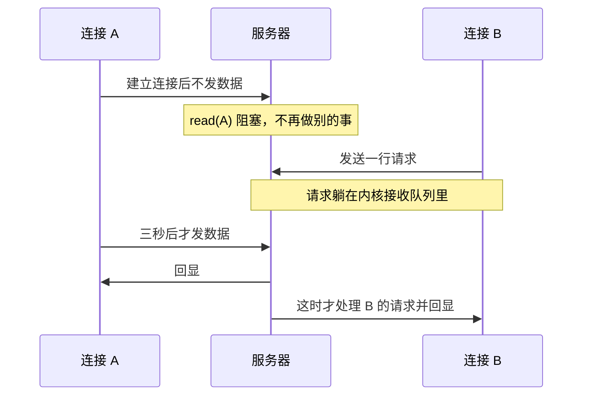
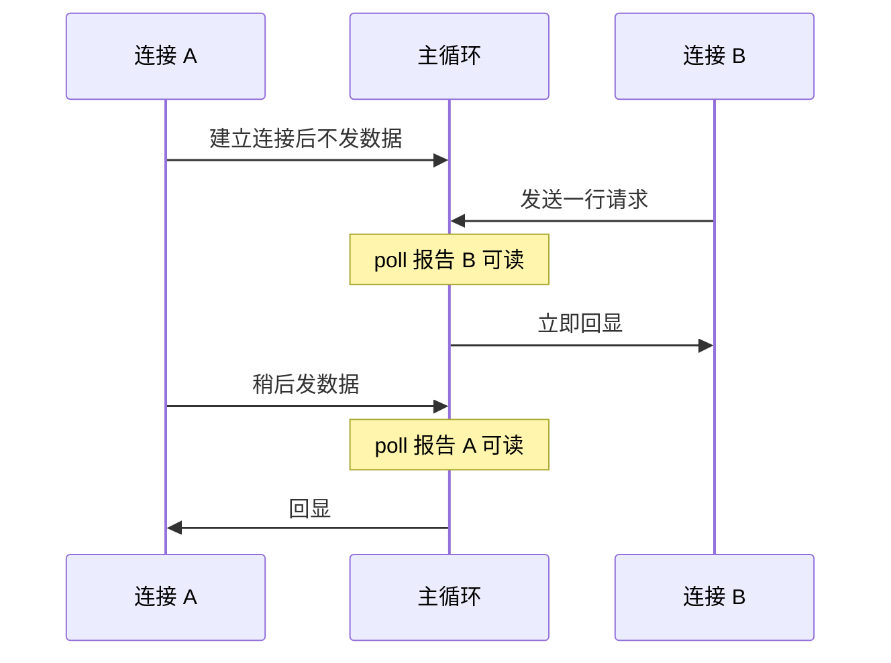

# 11. 非阻塞 I/O 与 I/O 多路复用

第 10 章构建的迭代版 lecho 服务器在单连接模型下结构简洁，但在面对真实的并发网络环境时却暴露出致命的脆弱性：服务端在同一个执行流中串行处理连接，一旦某一个客户端在建立 TCP 连接后迟迟不发送任何应用层载荷，服务器的 `read` 便会陷入无休止的内核挂起。在此期间，其他已经就绪的客户端即便已经在内核接收队列中积压了大量请求，也只能绝望地等待前序连接超时断开。

本章的核心主旨，正是打破这种「一个线程死守单条物理连接」的僵局：通过将文件描述符切换为非阻塞模式，结合操作系统提供的 I/O 多路复用机制，让单个执行流能够以极高的密度同时监控成百上千个套接字，精准捕获每一个连接上的就绪事件。从传统的 `select` 与 `poll` 到现代 Linux 下的高性能 `epoll`，我们将深入剖析水平触发与边缘触发的内在机理，并完整实现具备超时控制的非阻塞 `connect`，为后续构建高性能异步事件循环体系奠定坚实的系统级基石。

## 1. 阻塞带来的问题

先看第 10 章迭代版 lecho 的行为。服务器在 `accept` 之后直接调用阻塞的 `read`，而 `read` 在对方没有发数据时会一直等下去。下面的程序就是按这个思路写的，完整的行协议和第 10 章一致：收到一行，返回它的大写形式，收到 `quit` 关闭连接。

```c
/* 阻塞式服务一个连接：读满一行回一行，直到对方关闭或发 quit。 */
static void serve(int fd) {
    char buf[MAX_LINE];
    char out[MAX_LINE];
    size_t len = 0;
    for (;;) {
        ssize_t n = read(fd, buf + len, sizeof buf - len);
        if (n == 0) {
            return;
        }
        if (n == -1) {
            if (errno == EINTR) {
                continue;
            }
            return;
        }
        len += (size_t)n;
        size_t start = 0;
        for (;;) {
            char *nl = memchr(buf + start, '\n', len - start);
            if (nl == NULL) {
                break;
            }
            size_t line_len = (size_t)(nl - (buf + start)) + 1;
            size_t out_len = upper_line(buf + start, line_len, out);
            if (out_len == 0) {
                return;
            }
            if (write(fd, out, out_len) != (ssize_t)out_len) {
                return;
            }
            start += line_len;
        }
        memmove(buf, buf + start, len - start);
        len -= start;
    }
}
```

服务器的主循环只有 `accept` 和 `serve` 两句，`upper_line` 负责把一行转成大写，完整程序在 `code/系统编程/11_非阻塞IO与IO多路复用/lecho_iter.c`。用一个只建立连接、三秒内不发任何数据的客户端占住服务器（同目录的 `holdopen`），再让第二个客户端发一行请求并计时（同目录的 `sendline`），看第二个客户端等了多久：

::: terminal title="bash - 迭代服务器的队头阻塞"

<span class="prompt">\$</span> gcc -std=c17 -Wall -Wextra -g lecho_iter.c -o lecho_iter

<span class="prompt">\$</span> ./lecho_iter 21223 &

<span class="prompt">\$</span> ./holdopen 21223 3 &

<span class="prompt">\$</span> ./sendline 21223 "hello" 10

应答 "HELLO"，从连接到收到应答耗时 2698.5 ms

:::

空闲客户端占了大约三秒，第二个客户端的请求就等了接近三秒。服务器停在第一个连接的 `read` 上，根本没有去看第二个连接。这种一个慢客户端拖住所有人的现象，称为队头阻塞（head-of-line blocking）。

第 10 章给出的另外两种模型——每连接一个进程、每连接一个线程——也能同时服务多个客户端，但它们各自付出一份进程或线程的开销。连接数上千以后，光是线程栈就要占掉大量内存；线程之间的切换也会吃掉可观的 CPU。1999 年 Dan Kegel 把「一台服务器同时处理一万个客户端」概括为 C10K 问题，并在文章里比较了当时的各种做法：线程模型受限于地址空间和线程库，`select` 受限于固定的描述符上限，`poll` 在几千个描述符时开始变慢，而 `epoll` 与 `kqueue` 在那时显得最有希望。

两种模型的时间线对比：





目标由此明确：一个线程，一组描述符，谁有动静就处理谁。

## 2. 非阻塞描述符

要让 `read` 不再等，得先把描述符设成非阻塞。打开文件的状态标志里有 `O_NONBLOCK` 一位，`fcntl` 可以读改它。全书沿用下面这个辅助函数：

```c
static int set_nonblock(int fd) {
    int flags = fcntl(fd, F_GETFL);
    if (flags == -1) {
        return -1;
    }
    return fcntl(fd, F_SETFL, flags | O_NONBLOCK);
}
```

`F_GETFL` 取出当前标志，加上 `O_NONBLOCK` 再用 `F_SETFL` 写回。注意不能直接 `F_SETFL` 一个只有 `O_NONBLOCK` 的值，那会把原有的标志全部清掉。

看它在管道上的效果：

```c
static void try_read(const char *label, int fd) {
    char buf[64];
    errno = 0;
    ssize_t n = read(fd, buf, sizeof buf);
    if (n == -1) {
        printf("%s：read 返回 -1，errno = %d（%s）\n", label, errno,
               strerror(errno));
    } else {
        printf("%s：read 返回 %zd，读到 \"%.*s\"\n", label, n, (int)n, buf);
    }
}
```

::: terminal title="bash - 非阻塞读"

<span class="prompt">\$</span> gcc -std=c17 -Wall -Wextra -g nonblock_read.c -o nonblock_read

<span class="prompt">\$</span> ./nonblock_read

空管道：read 返回 -1，errno = 11（Resource temporarily unavailable）

写入 5 字节后：read 返回 5，读到 "hello"

读空后再读：read 返回 -1，errno = 11（Resource temporarily unavailable）

:::

`errno` 的 11 是 `EAGAIN`（在 Linux 上 `EWOULDBLOCK` 与它同值），意思是「现在没有数据，待会儿再来」。所有非阻塞的读都必须把这一种返回当成正常情况处理。

套接字在创建时就能带上这个标志，用 `SOCK_NONBLOCK`，和第 2 章讲过的 `SOCK_CLOEXEC` 一样是创建时生效的。`accept` 返回的新描述符在 Linux 上不继承监听套接字的文件状态标志，所以监听套接字是非阻塞的，新接受的连接仍然是阻塞的。Linux 提供了 `accept4`，多一个参数，直接给新连接加上 `SOCK_NONBLOCK`：

```c
int fd = accept4(listener, NULL, NULL, SOCK_NONBLOCK | SOCK_CLOEXEC);
```

`accept4` 是 Linux 扩展，需要 `_GNU_SOURCE`，目标不是 Linux 时用 `accept` 加一次 `set_nonblock`。

非阻塞只是让调用立刻返回。如果像下面这样循环重试，程序会把 CPU 全部烧在系统调用上：

```c
for (;;) {
    ssize_t n = read(fd, buf, sizeof buf);
    if (n == -1 && (errno == EAGAIN || errno == EWOULDBLOCK)) {
        continue; /* 忙等 */
    }
    /* ... */
}
```

::: terminal title="bash - 忙等的代价"

<span class="prompt">\$</span> gcc -std=c17 -Wall -Wextra -g busy_read.c -o busy_read

<span class="prompt">\$</span> ./busy_read

1 秒内 read 返回 EAGAIN 4062107 次

:::

一秒四百多万次系统调用，什么也没读到。所以非阻塞描述符通常要和下一节的「就绪通知」配合使用：平时睡着，等内核说某个描述符可以读了再动手。

## 3. select 和 poll

`select` 是最早的接口。它把要监视的描述符放进三个 `fd_set`（读、写、异常），调用时传最高的描述符编号加一：

::: terminal title="bash - select 的基本用法"

<span class="prompt">\$</span> gcc -std=c17 -Wall -Wextra -g select_smoke.c -o select_smoke

<span class="prompt">\$</span> ./select_smoke

读端 fd = 3

第 1 轮：select 返回 0，FD_ISSET(p[0]) = 0

第 2 轮：select 返回 1，FD_ISSET(p[0]) = 1

读回 5 字节：hello

:::

第一轮管道是空的，`select` 等满 300 毫秒超时返回 0；第二轮写入之后立刻返回 1，`FD_ISSET` 说明是读端就绪。

`select` 有两个麻烦。`fd_set` 是固定大小的位图，`FD_SETSIZE` 一般是 1024，编号大于等于它的描述符根本放不进去，对一个要处理上万连接的程序来说这是硬上限。另外，`select` 返回时会把集合改写成只剩就绪的那些，下一轮必须重新 `FD_ZERO`、`FD_SET` 一遍。新代码不必再用它，知道它长什么样、读得懂旧代码就够了。

`poll` 把这件事换了一种表示：一个数组，每项一个描述符、一个关注的事件掩码、一个返回的事件掩码。

```c
struct pollfd {
    int fd;          /* 描述符 */
    short events;    /* 关心的事件，调用前填 */
    short revents;   /* 实际发生的事件，返回时由内核填 */
};
```

读用 `POLLIN`，写用 `POLLOUT`。`POLLERR`、`POLLHUP`、`POLLNVAL` 只出现在 `revents` 里，即使没有在 `events` 中请求也会报告：`POLLERR` 表示出错，`POLLHUP` 表示对端挂断，`POLLNVAL` 表示描述符无效。`poll` 的第二个参数是数组长度，第三个参数是超时毫秒数，`-1` 表示一直等。返回值是 `revents` 非零的项数，0 表示超时。

`poll` 不修改 `events`，返回的信息另放在 `revents`，所以同一个数组可以接着用，只要每轮把 `revents` 清掉。

用 `poll` 改写 lecho，主循环变成这样。每个连接对应一个结构，里面放着描述符、输入缓冲区、输出缓冲区，以及两个状态位：`eof` 记录对端已经关闭，`closing` 记录收到了 `quit`、回完最后一批数据就该关闭。

```c
struct conn {
    int fd;
    int eof;
    int closing;
    char in[MAX_LINE];
    size_t in_len;
    char out[OUT_CAP];
    size_t out_len;
};
```

主循环的数组第 0 项固定是监听套接字，后面每项对应一个连接。哪一项报告可读，就读哪一个；监听套接字报告可读，就把新连接全部 `accept` 出来（监听套接字也是非阻塞的，循环 `accept` 到 `EAGAIN` 为止）。

```c
for (;;) {
    struct pollfd pfds[MAX_CONNS + 1];
    pfds[0].fd = listener;
    pfds[0].events = POLLIN;
    pfds[0].revents = 0;
    for (int i = 0; i < nconns; i++) {
        short events = 0;
        if (!conns[i].eof && conns[i].out_len + MAX_LINE <= OUT_CAP) {
            events = POLLIN;
        }
        if (conns[i].out_len > 0) {
            events |= POLLOUT;
        }
        pfds[i + 1].fd = conns[i].fd;
        pfds[i + 1].events = events;
        pfds[i + 1].revents = 0;
    }

    int ready = poll(pfds, (nfds_t)nconns + 1, -1);
    if (ready == -1) {
        if (errno == EINTR) {
            continue; /* 被信号打断，重新等 */
        }
        die("poll");
    }
    /* ... 处理每一项 ... */
}
```

处理每一项时有两处容易写错。一是 `poll` 返回后数组可能已经变化：如果先 `accept` 新连接，`nconns` 就变大了，而 `pfds` 里并没有给新连接准备槽位，所以先把这一轮实际参与 `poll` 的个数记下来，遍历时用这个数。二是连接关闭之后不能立刻把数组后面的项前移，否则正在遍历的下标会错位，先把 `fd` 置成 `-1`，等这一轮处理完再统一压缩。

`poll` 被信号处理函数打断时返回 -1、`errno` 为 `EINTR`，即使 `sigaction` 设了 `SA_RESTART` 也一样：`poll`、`select`、`epoll_wait` 属于那批「永远不自动重启」的调用，第 6 章列过这张表。多路复用器在事件循环里被信号打断是常事，这里的处理就是直接进入下一轮。

编译运行，三个客户端并发连接，每个发两行再退出：

::: terminal title="bash - poll 版 lecho 同时服务三个客户端"

<span class="prompt">\$</span> gcc -std=c17 -Wall -Wextra -g lecho_poll.c -o lecho_poll

<span class="prompt">\$</span> ./lecho_poll 21100 &

<span class="prompt">\$</span> ss -ltn 'sport = :21100' | tail -n +2

LISTEN 0      16         127.0.0.1:21100      0.0.0.0:*

<span class="prompt">\$</span> for i in 1 2 3; do printf 'client %d: hello\nsecond line from %d\nquit\n' "\$i" "\$i" | nc -q 1 127.0.0.1 21100 & done; wait

CLIENT 1: HELLO

SECOND LINE FROM 1

CLIENT 2: HELLO

SECOND LINE FROM 2

CLIENT 3: HELLO

SECOND LINE FROM 3

:::

三个客户端的输出交错着回来了，服务器的线程自始至终只有一个。完整程序在 `code/系统编程/11_非阻塞IO与IO多路复用/lecho_poll.c`。

<Quiz
  :options="[
    { label: '监听套接字报告 POLLIN，说明有新连接待接受', value: 'A' },
    { label: '连接上有半行数据但还没有换行符，不会报告 POLLIN', value: 'B' },
    { label: '监听套接字不能放进 poll 的数组里', value: 'C' },
    { label: '要通知「可以写了」，需要在 events 里写 POLLOUT', value: 'D' }
  ]"
  :answer="['A', 'D']"
>

<template #question>

关于 `poll` 的用法，下列说法正确的是哪些？

</template>

正确答案是 **A、D**。

- B 错：只要有数据到达，哪怕没有凑满一行，内核也会报告 `POLLIN`。凑不凑得成一行是应用层缓冲区的事。
- C 错：监听套接字就是一个描述符，`poll` 照样监视它，只是它报告可读的含义是「有待接受的连接」。
- A、D 是 `poll` 的基本用法。

</Quiz>

## 4. 就绪的含义与连接缓冲区

`poll` 报告的「可读」「可写」描述的是描述符此刻的状态，具体操作的结果要到调用之后才知道。

对读端，下列任一情况都算可读：接收缓冲区里有数据；对端关闭了连接（此时读到的是文件结束）；监听套接字上有待接受的连接；发生了错误。对写端，可写表示发送缓冲区里还有空间，写一个不太大的数据不会阻塞。

用一个管道把几种情况摆出来：

::: terminal title="bash - revents 里出现的各种标志"

<span class="prompt">\$</span> gcc -std=c17 -Wall -Wextra -g readiness.c -o readiness

<span class="prompt">\$</span> ./readiness

空管道： fd3 的 revents =0； fd4 的 revents = POLLOUT；

写入 1 字节： fd3 的 revents = POLLIN； fd4 的 revents = POLLOUT；

读空之后： fd3 的 revents =0； fd4 的 revents = POLLOUT；

关闭写端： fd3 的 revents = POLLHUP；

关闭写端后 read 返回 0

关闭读端： fd5 的 revents = POLLOUT POLLERR；

关闭读端后 write 返回 -1，errno = 32（Broken pipe）

:::

写端从始至终都是 `POLLOUT`，因为管道几乎总是有空间。读端在写端关闭时报告 `POLLHUP`，同时 `read` 返回 0。关闭读端之后，写端报告 `POLLOUT | POLLERR`，真正去写会得到 `EPIPE`。注意最后这一条：如果程序只看 `POLLOUT` 就以为可以安全地写，错误要到写的时候才发现；所以处理写事件时也要看 `POLLERR`、`POLLHUP`。

::: concept sys-nonblock-readiness-hint title="就绪只是提示"

多路复用返回的「就绪」表示：此刻执行相应的 I/O 操作不会因为等待数据或空间而睡眠。调用本身仍可能阻塞：对端在你写入之前把接收窗口关小、管道在你写入之前被别的线程写满，都会让一次「可写」之后的写操作停顿下来。

:::

就绪模型的直接后果是：每个连接都要有自己的输入缓冲区和输出缓冲区。

输入缓冲区用来攒「半行」。TCP 是字节流，一次 `read` 可能只读到半行，也可能一次读到三行。程序把读到的字节追加到缓冲区，每找到一个换行符就取出一整行处理，剩下的留在缓冲区里等下一次读。第 10 章已经按行读取做过这件事，这里的区别是缓冲区归每个连接所有，跨多次函数调用保留。

输出缓冲区用来暂存「还没能写出去」的字节。非阻塞的 `write` 可能只写出一部分，剩下的必须记住；下一次该描述符报告可写时再接着写。判断标准只有一条：输出缓冲区非空，才在 `poll` 的 `events` 里加 `POLLOUT`；写空之后立刻把 `POLLOUT` 去掉。

这条规则省下的是 CPU。看一个每秒统计 `poll` 调用次数的实验：两个版本都只接受一个连接，用 `SIGALRM` 在 1 秒后结束统计，主循环每转一圈把计数加一。

::: terminal title="bash - 一直关注 POLLOUT 与按需关注"

<span class="prompt">\$</span> gcc -std=c17 -Wall -Wextra -g pollout_busy.c -o pollout_busy

<span class="prompt">\$</span> ./pollout_busy 21103 always & ./holdopen 21103 3

一直关注 POLLOUT：1 秒内调用 poll 2880651 次

<span class="prompt">\$</span> ./pollout_busy 21103 ondemand & ./holdopen 21103 3

按需关注 POLLOUT：1 秒内调用 poll 1 次

:::

一直把 `POLLOUT` 挂在关注列表上，`poll` 每次都会立刻返回，因为发送缓冲区几乎总是空的：程序退化成第 2 节那种忙等，只是等待的地方从 `read` 换成了 `poll`。按需关注时，连接上没有待发数据，`poll` 就老老实实睡着，1 秒里只在 `SIGALRM` 打断它的那一次被唤醒，所以计数是 1。

::: terminal title="bash - strace -c 里的差别"

<span class="prompt">\$</span> strace -c -o always.txt ./pollout_busy 21104 always & ./holdopen 21104 2

<span class="prompt">\$</span> grep -E 'poll$' always.txt

 99.98    0.178881           2     74699           poll

<span class="prompt">\$</span> strace -c -o ondemand.txt ./pollout_busy 21105 ondemand & ./holdopen 21105 2

<span class="prompt">\$</span> grep -E 'poll$' ondemand.txt

  0.00    0.000000           0         1         1 poll

:::

::: compare left-title="一直关注 POLLOUT" right-title="只在输出缓冲区非空时关注"

```c
pfds[i + 1].events = POLLIN | POLLOUT;
```

---

```c
short events = POLLIN;
if (conns[i].out_len > 0) {
    events |= POLLOUT;
}
pfds[i + 1].events = events;
```

:::

::: tip 用 strace -c 找忙等

服务器 CPU 占用偏高而连接数并不多时，先怀疑事件循环在原地打转。`strace -c` 按系统调用汇总次数和耗时，某一项（通常是 `poll`、`epoll_wait`、`read`）次数高得离谱，就说明对应的等待条件写错了。

:::

缓冲区还有容量问题。输出缓冲区满了以后，如果继续从内核读，读出来的数据无处可放；正确的做法是暂时把该连接的 `POLLIN` 从关注列表里拿掉，等输出缓冲区被写空一部分再恢复。这样数据留在内核接收缓冲区里，TCP 的流控会替你把发送方挡住，这就是背压（backpressure）。

<Quiz
  :options="[
    { label: '连接上收到 3 个字节，还没有换行符', value: 'A' },
    { label: '对端关闭了写方向，接收缓冲区已经读空', value: 'B' },
    { label: '监听套接字上有一个连接完成三次握手，尚未 accept', value: 'C' },
    { label: '连接的另一端从未发过数据', value: 'D' }
  ]"
  :answer="['A', 'B', 'C']"
>

<template #question>

下面哪些情况会让一个 TCP 连接或监听套接字报告 `POLLIN`？

</template>

正确答案是 **A、B、C**。

- A：有数据可读，哪怕不完整，也算可读。
- B：对端关闭后 `read` 立刻返回 0，不会阻塞，所以算可读，通常同时带 `POLLHUP`。
- C：监听套接字可读的含义就是「有待接受的连接」。
- D：没有数据、没有关闭、没有错误，读会阻塞，`poll` 不会报告它。

</Quiz>

::: generate sys-nonblock-readiness-explain kind=explanation concepts=sys-nonblock-readiness-hint

面向刚接触事件驱动编程的读者，用「就绪只是提示」这句话解释为什么多路复用永远应当和非阻塞描述符搭配使用。举一个具体的、贴近本页服务器的场景：poll 报告可写之后、真正 write 之前，另一个方向的事件处理先消耗掉了发送缓冲区的空间。说明如果描述符是阻塞的，这一次 write 会把整个事件循环卡住；改成非阻塞之后最坏只是返回 EAGAIN，把数据留在输出缓冲区等下一次通知。

:::

## 5. epoll

`epoll` 是 Linux 专有的接口。`poll` 每轮都要把整个数组从用户态拷进内核，内核再逐个检查。连接数很多、而同一时刻只有少数活跃时，这份重复劳动很浪费。`epoll` 把登记和等待分开：描述符只在改变关注的事件时登记一次，之后每次只取回真正就绪的那些。

三个接口：

```c
int ep = epoll_create1(EPOLL_CLOEXEC);
struct epoll_event ev = {
    .events = EPOLLIN,
    .data.ptr = c,          /* 内核原样保存，返回时带回 */
};
epoll_ctl(ep, EPOLL_CTL_ADD, fd, &ev);
int n = epoll_wait(ep, events, 16, -1);
```

`epoll_create1` 建一个 epoll 实例，参数 `EPOLL_CLOEXEC` 与第 2 章的文件描述符标志同理，`exec` 时自动关闭。`epoll_ctl` 的第三个参数是操作：`EPOLL_CTL_ADD` 登记，`EPOLL_CTL_MOD` 修改关注的事件，`EPOLL_CTL_DEL` 删除。`epoll_wait` 与 `poll` 类似，最后一个参数是毫秒超时，`-1` 表示一直等，返回值是就绪的项数。

`epoll_event` 里的 `data` 是一个联合，可以存描述符编号，也可以存一个指针。事件驱动服务器通常直接存指向连接结构的指针，这样 `epoll_wait` 返回之后不必再去查表，取出的就是对应的连接。

把 lecho 的 `poll` 版改成 `epoll` 版，主循环如下：

```c
for (;;) {
    int ready = epoll_wait(ep, events, 16, -1);
    if (ready == -1) {
        if (errno == EINTR) {
            continue;
        }
        die("epoll_wait");
    }
    for (int i = 0; i < ready; i++) {
        struct conn *c = events[i].data.ptr;
        uint32_t re = events[i].events;
        if (c == NULL) {
            /* 监听套接字：把所有待接受的连接都取出来 */
            for (;;) {
                int fd = accept(listener, NULL, NULL);
                if (fd == -1) {
                    break;
                }
                struct conn *nc = calloc(1, sizeof *nc);
                nc->fd = fd;
                struct epoll_event cev = {
                    .events = EPOLLIN,
                    .data.ptr = nc,
                };
                epoll_ctl(ep, EPOLL_CTL_ADD, fd, &cev);
            }
            continue;
        }
        if (re & (EPOLLERR | EPOLLHUP)) {
            c->eof = 1;
        }
        if (re & (EPOLLIN | EPOLLERR | EPOLLHUP)) {
            conn_read(ep, c);
        }
        if (re & EPOLLOUT) {
            conn_process(c);
            conn_flush(ep, c);
        }
    }
}
```

监听套接字的 `data.ptr` 设为 `NULL`，作为「这一项是监听套接字」的标记。连接的可读、可写处理与 `poll` 版完全相同，区别只在注册和报告的方式。上面为了看清主循环省略了连接计数、上限检查和 `set_nonblock`，完整程序在 `code/系统编程/11_非阻塞IO与IO多路复用/lecho_epoll.c`。

可写事件的登记方式也是「按需」：输出缓冲区从空变成非空时用 `EPOLL_CTL_MOD` 加上 `EPOLLOUT`，写空之后再去掉。记住上一次登记的是什么，状态没变就不调用 `epoll_ctl`。

`epoll` 的开销与活跃连接数相关，而与登记的总数关系不大：`epoll_wait` 只返回就绪的那些，内核对空闲连接的检查发生在事件到达时，不必每次调用都扫一遍。这正是它在 C10K 场景下比 `poll` 有优势的原因。不过「与总数无关」不等于零成本：每次 `epoll_ctl` 都要动内核里的数据结构，所以关注的事件没有变化时不要再调 `EPOLL_CTL_MOD`。

::: concept sys-nonblock-epoll-key title="epoll 的兴趣列表按描述符与打开文件描述登记"

`epoll` 的兴趣列表用「描述符编号 + 打开文件描述」作为键。同一个打开文件描述可以被 `dup` 出多个描述符，它们在兴趣列表里是彼此独立的项；反过来，关闭其中一个描述符并不会自动把登记删掉，只要还有别的描述符指向同一个打开文件描述，事件仍可能被报告。

所以关闭连接之前先 `EPOLL_CTL_DEL`，再 `close`。

:::

::: generate sys-nonblock-select-poll-epoll kind=comparison concepts=sys-nonblock-epoll-key

面向已经会用 poll、正在决定新代码用哪个接口的读者，比较 select、poll、epoll 三者的登记与等待方式：select 用固定大小的位图且每次调用都改写集合，poll 用数组但每轮整体拷贝，epoll 把登记留在内核、每次只取就绪项。结合 Redis 的 ae 平台抽象层说明同一套事件循环为什么要按平台在 select、epoll、kqueue 之间切换，以及「接口不同但语义都是就绪通知」这一点如何让上层代码保持不变。

:::

## 6. 水平触发与边缘触发

`epoll` 默认使用水平触发（level-triggered，LT），语义与 `poll` 相同：只要描述符还处于可读状态，每次 `epoll_wait` 都会报告它。

边缘触发（edge-triggered，ET）在登记时加上 `EPOLLET`。它只在状态发生变化时报告一次：数据从无到有算一次变化，之后即使数据没读完，也不会再报告。

用一个管道把两者摆在一起。先写入 2 KB，第一次 `epoll_wait` 之后只读 512 字节，再调用一次 `epoll_wait`：

::: terminal title="bash - 同样的读法，LT 与 ET 的报告不同"

<span class="prompt">\$</span> gcc -std=c17 -Wall -Wextra -g lt_et.c -o lt_et

<span class="prompt">\$</span> ./lt_et

水平触发：第一次 epoll_wait 返回 1

水平触发：只读走 512 字节，还剩 1536 字节

水平触发：第二次 epoll_wait 返回 1

边缘触发：第一次 epoll_wait 返回 1

边缘触发：只读走 512 字节，还剩 1536 字节

边缘触发：第二次 epoll_wait 返回 0

边缘触发并读空：第一次 epoll_wait 返回 1

边缘触发并读空：读到 EAGAIN，共 2048 字节

边缘触发并读空：再写入 4 字节，epoll_wait 返回 1

:::

水平触发在还有数据时继续报告；边缘触发在数据没读完时不再报告，直到有新数据到达（最后一段验证了这一点）。如果程序在边缘触发下只读一次就走，剩下的 1536 字节会一直躺在缓冲区里，直到对端再发一次数据把它「唤醒」。

::: concept sys-nonblock-et-drain title="边缘触发必须读到 EAGAIN"

边缘触发模式下，事件只表示「状态刚刚变化」，不表示「现在还能读」。因此处理可读事件时必须循环 `read`，直到返回 -1 且 `errno` 为 `EAGAIN`/`EWOULDBLOCK`，把这次变化带来的数据全部取走。

写方向同理：只有在 `write` 返回 `EAGAIN` 时才说明发送缓冲区真的满了，可以停止关注可写。

:::

::: compare left-title="边缘触发下只读一次" right-title="边缘触发下读到 EAGAIN"

```c
if (re & EPOLLIN) {
    read(fd, buf, sizeof buf);
}
```

---

```c
if (re & EPOLLIN) {
    for (;;) {
        ssize_t n = read(fd, buf, sizeof buf);
        if (n == 0) {
            close_conn();
            break;
        }
        if (n == -1) {
            if (errno == EAGAIN || errno == EWOULDBLOCK) {
                break;
            }
            close_conn();
            break;
        }
        handle(buf, (size_t)n);
    }
}
```

:::

用边缘触发时，`accept` 也要循环到 `EAGAIN`：一次事件可能对应多个完成握手的连接，只 `accept` 一个，其余的会一直挂在队列里没有新事件来通知。

没有特别理由就用水平触发。它的行为与 `poll` 一致，代码里少一层「必须读空」的约束，调试时也容易看出问题。边缘触发的优势在于事件次数少：连接持续有大量数据时，水平触发会每次都报告，边缘触发只在每次数据到达时报告一次。代价是任何一处漏读都会让连接停住，而且这种停住往往表现为「客户端没反应」，很难定位。

边缘触发还有一个公平性问题。一个连接如果源源不断有数据，处理它的事件时会一直读到 `EAGAIN`，别的连接就得排队。连接很多、流量又大时，通常的做法是每轮给每个就绪连接设一个处理上限（比如最多处理 64 KB 或 64 行），处理不完的把剩余数据留在缓冲区，下一轮继续，或者维护一个就绪队列轮流处理。

多线程处理同一个 `epoll` 实例时，`EPOLLONESHOT` 可以让一个描述符在一次事件后自动失效，处理完再用 `EPOLL_CTL_MOD` 重新武装，避免两个线程同时处理同一个连接。多个进程或线程各自有 `epoll` 实例、同时等待同一个监听套接字时，`EPOLLEXCLUSIVE` 让内核只唤醒其中的一个或少数几个，减轻惊群。这两个标志都只在本页范围之外的多线程场景里才需要，知道名字即可。

<Quiz
  :options="[
    { label: '剩下的数据会丢失', value: 'A' },
    { label: '下一次 epoll_wait 不会再报告这个描述符，直到有新数据到达', value: 'B' },
    { label: 'epoll_wait 会立即返回并再次报告可读', value: 'C' },
    { label: '内核会自动把剩下的数据读走', value: 'D' }
  ]"
  answer="B"
>

<template #question>

在边缘触发模式下处理可读事件，只读了一半数据就返回，会发生什么？

</template>

正确答案是 **B**。剩下的数据仍在内核缓冲区里，但状态没有再次变化，所以不会产生新事件。直到对端又发来数据（或连接关闭）才可能再次报告。C 是水平触发的行为。A、D 都不对：数据不会丢，内核也不会替应用程序读。

</Quiz>

## 7. 非阻塞 connect

客户端同样可以用非阻塞套接字，好处是可以自己给连接设一个上限时间；交给内核的 TCP 重传，一等可能就是几十秒到几分钟。做法是把套接字设成非阻塞后调用 `connect`：

```c
int rc = connect(fd, addr, addrlen);
if (rc == -1 && errno == EINPROGRESS) {
    /* 连接正在进行 */
}
```

`EINPROGRESS` 表示三次握手已经发出，结果还没回来。这时用 `poll` 等这个描述符可写：

```c
struct pollfd pfd = {.fd = fd, .events = POLLOUT};
rc = poll(&pfd, 1, timeout_ms);
```

可写只说明「有结果了」，成功还是失败要再取一次错误码：

```c
int err = 0;
socklen_t len = sizeof err;
getsockopt(fd, SOL_SOCKET, SO_ERROR, &err, &len);
```

`err` 为 0 表示连接建立，非 0 就是失败原因。可写并不等于成功，这一点从 `strace` 里看得最清楚：连一个没有监听的端口，`poll` 同样报告可写，同时还带着错误和挂断标志。

::: terminal title="bash - 非阻塞 connect 的两种结果"

<span class="prompt">\$</span> gcc -std=c17 -Wall -Wextra -g tcping.c -o tcping

<span class="prompt">\$</span> ./tcping 127.0.0.1 21199 500

127.0.0.1:21199 失败：Connection refused，耗时 0.104 ms

<span class="prompt">\$</span> ./lecho_poll 21102 &

<span class="prompt">\$</span> ./tcping 127.0.0.1 21102 500

127.0.0.1:21102 连接成功，耗时 0.114 ms

<span class="prompt">\$</span> ./tcping 192.0.2.1 80 500

192.0.2.1:80 超时（500 ms）

:::

192.0.2.0/24 是保留给文档示例的地址段，从公网访问它不会得到响应，正好用来演示超时。用 `strace` 看失败的连接：

::: terminal title="bash - 可写不等于成功"

<span class="prompt">\$</span> strace -e trace=connect,poll,getsockopt ./tcping 127.0.0.1 21199 300

connect(3, {sa_family=AF_INET, sin_port=htons(21199), sin_addr=inet_addr("127.0.0.1")}, 16) = -1 EINPROGRESS (Operation now in progress)

poll([{fd=3, events=POLLOUT}], 1, 300)  = 1 ([{fd=3, revents=POLLOUT|POLLERR|POLLHUP}])

getsockopt(3, SOL_SOCKET, SO_ERROR, [ECONNREFUSED], [4]) = 0

:::

`poll` 返回了可写，同时报告 `POLLERR | POLLHUP`，`SO_ERROR` 给出实际的原因 `ECONNREFUSED`。如果程序只看 `POLLOUT` 就认为连上了，后面第一次读写才会撞上错误。

`tcping` 的完整程序在 `code/系统编程/11_非阻塞IO与IO多路复用/tcping.c`，主体是 `getaddrinfo` 解析、`set_nonblock`、`connect`、`poll`、`getsockopt` 五步，超时由 `poll` 的第三个参数给出。拿它做连通性检查比 `ping` 更有意义：`ping` 走 ICMP，服务器完全可能禁掉 ICMP 而正常提供 TCP 服务。

连接失败之后不要在那个套接字上重试。`connect` 失败后套接字的状态是不确定的，可移植的做法是关闭它，为下一次尝试新建一个。

## 8. 其他模型

前几节的接口都属于就绪通知（readiness notification）：内核告诉你「可以动手了」，读写仍由程序发起。另一类做法是完成通知（completion notification）：程序提交一个操作（比如「从这两个缓冲区读 8 KB」），内核做完之后通知你结果，中间不需要程序操心什么时候能读能写。

完成通知的代表是 Windows 的 I/O 完成端口（I/O completion port，IOCP），Linux 上对应的是 `io_uring`。`io_uring` 在内核和用户态之间放了一对环形队列：提交队列放要做的操作，完成队列放做完的结果，一次系统调用可以提交和收割一批操作，适合大量小 I/O。它与本页的接口不冲突，事件循环可以用 `io_uring` 同时处理网络和磁盘。

信号驱动 I/O（`O_ASYNC` 加 `SIGIO`）也是就绪通知的一种，数据到达时内核发一个信号。它把事件和信号处理函数搅在一起，`poll`/`epoll` 能做的事它都能做，实际很少用。POSIX 异步 I/O（`aio_read` 等）是另一种完成通知的尝试，但 Linux 上 glibc 的实现用线程池模拟，内核自己的 AIO（`io_submit`）长期只适合直接 I/O 的文件与块设备，网络编程里几乎见不到。

BSD 和 macOS 有 `kqueue`，作用与 `epoll` 相当，也支持水平与边缘两种触发。Redis 的事件循环就在 `epoll`、`kqueue`、`select` 之间按平台切换（见 [/教程/正文/项目案例/Redis/5_3_ae事件循环](/教程/正文/项目案例/Redis/5_3_ae事件循环)），上层代码只面对「注册事件、等待事件、处理事件」这一组操作。

要写出跨平台的网络程序，一般用库：libevent、libuv 把 `epoll`、`kqueue`、IOCP 包在同一套接口后面。第 12 章会在这套就绪通知的机制之上搭一个事件循环，把定时器、信号和回调组织起来。

## 9. 习题

### 9.1 巩固

<Exercise id="41101" :d="2" :w="2" multi>

用一个空闲的 TCP 连接和一个空闲的管道，分别回答：

(1) _[1.1]_ 不写任何代码，判断 `poll` 对下面四项各自报告什么：已经完成握手但尚未 `accept` 的监听套接字；对端已关闭写方向、缓冲区已读空的连接；发送缓冲区有空间的连接；已被 `close` 但还留在数组里的描述符。写出 `revents` 里应有的标志。

(2) _[2.2]_ 把 `readiness.c` 扩展一个场景：把管道写满（用非阻塞写循环到 `EAGAIN`），观察写端的 `revents`。预测并验证结果，解释为什么这时写端不再报告 `POLLOUT`。

(3) _[2.2]_ 用几句话对比就绪通知与完成通知：本页的 `poll`/`epoll` 服务器里，哪一步在完成模型下不再需要由程序自己判断？举出两个使用完成模型的接口。

</Exercise>

<Exercise id="41102" :d="2" :w="2">

不看正文，写出 `set_nonblock` 的两个版本：一个用 `fcntl` 修改已有标志，一个在 `socket` 调用时传 `SOCK_NONBLOCK`。然后写一个程序：创建非阻塞管道，先读一次记录 `errno`，再用 `poll` 等到可读，最后读一次。要求程序在 1 秒内退出，输出能看出「先 EAGAIN、后读到数据」的先后关系。

</Exercise>

### 9.2 编程

<Exercise id="41103" :d="3" :w="2">

写一个多目标的 `tcping`：命令行接收若干 `HOST:PORT` 和一个统一的超时毫秒数，对每个目标同时发起非阻塞 `connect`，用一个 `poll` 等待所有描述符，最后按完成顺序打印每个目标的耗时或错误（`Connection refused`、超时等）。

验收：`./mtcping 500 127.0.0.1:21199 127.0.0.1:21102 192.0.2.1:80` 应当分别打印拒绝、成功、超时；整个过程的总耗时接近 500 毫秒而不是三者之和。

</Exercise>

<Exercise id="41104" :d="3" :w="3">

写一个 `poll` 版聊天室：服务器接受多个客户端，任何一个客户端发来的一行，广播给其他所有客户端（不回给发送者）。每个连接维护输入缓冲区和输出缓冲区，广播时只往输出缓冲区追加，`POLLOUT` 按需关注；输出缓冲区满时暂时停止读该连接。

验收：开三个终端，用 `nc 127.0.0.1 端口` 连上，在其中一个里输入一行，另外两个立刻看到；三个客户端同时说话时互不阻塞。发送 `quit` 的连接关闭，其他人收到一行提示。

</Exercise>

<Exercise id="41105" :d="4" :w="3">

把 `code/系统编程/11_非阻塞IO与IO多路复用/exercises/kvserver_iter.c`（第 10 章习题 41002 的迭代版实现）改成 `epoll` 水平触发版，支持多个客户端同时操作同一份键值表。键值表的读写逻辑不用改，只改连接管理和事件循环。

验收：`exercises/kvstress.sh` 启动 20 个客户端，每个执行 100 条 `SET` 和 100 条 `GET`，要求全部应答正确、没有客户端卡住。原始版本也能通过这个脚本（每个客户端发完就走，轮到它时很快），差别要在慢客户端上才看得出来：另写一个只连接、几秒内不发数据的客户端占住原始版本，再用 `nc` 发一条 `GET` 并计时，观察它等了多久；换成 `epoll` 版后重复同样的场景，等待时间应当回到毫秒级。

</Exercise>

<Exercise id="41106" :d="4" :w="3">

把 `lecho_epoll.c` 改成边缘触发：监听套接字和每个连接都加 `EPOLLET`，`accept` 和 `read` 都循环到 `EAGAIN`。先用 `seq 500 | sed 's/^/line /' > in.txt` 准备输入，再 `nc -q 1 127.0.0.1 端口 < in.txt`，确认 500 行全部原样返回（大写）。

然后把 `read` 的循环删掉，只保留一次 `read`，重复同样的测试，记录客户端收到多少行、之后是否卡住，并解释原因。实测中这个「只读一次」的版本每次停在不同的行数（某次是 125 行，另一次是 238 行），停在哪里取决于内核把数据分成了几块到达——这正说明漏读的位置由内核的投递时机决定，而不是由程序控制。

</Exercise>

### 9.3 综合与挑战

<Exercise id="41107" :d="5" :w="4">

写一个 TCP 转发器 `relay LISTEN_PORT TARGET_PORT`：在 `LISTEN_PORT` 上接受连接，每个连接对应一个到 `127.0.0.1:TARGET_PORT` 的非阻塞连接，两个方向的数据互相转发。要求：

- 一端读到文件结束（对端关闭写方向）时，对另一端调用 `shutdown(SHUT_WR)`，而不是立刻 `close`，让反方向的数据还能传完。
- 某个方向写不出去时，暂停从另一个方向读取，等可写再恢复（背压）。两个方向各自的缓冲区都要有上限。
- 用 `poll` 或 `epoll` 实现，一个线程。

验收：用 `lecho_poll` 做目标服务，通过转发器连上去，发 1 万行并逐行核对；再用 `head -c 1000000 /dev/zero | nc` 之类的单向大流量测试，确认转发器不会因为一端读得太快而无限增长内存。

</Exercise>

<Exercise id="41108" :d="6" :w="4">

公平性实验。在 `lecho_poll.c` 的基础上实现两种调度：一种每轮把每个就绪连接读到 `EAGAIN`（一次处理完），另一种每轮每个连接最多处理 64 行。用 20 个客户端，其中一个持续快速发送大量短行，其余 19 个各发送 200 行并计时。比较两种调度下 19 个普通客户端从开始到全部收完的时间，用数据说明「一次处理完」为什么会饿死别人，并给出你选择哪种调度的理由。

</Exercise>

## 10. 参考资料

- `select(2)`、`select_tut(2)`、`poll(2)`、`fcntl(2)`、`connect(2)`：<https://man7.org/linux/man-pages/man2/select.2.html>、<https://man7.org/linux/man-pages/man2/poll.2.html>
- `epoll(7)`、`epoll_ctl(2)`、`epoll_wait(2)`：<https://man7.org/linux/man-pages/man7/epoll.7.html>、<https://man7.org/linux/man-pages/man2/epoll_ctl.2.html>
- `io_uring(7)`、`aio(7)`：<https://man7.org/linux/man-pages/man7/io_uring.7.html>、<https://man7.org/linux/man-pages/man7/aio.7.html>
- Dan Kegel, *The C10K problem*：<http://www.kegel.com/c10k.html>
- Jens Axboe, *Efficient IO with io_uring*：<https://kernel.dk/io_uring.pdf>
- *The Linux Programming Interface*（Kerrisk），第 63 章「Alternative I/O Models」
- *Advanced Programming in the UNIX Environment*（Stevens、Rago），第 3 版第 14 章「Advanced I/O」
- libevent 参考手册第 1 章：<https://libevent.org/libevent-book/01_intro.html>
