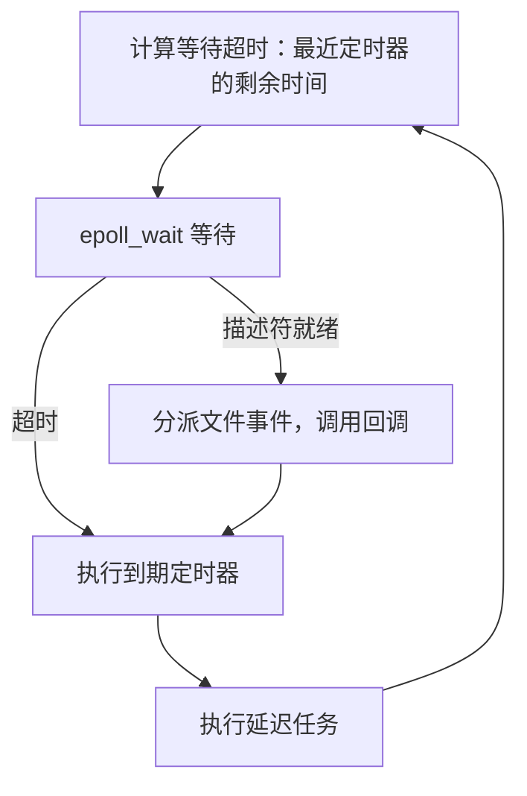
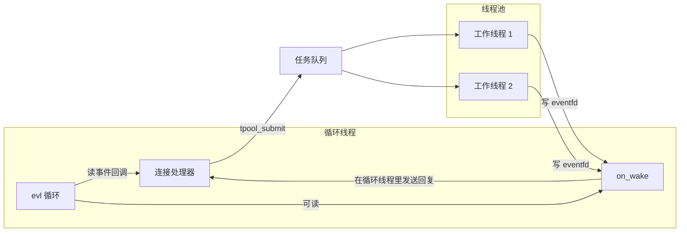

# 12. 事件循环

[第 11 章](/教程/正文/系统编程/11_非阻塞IO与IO多路复用)最后的 epoll 版 lecho 已经能同时服务多个客户端，但等待、分派和协议处理全写在同一个 `while` 里。给它加一个空闲超时，`epoll_wait` 的超时参数就要从定时器算出来；加一个 SIGTERM 优雅退出，循环里又多一个分支；再写一个键值服务器，多半会把整段骨架复制一遍。这一章把「等待和分派」抽成一个可复用的小库 evl（event loop，事件循环），由它管理文件事件、定时器、延迟任务、信号和跨线程唤醒；然后在这个库上重写 lecho，加入空闲超时和优雅退出；最后对照 Redis 的 ae、libevent 和 libuv，看清这些库共有的结构。

读完这一章，读者应当能设计出这类库的接口，写出它的核心，并判断一段处理逻辑该留在回调里，还是该交给线程池。

## 1. 从多路复用到事件循环

### 1.1 第 11 章的循环缺了什么

第 11 章的服务器大致是这个形状：

```c
for (;;) {
    int n = epoll_wait(epfd, events, MAX_EVENTS, -1);
    for (int i = 0; i < n; i++) {
        if (events[i].data.fd == listen_fd) {
            /* accept、设非阻塞、登记到 epoll、初始化连接缓冲区 */
        } else {
            /* 读数据、拆行、处理协议、写回、出错关闭 */
        }
    }
}
```

协议逻辑和等待混在一起。想给连接加空闲超时，就得在这里维护定时器，再根据最近的到期时刻填写 `epoll_wait` 的超时；想处理 SIGTERM，就得再加入一个 signalfd 描述符和对应的分支。每多一种关注点，这个循环就长一截，而换一个服务又要从头抄一遍。

真正值得复用的不是协议，而是这段骨架：等待哪些描述符、什么时候醒来、醒来后调用谁。

### 1.2 循环核心与回调函数

Reactor 模式把骨架和协议分开。调用方把「描述符、关注的事件、回调函数、一个 `void *` 参数」登记给循环；循环只负责等待和分派，协议逻辑全部写进回调。定时器和延迟任务也按同样的方式登记。这一模式的经典描述见 Douglas Schmidt 的 Reactor 论文，参与者是事件源（描述符）、同步事件分离器（epoll）、分发器和事件处理器。

一轮迭代做四件事，顺序固定：



::: concept sys-evl-iteration-order title="一轮迭代的顺序"

文件事件先于定时器分派，定时器先于延迟任务执行。文件事件全部处理完之后才检查定时器，延迟任务在最后统一执行。

:::

文件事件放在最前，是因为刚到达的数据应当先被读走。以带空闲超时的服务器为例：如果定时器先执行，一个恰好在截止时刻到达的字节就可能先被超时定时器关掉连接，数据白丢了；反过来，处理器读到数据后重装定时器，超时自然推迟到下一次空闲。

延迟任务放在最后，是为了给「关闭并释放对象」留一个安全的时机。这是本章的重点之一，2.3 节会用 AddressSanitizer（见[编译器诊断与程序检查](/教程/正文/开发与工程基础/13_编译器诊断与程序检查)）演示不这样做会怎样。

### 1.3 与 libuv 的对照

libuv 的循环把一轮拆得更细，按顺序是：更新循环的「现在」、执行到期定时器、调用 pending 回调、idle 回调、prepare 回调、计算 poll 超时、阻塞等待 I/O、check 回调、close 回调、再次更新「现在」并执行到期定时器。它把定时器拆成前后两处，让 check 阶段的回调有机会在同一轮里安排下一次唤醒。

evl 只有三个阶段，因为这个规模用不上更多。libuv 的另一处不同在后台工作：文件系统操作和 `getaddrinfo` 这类没有可移植非阻塞接口的调用，都交给一个全局线程池，网络 I/O 则在循环线程里用非阻塞套接字完成。第 6 节会自己搭一个小号版本。

<Quiz
  :options="[
    { label: '先执行文件事件，再执行到期定时器，最后执行延迟任务', value: 'A' },
    { label: '先执行到期定时器，再执行文件事件，最后执行延迟任务', value: 'B' },
    { label: '先执行延迟任务，再执行文件事件，最后执行到期定时器', value: 'C' },
    { label: '三者的顺序由登记时的参数决定', value: 'D' }
  ]"
  answer="A"
>

<template #question>

evl 的一轮迭代中，三个阶段按什么顺序执行？

</template>

正确答案是 **A**。文件事件最先处理，保证刚到达的数据优先于超时；延迟任务最后执行，让回调里标记关闭的对象在本轮末尾统一释放。

</Quiz>

## 2. 设计接口

### 2.1 evl.h

库的公开接口放在 `code/系统编程/12_事件循环/evl.h`。函数按对象分成四组：循环本身、文件事件、定时器、延迟任务。

```c
typedef struct evl_loop evl_loop;
typedef struct evl_timer evl_timer;

enum {
    EVL_READ = 1u << 0,
    EVL_WRITE = 1u << 1,
};

typedef void (*evl_file_cb)(evl_loop *loop, int fd, unsigned events, void *arg);
typedef void (*evl_timer_cb)(evl_loop *loop, evl_timer *timer, void *arg);
typedef void (*evl_defer_cb)(evl_loop *loop, void *arg);

evl_loop *evl_create(void);
void evl_destroy(evl_loop *loop);

int evl_add_fd(evl_loop *loop, int fd, unsigned mask, evl_file_cb cb, void *arg);
int evl_mod_fd(evl_loop *loop, int fd, unsigned mask);
int evl_del_fd(evl_loop *loop, int fd);

evl_timer *evl_add_timer(evl_loop *loop, int64_t delay_ms, int64_t repeat_ms,
                         evl_timer_cb cb, void *arg);
void evl_cancel_timer(evl_loop *loop, evl_timer *timer);

int evl_defer(evl_loop *loop, evl_defer_cb cb, void *arg);
void evl_stop(evl_loop *loop);
int evl_run(evl_loop *loop);

int64_t evl_now_ms(void);
```

接口设计有几点取舍。循环对象不透明，调用方只能通过函数操作它，内部结构以后可以改。所有回调都收到循环指针，回调里能继续登记新的定时器或延迟任务，不用另存全局对象。定时器的间隔用毫秒整数，配合单调时钟，省掉 `struct timespec` 的换算；需要更高精度时改成微秒，思路不变。`evl_add_timer` 同时接受首次延迟和重复间隔，`repeat_ms` 为 0 表示一次性定时器。

`evl_now_ms` 暴露给调用方，测试和日志都用同一个时间基准。

### 2.2 所有权规则

接口本身不难写，难的是把「谁负责关闭、谁负责释放」定下来。规则含糊，回调里的释放顺序就会出错。

::: concept sys-evl-ownership title="evl 的所有权规则"

循环不关闭任何描述符：`evl_del_fd` 只把它从关注列表里移除，`close` 由调用方在之后自己做。定时器对象由 evl 分配和释放：`evl_cancel_timer` 返回后句柄立即失效；`evl_run` 返回后循环仍持有所有未取消的定时器，由 `evl_destroy` 统一释放。同一个描述符只能登记一次。全部回调都在 `evl_run` 所在线程执行。

:::

由调用方关闭描述符，是因为同一个打开文件描述可能被多个描述符引用（`dup`、`fork` 之后尤其如此），库没有办法知道什么时候该关。定时器反过来由库释放，因为它的生命周期完全由库的时间堆管理，调用方拿到的是一个不透明句柄。

「全部回调在同一个线程」这条规则决定了后面几节的内容：信号不能直接在处理函数里改循环的数据结构，工作线程也不能直接调用 `evl_*` 函数。

### 2.3 写错了会怎样：释放后使用

同一批 `epoll_wait` 返回的事件里，可能包含一个回调要关掉的另一个连接。如果回调里就地 `free` 连接对象，而后面还有这个连接的事件，分派循环就会访问已经释放的内存。

`code/系统编程/12_事件循环/uaf_demo.c` 用两根管道模拟两个连接：A 的处理器关闭并释放 B，两个管道各写一个字节，让同一轮里有两个事件。

```c
static void on_readable(evl_loop *loop, int fd, unsigned events, void *arg) {
    struct conn *c = arg;
    char buf[16];

    (void)loop;
    (void)events;
    if (read(fd, buf, sizeof buf) < 0) {
        perror("read");
    }
    printf("连接 %c 的处理器运行\n", c->name);
    if (c->other != NULL) {
        struct conn *victim = c->other;

        printf("连接 %c 关闭并释放连接 %c\n", c->name, victim->name);
        close(victim->fd);
        free(victim);
        c->other = NULL;
    }
    printf("连接 %c 处理完毕\n", c->name);
}
```

用 AddressSanitizer 编译运行（`gcc -fsanitize=address`），报告如下（地址和构建路径已删节）：

::: terminal title="bash - uaf_demo（ASan）"

```text
连接 A 的处理器运行
连接 A 关闭并释放连接 B
连接 A 处理完毕
read: Bad file descriptor
=================================================================
==3773391==ERROR: AddressSanitizer: heap-use-after-free on address 0x502000000034
READ of size 1 at 0x502000000034 thread T0
    #0 0x55fa9d8043e8 in on_readable uaf_demo.c:24
    #1 0x55fa9d807560 in dispatch_file_events evl.c:430
    #2 0x55fa9d807a03 in evl_run evl.c:487
    #3 0x55fa9d804a8a in main uaf_demo.c:73

0x502000000034 is located 4 bytes inside of 16-byte region
freed by thread T0 here:
    #0 0x7f8516af38f8 in free asan_malloc_linux.cpp:52
    #1 0x55fa9d804532 in on_readable uaf_demo.c:30
    #2 0x55fa9d807560 in dispatch_file_events evl.c:430
```

:::

`read: Bad file descriptor` 出现在报告之前：两个管道各写了一个字节，`epoll_wait` 一次就把两个事件都取回了数组，分派 A 时释放了 B，轮到 B 时描述符已经关闭，`read` 返回 `EBADF`，随后第 24 行的 `printf` 又去读已经释放的 `c->name`。ASan 指出读的位置是 `on_readable` 第 24 行，释放的位置是第 30 行的 `free(victim)`，两次调用都在同一个 `dispatch_file_events` 调用栈里。

只把「先关描述符」改成「先 `evl_del_fd` 再关」能挡住这一种情况：evl 分派事件时会按描述符重新查表，表项已清空就跳过，上面的报告确实消失。但对象往往不止被一处引用，如果它同时挂着一个定时器，定时器仍持有同一个指针。`uaf_timer.c` 演示这一半：连接收到数据后删除描述符、关闭、`free`，却没有取消自己的空闲定时器，同一轮的定时器阶段照样访问已释放的对象。

::: terminal title="bash - uaf_timer（ASan）"

```text
连接 A 收到数据，关闭并释放自己
=================================================================
==3909794==ERROR: AddressSanitizer: heap-use-after-free on address 0x502000000014
READ of size 1 at 0x502000000014 thread T0
    #0 0x55d35dcfb34c in on_idle uaf_timer.c:19
    #1 0x55d35dcfe4eb in run_timers evl.c:453
    #2 0x55d35dcfe781 in evl_run evl.c:488
    #3 0x55d35dcfb817 in main uaf_timer.c:66

freed by thread T0 here:
    #0 0x7fdded8f38f8 in free asan_malloc_linux.cpp:52
    #1 0x55d35dcfb4a8 in on_readable uaf_timer.c:34
    #2 0x55d35dcfe2d2 in dispatch_file_events evl.c:430
```

:::

`free` 发生在文件事件阶段，读取发生在同一轮的定时器阶段，调用栈清楚地分成两段。两种情况合起来说明：光摘掉描述符不够，对象上挂着的每一处引用都要一起处理。可行的做法只有一条，关闭时只做「标记、摘除描述符、取消定时器」，对象本身交给延迟队列，在本轮最后统一释放。

::: compare left-title="回调里立即 free" right-title="标记关闭，本轮结束再 free"

```c
case 'q':
    close(c->fd);
    free(c);
    return;
```

---

```c
case 'q':
    conn_close(loop, c);   /* 标记、摘表、close */
    evl_defer(loop, conn_free, c);
    return;
```

:::

右边是 `uaf_fixed.c` 的做法。`conn_close` 把 `closing` 置 1、摘除描述符、关闭描述符，然后通过 `evl_defer` 把释放推迟；回调开头检查 `closing`，迟到的处理直接返回。运行结果：

::: terminal title="bash - uaf_fixed（ASan）"

```text
连接 A 的处理器运行
连接 A 关闭连接 B（只标记，稍后释放）
连接 A 处理完毕
本轮结束，释放连接 B 的结构
```

:::

延迟释放还解决了一个更隐蔽的问题：同一个对象可能同时挂着文件事件和定时器，两边都可能在回调里触发关闭。有了 `closing` 标志，第二次关闭直接返回；有了延迟队列，谁先触发都不会让另一个回调拿到已经释放的内存。

<Quiz
  :options="[
    { label: '在 free 之前调用 epoll_ctl 删除描述符就够了', value: 'A' },
    { label: '回调里只标记关闭并摘除描述符，释放推迟到本轮末尾', value: 'B' },
    { label: '把 free 换成 realloc(ptr, 0)', value: 'C' },
    { label: '在 free 之后立刻从事件数组里删掉对应项', value: 'D' }
  ]"
  answer="B"
>

<template #question>

同一轮事件分派里，一个回调要关闭另一个连接，正确的做法是什么？

</template>

正确答案是 **B**。仅删除描述符能避免「事件还在」，但同一对象若还有定时器或其他引用，仍然会被提前释放；标记加延迟释放把两件事一起解决。C 的效果与 `free` 相同，D 改不到已经拷贝到循环数组里的事件。

</Quiz>

## 3. 文件事件

### 3.1 描述符到处理器的表

epoll 在 `epoll_event.data` 里只带得回一个整数或一个指针。evl 选择带描述符编号，另外维护一张按编号索引的数组：

```c
struct evl_fd {
    int fd;
    unsigned mask;
    evl_file_cb cb;
    void *arg;
};
```

数组按需增长，`grow_fd_table` 用 `realloc` 扩容并清零新的一段，`evl_add_fd` 先确认表项为空，再 `epoll_ctl(EPOLL_CTL_ADD)`，成功后把表项填上。表项为空既表示没登记过，也表示分派时应当跳过；`uaf_demo` 的修正版正是靠这一点避免了对已关闭描述符的回调。

`evl_mod_fd` 更新掩码，`evl_del_fd` 从 epoll 里摘除并释放表项。`evl_add_fd` 和 `evl_mod_fd` 都在参数检查里拒绝 `EVL_READ | EVL_WRITE` 之外的标志，这类错误在调试时比在运行中悄悄忽略有用得多。

这里选带描述符而不是带指针，原因是描述符还会被循环之外的东西使用：关闭、`epoll_ctl`、日志都直接用它。如果 `data.ptr` 直接指向连接对象，回调里一旦释放了对象，分派时就连「这是谁」都判断不出来；按描述符查表，表项为空就说明对象已经不在了。

<Quiz
  :options="[
    { label: '指针比整数快，用指针更省一次数组访问', value: 'A' },
    { label: '对象被释放后，指针值本身已经无法用来判断该跳过还是该调用', value: 'B' },
    { label: 'epoll 不允许 data.ptr 指向堆上的对象', value: 'C' },
    { label: '用指针时描述符关闭后 epoll 会自动停止报告', value: 'D' }
  ]"
  answer="B"
>

<template #question>

evl 在 `epoll_event.data` 里存描述符编号而不是连接对象指针，主要理由是什么？

</template>

正确答案是 **B**。回调里释放对象之后，`data.ptr` 仍指向那块已经释放的内存，分派循环没法区分「有效对象」和「已释放对象」；按描述符查表，表项被清空就说明对象不在了。A 差一次数组访问，C 与 epoll 无关，D 在两种写法下行为相同。

</Quiz>

### 3.2 分派

`dispatch_file_events` 把 epoll 的位翻译成 `EVL_READ`、`EVL_WRITE`，并按登记时的掩码过滤：

```c
static void dispatch_file_events(evl_loop *loop, int count) {
    for (int i = 0; i < count; i++) {
        int fd = loop->events[i].data.fd;

        if (fd < 0 || fd >= loop->fd_cap) {
            continue;
        }
        struct evl_fd *entry = loop->fds[fd];

        if (entry == NULL) {
            continue;
        }
        unsigned events = 0;
        uint32_t raw = loop->events[i].events;

        if (raw & EPOLLIN) {
            events |= EVL_READ;
        }
        if (raw & EPOLLOUT) {
            events |= EVL_WRITE;
        }
        if (raw & (EPOLLERR | EPOLLHUP)) {
            events |= entry->mask;
        }
        events &= entry->mask;
        if (events != 0) {
            entry->cb(loop, fd, events, entry->arg);
        }
    }
}
```

`EPOLLERR` 和 `EPOLLHUP` 表示出错或对端已关闭，epoll 会无条件报告这两个标志，不管有没有登记它们。这里把它们展开成登记过的全部事件，让回调有机会处理：连接处理器看到可读，`read` 返回 0 或错误，走关闭流程。这正是第 11 章说过的「就绪只是提示」在库里的落实。

`entry == NULL` 的检查还有另一个用途。回调里可能调用 `evl_del_fd` 删掉另一个描述符，那么后面的循环里就该跳过它。代价是每个事件多一次数组访问，换来的是回调可以自由地增删关注列表。

`events &= entry->mask` 一行不能省。水平触发下 epoll 会报告描述符当前所有就绪的状态，即使调用方此刻只关心读。过滤之后，回调不会被自己没登记的事件叫醒。

::: tip 用 strace 观察循环的节奏

`strace -e trace=epoll_wait ./timer_demo` 能看到每次调用的超时参数：`0` 表示有延迟任务等着执行，`-1` 表示没有定时器，其他数值就是最近定时器到现在的毫秒数。回调里阻塞太久时，相邻两次调用之间的时间差会明显变大。

:::

### 3.3 完整的 evl.c

`code/系统编程/12_事件循环/evl.c` 全文约 490 行，包含文件事件、定时器堆、延迟队列和主循环。文件事件在 3.1、3.2 两节已经拆开看过，定时器在第 4 节，延迟队列很短，读一遍即可。

::: generate sys-evl-core-walkthrough kind=explanation concepts=sys-evl-iteration-order,sys-evl-ownership

面向第一次读事件循环实现的读者，按一轮迭代的顺序逐段走读 evl.c：`compute_timeout` 怎样从最小堆顶算出 `epoll_wait` 的超时；`epoll_wait` 返回后为什么先分派文件事件；`dispatch_file_events` 里按描述符查表以及 `entry == NULL` 检查各挡住了什么；`run_timers` 为什么会重新取当前时间；`run_deferred` 为什么先摘链再执行。读者若熟悉 epoll 可以略过查表部分。

:::

## 4. 定时器

### 4.1 以到期时刻为键的最小堆

定时器按到期时刻排序，最常用的结构是[最小堆](/教程/正文/数据结构与算法/数据结构/6_堆与优先队列)。evl 用一个指针数组保存定时器，堆顶 `heap[0]` 就是最早到期的那个，`compute_timeout` 只需要读它：

```c
static int compute_timeout(evl_loop *loop) {
    if (loop->defer_head != NULL) {
        return 0;
    }
    if (loop->heap_len == 0) {
        return -1;
    }
    int64_t delta = loop->heap[0]->when_ms - evl_now_ms();

    if (delta <= 0) {
        return 0;
    }
    if (delta > INT_MAX) {
        return INT_MAX;
    }
    return (int)delta;
}
```

::: concept sys-evl-timeout-source title="等待超时由最近的定时器决定"

`epoll_wait` 的超时取最近定时器的到期时刻减去当前时刻：没有定时器时为 -1（无限等待），定时器已经到期或有延迟任务时为 0。先分派文件事件、再执行定时器，保证刚到达的数据优先处理。

:::

有三处细节容易漏掉。延迟队列非空时超时必须取 0，否则延迟任务要等到下一个事件或定时器才能执行。`delta` 为负说明定时器已经过期，取 0 让 `epoll_wait` 立即返回。`delta` 可能超过 `int` 的范围，`INT_MAX` 是上限；`when_ms` 用 64 位整数存毫秒，`CLOCK_MONOTONIC` 走到 `INT64_MAX` 毫秒要几亿年。

堆里保存的是指针，定时器对象本身还挂在一条双向链表上：`evl_destroy` 靠链表回收全部定时器，`evl_cancel_timer` 靠链表的 `prev`、`next` 做 $O(1)$ 摘除。两套结构各管一件事：堆管顺序，删除一次 $O(\log n)$；链表管生命周期，摘除 $O(1)$。

`evl_cancel_timer` 用堆内下标直接定位，删除后把末尾元素移到空位，再分别向上和向下调整一次：

```c
static void heap_remove(evl_loop *loop, evl_timer *timer) {
    size_t index = timer->heap_index;

    loop->heap_len--;
    if (index != loop->heap_len) {
        loop->heap[index] = loop->heap[loop->heap_len];
        loop->heap[index]->heap_index = index;
        heap_sift_up(loop, index);
        heap_sift_down(loop, index);
    }
    timer->heap_index = EVL_NO_INDEX;
}
```

必须同时做两次调整，因为移过来的元素既可能比父节点小，也可能比子节点大。每次比较的开销都很小，两趟合起来仍是 $O(\log n)$。

### 4.2 执行到期的定时器

`run_timers` 每次循环都重新读一次当前时间，因为上一个回调可能睡了很久：

```c
static void run_timers(evl_loop *loop) {
    for (;;) {
        int64_t now = evl_now_ms();

        if (loop->heap_len == 0 || loop->heap[0]->when_ms > now) {
            return;
        }
        evl_timer *timer = heap_pop(loop);
        int once = timer->repeat_ms == 0;

        if (!once) {
            timer->when_ms = now + timer->repeat_ms;
            if (heap_push(loop, timer) < 0) {
                timer_unlink(loop, timer);
                free(timer);
                continue;
            }
        }
        timer->cb(loop, timer, timer->arg);
        if (once) {
            timer_unlink(loop, timer);
            free(timer);
        }
    }
}
```

重复定时器先把下一次到期时刻写回堆里再调用回调，这样回调里取消自己也能正确摘除：`evl_cancel_timer` 看到 `heap_index` 有效，正常删除；回到 `run_timers` 后，`once` 为假，不会再执行一次删除。一次性定时器的处理相反，回调之后才释放，所以回调里也能取消自己：`evl_cancel_timer` 会把 `heap_index` 置为无效，回调返回后的 `free` 不会重复。

`now` 是在弹出定时器时读到的，早于回调执行。正常情况下下一次到期时刻等于上次到期加 `repeat_ms`，回调耗时不会累积到周期上；如果回调耗时超过周期，下一轮读到的 `now` 已经越过了新的到期时刻，定时器按当前时刻重新排程，跳过错过的那些周期，不补触发。把回调里的工作改成睡 150 ms、周期仍是 100 ms，三次到期分别在 100、250、401 ms，正是这个行为。另一种常见做法是 `when_ms + repeat_ms`，按固定节拍排程，错过的周期连续补触发；实时采集这类要求总次数准确的场景需要它，evl 不需要。

### 4.3 定时器演示

`code/系统编程/12_事件循环/timer_demo.c` 登记一个 120 ms 后开始的 100 ms 重复定时器、一个 450 ms 后触发的一次性定时器，还有一个延迟任务（某次运行的输出，毫秒数会有几毫秒的浮动）：

::: terminal title="bash - timer_demo"

```text
[    0 ms] 进入循环
[    0 ms] defer：本轮分派结束后执行
[  120 ms] tick
[  220 ms] tick
[  320 ms] tick
[  320 ms] tick 取消自己
[  450 ms] 一次性定时器 450 ms
[  450 ms] 循环结束
```

:::

延迟任务在进入循环的第一轮就执行了。三次 `tick` 分别在 120、220、320 ms，间隔正好 100 ms：回调本身只花了几微秒，周期保持得干净。第三次 `tick` 在打印之后取消了自己，后面不再出现。

用 strace 看同一次运行的系统调用节奏：

::: terminal title="bash - strace -e trace=epoll_wait ./timer_demo"

```text
epoll_wait(3, [], 64, 0)                = 0
epoll_wait(3, [], 64, 120)              = 0
epoll_wait(3, [], 64, 100)              = 0
epoll_wait(3, [], 64, 100)              = 0
epoll_wait(3, [], 64, 129)              = 0
+++ exited with 0 +++
```

:::

第一个 `0` 来自延迟队列：有延迟任务时必须立即返回。第二个 `120` 是首次到期时间，后面两个 `100` 是重复周期。最后一个 `129` 是 450 ms 减去已经过的时间，也就是一次性定时器剩余的部分。所有调用都返回 0 个事件，说明这期间没有描述符就绪。

### 4.4 其他做法

排序链表：定时器按到期时刻排成有序链表，插入 $O(n)$、取最早 $O(1)$。定时器很少时开销比堆更小，代码也更短。

无序链表：Redis 的 ae 就是这种。`aeSearchNearestTimer` 线性扫描整条链表找最早到期的，`processTimeEvents` 再线性扫描执行所有到期的。Redis 的时间事件通常只有 `serverCron` 一个，扫描一次就是比较一个节点，链表反而比堆更划算。

时间轮：把时间分成槽，每个槽挂一组定时器，指针按固定间隔推进。到期开销接近 $O(1)$，适合大量定时器且精度要求不高的场景，内核的定时器子系统就用了变体的时间轮。

每个定时器一个 timerfd：定时器变成描述符，直接交给 epoll 管理，不用维护堆。描述符是稀缺资源，定时器多到几百个时就不合适了；少量精确定时器（比如第 6 章的 timerfd 示例）用这个办法最直接。

::: tip 选数据结构的依据是数量

定时器数量在十个以内，排序链表足够；成百上千且插入删除频繁，用最小堆；上万且精度要求宽松，考虑时间轮。数据结构跟着实际负载走，不要因为「堆更高级」就先上堆。

:::

<Quiz
  :options="[
    { label: '最近定时器到期时刻减去当前时刻', value: 'A' },
    { label: '所有定时器间隔的平均值', value: 'B' },
    { label: '固定 100 毫秒', value: 'C' },
    { label: '所有定时器到期时刻之和', value: 'D' }
  ]"
  answer="A"
>

<template #question>

没有延迟任务时，evl 传给 `epoll_wait` 的超时怎样计算？

</template>

正确答案是 **A**。只有最近那个定时器决定本次最多等多久，其余定时器都在它之后。平均值和固定值都会让最近的定时器迟到或让循环空转。

</Quiz>

## 5. 信号与跨线程唤醒

### 5.1 信号会打断 epoll_wait

信号递送到进程时，正在阻塞的系统调用可能返回 `-1`，`errno` 为 `EINTR`。`epoll_wait` 属于永远不会被 `SA_RESTART` 自动重启的那一类。下面这个程序安装一个只设置标志的处理函数，1 秒后用 `alarm` 送来 SIGALRM：

```c
static volatile sig_atomic_t got;

static void on_alarm(int signo) {
    (void)signo;
    got = 1;
}

/* ... */
    alarm(1);
    int n = epoll_wait(epfd, events, 4, -1);
    printf("SA_RESTART %s：epoll_wait 返回 %d，errno = %d (%s)，got = %d\n",
           use_restart ? "已设置" : "未设置", n, errno, strerror(errno), (int)got);
```

`code/系统编程/12_事件循环/eintr_epoll.c` 接受 `--restart` 参数，两种标志各运行一次（某次运行的输出）：

::: terminal title="bash - eintr_epoll"

```console
$ ./eintr_epoll
SA_RESTART 未设置：epoll_wait 返回 -1，errno = 4 (Interrupted system call)，got = 1
$ ./eintr_epoll --restart
SA_RESTART 已设置：epoll_wait 返回 -1，errno = 4 (Interrupted system call)，got = 1
```

:::

设置了 `SA_RESTART` 也照样返回 `EINTR`。所以循环里必须处理它，evl 的做法是直接进入下一轮：

```c
        int count = epoll_wait(loop->epfd, loop->events, EVL_MAX_EVENTS, timeout);

        if (count < 0) {
            if (errno == EINTR) {
                continue;
            }
            return -1;
        }
```

下一轮会重新计算超时。这一点不能省：信号处理函数执行期间可能过了几十毫秒，沿用上一轮算出的超时会让定时器迟到。重新计算的开销是几次内存访问，可以忽略。

### 5.2 为什么不在处理函数里直接关连接

信号处理函数在整个进程的任意指令处打断执行。如果它调用了 `evl_del_fd`，而主循环正改到一半 `fds` 数组或堆，两边就会撞车；`free` 和 `printf` 也不是异步信号安全的。[第 6 章](/教程/正文/系统编程/6_信号_时间与定时器)已经给出结论：处理函数里只做异步信号安全的操作，通常是设置一个 `volatile sig_atomic_t` 标志，或者向一个已经打开的描述符写一个字节。

本章把两种做法都做成示例：`signalfd`（Linux 专有）把信号变成可读事件，自管道（self-pipe）则是可移植的替代。

### 5.3 signalfd：把信号变成描述符

`signalfd` 创建一个描述符，被阻塞的信号递送时从它 `read` 出 `struct signalfd_siginfo`。前提是先用 `sigprocmask` 阻塞这些信号，否则它们会按默认动作处理，根本到不了描述符。

```c
static int open_signal_fd(void) {
    sigset_t mask;

    sigemptyset(&mask);
    sigaddset(&mask, SIGTERM);
    sigaddset(&mask, SIGINT);
    if (sigprocmask(SIG_BLOCK, &mask, NULL) < 0) {
        perror("sigprocmask");
        return -1;
    }
    return signalfd(-1, &mask, SFD_CLOEXEC | SFD_NONBLOCK);
}
```

`signalfd_demo.c` 把这个描述符登记进 evl，同时挂一个 300 ms 的心跳定时器，然后向自己发 SIGTERM（某次运行的输出）：

::: terminal title="bash - signalfd_demo"

```text
pid = 3834777，等待信号
心跳 1
心跳 2
从 signalfd 读到信号 15
收到 SIGTERM，退出
```

:::

回调里读到 `ssi_signo`，在循环线程里做正常的清理。这比处理函数安全得多：此时没有别的代码被打断，可以随意分配、释放、打印。

`signalfd` 只改变信号的接收方式，不改变信号掩码的继承规则。[第 6 章](/教程/正文/系统编程/6_信号_时间与定时器)说过，被阻塞的信号会穿过 `exec` 进入子进程。实测可以在子进程里查 `/proc/self/status` 的 `SigBlk`：父进程阻塞 SIGTERM 后 `exec` 一个读该文件的程序，`SigBlk` 从 `0000000000000000` 变成 `0000000000004000`，对应 SIGTERM 的那一位被置起。

`signalfd` 也不解决标准信号合并的问题：阻塞期间同一种信号到达多次，读出来的可能只有一条。

::: warning 启动子进程前恢复信号掩码

用 `signalfd` 或任何阻塞信号的写法启动子进程时，`exec` 之前一定要把掩码恢复，否则子进程会带着一组收不到的信号运行。

:::

`ldpreload.com` 那篇「signalfd is useless」的观点值得知道：`signalfd` 只是把信号接进同一套描述符等待，掩码继承、信号合并、额外一次 `read` 这些麻烦一个也没少。对一个单线程循环来说，省掉自管道那对描述符和信号处理函数恰好是主要收益，所以 evl 提供了它；程序要启动子进程时，自管道反而更省心。

### 5.4 自管道：可移植的替代

自管道用一个非阻塞管道：处理函数只往写端写一个字节，循环在读端等着。写操作是异步信号安全的，管道满时丢掉这个字节也无妨：既然管道里已经有未处理的信号，再写一次只会重复通知。

```c
static int pipe_fd[2];

static void on_term(int signo) {
    int saved = errno;
    unsigned char byte = (unsigned char)signo;

    if (write(pipe_fd[1], &byte, 1) < 0) {
        /* 管道满时丢弃，说明已有未处理的信号 */
    }
    errno = saved;
}
```

处理函数开头保存 `errno`、结尾恢复，这是第 6 章的规矩：处理函数可能在任何一次库调用之后打断，改掉 `errno` 会让被中断的代码误判错误。

`selfpipe_demo.c` 把管道读端登记进 evl，向自己发 SIGTERM（某次运行的输出）：

::: terminal title="bash - selfpipe_demo"

```text
pid = 3836437
从管道收到信号 15，在循环线程里安全地处理
```

:::

自管道在任何 POSIX 系统上都能用，代价是多一个描述符和一次 `read`/`write`。信号很少时，这点开销无所谓；要读 `siginfo_t` 里的发送者信息，`signalfd` 方便一些。

### 5.5 eventfd：工作线程唤醒循环

循环线程阻塞在 `epoll_wait` 里时，工作线程想让它醒过来。管道可以做到，但要两个描述符；`eventfd`（Linux 专有）只要一个，内核里维护的只是一个 64 位计数器。

`eventfd_demo.c` 的工作线程睡 1 秒后写一个 1：

```c
static void *worker(void *arg) {
    (void)arg;
    sleep(1);
    uint64_t one = 1;

    printf("工作线程完成，写 eventfd\n");
    fflush(stdout);
    if (write(wake_fd, &one, sizeof one) != sizeof one) {
        perror("write");
    }
    return NULL;
}
```

循环线程这边把它当成普通的可读描述符：

::: terminal title="bash - eventfd_demo"

```text
循环线程进入 epoll_wait
工作线程完成，写 eventfd
循环线程被唤醒，计数 = 1
```

:::

默认的 `read` 一次读走整个计数并清零，所以多次写入会合并成一次唤醒；`EFD_SEMAPHORE` 标志改成每次读减一。唤醒循环只需要「有事情发生」，合并正合适。

`eventfd` 只能传一个计数，不能传指针。工作线程的结果要放在别的地方，用互斥量保护，循环线程醒来后再取。第 6 节的做法就是这样：工作线程把完成的通知写进一个受互斥量保护的数组，再写 `eventfd`。

::: concept sys-evl-wakeup title="跨线程唤醒的唯一安全通道"

循环的数据结构只在循环线程里访问。其他线程要通知循环，只能经由一个描述符（`eventfd`、管道、`socketpair`），不能直接调用 `evl_*` 函数。唤醒与数据要分开：描述符负责叫醒，数据由调用方自己用互斥量保护。

:::

## 6. 回调里不能做的事

### 6.1 一次阻塞拖住所有连接

回调在循环线程里执行。它睡多久，`epoll_wait` 就晚多久被调用，其他连接的数据就晚多久被读到。

`slow_evl.c` 是一个故意做成两种模式的服务器：正常收到一行就回大写；收到 `slow` 就执行一段耗时 2 秒的工作。`--block` 模式直接在回调里 `nanosleep`。客户端用两个线程：A 先发 `slow`，300 ms 后 B 发一行普通数据，各自记录从发出到收到回复的时间。

::: terminal title="bash - python3 slow_client.py 21240 block"

```text
A(slow): 2.00s -> slow done
B(echo): 1.71s -> HELLO
```

:::

B 的普通回显被拖了 1.71 秒，而它本来应该在几毫秒内返回。服务器日志把原因写得很清楚：

::: terminal title="bash - ./slow_evl --block 21240"

```text
slow_evl 阻塞版 监听 127.0.0.1:21240
[   638 ms] 接受新连接
[  2638 ms] slow 处理完成
[  2638 ms] 接受新连接
```

:::

第二个连接是在第一个处理完、`epoll_wait` 终于返回之后才被 `accept` 的。内核早已把连接排进监听队列，但循环没空处理。

`nanosleep` 只是一个便于测量的替身。真实代码里阻塞时间更长、更隐蔽的操作包括：阻塞的 `getaddrinfo`（可能等上几秒的 DNS 超时）、`fsync`、同步的文件读写、对锁的等待、对内存的大块拷贝、正则匹配的回溯、加解密，以及任何循环次数由输入决定的计算。它们的共同点是：调用期间线程什么也做不了。

### 6.2 交给线程池，用 eventfd 回到循环

耗时工作交给[第 8 章](/教程/正文/系统编程/8_操作系统线程与同步)的线程池；本章目录下的 `tpool.c` 是一个最小版本，只有创建、提交、关闭三个操作，够支撑本节的演示。工作线程算完之后不能直接写套接字，那会与其他连接的回调并发访问同一个 `epoll` 和连接表。它把要通知的描述符放进一个受互斥量保护的数组，然后写 `eventfd`。

循环这边登记 `eventfd` 的可读事件：

```c
static void on_wake(evl_loop *loop, int fd, unsigned events, void *arg) {
    struct server *srv = arg;
    int pending[MAX_DONE];
    int n;

    (void)loop;
    (void)events;
    uint64_t count;

    while (read(fd, &count, sizeof count) == sizeof count) {
    }
    pthread_mutex_lock(&srv->done_lock);
    n = srv->done_len;
    memcpy(pending, srv->done, (size_t)n * sizeof *pending);
    srv->done_len = 0;
    pthread_mutex_unlock(&srv->done_lock);
    for (int i = 0; i < n; i++) {
        struct conn *c = find_conn(srv, pending[i]);

        if (c != NULL) {
            send_line(c->fd, "slow done\n");
            log_msg(srv, "slow 处理完成");
        }
    }
}
```

先把计数读空，再在锁里把数组整体取走，然后在循环线程里逐个发送。读空这一步不能省：`eventfd` 的计数会被合并，不读空的话下一次写入不会产生新的可读事件。

同样两个客户端、同样的顺序，换成线程池版（某次运行的输出）：

::: terminal title="bash - python3 slow_client.py 21241 pool"

```text
B(echo): 0.00s -> HELLO
A(slow): 2.00s -> slow done
```

:::

B 的耗时显示为 0.00 秒，A 仍然等了 2 秒，但这 2 秒里循环线程一直在正常服务其他连接。服务器日志的顺序也变了：

::: terminal title="bash - ./slow_evl 21241"

```text
slow_evl 线程池版 监听 127.0.0.1:21241
[   639 ms] 接受新连接
[   932 ms] 接受新连接
[  2639 ms] slow 处理完成
```

:::

两个连接在相邻的毫秒里先后被接受，说明循环没有停下。



::: compare left-title="在回调里直接做耗时工作" right-title="提交给线程池，完成后用 eventfd 唤醒"

```c
static void on_conn(...) {
    if (is_slow(buf)) {
        sleep(2);              /* 整个循环停摆 2 秒 */
        send_line(fd, "done\n");
        return;
    }
    ...
}
```

---

```c
static void on_conn(...) {
    if (is_slow(buf)) {
        job = malloc(sizeof *job);
        job->srv = srv;
        job->fd = fd;
        tpool_submit(srv->pool, run_slow_job, job);
        return;                /* 循环立刻回去等下一批事件 */
    }
    ...
}
```

:::

::: concept sys-evl-no-blocking title="回调函数不能阻塞"

回调在循环线程里执行，任何阻塞调用或长计算都会推迟这一轮剩余的事件和下一轮 `epoll_wait`，所有连接一起受影响。耗时工作应当拆成小步，或者提交给线程池，完成后通过描述符（`eventfd`）唤醒循环，在循环线程里做收尾。

:::

作者判断：短于几十微秒的工作留在回调里，拆出去的调度开销比它本身还大；能从输入推算上界的循环可以用「每次处理一部分」的办法摊开；无法给出上界的（DNS、磁盘、外部命令、大块加解密）一律交给线程池。线程池不是万能：它有自己的队列和线程数上限，阻塞工作塞满之后请求会排队，所以[第 14 章](/教程/正文/系统编程/14_系统程序的健壮性与安全边界)还会给队列和超时加上限。

<Quiz
  :options="[
    { label: '阻塞的 getaddrinfo', value: 'A' },
    { label: 'fsync', value: 'B' },
    { label: '把刚读到的字节转成大写', value: 'C' },
    { label: '读一个可能有几百兆字节的文件', value: 'D' }
  ]"
  :answer="['A', 'B', 'D']"
  type="multi"
>

<template #question>

下列哪些操作不适合直接放在事件循环的回调里？

</template>

正确答案是 **A、B、D**。DNS 解析、刷盘和大文件读取的耗时都无法从输入推算上界，会把整个循环停住。把读到的字节转成大写是固定开销的小操作，留在回调里最省事。

</Quiz>

## 7. 用事件循环重写 lecho

### 7.1 连接结构

`code/系统编程/12_事件循环/lecho_evl.c` 是[第 10 章](/教程/正文/系统编程/10_套接字编程)、[第 11 章](/教程/正文/系统编程/11_非阻塞IO与IO多路复用)行大写回显服务器的最终版。每个连接一份状态：

```c
struct conn {
    struct server *srv;
    int fd;
    evl_timer *idle_timer;
    char in_buf[IN_BUF_SIZE];
    size_t in_len;
    char out_buf[OUT_BUF_SIZE];
    size_t out_len;
    size_t out_off;
    int read_eof;
    int closing;
    struct conn *prev;
    struct conn *next;
};
```

输入缓冲区攒半行，输出缓冲区攒待发的字节。`out_off` 记录已经写出多少，写不完时留着下次接着写。`read_eof` 和 `closing` 两个标志把「对端不再发数据」和「我们这边决定关闭」分开，这是优雅退出能写对的关键。

### 7.2 接受连接

监听描述符可读时循环 `accept` 直到 `EAGAIN`，每个新连接设成非阻塞，登记可读事件，再挂一个空闲定时器：

```c
        struct conn *c = calloc(1, sizeof *c);

        if (c == NULL) {
            close(client);
            return;
        }
        c->srv = srv;
        c->fd = client;
        conn_list_add(srv, c);
        if (evl_add_fd(srv->loop, client, EVL_READ, on_conn_event, c) < 0) {
            perror("evl_add_fd");
            conn_close(srv, c);
            return;
        }
        c->idle_timer = evl_add_timer(srv->loop, srv->idle_ms, 0, on_idle, c);
        log_msg("接受新连接");
```

连接对象同时被两处引用：evl 的表项带着它，定时器也带着它。`conn_close` 必须把两处都摘掉再释放，这也是 2.3 节用延迟释放的原因。

### 7.3 读写与按需关注可写

每读到一批数据，逐行取出处理；每处理一行，把大写结果放进输出缓冲区并立刻尝试写出。写不完时打开可写关注，下次可写时接着写：

```c
static void conn_arm_write(struct server *srv, struct conn *c) {
    unsigned mask = EVL_READ;

    if (c->out_off < c->out_len) {
        mask |= EVL_WRITE;
    }
    evl_mod_fd(srv->loop, c->fd, mask);
}
```

一直关注可写会让 `epoll_wait` 几乎不阻塞，白白烧掉 CPU；第 11 章已经测量过这个代价。只在输出缓冲区还有内容时才关注可写，是对那一节的直接应用。

空闲定时器在每次收到数据后重装：

```c
static void reset_idle_timer(struct server *srv, struct conn *c) {
    if (srv->shutting_down) {
        return;
    }
    evl_cancel_timer(srv->loop, c->idle_timer);
    c->idle_timer = evl_add_timer(srv->loop, srv->idle_ms, 0, on_idle, c);
}
```

删除旧定时器再新建，比修改到期时刻简单。定时器的创建和取消都是 $O(\log n)$，连接数上千时也够用。如果每条消息都换定时器，可以考虑给定时器加一个「重新设定」的接口，省掉分配和释放；evl 保持最小接口，不做这个优化。

### 7.4 空闲超时

`on_idle` 收到连接指针，直接走关闭流程：

```c
static void on_idle(evl_loop *loop, evl_timer *timer, void *arg) {
    struct conn *c = arg;

    (void)loop;
    (void)timer;
    log_msg("连接空闲超时，关闭");
    conn_close(c->srv, c);
}
```

时钟是 `CLOCK_MONOTONIC`，系统时间被 NTP 调整时超时不会提前或推迟。默认 10 秒，命令行第二个参数可以改，测试时用短一点的值。把空闲超时设成 1200 ms，客户端连上后只说一句 `hello` 就不再做声：客户端收到大写回显 `HELLO`，服务器日志里在 1.2 秒后多出一行。某次运行的服务端输出：

::: terminal title="bash - ./lecho_evl 21212 1200"

```text
lecho_evl 监听 127.0.0.1:21212，pid = 3842699
[   703 ms] 接受新连接
[  1904 ms] 连接空闲超时，关闭
```

:::

### 7.5 SIGTERM 优雅退出

服务器把 SIGTERM 和 SIGINT 阻塞掉，转成 `signalfd` 登记进循环（5.3 节）。收到信号后：

1. 从循环里摘除并关闭监听描述符，不再接受新连接；
2. 对输出缓冲区为空的连接立即关闭；
3. 对还有待发数据的连接打开可写关注，让它继续发；
4. 起一个 1 秒的兜底定时器，到点强制关闭全部剩余连接；
5. 连接全部关闭后 `evl_stop`。

```c
static void begin_shutdown(struct server *srv) {
    if (srv->shutting_down) {
        return;
    }
    srv->shutting_down = 1;
    /* ... 统计并打印剩余连接数 ... */
    evl_del_fd(srv->loop, srv->listen_fd);
    close(srv->listen_fd);
    srv->listen_fd = -1;
    for (struct conn *c = srv->conns; c != NULL;) {
        struct conn *next = c->next;

        if (c->out_len == 0) {
            conn_close(srv, c);
        } else {
            conn_arm_write(srv, c);
        }
        c = next;
    }
    if (srv->conns == NULL) {
        evl_stop(srv->loop);
        return;
    }
    srv->drain_timer = evl_add_timer(srv->loop, DRAIN_TIMEOUT_MS, 0, on_drain_timeout, srv);
}
```

遍历连接表时先记下 `next`，因为 `conn_close` 会把当前节点摘掉。这条遍历习惯在链表上到处都要用。

可写事件里判断是否可以关闭：

```c
        if ((srv->shutting_down || c->read_eof) && c->out_len == 0) {
            log_msg("输出已发完，关闭连接");
            conn_close(srv, c);
            return;
        }
        conn_arm_write(srv, c);
```

`c->read_eof` 那一半是另一条路径：客户端已经关闭了写端，但服务器还有数据要发。这时不立即关闭，等输出发完再关，HTTP 服务器和 `shutdown(SHUT_WR)` 之后的收尾都靠这个逻辑。

写不出去的数据留在输出缓冲区里，可写事件要等对端读走一些才会来，这就是最基本的背压。缓冲区固定 64 KiB，`handle_line` 发现装不下时直接断开连接，处理一个不读的对端时内存有上限。上限取多少、满了之后是断开还是暂停读，属于第 14 章的话题。

::: warning 收到 SIGTERM 后别再重装空闲定时器

退出期间重装空闲定时器，会把还没发完数据的连接在 10 秒后掐断，兜底定时器失去意义。`reset_idle_timer` 开头检查 `shutting_down` 就是为了这个。

:::

### 7.6 测试

`test_lecho.sh` 依次验证回显、空闲超时和 SIGTERM（某次运行的输出）：

::: terminal title="bash - ./test_lecho.sh 21230"

```text
== 回显 ==
HELLO
WORLD
== 空闲超时（1500 ms 内没有输入就关闭）==
== SIGTERM ==
STILL HERE
退出码 0
lecho_evl 监听 127.0.0.1:21230，pid = 3935120
[   306 ms] 接受新连接
[   307 ms] 收到 quit，关闭连接
[   313 ms] 接受新连接
[  1814 ms] 连接空闲超时，关闭
[  2514 ms] 接受新连接
[  2514 ms] 对端关闭
[  2714 ms] 收到 SIGTERM
[  2714 ms] 开始优雅退出：停止接受新连接，剩余 0 个连接
[  2714 ms] 循环结束
```

:::

`quit` 让服务器在 303 ms 主动关闭，第二条连接因为没有输入在 1.8 秒时被空闲定时器关闭。第三条连接发出 `still here` 后立刻半关闭，服务器把大写结果发完，看到对端关闭后收尾。最后 SIGTERM 到来时没有剩余连接，循环直接结束。

有连接正在发数据时，退出过程会等它发完。`code/系统编程/12_事件循环/slow_reader.py` 先用一个很小的接收缓冲区分两批写入约 1.6 MB，停 1 秒才开始读；这期间向服务器发 SIGTERM，服务器把输出发完才退出：

::: terminal title="bash - 收到 SIGTERM 时仍有 1.6 MB 待发"

```text
lecho_evl 监听 127.0.0.1:21225，pid = 3936055
[   830 ms] 接受新连接
[  1705 ms] 收到 SIGTERM
[  1705 ms] 开始优雅退出：停止接受新连接，剩余 1 个连接
[  2447 ms] 输出已发完，关闭连接
[  2447 ms] 循环结束
```

:::

客户端收到全部 1598200 字节。如果对端一直不读，兜底定时器会在 1 秒后强制关闭；`[  2806 ms] 等待输出超时，强制关闭剩余连接` 就是这条路径，客户端只收到 1575821 字节就被断开。剩下那 2 万多字节是内核发送缓冲区里还没发走的部分，进程退出时连同套接字一起丢弃。

::: tip 用 ss 确认监听状态

`ss -ltn 'sport = :21224'` 只显示自己的端口，不暴露机器上的其他服务。启动前确认端口空闲，测试完确认监听套接字已经消失：

```text
State  Recv-Q Send-Q Local Address:Port  Peer Address:Port
LISTEN 0      4096       127.0.0.1:21224      0.0.0.0:*
```

:::

## 8. 现成的事件库

### 8.1 Redis 的 ae

Redis 自带的事件库只有几百行，结构在[项目案例 5.3](/教程/正文/项目案例/Redis/5_3_ae事件循环)里已经看过。要点与 evl 一一对应：`aeEventLoop` 里按描述符索引的文件事件数组、链表形式的时间事件、`stop` 标志；`aeProcessEvents` 先算最近定时器的剩余时间作 poll 超时，再调平台函数等待，然后分派文件事件、执行到期时间事件。平台层用 `#include "ae_epoll.c"` 这样的方式在编译期选实现，一个二进制里只有一套。

和 evl 的差别在于规模带来的取舍。ae 的时间事件用无序链表，因为 Redis 通常只有一个 `serverCron`；文件事件表固定容量，按 `maxclients` 预分配，省掉扩容；它还多一个 `beforesleep` 钩子，在阻塞之前把待发的回复刷出去，减少一轮延迟。

### 8.2 libevent

libevent 的核心对象是 `event_base`，用法是先把事件（描述符、超时、信号）登记到 base，再调用 `event_base_dispatch` 进入循环。它的循环同样只能在一个线程里运行；多线程要么每个线程一个 base，要么加锁后跨线程投递。在 base 之上，`bufferevent` 把「输入缓冲区、输出缓冲区、按需关注可写」封装成一对回调，第 11 章和本章手写的那些连接状态它都替调用方管理。

libevent 可移植性很好，Linux 上用 epoll，BSD 和 macOS 上用 kqueue，Windows 上退回 select。它比自写循环重，但省掉了平台适配和缓冲区管理。

### 8.3 libuv

libuv 是 Node.js 的底层。1.3 节列出的循环阶段、线程池和 DNS 解析都在它这里。文件 I/O 走线程池，因为 POSIX 没有可移植的非阻塞文件接口；网络 I/O 在循环线程里用非阻塞套接字，这一点和 evl 相同。它的循环是否继续由活跃句柄和请求决定：还有处于活跃状态且被引用的句柄、未完成的请求或正在关闭的句柄时，循环就继续转；全部归零后 `uv_run` 自己返回。evl 反过来，用显式的 `evl_stop` 结束，因为服务器通常要在外部信号到来时才退出。

### 8.4 作者判断

小型 C 服务可以直接用 libevent 或 libuv，前提是接受它们的构建依赖和 API 风格；也可以用本章这种五百行上下的循环，代价是自己维护定时器、信号和退出逻辑。判断依据是有没有超出「文件事件 + 定时器 + 唤醒」的需求：需要 bufferevent 那种成对的缓冲回调、需要跨平台，就用现成的；只有一个行协议服务器，自写的循环更容易调试，出问题时调用栈完全是自己写的代码。

多核机器上想用满所有核，办法是每个线程一个循环，各自 `accept`，配合 `SO_REUSEPORT` 让内核把新连接分到不同的循环。循环之间不共享连接表，跨循环通信仍然走 `eventfd` 或 Unix 域套接字。这一层的细节超出本章范围，知道「一个循环一个线程」是基本单位就够了。

## 9. 习题

### 9.1 巩固

<Exercise id="41201" :d="2" :w="2">

`evl_defer` 与定时器的区别是什么？下面三段代码分别会在什么时候执行 `cb`？

```c
evl_defer(loop, cb, arg);
evl_add_timer(loop, 0, 0, cb, arg);
evl_add_timer(loop, 10, 0, cb, arg);
```

写一个程序把三种登记方式放在同一轮里，打印每次回调的时刻，验证你的判断。

</Exercise>

<Exercise id="41202" :d="3" :w="3">

给 `evl` 增加 `evl_timer_again(evl_loop *loop, evl_timer *timer, int64_t delay_ms)`，把定时器的下一次到期时刻改成「现在 + `delay_ms`」，不重新分配对象。

要求：

1. 定时器不在堆里（已取消或已触发的一次性定时器）时返回 -1，`errno` 为 `EINVAL`。
2. 修改后堆序仍然正确，`heap_index` 与实际位置一致。
3. 用 `timer_demo` 改一版验证：每收到一行输入就把空闲定时器推到 10 秒后，不再删除重建。

</Exercise>

### 9.2 编程

<Exercise id="41203" :d="4" :w="4">

在 `lecho_evl` 的基础上写一个聊天室：任一客户端发来的一行广播给其他所有客户端。

要求：

1. `/nick 名字` 修改自己的昵称，之后的广播带 `昵称: 内容`，重名时返回错误提示。
2. 连接空闲 60 秒没有发消息就踢出，并广播「某某离开」。
3. 收到 SIGHUP 时重新读取当前目录下的 `welcome.txt`，作为新连接的第一行发送。文件不存在时保留旧内容并在日志里报告。
4. 关闭连接一律走「标记、摘表、关闭、`evl_defer` 释放」，不许在回调里直接 `free`；用一个客户端在广播过程中掉线来验证没有释放后使用（ASan 编译）。
5. 用 3 个 `nc` 客户端验证广播、昵称、踢出和 SIGHUP 重载。

</Exercise>

<Exercise id="41204" :d="4" :w="3">

在 `lecho_evl` 上增加 `stats` 命令：返回当前连接数、累计接受连接数、累计处理行数。另外，收到 SIGUSR1 时立即打印一次同样的统计。

要求：

1. 周期统计用 `evl_add_timer`，每 5 秒一次。
2. SIGUSR1 同样走 `signalfd`，不要写处理函数；服务器进程要能被 `kill -USR1` 叫出统计且不退出。
3. 验收：启动服务器，用 5 个 `nc` 各发 100 行，再发一次 `stats`，数字与预期一致；日志里每 5 秒出现一行统计，`kill -USR1` 后立即多出一行。

</Exercise>

<Exercise id="41205" :d="5" :w="4">

实现 `resolve_async(const char *host, void (*cb)(const char *, void *), void *arg)`：在线程池里调用 `getaddrinfo`，完成后通过 `eventfd` 唤醒循环，在循环线程里调用 `cb`。

要求：

1. 结果结构里至少包含 `host`、第一个地址的字符串形式、错误信息；回调返回后由调用方负责释放。
2. 一次提交 5 个主机名（`localhost`、`127.0.0.1` 和几个不存在的名字），打印每个结果的完成顺序。
3. 用 `strace -f -e trace=epoll_wait,write` 观察：解析期间循环仍在运转。

</Exercise>

<Exercise id="41206" :d="5" :w="4">

把[第 11 章习题 41105](/教程/正文/系统编程/11_非阻塞IO与IO多路复用) 的 epoll 版 kvserver 移植到 evl 上，并增加 `EXPIRE key seconds` 与 `TTL key`（Redis 的同名命令语义：`EXPIRE` 设置过期时间并返回 1，键不存在返回 0；`TTL` 返回剩余秒数，无过期返回 -1）。

要求：每个带过期时间的键配一个定时器，到期删除键并释放；键被 `DEL` 或重新 `SET` 时取消旧定时器。用 `nc` 写脚本验证：`SET k v`、`EXPIRE k 2`、`TTL k` 立即返回 2、2 秒后 `GET k` 返回空。

</Exercise>

### 9.3 综合与挑战

<Exercise id="41207" :d="6" :w="5">

把 evl 的定时器从最小堆换成排序链表，写一个测试程序验证两种实现的到期顺序一致。

要求：

1. 随机生成 10000 个延迟在 1～10000 ms 之间的定时器，另加 500 个随机取消操作，记录回调被调用的编号顺序；两种实现分别运行，比较序列是否完全相同。
2. 取消操作在堆里用「保存下标」和「惰性删除」各实现一次，说明惰性删除怎样避免下标失效，以及它多付出了什么。
3. 报告每个定时器的平均插入、取消和弹出开销（只统计比较次数或时间，不做压力测试）。

</Exercise>

<Exercise id="41208" :d="7" :w="5">

参照 Redis ae 的结构，给 evl 加一个「阻塞前回调」钩子（`evl_set_beforesleep`）：每轮计算超时之前调用，用来批量刷出待发数据。

要求：

1. 钩子放在哪个阶段由你决定，并说明理由。
2. 用 `strace -c` 对比加钩子前后 `epoll_wait` 与 `write` 的调用次数：批量写应当减少 `write` 次数。
3. 说明这个钩子会让哪类回调变得不安全。

</Exercise>

<Exercise id="41209" :d="8" :w="7" scope="*">

写一个 mini 版的 libuv 风格循环 `muv`，接口与 evl 不兼容但功能对等：句柄有引用计数，循环在没有活跃句柄时 `muv_run` 自动退出；提供 `muv_timer_t`、`muv_poll_t`、`muv_async_t`（对应 `eventfd`）。

要求：

1. 用 `muv` 重写 41205 的 `resolve_async`，验证 5 个主机名的解析。
2. 循环自动退出这一条要有单独的测试：登记一个 100 ms 的定时器和一个 `muv_async_t`，定时器触发后循环自己结束。
3. 阅读 libuv 的 `uv_run` 源码或设计文档，在报告里写出你的设计与它的主要差异。

</Exercise>

## 10. 参考资料

- Michael Kerrisk，《Linux/UNIX 系统编程手册》（TLPI），第 63 章，63.5 节。
- Douglas C. Schmidt，Reactor 模式：<https://www.dre.vanderbilt.edu/~schmidt/PDF/reactor-siemens.pdf>
- D. J. Bernstein，The self-pipe trick：<https://cr.yp.to/docs/selfpipe.html>
- libuv Design overview：<https://docs.libuv.org/en/v1.x/design.html>
- libevent 参考手册：<https://libevent.org/libevent-book/>
- Redis 事件库：<https://redis.io/docs/latest/operate/oss_and_stack/reference/internals/internals-rediseventlib/>
- 「signalfd is useless」：<https://ldpreload.com/blog/signalfd-is-useless>
- man 手册：epoll(7)、epoll_wait(2)、signalfd(2)、eventfd(2)、timerfd_create(2)（man7.org）。
