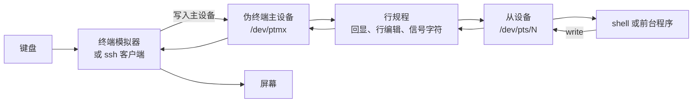
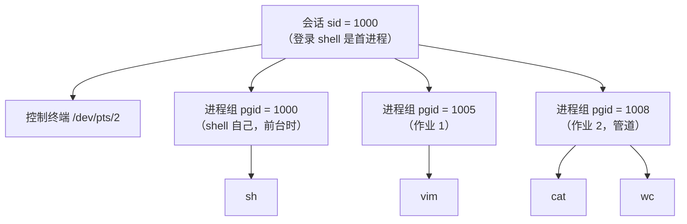

# 13. 终端、伪终端与作业控制

在终端里敲下 Ctrl+C，正在执行的程序会立即收到 SIGINT 信号体面退出；按下 Ctrl+Z，控制流戛然而止，通过 `jobs` 可以看到被挂起的任务，随后键入 `fg` 又能将其重新调度回前台恢复运行。输入密码时屏幕上不会泄漏任何字符，按下方向键时终端光标能够灵活上下挪移。这些习以为常的交互体验，没有一行逻辑是由用户编写的普通业务代码实现的，它们完完全全依托于操作系统内核中的终端驱动与行规程（line discipline）。

本章将全面拆解这层连接人机交互的系统级抽象：终端驱动如何拦截物理击键并转化为应用程序读到的字节或异步信号；如何通过 termios 在规范模式、非规范模式与原始模式之间平滑切换，并确保在进程异常退出时终端依然能够自愈复原；窗口物理尺寸的改变如何通过 SIGWINCH 驱动全屏 UI 重新布局；进程组、会话与控制终端的三层拓扑如何严格裁定谁享有终端读写权；以及如何通过伪终端（pseudoterminal, pty）构建外层容器去完全操控子进程的交互输入——这正是 `ssh` 守护进程、`expect` 自动化脚本以及所有现代图形终端模拟器的底层核心。最后，我们将把这些原语融会贯通，从零编写一个支持前后台切换、任务挂起与唤醒的迷你作业控制 shell。

## 1. 终端是什么

最早的终端是一台电传打字机，通过串口连到计算机：键盘把字符送进计算机，计算机把字符送回打字机打印。后来终端变成了一台独立的机器，再后来终端模拟器（terminal emulator）变成了一个普通程序，在一个窗口里画字符。从程序的角度，这三种东西没有区别：它面对的是一个字符设备，从中读字节、向它写字节。

程序看到的设备叫 tty（teletypewriter 的缩写）。Linux 上它可能是一个虚拟控制台 `/dev/tty1`，一个串口 `/dev/ttyS0`，也可能是一对伪终端中的从设备 `/dev/pts/2`。`tty` 命令打印当前标准输入对应的设备名：

::: terminal title="bash - tty"

```text
$ tty
/dev/pts/2
```

:::

这条命令在 ssh 会话里和在图形界面的终端窗口里都会打印一个 `/dev/pts/N`。原因是 ssh 服务器和终端窗口都在中间放了一对伪终端：程序连在从设备一端，终端模拟器或 ssh 客户端拿着主设备一端，中间隔着内核里的行规程。

### 1.1 一条完整的路径

一次按键到达程序，要经过下面这条路径：



在图形界面的终端窗口里，终端模拟器负责把键盘事件变成字节写进主设备，再把从主设备读到的字节画成字符。行规程是内核中的一层软件，夹在主设备和从设备之间：它决定要不要回显、要不要把回车翻译成换行、`Ctrl+C` 这样的字节要不要交给程序。程序读写的从设备看起来就是一个普通的字符设备，`read` 和 `write` 的用法与文件相同。

在没有伪终端的场合，这条路径的两端由别的东西承担：虚拟控制台由内核自己模拟屏幕，串口终端的主设备一端是 UART 驱动。中间的行规程和从设备这一侧不变。

::: concept sys-tty-line-discipline-signal title="信号字符由行规程处理"

当 `ISIG` 置位时，行规程截获输入中的中断字符（`VINTR`，通常是 `^C`）、退出字符（`VQUIT`，`^\`）和挂起字符（`VSUSP`，`^Z`），不把它们交给程序，而是向终端的前台进程组发送 `SIGINT`、`SIGQUIT`、`SIGTSTP`。程序用 `read` 永远读不到这几个字节。

:::

::: generate sys-tty-history kind=explanation concepts=sys-tty-line-discipline-signal

面向只见过图形界面终端的读者，从 ASR-33 电传打字机讲到 xterm：为什么「终端」这个名字留了下来，为什么字符设备上会有一个行规程，以及终端模拟器、伪终端、行规程、从设备四者在一次按键中各做了什么。用打字机的回车与换行说明 `\r` 和 `\n` 的来历，不要总结。

:::

### 1.2 程序怎样知道自己面对的是不是终端

`isatty` 判断一个描述符是不是终端，`ttyname` 返回设备路径。下面的程序把标准输入、输出、错误三个描述符都查一遍：

```c
#define _POSIX_C_SOURCE 200809L

#include <stdio.h>
#include <stdlib.h>
#include <termios.h>
#include <unistd.h>

int main(void) {
    for (int fd = 0; fd <= 2; fd++) {
        const char *name = isatty(fd) ? ttyname(fd) : "(not a terminal)";

        printf("fd %d: %s\n", fd, name ? name : "(unknown)");
    }
    if (!isatty(STDIN_FILENO)) {
        fprintf(stderr, "stdin is not a terminal; run inside a terminal or ptyrun\n");
        return EXIT_FAILURE;
    }
    /* 下面用 tcgetattr 读出各项标志，完整代码见
       code/系统编程/13_终端_伪终端与作业控制/ttyinfo.c */
    return 0;
}
```

同一个程序在两种环境下运行，输出完全不同。标准输入是管道时，三个描述符都不是终端：

::: terminal title="bash - ./ttyinfo"

```text
$ ./ttyinfo
fd 0: (not a terminal)
fd 1: (not a terminal)
fd 2: (not a terminal)
stdin is not a terminal; run inside a terminal or ptyrun
```

:::

放进本章后面要讲的伪终端里，三个描述符都指向同一个从设备：

::: terminal title="bash - ./ptyrun ./ttyinfo"

```text
$ ./ptyrun ./ttyinfo
fd 0: /dev/pts/2
fd 1: /dev/pts/2
fd 2: /dev/pts/2
c_iflag = 0x00000500  (ICRNL=1 IXON=1)
c_oflag = 0x00000005  (OPOST=1 ONLCR=1)
c_cflag = 0x000000bf  (CS8=1 CREAD=1)
c_lflag = 0x00008a3b  (ICANON=1 ECHO=1 ISIG=1)
VMIN = 1  VTIME = 0
VERASE = 0x7f  VINTR = 0x03  VEOF = 0x04
[ptyrun] child exited with status 0
```

:::

`ptyrun` 是本章的示例程序，它分配一对伪终端，在其中运行给定的命令，并把标准输入原样转给主设备。`/dev/pts/2` 的具体编号每次不同，取决于当时已打开了多少伪终端。

`stty -a` 把 `struct termios` 的内容翻译成人能读的形式：

::: terminal title="bash - stty -a"

```text
$ ./ptyrun -s 24x80 sh -c "stty -a"
speed 38400 baud; rows 24; columns 80; line = 0;
intr = ^C; quit = ^\; erase = ^?; kill = ^U; eof = ^D; eol = <undef>;
eol2 = <undef>; swtch = <undef>; start = ^Q; stop = ^S; susp = ^Z; rprnt = ^R;
werase = ^W; lnext = ^V; discard = ^O; min = 1; time = 0;
-parenb -parodd -cmspar cs8 -hupcl -cstopb cread -clocal -crtscts
-ignbrk -brkint -ignpar -parmrk -inpck -istrip -inlcr -igncr icrnl ixon -ixoff
-iuclc -ixany -imaxbel -iutf8
opost -olcuc -ocrnl onlcr -onocr -onlret -ofill -ofdel nl0 cr0 tab0 bs0 vt0 ff0
isig icanon iexten echo echoe echok -echonl -noflsh -xcase -tostop -echoprt
echoctl echoke -flusho -extproc
```

:::

这三段输出里的每一项都对应 `termios` 的一个字段，下一节逐个说明。

<Quiz
  type="single"
  :options="[
    { label: '程序 read 到一个值为 3 的字节，自己调用 raise(SIGINT)', value: 'A' },
    { label: '行规程把 VINTR 字节消耗掉，向终端的前台进程组发送 SIGINT', value: 'B' },
    { label: '终端模拟器在把字节写给主设备之前发送 SIGINT', value: 'C' },
    { label: 'shell 收到通知后向子进程发送 SIGINT', value: 'D' }
  ]"
  answer="B"
>

<template #question>

在正常设置的终端里按 Ctrl+C，程序为什么收到 SIGINT？

</template>

正确答案是 **B**。中断字符由行规程识别，程序读不到这个字节；SIGINT 发给终端驱动记录的前台进程组。

- 把 `ISIG` 清掉之后，同一个 `^C` 就只是字节 0x03，会原样交给 `read`，本章第 3 节的 `keys` 程序演示了这一点。
- 终端模拟器只负责把按键转成字节，它不知道什么是信号。
- shell 不是中间人：信号直接从内核送到作业。

</Quiz>

## 2. termios：终端的设置

### 2.1 四组标志与特殊字符

`<termios.h>` 里的 `struct termios` 有四个标志字段和一个特殊字符数组：

```c
struct termios {
    tcflag_t c_iflag;    /* 输入处理 */
    tcflag_t c_oflag;    /* 输出处理 */
    tcflag_t c_cflag;    /* 线路参数 */
    tcflag_t c_lflag;    /* 本地处理 */
    cc_t     c_cc[NCCS]; /* 特殊字符与 VMIN、VTIME */
};
```

四组标志各管一段，常用的如下表。

| 字段 | 常用标志 | 作用 |
| --- | --- | --- |
| `c_iflag` | `ICRNL` | 输入中的 `\r` 转成 `\n` |
| | `IXON` | 用 `^S`、`^Q` 控制输出暂停与继续 |
| | `ISTRIP` | 去掉输入字节的最高位 |
| `c_oflag` | `OPOST` | 打开输出后处理 |
| | `ONLCR` | 输出的 `\n` 转成 `\r\n`，配合 `OPOST` |
| `c_cflag` | `CS8` | 每个字符 8 位 |
| | `CREAD` | 允许接收 |
| | `HUPCL` | 关闭设备时挂断调制解调器线路 |
| `c_lflag` | `ICANON` | 规范模式（按行交付） |
| | `ECHO` | 回显输入 |
| | `ISIG` | 识别信号字符 |
| | `IEXTEN` | 扩展处理，如 `^V` 字面输入 |
| | `TOSTOP` | 后台进程组写终端时发送 `SIGTTOU` |

特殊字符放在 `c_cc` 数组里，用下标访问：

| 下标 | 默认值 | 含义 |
| --- | --- | --- |
| `VINTR` | `^C` | 中断字符，发送 `SIGINT` |
| `VQUIT` | `^\` | 退出字符，发送 `SIGQUIT` |
| `VSUSP` | `^Z` | 挂起字符，发送 `SIGTSTP` |
| `VERASE` | `^?` | 删除前一个字符 |
| `VKILL` | `^U` | 删除整行 |
| `VEOF` | `^D` | 行首时让 `read` 返回 0 |
| `VSTART`、`VSTOP` | `^Q`、`^S` | 恢复、暂停输出（需要 `IXON`） |
| `VMIN`、`VTIME` | 1、0 | 非规范模式下 `read` 的返回条件 |

把某个字符设成 `_POSIX_VDISABLE` 就禁用它。`stty` 命令可以临时修改这些设置，例如 `stty erase ^H`；程序里则通过 `tcgetattr` 读出、修改、再 `tcsetattr` 写回。

::: details `c_lflag` 里其余几个值得认识的标志

- `ECHOE`：删除字符时在屏幕上用退格擦掉它。
- `ECHOK`：删除整行时输出换行。
- `ECHOCTL`：把控制字符回显成 `^X` 的形式，`^C` 就来自这里。
- `ECHOKE`：把被删除的字符在屏幕上真正擦掉，而不是留一串退格。
- `NOFLSH`：收到信号后不清空输入输出队列，默认是要清的。
- `PENDIN`：下次读入时重新处理已缓冲的输入。

`stty -a` 输出里带减号的标志是关闭的。Linux 的默认行规程叫 `N_TTY`，上面这些行为都是它实现的。

:::

### 2.2 tcgetattr 与 tcsetattr

读设置用 `tcgetattr`，写设置用 `tcsetattr`：

```c
struct termios t;

if (tcgetattr(STDIN_FILENO, &t) == -1) {
    /* errno 为 ENOTTY 表示这个描述符不是终端 */
}
t.c_lflag &= ~(tcflag_t)ECHO;
if (tcsetattr(STDIN_FILENO, TCSANOW, &t) == -1) {
    /* ... */
}
```

第三个参数决定什么时候生效：

- `TCSANOW`：立即生效。
- `TCSADRAIN`：等已经写出的输出全部发送完之后生效。改输出参数时用它，否则可能把半行输出按新设置处理。
- `TCSAFLUSH`：等输出发送完之后生效，并丢弃已经到达但还没被读走的输入。

`TCSAFLUSH` 适合在切换模式时使用：用户提前敲进去的字符（type-ahead）在旧模式下可能有不同的解释，丢掉比误读好。程序读口令时就用它，避免用户提前输入的口令被非规范模式拆散。

`tcsetattr` 只要有一项修改成功就返回 0，想确认全部生效，改完再 `tcgetattr` 一次比较。

### 2.3 规范模式

默认设置下 `ICANON` 和 `ECHO` 都置位，这就是规范模式（canonical mode，也叫 cooked mode）。行规程在这里做的事情相当于一个极简的行编辑器：

- 输入的字符先进入缓冲区，同时回显到屏幕；
- `VERASE` 删掉前一个字符，`VKILL` 删掉整行；
- 按下回车（`\n`，`ICRNL` 会把 `\r` 转成它）后，整行连同换行符一起交给 `read`；
- 行首按 `VEOF`，`read` 返回 0，表示文件结束；行中间按 `VEOF` 只是把已输入的部分立即交给 `read`，不产生文件结束。

`canon.c` 先读两行，再切到非规范模式读三个字节：

```c
set_canonical(1);
printf("first read waiting...\n");
ssize_t n = read(STDIN_FILENO, buf, sizeof buf);
show("first ", n, buf);
```

用管道把两行输入一口气送进去，第一次 `read` 仍然只拿到第一行：

::: terminal title="bash - ./ptyrun ./canon"

```text
$ ./ptyrun ./canon
Type two lines, each under 60 characters.
--- canonical mode (ICANON set) ---
first read waiting...
hello
world
first : read returned 6 byte(s): "hello\n"
second read waiting...
second: read returned 6 byte(s): "world\n"
--- noncanonical mode (ICANON and ECHO cleared, VMIN=1, VTIME=0) ---
press three keys
key  : read returned 1 byte(s): "a"
key  : read returned 1 byte(s): "b"
key  : read returned 1 byte(s): "c"
--- back to canonical mode ---
```

:::

输入里的 `hello`、`world` 是行规程回显出来的，不是程序打印的；程序只打印 `read` 的返回值和内容。两行输入都到达之后，第一次 `read` 返回 6 字节（`hello\n`），第二次返回 6 字节（`world\n`），不会把两行合在一起。读的缓冲区有 64 字节，够放下两行，但规范模式一次只交一行。

行编辑也是行规程做的。下面的会话先输入 `abcd`，按两次退格删掉两个字符，再输入 `X` 和回车，然后直接按 Ctrl+D：

::: terminal title="bash - ./ptyrun ./canon（节选）"

```text
$ ./ptyrun ./canon
Type two lines, each under 60 characters.
--- canonical mode (ICANON set) ---
first read waiting...
abcd^H ^H^H ^HX
first : read returned 4 byte(s): "abX\n"
second read waiting...
second: read returned 0 byte(s): ""
```

:::

第一行 `abcd^H ^H^H ^HX` 是回显，`^H` 是退格；程序读到的只有 `abX\n`。第二行没有任何输入就按了 Ctrl+D，`read` 返回 0。`^D` 本身不进入缓冲区，也不出现在返回的内容里。

### 2.4 非规范模式与 VMIN、VTIME

清掉 `ICANON` 就进入非规范模式（noncanonical mode）。这时行规程不再攒行，`read` 什么时候返回由 `c_cc[VMIN]` 和 `c_cc[VTIME]` 决定。`VTIME` 的单位是 0.1 秒，0 表示不设超时。四种组合：

| VMIN | VTIME | `read` 的行为 |
| --- | --- | --- |
| 0 | 0 | 有数据就立即返回已有的数据，没有就立即返回 0。轮询用。 |
| 大于 0 | 0 | 等到至少 `VMIN` 个字节才返回，返回的字节数可以多于 `VMIN`，最多是请求的字节数。 |
| 0 | 大于 0 | 开始计时，收到至少一个字节立即返回；到时间还没有数据就返回 0。每次调用重新计时。 |
| 大于 0 | 大于 0 | 收到第一个字节后开始计时，每收到一个字节重新计时；攒够 `VMIN` 个、或者两个字节之间的间隔超过 `VTIME`，就返回已经收到的字节。 |

`vtmode.c` 用一个程序演示这四种组合，每次 `read` 之后打印字节数和耗时：

```c
static void set_vmin_vtime(int vmin, int vtime) {
    struct termios t;

    if (tcgetattr(STDIN_FILENO, &t) == -1) {
        die("tcgetattr");
    }
    t.c_lflag &= ~(tcflag_t)ICANON;
    t.c_lflag &= ~(tcflag_t)ECHO;
    t.c_cc[VMIN] = (cc_t)vmin;
    t.c_cc[VTIME] = (cc_t)vtime;
    if (tcsetattr(STDIN_FILENO, TCSAFLUSH, &t) == -1) {
        die("tcsetattr");
    }
}
```

先看 `VMIN=0, VTIME=0`，没有输入时三次 `read` 全部立刻返回 0：

::: terminal title="bash - ./ptyrun ./vtmode 0 0"

```text
$ ./ptyrun ./vtmode 0 0
VMIN=0 VTIME=0: three reads follow
read 1: 0 byte(s) after 0.00 s
read 2: 0 byte(s) after 0.00 s
read 3: 0 byte(s) after 0.00 s
```

:::

`VMIN=0, VTIME=10` 是一秒的读超时。第一个字节在 0.6 秒时到达，所以两次 `read` 各等到一个字节；第三个字节一直没来，1.03 秒后返回 0：

::: terminal title="bash - ./ptyrun ./vtmode 0 10"

```text
$ ./ptyrun ./vtmode 0 10
VMIN=0 VTIME=10: three reads follow
read 1: 1 byte(s) after 0.60 s
read 2: 1 byte(s) after 0.40 s
read 3: 0 byte(s) after 1.03 s
```

:::

`VMIN=5, VTIME=0` 要攒够 5 个字节。输入按 `abc`、`de`、`fghij`、`xy`、`z123` 分五批送进来，前两次 `read` 都等到 5 个字节才返回，第三次把剩下的 6 个字节一起返回：

::: terminal title="bash - ./ptyrun ./vtmode 5 0"

```text
$ ./ptyrun ./vtmode 5 0
VMIN=5 VTIME=0: three reads follow
read 1: 5 byte(s) after 0.90 s
read 2: 5 byte(s) after 0.60 s
read 3: 6 byte(s) after 0.81 s
```

:::

最后一次返回 6 个字节说明「至少 `VMIN` 个」不等于「正好 `VMIN` 个」：缓冲区里有多少就交多少。

`VMIN=3, VTIME=5` 是字节间超时。输入 `a`、`b`、`c` 各隔 0.2 秒，凑够 3 个字节后返回；下一个字节 `d` 之后隔了 0.9 秒才来新的，超过 0.5 秒的字节间时限，所以那次 `read` 只返回 `d` 一个字节；再之后 `efg` 三个字节一起到达，又凑够 3 个：

::: terminal title="bash - ./ptyrun ./vtmode 3 5"

```text
$ ./ptyrun ./vtmode 3 5
VMIN=3 VTIME=5: three reads follow
read 1: 3 byte(s) after 1.00 s
read 2: 1 byte(s) after 1.10 s
read 3: 3 byte(s) after 0.40 s
```

:::

第一次的 1.00 秒是三个字节陆续到达、每来一个就重新计时的结果；只要字节间隔小于 0.5 秒，就不会提前返回。

<Quiz
  type="single"
  :options="[
    { label: '立即返回 0，因为没有数据', value: 'A' },
    { label: '最多等 1 秒，有数据就返回一个字节，没有就返回 0', value: 'B' },
    { label: '一直等到有数据为止，返回 10 个字节', value: 'C' },
    { label: '返回 -1，errno 为 EAGAIN', value: 'D' }
  ]"
  answer="B"
>

<template #question>

清掉 `ICANON`，设 `VMIN = 0`、`VTIME = 10`，然后调用 `read(fd, buf, 64)`。此时没有数据到达，`read` 会怎样？

</template>

正确答案是 **B**。`VTIME` 的单位是 0.1 秒，10 就是 1 秒；`VMIN` 为 0 表示不要求最小字节数，所以超时后返回 0 而不是 -1。返回 0 在这里表示「这次没有读到东西」，不是文件结束。

</Quiz>

### 2.5 关闭回显读口令

读口令需要三件事：关掉 `ECHO`，按行读，结束后恢复。`getpass_lite.c` 的做法是先把原设置存进静态对象，再用 `atexit` 注册恢复函数，然后关闭回显：

```c
static struct termios saved;

static void restore(void) {
    if (tcsetattr(STDIN_FILENO, TCSANOW, &saved) == -1) {
        perror("tcsetattr restore");
    }
}

int main(void) {
    if (tcgetattr(STDIN_FILENO, &saved) == -1) {
        perror("tcgetattr");
        return EXIT_FAILURE;
    }
    atexit(restore);

    struct termios t = saved;

    t.c_lflag &= ~(tcflag_t)ECHO;
    if (tcsetattr(STDIN_FILENO, TCSAFLUSH, &t) == -1) {
        perror("tcsetattr");
        return EXIT_FAILURE;
    }
    char pass[64];

    printf("Password: ");
    fflush(stdout);
    ssize_t n = read(STDIN_FILENO, pass, sizeof pass - 1);
    /* 读完以后换行、恢复回显，再处理口令 */
    ...
}
```

`TCSAFLUSH` 在切换生效前把已经到达但还没被读走的输入丢掉。用户在提示符出现前敲进去的字符因此不会进入接下来的 `read`，读取从新设置下的输入开始。

读取时如果被信号打断，`read` 返回 -1 且 `errno` 为 `EINTR`。`getpass_lite` 为 `SIGINT`、`SIGTERM`、`SIGHUP`、`SIGQUIT` 各装了一个只设置标志的处理函数，循环里据此判断是否该退出：

```c
ssize_t n;
do {
    n = read(STDIN_FILENO, pass, sizeof pass - 1);
} while (n == -1 && errno == EINTR && got_signal == 0);
```

正常输入和按下 Ctrl+C 两种情况都用伪终端驱动，输出如下：

::: terminal title="bash - ./ptyrun ./getpass_lite"

```text
$ { sleep 0.3; printf 's3cret\n'; } | ./ptyrun ./getpass_lite
Password: 
read 6 character(s) without echo
[ptyrun] child exited with status 0

$ { sleep 0.4; printf '\003'; } | ./ptyrun ./getpass_lite
Password: 
interrupted by signal 2 (Interrupt), terminal restored
[ptyrun] child exited with status 130
```

:::

第二次的运行里，Ctrl+C 由行规程变成 SIGINT，`read` 被中断，程序打印提示并以 130 退出。`ptyrun` 报告的 130 来自它自己的约定：子进程被信号 N 杀死时返回 128 + N。

### 2.6 恢复终端设置

前面的恢复逻辑不是可选项。下面这个程序只关回显，不做任何恢复：

```c
int main(void) {
    struct termios t;

    if (tcgetattr(STDIN_FILENO, &t) == -1) {
        perror("tcgetattr");
        return EXIT_FAILURE;
    }
    t.c_lflag &= ~(tcflag_t)ECHO;
    if (tcsetattr(STDIN_FILENO, TCSANOW, &t) == -1) {
        perror("tcsetattr");
        return EXIT_FAILURE;
    }
    printf("echo is now off; this program exits without restoring it\n");
    fflush(stdout);
    return 0;
}
```

在新建的伪终端里运行它，再查看同一个终端的设置，`echo` 前面的减号还在：

::: terminal title="bash - ./ptyrun sh -c '...'"

```text
$ ./ptyrun sh -c './no_restore; stty -a | tr " " "\n" | grep -x -- "-\?echo"'
echo is now off; this program exits without restoring it
-echo
```

:::

按 `stty sane` 之后恢复正常：

::: terminal title="bash - ./ptyrun sh -c '...'"

```text
$ ./ptyrun sh -c './no_restore; stty sane; stty -a | tr " " "\n" | grep -x -- "-\?echo"'
echo is now off; this program exits without restoring it
echo
```

:::

用户当前的终端如果被弄成这样，输入什么都看不见，连敲 `stty sane` 都看不到自己在敲什么。此时先按 Ctrl+J（换行，即使回显关闭也能提交命令）执行 `stty sane`，或者执行 `reset`。

::: compare left-title="只在正常路径恢复" right-title="用 atexit 恢复"

```c
int main(void) {
    struct termios saved;

    tcgetattr(STDIN_FILENO, &saved);
    /* 改设置、读输入 */
    read_password();
    /* 正常返回前恢复 */
    tcsetattr(STDIN_FILENO, TCSANOW, &saved);
    return 0;
}
```

---

```c
static struct termios saved;

static void restore(void) {
    tcsetattr(STDIN_FILENO, TCSANOW, &saved);
}

int main(void) {
    tcgetattr(STDIN_FILENO, &saved);
    atexit(restore);
    /* 改设置、读输入，任何一次提前 return 都会恢复 */
    ...
}
```

:::

左边只有正常返回时才恢复；程序在中间 `return`、`exit` 或者调用 `die` 时终端就留在关闭回显的状态。右边把恢复放进 `atexit`，所有经过 `exit` 的退出路径都会执行。

`atexit` 管不到进程被信号杀死的情况。要覆盖 Ctrl+C、`SIGTERM`、`SIGHUP`，得给这些信号装处理函数，在处理函数里调用 `tcsetattr`，然后重新抛出信号或者设置标志让主循环退出。`tcsetattr` 是异步信号安全的，可以直接在处理函数里调用。收到 `SIGKILL` 时什么都做不了，只能靠 `stty sane` 收拾。

::: tip 终端被弄乱时的急救

`stty sane` 把设置恢复成一组合理的默认值，`reset` 除了恢复设置还会清屏并重新初始化终端。两个命令都不需要看见自己的回显。

:::

## 3. 原始模式与读取按键

### 3.1 原始模式的标志

编辑器、游戏、全屏程序需要自己处理每一个按键，于是把行规程的功能全部关掉，进入原始模式（raw mode）。`keys.c` 的写法照着 kilo 的 `enableRawMode`：

```c
static void enable_raw(void) {
    struct termios t;

    if (tcgetattr(STDIN_FILENO, &t) == -1) {
        die("tcgetattr");
    }
    saved = t;

    t.c_iflag &= ~(tcflag_t)(BRKINT | ICRNL | INPCK | ISTRIP | IXON);
    t.c_oflag &= ~(tcflag_t)OPOST;
    t.c_cflag |= CS8;
    t.c_lflag &= ~(tcflag_t)(ECHO | ICANON | IEXTEN | ISIG);
    t.c_cc[VMIN] = 0;
    t.c_cc[VTIME] = 1;
    if (tcsetattr(STDIN_FILENO, TCSAFLUSH, &t) == -1) {
        die("tcsetattr");
    }
}
```

逐项解释：

- `BRKINT` 关掉：串口上的 break 条件不再产生 `SIGINT`。
- `ICRNL` 关掉：回车原样作为 `\r` 交给程序，不再变成 `\n`。
- `INPCK`、`ISTRIP` 关掉：不做奇偶校验，也不剥掉第 8 位。
- `IXON` 关掉：`^S`、`^Q` 不再控制输出，可以作为普通按键。
- `OPOST` 关掉：程序写出的 `\n` 不再被翻译成 `\r\n`，换行要自己写 `\r\n`。
- `CS8` 打开：按 8 位字符处理。
- `ECHO`、`ICANON`、`IEXTEN`、`ISIG` 关掉：不回显、不攒行、不处理 `^V`、不产生信号。
- `VMIN=0`、`VTIME=1`：有字节立即返回，没有就最多等 0.1 秒，超时返回 0。

`VMIN=0` 加上超时是为了区分单独的 Esc 键和转义序列。方向键发送的是 `ESC [ A` 这样的三个字节，如果用户只按了 Esc，后面的字节不会来，`read` 超时返回 0，程序就知道这是一个单独的 Esc。

glibc 提供了 `cfmakeraw` 做同样的设置，但它是 BSD 扩展，需要 `_GNU_SOURCE` 才能声明：

```c
#define _GNU_SOURCE
#include <termios.h>

struct termios t;

cfmakeraw(&t);   /* 设置与上面等价，但 VMIN、VTIME 不变 */
```

用 `_POSIX_C_SOURCE 200809L` 编译同一个程序，gcc 报 `implicit declaration of function 'cfmakeraw'`。为了少一个宏，本章的示例都手写标志位；读别的人代码时认识 `cfmakeraw` 就够了。

### 3.2 按键与转义序列

`keys.c` 在原始模式下每次读一个字节，按十六进制打印，再给一个解释：

::: terminal title="bash - ./ptyrun ./keys"

```text
$ { sleep 0.4; printf '\033[A'; sleep 0.25; printf 'a'; sleep 0.25; printf '\003'; sleep 0.25; printf 'q'; } | ./ptyrun ./keys
Press keys; q quits. Bytes are shown in hex.
0x1b  ESC
0x5b  '['
0x41  'A'
0x61  'a'
0x03  Ctrl-C (ISIG off: arrives as a byte)
0x71  'q'
```

:::

方向键上产生三个字节：`0x1b`（Esc）、`0x5b`（`[`）、`0x41`（`A`）。这是 VT100 终端留下的约定，叫转义序列（escape sequence）。常见的几组：

| 按键 | 字节序列 |
| --- | --- |
| 上、下、右、左 | `ESC [ A`、`ESC [ B`、`ESC [ C`、`ESC [ D` |
| Home、End | `ESC [ H`、`ESC [ F`，有的终端用 `ESC [ 1 ~`、`ESC [ 4 ~` |
| Page Up、Page Down | `ESC [ 5 ~`、`ESC [ 6 ~` |
| Delete | `ESC [ 3 ~` |
| F1～F4 | `ESC O P` 到 `ESC O S` |

因为 `ISIG` 关掉了，同一个 `^C` 这次作为字节 0x03 到达程序，没有变成信号。这就是原始模式下编辑器能自由使用 Ctrl 组合键的原因。

原始模式下读取按键的程序必须自己解析这些序列。kilo 的 `editorReadKey` 就是先读一个字节，遇到 `ESC` 再读两个字节，按 `seq[0] == '['` 分出方向键；如果后续字节迟迟不来（`read` 超时返回 0），就认为用户单独按了 Esc。第 2 章的 [kilo 源码阅读](/教程/正文/项目案例/kilo/2_1_源码阅读_kilo) 有完整代码。

### 3.3 OPOST 与换行

原始模式关掉了 `OPOST`，程序写出的 `\n` 就只是换行符，光标回到行首这件事不再自动发生。同一个程序在两种设置下输出 `one\ntwo\nthree\n`：

::: terminal title="bash - od -c"

```text
$ ./ptyrun ./opost 0 | od -c | head -2
0000000   o   n   e  \n   t   w   o  \n   t   h   r   e   e  \n
$ ./ptyrun ./opost 1 | od -c | head -2
0000000   o   n   e  \r  \n   t   w   o  \r  \n   t   h   r   e   e  \r
```

:::

`OPOST` 关闭时字节原样到达主设备；打开时行规程按 `ONLCR` 把每个 `\n` 换成 `\r\n`。终端模拟器收到单独的 `\n` 只会把光标下移一行，列不变，所以原始模式下的程序要自己写 `\r\n`，`keys.c` 里的每一行输出就是这么写的。反过来，如果程序在原始模式下只写 `\n`，屏幕上的输出会呈阶梯状向右下方延伸。

## 4. 窗口大小与 SIGWINCH

终端知道自己有多少行多少列。这个尺寸存放在终端驱动里，用 `ioctl` 的 `TIOCGWINSZ` 读取：

```c
#include <sys/ioctl.h>

struct winsize {
    unsigned short ws_row;    /* 行数 */
    unsigned short ws_col;    /* 列数 */
    unsigned short ws_xpixel; /* 像素宽度，通常为 0 */
    unsigned short ws_ypixel; /* 像素高度，通常为 0 */
};
```

`winsize.c` 读出尺寸，装上 `SIGWINCH` 的处理函数，然后在 `pause` 里等：

```c
static void print_size(const char *label) {
    struct winsize ws;

    if (ioctl(STDIN_FILENO, TIOCGWINSZ, &ws) == -1) {
        perror("TIOCGWINSZ");
        exit(EXIT_FAILURE);
    }
    printf("%s: %u rows x %u columns (%u x %u pixels)\n", label, ws.ws_row, ws.ws_col,
           ws.ws_xpixel, ws.ws_ypixel);
}
```

窗口大小改变时，内核向终端的前台进程组发送 `SIGWINCH`，默认动作是忽略，程序可以自己处理。下面的会话用 `ptyrun` 的 `-s` 选项把初始尺寸设成 24×80，`-c` 选项在 600 毫秒后用 `TIOCSWINSZ` 改成 30×100：

::: terminal title="bash - ./ptyrun -s 24x80 -c 30x100@600 ./winsize"

```text
$ ./ptyrun -s 24x80 -c 30x100@600 ./winsize
initial: 24 rows x 80 columns (0 x 0 pixels)
resize the window; ctrl-c to quit
after SIGWINCH: 30 rows x 100 columns (0 x 0 pixels)
```

:::

程序先打印初始尺寸，收到 `SIGWINCH` 之后再读一次，得到新值。设置了 `TIOCSWINSZ` 的是另一个进程（这里是 `ptyrun`），收到信号的是终端前台进程组里的程序，两者不一定是同一个进程。真实的终端窗口改变大小时，终端模拟器也是这样做：先 `ioctl` 设置主设备的尺寸，内核再通知前台进程组。

`TIOCSWINSZ` 和 `TIOCGWINSZ` 都是 Linux 和多数 Unix 共有的终端 ioctl，不在 POSIX 的 `termios` 接口里。POSIX.1-2024 增加了 `tcgetwinsize` 和 `tcsetwinsize`，但 glibc 2.41 还没有实现，所以实际代码继续用 `ioctl`。

窗口大小变化的信号是发给前台进程组的，后台作业收不到。全屏程序被 `fg` 调回前台时，应该自己重新读一次尺寸，不要等 `SIGWINCH`。

## 5. 进程组、会话与控制终端

### 5.1 进程组

进程组（process group）是一组可以一起接收信号的进程。shell 把一条管道线里的所有进程放进同一个组，这样 Ctrl+C 一次就能终止整条管道。每个组有一个进程组 ID，等于组长进程的 PID。

在伪终端里运行 `sh`，执行 `cat | cat &`，再用 `ps` 查看：

::: terminal title="bash - 伪终端内的 sh"

```text
$ ./ptyrun sh
$ cat | cat &
$ ps -o pid,ppid,pgid,sid,tpgid,stat,comm
    PID    PPID    PGID     SID   TPGID STAT COMMAND
3783009 3783008 3783009 3783009 3783026 SNs  sh
3783022 3783009 3783022 3783009 3783026 TN   cat
3783023 3783009 3783022 3783009 3783026 TN   cat
3783026 3783009 3783026 3783009 3783026 RN+  ps
[1] + Stopped (tty input)        cat | cat
```

:::

两个 `cat` 的 `PGID` 都是 3783022，说明它们在同一个组里；组长是第一个 `cat`。它们的 `STAT` 是 `TN`：`T` 表示被停止，原因在下一节。`sh` 的 `STAT` 是 `SNs`，`s` 表示它是会话首进程（session leader）。`ps` 自己的 `STAT` 带 `+`，表示它在前台进程组。

演示程序是用 `nice -n 19` 启动的，所以 `STAT` 里多一个 `N`（低优先级）；读者在自己的终端里运行不会看到这个字母。`ps` 的 `TPGID` 一列也随前台作业变化：运行 `ps` 时前台组是 `ps` 所在的组，3783026，而不是 `cat` 的 3783022。

### 5.2 会话与控制终端

会话（session）是一组进程组的集合。登录时 shell 调用 `setsid` 成为新会话的首进程，会话的 ID 等于它的 PID。一个会话最多有一个控制终端（controlling terminal）；会话首进程打开一个还没有被其他会话当作控制终端的终端设备时，这个终端就成为它的控制终端，除非打开时加了 `O_NOCTTY`。

控制终端记住三样东西：会话 ID、前台进程组 ID、终端设置。`ps` 输出里的 `SID` 是会话 ID，`TPGID` 是控制终端当前的前台进程组 ID。终端上的 `tpgid` 为 -1 表示这个进程没有控制终端。

`tcgetpgrp(fd)` 和 `tcsetpgrp(fd, pgrp)` 读写前台进程组，`tcgetsid(fd)` 取控制终端所属会话的 ID。前台进程组只能由同一个会话里的进程组担任。

### 5.3 前台进程组

内核的终端驱动只把输入交给前台进程组，也只把终端产生的信号发给它。后台进程组里的进程如果要读终端，行规程向它发送 `SIGTTIN`，默认动作是停止。上一节的 `cat | cat &` 就是这个结局：两个 `cat` 都想读终端，一读就被停止，`jobs` 里显示 `Stopped (tty input)`。

写终端是另一回事。默认情况下后台进程可以写，只有设置了 `TOSTOP`（`stty tostop`）之后，后台进程组写终端才会收到 `SIGTTOU` 并被停止：

::: terminal title="bash - 伪终端内的 sh"

```text
$ ./ptyrun sh
$ stty tostop
$ sh -c "while :; do echo tick; sleep 0.2; done" &
$ jobs
[1] + Stopped (tty output)       sh -c "while :; do echo tick; sleep 0.2; done"
```

:::

`SIGTTIN` 和 `SIGTTOU` 都能被捕获或忽略。被忽略时，后台读终端会返回 `EIO`；被捕获时，处理函数可以做别的事，但默认的停止行为就没了。

::: concept sys-tty-foreground-pgrp title="只有前台进程组拥有终端"

终端驱动只把输入交给前台进程组，并且只向前台进程组发送 `SIGINT`、`SIGQUIT`、`SIGTSTP`、`SIGWINCH`。后台进程组读终端会收到 `SIGTTIN` 并停止；写终端在 `TOSTOP` 置位时收到 `SIGTTOU` 并停止。前台进程组由 `tcsetpgrp` 设置，只能从会话内的进程组中选。

:::

<Quiz
  type="single"
  :options="[
    { label: 'read 返回 -1，errno 为 EAGAIN', value: 'A' },
    { label: 'read 阻塞，直到被调到前台', value: 'B' },
    { label: '进程组收到 SIGTTIN，默认被停止', value: 'C' },
    { label: 'read 返回 0，表示文件结束', value: 'D' }
  ]"
  answer="C"
>

<template #question>

在 shell 里执行 `cat &`，然后 `cat` 从后台读终端，会发生什么？

</template>

正确答案是 **C**。行规程发现读终端的是后台进程组，发送 `SIGTTIN`；`cat` 没有处理这个信号，于是停止，`jobs` 显示 `Stopped (tty input)`。用 `fg` 把它调到前台，它会继续运行。

</Quiz>

### 5.4 会话与进程组的结构

一个会话里有若干个进程组，每个进程组里有若干进程：



终端只记录一个前台进程组 ID，其余都是后台。shell 在作业之间切换时，修改的就是这一个数字。

### 5.5 终端关闭：SIGHUP

终端设备被挂断时，内核做两件事：先向会话首进程发送 `SIGHUP` 和 `SIGCONT`，再检查这个终端有没有前台进程组，把它记下来交给「会话首进程退出」时的处理。ssh 连接断开、终端窗口被关掉、调制解调器掉线，走的都是这条路。

在伪终端里验证。父进程创建一对伪终端，子进程 `setsid` 后打开从设备成为会话首进程，再 fork 出一个前台组，然后父进程关闭主设备：

::: terminal title="bash - ./hup_demo stay"

```text
$ ./hup_demo stay
mode stay, closing master
leader  pid 3901394 pgid 3901394 sid 3901394
fg-ready pid 3901395 pgid 3901395 sid 3901394
SIGHUP  pid 3901394 pgid 3901394 sid 3901394
```

:::

首进程收到 `SIGHUP`，前台组没有。这里 `hup_demo` 让首进程捕获了 `SIGHUP` 并继续存活。真实的登录 shell 不会捕获它，默认动作是终止。首进程一退出，内核在释放控制终端时会向它活着时记录的前台进程组补发 `SIGHUP`：

::: terminal title="bash - ./hup_demo exit"

```text
$ ./hup_demo exit
mode exit, closing master
leader  pid 3901402 pgid 3901402 sid 3901402
fg-ready pid 3901403 pgid 3901403 sid 3901402
SIGHUP  pid 3901402 pgid 3901402 sid 3901402
SIGHUP  pid 3901403 pgid 3901403 sid 3901402
```

:::

第二行 `SIGHUP` 来自首进程退出时的这一轮补发，不是挂断时直接发给前台组的。后台进程组在这一整套流程里一次也收不到信号：内核不向它发信号，会话首进程默认也不会给它发。

那么「关掉终端后后台任务全没了」是谁做的？是 shell。真实的 shell 在收到 `SIGHUP` 时，向自己管理的每个作业发送 `SIGHUP`，不管那个作业在前台还是后台。`code/系统编程/13_终端_伪终端与作业控制/hupjob2.sh` 让后台循环自己捕获 `SIGHUP`，把收到信号的事实记下来：

::: terminal title="bash - 关闭伪终端之后"

```text
$ ./ptyrun -q ./hupjob2.sh
jobs started
Hangup
$ sleep 0.8; wc -l < ticks.log; cat hupped.log
10
job-got-HUP
```

:::

后台作业只写了 10 行就不再写，`hupped.log` 里有它自己记下的 `job-got-HUP`，说明它收到了 shell 转发来的 `SIGHUP`。中间那行 `Hangup` 是 `sh` 退出时报告作业被挂断。上面 `hup_demo` 的实验表明，如果只关闭伪终端而背后没有 shell 转发，后台组根本收不到信号。

`nohup` 命令做的事情就是让程序忽略 `SIGHUP`，把标准输出重定向到文件，这样退出登录后程序还能继续跑。要彻底脱离终端，得再配合 `setsid` 或者用 `tmux`、`screen` 这类自己持有伪终端的工具。

会话里的某个进程组如果既没有成员在前台、也没有成员在别的会话里，并且组里每个进程的父进程要么在组内、要么不在这个会话里，这个组就叫孤儿进程组（orphaned process group）。内核不会把 `SIGTTIN`、`SIGTTOU` 发给孤儿进程组，而是直接让 `read`、`write` 返回 `EIO`，因为发信号只会让它们永远停在那里没人管。

## 6. 伪终端

### 6.1 主设备与从设备

伪终端（pseudoterminal，pty）是一对虚拟字符设备：主设备（master）和从设备（slave）。从设备的行为和真实终端一样，程序打开它、读写它、在它上面设置 termios，都感觉不到区别；主设备则由另一个程序持有，通常是终端模拟器、ssh 服务器或 `script`。

内核在两台设备之间放了一个行规程。向主设备写入的字节，经过行规程处理后成为从设备的输入；从设备上程序写出的字节，经过行规程处理后可以从主设备读到。所以终端模拟器只要把按键写进主设备，就能让从设备上的程序收到输入；程序输出的 `\r\n`、回显、信号字符，也全部由内核的行规程处理，终端模拟器不需要自己实现这些。这也解释了为什么终端模拟器能运行 `vim` 这类要求完整终端语义的程序。

Linux 上主设备是 `/dev/ptmx`，每次打开都会分配一个新的从设备 `/dev/pts/N`。详细的 pty 接口见 [pty(7)](https://man7.org/linux/man-pages/man7/pty.7.html)。

### 6.2 打开一对伪终端

标准的做法是用 `posix_openpt` 打开主设备，再取从设备的名字：

```c
#define _XOPEN_SOURCE 700

#include <fcntl.h>
#include <stdlib.h>

int master = posix_openpt(O_RDWR | O_NOCTTY);
if (master == -1) {
    die("posix_openpt");
}
if (grantpt(master) == -1) {
    die("grantpt");
}
if (unlockpt(master) == -1) {
    die("unlockpt");
}
char *slave_name = ptsname(master);
```

四个函数的职责：

- `posix_openpt`：打开一个尚未使用的主设备。`O_NOCTTY` 防止主设备本身成为调用者的控制终端。
- `grantpt`：把从设备的属主改成调用者、权限改成 0620。在 Linux 上这个函数是空操作，因为 devpts 挂载时已经处理好了权限；为了可移植性仍然要调用。
- `unlockpt`：解除从设备的锁定，允许打开。
- `ptsname`：返回从设备的路径，如 `/dev/pts/2`。返回的字符串由库管理，下一次调用会覆盖它，需要保存就自己复制。

这几个接口来自 XSI，所以源文件用 `_XOPEN_SOURCE 700`。只用 `_POSIX_C_SOURCE 200809L` 时，gcc 报 `implicit declaration of function 'posix_openpt'`。

glibc 的 `<pty.h>` 还提供了 `forkpty` 和 `openpty`，把这一串操作包成一个调用。`forkpty` 相当于 `openpty` 加 `fork`、`setsid`、把从设备接到标准输入输出上：

```c
#include <pty.h>

int master;
pid_t pid = forkpty(&master, NULL, NULL, NULL);
if (pid == 0) {
    execlp("sh", "sh", "-c", "tty", (char *)NULL);
    _exit(127);
}
```

这两个函数在 `_POSIX_C_SOURCE 200809L` 下就能用。`login_tty(slave)` 做的是 `forkpty` 中子进程的那一半：`setsid`，把描述符复制到 0、1、2，关闭原来的描述符。自己写 pty 程序时，用 `posix_openpt` 那一组能看到每一步在做什么，`forkpty` 则省事。

子进程的顺序不能颠倒：先 `setsid`，再打开从设备，从设备才会成为新会话的控制终端。先打开再从设备再 `setsid` 的话，`setsid` 本身能成功，但那个从设备不会成为新会话的控制终端，`tcgetpgrp` 会返回 `ENOTTY`，后续的 `tcsetpgrp` 和作业控制都无从谈起。要让已经打开的终端成为控制终端，得由会话首进程调用 `TIOCSCTTY`。

### 6.3 一个驱动器：ptyrun

本章几乎所有的演示都靠 `ptyrun`。它的结构是典型的 pty 驱动：

```c
int master = posix_openpt(O_RDWR | O_NOCTTY);
grantpt(master);
unlockpt(master);
char *slave_name = ptsname(master);

pid_t pid = fork();
if (pid == 0) {
    setsid();
    int slave = open(slave_name, O_RDWR);
    dup2(slave, STDIN_FILENO);
    dup2(slave, STDOUT_FILENO);
    dup2(slave, STDERR_FILENO);
    close(slave);
    close(master);
    execvp(argv[optind], &argv[optind]);
    _exit(127);
}
```

父进程用 `poll` 同时等标准输入和主设备，把标准输入读到的东西写给主设备，把主设备读到的东西写回标准输出。`-s` 和 `-c` 选项分别设置初始窗口大小和在指定时刻修改窗口大小，用来演示 `SIGWINCH`。

主设备上有一个必须处理的细节：所有从设备都关闭之后，读主设备返回 -1，`errno` 为 `EIO`，而不是返回 0。程序要把 `EIO` 当作「对端已经消失」处理，否则会陷在 `poll` 循环里。下面的小实验验证了这一点：

::: terminal title="bash - ./eio_test"

```text
$ ./eio_test
from child
read returned -1, errno=5 (Input/output error)
child exited with status 3
```

:::

子进程运行 `sh -c 'echo from child; exit 3'`，退出后主设备读不到数据，返回 `EIO`。

用 `ptyrun` 运行一个普通程序，能看到「终端」是怎样起作用的。写 `hello\n` 给主设备，程序读到并回显：

::: terminal title="bash - ./ptyrun cat"

```text
$ printf 'hello\n' | ./ptyrun cat
hello
hello
```

:::

第一行 `hello` 是行规程的回显（`ECHO` 打开时，输入被回显），第二行是 `cat` 的输出。两者看起来一样，来源不同。

再往主设备写一个字节 0x03：

::: terminal title="bash - ./ptyrun sleep 30"

```text
$ printf '\003' | ./ptyrun sleep 30
^C[ptyrun] child killed by signal 2 (Interrupt)
```

:::

按键变成信号，信号杀死的是从设备那一侧的 `sleep`，而发送字节的是父进程。这验证了第 1 节的结论：产生 SIGINT 的是行规程，不是键盘。

`ptyrun` 在 fork 之后用一个管道做同步：子进程把从设备接到标准输入输出上之后才通知父进程开始转发。少了这一步，父进程可能在子进程还没打开从设备时就把输入写给主设备。这时行规程已经开始处理这些字节，但从设备还没有成为任何会话的控制终端，没有前台进程组可以接收信号，写进去的 `^C` 不会让任何进程退出；第一次运行 `printf '\003' | ./ptyrun sleep 30` 时，`sleep` 就会一直等到 `timeout` 把它杀掉。加上同步之后，信号才落到正确的位置。

### 6.4 伪终端的用途

伪终端是很多工具的底座：

- `script`：在一个伪终端里运行 shell，把全部输出（连同控制序列）记到文件，用来留下操作记录。
- `expect`：在伪终端里运行需要交互的程序，按预期匹配输出，再发送预先准备好的输入。
- `ssh`：服务器端为每个连接创建伪终端，让远端程序以为自己面对的是终端；这正是 ssh 会话里 `ls` 会输出颜色、`vim` 能工作的原因。
- `tmux`、`screen`：自己持有伪终端，把多个程序画在同一个窗口里，断线后程序不受 `SIGHUP` 影响。
- 终端模拟器：窗口里的 shell 运行在伪终端从设备上。
- 测试 TUI 程序：用伪终端喂入按键序列，检查屏幕输出，不必人工操作。

## 7. 作业控制

### 7.1 shell 要做的事

作业控制（job control）让一个终端同时管理多个作业：一个在前台，其他的在后台运行或停止。支持作业控制的 shell 做这些事：

1. 启动每个作业时把它放进新的进程组。对一条管道，组里的每个进程都要加入同一个组。
2. 前台作业开始运行前，用 `tcsetpgrp` 把这个组设为终端的前台进程组。
3. 用 `waitpid` 等待，标志里带 `WUNTRACED`，这样作业被停止时也能得到通知。
4. 作业停止（Ctrl+Z 产生 `SIGTSTP`）后，shell 把终端收回给自己，记录作业状态和它使用的终端设置。
5. `fg`：把作业的组设为前台，恢复它停止时保存的终端设置，向组发送 `SIGCONT`，然后等待。
6. `bg`：只发送 `SIGCONT`，不改变前台进程组。
7. shell 自己忽略 `SIGINT`、`SIGQUIT`、`SIGTSTP`、`SIGTTIN`、`SIGTTOU`，否则它会和作业一起被 Ctrl+C 终止，或者在调用 `tcsetpgrp` 时被 `SIGTTOU` 停止。

子进程在 `exec` 之前要把这几个信号的处置恢复成默认，因为 fork 之后它继承了 shell 的「忽略」。不恢复的话，作业里的程序对 Ctrl+C 没有任何反应。

### 7.2 jsh

`jsh` 是一个两百多行的迷你 shell，支持前台运行、`&` 后台启动、Ctrl+Z 停止、`jobs`、`fg`、`bg`。完整代码在 `code/系统编程/13_终端_伪终端与作业控制/jsh.c`。

启动子进程的代码是这样的：

```c
pid_t pid = fork();
if (pid == 0) {
    setpgid(0, 0);
    if (foreground) {
        tcsetpgrp(tty_fd, getpid());
    }
    set_signal(SIGINT, SIG_DFL);
    set_signal(SIGQUIT, SIG_DFL);
    set_signal(SIGTSTP, SIG_DFL);
    set_signal(SIGTTIN, SIG_DFL);
    set_signal(SIGTTOU, SIG_DFL);
    execvp(argv[0], argv);
    fprintf(stderr, "jsh: %s: %s\n", argv[0], strerror(errno));
    _exit(127);
}
setpgid(pid, pid);
if (foreground) {
    tcsetpgrp(tty_fd, pid);
}
```

父进程和子进程都调用 `setpgid` 和 `tcsetpgrp`，看起来重复，实际是在处理调度顺序的不确定性。fork 之后父进程和子进程谁先运行没有保证：子进程如果在进入新组之前就读终端，会被当成后台进程而收到 `SIGTTIN`；父进程如果晚于子进程 `exec` 才调用 `setpgid`，这次调用会因 `EACCES` 失败，因为子进程已经换了程序。两边各做一次，先执行的那次生效，后执行的那次没有副作用。这也正是 glibc 手册的示例 shell 采用同一个写法的原因。

等待和收尾：

```c
static void wait_for_job(int number) {
    int status;
    pid_t r;

    do {
        r = waitpid(-jobs[number].pgid, &status, WUNTRACED);
    } while (r == -1 && errno == EINTR);

    if (r == -1) {
        perror("waitpid");
        jobs[number].used = 0;
    } else {
        report_status(number, status);
    }
    /* 先收回终端，再恢复 shell 自己的终端模式 */
    if (tcsetpgrp(tty_fd, shell_pgid) == -1) {
        perror("tcsetpgrp");
    }
    if (tcsetattr(tty_fd, TCSADRAIN, &shell_tmodes) == -1) {
        perror("tcsetattr");
    }
}
```

`waitpid` 的第一个参数是负的进程组 ID，表示等这个组里的任意一个进程。`WUNTRACED` 让被停止的子进程也算作状态变化。作业停止时，`jsh` 在 `report_status` 里用 `tcgetattr` 保存它当时的终端设置；`fg` 恢复之前先 `tcsetattr` 写回这些设置，再发 `SIGCONT`。编辑器这类程序在被挂起前会把终端改成原始模式，恢复时 shell 必须把这些设置还给它。

主循环里处理 `jobs`、`fg`、`bg`、`exit` 和普通命令。`fg` 和 `bg` 的参数可以省略，省略时选最近的一个作业；也接受 `%1` 这样的形式。

### 7.3 一次完整的会话

用 `ptyrun` 驱动 `jsh`，依次发送 `sleep 30`、Ctrl+Z、`jobs`、`fg`、Ctrl+C、`exit`：

::: terminal title="bash - ./ptyrun ./jsh"

```text
$ ./ptyrun ./jsh
jsh> sleep 30
^Z[1]+ stopped: sleep 30
jsh> jobs
[1] Stopped sleep 30
jsh> fg
^C[1]+ killed by signal 2 (Interrupt): sleep 30
jsh> exit
[ptyrun] child exited with status 0
```

:::

`^Z` 和 `^C` 是行规程回显出来的，`jsh` 自己读不到这两个字节。`fg` 之后 `sleep` 回到前台，Ctrl+C 产生的 `SIGINT` 发给了它所在的进程组，`jsh` 从 `waitpid` 得到的状态是「被信号 2 终止」。

再看不经过前台的一组操作：

::: terminal title="bash - ./ptyrun ./jsh"

```text
$ ./ptyrun ./jsh
jsh> sleep 40 &
[1] 3807767
jsh> jobs
[1] Running sleep 40
jsh> bg
[1] running: sleep 40
jsh> fg %1
^Z[1]+ stopped: sleep 40
jsh> jobs
[1] Stopped sleep 40
jsh> exit
[ptyrun] child exited with status 0
```

:::

`bg` 对一个已经在运行的作业除了发 `SIGCONT` 没有别的作用，所以它仍然显示 Running；`fg %1` 把它调到前台，再按 Ctrl+Z 又把它停住。

`jsh` 只支持单条命令，不解析管道、重定向和引号。带管道的作业要把整条管道放进同一个进程组，这是习题 41309 的内容。

### 7.4 写对作业控制的几个要点

**终端模式要跟着作业走。** 前台作业改变了终端设置（比如 `vim` 进入原始模式），作业停止后 shell 必须把终端恢复到自己的设置，否则提示符会在奇怪的状态下显示；`fg` 恢复作业时再把它保存的设置还回去。`jsh` 的 `report_status` 和 `continue_job` 分别做了这两件事。

::: terminal title="bash - ./ptyrun ./jsh"

```text
$ ./ptyrun ./jsh
jsh> ./no_restore
echo is now off; this program exits without restoring it
[1]+ done: ./no_restore
jsh> ./echoflag
ECHO is on
jsh> ./rawstop
echo off, stopping myself with SIGTSTP
[1]+ stopped: ./rawstop
jsh> ./echoflag
ECHO is on
[2]+ done: ./echoflag
jsh> fg
resumed; ECHO is off
[1]+ done: ./rawstop
jsh> exit
```

:::

`no_restore` 没有恢复回显就退出了，`jsh` 在 `wait_for_job` 里用保存的 `shell_tmodes` 把它改了回来，所以下一条 `echoflag` 报告 on。`rawstop` 把回显关掉后自己发 `SIGTSTP` 停住，`jsh` 在 `report_status` 里用 `tcgetattr` 存下它当时的设置，收回终端后立刻恢复自己的设置，所以提示符仍然正常；`fg` 把这份保存的设置写回终端，`rawstop` 恢复执行时看到的就是自己留下的 `ECHO is off`。

**前台进程组在作业结束时必须收回。** 作业退出后，终端的 `tpgid` 还指向一个已经不存在的组，用户按 Ctrl+C 就没人接收。`wait_for_job` 在最后调用 `tcsetpgrp(tty_fd, shell_pgid)` 把终端还给 shell。

**shell 自己要忽略作业控制信号。** `jsh` 在 `main` 开头做了五件事：

```c
set_signal(SIGINT, SIG_IGN);
set_signal(SIGQUIT, SIG_IGN);
set_signal(SIGTSTP, SIG_IGN);
set_signal(SIGTTIN, SIG_IGN);
set_signal(SIGTTOU, SIG_IGN);
```

忽略 `SIGTTOU` 尤其重要：shell 经常在后台状态下调用 `tcsetpgrp`，如果不忽略，它会被自己发出的这个信号停住，整个终端就卡死了。

## 8. 习题

### 8.1 巩固

<Exercise id="41301" :d="1" :w="1">

在三个环境里运行 `ttyinfo`：ssh 或本地 shell 的管道（`./ttyinfo | cat`）、`script -qc ./ttyinfo /dev/null`、`./ptyrun ./ttyinfo`。记录 `isatty`、`ttyname`、`c_lflag` 三项的差别，并解释为什么管道下 `tcgetattr` 会失败。

</Exercise>

<Exercise id="41302" :d="2" :w="2">

用 `canon.c` 做实验：先写下你对下面三组输入结果的预测，再运行验证。

- `abc` 加两次退格（`\177\177`）再加 `XY\n`；
- `abc` 加 Ctrl+U 再加 `XY\n`；
- `abc` 加 Ctrl+D。

说明每一种情况 `read` 返回几个字节、内容是什么，以及 `VERASE`、`VKILL`、`VEOF` 各起了什么作用。

</Exercise>

<Exercise id="41303" :d="3" :w="2">

把 `getpass_lite.c` 补完整：读口令时关闭回显，无论正常结束、读取出错还是被 Ctrl+C、`SIGTERM` 中断，都要恢复终端设置。用 `ptyrun` 分别发送口令和 0x03 验证两种路径，并比较中断前后 `stty -a` 里 `echo` 一项。

</Exercise>

### 8.2 编程

<Exercise id="41304" :d="3" :w="3">

写一个完整的 `keys` 程序：原始模式下逐个读取按键，普通字符打印其 ASCII 码，方向键、Home、End、Delete 打印键名，Ctrl+字母打印成 `Ctrl-A` 这样的形式，按 `q` 退出。用单独的 Esc 键测试超时判断：单独的 Esc 与 `ESC [` 开头序列要能区分。

</Exercise>

<Exercise id="41305" :d="3" :w="2">

写一个 `watchsize` 程序：启动时打印终端尺寸，收到 `SIGWINCH` 就打印新尺寸，按 Ctrl+C 退出。用 `./ptyrun -s 20x60 -c 40x120@500 ./watchsize` 验证。再把它放到后台运行（`&`），在 `ptyrun` 的 `-c` 时刻改变窗口大小，说明为什么后台收不到 `SIGWINCH`。

</Exercise>

<Exercise id="41306" :d="4" :w="3">

写一个查询程序 `pgrpinfo`，打印自己的 PID、PPID、PGID、SID、TPGID 和控制终端路径。然后分别在下列场合运行并解释每列为什么是那个值：在 `ptyrun` 里的 `sh` 中直接运行、用 `&` 放到后台、放在管道 `./pgrpinfo | cat` 里、在程序里先 `setsid` 再运行。

</Exercise>

<Exercise id="41307" :d="4" :w="3">

写一个 expect 的雏形：在伪终端里运行你的 `keys` 程序，依次发送 `ESC [ A`、`a`、`q`，根据从主设备读到的输出判断程序是否按预期工作，最后检查子进程的退出状态。

</Exercise>

<Exercise id="41308" :d="5" :w="4">

实现 `myscript FILE`：在伪终端里启动 `$SHELL`，把会话的全部输出写到标准输出的同时追加到 `FILE`，并把当前窗口大小转发给伪终端；收到 `SIGWINCH` 时用 `TIOCSWINSZ` 更新从设备。用 `ptyrun` 运行它，输入几条命令后 `exit`，检查 `FILE` 的内容。与系统自带的 `script` 命令生成的文件比较，注意 `script` 会在开头写入一行 `Script started on ...` 的包头，并用 `-q` 可以省掉这一行。

</Exercise>

### 8.3 综合与挑战

<Exercise id="41309" :d="6" :w="5" multi>

扩展 `jsh`，让它能处理管道和按编号引用作业。

(1) _[4.3]_ 解析 `cmd1 | cmd2 | cmd3`：为每对相邻命令建一根管道，所有子进程加入同一个新进程组，父进程关掉用不到的管道端。

(2) _[4.2]_ `fg %n` 和 `bg %n` 支持按编号选作业，`jobs` 的输出带上作业编号和状态；作业结束或停止时打印 `Done` 或 `Stopped` 通知。

(3) _[5.3]_ 作业停止时保存终端设置，`fg` 恢复时写回；用一个自己改终端模式再崩溃的程序验证恢复。

(4) _[6.4*]_ 用 `ptyrun` 写一段自动化测试，驱动 `jsh` 完成「启动管道作业、挂起、后台、调回前台、终止」的全过程，并校验每一步的输出。

</Exercise>

## 9. 参考资料

- [termios(3)](https://man7.org/linux/man-pages/man3/termios.3.html)：`struct termios` 的字段、四组标志、`c_cc` 特殊字符、VMIN/VTIME 四种组合、`tcsetattr` 的三个动作。
- [ioctl_tty(2)](https://man7.org/linux/man-pages/man2/ioctl_tty.2.html) 与 [TIOCGWINSZ(2const)](https://man7.org/linux/man-pages/man2/TIOCGWINSZ.2const.html)：终端 ioctl 一览、`struct winsize`、`SIGWINCH` 发给前台进程组。
- [pty(7)](https://man7.org/linux/man-pages/man7/pty.7.html)、[posix_openpt(3)](https://man7.org/linux/man-pages/man3/posix_openpt.3.html)、[grantpt(3)](https://man7.org/linux/man-pages/man3/grantpt.3.html)、[openpty(3)](https://man7.org/linux/man-pages/man3/openpty.3.html)：UNIX 98 伪终端的打开流程、主从设备模型。
- [setsid(2)](https://man7.org/linux/man-pages/man2/setsid.2.html)、[setpgid(2)](https://man7.org/linux/man-pages/man2/setpgid.2.html)、[tcsetpgrp(3)](https://man7.org/linux/man-pages/man3/tcsetpgrp.3.html)、[credentials(7)](https://man7.org/linux/man-pages/man7/credentials.7.html)：会话、进程组、前台进程组与 `SIGTTIN`、`SIGTTOU`。
- [stty(1)](https://man7.org/linux/man-pages/man1/stty.1.html)、[script(1)](https://man7.org/linux/man-pages/man1/script.1.html)：终端设置的命令行工具、会话记录工具。
- glibc 手册 [Implementing a Job Control Shell](https://sourceware.org/glibc/manual/latest/html_node/Implementing-a-Shell.html)：`jsh` 的结构参照，包括父子进程都调用 `setpgid` 的理由、`WUNTRACED`、终端设置的保存与恢复。
- Linus Åkesson, [The TTY demystified](https://www.linusakesson.net/programming/tty/)：终端驱动、行规程、会话与作业控制的分层讲解。
- [Build Your Own Text Editor](https://viewsourcecode.org/snaptoken/kilo/)：原始模式与按键解码的完整实现，对应本教程的 [kilo 源码阅读](/教程/正文/项目案例/kilo/2_1_源码阅读_kilo)。
- Michael Kerrisk, _The Linux Programming Interface_（TLPI），第 34、62、64 章：终端 I/O、伪终端、终端驱动与作业控制。
- W. Richard Stevens, _Advanced Programming in the UNIX Environment_（APUE），第 3 版，第 9、18、19 章：进程关系、终端 I/O、伪终端。
