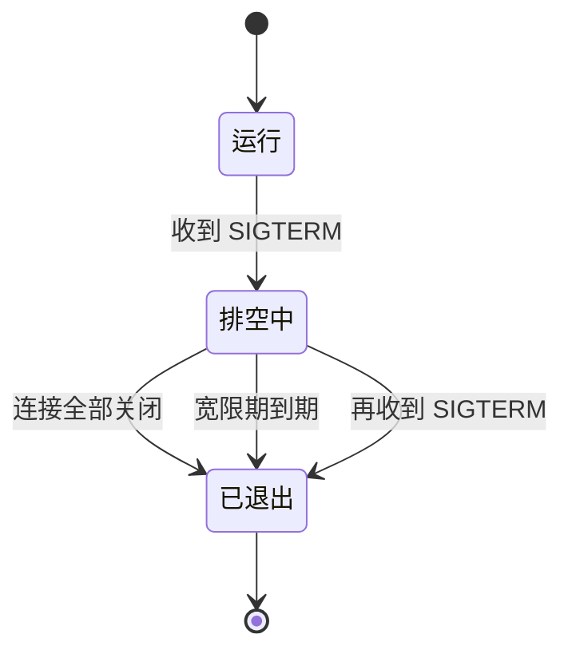
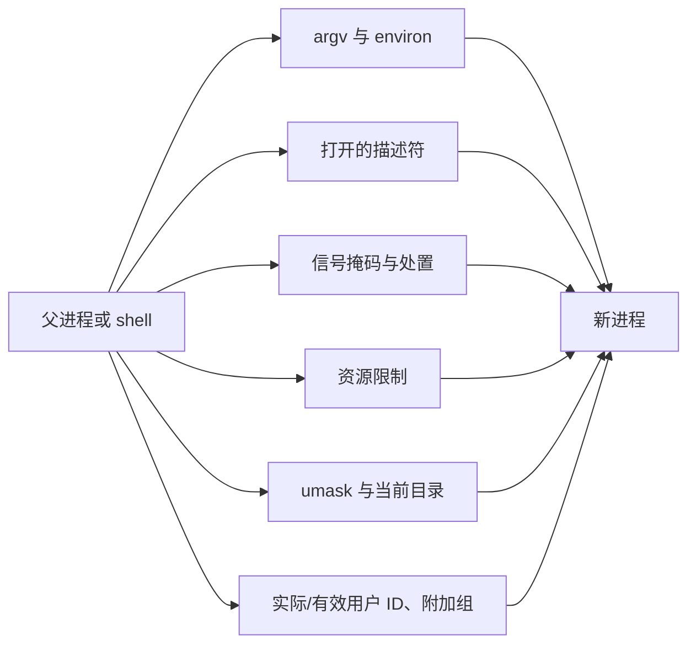

# 14. 系统程序的健壮性与安全边界

[第 12 章](/教程/正文/系统编程/12_事件循环)的事件循环版 lecho 在内网测试了一个月，行为一直符合预期。上线第一周，运维记录里出现了四件事：某个客户端建立连接后既不发送也不关闭，连接数缓慢爬升，最后 `accept` 开始失败；一个客户端发来 10 MiB 不带换行的数据，进程的内存跟着涨到几百兆；重启服务时，正在处理的请求被直接切断，客户端读到半行大写输出；上传目录里一个名为 `report; echo pwned` 的文件，让服务器额外执行了一条命令。

这四件事分别对应资源耗尽、无上限的输入、非优雅退出和不可信输入。它们都不是某一行写错了，而是程序从一开始就假设「调用会成功、对端守规矩、输入是人写的」。这一页把这些假设逐条拆开：先按类别处理错误，再给资源和等待加上限，然后做优雅退出、学会测试这些平时走不到的分支，最后讨论进程从外部继承了什么、常见的漏洞模式，以及怎样按最小权限把服务跑起来。

本页的示例都在 Linux 上运行。完整的加固版 lecho 放在 `code/系统编程/14_系统程序的健壮性与安全边界/lecho_hardened.c`，同一目录还有正文里其余演示程序的源码和几个测试脚本（`lecho_demo.sh`、`reload_demo.sh`、`drain_demo.sh`、`grace_demo.sh`）。

## 1. 失败是常态

系统调用的失败不是异常情况，而是接口的一部分。`read` 会返回 -1，`accept` 会返回 -1，`malloc` 会返回空指针，这些结果每天都会出现。区别只在于程序有没有看返回值，以及看了之后做了什么。

错误按处理方式分成四类就够了。

| 类别 | 典型错误 | 调用点的策略 |
| --- | --- | --- |
| 暂时性 | `EINTR`、`EAGAIN`、`EWOULDBLOCK`、`EINPROGRESS` | 重试，或等描述符再次就绪 |
| 资源不足 | `EMFILE`、`ENFILE`、`ENOMEM`、`ENOSPC`、`EFBIG` | 降级、退避，或明确告诉对端稍后再来 |
| 对端问题 | `EPIPE`、`ECONNRESET`、`ETIMEDOUT` | 关闭这一个连接，不影响其他连接 |
| 程序错误 | `EBADF`、`EFAULT`、`EINVAL` | 记录现场，尽早终止 |

分类本身不难，难的是不要把它做成一个统一的包装。有人写过这样的「健壮」函数：调用失败就重试三次。它遇到 `EINTR` 是对的，遇到 `EAGAIN` 在阻塞描述符上也是对的，但遇到 `EBADF` 会把同一个错误重复四次，遇到 `ENOSPC` 只会让磁盘更满。策略必须由调用点决定，因为只有调用点知道这次调用失败意味着什么。

同一个 `write`，在日志里失败可以丢掉这条日志，在把响应发给客户端时失败就只能关闭连接，在写数据库文件时失败必须回滚并报告。错误码相同，后果不同。

<Quiz
  type="single"
  :options="[
    { label: 'EINTR', value: 'A' },
    { label: 'EAGAIN', value: 'B' },
    { label: 'EBADF', value: 'C' },
    { label: 'EINPROGRESS', value: 'D' }
  ]"
  answer="C"
>

<template #question>

下面哪一个错误重试没有意义，应当视为程序缺陷？

</template>

正确答案是 **C**。`EBADF` 表示传给调用的描述符根本不合法，再调用多少次都是同一个结果。`EINTR` 是被信号打断，`EAGAIN` 是非阻塞描述符暂时没有数据，`EINPROGRESS` 是非阻塞 `connect` 正在进行，这三个重试或等待都是正常做法。

</Quiz>

## 2. 资源耗尽：rlimit 与 EMFILE

每个进程都带着一组资源限制 (resource limit) 启动，每一项有软限制和硬限制两个值，用 `struct rlimit` 的两个字段表示，资源本身用 `RLIMIT_*` 常量指定。软限制是当前生效的上限，进程可以把它调低；硬限制是软限制的上限，没有特权的进程只能降低硬限制，不能提高。查询用 `getrlimit`，修改用 `setrlimit`。

```c
#define _POSIX_C_SOURCE 200809L
#include <stdio.h>
#include <sys/resource.h>

static void show(const char *name, int resource) {
    struct rlimit rl;
    if (getrlimit(resource, &rl) == -1) {
        perror("getrlimit");
        return;
    }
    if (rl.rlim_cur == RLIM_INFINITY) {
        printf("%-14s  soft=unlimited  hard=unlimited\n", name);
    } else if (rl.rlim_max == RLIM_INFINITY) {
        printf("%-14s  soft=%-10llu  hard=unlimited\n", name,
               (unsigned long long)rl.rlim_cur);
    } else {
        printf("%-14s  soft=%-10llu  hard=%llu\n", name,
               (unsigned long long)rl.rlim_cur, (unsigned long long)rl.rlim_max);
    }
}

int main(void) {
    show("RLIMIT_NOFILE", RLIMIT_NOFILE);
    show("RLIMIT_CORE", RLIMIT_CORE);
    show("RLIMIT_AS", RLIMIT_AS);
    show("RLIMIT_STACK", RLIMIT_STACK);
    return 0;
}
```

某次运行的输出：

::: terminal title="bash - rlim"

```text
$ gcc -std=c17 -Wall -Wextra -g rlim.c -o rlim
$ ./rlim
RLIMIT_NOFILE   soft=1024        hard=524288
RLIMIT_CORE     soft=0           hard=unlimited
RLIMIT_AS       soft=unlimited  hard=unlimited
RLIMIT_STACK    soft=8388608     hard=unlimited
```

:::

`RLIMIT_NOFILE` 是每个进程能同时打开的描述符数量。软限制 1024 意味着一个进程最多持有 1024 个描述符，其中 0、1、2 已经占掉三个。硬限制 524288 只是说可以把软限制调到这么高，不会自动生效。

shell 里的 `ulimit -n` 同时改软限制和硬限制，`ulimit -Sn` 只改软限制，`ulimit -Hn` 查看硬限制。对于已经在运行的进程，`prlimit` 可以查询和修改：

::: terminal title="bash - prlimit"

```text
$ prlimit --pid $$ --nofile
RESOURCE DESCRIPTION              SOFT   HARD UNITS
NOFILE   max number of open files 1024 524288 files
```

:::

源码里自己查询和修改，用的是 `getrlimit` 与 `setrlimit`。另有两个限制值得一提：`RLIMIT_CORE` 决定崩溃时能写出多大的 core 文件，为 0 时完全不写；`RLIMIT_AS` 限制进程能映射的虚拟地址空间总量，设得太小会让 `malloc` 和线程创建失败。

### 2.1 EMFILE 与水平触发下的空转

描述符用光之后，`accept` 返回 -1，`errno` 为 `EMFILE`。`ENFILE` 是系统范围的文件表满了，含义相近，处理方式一样。写一个演示程序，先把本进程的 `RLIMIT_NOFILE` 降到 20，再把 `/dev/null` 反复打开直到额度用完，这时让客户端连进来：

```c
/* emfile.c 的核心：把额度填满，然后进入 epoll 循环 */
int main(int argc, char *argv[]) {
    ...
    rl.rlim_cur = 20;
    setrlimit(RLIMIT_NOFILE, &rl);
    listener = socket(AF_INET, SOCK_STREAM | SOCK_NONBLOCK | SOCK_CLOEXEC, 0);
    ...
    for (;;) {
        int n = epoll_wait(ep, events, 4, 1000);
        ...
        int fd = accept(listener, NULL, NULL);
        if (fd == -1) {
            if (errno != EMFILE) {
                continue;
            }
            failures++;
            ...
            continue; /* 朴素写法：直接回到循环顶部 */
        }
        close(fd);
    }
}
```

不加任何处理时，监听套接字上还有排队的连接，水平触发的 `epoll_wait` 每一轮都会立刻返回它可读，`accept` 每次都失败。用一个客户端保持连接约一秒，`strace -c` 的统计是：

::: terminal title="bash - strace -c ./emfile naive"

```text
% time     seconds  usecs/call     calls    errors syscall
------ ----------- ----------- --------- --------- ----------------
100.00    0.134294           1     67348     67348 accept
------ ----------- ----------- --------- --------- ----------------
100.00    0.134294           1     67348     67348 total
```

:::

一秒之内六万多次 `accept`，每次都返回 `EMFILE`（具体次数随机器和负载变化）。CPU 全花在这个循环上，而连接一个也没有被处理。这就是「资源耗尽」和「错误处理」叠在一起时的典型后果：错误本身被正确处理了（程序没有崩溃），但处理方式让程序空转。

修正思路是给 `EMFILE` 一条单独的路径。最常用的做法是预留一个描述符：启动时多打开一个文件，把它的编号留作备用。`accept` 返回 `EMFILE` 时，先关掉这个备用描述符，于是空出一个位置；再次 `accept` 就能拿到那个排队中的连接，立刻给它一个「服务器忙」的回应并关闭；最后重新打开备用描述符。

::: compare left-title="accept 失败直接 continue" right-title="预留一个描述符"

```c
int fd = accept(listener, NULL, NULL);
if (fd == -1) {
    if (errno == EMFILE) {
        continue; /* 监听套接字仍然可读，下一轮再来 */
    }
    continue;
}
```

---

```c
int fd = accept(listener, NULL, NULL);
if (fd == -1 && errno == EMFILE && reserve_fd >= 0) {
    close(reserve_fd);
    fd = accept(listener, NULL, NULL);
    if (fd >= 0) {
        send(fd, "server busy\n", 12, MSG_NOSIGNAL);
        close(fd);
    }
    reserve_fd = open("/dev/null", O_RDONLY | O_CLOEXEC);
}
```

:::

改完之后，同一个测试里客户端收到的是 `server busy`，服务器日志里只有一行 `accept: Too many open files`，不再空转：

::: terminal title="bash - ./emfile reserve"

```text
$ ./emfile reserve
reserve: filled 14 descriptors, limit soft=20
accept: Too many open files
$ python3 -c '...'   # 客户端
client got: b'server busy\n'
```

:::

预留描述符只在 `EMFILE` 时有用。如果连接数上限是程序自己设的（第 3 节会讲），达到上限时应当在 `accept` 之后立刻关闭新连接并回应一句，不要让它排队。真正的修复还包括：检查是不是有描述符泄漏，以及把 `RLIMIT_NOFILE` 调到与实际负载相称的值。

`EMFILE` 还有另一种处理：暂停接受。把监听套接字从 epoll 的兴趣列表里移除，等某个连接关闭、描述符被释放后再加上。这需要程序知道「描述符什么时候被释放」，在事件循环里就是连接关闭的地方，实现起来比预留描述符多几行，但不会每次空转。

<Quiz
  type="single"
  :options="[
    { label: 'accept 成功后 epoll_wait 不再返回监听套接字', value: 'A' },
    { label: '监听套接字上还有排队的连接，水平触发会一直报告可读，accept 又一直失败', value: 'B' },
    { label: 'EMFILE 会让 epoll_wait 立即返回错误', value: 'C' },
    { label: 'strace 附着导致循环变慢', value: 'D' }
  ]"
  answer="B"
>

<template #question>

水平触发模式下，`accept` 返回 `EMFILE` 后循环空转，原因是什么？

</template>

正确答案是 **B**。水平触发只关心「现在是否就绪」，连接还在队列里，监听套接字就一直是可读的。`accept` 失败并没有把队列里的连接取走，于是下一轮又是同一个结果。把监听套接字暂时移出兴趣列表，或者腾出一个描述符把连接取走，都能打破这个循环。

</Quiz>

## 3. 超时、上限与背压

资源耗尽还有一个来源：程序自己允许占用的资源没有上限。网络程序里最常见的三处是等待时间、单条消息长度和待发数据量。

### 3.1 每个网络等待都要有超时

阻塞的 `read`、`accept`、`connect` 都可能永远等下去。对端不发数据，`read` 就一直阻塞；对端不完成握手，`connect` 可能等几十秒；`accept` 在没人连接时本来就应该等，但如果事件循环里其他工作也要靠这一轮唤醒，就得给它一个上限。

[第 11 章](/教程/正文/系统编程/11_非阻塞IO与IO多路复用)的非阻塞 `connect` 用 `poll` 加超时解决连接阶段；[第 12 章](/教程/正文/系统编程/12_事件循环)的事件循环用空闲定时器解决「连接建立后一直不说话」。这里的做法是同一个：给等待设一个截止时刻，到点就关闭。一个连接占着不放的代价不只是内存，还有连接数上限里的一个名额。

### 3.2 单行长度的上限

行协议的解析器要攒够一整行才能处理。客户端发来 10 MiB 不带换行的数据，一个「不够就扩容」的缓冲区会老老实实地跟着涨：

```c
/* linegrow.c：从标准输入读一行，缓冲区不够就翻倍 */
for (;;) {
    if (len + 1 == cap) {
        cap *= 2;
        line = realloc(line, cap);
    }
    ssize_t n = read(STDIN_FILENO, line + len, cap - len - 1);
    ...
    len += (size_t)n;
    if (line[len - 1] == '\n') {
        break;
    }
}
```

同一个程序加上一个长度参数，超过就放弃这一行：

::: terminal title="bash - ./linegrow"

```text
$ head -c 10485760 /dev/zero | tr '\0' 'A' > longline.bin
$ ./linegrow < longline.bin
line read: 10485760 bytes, buffer capacity 16777216
$ ./linegrow 65536 < longline.bin
line too long: 131071 bytes read, limit 65536, buffer 131072
```

:::

10 MiB 本身不算多。问题是连接可以同时有一千个，每个都发 10 MiB，进程就要准备 10 GiB。上限应该按业务来定：行协议的一行超过 64 KiB 通常说明对端在发别的东西，直接断开比继续读更合理。

检查的位置也有讲究。上面的实现是在每次 `read` 之后检查「尚未成行的部分」有多长，而不是检查这一次读到了多少字节。一次读 4 KiB 是正常的，攒了 64 KiB 还没有换行才是异常。

### 3.3 输出缓冲的上限与背压

服务器处理完请求，把结果放进每连接的输出缓冲区，等描述符可写时发送。对端如果不读，TCP 的发送窗口会慢慢关闭，`send` 开始返回 `EAGAIN`，输出缓冲区只进不出。如果缓冲区不设上限，一个不读数据的客户端就能让服务器为它攒下任意多的数据。

加固版 lecho 在入队时检查：

```c
static int conn_queue(struct conn *c, const char *data, size_t len) {
    if (c->out_len + len > (size_t)cfg.max_out) {
        log_msg("WARN", "fd=%d output over %ld bytes, closing", c->fd,
                cfg.max_out);
        conn_close(c, "slow reader");
        return -1;
    }
    ...
}
```

这个上限就是背压 (backpressure) 的落点：缓冲区满了，说明对端消费不过来，程序的选择是要么停止读取新的请求（把压力传回给对端），要么断开这个连接。lecho 选择断开，日志里能看到原因：

::: terminal title="bash - lecho 日志"

```text
2026-10-21T13:28:13.537 INFO  accept fd=7 conns=1
2026-10-21T13:28:13.574 WARN  fd=7 output over 128 bytes, closing
2026-10-21T13:28:13.574 INFO  close fd=7 (slow reader)
```

:::

这里的 `max_out` 被故意设成 128 字节，客户端发 40 行、每行 61 字节，很快就越过了上限。

### 3.4 最大连接数

描述符上限是操作系统的兜底，不是程序自己的容量。程序应当在 `accept` 之后、分配任何每连接资源之前检查当前连接数，超过就回应一句并关闭：

```c
if ((long)conn_count >= cfg.max_conn) {
    static const char busy[] = "server busy, try later\n";
    send(fd, busy, sizeof busy - 1, MSG_NOSIGNAL);
    close(fd);
    log_msg("WARN", "reject fd=%d: connection limit %ld", fd, cfg.max_conn);
    continue;
}
```

连接数上限、单行上限、输出缓冲上限和空闲超时这四个值都应该来自配置，能在线调整。加固版 lecho 的四个值放在一个文本配置文件里，每行一个键值对。

## 4. 优雅退出与重新加载

服务器收到 `SIGTERM` 时的默认动作是立即终止。对一个正在回显的服务器来说，这意味着已经读进来、还没发出去的数据随进程一起消失，客户端读到半行。所谓优雅退出，就是让进程在收到信号后停止接受新连接，把已经接受的工作做完，然后退出。

### 4.1 SIGTERM 的退出流程

一个可以照抄的流程是：

1. 停止监听：关闭监听套接字，或把它从事件循环里移除。
2. 进入排空状态：不再读取新请求，只把每个连接输出缓冲区里的数据发完。
3. 每个连接发完就关闭；全部关闭后进程退出。
4. 设一个宽限期，到点还没发完的连接直接关闭。
5. 宽限期内再收到一次 `SIGTERM`（或 `SIGINT`），立即退出。



在加固版 lecho 里，信号通过 `signalfd` 接入事件循环（[第 12 章](/教程/正文/系统编程/12_事件循环)的做法），处理函数只有几十行：

```c
static void handle_signal(void) {
    struct signalfd_siginfo si;
    for (;;) {
        ssize_t n = read(sig_fd, &si, sizeof si);
        if (n != (ssize_t)sizeof si) {
            return;
        }
        if (si.ssi_signo == SIGHUP) {
            ... /* 见 4.2 */
            continue;
        }
        if (draining) {
            log_msg("WARN", "second signal, exiting immediately");
            exit(EXIT_SUCCESS);
        }
        draining = 1;
        drain_deadline_ms = now_ms() + GRACE_MS;
        epoll_ctl(epfd, EPOLL_CTL_DEL, listener, NULL);
        close(listener);
        listener = -1;
        for (size_t i = conn_count; i-- > 0;) {
            struct conn *c = conns[i];
            c->close_after_flush = 1;
            if (c->out_len == 0) {
                conn_close(c, "shutdown");
            } else {
                conn_set_events(c, EPOLLOUT);
            }
        }
    }
}
```

最直接的验证是让输出缓冲区里真的积压着数据。客户端连上后连发 12000 行长 1000 字节的请求，然后故意不读；服务器积压了上兆的待发数据时，按 PID 发 `SIGTERM`。服务器进入排空状态，等客户端一秒后开始读、缓冲区发空之后才关闭连接（脚本见 `drain_demo.sh`）：

::: terminal title="bash - 排空过程"

```text
2026-10-21T13:27:11.459 INFO  listening on 127.0.0.1:21404 (max_conn=8 max_line=4096 max_out=33554432 idle_ms=60000)
2026-10-21T13:27:11.792 INFO  accept fd=7 conns=1
2026-10-21T13:27:12.361 INFO  shutdown: stop accepting, flush 1 connections
2026-10-21T13:27:13.086 INFO  close fd=7 (done)
2026-10-21T13:27:13.087 INFO  all connections finished, exiting
```

:::

关闭原因从平时对端挂断的 `peer closed` 变成了 `done`，说明这条连接是发完之后主动关的。客户端那边读到的是完整的 12000 行，然后是文件结束：

::: terminal title="bash - 客户端"

```text
client received 12000 lines, then EOF
```

:::

宽限期到期的情况用同样的客户端：这次让它一直不读，三秒的宽限期一到，服务器放弃剩余数据退出。另一段日志来自第二次信号的路径，第一次 `SIGTERM` 之后零点六秒再发一次，进程不走宽限期直接退出：

::: terminal title="bash - 宽限期到期与第二次 SIGTERM"

```text
2026-10-21T13:27:32.108 INFO  shutdown: stop accepting, flush 1 connections
2026-10-21T13:27:35.123 WARN  grace period over, 1 dropped
2026-10-21T12:57:00.726 INFO  shutdown: stop accepting, flush 1 connections
2026-10-21T12:57:01.328 WARN  second signal, exiting immediately
```

:::

退出码也要固定下来：正常退出返回 0，启动失败返回非零。服务管理器靠这一点判断这次退出是计划内的还是崩溃。

### 4.2 SIGHUP 重新加载

传统上 `SIGHUP` 表示「重新读取配置」。重载的正确顺序是先把新配置完整读进来、逐项校验，全部通过了再整体替换；校验失败就保留旧配置，记一条错误日志。不能边读边生效，否则读到第三行发现语法错误时，前两行已经改掉了。

```c
/* 先读进副本，成功后才写回 */
static int load_config(const char *path, struct config *out) {
    struct config next = *out;
    ...
    if (!ok) {
        return -1;
    }
    *out = next;
    return 0;
}
```

::: terminal title="bash - SIGHUP 重载"

```text
2026-10-21T13:27:35.441 INFO  SIGHUP: reload reload.conf
2026-10-21T13:27:35.441 ERROR config line 2: bad number
2026-10-21T13:27:35.441 ERROR config rejected, previous one kept
2026-10-21T13:27:35.743 INFO  SIGHUP: reload reload.conf
2026-10-21T13:27:35.743 INFO  config reloaded: max_conn=8 max_line=16 max_out=4096 idle_ms=30000
```

:::

配置文件本身应当用[第 3 章](/教程/正文/系统编程/3_文件系统_目录与权限)的原子替换写入：临时文件、`fsync`、`rename`。这样重载时读到的要么是完整的旧文件，要么是完整的新文件，不会是写了一半的内容。

### 4.3 SIGPIPE 与退出码

网络服务器还要处理 `SIGPIPE`。向已经关闭的连接写数据时，内核默认会给进程发 `SIGPIPE`，进程直接终止，退出状态 141（128 加 13）。服务器在启动时忽略它，之后按 `EPIPE` 处理：

```c
struct sigaction sa;
memset(&sa, 0, sizeof sa);
sa.sa_handler = SIG_IGN;
sigaction(SIGPIPE, &sa, NULL);
```

每次发送用 `MSG_NOSIGNAL` 也能达到同样的效果，而且不影响同进程的其他描述符。两者选一个就行，同时用也不冲突。

## 5. 测试错误路径

错误分支平时走不到，测试时也很难自然触发：磁盘不会恰好在你写文件时满，`accept` 不会恰好在你测试 `EMFILE` 时失败。strace 的故障注入 (fault injection) 可以按需制造这些失败。

### 5.1 strace -e inject

语法是 `-e inject=SYSCALL:error=ERRNO[:when=N]`。用一个复制文件的小程序 `mycp` 注入一次 `ENOSPC`，它把第 2 章 3.1 节的 `write_all` 配上 `open` 与 `read`，源码在本页的 `code/` 目录：

::: terminal title="bash - strace 注入 ENOSPC"

```text
$ ./mycp src.txt dst.txt
$ cmp src.txt dst.txt && echo SAME
SAME
$ strace -o /dev/null -e inject=write:error=ENOSPC:when=1 ./mycp src.txt dst2.txt
write: No space left on device
$ echo $?
1
```

:::

`mycp` 的 `write_all` 里检查了返回值，`perror` 打出了原因，退出码是 1。目标文件被创建了，但大小是 0：`open` 带了 `O_TRUNC`，错误发生在第一次写入。如果注入的是第二次写入，文件会留下前一次的 4096 字节：

::: terminal title="bash - 注入第二次 write"

```text
$ strace -o /dev/null -e inject=write:error=ENOSPC:when=2 ./mycp src.txt dst3.txt
write: No space left on device
$ wc -c < dst3.txt
4096
$ wc -c < src.txt
8893
```

:::

半截的目标文件正是[第 3 章](/教程/正文/系统编程/3_文件系统_目录与权限)原子替换要解决的问题：写临时文件、`fsync`、`rename`，失败时目标文件保持原样。

`when` 在这里不能省。不写 `when`，注入会作用于每一次 `write`，包括程序打印错误信息的那一次，结果是什么也看不到：

::: terminal title="bash - 不加 when"

```text
$ strace -o /dev/null -e inject=write:error=ENOSPC ./mycp src.txt dst5.txt
$ echo $?
1
```

:::

退出码是 1，但没有任何输出：`perror` 内部也要 `write`，同样被注入，错误信息没能写出去。只注入第一次 `write` 时，`cat` 的报错仍然打得出来，因为它的错误信息走的是后面几次 `write`：

::: terminal title="bash - cat"

```text
$ strace -o /dev/null -e inject=write:error=ENOSPC:when=1 cat src.txt > /dev/null
cat: write error: No space left on device
$ echo $?
1
```

:::

`EINTR` 也可以注入。`write_all` 遇到它应当重试，最终结果应当与源文件一致：

::: terminal title="bash - 注入 EINTR"

```text
$ strace -o /dev/null -e inject=write:error=EINTR:when=2 ./mycp src.txt dst4.txt
$ echo $?
0
$ cmp src.txt dst4.txt && echo SAME
SAME
```

:::

`retval=1` 可以制造一次「成功」的短写。要注意它的语义：内核并不写任何数据，只是让这次调用返回 1。程序无从分辨，`write_all` 会认为第一个字节已经写出，接着写剩下的部分，最终文件比源文件少一个字节，而程序报告成功：

::: terminal title="bash - 注入短写"

```text
$ strace -o /dev/null -e inject=write:retval=1:when=1 ./mycp src.txt dst6.txt
$ echo $?
0
$ cmp src.txt dst6.txt
src.txt dst6.txt differ: byte 1, line 1
```

:::

这类注入用来验证「返回值看起来正常但数据不对」的情况，程序本身没有办法补救，能补救的是对端或事后校验。

网络程序可以注入 `accept4` 或 `accept`。加固版 lecho 的 `EMFILE` 处理路径就是这样测的：

::: terminal title="bash - 注入 accept4 的 EMFILE"

```text
$ strace -o /dev/null -e inject=accept4:error=EMFILE:when=1 ./lecho_hardened 21400 lecho.conf
2026-10-21T13:28:39.866 ERROR accept: Too many open files
$ python3 -c '...'   # 客户端
client got: b'server busy\n'
```

:::

注入发生在第一次 `accept4`，服务器的预留描述符逻辑接住了它，客户端收到了明确的拒绝，而不是一直等待。

::: tip 注入前先确认调用名

`strace -e inject=` 里的名字必须是程序实际使用的系统调用。不带 `_GNU_SOURCE` 的程序用不了 `accept4`，实际调用的是 `accept`；`fwrite` 最终可能调用 `write` 或 `writev`。用 `strace -e trace=...` 先看一遍真实调用名，再注入。

:::

### 5.2 sanitizer 与崩溃现场

编译器自带的 sanitizer 用来抓程序自身的错误。一段故意越界的代码，加上 `-fsanitize=address,undefined` 之后：

```c
char *buf = malloc(8);
for (int i = 0; i < 12; i++) {
    buf[i] = 'A';
}
```

编译时加 `-ffile-prefix-map` 去掉工作目录的绝对路径：

::: terminal title="bash - ASan"

```text
$ gcc -std=c17 -Wall -Wextra -g -fsanitize=address,undefined \
      -ffile-prefix-map=$PWD=. asan_demo.c -o asan_demo
$ ./asan_demo
=================================================================
==669506==ERROR: AddressSanitizer: heap-buffer-overflow on address 0x502000000018
WRITE of size 1 at 0x502000000018 thread T0
    #0 0x558dd28d32ad in main asan_demo.c:13
    #1 0x7fae02835ca7  (/lib/x86_64-linux-gnu/libc.so.6+0x29ca7)

0x502000000018 is located 0 bytes after 8-byte region [0x502000000010,0x502000000018)
allocated by thread T0 here:
    #0 0x7fae032f4c57 in malloc
    #1 0x558dd28d31fb in main asan_demo.c:7

SUMMARY: AddressSanitizer: heap-buffer-overflow asan_demo.c:13 in main
$ echo $?
1
```

:::

`-g` 让报告里的行号对得上源码；`-ffile-prefix-map` 把报告里的源文件路径换成相对形式，便于贴进文档。完整的报告还会附一段 shadow bytes 和库里的完整调用栈，这里只留定位所需的部分。

不加 sanitizer 时，同一段代码打印出 `AAAAAAAAAAAA` 并正常退出：多写的那几个字节落在分配器给这块内存留的余量里，没有碰到别的对象。这类错误在测试里往往没有症状，只有在负载变化、换一个分配器或改成更大的越界量时才变成崩溃。编译选项和 UBSan 的用法在 [13. 编译器诊断与程序检查](/教程/正文/开发与工程基础/13_编译器诊断与程序检查) 里有完整说明。

崩溃时的 core 文件是另一条线索。`RLIMIT_CORE` 为 0 时内核不写 core，`ulimit -c unlimited` 才打开；写到哪由 `/proc/sys/kernel/core_pattern` 决定，现代发行版通常把它交给 `systemd-coredump`，事后用 `coredumpctl` 查看调用栈。默认关闭 core 的机器上要先把限额调大，才能等到文件。

### 5.3 日志

服务的日志写到标准错误，每行带时间戳和级别，由 systemd 的 journald 收集。日志函数只有十几行：

```c
static void log_msg(const char *level, const char *fmt, ...) {
    struct timespec ts;
    struct tm tm;
    char stamp[32];
    va_list ap;

    clock_gettime(CLOCK_REALTIME, &ts);
    localtime_r(&ts.tv_sec, &tm);
    strftime(stamp, sizeof stamp, "%Y-%m-%dT%H:%M:%S", &tm);
    fprintf(stderr, "%s.%03ld %-5s ", stamp, ts.tv_nsec / 1000000, level);
    va_start(ap, fmt);
    vfprintf(stderr, fmt, ap);
    va_end(ap);
    fputc('\n', stderr);
    fflush(stderr);
}
```

时间用 `CLOCK_REALTIME` 和 `localtime_r`，因为日志要和人看到的时钟对齐，时间戳不带时区标记，按本机时区读（[第 6 章](/教程/正文/系统编程/6_信号_时间与定时器)）；程序内部算间隔才用 `CLOCK_MONOTONIC`。标准错误默认不带缓冲，每行再 `fflush` 一次，是防止将来把日志重定向到文件时输出被攒在 stdio 缓冲区里。syslog(3) 是更老的接口，把日志发给本机的 syslog 守护进程；新写的服务直接用 stderr 就够了。

## 6. 进程继承了什么

一个新进程从创建它的进程那里继承了一整套状态。`fork` 复制全部，`exec` 则把程序映像和 `argv`、环境一起换成新的，其余大部分保留下来。



写一个程序把这些值改掉再 `exec` 自己，子进程打印看到的结果：

```c
/* inherit.c 的父进程部分 */
umask(077);
sigemptyset(&set);
sigaddset(&set, SIGTERM);
sigprocmask(SIG_BLOCK, &set, NULL);
struct rlimit rl = {.rlim_cur = 64, .rlim_max = 64};
setrlimit(RLIMIT_NOFILE, &rl);
chdir("subdir");
execv(exe, new_argv);
```

::: terminal title="bash - ./inherit"

```text
$ ./inherit
child: umask=077 cwd ends with subdir
blocked: 15
RLIMIT_NOFILE soft=64
```

:::

`umask`、信号掩码、资源限制和当前目录全部传给了子进程。这几项里，`exec` 只重置被捕获的信号处置：`SIGTERM` 的处理函数恢复成默认动作，被忽略的信号保持忽略，信号掩码原样保留。这条规则在[第 6 章](/教程/正文/系统编程/6_信号_时间与定时器)和[第 12 章](/教程/正文/系统编程/12_事件循环)都用过。

### 6.1 描述符泄漏

`exec` 时，没有设置 `FD_CLOEXEC` 的描述符会原样传给新程序。多数程序用不到它们，但它们占着资源，还可能把不该暴露的打开文件交给一个被信任程度更低的程序。

父进程分别以带与不带 `O_CLOEXEC` 的方式打开同一个文件，然后 `exec` 一个列出自己描述符的小程序：

```c
int no_cloexec = open("data.txt", O_RDONLY);
int with_cloexec = open("data.txt", O_RDONLY | O_CLOEXEC);
execl("./fdlist", "fdlist", (char *)NULL);
```

::: terminal title="bash - ./fdleak"

```text
$ ./fdleak
parent: fd 3 without O_CLOEXEC, fd 4 with O_CLOEXEC
fd 0  cloexec=0  pipe:[876900955]
fd 1  cloexec=0  pipe:[876900956]
fd 2  cloexec=0  pipe:[876900957]
fd 3  cloexec=0  data.txt
child exit=0
```

:::

fd 4 在 `exec` 时被内核关闭了，fd 3 留了下来，新程序甚至不知道它是什么。[第 2 章](/教程/正文/系统编程/2_文件描述符与非缓冲IO)约定所有 `open` 都带 `O_CLOEXEC`，就是为了让这种情况不发生。对于无法逐个修改的旧代码，Linux 提供了 `close_range`，在 `exec` 之前一次性关掉一段描述符：

```c
close_range(3, ~0U, 0);
execl("./fdlist", "fdlist", (char *)NULL);
```

::: terminal title="bash - close_range 之后"

```text
$ ./cr
opened fd 3
fd 0  cloexec=0  pipe:[877083021]
fd 1  cloexec=0  pipe:[877083022]
fd 2  cloexec=0  pipe:[877083023]
```

:::

`close_range` 是 Linux 专有接口（glibc 2.34 起有包装函数），需要 `_GNU_SOURCE`。它只在 `exec` 前清理一次，不能代替每个 `open` 的 `O_CLOEXEC`：中间的代码仍可能把这几个描述符暴露给别的线程或子进程。

### 6.2 环境与 secure_getenv

环境是另一条继承通道。`PATH` 决定 `execlp` 和 `posix_spawnp` 找到的是哪个程序，`IFS` 影响 shell 脚本的字段拆分，`LD_PRELOAD` 让动态链接器在程序启动前加载指定的库。普通程序用 `getenv` 读这些值没有问题，因为环境和程序由同一个用户控制。

setuid 程序不一样：它以文件属主的身份运行，环境却来自调用者。内核在 `exec` 这类程序时把辅助向量里的 `AT_SECURE` 置为 1，动态链接器据此清掉危险的环境变量。想读环境又不想被调用者影响，用 `secure_getenv`：

```c
printf("AT_SECURE = %lu\n", (unsigned long)getauxval(AT_SECURE));
printf("getenv        = %s\n", getenv("PATH") ? "set" : "(null)");
printf("secure_getenv = %s\n", secure_getenv("PATH") ? "set" : "(null)");
```

普通用户运行时，两者没有区别：

::: terminal title="bash - ./secenv"

```text
$ ./secenv
AT_SECURE = 0
getenv        = set
secure_getenv = set
```

:::

`AT_SECURE` 为 1 时，`secure_getenv` 对任何名字都返回空指针。它需要 `_GNU_SOURCE`，POSIX 里没有对应接口。

### 6.3 凭证

进程的用户身份有三个 ID：实际用户 ID 表示「谁在运行这个程序」，有效用户 ID 决定权限检查的结果，保存的用户 ID 用于在两者之间切换。附加组是另一个列表，决定进程属于哪些组。`id -u` 打印实际用户 ID，`id -un` 打印用户名。

`exec` 一个设置了设置用户 ID 位 (set-user-ID bit) 的程序时，有效用户 ID 变成文件属主，保存的用户 ID 也变成文件属主。[第 3 章](/教程/正文/系统编程/3_文件系统_目录与权限)看过这个位的效果，本页第 8 节讨论怎样在程序里把它丢掉。

::: concept sys-robust-inherited-state title="不信任从外部继承的状态"

argv、环境、打开的描述符、umask、当前目录、信号掩码、资源限制和凭证都来自调用者。特权程序在读取其中任何一项之前，应当先按自己的需要重置它们；不能重置的，至少要在使用前校验。

:::

## 7. 常见漏洞模式

所谓「不可信输入」，包括命令行参数、环境、文件内容、网络报文，以及文件名。文件名最容易被当成可信的，因为它看起来只是一个名字。

### 7.1 命令注入

`system` 和 `popen` 把字符串交给 `/bin/sh -c`。字符串里如果拼进了文件名，文件名里的 `;`、`|`、`$()`、反引号都会被 shell 当成语法。

下面这个小工具用一个文件名调用 `wc`：

```c
char cmd[512];
snprintf(cmd, sizeof cmd, "wc -l %s", argv[1]);
int rc = system(cmd);
```

正常文件名没有问题，构造一个带分号的名字就多出一条命令：

::: terminal title="bash - ./cmd_inject"

```text
$ ./cmd_inject notes.txt
$ wc -l notes.txt
3 notes.txt
system returned 0
$ ./cmd_inject 'notes.txt; echo INJECTED'
$ wc -l notes.txt; echo INJECTED
3 notes.txt
INJECTED
system returned 0
```

:::

`echo` 只是演示，换成任何命令都会以服务进程的身份执行。修正的办法不是转义文件名，而是根本不经过 shell：`posix_spawnp` 把程序和参数列表直接交给 `execve`，每个参数是一个独立的字符串，shell 没有机会解析其中的字符。

::: compare vertical left-title="system 拼接字符串" right-title="posix_spawnp 传 argv"

```c
char cmd[512];
snprintf(cmd, sizeof cmd, "wc -l %s", argv[1]);
int rc = system(cmd);
```

---

```c
char *child_argv[] = {"wc", "-l", "--", argv[1], NULL};
pid_t pid;
int rc = posix_spawnp(&pid, "wc", NULL, NULL, child_argv, environ);
```

:::

`--` 是命令行工具间的约定，告诉程序「后面都是文件名，不是选项」。文件名以 `-` 开头时，没有它会被 `wc` 当成选项（`wc -l -rf` 会报 `invalid option -- 'r'`）。程序自己的命令行解析也同样处理：遇到 `--` 之后一律按操作数看待：

::: terminal title="bash - ./spawn_safe"

```text
$ ./spawn_safe notes.txt
$ wc -l -- 'notes.txt'
3 notes.txt
child exit=0
$ ./spawn_safe 'notes.txt; echo INJECTED'
$ wc -l -- 'notes.txt; echo INJECTED'
1 notes.txt; echo INJECTED
child exit=0
$ ./spawn_safe '-rf'
$ wc -l -- '-rf'
1 -rf
child exit=0
```

:::

含分号的名字被当成一个完整文件名，`wc` 统计的是这个文件本身（它只有一行，所以输出 1），分号后面的命令没有执行；`-rf` 也没有被当成选项。如果文件名不存在，`wc` 报 `No such file or directory`，子进程返回 1，`spawn_safe` 自己仍然正常退出。`posix_spawnp` 的第三个参数是 `posix_spawn_file_actions_t`，用来做重定向和关闭描述符，需要时再传。

<Quiz
  type="single"
  :options="[
    { label: '转义文件名里的分号和反引号', value: 'A' },
    { label: '改成 posix_spawnp，把文件名作为一个 argv 元素传过去', value: 'B' },
    { label: '把 system 的返回值检查得更仔细', value: 'C' },
    { label: '在文件名外面加一对单引号', value: 'D' }
  ]"
  answer="B"
>

<template #question>

一个用 `system("wc -l " + 文件名)` 统计行数的工具，文件名来自上传内容。哪一种修改真正消除了命令注入？

</template>

正确答案是 **B**。注入的根源是字符串经过了 shell，转义和加引号都要预判 shell 的全部语法（`$()`、反引号、换行、`!` 等），漏掉一处就失效。`posix_spawnp` 把每个参数作为独立字符串传给 `execve`，shell 根本不在场。

</Quiz>

### 7.2 TOCTOU

先检查后使用 (time-of-check to time-of-use, TOCTOU) 的漏洞形式是：程序用 `access` 检查文件可写，再用 `open` 打开；两次调用之间，文件名可能被换成指向另一个文件的符号链接。

```c
if (access(argv[1], W_OK) == -1) {
    ...
}
sleep(1);   /* 演示用：真实程序里是执行其他工作的间隙 */
int fd = open(argv[1], O_WRONLY | O_APPEND);
write(fd, "appended by toctou demo\n", 24);
```

演示里在检查和打开之间停一秒，另一个进程把 `attack.txt` 换成了指向 `victim.txt` 的符号链接：

::: terminal title="bash - TOCTOU 竞争"

```text
$ ( sleep 0.4; rm -f attack.txt; ln -s victim.txt attack.txt ) &
$ ./toctou attack.txt sleep
access says writable: attack.txt
wrote to attack.txt
$ ls -l attack.txt
lrwxrwxrwx ... attack.txt -> victim.txt
$ cat victim.txt
victim
appended by toctou demo
```

:::

权限检查通过的是「检查时刻的 attack.txt」，实际写入的是「写入时刻的 attack.txt」，两者已经不是同一个文件。

修正的原则是只做一次操作，从这一次操作的结果判断成败。不需要检查时就不检查，直接 `open`，失败再处理；需要拒绝符号链接时加 `O_NOFOLLOW`；需要相对可信目录打开时，先用 `open` 拿到目录描述符，再用 `openat`：

::: compare vertical left-title="access 检查后再 open" right-title="openat 一次打开并按结果判断"

```c
if (access(path, W_OK) == -1) {
    return -1;
}
int fd = open(path, O_WRONLY | O_APPEND);
```

---

```c
int dirfd = open(dir, O_RDONLY | O_DIRECTORY | O_CLOEXEC);
int fd = openat(dirfd, name, O_WRONLY | O_APPEND | O_NOFOLLOW | O_CLOEXEC);
struct stat st;
fstat(fd, &st);
if (!S_ISREG(st.st_mode)) {
    /* 不是普通文件 */
}
```

:::

`openat` 的路径解析是相对 `dirfd` 的一次系统调用，中间没有可以被替换的时间窗口。`fstat` 检查的是已经打开的那个文件，而不是名字。`O_NOFOLLOW` 让最后一段是符号链接时直接失败，错误码 `ELOOP`：

::: terminal title="bash - ./toctou_fixed"

```text
$ ./toctou_fixed . mine.txt
appended to mine.txt without a separate check
$ ln -sf safe/victim.txt link.txt
$ ./toctou_fixed . link.txt
openat: Too many levels of symbolic links
```

:::

### 7.3 可预测的临时文件名

用固定的名字创建临时文件，等于邀请别人提前在那个位置放一个符号链接：

```c
int bad = open("mytool.tmp", O_WRONLY | O_CREAT | O_TRUNC, 0600);
write(bad, payload, sizeof payload - 1);
```

在程序运行前，同目录下有人先执行 `ln -s victim.txt mytool.tmp`，写入就会落到 `victim.txt` 上：

::: terminal title="bash - 可预测名字的攻击"

```text
$ printf 'important data\n' > victim.txt
$ ln -s victim.txt mytool.tmp
$ ./tmpsafe
predictable name -> fd 3
mkstemp name      -> mytool.2EBX5d, fd 3
$ cat victim.txt
written through mytool.tmp
```

:::

`mkstemp` 用随机的文件名和 `O_EXCL` 创建：如果名字已经存在（哪怕是一个符号链接），`open` 直接失败，程序换一个名字再试。`O_EXCL` 与 `O_CREAT` 一起用时，内核保证「检查不存在」和「创建」是一个原子操作。模板里不带目录就建在当前目录；要放到别处，把目录写进模板。用完立刻 `unlink`。

### 7.4 路径穿越

文件服务收到客户端给的路径，如果直接拼到根目录后面，`../` 就能走到根目录外面。两种常见实现：

- `realpath` 解析出绝对路径，再检查它是否以根目录开头；
- `openat2` 的 `RESOLVE_BENEATH`，在路径解析过程中就限制不能离开给定目录。

`openat2` 是 Linux 专有接口，glibc 没有包装函数，用 `syscall(SYS_openat2, dirfd, path, &how, sizeof how)` 调用，需要 `_GNU_SOURCE` 和 `<linux/openat2.h>`。

两个版本的拒绝效果：

::: terminal title="bash - ./jail"

```text
$ ./jail jailroot jailroot/ok.txt
opened, first 12 bytes: public data
$ ./jail jailroot jailroot/../outside.txt
realpath: jailroot/../outside.txt escapes root jailroot
$ ./jail jailroot jailroot/link
realpath: jailroot/link escapes root jailroot
$ ./jail jailroot ok.txt beneath
opened, first 12 bytes: public data
$ ./jail jailroot ../outside.txt beneath
openat2: Invalid cross-device link
$ ./jail jailroot link beneath
openat2: Invalid cross-device link
$ ./jail jailroot inner_link beneath
opened, first 7 bytes: inside
```

:::

`EXDEV`（Invalid cross-device link）是 `RESOLVE_BENEATH` 检测到路径试图离开目录时返回的错误。指向根目录内部的符号链接仍然能打开，受限的是离开根目录，不是链接本身。名字看起来和跨设备有关，实际是内核复用了同一个错误码。

`realpath` 版本也能拒绝这两种用例，但它有两个弱点：一是检查与打开是两次操作，中间仍可能被替换（同 7.2）；二是 `realpath` 要求路径上的文件都存在，服务想创建一个新文件时用不上。`openat2` 把限制放进内核的路径解析里，一次调用完成，没有中间窗口。

::: tip 前缀比较要看到目录分隔符

自己写 `strncmp(real_path, real_root, strlen(real_root))` 时，根目录 `/srv/pub` 会错误地接受 `/srv/publisher/x`。比较到根目录长度之后，还必须确认下一个字符是 `\0` 或 `/`。

:::

### 7.5 整数溢出与格式化字符串

长度、偏移、数量的计算如果溢出，检查就会失效。一个「先加再判断」的写法在加法回绕之后可能得到一个小数值，随后的 `malloc` 分配不足，写入越界。C23 提供了 `<stdckdint.h>` 里的 `ckd_add`、`ckd_sub`、`ckd_mul`，溢出时返回非零：

```c
#include <stdckdint.h>

int total;
if (ckd_add(&total, 2000000000, 2000000000)) {
    puts("overflow detected");
}
```

::: terminal title="bash - ./ckd"

```text
$ gcc -std=c2x -Wall -Wextra -g ckd.c -o ckd
$ ./ckd
overflow detected
```

:::

C23 之前用「先判断再运算」的写法，具体做法见 [19.9 节](/教程/正文/语法和标准库/19_数值_位运算与随机数/19_9_stdckdint)。格式化字符串的漏洞只有一句话：格式串来自用户时，用 `printf("%s", user)`，不要写 `printf(user)`。

## 8. 最小权限与沙箱

服务需要特权时，正确的做法不是一直持有它，而是启动时用完就丢掉。降权 (drop privileges) 的顺序有讲究，因为每一步之后能做的事情都变少了。

### 8.1 降权的顺序

以 root 启动的程序要变成普通用户，顺序是：

1. `setgroups(0, NULL)` 清空附加组；
2. `setgid` / `setresgid` 改成目标组；
3. `setuid` / `setresuid` 改成目标用户。

```c
if (setgroups(0, NULL) == -1) {
    die("setgroups");
}
if (setresgid(gid, gid, gid) == -1) {
    die("setresgid");
}
if (setresuid(uid, uid, uid) == -1) {
    die("setresuid");
}
if (getuid() != uid || geteuid() != uid) {
    fprintf(stderr, "privileges not dropped\n");
    return EXIT_FAILURE;
}
if (seteuid(0) == 0) {
    fprintf(stderr, "still able to regain root\n");
    return EXIT_FAILURE;
}
```

`setresuid` 把实际、有效、保存三个用户 ID 一次写成目标值，改完之后 `seteuid(0)` 拿不回特权。从 root 调用 `setuid` 时它同样会改掉这三个值，但 `setresuid` 的行为不依赖「调用者是否特权」这个前提，意图也更明确。三个 ID 都要写成目标值，不能只改有效用户 ID。

::: warning 先 setuid 再 setgid 会降不掉组权限

`setuid` 之后进程不再是 root，`setgid` 和 `setgroups` 都需要特权，会以 `EPERM` 失败。组身份仍然是 root 的附加组，文件访问检查会按组放行。

:::

需要 root 才能运行的演示程序在普通用户下执行时，第一步就失败：

::: terminal title="bash - ./drop_priv（普通用户）"

```text
$ ./drop_priv 65534 65534
setgroups: Operation not permitted
```

:::

这正说明降权必须从特权身份开始。以 root 启动时它才走完全部步骤；普通用户下的这次失败本身就是「没有特权就做不了」的佐证。

<Quiz
  type="single"
  :options="[
    { label: 'setgroups、setgid、setuid 三步，每步都检查返回值', value: 'A' },
    { label: 'setuid 之后再 setgid，最后 setgroups', value: 'B' },
    { label: '只调用 setuid，组权限不影响文件访问', value: 'C' },
    { label: '先 seteuid 再 setegid，保留保存的用户 ID', value: 'D' }
  ]"
  answer="A"
>

<template #question>

以 root 启动的服务要把身份降到普通用户，正确的调用顺序是哪一个？

</template>

正确答案是 **A**。`setgroups` 和 `setgid` 都需要特权，必须在 `setuid` 之前完成；`setuid` 之后再调用它们会得到 `EPERM`，而附加组里残留的 root 组会让文件访问检查按组放行。B 的顺序反了，C 忽略了组权限，D 保留了特权回退的可能。

</Quiz>

### 8.2 capabilities

把 root 的全部权力拆成几十项能力 (capability)，程序可以只保留需要的那几项。绑定 1024 以下的端口只需要 `CAP_NET_BIND_SERVICE`：

::: terminal title="bash - setcap"

```text
$ sudo setcap cap_net_bind_service=+ep ./myserver
```

:::

之后这个程序不需要以 root 运行也能绑定 80 端口，其他 root 权力一概没有。`setcap` 需要 root 和 `CAP_SETFCAP`，演示机上不执行。文件能力存放在 `security.capability` 扩展属性里，和设置用户 ID 位是两种不同的授权方式；对新程序来说，能力比整个 root 身份更精细。

### 8.3 no_new_privs

`prctl(PR_SET_NO_NEW_PRIVS, 1, ...)` 让进程及其所有后代在执行 `exec` 时不再获得新特权：设置用户 ID 位、设置组 ID 位和文件能力都不再生效。它不可撤销，一旦设置就一直有效。

```c
show_flag("before");
prctl(PR_SET_NO_NEW_PRIVS, 1, 0, 0, 0);
show_flag("after ");
```

::: terminal title="bash - ./nnp"

```text
$ ./nnp
before: NoNewPrivs:	0
after : NoNewPrivs:	1
```

:::

这个标志也是无特权进程使用 seccomp 过滤器的前提。服务的 `exec` 调用路径上如果不需要 setuid 程序，打开它没有代价。

### 8.4 seccomp 严格模式

seccomp 把进程能发起的系统调用限制在一个白名单里。严格模式 (strict mode) 的白名单只有四个系统调用：`read`、`write`、`_exit`（系统调用名是 `exit`，不是 `exit_group`）和 `sigreturn`。设置之后，任何其他系统调用都会让进程被 `SIGKILL` 杀死，连返回错误的机会都没有。

```c
if (prctl(PR_SET_SECCOMP, SECCOMP_MODE_STRICT) == -1) {
    perror("prctl");
    return 1;
}
write(STDOUT_FILENO, msg, sizeof msg - 1);
if (call_getpid) {
    syscall(SYS_getpid);   /* 内核直接杀死进程 */
}
syscall(SYS_exit, 0);
```

::: terminal title="bash - ./strict"

```text
$ ./strict
strict mode: only read/write/_exit/sigreturn
$ echo $?
0
$ ./strict x
strict mode: only read/write/_exit/sigreturn
Killed
$ echo $?
137
```

:::

137 是 128 加 9，表示进程被 `SIGKILL` 终止。正常退出必须用 `syscall(SYS_exit, 0)`，因为 glibc 的 `exit` 和 `_exit` 最终调用的是 `exit_group`，它管理的是「整个进程的所有线程」，不在白名单里（白名单里的 `exit` 只结束调用它的线程）：

::: terminal title="bash - 严格模式下 _exit(0)"

```text
$ ./strict_exit
about to call _exit(0)
Killed
$ echo $?
137
```

:::

严格模式只适合极简的程序。实际使用的是过滤器模式：程序自己构造 BPF 程序，按系统调用号和参数决定允许、拒绝还是杀死。过滤器模式要求线程已持有 `CAP_SYS_ADMIN` 或已设置 `no_new_privs`，过滤器的编写放在拓展B 的 [B.13 安全应用：seccomp、LSM 与 cgroup](/教程/正文/系统编程/拓展B_eBPF/B_13_安全应用_seccomp_LSM与cgroup)。

::: concept sys-robust-least-privilege title="最小权限"

程序只应持有完成当前工作所必需的权限，用完就放弃，并且放弃之后不能再取回。降权、能力、`no_new_privs` 和 seccomp 是同一原则在不同粒度上的实现。

:::

容器和命名空间把这一原则扩展到整个进程树：文件系统、进程、网络各自有一份隔离的视图。细节不在本页范围，SELinux 和 AppArmor 这类强制访问控制同样只提名字。

## 9. 交给服务管理器

写长期运行的服务时，一个常见的历史包袱是程序自己变成守护进程 (daemon)：两次 `fork`、`setsid`、`chdir("/")`、关掉所有描述符、重定向到 `/dev/null`、写 pid 文件。这套步骤在 sysvinit 时代是必需的，因为 init 不会替你管理进程。

systemd 的 daemon(7) 明确建议新服务不要这样做。服务管理器会给进程一个干净的环境：

- 环境块被清理，信号处置和掩码被重置；
- 没有遗留的描述符，标准输入接到 `/dev/null`；
- 标准输出和标准错误接到 journald；
- 进程在自己的会话里运行，`umask` 被重置。

因此新服务只需要：前台运行，日志写标准错误，处理 `SIGTERM` 后干净退出，处理 `SIGHUP` 重载配置，返回正确的退出码。剩下的交给单元文件。

完整文件在 `code/系统编程/14_系统程序的健壮性与安全边界/lecho.service`：

```ini
[Unit]
Description=lecho line echo service
After=network.target

[Service]
Type=simple
ExecStart=/usr/local/bin/lecho_hardened 21400 /etc/lecho.conf
Restart=on-failure
RestartSec=2s
NoNewPrivileges=yes
ProtectSystem=strict
ProtectHome=yes
PrivateTmp=yes
DynamicUser=yes

[Install]
WantedBy=multi-user.target
```

几个指令的含义：

| 指令 | 作用 |
| --- | --- |
| `Type=simple` | 进程在前台运行，`ExecStart` 启动后即视为已启动 |
| `Restart=on-failure` | 非零退出码、被「不干净的信号」终止、超时或 OOM 杀死时重启；`SIGTERM`、`SIGINT`、`SIGHUP`、`SIGPIPE` 和退出码 0 视为正常结束 |
| `NoNewPrivileges=yes` | 等同于 8.3 的 `PR_SET_NO_NEW_PRIVS` |
| `ProtectSystem=strict` | 整个文件系统几乎只读，`/dev`、`/proc`、`/sys` 和 `ReadWritePaths` 列出的路径除外 |
| `PrivateTmp=yes` | 给服务一份私有的 `/tmp` 与 `/var/tmp`，看不到系统的临时文件；在 `ProtectSystem=strict` 下这两处仍然可写 |
| `DynamicUser=yes` | 启动时临时分配用户，不需要预先创建账户 |

`NoNewPrivileges` 与 `ProtectSystem=strict` 的组合意味着：即使服务里有命令注入，攻击者也只能在一个几乎只读的文件系统上以临时用户身份执行命令。服务需要写状态时，用 `StateDirectory=` 指定一个允许写入的目录。systemd.exec(5) 里还有几十个类似的选项，`systemd-analyze security` 可以给单元文件打一个安全评分并列出可以收紧的项。这个工具和 `systemctl` 需要在读者自己的 Linux 机器上运行，本页不贴输出。

::: details 传统守护进程的步骤

读旧代码时会遇到这样的 `daemonize` 函数，了解每一步在解决什么即可：

1. `fork` 一次，父进程退出。子进程不是进程组组长，下一步的 `setsid` 才能成功。
2. `setsid` 创建新会话，脱离控制终端。之后终端关闭不会给进程发 `SIGHUP`。
3. 再 `fork` 一次，父进程退出。第二次 fork 保证进程不是会话首进程，永远无法重新获得控制终端。
4. `chdir("/")`，避免占着某个挂载点，也避免相对路径随工作目录变化。
5. `umask(0)`，让程序自己决定新建文件的权限。
6. 关闭所有继承的描述符，把 0、1、2 重定向到 `/dev/null`。
7. 写 pid 文件，供 init 脚本停止服务。

这些步骤今天由 systemd 完成。其中 `fork` 的行为在[第 5 章](/教程/正文/系统编程/5_进程的创建_执行与回收)讲过：`fork` 只复制调用它的线程，这也是多线程程序在 `fork` 之后、`exec` 之前只能调用异步信号安全函数的原因。

:::

::: generate sys-robust-threat-model kind=explanation concepts=sys-robust-inherited-state,sys-robust-least-privilege

面向刚写完第一个网络服务的读者，用本页的四个上线事故作为线索，按「这个进程信任了谁」组织一次威胁分析：argv、环境、文件名、网络输入、继承的描述符和凭证各能被谁控制，对应本页哪一节的防护手段，以及如果跳过其中一项，最坏会发生什么。

:::

## 10. 习题

<Exercise id="41401" :d="3" :w="3">

给第 12 章的 `lecho_evl` 加上四种保护：最大连接数、单行最大长度、输出缓冲区上限和空闲超时。四个值从命令行参数或配置文件读取。

写一个测试脚本分别触发它们：

1. 打开 N+1 个连接，确认第 N+1 个收到拒绝信息；
2. 发送一行超过上限的数据，确认连接被关闭；
3. 建立连接后只发不收，确认输出缓冲区到上限时连接被关闭；
4. 建立连接后什么都不做，确认空闲超时后连接被关闭。

每种情况都要在服务器日志里找到对应的一行，并在报告里贴出脚本和日志。

</Exercise>

<Exercise id="41402" :d="3" :w="2">

用 `strace -e inject=` 测试 `mycp`（第 5.1 节的程序，源码在本页 `code/` 目录）的错误处理：

1. 给第一次和第二次 `write` 分别注入 `ENOSPC`，记录退出码和目标文件大小；
2. 注入一次 `EINTR`，确认程序重试后输出与输入一致；
3. 用 `retval=1` 注入一次短写，解释为什么程序报告成功但文件不同。

然后按第 3 章的原子替换改写 `mycp`：写同目录的临时文件、`fsync`、`rename`。重复第 1 步，确认失败时原来的目标文件没有被破坏。

</Exercise>

<Exercise id="41403" :d="4" :w="3">

找一个用 `system()` 或 `popen()` 拼接文件名调用外部命令的小工具（可以自己写一个，功能是统计文件行数或大小），改写成 `posix_spawnp` 加 `argv` 的形式。

构造三种文件名验证新版本不受影响：

- 含 `;` 的名字，例如 `a.txt; echo pwned`；
- 含 `$(...)` 的名字；
- 以 `-` 开头的名字，例如 `-rf`。

对每一种都说明旧版本会发生什么、新版本会发生什么。旧版本的验证只能用无害命令，并且只在你的工作目录里进行。

</Exercise>

<Exercise id="41404" :d="4" :w="3">

写一个「目录监狱」文件服务：它读标准输入上的行协议 `GET path`，只允许读取指定根目录内的文件，把内容写到标准输出。

分别用两种方式实现路径检查：

1. `realpath` 解析后做前缀比较（注意目录分隔符的位置）；
2. `openat2` 加 `RESOLVE_BENEATH`。

对两种实现运行同一组用例：正常文件、`../` 逃逸、指向根目录外的符号链接、根目录内指向根目录内的符号链接。记录每种的返回值和错误码。再说明 `realpath` 版本在「检查之后、打开之前」还有什么残留问题。

</Exercise>

<Exercise id="41405" :d="4" :w="3">

以第 12 章的 `lecho_evl` 为基础，实现完整的退出与重载流程：

1. 收到 `SIGTERM` 后停止接受新连接，把每个连接输出缓冲区里的数据发完再关闭；设三秒宽限期，到期强制关闭。
2. 宽限期内再收到一次 `SIGTERM` 或 `SIGINT` 时立即退出。
3. 收到 `SIGHUP` 时重新读取配置文件；先用一份故意写坏的配置测试，确认旧配置仍然生效且日志里有一行错误。

写一个测试脚本：启动服务器，让一个客户端发若干行后保持连接，按 PID 发 `SIGTERM`，确认客户端读完所有响应后才收到文件结束，服务器退出码为 0。再用一个只发不读的客户端验证宽限期路径。

</Exercise>

<Exercise id="41406" :d="4" :w="2">

为第 3 章的原子替换写一个可复用的辅助模块 `atomic.c` / `atomic.h`：

1. `int atomic_save(const char *path, const void *data, size_t len, mode_t mode)`，在目标同目录用 `mkstemp` 建临时文件，写入后 `fsync` 文件、`rename`，再 `fsync` 目录；
2. 文件名不得可预测，临时文件带 `O_CLOEXEC`，失败时清理临时文件。

用一个简单程序测试：写入一份正常数据，再用 `strace -e inject=write:error=ENOSPC:when=2` 注入失败，确认原文件的内容和权限都没有变化、目录里没有残留的临时文件。最后把一次用 `open("name.tmp", O_CREAT|O_TRUNC)` 写临时文件的旧代码改成调用它，并说明旧写法能被怎样的符号链接攻击。

</Exercise>

<Exercise id="41407" :d="5" :w="4">

为 `lecho_hardened` 写一个 systemd 单元文件，要求：前台运行、失败自动重启、`NoNewPrivileges=yes`、`ProtectSystem=strict`、`PrivateTmp=yes`、`DynamicUser=yes`。

在你有 root 的 Linux 机器上安装并启动它，用 `systemd-analyze security 单元名` 查看评分，逐项收紧，记录每次改动前后的评分和 `systemctl show` 里对应的属性。然后验证两件事：

1. `kill -TERM` 主进程后服务按优雅退出流程结束，且不会被 `Restart=` 重新拉起；
2. 故意让配置读取失败，确认服务以非零码退出并被重启。

</Exercise>

<Exercise id="41408" :d="5" :w="3">

写一个只用 epoll（水平触发）和 `accept` 的最小服务器，把 `RLIMIT_NOFILE` 设为 20，用光描述符后让一个客户端连接。

1. 用 `strace -c` 统计 5 秒内 `accept` 的调用次数，记录空转的情况；
2. 加入预留描述符逻辑，重复测试，确认不再空转且客户端收到明确的拒绝信息；
3. 换一种做法：`EMFILE` 时把监听套接字从 epoll 中移除，并在任意连接关闭后重新加入。比较两种做法在代码上的取舍。

</Exercise>

<Exercise id="41409" :d="6" :w="4">

写一个「启动自检」程序 `audit`，以 root 或普通用户运行都能执行，输出并清理以下继承状态：

1. 列出 3 以上的全部打开描述符及其 `FD_CLOEXEC` 标志，然后用 `close_range` 全部关闭（保留自己需要的）；
2. 打印 `umask`、信号掩码、`RLIMIT_NOFILE`，并按参数重置成指定的值；
3. 打印 `AT_SECURE`，并对 `PATH`、`LD_PRELOAD`、`IFS` 分别用 `getenv` 和 `secure_getenv` 取值，说明两者在 setuid 场景下的区别；
4. 设置 `PR_SET_NO_NEW_PRIVS` 后，进入 seccomp 严格模式前先用 `getpid` 触发一次死亡，确认退出码 137；再把 `getpid` 改成 `write` 加 `syscall(SYS_exit, 0)`，确认能正常退出。

最后说明：这个程序如果被设为 setuid root，哪几步会改变行为，为什么不应该这样做。

</Exercise>

## 11. 参考资料

- Linux man-pages：[getrlimit(2)](https://man7.org/linux/man-pages/man2/getrlimit.2.html)、[prlimit(1)](https://man7.org/linux/man-pages/man1/prlimit.1.html)、[credentials(7)](https://man7.org/linux/man-pages/man7/credentials.7.html)、[capabilities(7)](https://man7.org/linux/man-pages/man7/capabilities.7.html)、[prctl(2)](https://man7.org/linux/man-pages/man2/prctl.2.html)、[seccomp(2)](https://man7.org/linux/man-pages/man2/seccomp.2.html)、[openat2(2)](https://man7.org/linux/man-pages/man2/openat2.2.html)、[path_resolution(7)](https://man7.org/linux/man-pages/man7/path_resolution.7.html)、[system(3)](https://man7.org/linux/man-pages/man3/system.3.html)、[posix_spawn(3)](https://man7.org/linux/man-pages/man3/posix_spawn.3.html)、[secure_getenv(3)](https://man7.org/linux/man-pages/man3/secure_getenv.3.html)、[core(5)](https://man7.org/linux/man-pages/man5/core.5.html)、[strace(1)](https://man7.org/linux/man-pages/man1/strace.1.html)（`-e inject`）
- 内核文档：[No New Privileges Flag](https://docs.kernel.org/userspace-api/no_new_privs.html)
- systemd：[daemon(7)](https://www.freedesktop.org/software/systemd/man/latest/daemon.html)、[systemd.exec(5)](https://www.freedesktop.org/software/systemd/man/latest/systemd.exec.html)
- SEI CERT C：POS36-C、POS37-C、ENV33-C、FIO45-C，<https://wiki.sei.cmu.edu/confluence/display/c/>
- David A. Wheeler，*Secure Programming HOWTO*，<https://dwheeler.com/secure-programs/>
- Michael Kerrisk，*The Linux Programming Interface*，第 36～39 章（进程资源、daemon、编写安全的特权程序、capabilities）；进程凭证在第 9 章
- W. Richard Stevens、Stephen A. Rago，*Advanced Programming in the UNIX Environment*，第 3 版，第 13 章（daemon）与第 8 章（进程凭证）
