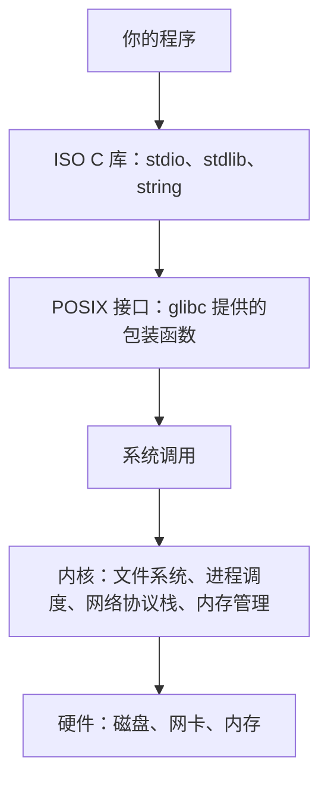
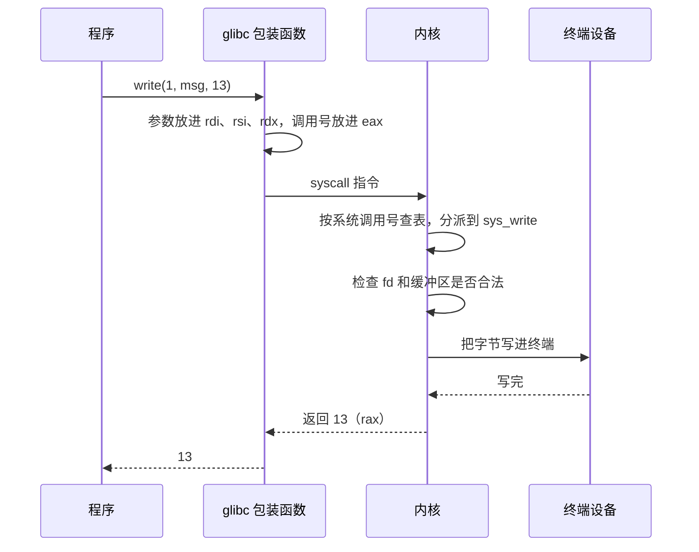

# 1. 平台边界、POSIX 与系统调用

想写一个列出目录内容的小工具，要显示每个文件的名字和权限；想写一个构建脚本，要启动编译器、等它结束并拿到退出状态；想写一个客户端，要连接本机的一个端口。这三件事在 ISO C 里都没有接口：`<stdio.h>` 能打开文件，却打不开目录；`system` 只返回一个整数，拿不到子进程的详细信息；套接字在标准库里根本没有出现。

这些能力由操作系统提供。内核管理文件系统、进程、内存和网卡，用户程序不能直接操作这些资源，只能请求内核代劳，请求的入口就是系统调用 (system call)。这一页把这个入口讲清楚，交代本部分使用的 Linux 环境、POSIX 标准的版本和功能特性测试宏 (feature test macro) 的写法，再把 strace、errno 和 man 手册这三样日常工具练熟。读完能说清一次 `printf` 怎样一路走到内核，能自己判断一个接口该配哪个宏，也能在程序行为反常时先用 strace 看出它在请求内核做什么。

## 1. 标准库之外

ISO C 定义的是语言和标准库。标准库处理「流」和「内存」这些抽象：`fopen` 打开一个文件流，`malloc` 分配一块内存，`printf` 往标准输出写格式化文本。目录里有哪些文件、一个程序怎样启动另一个程序、网络连接怎样建立，标准库一概不管。

这些能力来自内核。内核之上有一层 C 库，本部分使用 Linux 上的 glibc。glibc 一方面实现 ISO C 标准库，另一方面把内核的系统调用包装成 POSIX 接口。同一个程序从下往上看是这几层：



CPU 在运行时有两种特权级。用户程序运行在用户态 (user mode)，不能执行特权指令，也访问不到内核的地址空间；内核运行在内核态 (kernel mode)，可以操作页表、设备寄存器和中断控制器。两者之间只有少数几个受控入口，系统调用是其中最主要的一个。程序把参数放进约定的寄存器，执行一条专门用来陷入内核的指令，CPU 切换到内核态，内核在入口处检查参数和权限，做完事再回到用户态。

::: concept sys-platform-syscall-definition title="系统调用"

系统调用是内核向用户程序提供的受控服务入口。程序把系统调用号和参数放进约定的寄存器，执行一条陷入指令，CPU 切换到内核态，内核按系统调用号分派到对应的处理函数，完成工作后把结果放回寄存器并返回用户态。用户程序不能直接读写硬件，也不能直接访问内核的数据结构。

:::

<Quiz
  type="multi"
  :options="[
    { label: 'printf', value: 'A' },
    { label: 'write', value: 'B' },
    { label: 'malloc', value: 'C' },
    { label: 'brk', value: 'D' },
    { label: 'fopen', value: 'E' },
    { label: 'openat', value: 'F' }
  ]"
  :answer="['B', 'D', 'F']"
>

<template #question>

下列调用中，哪些本身就是系统调用？

</template>

正确答案是 **B、D、F**。`write`、`brk`、`openat` 是系统调用；`printf` 和 `fopen` 是 ISO C 库函数，它们最终会经过 `write`、`openat` 之类的系统调用进入内核，但调用本身不是系统调用，`printf` 的输出还可能一直留在缓冲区里，根本不到内核。`malloc` 也是库函数，它向内核要内存时才调用 `brk` 或 `mmap`。

</Quiz>

::: generate sys-platform-user-kernel kind=explanation concepts=sys-platform-syscall-definition

面向第一次接触用户态与内核态的读者，用日常生活中的窗口办事、餐厅点单之类类比说明为什么程序不能直接访问硬件、系统调用为什么需要一个统一入口、内核在入口处检查哪些东西；说明库函数与系统调用的分工，指出同一个功能可能经过好几层调用才进入内核，并提示用 strace 能看到的是最里面那一层。

:::

## 2. 准备 Linux 环境

本部分的代码全部在 Linux x86-64 上编译运行。原生安装、虚拟机、Windows 上的 WSL2、云主机都可以，登录后能用终端就行。需要的工具是 gcc、make、man 手册和 strace。Debian 与 Ubuntu 上一条命令装齐：

::: terminal title="bash - 安装工具"

```console
$ sudo apt install build-essential manpages-dev strace
```

:::

本部分统一使用这条编译命令：

::: terminal title="bash - 编译"

```console
$ gcc -std=c17 -Wall -Wextra -g prog.c -o prog
```

:::

`-std=c17` 让 gcc 按 C17 处理源文件，`-Wall -Wextra` 打开常用的警告，`-g` 保留调试信息，后面几章用调试器和 sanitizer 时要它。用线程的程序再加 `-pthread`，用到数学库时加 `-lm`。这一部分不需要 `-lrt` 和 `-lutil`：`clock_gettime` 这类函数 glibc 2.17 起就在 C 库里，`libutil` 的内容 2.34 起并入了 C 库。老教程里出现的 `-lrt` 是十多年前的写法，现在加上也不妨碍，只是多余。

Windows 上的 MinGW 不能代替 Linux。它提供的是 Windows 版本的 C 运行库，`write`、`getpid` 这类名字有，但进程、目录、套接字这些接口与 POSIX 对不上。三个实测结果很能说明问题，源码都在 `code/系统编程/1_平台边界_POSIX与系统调用/exercises/` 下。包含 `<sys/wait.h>` 的程序在编译阶段就失败：

::: terminal title="PowerShell - MinGW 编译 exercises/wait.c"

```text
> gcc -std=c17 -Wall -Wextra wait.c -o wait
wait.c:2:10: fatal error: sys/wait.h: No such file or directory
    2 | #include <sys/wait.h>
      |          ^~~~~~~~~~~~
compilation terminated.
```

:::

调用 `fork` 的程序能过编译，但只有一个隐式声明警告，链接时找不到符号：

::: terminal title="PowerShell - MinGW 编译 exercises/fork.c"

```text
> gcc -std=c17 -Wall -Wextra fork.c -o fork
fork.c: In function 'main':
fork.c:5:17: warning: implicit declaration of function 'fork' [-Wimplicit-function-declaration]
    5 |     pid_t pid = fork();
      |                 ^~~~
D:/Software/Strawberry/c/bin/../lib/gcc/x86_64-w64-mingw32/13.2.0/../../../../x86_64-w64-mingw32/bin/ld.exe: C:\Users\29728\AppData\Local\Temp\ccWRyf1b.o:fork.c:(.text+0xe): undefined reference to `fork'
collect2.exe: error: ld returned 1 exit status
```

:::

而 `write` 和 `getpid` 可以编译运行，只是表示 POSIX 版本的宏没有定义：

::: terminal title="PowerShell - MinGW 运行 exercises/posix.c"

```text
> gcc -std=c17 -Wall -Wextra posix.c -o posix
> ./posix
hello from write
_POSIX_VERSION 未定义
pid = 26828
```

:::

MinGW 的 `unistd.h` 只提供了一小部分名字，`fork` 连声明都没有，链接阶段自然找不到实体。这不是头文件没装全，MinGW 本来就不打算提供这些接口。Windows 原生的进程、目录、网络接口与 POSIX 是两套设计，写法见[拓展A A.1](/教程/正文/系统编程/拓展A_Win32系统编程/A_1_Win32API概览与POSIX对照)。

macOS 是 POSIX 环境，但缺少本部分用到的若干接口，包括 `clock_nanosleep`、`timer_create`、无名信号量、pthread 屏障和 `epoll`。它自带 BSD 风格的 `kqueue`，与 epoll 不通用。在 macOS 上读这一部分，建议开一台 Linux 虚拟机；只读代码不运行，问题不大。

::: tip 检查环境

`uname -srm` 看内核和架构，`gcc --version` 看编译器，`ldd --version` 看 C 库版本，`strace -V` 看 strace 是否装好。四样都正常，这一部分的示例就能跑。

:::

## 3. POSIX、SUS 与 Linux

标准库之外的那套接口来自一个标准：POSIX。它的全名是「可移植操作系统接口」(Portable Operating System Interface)，由 IEEE 和 Open Group 维护，编号 IEEE Std 1003.1。POSIX 规定 C 接口，也规定 shell 和一些工具程序的行为，本部分只关心 C 接口。

POSIX 之上还有一个更大的文档集，叫单一 UNIX 规范 (Single UNIX Specification, SUS)，由 Open Group 维护。SUS 等于 POSIX 加上 XSI 选项 (X/Open System Interfaces)。XSI 是一个扩展层，其中列出的接口在普通 POSIX 实现里是可选的，在 XSI 实现里是必需的。glibc 实现了很大一部分 XSI，但 Linux 本身没有做过正式认证，所以严格说来 Linux 是「与 POSIX 兼容」，而不是 POSIX 认证系统。

版本只需要记两个。当前广泛遵循的是 POSIX.1-2008，也叫 SUSv4，Open Group 文档编号里的 Issue 7；2024 年发布了 POSIX.1-2024，也叫 SUSv5、Issue 8，与 C17 对齐。本部分主要按 POSIX.1-2008 写，遇到 2024 新增、glibc 又已经提供的接口时，会说明它的来历。

日常写代码真正要判断的是：一个接口属于哪一层。这个判断决定了写哪个宏，也决定了代码能不能移植到 macOS 或 BSD。

| 接口 | 归属 | 典型代表 |
| --- | --- | --- |
| ISO C | 标准 C 库，任何宿主实现都有 | `fopen`、`printf`、`malloc`、`time` |
| POSIX | POSIX.1-2008 基础部分，`_POSIX_C_SOURCE 200809L` 即可 | `open`、`read`、`write`、`fork`、`waitpid`、`socket` |
| XSI | POSIX 的可选扩展层，要 `_XOPEN_SOURCE 700` | `nftw`、`killpg`、`realpath`、`posix_openpt` |
| Linux 专有 | 只有 Linux 内核提供，别的系统没有 | `epoll_create1`、`signalfd`、`timerfd_create`、`inotify_init1` |
| GNU 扩展 | glibc 在 POSIX 之外额外提供的名字 | `strerrorname_np`、`memfd_create`、`gettid`、`execvpe` |

Linux 专有这一行值得注意：它们的头文件在别的系统上可能根本不存在，用了就不具备可移植性。本部分讲 Linux 专有接口时会明确标注，并在讲完之后指出对应的 POSIX 做法。`epoll` 就是例子，POSIX 里与之对应的是 `poll`，后者慢一些，但各系统都有。

GNU 扩展和 Linux 专有经常重叠，但不是一回事。`pipe2` 最初是 GNU 扩展，2024 年被收进 POSIX.1-2024，可 glibc 2.41 仍然要 `_GNU_SOURCE` 才声明它。`memfd_create` 是 Linux 内核的系统调用，glibc 提供的包装函数放在 GNU 扩展里。判断一个名字属于哪一类，最可靠的办法是看 man 手册末尾的 STANDARDS 一节，或者直接翻 POSIX 在线规范。

作者的经验是：能用 POSIX 就先用 POSIX。POSIX 接口在 Linux、macOS、BSD、Solaris 上都有，换平台时不用重写。只有在需要某个性能或功能上的差别时，才换用 Linux 专有接口，并且在代码里标出来，方便以后移植。本部分从第 2 章开始的示例都遵循这个顺序：先给出 POSIX 写法，Linux 专有写法作为补充。

::: warning 别把 Linux 专有的头文件当成人人都有的

`<sys/epoll.h>`、`<sys/signalfd.h>`、`<sys/timerfd.h>`、`<sys/inotify.h>` 在 macOS 上不存在，在这些系统上编译会直接停在预处理阶段。写了这些头文件的代码要在 README 或 Makefile 里说清楚只支持 Linux。

:::

## 4. 功能特性测试宏

glibc 的头文件里塞着很多声明，其中一部分属于 ISO C，一部分属于 POSIX，一部分属于 XSI，还有一部分属于 GNU 扩展。头文件被包含时，glibc 需要知道程序想要哪一层的名字，才能决定把哪些声明露出来。这个信息由功能特性测试宏提供。

规则有两条，都很容易记。第一条：在**任何** `#include` 之前定义宏。宏只影响它之后被包含的头文件；一个头文件一旦被处理过，再定义宏也改不了它已经露出的声明。头文件之间还会互相包含，你以为没有包含过的东西，可能已经被某个头文件带进来了。第二条：按需要的层次选宏。本部分只用三个：

| 需要的接口 | 宏 | 含义 |
| --- | --- | --- |
| POSIX | `#define _POSIX_C_SOURCE 200809L` | POSIX.1-2008 的基础接口 |
| XSI | `#define _XOPEN_SOURCE 700` | POSIX.1-2008 加 XSI 扩展 |
| GNU 扩展或 Linux 专有 | `#define _GNU_SOURCE` | 以上全部，再加 glibc 的 GNU 扩展 |

`_XOPEN_SOURCE 700` 隐含了 `_POSIX_C_SOURCE 200809L`，`_GNU_SOURCE` 又隐含了前两个，所以一个源文件里写一个就够，不需要叠着写。`_GNU_SOURCE` 甚至不需要给值，写 `#define _GNU_SOURCE` 就行。

::: concept sys-platform-ftm-before-include title="功能特性测试宏必须在任何 #include 之前定义"

功能特性测试宏只对定义之后被包含的头文件生效。头文件可能互相包含，因此把宏写在某个 `#include` 之后，可能有一部分声明已经按旧设置处理完毕，再定义宏也不起作用。要么把 `#define` 放在文件最前面，要么在编译命令行上用 `-D` 传进去。

:::

下面这段程序用了 `getline`、`fileno` 和 `ssize_t`，三者都属于 POSIX，不属于 ISO C。文件里没有写宏，`code/系统编程/1_平台边界_POSIX与系统调用/need_macro.c` 就是这个样子：

```c
#include <stdio.h>
#include <stdlib.h>

int main(void) {
    char *line = NULL;
    size_t cap = 0;
    ssize_t len;
    while ((len = getline(&line, &cap, stdin)) != -1) {
        printf("%zd 字节：%s", len, line);
    }
    if (ferror(stdin)) {
        perror("getline");
        return 1;
    }
    free(line);
    printf("stdin 的文件描述符是 %d\n", fileno(stdin));
    return 0;
}
```

在 `-std=c17` 下编译，gcc 14 给出三条错误和一条警告：

::: terminal title="bash - 没有宏时的编译诊断"

```console
$ gcc -std=c17 -Wall -Wextra need_macro.c -o need_macro
need_macro.c: In function 'main':
need_macro.c:7:5: error: unknown type name 'ssize_t'; did you mean 'size_t'?
need_macro.c:8:19: error: implicit declaration of function 'getline' [-Wimplicit-function-declaration]
need_macro.c:9:19: warning: format '%zd' expects argument of type 'signed size_t', but argument 2 has type 'int' [-Wformat=]
need_macro.c:16:41: error: implicit declaration of function 'fileno' [-Wimplicit-function-declaration]
```

:::

关键的一行是 `unknown type name 'ssize_t'`。`ssize_t` 是 POSIX 类型，ISO C 里没有。`getline` 和 `fileno` 同样是 POSIX 函数，头文件按当前的宏设置把它们藏了起来，编译器找不到声明，只能按旧规则当成「隐式声明」，返回 `int`。`%zd` 那条警告是连锁反应：`len` 被当成了 `int`，与 `%zd` 不匹配。gcc 14 起隐式声明默认是错误而不是警告，所以这个程序根本编译不过；更早的 gcc 会给警告并生成一个能跑的二进制，函数返回值按 `int` 截断，遇到返回 `ssize_t` 的调用就可能算错。

在文件第一行加上宏：

```c
#define _POSIX_C_SOURCE 200809L
#include <stdio.h>
#include <stdlib.h>
```

三条错误全部消失，编译通过，运行结果符合预期。加好宏的完整文件是 `code/系统编程/1_平台边界_POSIX与系统调用/need_macro_posix.c`：

::: terminal title="bash - 加上宏之后"

```console
$ gcc -std=c17 -Wall -Wextra need_macro_posix.c -o need_macro_posix
$ echo hello | ./need_macro_posix
6 字节：hello
stdin 的文件描述符是 0
```

:::

把 `#define` 挪到 `#include <stdio.h>` 后面，错误会原样回来。同一目录下的 `late_macro.c` 就是这个写法，它被排除在 Makefile 的构建目标之外，本来就编译不过。不是「位置随便，编译器会找」，而是预处理顺序在起作用：`stdio.h` 被处理的时候，`_POSIX_C_SOURCE` 还没有定义。

::: terminal title="bash - 宏写在 include 之后"

```console
$ gcc -std=c17 -Wall -Wextra late_macro.c -o late_macro
late_macro.c: In function 'main':
late_macro.c:8:5: error: unknown type name 'ssize_t'; did you mean 'size_t'?
late_macro.c:9:19: error: implicit declaration of function 'getline' [-Wimplicit-function-declaration]
late_macro.c:10:19: warning: format '%zd' expects argument of type 'signed size_t', but argument 2 has type 'int' [-Wformat=]
late_macro.c:17:41: error: implicit declaration of function 'fileno' [-Wimplicit-function-declaration]
```

:::

还有一个容易迷惑人的现象：把 `-std=c17` 换成 `-std=gnu17`，不加任何宏，这个程序也能编译通过。原因是 `-std=gnu17` 没有定义 `__STRICT_ANSI__`，glibc 在这种模式下默认定义 `_DEFAULT_SOURCE` 和 `_POSIX_C_SOURCE=200809L`。在预处理结果里可以直接看到：

::: terminal title="bash - 两种标准模式下 glibc 的默认宏"

```console
$ echo | gcc -std=c17 -dM -E -include unistd.h - | grep -E '_POSIX_C_SOURCE|_DEFAULT_SOURCE|__STRICT_ANSI__'
#define __STRICT_ANSI__ 1
$ echo | gcc -std=gnu17 -dM -E -include unistd.h - | grep -E '_POSIX_C_SOURCE|_DEFAULT_SOURCE|__STRICT_ANSI__'
#define _DEFAULT_SOURCE 1
#define _POSIX_C_SOURCE 200809L
```

:::

`-std=gnu17` 能过，是因为 glibc 在背后替你定义了这个宏。教程里的示例仍然显式写 `_POSIX_C_SOURCE 200809L`，理由是源文件应该自己说明它依赖什么：别人把这个文件拿到 `-std=c17` 的工程里编译，不需要猜它为什么在原来的工程里能过。显式写宏还有一个好处，换到别的 C 库（musl、BSD libc）时，头文件对宏的解读不一样，问题会暴露在编译阶段而不是运行阶段。

各层级接口在不同宏设置下是否可见，实测结果如下。表格里 P 表示 `_POSIX_C_SOURCE 200809L`，X 表示 `_XOPEN_SOURCE 700`，G 表示 `_GNU_SOURCE`：

| 接口 | 无宏 | P | X | G | `-std=gnu17` |
| --- | --- | --- | --- | --- | --- |
| `getline`、`fileno`、`strdup` | 否 | 是 | 是 | 是 | 是 |
| `sigemptyset`、`getaddrinfo` | 否 | 是 | 是 | 是 | 是 |
| `fork`、`open`、`read`、`waitpid` | 是 | 是 | 是 | 是 | 是 |
| `epoll_create1`、`inotify_init1` | 是 | 是 | 是 | 是 | 是 |
| `nftw`、`FTW_PHYS` | 否 | 否 | 是 | 是 | 否 |
| `killpg` | 否 | 否 | 是 | 是 | 是 |
| `pipe2`、`dup3`、`accept4` | 否 | 否 | 否 | 是 | 否 |
| `strerrorname_np` | 否 | 否 | 否 | 是 | 否 |

`fork`、`open` 那一行在 `-std=c17` 下也能用，因为它们是 POSIX 的基础接口，glibc 无条件声明。两行值得单独说。`epoll_create1` 那一行在所有设置下都能用，因为 `<sys/epoll.h>` 是 Linux 自己的头文件，不受 glibc 的宏控制。`nftw` 在 `-std=gnu17` 下不能用，但在 `_XOPEN_SOURCE 700` 和 `_GNU_SOURCE` 下可以：`nftw` 属于 XSI，`_DEFAULT_SOURCE` 并不包含 XSI，所以 `gnu17` 的默认设置不够。同一张表里 `killpg` 也是 XSI 名字，却在 `gnu17` 下也能用，这是 glibc 额外把它放进了默认集合，换一个 C 库就不一定。

::: details 实测方法

上面这张表用一组只有一行调用的小程序得到，每个文件只用到一个接口，文件名统一叫 `probe.c`，逐个换设置编译：

```console
$ for opt in "-std=c17" "-std=c17 -D_POSIX_C_SOURCE=200809L" \
             "-std=c17 -D_XOPEN_SOURCE=700" "-std=c17 -D_GNU_SOURCE" "-std=gnu17"; do
>   printf '%-38s ' "$opt"
>   gcc $opt -Wall -Wextra -c probe.c -o /dev/null 2>/dev/null && echo OK || echo FAIL
> done
```

`-c` 只做编译和汇编，不链接，所以程序里有没有 `main`、调用的函数是否有实体都不影响结论。看到 `FAIL` 时去掉 `2>/dev/null`，就能读到具体是哪一行声明缺失。

:::

有一个流传很广的说法需要纠正：以为把宏改成 `_POSIX_C_SOURCE 202405L` 或 `_XOPEN_SOURCE 800`，就能用上 POSIX.1-2024 的新接口。在 glibc 2.41 上这两个值不会多露出任何名字。2024 新增的 `pipe2`、`dup3`、`accept4`、`ppoll`、`mkostemp` 仍然要 `_GNU_SOURCE`，而 `tcgetwinsize`、`posix_close`、`posix_getdents` 这些名字在 glibc 里还没有实现。想让代码在 glibc 上用上新接口，只能写 `_GNU_SOURCE`；想让代码符合 2024 标准，得换一个实现了它的 C 库。

::: tip 宏也可以写在命令行上

`gcc -D_POSIX_C_SOURCE=200809L ...` 与写在源文件第一行效果一样。写在文件里，读代码的人一眼能看到依赖；写在命令行上，适合整个工程统一设置。两种都行，不要一半文件写、一半文件靠命令行。[18.3 功能特性测试宏](/教程/正文/语法和标准库/18_标准库的使用契约/18_3_功能特性测试宏)从 C 标准的角度讲过这些宏的来历，这一节讲的是 glibc 具体怎么解读它们。

:::

<Quiz
  type="single"
  :options="[
    { label: '不需要，nftw 属于 POSIX 基础接口', value: 'A' },
    { label: '_POSIX_C_SOURCE 200809L', value: 'B' },
    { label: '_XOPEN_SOURCE 700', value: 'C' },
    { label: '任何宏都不行', value: 'D' }
  ]"
  answer="C"
>

<template #question>

要在一个 `-std=c17` 的程序里使用 `nftw` 和 `FTW_PHYS`，应该定义哪个宏？

</template>

正确答案是 **C**。`nftw` 属于 XSI 选项，`_POSIX_C_SOURCE` 不够，实测在 `-std=gnu17` 的默认设置下也不可见。用 `_XOPEN_SOURCE 700` 可以，用 `_GNU_SOURCE` 也可以，因为它隐含了 `_XOPEN_SOURCE 700`。

</Quiz>

## 5. 系统调用是怎样发生的

`printf` 往标准输出写一行字，最终落到内核里的 `write` 系统调用。这一节把这中间的过程拆开看，并给出三种写法：用 `printf`、用 `write`、用 `syscall` 直接调用。

先看三个只差一行的程序。第一个用 `printf`：

```c
#include <stdio.h>

int main(void) {
    printf("hello, world\n");
    return 0;
}
```

第二个用 `write`，需要 `_POSIX_C_SOURCE`：

```c
#define _POSIX_C_SOURCE 200809L
#include <stdio.h>
#include <unistd.h>

int main(void) {
    static const char msg[] = "hello, world\n";
    if (write(STDOUT_FILENO, msg, sizeof msg - 1) == -1) {
        perror("write");
        return 1;
    }
    return 0;
}
```

第三个用 `syscall`，直接把系统调用号和参数交给 glibc 的通用入口：

```c
#define _GNU_SOURCE /* syscall() 是 GNU 扩展 */
#include <stdio.h>
#include <sys/syscall.h>
#include <unistd.h>

int main(void) {
    static const char msg[] = "hello, world\n";
    long n = syscall(SYS_write, STDOUT_FILENO, msg, sizeof msg - 1);
    if (n == -1) {
        perror("syscall");
        return 1;
    }
    return 0;
}
```

三个程序的输出相同：

::: terminal title="bash - 三种 hello"

```console
$ gcc -std=c17 -Wall -Wextra hello_printf.c -o hello_printf
$ gcc -std=c17 -Wall -Wextra hello_write.c -o hello_write
$ gcc -std=c17 -Wall -Wextra hello_syscall.c -o hello_syscall
$ ./hello_printf
hello, world
$ ./hello_write
hello, world
$ ./hello_syscall
hello, world
```

:::

用 `strace -e trace=write` 看，三者最后发出的动作完全一样：

::: terminal title="bash - 三个程序的 write 调用"

```console
$ strace -e trace=write ./hello_printf
write(1, "hello, world\n", 13)          = 13
+++ exited with 0 +++
$ strace -e trace=write ./hello_write
write(1, "hello, world\n", 13)          = 13
+++ exited with 0 +++
$ strace -e trace=write ./hello_syscall
write(1, "hello, world\n", 13)          = 13
+++ exited with 0 +++
```

:::

差别在到达这一步之前。`write` 是 glibc 提供的包装函数 (wrapper function)，它做的事情固定而机械：把系统调用号放进 `eax`，第一个参数放进 `rdi`，第二个放进 `rsi`，第三个放进 `rdx`，执行 `syscall` 指令，从 `rax` 取回返回值。如果返回值落在错误区间，它把绝对值写进 `errno`，返回 -1。`printf` 多做了一层：它先把格式化的结果放进 `stdout` 的缓冲区，缓冲区满了或者遇到换行（行缓冲时）才调用 `write`。在 `hello_printf` 里，程序退出时 libc 会刷新所有缓冲区，这一次刷新才落到 `write` 上。

`syscall` 是 glibc 提供的通用入口，参数是系统调用号和变长参数列表。除了 `errno` 的处理，它几乎只是一层薄壳，作用是把调用者给出的参数按当前体系结构的约定摆进寄存器，执行陷入指令。它存在的主要理由是：有些系统调用 glibc 没有提供专用包装函数（比如 `openat2`、`pidfd_open`），只能从这条路进。

下面是一张时序，从程序调用 `write` 到数据到达终端：



如果 `fd` 无效，内核在分派之后、真正写之前就发现了，直接返回一个负的错误号。内核的约定是返回值落在 -1 到 -4095 之间表示出错，4095 这个上限来自 `MAX_ERRNO`，留出这个区间是为了让真正的返回值和错误号不会混淆。glibc 的包装函数看到负数，把它的绝对值写进 `errno`，自己返回 -1。程序看到的永远是 -1 加 `errno`，看不到那个负数。

如果不经过任何包装函数，自己执行 `syscall` 指令，返回的就是内核原始的负值。下面这段内联汇编只适用于 x86-64 Linux：

```c
/* 只适用于 x86-64 Linux：自己执行 syscall 指令，不经过 glibc 的包装函数 */
static long raw_write(int fd, const void *buf, long count) {
    long ret;
    __asm__ volatile("syscall"
                     : "=a"(ret)
                     : "a"((long)SYS_write), "D"((long)fd), "S"(buf),
                       "d"(count)
                     : "rcx", "r11", "memory");
    return ret;
}
```

完整程序在 `code/系统编程/1_平台边界_POSIX与系统调用/raw_syscall.c`。对有效描述符和无效描述符各调用一次，结果如下：

::: terminal title="bash - 内联汇编发起的系统调用"

```console
$ gcc -std=c17 -Wall -Wextra raw_syscall.c -o raw_syscall
$ ./raw_syscall
hello from a raw syscall
有效描述符返回 25，无效描述符返回 -9，errno = 0
```

:::

-9 是 `-EBADF`，`EBADF` 的值是 9。`errno` 仍然是 0，因为没有任何包装函数去写它。这一段代码的意义不在于鼓励读者手写汇编，而在于展示包装函数到底做了什么事：它把内核返回的 `-9` 翻译成「返回 -1，`errno` 置为 9」这个统一形式，让调用者只面对一种错误约定。

::: details x86-64 的寄存器约定

x86-64 的系统调用约定与普通函数调用不同。系统调用号放 `eax`，参数依次放 `rdi`、`rsi`、`rdx`、`r10`、`r8`、`r9`（注意第四个参数是 `r10` 而不是 `rcx`），返回值放 `rax`。`syscall` 指令会把返回地址放进 `rcx`、把 `rflags` 放进 `r11`，所以这两个寄存器在内联汇编里要标成 clobber。

其他体系结构的约定不同：i386 用 `int $0x80`，参数放 `ebx`、`ecx`、`edx`、`esi`、`edi`、`ebp`；arm64 用 `svc #0`，调用号放 `w8`，参数放 `x0` 到 `x5`。这些数字不用背，需要时查 `syscall(2)` 的表格即可。glibc 的包装函数把这些差异全部盖住了，这正是「可移植」二字的具体含义。

:::

一次系统调用比普通函数调用重得多：保存用户态现场、切换栈、检查系统调用号是否在范围内，多核上还要处理各种隔离机制。开一次系统调用通常以百纳秒计，一次普通的函数调用只要几纳秒，差两个数量级。这个差距在设计高频调用的接口时很重要，第 2 章讲 `stdio` 缓冲时还会回到这一点。

有一个例外值得提前说：`clock_gettime` 这类读取时间的调用，在 Linux 上通常根本不进入内核。内核在启动时把一个小的共享对象映射到每个进程的地址空间里，叫 vDSO (virtual dynamic shared object)，glibc 的 `clock_gettime` 会优先调用 vDSO 里的实现，直接从内核维护的共享数据里读时间，省掉一次陷入和返回。用一个循环调用 1000 次来验证：

```c
#define _POSIX_C_SOURCE 200809L
#include <stdio.h>
#include <time.h>
#include <unistd.h>

int main(void) {
    struct timespec ts;
    for (int i = 0; i < 1000; i++) {
        if (clock_gettime(CLOCK_MONOTONIC, &ts) == -1) {
            perror("clock_gettime");
            return 1;
        }
        (void)getpid();
    }
    printf("clock_gettime 与 getpid 各调用 1000 次\n");
    return 0;
}
```

`strace -c -e trace=clock_gettime,getpid` 的统计里只有 1000 次 `getpid`，一次 `clock_gettime` 都没有：

::: terminal title="bash - vDSO 让 clock_gettime 不进内核"

```console
$ gcc -std=c17 -Wall -Wextra vdso_demo.c -o vdso_demo
$ strace -c -e trace=clock_gettime,getpid ./vdso_demo
clock_gettime 与 getpid 各调用 1000 次
% time     seconds  usecs/call     calls    errors syscall
------ ----------- ----------- --------- --------- ----------------
  0.00    0.000000           0      1000           getpid
------ ----------- ----------- --------- --------- ----------------
100.00    0.000000           0      1000           total
```

:::

`getpid` 在这台机器上仍然是真正的系统调用，没有走 vDSO。想确认一个库函数是否进入内核，最直接的办法就是用 `strace` 数次数，而不是背哪些调用走了 vDSO。把同样的循环改用 `syscall(SYS_clock_gettime, ...)`，强制绕开 vDSO 走系统调用这一层，`strace` 里就有记录了：

::: terminal title="bash - 强制走系统调用"

```console
$ gcc -std=c17 -Wall -Wextra clock_syscall.c -o clock_syscall
$ strace -c -e trace=clock_gettime ./clock_syscall
clock_gettime 系统调用执行了 1000 次
% time     seconds  usecs/call     calls    errors syscall
------ ----------- ----------- --------- --------- ----------------
100.00    0.005094           5      1000           clock_gettime
------ ----------- ----------- --------- --------- ----------------
100.00    0.005094           5      1000           total
```

:::

::: generate sys-platform-write-path kind=explanation concepts=sys-platform-syscall-definition

面向已经会写 C、但第一次接触系统调用的读者，从 hello_printf 的 strace 输出出发，逐步解释一次 printf 从 stdio 缓冲区出发、经过 glibc 的 write 包装函数、进入内核、把字节送到终端、再把返回值一路传回来的完整过程；说明包装函数在错误处理上补了什么，为什么程序看到的总是 -1 和 errno；最后指出 vDSO 是这条路径的一个例外。

:::

## 6. 用 strace 观察程序

strace 跟踪一个程序发出的系统调用和收到的信号，打印调用名、参数和返回值。它不需要源代码，也不需要重新编译，任何二进制都能跟踪。系统行为解释不了的时候，先 strace 是最省时间的做法。

最常用的四组选项：

| 选项 | 作用 |
| --- | --- |
| `-e trace=` | 只跟踪指定的系统调用，可以写调用名、`%file` 这样的分组或 `all`、`none` |
| `-c` | 只输出统计表：每个调用被调了多少次、总共花了多少时间、失败了几次 |
| `-f` | 跟随 `fork`、`vfork`、`clone` 产生的子进程 |
| `-o 文件` | 把跟踪记录写到文件，不混进程序自己的输出 |

先看一个最简单的例子。一个打印三行的程序：

```c
#include <stdio.h>

int main(void) {
    printf("line 1\n");
    printf("line 2\n");
    printf("line 3\n");
    return 0;
}
```

输出被接到管道上时，三次 `printf` 只产生一次 `write`：

::: terminal title="bash - 管道下的 write"

```console
$ gcc -std=c17 -Wall -Wextra lines.c -o lines
$ strace -e trace=write ./lines | cat
line 1
line 2
line 3
write(1, "line 1\nline 2\nline 3\n", 21) = 21
+++ exited with 0 +++
```

:::

换成伪终端，同样的程序产生三次 `write`，每行一次。`script -qc` 可以给命令分配一个伪终端，正好用来做这个对照：

::: terminal title="bash - 伪终端下的 write"

```console
$ script -qc 'strace -o pty.log -e trace=write ./lines' /dev/null
$ cat pty.log
write(1, "line 1\n", 7)                 = 7
write(1, "line 2\n", 7)                 = 7
write(1, "line 3\n", 7)                 = 7
+++ exited with 0 +++
```

:::

原因在[13.1 IO 流](/教程/正文/语法和标准库/13_输入输出/13_1_IO流)讲过的缓冲策略。`stdout` 连到管道、文件这类非终端对象时是全缓冲，缓冲区攒到 4096 字节或程序退出时才写出；连到终端时是行缓冲，每遇到换行就写一次。三次 `printf` 一共 21 字节，远不够填满全缓冲的缓冲区，程序退出时 libc 刷新缓冲区，于是只有一次 `write`。

如果不想依赖程序的退出时机，可以在每次输出后手动刷新：

::: terminal title="bash - 每行都 fflush"

```console
$ strace -e trace=write ./fflush_demo | cat
line 1
line 2
line 3
write(1, "line 1\n", 7)                 = 7
write(1, "line 2\n", 7)                 = 7
write(1, "line 3\n", 7)                 = 7
+++ exited with 0 +++
```

:::

用 `-c` 把差距量化。一个打印一万行的程序，输出到管道时只有 25 次 `write`，因为每次写满 4096 字节的缓冲区才发一次；去掉 `-c` 就能看到每次写的长度，前 24 次都是 4096，最后一次是 590：

::: terminal title="bash - 一万行的 write 次数（管道）"

```console
$ strace -c -e trace=write ./many | cat
% time     seconds  usecs/call     calls    errors syscall
------ ----------- ----------- --------- --------- ----------------
  0.00    0.000000           0        25           write
------ ----------- ----------- --------- --------- ----------------
100.00    0.000000           0        25           total
```

:::

伪终端下是 10000 次，一行一次：

::: terminal title="bash - 一万行的 write 次数（伪终端）"

```console
$ script -qc 'strace -c -o pty.log -e trace=write ./many' /dev/null
$ cat pty.log
% time     seconds  usecs/call     calls    errors syscall
------ ----------- ----------- --------- --------- ----------------
100.00    0.041082           4     10000           write
------ ----------- ----------- --------- --------- ----------------
100.00    0.041082           4     10000           total
```

:::

不同的接口混用还会带来顺序问题。下面的程序先 `printf` 一行、再 `write` 一行、再 `printf` 一行：

```c
#define _POSIX_C_SOURCE 200809L
#include <stdio.h>
#include <unistd.h>

int main(void) {
    printf("A\n");
    if (write(STDOUT_FILENO, "B\n", 2) == -1) {
        perror("write");
        return 1;
    }
    printf("C\n");
    return 0;
}
```

在管道下，`B` 抢到了 `A` 前面：

::: terminal title="bash - stdio 与 write 混用"

```console
$ ./mix
B
A
C
$ strace -e trace=write ./mix | cat
write(1, "B\n", 2)                      = 2
B
A
C
write(1, "A\nC\n", 4)                   = 4
+++ exited with 0 +++
```

:::

`printf` 的输出还在缓冲区里，`write` 直接进了内核，所以 `B` 先到。在终端里运行则顺序正常，因为 `A` 那一行触发了行缓冲的刷新。结论很简单：同一个输出流不要混用 stdio 和描述符级的接口；非混不可时，先在两者之间调用 `fflush`。

接下来看启动阶段。程序从 `execve` 开始，到自己的第一行代码，中间有相当多的动作：

::: terminal title="bash - 程序启动时的系统调用（地址每次运行都不同）"

```console
$ strace -o trace.log -e trace=execve,openat,mmap,brk,write,exit_group ./hello_printf
$ cat trace.log
execve("./hello_printf", ["./hello_printf"], 0x7ffc7cb9b330 /* 20 vars */) = 0
brk(NULL)                               = 0x561e30b3b000
mmap(NULL, 8192, PROT_READ|PROT_WRITE, MAP_PRIVATE|MAP_ANONYMOUS, -1, 0) = 0x7fc97e895000
openat(AT_FDCWD, "/etc/ld.so.cache", O_RDONLY|O_CLOEXEC) = 3
mmap(NULL, 28463, PROT_READ, MAP_PRIVATE, 3, 0) = 0x7fc97e88e000
openat(AT_FDCWD, "/lib/x86_64-linux-gnu/libc.so.6", O_RDONLY|O_CLOEXEC) = 3
mmap(NULL, 2047568, PROT_READ, MAP_PRIVATE|MAP_DENYWRITE, 3, 0) = 0x7fc97e69a000
mmap(0x7fc97e6c2000, 1454080, PROT_READ|PROT_EXEC, MAP_PRIVATE|MAP_FIXED|MAP_DENYWRITE, 3, 0x28000) = 0x7fc97e6c2000
mmap(0x7fc97e825000, 352256, PROT_READ, MAP_PRIVATE|MAP_FIXED|MAP_DENYWRITE, 3, 0x18b000) = 0x7fc97e825000
mmap(0x7fc97e87b000, 24576, PROT_READ|PROT_WRITE, MAP_PRIVATE|MAP_FIXED|MAP_DENYWRITE, 3, 0x1e0000) = 0x7fc97e87b000
mmap(0x7fc97e881000, 52816, PROT_READ|PROT_WRITE, MAP_PRIVATE|MAP_FIXED|MAP_ANONYMOUS, -1, 0) = 0x7fc97e881000
mmap(NULL, 12288, PROT_READ|PROT_WRITE, MAP_PRIVATE|MAP_ANONYMOUS, -1, 0) = 0x7fc97e697000
brk(NULL)                               = 0x561e30b3b000
brk(0x561e30b5c000)                     = 0x561e30b5c000
write(1, "hello, world\n", 13)          = 13
exit_group(0)                           = ?
+++ exited with 0 +++
```

:::

`execve` 是内核装载可执行文件的入口。它把程序读进内存，然后判断这个程序是不是动态链接的；是的话，先把动态链接器 `/lib64/ld-linux-x86-64.so.2` 装载进来，再把控制权交给它。接下来的 `openat` 打开 `/etc/ld.so.cache`（找库文件的索引）和 `/lib/x86_64-linux-gnu/libc.so.6`（C 库本体）。`mmap` 那些长参数的行是把库文件的各个段映射进地址空间：代码段映射成可读可执行，数据段映射成可读可写，未初始化数据补一段匿名映射。`brk` 调整堆的边界。最后 `write` 输出那一行，`exit_group` 结束所有线程。

这些行不需要逐条背下来，但看过一遍之后，遇到「程序启动就崩」「找不到某个库」「内存怎么这么大」这类问题，就知道该看哪几行。

::: details 同步与异步输出的差异

把 `strace` 的输出重定向到管道时，`strace` 自己的记录和程序的输出会交错，看起来乱。用 `-o` 写到文件里最干净：

```console
$ strace -o trace.log -e trace=write ./lines | cat
line 1
line 2
line 3
$ cat trace.log
write(1, "line 1\nline 2\nline 3\n", 21) = 21
+++ exited with 0 +++
```

跟踪多进程程序时加 `-f`。`sh -c 'ls | wc -l'` 会创建两个子进程，不加 `-f` 只能看到 shell 自己：

```console
$ strace -f -e trace=execve -e signal=none -o trace.log sh -c 'ls | wc -l'
$ cat trace.log
4058885 execve("/usr/bin/sh", ["sh", "-c", "ls | wc -l"], 0x7fff9aeea308 /* 20 vars */) = 0
4058886 execve("/usr/bin/ls", ["ls"], 0x55e11a15c910 /* 20 vars */ <unfinished ...>
4058887 execve("/usr/bin/wc", ["wc", "-l"], 0x55e11a15c930 /* 20 vars */ <unfinished ...>
4058886 <... execve resumed>)           = 0
4058887 <... execve resumed>)           = 0
4058886 +++ exited with 0 +++
4058887 +++ exited with 0 +++
4058885 +++ exited with 0 +++
```

`-e signal=none` 去掉 SIGCHLD 的记录，输出会干净得多。

:::

::: tip strace 会让程序变慢

被跟踪的程序每发一个系统调用都要停下来等 strace 记录，运行速度可能慢几倍到几十倍。用它定位问题、数调用次数都可以，不要用它测性能。另外，setuid 程序在被跟踪时不带特权运行，这是内核的安全设计。

:::

作者的习惯是：遇到解释不了的行为，先 `strace -f -e trace=%file` 看它到底对哪些文件做了什么，再 `strace -c` 看哪个调用占了大头，最后才去看源码。这一部分后面讲文件、进程、信号、网络时，几乎每一节都会用它。

::: generate sys-platform-strace-walkthrough kind=explanation

面向刚学会用 strace、但看到满屏调用就发懵的读者，以本节的启动片段为例逐行走读：哪一行是内核装载程序，哪几行是动态链接器在找库，哪几行在建立地址空间，哪一行才是程序自己想要的 write；同时说明怎样用 -e trace 把输出缩到能读懂的长度。

:::

## 7. 错误处理惯例

系统调用和库函数报错的方式有三种约定，本部分会反复遇到。

第一种最常见：返回一个特殊值表示失败，具体原因放在 `errno` 里。系统调用和绝大多数 POSIX 函数都用这种约定。`write` 失败返回 -1，`open` 失败返回 -1，`malloc` 失败返回 `NULL`，`fopen` 失败也返回 `NULL`。

第二种是 pthread 系列：函数直接返回错误号，不碰 `errno`。返回 0 表示成功，返回值本身就是错误号。第 8 章会大量使用。

第三种是 `getaddrinfo`：返回一组专用错误码（`EAI_*`），要用 `gai_strerror` 解释，既不是 -1 也不是 `errno`。第 10 章讲。

三种约定放在一个程序里对比：

```c
#define _POSIX_C_SOURCE 200809L
#include <errno.h>
#include <netdb.h>
#include <pthread.h>
#include <stdio.h>
#include <string.h>
#include <unistd.h>

int main(void) {
    /* 第一种：返回 -1，原因在 errno 里 */
    errno = 0;
    if (write(-1, "x", 1) == -1) {
        printf("write: %s\n", strerror(errno));
    }

    /* 第二种：直接返回错误号，不设置 errno */
    errno = 0;
    int rc = pthread_join(pthread_self(), NULL);
    if (rc != 0) {
        printf("pthread_join: %s（errno 还是 %d）\n", strerror(rc), errno);
    }

    /* 第三种：返回专用错误码，用 gai_strerror 解释 */
    struct addrinfo hints = {0};
    struct addrinfo *res = NULL;
    rc = getaddrinfo(NULL, NULL, &hints, &res);
    if (rc != 0) {
        printf("getaddrinfo: %s（rc = %d）\n", gai_strerror(rc), rc);
    } else {
        freeaddrinfo(res);
    }
    return 0;
}
```

编译时记得加 `-pthread`。输出：

::: terminal title="bash - 三种错误约定"

```console
$ gcc -std=c17 -Wall -Wextra -g conventions.c -o conventions -pthread
$ ./conventions 2>&1
write: Bad file descriptor
pthread_join: Resource deadlock avoided（errno 还是 0）
getaddrinfo: Name or service not known（rc = -2）
```

:::

`pthread_join(pthread_self(), NULL)` 让线程等待自己，返回 `EDEADLK`，值是 35，`strerror(35)` 给出 `Resource deadlock avoided`。整个调用过程中 `errno` 一直是 0，验证了第二种约定不碰 `errno`。`getaddrinfo` 返回 -2，这是 `EAI_NONAME` 的取值，用 `gai_strerror` 解释才对，拿 `strerror` 去翻译会得到牛头不对马嘴的字符串。

`errno` 有两个性质必须记住。第一，成功时不会被清零，它保留着上一次失败留下的值。第二，每个线程各有一份，一个线程设置的 `errno` 另一个线程看不到，所以多线程程序里不会互相踩。第二条在第 8 章还会提到，第一条现在就能演示：

```c
#define _POSIX_C_SOURCE 200809L
#include <errno.h>
#include <stdio.h>
#include <string.h>
#include <unistd.h>

int main(void) {
    ssize_t n = write(-1, "x", 1);
    int err = errno; /* 马上保存：后面的调用也可能改动 errno */
    printf("write 返回 %zd，errno = %d（%s）\n", n, err, strerror(err));

    pid_t pid = getpid();
    printf("getpid 返回 %d，errno 仍是 %d\n", (int)pid, errno);
    return 0;
}
```

::: terminal title="bash - errno 不会被成功调用清零（PID 是某次运行的值）"

```console
$ gcc -std=c17 -Wall -Wextra errno_demo.c -o errno_demo
$ ./errno_demo
write 返回 -1，errno = 9（Bad file descriptor）
getpid 返回 4060551，errno 仍是 9
```

:::

`getpid` 成功了，`errno` 却还是 9。这一条直接推出正确的检查顺序：先看返回值判断有没有失败，失败了才去读 `errno`。反过来，只看 `errno` 是不是非零，会把一次成功的调用判成失败。下面两个程序对照这件事：

::: compare left-title="先看 errno" right-title="先看返回值"

```c
errno = 0;
write(-1, "x", 1); /* 失败，errno 变成 EBADF */

pid_t pid = getpid(); /* 这一次成功了，errno 却没有被清掉 */
if (errno != 0) {
    perror("getpid");
}
printf("getpid 返回 %d\n", (int)pid);
```

---

```c
if (write(-1, "x", 1) == -1) {
    perror("write");
}
pid_t pid = getpid();
if (pid == -1) {
    perror("getpid");
}
printf("getpid 返回 %d\n", (int)pid);
```

:::

第一个程序把一次成功的 `getpid` 报告成失败：

::: terminal title="bash - 两个版本的实际输出（PID 是某次运行的值）"

```console
$ gcc -std=c17 -Wall -Wextra errno_first.c -o errno_first
$ gcc -std=c17 -Wall -Wextra retval_first.c -o retval_first
$ ./errno_first 2>&1
getpid: Bad file descriptor
getpid 返回 4061389
$ ./retval_first 2>&1
write: Bad file descriptor
getpid 返回 4061390
```

:::

左边那行 `getpid: Bad file descriptor` 是彻头彻尾的误报：`getpid` 根本没有失败，`EBADF` 是上一条 `write` 留下的。右边先判断返回值，只有 `write` 报错，`getpid` 不报。

<Quiz
  type="single"
  :options="[
    { label: 'strerror 的返回值', value: 'A' },
    { label: 'errno，前提是刚才那次调用确实失败了', value: 'B' },
    { label: '返回值本身，比如 -1 就是原因', value: 'C' },
    { label: 'getpid 之类的调用不会失败，不用查', value: 'D' }
  ]"
  answer="B"
>

<template #question>

`write` 返回 -1 之后，去哪里看失败原因？

</template>

正确答案是 **B**。`write` 的返回值只告诉你「失败了」，具体原因由 `errno` 给出，`strerror(errno)` 把错误号翻译成一句话。C 错在把 -1 当成原因：`-1` 只表示失败，不同错误都是 -1。

</Quiz>

读 `errno` 之前还有一件小事：读取之前立刻把它存进一个局部对象。`perror`、`printf`、`strerror` 这些调用本身也可能失败并修改 `errno`，`printf` 的参数里连续写两次 `errno`，两次读到的可能不是同一个值。本部分统一的写法是：

```c
if (some_call(...) == -1) {
    int err = errno;
    fprintf(stderr, "some_call: %s\n", strerror(err));
}
```

这个模式在每一章的示例里都会重复，本部分把它固化成两个辅助函数，每个示例文件顶部以 `static` 定义：

```c
static void die(const char *what) {
    perror(what);
    exit(EXIT_FAILURE);
}

static void die_rc(int rc, const char *what) {
    if (rc == 0) {
        return;
    }
    fprintf(stderr, "%s: %s\n", what, strerror(rc));
    exit(EXIT_FAILURE);
}
```

`die` 用于第一种约定，`what` 写调用名或它操作的对象名；`die_rc` 接收 pthread 函数返回的错误号，返回 0 时什么也不做，所以可以直接包在调用外面：`die_rc(pthread_mutex_lock(&lock), "pthread_mutex_lock");`。`getaddrinfo` 的失败用 `gai_strerror`，不需要专门的函数，就地处理更清楚。

::: warning 不要用 strerror_r

`strerror_r` 有 XSI 和 GNU 两个版本，函数原型和返回值都不同，随宏的设置切换，写错了编译器不一定报错。glibc 2.32 起 `strerror` 本身是线程安全的，直接用它即可。

:::

::: tip EINTR 留到第 6 章

系统调用可能被信号打断，返回 -1、`errno` 为 `EINTR`。这是唯一一种需要「重试」而不是「报错」的失败，处理方式和信号机制绑在一起，第 6 章专门讲。现在只需要知道有这么回事，看到 `EINTR` 不要当成真正的错误。

:::

## 8. 查文档与查询系统参数

接口的准确行为、参数含义、返回值、错误码、需要哪个宏，全都写在 man 手册里。会查手册，比背接口有用得多。

man 手册按节划分，常用的五节是：

| 节号 | 内容 | 例子 |
| --- | --- | --- |
| 1 | 用户命令 | `man 1 ls` |
| 2 | 系统调用 | `man 2 write` |
| 3 | 库函数 | `man 3 printf` |
| 5 | 文件格式与配置文件 | `man 5 proc` |
| 7 | 概念与概述 | `man 7 signal`、`man 7 feature_test_macros` |

同一个名字可能同时出现在几节里。`printf` 在 1 节是一个 shell 命令，在 3 节是 C 函数，`man printf` 默认给你 1 节那个。想看 C 函数就写 `man 3 printf`。不确定在哪一节，用 `man -k` 搜关键字，或者装一个 `apropos` 查。

一节 man 页的结构是固定的，读的时候按顺序看这几段：

| 段落 | 内容 |
| --- | --- |
| NAME | 一句话说明这个接口做什么 |
| SYNOPSIS | 函数原型，以及上面那段 `Feature Test Macro Requirements`，写着需要哪个宏、哪个标准 |
| DESCRIPTION | 参数含义和行为的细节 |
| RETURN VALUE | 成功返回什么、失败返回什么、`errno` 有没有设置 |
| ERRORS | 可能出现的错误码列表，每一项一句话 |
| ATTRIBUTES | 线程安全性，`MT-Safe` 表示多线程安全 |
| STANDARDS | 属于哪个标准，`POSIX.1-2008` 还是 `Linux` |

`write(2)` 的 SYNOPSIS 和 RETURN VALUE 两段，摘自 Linux man-pages 6.9.1：

::: terminal title="man 2 write"

```text
SYNOPSIS
       #include <unistd.h>

       ssize_t write(int fd, const void *buf, size_t count);

RETURN VALUE
       On success, the number of bytes written is returned.
       On error, -1 is returned, and errno is set to indicate the error.
       ...
       Note that a successful write() may transfer fewer than count bytes.
```

:::

最后那句是 `write` 最重要的一条性质：成功也可能只写一部分，所以调用方要循环写到全部写完。这一条到第 2 章写 `write_all` 时会展开。STANDARDS 一节写着 `POSIX.1-2008`，说明它是 POSIX 接口，`_POSIX_C_SOURCE 200809L` 就够。

没有装 man 的机器（容器里很常见）可以用在线版本：man7.org 收录了 Linux man-pages 的全部页面，POSIX 规范在 pubs.opengroup.org 上有在线版，包含每一节的完整文本和 rationale。查 POSIX 接口的精确定义时，在线版比 man 页更权威：man 页描述的是 Linux 的实现，POSIX 页面描述的是标准要求。

程序在运行时能拿到的参数，用 `sysconf`、`confstr` 和 `uname` 查询。`sysconf` 查数值，`confstr` 查字符串，`uname` 查内核信息。下面这个程序三样都用上：

```c
#define _POSIX_C_SOURCE 200809L
#include <errno.h>
#include <stdio.h>
#include <stdlib.h>
#include <sys/utsname.h>
#include <unistd.h>

static void die(const char *what) {
    perror(what);
    exit(EXIT_FAILURE);
}

/* 返回 -1 且 errno 没有变化，表示这一项没有确定的值 */
static long query(int name, const char *what) {
    errno = 0;
    long value = sysconf(name);
    if (value == -1 && errno != 0) {
        die(what);
    }
    return value;
}

int main(void) {
    struct utsname u;
    if (uname(&u) == -1) {
        die("uname");
    }
    printf("系统：%s %s %s\n", u.sysname, u.release, u.machine);

    printf("页大小：%ld 字节\n", query(_SC_PAGESIZE, "sysconf(_SC_PAGESIZE)"));
    printf("可打开的文件数上限：%ld\n",
           query(_SC_OPEN_MAX, "sysconf(_SC_OPEN_MAX)"));
    printf("在线 CPU 数：%ld\n",
           query(_SC_NPROCESSORS_ONLN, "sysconf(_SC_NPROCESSORS_ONLN)"));
    printf("每秒时钟滴答数：%ld\n", query(_SC_CLK_TCK, "sysconf(_SC_CLK_TCK)"));

    char libc[64];
    if (confstr(_CS_GNU_LIBC_VERSION, libc, sizeof libc) == 0) {
        die("confstr");
    }
    printf("C 库：%s\n", libc);
    printf("POSIX 版本：%ld\n", (long)_POSIX_VERSION);
    return 0;
}
```

::: terminal title="bash - sysinfo（输出随机器而变）"

```console
$ gcc -std=c17 -Wall -Wextra -g sysinfo.c -o sysinfo
$ ./sysinfo
系统：Linux 6.12.86+deb13-amd64 x86_64
页大小：4096 字节
可打开的文件数上限：1024
在线 CPU 数：96
每秒时钟滴答数：100
C 库：glibc 2.41
POSIX 版本：200809
```

:::

`query` 函数值得解释。`sysconf` 的返回值有三种情况：正常的数值；-1 表示这一项没有确定值；-1 且 `errno` 被设置表示出错了。要区分后两种，就得在调用前把 `errno` 清零，调用后看它有没有变。这正是第 7 节那条规则的应用：先看返回值，再看 `errno`。

同样的信息也能在 shell 里用命令行工具拿到：

::: terminal title="bash - 命令行对照"

```console
$ uname -srm
Linux 6.12.86+deb13-amd64 x86_64
$ getconf PAGESIZE
4096
$ getconf OPEN_MAX
1024
$ getconf CLK_TCK
100
$ getconf GNU_LIBC_VERSION
glibc 2.41
```

:::

两边一一对应。`getconf` 本身就是调用 `sysconf` 和 `confstr` 加一层命令行外壳，所以写脚本时用它比写 C 程序方便；程序内部要用这些值，就用 `sysconf`。

`uname` 返回的结构里还有 `nodename`（主机名），示例里故意没有打印。本部分的示例都不输出主机名、用户名和其他进程的信息，这在把输出贴到文档里时尤其重要。

`_POSIX_VERSION` 是在编译时由头文件定义的，表示「编译时用到的 C 库声称支持哪个 POSIX 版本」，与运行时用 `sysconf(_SC_VERSION)` 查到的值可能不同。示例里打印的是编译时的值，运行在这台机器上是 200809。不写宏、又用 `-std=c17` 编译的话，同一个程序打印出来的是 199009：`__STRICT_ANSI__` 让 glibc 关掉了默认设置，头文件退回到最老的 POSIX 定义，很多接口随之消失。

::: tip man 页里找不到某个接口

先确认是不是查错了节：`man 2 open` 和 `man 3 fopen` 是两个东西。再确认拼写，很多名字只差一个字母。还找不到，多半是名字属于 GNU 扩展，装 `manpages-dev` 之后仍然查不到的话，去 glibc 的 info 文档或 man7.org 的 GNU 扩展列表里找。

:::

## 9. 习题

### 9.1 巩固

<Exercise id="40101" :d="1" :w="2">

写 `myuname`：用 `uname` 打印内核名、版本和机器架构，用 `sysconf` 打印页大小、可打开文件数上限、在线 CPU 数和每秒时钟滴答数，用 `confstr(_CS_GNU_LIBC_VERSION)` 打印 C 库版本。

要求：

1. 按第 8 节 `query` 函数的写法处理 `sysconf` 的「-1 但没有出错」这一种返回值；
2. 不要打印 `uname` 结构里的 `nodename`；
3. 把输出与 `uname -srm`、`getconf PAGESIZE`、`getconf OPEN_MAX`、`getconf CLK_TCK`、`getconf GNU_LIBC_VERSION` 逐项对照，写下一一对应的关系；
4. 列出程序里用到的每个名字，按第 3 节的表标出它属于 ISO C、POSIX、XSI 还是 GNU 扩展。

</Exercise>

<Exercise id="40102" :d="2" :w="2">

`code/系统编程/1_平台边界_POSIX与系统调用/exercises/macro_probe.c` 只用了 `getline`、`strdup`、`fileno`、`nftw` 和 `FTW_PHYS` 五个 POSIX/XSI 名字。把它分别编译五次，记录每次的第一条诊断：

```console
$ gcc -std=c17 -Wall -Wextra -c macro_probe.c -o /dev/null
$ gcc -std=c17 -D_POSIX_C_SOURCE=200809L -Wall -Wextra -c macro_probe.c -o /dev/null
$ gcc -std=c17 -D_XOPEN_SOURCE=700 -Wall -Wextra -c macro_probe.c -o /dev/null
$ gcc -std=c17 -D_GNU_SOURCE -Wall -Wextra -c macro_probe.c -o /dev/null
$ gcc -std=gnu17 -Wall -Wextra -c macro_probe.c -o /dev/null
```

回答三个问题：

1. 哪几种设置能完整通过？不能通过的那些，缺的是哪个名字？
2. 为什么 `-std=gnu17` 下能过前三个名字，却过不了 `nftw`？
3. 在 `_XOPEN_SOURCE 700` 与 `_GNU_SOURCE` 两种设置下分别运行程序（标准输入给一个目录名），两次输出应该相同，说明为什么。

</Exercise>

<Exercise id="40103" :d="2" :w="2">

新建一个只有几个空文件的目录，用 strace 找出 `ls` 读取目录内容用的是哪个系统调用：

```console
$ mkdir dirtest && touch dirtest/a dirtest/b
$ strace -e trace=getdents64 ls dirtest
```

然后：

1. 抄下两条 `getdents64` 的返回值和第二参数里的注释（第一条返回 96，第二条返回 0，第二条表示目录读完）；
2. 用 `man 2 getdents` 找到这个调用的说明，说明 `linux_dirent` 结构里 `d_name` 之后那个字节是什么；
3. 用一句话说明 `readdir(3)` 与 `getdents64` 的关系：`readdir` 是库函数还是系统调用，它下面靠什么工作。

</Exercise>

### 9.2 编程

<Exercise id="40104" :d="3" :w="2">

写 `errname`：对命令行上的每个整数，打印错误号、错误宏名和说明文字。例如：

```console
$ ./errname 2 13 98
2    ENOENT       No such file or directory
13   EACCES       Permission denied
98   EADDRINUSE   Address already in use
```

要求：

1. 宏名用 `strerrorname_np` 取，它需要 `_GNU_SOURCE`；说明文字用 `strerror`；
2. 对没有对应宏的编号（例如 `9999`），`strerrorname_np` 返回 `NULL`，打印 `(无)`，说明文字仍要打印；
3. 对 0 调用一次，说明它为什么打印出宏名 `0` 而不是某个 `E*` 名字。

</Exercise>

<Exercise id="40105" :d="3" :w="3">

下面这段程序用「检查 errno」而不是「检查返回值」判断成败：

```c
errno = 0;
write(-1, "x", 1);        /* 会失败 */
close(0);                 /* 会成功 */
if (errno != 0) {
    perror("close");
}
```

要求：

1. 先预测输出，再编译运行，解释 `close` 为什么被误判；
2. 把它改成返回值优先的正确写法；
3. 把本页 `retval_first.c` 和 `errno_first.c` 的差别用一段话写清楚，说明「成功不清 errno」这一条为什么让「只看 errno」不可靠；
4. 再写一个反例：某次调用失败了，返回值是 -1，但某个库函数把 `errno` 改成了别的值，导致打印出错误的错误信息。用 `write(-1, ...)` 之后调用一次会失败且会设置 `errno` 的库函数来构造，并在修正版里先把 `errno` 存进局部对象。

</Exercise>

<Exercise id="40106" :d="4" :w="3">

验证 vDSO：写两个循环，各调用 1000 次读取单调时钟，一个用 `clock_gettime`，一个用 `syscall(SYS_clock_gettime, CLOCK_MONOTONIC, &ts)`。

要求：

1. 两个版本都加 `_GNU_SOURCE`，分别用 `strace -c` 统计 `clock_gettime` 的调用次数，贴出两份统计；
2. 用 `clock_gettime(CLOCK_MONOTONIC)` 自己计时，各自跑一个足够大的循环（例如 100 万次），报告两种调用每次的平均耗时，说明差距的数量级；
3. 用一段话解释：为什么 `strace -c` 里 `clock_gettime` 一次都没有，并不是因为 glibc 没有调用它。

</Exercise>

### 9.3 综合与挑战

<Exercise id="40107" :d="6" :w="4">

写一个**不链接 C 库**的 hello：用 `gcc -nostdlib` 和自己的 `_start` 入口，只靠内联汇编发起的 `write` 和 `exit` 两个系统调用完成输出与退出。

要求：

1. 只适用于 x86-64 Linux，系统调用号直接写数字或用 `<sys/syscall.h>` 里的 `SYS_write`；
2. 用 `gcc -std=c17 -Wall -Wextra -nostdlib -static -fno-stack-protector` 编译；
3. 先用 `strace ./tiny` 看完整的调用列表，确认只有 `execve`、`write`、`exit`（或 `exit_group`）三次；
4. 把退出调用换成 `exit_group`，再 strace 一次，说明为什么两者在单线程程序里效果相同；
5. 把 `write` 的返回值打印出来（不链接 C 库就没有 `printf`，要自己格式化成字符串再写），确认成功时返回写入的字节数。

</Exercise>

## 10. 参考资料

- POSIX.1-2024 在线版（Issue 8）：<https://pubs.opengroup.org/onlinepubs/9799919799/>
- Issue 8 的变更说明，关于与 C17 对齐和新增接口：<https://pubs.opengroup.org/onlinepubs/9799919799/xrat/V4_xsh_chap01.html>
- POSIX.1-2024 的 `<unistd.h>` 页面，`_POSIX_VERSION` 与 `_XOPEN_VERSION` 的取值：<https://pubs.opengroup.org/onlinepubs/9799919799/basedefs/unistd.h.html>
- POSIX.1-2024 的 `pipe()` 页面，`pipe2` 已进入本标准：<https://pubs.opengroup.org/onlinepubs/9799919799/functions/pipe.html>
- `standards(7)`：ISO C、POSIX、SUS 各版本的关系：<https://man7.org/linux/man-pages/man7/standards.7.html>
- `feature_test_macros(7)`：功能特性测试宏的作用顺序与各宏的含义：<https://man7.org/linux/man-pages/man7/feature_test_macros.7.html>
- `intro(2)`：系统调用的定义、包装函数与错误约定：<https://man7.org/linux/man-pages/man2/intro.2.html>
- `syscall(2)`：通用系统调用入口，x86-64 的寄存器表：<https://man7.org/linux/man-pages/man2/syscall.2.html>
- `syscalls(2)`：Linux 系统调用名录：<https://man7.org/linux/man-pages/man2/syscalls.2.html>
- `errno(3)`：`errno` 的线程局部性质与 pthread 不设置 `errno` 的说明：<https://man7.org/linux/man-pages/man3/errno.3.html>
- `vdso(7)`：vDSO 导出的函数与「不再是一次系统调用」的说明：<https://man7.org/linux/man-pages/man7/vdso.7.html>
- `strace(1)`：`-e trace=`、`-c`、`-f`、`-o` 选项：<https://man7.org/linux/man-pages/man1/strace.1.html>
- `sysconf(3)`：`sysconf` 的三种返回值：<https://man7.org/linux/man-pages/man3/sysconf.3.html>
- `uname(2)`、`getdents(2)`：<https://man7.org/linux/man-pages/man2/uname.2.html>、<https://man7.org/linux/man-pages/man2/getdents.2.html>
- LWN，「Anatomy of a system call, part 1」：`SYSCALL_DEFINEn`、系统调用表与分派：<https://lwn.net/Articles/604287/>
- 内核源码 `include/linux/err.h`，`MAX_ERRNO` 为 4095：<https://raw.githubusercontent.com/torvalds/linux/v6.12/include/linux/err.h>
- GCC 14 的移植说明，隐式函数声明不再是警告：<https://gcc.gnu.org/gcc-14/porting_to.html>
- **_The Linux Programming Interface_**，第 1 章（通用概念）、第 2 章（基本系统调用）、第 3 章（系统编程概念）：<https://man7.org/tlpi/toc-detailed.html>
- W. Richard Stevens、Stephen A. Rago，**_Advanced Programming in the UNIX Environment_**，第 3 版，第 1、2 章，Addison-Wesley，ISBN 978-0-321-63773-4
